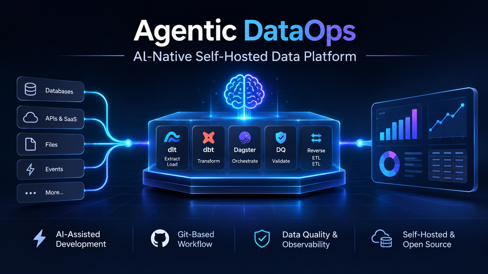

# adops — open-source, self-hosted ELT pipelines with an AI assistant

[](https://pypi.org/project/adops/)
[](https://pypi.org/project/adops/)
[](https://github.com/Basiliskin/agentic-data-ops/actions/workflows/ci.yml)
[](https://github.com/Basiliskin/agentic-data-ops/blob/main/LICENSE)



**adops** is an open-source **ELT / ETL tool** for data engineering that you run on your own
machines. It copies data from your app's Postgres database into a **data warehouse** (Postgres or
DuckDB), transforms it with **dbt**, runs **data quality checks** that stop bad data before it
spreads, and sends the results back into your app (**reverse ETL**). Pipelines are YAML files in
Git, scheduled by **Dagster**, promoted from dev to stage to prod through pull requests, and you can
build them by talking to your AI assistant (such as Claude Code, over **MCP**).

One `uv tool install adops` gives you the whole data pipeline: extract and load, transform, test,
schedule, deploy and reverse sync, already wired together. You don't have to connect a loader (such
as Airbyte), dbt, an orchestrator (such as Airflow) and a reverse-ETL service yourself.

> **Status: early (0.3).** Works end to end on the demo shop, in dev, stage and prod. Promotion
> through GitHub (pull request → stage → release → prod) is proven on real self-hosted runners.
> Starting your own Project from scratch is still thin (see [below](#start-your-own-project)).

## Why adops

- **The whole ELT pipeline in one tool.** Extract and load with [dlt](https://dlthub.com)
  (full refresh or incremental by cursor), transform with plain [dbt](https://www.getdbt.com)
  models, reverse ETL back into Postgres, and schedules on [Dagster](https://dagster.io).
- **Data quality checks built in.** Unique keys, not-null, accepted values, minimum row counts,
  freshness, no row loss, and a max-change guard on reverse sync. A failed check stops the run, so
  later steps never see bad data.
- **Schema change detection.** When a source table drops or changes a column (schema drift), adops
  stops before loading anything. You accept intended changes with one command, and that acceptance
  reaches stage and prod through Git.
- **CI/CD for data (DataOps).** Separate dev, stage and prod environments, plus a disposable
  **branch environment for every pull request** that rebuilds only the changed steps. Deploys rerun
  only what changed.
- **Self-hosted, secrets stay with you.** No hosted data service to sign up for: it runs on your
  machines, with GitHub only for pull requests and deploys. Warehouse passwords stay in each
  machine's `.env` and never go to GitHub or to the AI model.
- **An AI data engineering assistant that can't touch prod.** Claude Code (or any MCP client) builds
  and tests pipelines in dev. Changes reach stage and prod only through a reviewed pull request.
- **Postgres or DuckDB warehouse.** Use DuckDB for a local data warehouse in a single file, with no
  setup.

### Is it a fit?

**Good fit:** a small team or startup whose app runs on Postgres and wants an analytics warehouse,
dbt models and synced-back results, with tests and environments, without running a data platform.

**Not a fit yet:** you need many SaaS connectors (Sources are Postgres today), a Snowflake, BigQuery
or Redshift warehouse, or a managed cloud service.

## What you need

- **Docker**, running. [OrbStack](https://orbstack.dev) or Docker Desktop both work. The demo starts
  its databases in Docker.
- **[uv](https://docs.astral.sh/uv/)**, which installs adops and the Python it needs.
- Optional: **Claude Code** (or another assistant that speaks MCP) for the
  [assistant part](#now-try-it-with-your-assistant).

You don't need to know Git or Docker. Once you're set up, your assistant handles both for you.

## Install

```sh
uv tool install adops
adops --version
```

To install the latest code from GitHub instead: `uv tool install git+https://github.com/Basiliskin/agentic-data-ops`.

## Quickstart: the demo shop (about 10 minutes)

The demo is a small online shop: a `shop` database with 20 customers and 100 orders, and an empty
warehouse. One Pipeline, `shop_sync`, does three Steps:

1. **Sync**: copies `customers` and `orders` into the warehouse.
2. **Transform**: dbt models build `customer_stats` (orders and money spent per customer).
3. **Reverse Sync**: sends `customer_stats` back into the shop database.

### 1. Create the demo Project and start its databases

```sh
adops init --demo shop-demo
cd shop-demo
cp .env.example .env
docker compose up --wait
```

`adops init` also makes the folder a Git repository and saves the starting files in it, so later
your assistant can share each change on its own. (If Git isn't installed, it skips this and says
so; `--no-git` turns it off.)

> **Docker isn't running?** `docker compose` fails with an error about the Docker daemon.
> Open OrbStack or Docker Desktop, wait until it says it's running, and run the command again.

### 2. Run it

```sh
adops run --all
```

It prints a summary of every Step:

```text
step sync_shop: passed — customers 20 rows, orders 100 rows
  check customers primary_key_unique: pass
  check customers not_null(email): pass
  check orders no_row_loss: pass
  ...
step transform_shop: passed
step reverse_sync_customer_stats: passed
  check customer_stats max_change: pass
  ...
  Preview: would insert 20, would update 0, would delete 0
  sample insert keys: 1, 2, 3, 4, 5
Pipeline shop_sync passed in Environment dev.
```

Every Step runs **Checks**, fixed rules such as "no rows were lost" or "the key is unique". A
failed Check stops the run, so later Steps never see bad data.

The last Step shows a **Preview**: in dev, adops only *reports* what it would write back to the
shop. Only the `stage` and `prod` Environments really write.

### 3. Look at the result

```sh
docker compose exec warehouse psql -U warehouse -d warehouse \
  -c 'select * from analytics.customer_stats order by total_amount desc limit 3'
```

```text
 customer_id | order_count | total_amount |     last_order_at
-------------+-------------+--------------+------------------------
          13 |           5 |      1832.65 | 2026-02-01 15:30:00+00
           7 |           5 |      1722.35 | 2026-02-01 14:30:00+00
          12 |           5 |      1647.60 | 2026-02-01 15:20:00+00
```

### 4. Watch adops stop a breaking change

Pretend your app team adds a column to `customers` and later removes it again. Adding a column is
harmless:

```sh
docker compose exec shop psql -U shop -d shop -c 'ALTER TABLE customers ADD COLUMN phone text'
adops run shop_sync          # passes
```

Removing a column is a **Breaking Change**, because anything downstream that used it would break
silently. adops stops the run before loading anything:

```sh
docker compose exec shop psql -U shop -d shop -c 'ALTER TABLE customers DROP COLUMN phone'
adops run shop_sync
```

```text
step sync_shop: failed
  Step sync_shop: Breaking Change in customers: phone dropped
step transform_shop: skipped
step reverse_sync_customer_stats: skipped
Pipeline shop_sync failed in Environment dev.
```

If the change was intended, accept it:

```sh
adops accept-schema shop_sync customers
```

```text
Accepted the current shape of customers (3 columns, Step sync_shop) for Pipeline shop_sync in Environment dev.
These columns are no longer in the Source and may now be NULL in the Warehouse: phone
Wrote accepted-change record pipelines/accepted/<time>-shop_sync-customers.yaml (phone dropped). Commit it so stage and prod accept the change on their next run.
```

```sh
adops run shop_sync          # passes again
```

The record file is how stage and prod learn the change was intended: it reaches them through Git,
just like your code does.

### More to try

- **Make a Check fail.** Blank out one email (`UPDATE customers SET email = NULL WHERE id = 1` in
  the `shop` database) and run again. The `not_null(email)` Check fails with "1 rows with no value",
  and the later Steps are skipped. Put an email back to make it pass.
- **Use DuckDB as the warehouse.** `adops.yaml` has a commented-out block for each Environment
  that keeps the warehouse in a local file instead of Postgres.
- **Check your files without running anything:** `adops validate`.

## Now try it with your assistant

The demo Project already includes everything Claude Code needs: `.mcp.json` connects it to adops,
and six Skills in `.claude/skills/` teach it the workflows. Open Claude Code in `shop-demo/` and
ask:

> *Add a dbt model with the top 10 customers by total spent, and test it in dev.*

It writes a new model with tests (in our try, `dbt/models/top_customers.sql`), runs the
Pipeline in dev and tells you in plain words whether everything passed. It can't read Warehouse
tables itself, so look at the rows yourself, using the model name it reports:

```sh
docker compose exec warehouse psql -U warehouse -d warehouse \
  -c 'select * from analytics.top_customers'
```

The Assistant acts only in dev and in Branch Environments. Changes reach stage and prod only through
a reviewed pull request.

| Skill | What it does |
|---|---|
| `adops-setup` | First-time setup: checks Docker, free ports, `.env`, Git and the GitHub CLI, then starts the databases and tests the connections. |
| `adops-build` | Adds or changes a Pipeline (a new table, Steps, a Schedule) and its dbt models. |
| `adops-test-in-dev` | Runs a Pipeline in dev, previews what it would change and explains any failure. |
| `adops-breaking-change` | Accepts a Breaking Change in dev and opens the pull request that lets stage and prod accept it too. |
| `adops-share` | Puts a finished change on its own branch, opens a pull request and runs it in its Branch Environment. |
| `adops-promote` | After a merge: removes the Branch Environment and explains how the change moves to stage and prod. |

## Start your own Project

For now, **start from the demo**: run `adops init --demo my-project`, then replace the `shop`
Source in `adops.yaml`, the tables in `pipelines/shop_sync.yaml` and the models in `dbt/` with your
own (or ask your assistant to do it with `adops-build`). Plain `adops init` creates the settings
file, Docker setup, workflows, Skills and `.mcp.json`, but an empty `pipelines/` and no dbt project
yet. A full blank Project is planned.

Passwords never go in `adops.yaml`. Each `*_env` setting names a variable in `.env`, so your files
can be committed safely.

## Going further

- **Run stage and prod**: [Run stage and prod locally on a Mac](https://github.com/Basiliskin/agentic-data-ops/blob/main/docs/playbooks/run-stage-and-prod-on-a-mac.md)
- **Pull request → stage → prod through GitHub**: [Promotion](https://github.com/Basiliskin/agentic-data-ops/blob/main/docs/playbooks/promotion.md)
- **Check the quickstart and Assistant example still work**: [Try the Assistant on the demo](https://github.com/Basiliskin/agentic-data-ops/blob/main/docs/playbooks/try-the-assistant.md)
- **Why it's built this way**: [Architecture decisions](https://github.com/Basiliskin/agentic-data-ops/blob/main/docs/adr/)
- **What the words mean**: [Glossary](https://github.com/Basiliskin/agentic-data-ops/blob/main/GLOSSARY.md)

## How it works (for data engineers)

- **Pipelines** are YAML files in your own Git repo (the **Project**), compiled to
  [Dagster](https://dagster.io) jobs. The tool is a separate package, so upgrading is just a version bump.
- **Sync** uses [dlt](https://dlthub.com) for Verified Sources (full refresh, incremental by
  cursor); **Transform** is plain [dbt](https://www.getdbt.com); **Reverse Sync** writes a keyed
  Diff to an existing Postgres table, protected by a max-change guard.
- **Warehouse**: Postgres, or DuckDB for a no-setup file.
- **Environments**: dev, stage and prod are fully separate. **Branch Environments** build a pull
  request into `br_<branch>__*` schemas in stage's warehouse, rebuild only changed Steps and read
  stage's results for the rest.
- **Schedules** run on an always-on **Server** per Environment. Promotion runs on a self-hosted
  GitHub runner on that Server, so warehouse secrets stay in the machine's `.env` and never go to
  GitHub.
- **The Assistant** works through an MCP server (`adops mcp`). The AI proposes, plain code runs it,
  and secrets never reach the model.

## License

[Apache-2.0](https://github.com/Basiliskin/agentic-data-ops/blob/main/LICENSE)
