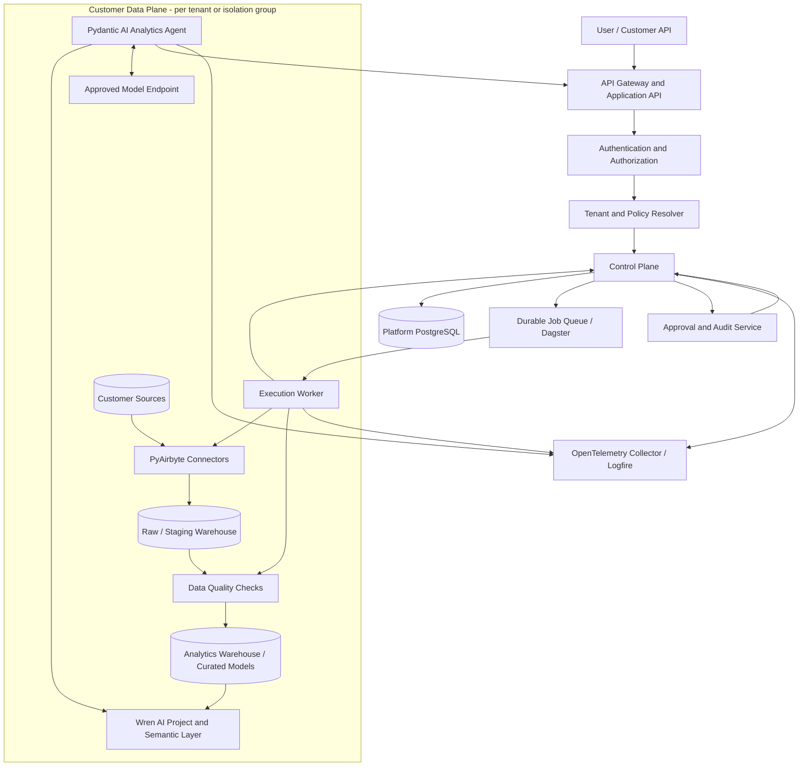

# Production Specification: Multi-Tenant Agentic DataOps Platform

**Document status:** Proposed production architecture  
**Version:** 2.0  
**Date:** 2026-11-16  
**Supersedes:** Open-Source Agentic DataOps Architecture: Assembling PyAirbyte, Pydantic AI, and WrenAI  
**Primary stack:** PyAirbyte · Wren AI · Pydantic AI · Dagster · PostgreSQL · OpenTelemetry / Pydantic Logfire  
**Audience:** Engineering, platform, data, security, and product teams

---

## 0. Executive summary

This specification describes a production-oriented, multi-tenant DataOps platform that onboards customer data sources, ingests data into an approved analytical warehouse, maintains a version-controlled semantic model, and exposes governed analytics through AI-assisted workflows.

The architecture deliberately separates **deterministic data execution** from **AI-assisted reasoning**:

- **PyAirbyte** provides source connectors and data movement primitives.
- **Dagster** owns orchestration, scheduling, retries, backfills, run history, and data-asset dependencies.
- **Wren AI** provides the semantic context layer: business models, relationships, calculated metrics, governed query planning, and query execution against an approved warehouse.
- **Pydantic AI** provides typed agent orchestration for tasks that benefit from reasoning, such as schema-mapping proposals, semantic-context enrichment, analytical question interpretation, and incident investigation.
- **PostgreSQL** stores platform metadata, tenant configuration references, workflow state, approvals, and audit records. It is not the default analytical warehouse.
- **OpenTelemetry / Pydantic Logfire** provide traces and operational telemetry, with strict content-redaction controls.

The platform must not depend on an LLM to provide correctness, security, exactly-once processing, tenant isolation, or workflow durability. Those properties are enforced by normal application code, database permissions, orchestration, state management, and deployment boundaries.

### Architectural principles

1. **AI proposes; deterministic code validates and executes.**
2. **Tenant identity comes from authenticated server-side context, never from model-generated arguments.**
3. **Secrets and unrestricted source connection details are never exposed to the model.**
4. **Raw data stays in the approved customer data boundary.** Model and telemetry boundaries are explicit and configurable.
5. **At-least-once execution is assumed.** Destination writes and job transitions must be idempotent or safely repeatable.
6. **Semantic definitions are governed software artifacts.** AI-generated changes require validation, review, and approval before production deployment.
7. **A successful SQL plan is not proof of correct business meaning.** Metric definitions and analytical outputs require tests and ownership.
8. **Every production action is attributable.** Runs, queries, approvals, model calls, configuration versions, and deployments are auditable.

### Readiness statement

This is a target architecture and implementation contract, not a claim that combining the named libraries automatically produces a production service. The team must pin compatible dependency versions, validate connector behavior, perform security and load testing, and satisfy the release gates in this document before onboarding production customers.

---

## 1. Goals, scope, and non-goals

### 1.1 Goals

The platform shall:

- Onboard multiple customer organizations with independent credentials, data sources, warehouses, semantic projects, and access policies.
- Support relational databases, selected NoSQL sources, approved SaaS APIs, and file-based sources through an allowlisted connector catalog.
- Execute scheduled, manual, and event-triggered data syncs.
- Support full refreshes, incremental syncs, controlled backfills, and recovery from interrupted runs.
- Land source data in a raw/staging layer with enough metadata to trace a record set to its source and sync run.
- Run deterministic data quality checks before data is considered analytics-ready.
- Maintain Wren projects and MDL in Git with dev/staging/prod promotion.
- Provide natural-language analytical access through Wren's semantic layer and Pydantic AI.
- Enforce read-only query permissions, query limits, tenant policies, and result minimization.
- Produce useful operational telemetry without leaking credentials, PII, raw records, or sensitive prompts by default.
- Support controlled AI-assisted remediation, with human approval for semantic or data-contract changes.

### 1.2 Non-goals for the initial release

The following are not part of the MVP unless explicitly approved through an architecture decision record (ADR):

- A general-purpose LLM agent with unrestricted shell, SQL, network, or infrastructure access.
- Automatic production modification of customer schemas, business metrics, or MDL definitions.
- Arbitrary user-supplied Python, SQL, Docker images, or connector code.
- A universal reverse-ETL platform that writes into customer operational systems.
- Replacing the customer's source-of-record database or BI governance process.
- Guaranteeing exactly-once processing across arbitrary external connectors and warehouses.
- A claim that customer data never leaves its environment when an external model provider or telemetry service receives any derived content.
- Automatic support for every connector, warehouse, region, and regulatory regime.

### 1.3 Initial supported deployment profiles

**Profile A — Customer-VPC data plane (recommended for enterprise):**

- The platform control plane may be centrally hosted or customer-hosted.
- A customer-side execution plane runs source connectors, ingestion workers, warehouse access, Wren project runtime, and optionally the model endpoint.
- The customer-side worker establishes outbound mTLS communication to the control plane; the control plane does not require inbound access to customer databases.
- Only explicitly approved metadata and task results may cross the customer boundary.

**Profile B — Fully customer-hosted:**

- Control plane, data plane, warehouse, Wren services, model endpoint, and telemetry backend run inside the customer's approved environment.
- This is the strongest option for strict data residency or network isolation, but carries higher deployment and support overhead.

A shared SaaS data plane that directly connects to all customers' production databases is not the default architecture.

---

## 2. System context and high-level architecture

### 2.1 Logical architecture



The diagram is logical. Individual customer environments can deploy more than one worker, and the orchestration service may be colocated with the customer data plane for a fully private deployment.

### 2.2 Plane separation

| Plane | Responsibilities | Must not own |
|---|---|---|
| Control plane | Tenant lifecycle, authentication, policy resolution, job submission, approvals, deployment metadata, audit | Direct unrestricted access to customer source data |
| Data execution plane | Source reads, destination writes, data validation, warehouse access, Wren query execution | Tenant identity decisions based on model output |
| Agent reasoning plane | Interpret user intent, request semantic context, explain approved results, propose changes | Secret retrieval, arbitrary SQL execution, unrestricted ingestion, direct infrastructure mutation |
| Observability plane | Metrics, traces, sanitized logs, alerts, audit references | Raw PII, credentials, unredacted record payloads by default |

### 2.3 Component responsibilities

| Component | Primary responsibility | Design constraints |
|---|---|---|
| PyAirbyte | Connector-based extraction and supported destination/cache writes | Pin connector versions; allowlist streams; explicitly configure destination/cache and state behavior; do not infer commit metrics |
| Dagster | Sync orchestration, schedules, sensors, retries, backfills, run metadata, asset dependencies | Own pipeline lifecycle; enforce concurrency and tenant quotas; do not put model reasoning in the critical sync path |
| Wren AI | MDL semantic context and governed analytics query workflow | One project/profile per isolation boundary; project files in Git; use database-side privileges as the final security boundary |
| Wren Pydantic toolkit | Attach a prepared Wren project as a Pydantic AI toolset | Requires a Wren CLI-prepared project; resolve tenant project and profile server-side |
| Pydantic AI | Typed agent loop, dependency injection, tool calling, constrained outputs, approvals/deferred execution | Only expose scoped tools; model output is untrusted; cap retries, tokens, spend, and runtime |
| PostgreSQL | Control-plane metadata and durable platform state | Enforce tenant scoping, transactions, uniqueness constraints, migrations, backups |
| Warehouse | Raw/staging/curated analytical data | Dedicated read/write roles, query timeout/resource governor, tenant isolation, backups and encryption |
| OpenTelemetry / Logfire | End-to-end traces and metrics | Disable or redact content capture; separate audit logs from diagnostic traces |
| Secret manager | Source and destination secrets | Secrets are referenced by ID; short-lived retrieval; no plaintext in DB, Git, prompts, logs, or job payloads |

---

## 3. Tenant model and isolation requirements

Tenant isolation is a security property of the platform, not a convention in application code.

### 3.1 Tenant identity

- Every request must be authenticated before tenant resolution.
- The authenticated principal maps to an authorized tenant and role in the control plane.
- The tenant ID is injected into server-side request context and all repository/service calls.
- A model may not select, change, or override `tenant_id`, `client_id`, connection ID, secret reference, Wren project path, warehouse role, or database connection.
- Every job, query, approval, artifact, secret reference, and audit event must be tenant-scoped.
- Database queries against platform metadata must include tenant scoping and enforce it with row-level security or equivalent repository-level controls. Prefer both where feasible.

### 3.2 Recommended isolation tiers

**Tier 1 — Dedicated data plane (default for regulated or high-value customers):**

- Dedicated customer execution namespace or worker pool.
- Dedicated warehouse database/schema and non-shared credentials.
- Dedicated Wren project and connection profile.
- Tenant-specific secret namespace and encryption context.
- Tenant-specific object-storage prefix/bucket policy for temporary artifacts.
- Per-tenant queue concurrency and network egress policy.
- Dedicated model endpoint when required by contract or data classification.

**Tier 2 — Shared compute with hard data isolation (only after security validation):**

- Shared stateless API and worker fleet.
- Tenant-specific source credentials and warehouse roles.
- Database-native RLS or isolated schemas/databases, with connection-pool session context reset on every checkout and check-in.
- Wren project/session isolation using a supported mechanism for the exact Wren edition and version.
- No reliance on a prompt instruction or semantic model filter as the only tenant security control.
- Automated cross-tenant isolation tests are mandatory.

**Tier 3 — Fully shared data tables protected by RLS:**

Use only if the warehouse's RLS behavior, Wren integration, connection pooling, and session-property propagation have been verified end-to-end. Wren documentation describes project-based and RLS-based multi-tenancy patterns for its supported deployments; confirm which features are available in the selected OSS/commercial edition before selecting this tier.

### 3.3 Wren isolation strategy

- Use a dedicated Wren project for tenants requiring strong separation or tenant-specific semantic models.
- For tenants sharing a schema, consider RLS only when the chosen Wren edition and warehouse provide reliable policy enforcement at query time.
- Store project definitions and non-secret connection profile references in tenant-scoped deployment metadata.
- Keep credentials in the external secret manager; never commit profile files containing passwords.
- Never use a process-global “active tenant profile” in a shared worker. Resolve a tenant-scoped project/profile per run and avoid mutable global state.

### 3.4 Isolation acceptance tests

The release pipeline must prove that:

- Tenant A cannot enumerate Tenant B's jobs, sources, projects, query history, metrics, or artifacts.
- Tenant A cannot pass Tenant B's resource IDs and access the resource.
- A malformed or missing tenant context fails closed.
- Connection-pool reuse cannot preserve a previous tenant's session variables or database role.
- A worker restart, retry, or replay cannot switch tenant context.
- A model-generated tool argument cannot influence the tenant boundary.

---

## 4. Data classification, privacy, and model boundary

### 4.1 Data classes

| Classification | Examples | Default handling |
|---|---|---|
| Secret | DB password, API token, private key | Secret manager only; never send to model or telemetry |
| Restricted / PII | Email, phone, national ID, financial account identifiers | Stay inside approved data plane; redact/tokenize before any permitted external processing |
| Confidential business data | Revenue, customer lists, contracts, detailed usage records | Minimize and aggregate; external model access only under explicit tenant policy and provider contract |
| Schema metadata | Table/column names, types, relationships | May be exposed only according to tenant policy; names may themselves be sensitive |
| Approved aggregates | Thresholded counts, trends, approved KPI values | May be sent to an external model only when policy permits |
| Operational metadata | Run ID, duration, status, connector version | May be sent to central observability after pseudonymization and minimization |

### 4.2 Two explicit LLM modes

**Private-model mode:**

- Model endpoint runs inside the customer-controlled boundary or an explicitly approved private network.
- Raw query results may be provided to the model only if the customer's policy allows it.
- Network egress is restricted to approved endpoints.

**External-provider mode:**

- No claim of “raw data never leaves the VPC” may be made unless the actual content flow supports it.
- The application sends only minimized prompts, approved schema context, redacted values, or aggregated query results.
- Provider retention, training usage, region, subprocessors, and contractual controls must be reviewed.
- PII is excluded by default. Any exception requires explicit tenant policy and legal/security approval.
- Model request/response content capture in Logfire or OTel is disabled or redacted.

### 4.3 Query-result minimization

Before a result reaches an external model:

- Enforce maximum row count, column count, payload size, and value length.
- Mask or remove restricted columns.
- Prefer aggregates over individual records.
- Apply minimum cohort thresholds where small groups could reveal individuals.
- Truncate large text fields and exclude raw blobs.
- Attach data classification and permitted-use metadata to the tool result.
- Record the policy decision, not the sensitive values, in the audit log.

### 4.4 Connector isolation and egress

- Run connectors in isolated containers or worker sandboxes with non-root users, read-only base filesystem where possible, bounded CPU/memory/time, and no privileged Docker socket.
- Apply outbound network allowlists. REST connectors must not be allowed to reach cloud metadata endpoints, loopback services, internal control-plane addresses, or arbitrary private networks unless explicitly configured.
- Validate source hostnames and resolved IPs to mitigate SSRF and DNS-rebinding paths.
- Do not let the model construct arbitrary connector config. A human/admin selects an allowlisted connector and a validated configuration schema.

---

## 5. Control-plane data model

PostgreSQL is the system of record for orchestration metadata and tenant configuration references. Raw data and analytical datasets belong in the customer warehouse or approved object storage.

### 5.1 Core entities

| Entity | Key fields | Notes |
|---|---|---|
| `tenants` | `id`, `status`, `isolation_tier`, `region`, `created_at` | Tenant root |
| `tenant_memberships` | `tenant_id`, `principal_id`, `role` | Authorization mapping |
| `source_connections` | `id`, `tenant_id`, `connector_name`, `connector_version`, `secret_ref`, `config_schema_version`, `status` | Never store plaintext credentials |
| `destination_connections` | `id`, `tenant_id`, `destination_type`, `secret_ref`, `namespace`, `status` | Destination configuration reference |
| `sync_definitions` | `id`, `tenant_id`, `source_connection_id`, `destination_connection_id`, `stream_allowlist`, `sync_policy`, `schedule`, `config_version` | Declarative pipeline definition |
| `sync_runs` | `id`, `tenant_id`, `sync_definition_id`, `idempotency_key`, `status`, `started_at`, `finished_at`, `error_code`, `connector_version` | Durable run state |
| `data_assets` | `id`, `tenant_id`, `logical_name`, `physical_location`, `schema_fingerprint`, `freshness_sla`, `classification` | Maps logical assets to warehouse datasets |
| `quality_results` | `id`, `tenant_id`, `sync_run_id`, `asset_id`, `check_name`, `status`, `metrics_json`, `observed_at` | No raw row payloads by default |
| `semantic_projects` | `id`, `tenant_id`, `repo_ref`, `commit_sha`, `wren_project_ref`, `profile_ref`, `environment`, `status` | Versioned project deployment |
| `agent_runs` | `id`, `tenant_id`, `principal_id`, `conversation_ref`, `model_id`, `prompt_version`, `status`, `started_at`, `finished_at` | Conversation storage must be protected/redacted |
| `approvals` | `id`, `tenant_id`, `requested_by`, `action_type`, `resource_ref`, `payload_hash`, `status`, `approved_by`, `expires_at` | Append-only decision history |
| `audit_events` | `id`, `tenant_id`, `actor_id`, `action`, `resource_type`, `resource_id`, `correlation_id`, `policy_decision`, `created_at` | Tamper-evident retention/export |

### 5.2 Run state machine

A sync run should use explicit state transitions:

```text
QUEUED -> VALIDATING -> RUNNING -> WRITING -> QUALITY_CHECKING -> SUCCEEDED
                 |          |           |               |
                 +----------+-----------+---------------+--> RETRY_WAIT
                 +------------------------------------------> FAILED
                 +------------------------------------------> CANCELLED
                 +------------------------------------------> NEEDS_APPROVAL
```

Rules:

- State transitions are performed transactionally and validated against the state machine.
- A worker claims a job with a lease/heartbeat. Expired leases are recoverable.
- Retries use the same logical idempotency key but a distinct attempt number.
- A job is not marked `SUCCEEDED` until destination write completion and required quality gates succeed.
- Partial success must be represented explicitly. Do not report a full sync as successful if only some streams completed.
- Cancellation is cooperative and must leave a recoverable checkpoint or an explicit state that requires a safe restart.

### 5.3 Idempotency

Create a stable idempotency key from:

`tenant_id + sync_definition_id + source_cursor/window + destination + config_version + requested_run_type`

The key must be generated server-side. Enforce a database uniqueness constraint for active or completed logical runs where duplicate submission is not intended. Do not rely only on queue de-duplication.

---

## 6. Ingestion and data execution design

### 6.1 Ingestion workflow

1. Resolve tenant, source connection, destination, policy, and approved stream list from server-side metadata.
2. Fetch source and destination credentials from the secret manager at execution time.
3. Validate the connector name/version and config against the connector's supported schema.
4. Check source connectivity and permissions.
5. Verify the configured destination, namespace, and write strategy.
6. Start the sync with an idempotency key and bounded resource allocation.
7. Execute extraction and destination write through the PyAirbyte adapter.
8. Persist or confirm connector-managed state/checkpoints according to the pinned connector and destination behavior.
9. Run schema and data-quality checks.
10. Publish lineage/run metadata and update freshness status.
11. Mark the run successful only after all required gates pass.
12. On failure, classify it, preserve sanitized diagnostics, and apply a bounded retry or operator escalation.

### 6.2 PyAirbyte destination/cache distinction

The original implementation used `ab.get_default_cache()` and `source.read(cache=cache)`. PyAirbyte uses a local DuckDB cache by default when no cache is specified. That is not equivalent to writing to the warehouse URI stored in an application constructor.

Two supported patterns must be distinguished:

**Pattern A — Write to an Airbyte destination connector:**

```python
import airbyte as ab

source = ab.get_source(
    "source-postgres",
    config=resolved_source_config,
)
source.check()

destination = ab.get_destination(
    "destination-postgres",  # Example only; use the selected supported connector.
    config=resolved_destination_config,
    docker_image=True,        # Many destination connectors are Docker-based.
)

write_result = destination.write(
    source,
    streams=approved_stream_names,
    # Set write_strategy and force_full_refresh explicitly through
    # the version-pinned adapter after connector-specific testing.
)
```

**Pattern B — Write to a PyAirbyte SQL cache:**

- Configure the cache implementation to point to the intended SQL warehouse/cache (for example, a supported Postgres, Snowflake, BigQuery, DuckDB, or other cache backend).
- Pass that explicit cache to `source.read(cache=...)`.
- Persist and verify state using the supported cache behavior.
- Do not use the implicit local default cache for production unless local DuckDB is intentionally the actual destination.

The production adapter must use one explicitly selected pattern per connector/destination combination. The selected pattern, connector version, cache/destination version, write strategy, and state behavior must be covered by integration tests.

### 6.3 PyAirbyte adapter contract

Implement a project-owned interface so the rest of the platform does not depend directly on volatile connector details:

```python
from dataclasses import dataclass
from typing import Protocol, Sequence

@dataclass(frozen=True)
class SyncRequest:
    tenant_id: str                 # Set by trusted server code, never by the model
    sync_definition_id: str
    source_connector: str
    source_config: dict            # Resolved from validated config + secret refs
    destination_connector: str
    destination_config: dict       # Resolved at execution time
    streams: Sequence[str]         # Explicit allowlist; never implicitly all
    write_strategy: str            # Connector/destination-specific allowlist
    force_full_refresh: bool
    idempotency_key: str

@dataclass(frozen=True)
class SyncOutcome:
    status: str                    # succeeded | failed | partial
    started_at: str
    finished_at: str
    connector_version: str
    streams_completed: list[str]
    streams_failed: list[str]
    records_read: int | None        # None when connector does not provide a reliable value
    records_written: int | None     # None when destination does not provide a reliable value
    bytes_written: int | None       # Never estimate and label as measured
    state_reference: str | None     # Opaque reference; never log raw state payloads
    sanitized_error_code: str | None

class IngestionAdapter(Protocol):
    def run(self, request: SyncRequest) -> SyncOutcome: ...
```

Implementation notes:

- Validate source configuration using the selected connector's schema; do not accept arbitrary dictionaries from an agent or end user without validation.
- Explicitly allowlist streams. Avoid `select_all_streams()` as a default production behavior.
- Never estimate bytes as `records * constant`. Use measured connector/destination metrics or report `null`/unknown.
- Do not set `records_written = records_read` unless the destination confirms the write result.
- Do not update state/cursors manually unless the connector protocol explicitly requires it. Prefer connector/destination checkpoint behavior and test its crash semantics.
- Keep raw connector exceptions internal; map them to sanitized, actionable error codes.
- Use bounded timeouts and cancellation. Ensure the worker can terminate orphaned connector subprocesses.

### 6.4 Incremental sync and checkpoint correctness

The platform assumes **at-least-once execution**. Connectors and destinations may retry or replay records. The platform must achieve effective idempotency through destination semantics and state handling.

Requirements:

- Use stable primary keys and destination merge/upsert semantics where supported.
- Use source cursor/state support only where the connector supports it; otherwise use a documented full-refresh or watermark strategy.
- Define timestamp timezone, precision, tie-breaking key, late-arriving data window, and deletion behavior for every incremental stream.
- Prefer CDC where source/connector support and customer permissions make it appropriate.
- Store source state only through supported connector/cache/destination mechanisms; state blobs are opaque and versioned by connector compatibility.
- Test process crash before write, during write, after destination commit but before job acknowledgement, and during state persistence.
- If the destination cannot provide safe merge semantics, use a staging table plus deterministic deduplication and atomic publish/swap strategy.
- Treat deletes explicitly: hard delete, soft delete, tombstone, or unsupported. Never silently assume append-only data.

**Exactly-once is not promised.** The product promises documented replay and deduplication behavior for each supported source/destination pair.

### 6.5 Raw, staging, and curated layers

Recommended logical layers:

- `raw`: connector-shaped source data, minimally transformed, includes source metadata and sync identifiers.
- `staging`: type normalization, deduplication, standard timestamps, source key handling.
- `curated`: governed facts, dimensions, business entities, and analytics-ready tables.

Use schema/database isolation by tenant where required. Raw records should carry provenance such as source connection, source stream, extracted/loaded timestamp, and sync run ID where the connector/destination makes this possible.

Do not let the analytics agent query arbitrary raw schemas by default. Wren should expose approved curated or explicitly classified views.

### 6.6 Data quality and contracts

Every production dataset must define a minimum contract:

- Expected schema and compatible schema-evolution rules.
- Primary/business key and uniqueness expectations.
- Nullability and required columns.
- Freshness objective and maximum acceptable lag.
- Row-count or volume anomaly bounds where meaningful.
- Referential integrity or accepted orphan behavior.
- PII classification and allowed downstream use.
- Deletion and late-arrival semantics.
- Owner and escalation channel.

Quality gates should be deterministic code/tests (for example, SQL assertions, dbt tests, Soda, or equivalent). An LLM may help propose a check, but a human-reviewed contract must govern production.

On failed checks:

- Mark the affected asset as degraded/quarantined, not fresh.
- Do not silently publish it as analytics-ready.
- Preserve safe evidence such as failed check name and aggregate metrics.
- Allow policy-defined partial acceptance only for explicitly non-critical checks.

### 6.7 Schema drift policy

Classify changes:

| Change | Default handling |
|---|---|
| Add nullable column | Accept only if contract marks it backward-compatible; alert and update candidate schema |
| Add required/non-null column | Block or quarantine until mapping/default is approved |
| Rename/drop column | Breaking change; block dependent assets and create remediation proposal |
| Type narrowing or incompatible type change | Block and require review/migration |
| Primary key/cursor change | Block incremental sync until state migration/backfill plan is approved |
| Semantic meaning changed without physical schema change | Treat as business-definition change; require owner approval |

AI can generate a diff, explain impact, and open a pull request. It must not commit directly to a protected production branch or deploy a new business definition without approval.

---

## 7. Orchestration and operational workflows

### 7.1 Dagster as the reference orchestrator

Dagster is the recommended default for this design because the platform models sources, warehouse tables, quality checks, and semantic refreshes as related data assets. Use Dagster assets/jobs, schedules, sensors, partitions, and backfills to coordinate the data lifecycle.

Airflow is a valid alternative when it is already the organization's standard. Do not deploy both in the first release unless there is a concrete operational requirement.

Dagster owns:

- Scheduled and event-triggered syncs.
- Bounded retries and retry classification.
- Concurrency limits per tenant, source, and destination.
- Backfills and reprocessing.
- Dependency ordering between ingestion, data validation, curated transforms, and semantic-model refresh.
- Run history and data-asset observability.

Dagster does not make an individual connector transactional. Destination idempotency and state behavior remain the responsibility of the ingestion adapter and connector/destination pair.

### 7.2 Retry policy

| Failure type | Retry behavior |
|---|---|
| Network timeout / transient 5xx | Retry with exponential backoff and jitter; bounded attempts |
| Rate limit | Honor `Retry-After` where present; apply source-level concurrency limits |
| Authentication/permission error | Do not retry blindly; mark blocked and request credential/permission repair |
| Invalid connector config | No automatic retry; return actionable validation error |
| Schema contract violation | Quarantine/block; open incident or approval request |
| Destination capacity/warehouse throttling | Retry only within budget and deadline; reduce concurrency if needed |
| Data-quality failure | Do not blindly rerun extraction; classify whether upstream data or contract needs correction |
| Agent/model provider failure | Retry at agent step boundary only when safe; do not replay a completed external side effect without reconciliation |

Every retry policy needs a maximum elapsed time and total attempt budget. A retry loop must not continue indefinitely.

### 7.3 Backfills and replay

- Backfill must be an explicit operation with date/window, stream, and destination scope.
- Backfills must have separate concurrency and cost limits.
- Destination write mode must be selected for replay safety.
- A backfill must not overwrite newer data unless that outcome is intentional and tested.
- Record who initiated the backfill, why, the source window, the semantic/data-contract version, and the resulting asset versions.

### 7.4 Ingestion onboarding workflow

1. Admin creates tenant and chooses isolation/deployment tier.
2. Admin selects an allowlisted source connector and destination type.
3. A credential is written to the customer's secret manager; platform stores only a secret reference.
4. Admin selects the exact streams and required sync mode.
5. Connection validation runs in a sandboxed worker.
6. A discovery sync samples schema/metadata according to data-classification rules; no unbounded full extract during discovery.
7. Platform produces a schema profile and data-contract draft.
8. Data owner approves streams, classifications, keys, and sync policy.
9. First full/incremental sync runs with monitored resource limits.
10. Data quality checks execute and raw/staging assets are registered.
11. Candidate Wren project is generated/enriched and validated.
12. Semantic owner approves the candidate project for staging.
13. Staging query suite passes, then the project is promoted to production.

### 7.5 Analytics workflow

1. Authenticate the user and resolve tenant, role, and data policy.
2. Build a tenant-scoped analytics context and resolve the correct Wren project/profile.
3. Invoke the analytics agent with only the approved Wren toolset and a typed output contract.
4. The agent follows the Wren context workflow: retrieve relevant semantic context, construct a question-specific query, validate/plan it, execute through the governed semantic layer, and interpret the result.
5. The query gateway/database role enforces read-only access, timeouts, limits, RLS/schema access, and allowed objects.
6. Result minimization and classification checks run before results are passed to an external model.
7. Output includes the answer, caveats, query/run reference, semantic model version, and data freshness.
8. Query metadata and policy decisions are audited; prompt/result content is not captured by default.

An analytics request must not trigger data ingestion unless a separate policy explicitly allows a freshness refresh workflow. If a refresh is needed, the API submits a separate deterministic sync job and the user receives its status.

---

## 8. Semantic layer and Wren AI governance

### 8.1 Wren project lifecycle

A Wren project is the version-controlled unit of semantic-model authoring, validation, building, and deployment.

Use the Wren CLI-supported lifecycle for the pinned Wren version:

```bash
wren context init
wren context validate
wren context build
wren context set-profile <profile>
wren memory index  # if the selected workflow uses Wren memory
```

The current documented project layout includes a project manifest, model/view definitions, relationships, and knowledge/context files. Do not assume older layouts such as a universal `models.yml` / `queries.yml` structure. Generate the project using the pinned CLI, commit the supported source files, and treat generated build output/runtime state as defined by the tool's version-specific guidance.

### 8.2 Git workflow

Each tenant (or approved tenant group) has a project repository or isolated repository path containing:

- Wren project manifest and schema version.
- Models, views, relationships, and calculated fields.
- Business descriptions and knowledge/context files.
- Approved examples and query guidance.
- Golden query tests and expected semantic behavior.
- Data classification and access metadata where supported.
- Deployment metadata that contains references, not credentials.

Promotion process:

`feature branch -> CI validation -> reviewer approval -> staging build -> golden-query tests -> production approval -> production build/deploy`

Do not store secrets in project repositories. Use environment-specific secret references or profile resolution outside Git.

### 8.3 Semantic governance rules

- Every KPI has a named business owner, description, formula, grain, time basis, currency/unit, inclusion/exclusion rules, and test cases.
- Relationships specify intended join keys and cardinality; unexpected many-to-many joins must be explicitly modeled.
- Time semantics must specify timezone, calendar/fiscal period, and handling of late-arriving facts.
- Metrics with materially different definitions must have distinct names and documentation.
- Semantic model version and Git commit SHA are attached to analytical results.
- Breaking semantic changes require a migration plan and approval.
- SQL dry-plan validation catches certain syntax/model/relationship issues but does not prove that the metric is factually or commercially correct.

### 8.4 Safe semantic change proposals

The agent may:

- Suggest a new model, field description, relationship, metric, or example query.
- Generate a candidate patch in a feature branch.
- Run schema/MDL validation and a bounded golden-query suite in an isolated environment.
- Produce a change summary and impact report.

The agent may not:

- Push directly to the protected production branch.
- Change access policies, tenant isolation, or secret references.
- Automatically redefine a financial/regulated KPI.
- Deploy a model change without required human approval.

### 8.5 Wren tenant isolation

Use dedicated projects for strict isolation and tenant-specific semantic models. If using RLS/session properties for shared projects, validate the feature availability in the chosen Wren edition, verify session propagation, and enforce the same policy in the warehouse. Wren's project/RLS capabilities should complement—not replace—warehouse permissions and application authorization.

---

## 9. Pydantic AI design and tool permissions

### 9.1 Agent boundaries

Use distinct agents or agent configurations for distinct use cases. Do not give one all-powerful agent both ingestion and analytical permissions.

**Analytics agent:**

- Read-only access to the approved Wren toolset.
- No credential retrieval, connector configuration, write SQL, shell, filesystem, or unrestricted network tool.
- Tenant and user context injected through trusted dependencies.
- Bounded model requests, tool calls, result sizes, runtime, and spend.

**Onboarding assistant:**

- Read-only discovery tools and schema profiling in a sandbox.
- May draft connector/stream/data-contract configuration.
- No production sync until deterministic validation and an authorized human approves the configuration.

**Semantic maintenance assistant:**

- Read-only inspection of schemas and current MDL.
- Can create proposed repository changes in an isolated branch.
- Cannot merge or deploy.

**Incident investigation assistant:**

- Read-only access to sanitized run metadata, quality results, and logs.
- Can recommend a retry, backfill, or schema fix; execution remains in deterministic runbooks or approval-gated tools.

### 9.2 Tenant-scoped dependency injection

```python
from dataclasses import dataclass

@dataclass(frozen=True)
class AnalyticsDependencies:
    tenant_id: str                 # Derived from authenticated server context
    principal_id: str
    tenant_policy: object          # Immutable, validated policy snapshot
    wren_project_path: str         # Resolved server-side; never model-controlled
    wren_profile_name: str        # Resolved server-side
    request_id: str
    result_policy: object          # Row/column/size/redaction limits
```

Dependencies must be immutable per run. Do not keep a mutable “current tenant” on a singleton agent or shared client. Build or resolve a tenant-scoped toolkit safely for each run/project boundary.

### 9.3 Wren Pydantic toolkit integration

The current documented integration uses `wren-pydantic` and a Wren CLI-prepared project:

```python
from pydantic_ai import Agent
from wren_pydantic import WrenToolkit

# `project_path` and `profile_name` are resolved by trusted application code.
toolkit = WrenToolkit.from_project(
    project_path,
    profile=profile_name,
)

analytics_agent = Agent(
    model_configured_by_deployment,
    instructions=toolkit.instructions(),
    toolsets=[toolkit.toolset()],
    output_type=AnalyticsAnswer,
)
```

This is an integration sketch, not a complete service. The actual package versions, model provider, toolset filtering/wrapping, async execution, and error handling must be pinned and integration-tested. The Wren CLI preparation step (profile + MDL + optional memory index) is a prerequisite; `WrenToolkit.from_project()` is not a substitute for project initialization.

### 9.4 Typed output contract

Use a schema that represents provenance and caveats instead of asking the model to invent a numeric confidence score:

```python
from pydantic import BaseModel, Field

class QueryProvenance(BaseModel):
    query_reference: str
    semantic_project_version: str
    data_as_of: str | None = None
    row_count: int = Field(ge=0)

class AnalyticsAnswer(BaseModel):
    answer: str
    key_findings: list[str]
    caveats: list[str]
    provenance: QueryProvenance | None = None
    requires_human_review: bool = False
```

The application, not the model, must populate authoritative tenant, principal, policy, query, and model-version metadata wherever possible. Structured output validation does not establish analytical truth; golden tests and provenance checks are required.

### 9.5 Tool safety

Every tool invocation must be checked in deterministic code for:

- Authenticated principal and tenant authorization.
- Resource ownership and tenant scope.
- Tool-level permission and operation type.
- Validated arguments and allowed resource IDs.
- Rate limits, query limits, data classification, and spend budgets.
- Idempotency for any side effect.
- Approval requirement for sensitive operations.

A human approval UI is not itself an authorization boundary. The server must authenticate the approver and independently verify that the approver is allowed to authorize the requested operation. Never trust client-submitted message history or a model-generated “approved” flag.

### 9.6 Approval-gated operations

Require human approval for:

- First production connection to a source or destination.
- Full refresh or potentially destructive overwrite.
- Expanding the stream allowlist or changing an incremental cursor.
- Changing PII classification or external model eligibility.
- Deploying semantic model changes.
- Increasing query limits or resource budgets beyond normal policy.
- Running high-cost backfills or replaying production data.

Approvals must be tied to a server-generated action hash, resource/version, requester, approver, expiry, and exact arguments. If the arguments change after approval, the approval is invalidated.

### 9.7 Durable agent runs

- Store run/conversation references securely and tenant-scoped.
- For long-lived approvals, use Pydantic AI's deferred tool/approval flow or a durable execution engine supported by the pinned version.
- Do not keep a web request open while waiting for human approval.
- Persist run status and resume correlation in the application database.
- Make every external side effect independently idempotent; durable model/tool execution alone does not make a third-party side effect exactly-once.

---

## 10. Analytics query security and correctness

### 10.1 Database permissions are the final enforcement layer

- Wren's warehouse role for analytics is read-only.
- It must not have DDL, DML, ownership, schema modification, or administrative permissions.
- It can access only approved semantic source schemas/views.
- Use database-native RLS/schema isolation as required.
- Query execution is subject to warehouse statement timeout, memory/compute limits, result-size limits, and per-tenant quotas.
- Deny multi-statement execution and dangerous functions where supported.

### 10.2 Query controls

At minimum:

- Maximum execution time per query.
- Maximum returned rows and bytes.
- Maximum columns and string lengths.
- Per-user and per-tenant request rate limits.
- Per-tenant concurrent-query limits.
- Query cancellation on client cancellation/timeout.
- Query-cost or warehouse-credit budget where supported.
- Allowlist of databases/schemas/views.
- Audit metadata for normalized SQL hash, query reference, semantic project version, and execution duration. Store full SQL only where permitted and protect it as potentially sensitive.

Dry-plan validation is useful but insufficient as a security boundary. Use database privileges and policy checks even when the query passed Wren validation.

### 10.3 Analytical correctness

- Maintain golden questions and expected result assertions for critical metrics.
- Test time boundaries, timezone, fiscal calendar, null handling, duplicates, join cardinality, refunds/reversals, and late-arriving data.
- Compare selected high-value metrics with independently calculated reference queries or trusted reports.
- Record metric definition version and data freshness on responses.
- Return “insufficient data” or an explicit caveat when freshness/quality gates fail; do not guess.
- Separate model-generated narrative from deterministic numeric values. Prefer application-formatted values sourced from query results.

---

## 11. Observability, audit, and incident management

### 11.1 Telemetry design

Use OpenTelemetry for traces and metrics across API requests, queue submission, Dagster runs, connector execution, warehouse queries, Wren operations, model requests, and tool calls. Pydantic Logfire may be used as an OTel-compatible backend.

Every request/job should carry:

- `request_id`
- `correlation_id`
- `sync_run_id` or `agent_run_id`
- pseudonymous `tenant_ref`
- `principal_ref` where appropriate
- connector/destination/Wren/model version identifiers
- deployment/environment identifier

Do not put high-cardinality tenant IDs into metric labels by default. Use pseudonymous identifiers in traces/logs and keep cardinality controlled.

### 11.2 Safe telemetry defaults

- Disable prompt and tool-content capture in production unless explicitly enabled for a restricted, approved troubleshooting session.
- Redact tokens, passwords, authorization headers, connection strings, API keys, and PII from exceptions and span attributes.
- Never log raw source records or entire query result sets.
- Do not attach secret values or raw connector state blobs to spans.
- Configure collector-side redaction as a second layer, not the only one.
- Define retention and deletion for traces, logs, audit events, conversation state, and quarantine data separately.
- Restrict telemetry access by tenant/role where the product exposes customer-facing traces.

### 11.3 Core metrics

**Ingestion:**

- Sync success/failure rate by connector and destination.
- Sync duration and freshness lag.
- Records read/written when reliably reported.
- Bytes transferred when measured.
- Retry count, backfill volume, and partial-success count.
- Connector/schema validation failures.

**Data quality:**

- Failed checks by asset/check type.
- Null/duplicate/referential-integrity rates.
- Schema drift events.
- Quarantined assets and time to recovery.

**Analytics / agents:**

- Query success/failure and latency.
- Tool-call count and model steps per request.
- Result truncation/redaction counts.
- Model/provider latency, token usage, and cost.
- Approval wait time and denial rate.
- Agent loop/timeout/budget exhaustion rate.
- Golden-query evaluation score and regression rate.

**Platform:**

- API availability/latency.
- Queue depth and job age.
- Worker utilization, lease expiry, and crash rate.
- Database pool saturation.
- Secret-manager failures.
- Tenant-level quota usage.

### 11.4 Audit events

Keep an append-only audit trail for:

- Tenant and membership changes.
- Source/destination connection creation or update.
- Secret reference rotation (never secret contents).
- Sync definition changes and run triggers.
- Full refreshes/backfills/cancellations.
- Semantic project changes and promotions.
- Analytics query execution references and policy decisions.
- AI tool approvals/denials and approver identity.
- Model/provider and prompt-template version changes.
- Data export and retention-policy actions.

Audit data should be tamper-evident and retained according to customer contract and applicable law.

### 11.5 Incident runbooks

Required runbooks:

1. Connector authentication failure.
2. Source rate limit / API outage.
3. Partial sync or checkpoint corruption.
4. Destination write failure / warehouse saturation.
5. Data-quality regression or schema drift.
6. Tenant isolation or suspected cross-tenant access.
7. PII/secret leakage into logs or model provider.
8. Wren project build/query regression.
9. Model provider outage or unexpected spend spike.
10. Failed or stuck approval / deferred agent run.

Each runbook must state detection, impact assessment, containment, recovery, replay/backfill safety, customer communication, evidence retention, and post-incident actions.

---

## 12. Reliability, SLOs, and disaster recovery

The following are initial targets for the first production service tier. Validate them against product commitments, customer source limits, and warehouse capabilities before making contractual promises.

| Service measure | Initial target | Notes |
|---|---|---|
| Control-plane API availability | 99.9% monthly | Excludes customer-managed infrastructure and planned maintenance only if contract permits |
| Job submission durability | 99.99% accepted jobs persisted | A 2xx response means durable metadata/queue acceptance, not completed sync |
| Scheduled sync start delay | 95% within 5 minutes of schedule | Source limits and customer worker availability may be excluded |
| Sync completion | Per-source freshness SLO | Define per stream; do not promise one generic completion time |
| Analytics API latency | p95 under 30 seconds for standard bounded queries | Heavy/warehouse-dependent queries may be async |
| RPO for platform metadata | 15 minutes or better | Depends on database backup/PITR design |
| RTO for control plane | 4 hours or better | Target, to be verified by DR exercises |
| Audit event durability | No acknowledged audit write loss | Use durable transactional/outbox or equivalent delivery |

### 12.1 Resilience requirements

- Stateless API replicas behind a load balancer.
- Durable queue/orchestrator storage.
- Worker leases and heartbeats.
- Bounded retries and circuit breakers for external providers.
- Per-tenant concurrency and rate limits to prevent noisy-neighbor incidents.
- Database connection pool limits and timeouts.
- Graceful shutdown and job handoff/lease expiry.
- Health checks that distinguish process liveness from dependency readiness.
- Backups and tested restores for platform metadata, Wren project repositories, and required customer data assets.

### 12.2 Recovery and replay

- Recovery is based on connector state and destination write semantics, not an assumption that the previous attempt did nothing.
- Before replaying any uncertain write, inspect the destination state or use an idempotent write strategy.
- If state is lost or incompatible after a connector upgrade, pause incremental sync and require a documented full-refresh/rebaseline plan.
- Reconciliation compares source/destination counts or checksums only where a meaningful, privacy-safe comparison is supported.
- A restore test must demonstrate recovery of job definitions, tenant mappings, secret references (not secret values), Wren project versions, and audit history.

---

## 13. Deployment and infrastructure

### 13.1 Reference production deployment

**Control plane:**

- API gateway / ingress with TLS.
- Application API and tenant/policy services.
- PostgreSQL HA deployment with encrypted storage and point-in-time recovery.
- Durable queue/orchestrator control services.
- Approval service and audit event writer.
- OTel collector and restricted telemetry backend.
- Secret-manager integration.

**Customer data plane:**

- Isolated worker namespace or customer-hosted execution agent.
- PyAirbyte connector runtime and destination runtime.
- Dagster user-code location/worker as appropriate for the selected deployment.
- Customer warehouse and access roles.
- Wren CLI/runtime and tenant project directory.
- Optional private model endpoint.
- Local OTel collector/exporter with approved egress.

### 13.2 Container and runtime requirements

- Non-root containers, minimal base images, pinned dependencies, signed images, vulnerability scanning.
- No privileged containers or Docker socket mounted into connector jobs.
- CPU, memory, disk, process-count, and wall-clock limits.
- Ephemeral scratch space with encryption and cleanup.
- Separate service accounts for ingestion, analytics, Wren deployment, and control plane.
- Network policies restricting east-west and outbound connectivity.
- Read-only filesystem where practical; explicit writable volumes only.
- Kill and clean up connector subprocesses on timeout/cancellation.

### 13.3 Environment separation

Maintain separate dev, staging, and production environments:

- Separate warehouses or isolated schemas and credentials.
- Separate Wren profiles and deployment targets.
- Separate secret-manager paths.
- Separate model provider credentials/budgets.
- No production customer data in developer laptops or CI unless masked and authorized.
- Production data access through audited break-glass procedure only.

### 13.4 GitOps and infrastructure as code

- Infrastructure and deployment configuration are version-controlled.
- Database migrations run through controlled release jobs.
- Wren project promotion uses Git commit SHA and environment-specific profile binding.
- Connector and library versions are pinned in lockfiles/container images.
- Rollback procedure includes application, connector, Wren project, and data migration compatibility.

---

## 14. Security requirements checklist

### Identity and access

- [ ] OIDC/SAML or enterprise identity integration as required.
- [ ] MFA for privileged roles.
- [ ] RBAC roles: tenant admin, data engineer, semantic owner, analyst, auditor, platform operator.
- [ ] Server-side authorization on every resource action.
- [ ] Short-lived service credentials and workload identity where possible.
- [ ] Break-glass access audited and time-limited.

### Secrets and encryption

- [ ] Secrets in Vault / AWS Secrets Manager / equivalent.
- [ ] Encryption in transit and at rest.
- [ ] Tenant-scoped secret access policies.
- [ ] Rotation and revocation procedures.
- [ ] No plaintext secrets in job payloads, logs, Git, prompts, crash dumps, or telemetry.

### Data and query security

- [ ] Database roles follow least privilege.
- [ ] Read-only analytics role.
- [ ] RLS/schema/database isolation tested.
- [ ] PII classification and masking rules.
- [ ] Query timeout, row cap, payload cap, and concurrency quota.
- [ ] Connector egress allowlists and SSRF defenses.
- [ ] Quarantine and temporary data retention policies.

### AI-specific security

- [ ] No model access to secrets or unrestricted connector configs.
- [ ] No unrestricted shell/filesystem/network tools.
- [ ] Tool arguments validated and authorized independently of model output.
- [ ] Prompt-injection-resistant treatment of retrieved data and descriptions.
- [ ] Model and tool budgets enforced server-side.
- [ ] Approval state is server-authenticated and action-hash-bound.
- [ ] External-provider data policy is explicit and tenant-configurable.
- [ ] Prompt/tool content is excluded or redacted from production telemetry by default.

### Governance and compliance

- [ ] Data processing inventory and retention schedule.
- [ ] Customer DPA and model-provider review where applicable.
- [ ] Regional deployment/data residency decision.
- [ ] Access review and audit retention.
- [ ] Security testing, dependency scanning, and incident response exercises.
- [ ] Compliance claims (SOC 2, ISO 27001, GDPR, etc.) made only after actual control assessment/certification; this architecture alone does not confer compliance.

---

## 15. Testing and validation strategy

### 15.1 Unit tests

- Tenant resolver and policy enforcement.
- Connector config schema validation.
- Idempotency key generation and uniqueness.
- State-machine transition guards.
- Retry classification and jitter bounds.
- Result redaction and truncation.
- Tool argument validation and authorization.
- MDL change classification.
- Audit event generation.

### 15.2 Connector integration tests

For every supported source/destination pair:

- Successful initial full sync.
- Incremental sync with new records.
- Update and delete behavior.
- Duplicate/replayed records.
- Source timeout and retry.
- Destination interruption during write.
- Worker crash after destination commit but before job completion.
- Connector upgrade/state compatibility.
- Schema addition, rename, drop, and type change.
- Large volume / memory pressure / rate limits.

A connector is not “production supported” until these tests pass and its limitations are documented.

### 15.3 Data quality tests

- Contract tests per asset.
- Golden row-count and aggregate checks for representative datasets.
- Freshness and late-arrival tests.
- Join cardinality and duplicate detection.
- Timezone and fiscal-calendar edge cases.
- Regression tests after semantic changes.

### 15.4 Agent evaluation tests

- Golden natural-language questions with expected SQL/result semantics.
- Ambiguous questions that should ask for clarification or state assumptions.
- Unauthorized table/column requests.
- Prompt injection embedded in source data, schema descriptions, and retrieved documents.
- Attempts to override tenant context or use another tenant's resource IDs.
- Attempts to trigger ingestion from analytics-only workflows.
- Large-result and sensitive-value exfiltration attempts.
- Tool-loop, budget, timeout, and provider-outage tests.
- Output must cite provenance and surface freshness/quality caveats.

Use a fixed evaluation dataset and compare regressions before changing model, prompt, Wren, connector, or semantic-model versions. Track both answer quality and tool trajectory/permission outcomes.

### 15.5 Performance and chaos tests

- Concurrent syncs per tenant and across tenants.
- Warehouse saturation and queue backlog.
- Worker termination and rescheduling.
- Database failover and connection pool reset.
- Secret-manager outage.
- LLM provider timeout/rate limit/outage.
- Telemetry backend outage (business workflows should degrade safely without leaking data or failing solely due to non-critical telemetry export).
- Network partition between control plane and customer execution plane.

### 15.6 Security tests

- Cross-tenant authorization matrix.
- RLS bypass and pooled connection leakage.
- SSRF and connector egress controls.
- Secret scanning and log redaction tests.
- Prompt-injection and tool-abuse tests.
- Approval spoofing/replay/modified-payload tests.
- Container escape hardening and dependency scanning.

---

## 16. API surface (proposed)

The application API should expose deterministic resources and job operations, not direct arbitrary agent tools.

| Endpoint | Purpose | Authorization |
|---|---|---|
| `POST /v1/tenants/{tenant_id}/sources` | Register a source using a secret reference | Tenant admin |
| `POST /v1/tenants/{tenant_id}/sources/{source_id}:validate` | Validate connectivity and config | Data engineer/admin |
| `POST /v1/tenants/{tenant_id}/sync-definitions` | Create a sync definition with stream allowlist | Data engineer/admin |
| `POST /v1/tenants/{tenant_id}/sync-runs` | Start an approved sync/backfill | Data engineer; approval for destructive modes |
| `GET /v1/tenants/{tenant_id}/sync-runs/{run_id}` | Read run status/summary | Authorized tenant member |
| `POST /v1/tenants/{tenant_id}/analytics-queries` | Submit a natural-language analytics request | Analyst/authorized user |
| `GET /v1/tenants/{tenant_id}/analytics-queries/{query_id}` | Read result/status/provenance | Request owner or authorized role |
| `POST /v1/approvals/{approval_id}:decide` | Approve/deny exact pending action | Authorized approver |
| `GET /v1/tenants/{tenant_id}/assets` | List approved data assets and freshness | Authorized tenant member |
| `GET /v1/tenants/{tenant_id}/audit-events` | Query audit history | Auditor/admin |

API requirements:

- Require an idempotency key for job-creating operations.
- Return `202 Accepted` only after durable job acceptance.
- Include correlation and resource references in responses.
- Never accept raw credentials in normal JSON request bodies; accept secret references created through an approved credential flow.
- Validate tenant path parameters against the authenticated principal; path tenant IDs are not authority.
- Use pagination, rate limits, and consistent error codes.
- Avoid returning raw SQL/results unless the caller is authorized and policy allows it.

---

## 17. Repository and code organization

A suggested monorepo layout:

```text
agentic-dataops/
├── apps/
│   ├── api/                         # FastAPI or selected API service
│   ├── control-plane-worker/        # Approval, tenant lifecycle, async tasks
│   └── customer-execution-agent/    # Customer-VPC worker entrypoint
├── packages/
│   ├── domain/                      # Domain entities, state machines, policies
│   ├── tenancy/                     # Tenant resolver and isolation adapters
│   ├── secrets/                     # Secret manager abstractions
│   ├── ingestion/                   # PyAirbyte adapter + connector registry
│   ├── orchestration/               # Dagster definitions and resources
│   ├── quality/                     # Data contracts and deterministic checks
│   ├── semantic/                    # Wren project lifecycle/deployment adapter
│   ├── agents/                      # Pydantic AI agents/toolsets/evals
│   ├── audit/                       # Append-only audit writer
│   └── observability/               # OTel config, redaction, metrics
├── tenant-projects/
│   └── <tenant-or-template>/         # Wren project source (no credentials)
├── migrations/                     # Platform DB migrations
├── deploy/
│   ├── helm/ or terraform/          # Deployment manifests/IaC
│   └── policies/                    # Network and workload policies
├── tests/
│   ├── unit/
│   ├── integration/
│   ├── isolation/
│   ├── contracts/
│   ├── agent-evals/
│   └── chaos/
├── docs/
│   ├── runbooks/
│   ├── adr/
│   └── data-contracts/
├── pyproject.toml
├── uv.lock                          # Or equivalent reproducible lockfile
└── README.md
```

### 17.1 Dependency management

- Pin exact tested versions in lockfiles and production images.
- Keep a compatibility matrix for Python, PyAirbyte, connector versions, Wren CLI, `wren-pydantic`, Pydantic AI, Dagster, database drivers, and model provider SDKs.
- Upgrade one major dependency at a time in staging.
- Run connector replay tests and semantic golden tests during upgrades.
- Do not use floating `latest` tags for production containers.

### 17.2 Architectural adapters

Keep project-owned interfaces around:

- `IngestionAdapter`
- `SecretProvider`
- `TenantResourceResolver`
- `OrchestrationClient`
- `SemanticProjectManager`
- `AnalyticsQueryGateway`
- `AuditWriter`
- `TelemetryRedactor`
- `ApprovalService`

This limits coupling to framework-specific APIs and makes tests deterministic.

---

## 18. Implementation roadmap and release gates

### Phase 0 — Decisions and threat model

Deliverables:

- Select target customers, deployment profile, warehouse, source connectors, and data regions.
- Decide tenant isolation tier and LLM boundary.
- Threat model and data classification.
- Pin initial framework versions and validate licensing/operational constraints.
- Write ADRs for PyAirbyte deployment pattern, orchestration, Wren tenancy, and model provider.

**Exit gate:** architecture/security review approved; one supported source-to-warehouse pair chosen.

### Phase 1 — Deterministic ingestion vertical slice

Deliverables:

- Tenant registration and secret reference flow.
- One source connector and one warehouse destination.
- PyAirbyte adapter with explicit destination/cache configuration.
- Dagster job, durable run state, idempotency, retries, and basic backfill.
- Raw/staging landing and measured/sanitized telemetry.
- Integration tests for crash/retry/replay.

**Exit gate:** successful full and incremental sync; replay test demonstrates no unacceptable duplicates/loss; metrics accurately reflect what the connector reports.

### Phase 2 — Data contracts and quality

Deliverables:

- Asset registry and data contract format.
- Schema fingerprinting and drift classification.
- Deterministic quality checks and quarantine behavior.
- Freshness reporting and reconciliation runbook.

**Exit gate:** bad data is not published as healthy/analytics-ready; alerts and recovery are tested.

### Phase 3 — Wren semantic governance

Deliverables:

- Wren project initialized by pinned CLI.
- Models, relationships, metric definitions, knowledge context, and golden queries.
- Git validation/build pipeline.
- Dev/staging/prod profile separation without credentials in Git.
- Read-only warehouse role and query resource controls.

**Exit gate:** critical business questions pass golden tests; semantic changes require PR/approval; tenant access boundaries are tested.

### Phase 4 — Analytics agent

Deliverables:

- Pydantic AI analytics agent with Wren toolkit.
- Tenant-scoped dependencies and tool authorization.
- Result minimization/redaction and provenance output.
- Model budgets, rate limits, bounded retries, and telemetry redaction.
- Agent evaluation dataset, prompt-injection tests, and provider outage handling.

**Exit gate:** no cross-tenant access; no unrestricted SQL/write tools; answer quality and security thresholds met.

### Phase 5 — Multi-tenant production hardening

Deliverables:

- Isolation tier implementation and cross-tenant test matrix.
- Per-tenant quotas and noisy-neighbor controls.
- HA, backups, PITR, restore drills, audit retention, incident runbooks.
- Vulnerability scans, penetration test, security review, and deployment automation.

**Exit gate:** operational readiness review and disaster-recovery exercise passed.

### Phase 6 — Agent-assisted onboarding and maintenance

Deliverables:

- Schema-mapping proposal agent.
- Semantic change proposal agent.
- Pull-request generation and review workflow.
- Incident investigation assistant.
- Human approval UX for risk-bearing operations.

**Exit gate:** AI-generated changes are always traceable, testable, reviewable, and cannot bypass deterministic authorization.

### Production launch checklist

- [ ] Supported connector/destination matrix published.
- [ ] Tenant isolation tier documented and tested.
- [ ] Data-boundary and model-provider policy approved.
- [ ] Full/incremental/replay/backfill tests passed.
- [ ] Data contracts and quality gates enabled.
- [ ] Wren project CI and protected promotion flow enabled.
- [ ] Analytics queries are read-only and resource bounded.
- [ ] Agent evaluations and prompt-injection tests passed.
- [ ] Secrets, telemetry, and retention policies tested.
- [ ] SLO dashboards and alerts active.
- [ ] Incident and customer communication runbooks approved.
- [ ] Backup restore and disaster recovery exercised.
- [ ] Dependency/container scans and security review complete.

---

## 19. Open architecture decisions (ADRs)

These must be resolved before the relevant implementation phase. The spec intentionally does not pretend there is one universally correct choice.

| ADR | Decision | Default recommendation |
|---|---|---|
| ADR-001 | Initial warehouse | Select one based on customer footprint; DuckDB is excellent for local development/small embedded cases, not the assumed multi-tenant enterprise default |
| ADR-002 | PyAirbyte execution model | Embedded PyAirbyte for a bounded connector set; evaluate full Airbyte platform when connector lifecycle, scale, support, or orchestration needs exceed the embedded model |
| ADR-003 | Orchestrator | Dagster by default; Airflow if already standard and operationally mature |
| ADR-004 | Tenant isolation | Dedicated customer data plane for high-security customers; shared compute only after end-to-end isolation tests |
| ADR-005 | Wren isolation | Dedicated Wren project for strict isolation; shared project/RLS only if supported by the selected edition and warehouse and tested end-to-end |
| ADR-006 | Model deployment | Private endpoint for sensitive workloads; external providers only with approved minimized data flows and contractual controls |
| ADR-007 | Durable agent execution | Persist/resume or use a supported durable engine when runs require long waits, restarts, or human approval |
| ADR-008 | Data transformations | Choose SQL/dbt or another deterministic transform framework; do not use an LLM as the transformation runtime |
| ADR-009 | Data quality | Select a deterministic framework and standard contract format based on warehouse/tooling fit |
| ADR-010 | Telemetry backend | Pydantic Logfire or another OTel backend; enforce the same redaction policy regardless of provider |
| ADR-011 | Unstructured data | Defer DocETL until security, provenance, evaluation, and retention requirements are defined |
| ADR-012 | Custom SaaS integrations | Defer Nango/custom API generation until connector governance, code review, and sandboxing are established |

---

## 20. Risks and mitigations

| Risk | Impact | Mitigation |
|---|---|---|
| LLM sends sensitive query results to external provider | Data disclosure / contractual breach | Private-model mode or strict minimization/redaction and tenant approval |
| Tenant context mix-up in shared worker | Cross-tenant data exposure | Immutable per-run context, dedicated projects/roles, RLS, integration tests, no global active profile |
| Connector crash after destination commit | Duplicate records or inconsistent state | Idempotent destination writes, checkpoint/replay tests, reconciliation |
| Schema drift causes silent metric changes | Incorrect business reporting | Contract checks, impact analysis, semantic PR review, golden queries |
| Agent self-heals by changing business meaning | Incorrect financial/operational decisions | Proposal-only workflow and human approval |
| Warehouse query runaway | Cost/performance incident | Read-only role, timeouts, row caps, cost quotas, concurrency controls |
| Prompt injection in data/metadata | Unauthorized tool behavior or data leakage | Treat retrieved content as untrusted; strict tools, policies, redaction, evaluation |
| Telemetry captures PII or secrets | Secondary data breach | Disable content capture, redaction, retention/access controls, test logs |
| Connector ecosystem/API drift | Production failures | Version pinning, compatibility matrix, staging contract tests |
| Shared control plane becomes tenant bottleneck | Noisy neighbor or platform outage | Quotas, worker isolation, queues, per-tenant concurrency, HA |

---

## 21. Acceptance criteria for a first production customer

A first customer can be declared production-ready only when all of the following are true:

1. The customer has a documented deployment and tenant isolation profile.
2. Source and destination credentials are stored outside the application database and are never visible to the model.
3. The selected source/destination pair has passed full, incremental, failure, replay, and schema-evolution tests.
4. The sync destination is explicitly configured; no accidental local default DuckDB cache is treated as the customer's warehouse.
5. The customer has approved stream allowlists, sync schedule, data contracts, classifications, and retention.
6. Data-quality failures prevent or clearly mark publication of affected assets.
7. Wren project definitions are in Git, validated in CI, and deployed with an auditable commit/version.
8. The analytics agent can access only the correct tenant's Wren project and read-only warehouse permissions.
9. Query limits, result minimization, external model policy, and telemetry redaction are active and tested.
10. Agent answers include provenance and freshness/quality caveats.
11. Semantic changes and sensitive operations require authenticated, action-bound approval.
12. Dashboards, alerts, audit logs, backups, restore tests, and incident runbooks are operational.
13. Security review and cross-tenant isolation tests have passed.
14. The customer has accepted documented connector limitations, freshness objectives, and recovery procedures.

---

## 22. Official documentation and implementation references

The following references were checked while preparing this specification (2026-11-16). These links describe current documented concepts and APIs; always pin the exact release used by the implementation and re-check behavior during upgrades.

### PyAirbyte

- [PyAirbyte API documentation](https://airbytehq.github.io/PyAirbyte/airbyte.html)
- [PyAirbyte destination API and write patterns](https://airbytehq.github.io/PyAirbyte/airbyte/destinations.html)
- [PyAirbyte source read API](https://airbytehq.github.io/PyAirbyte/airbyte/sources/base.html)
- [Airbyte protocol: state and checkpointing](https://docs.airbyte.com/platform/understanding-airbyte/airbyte-protocol)

### Wren AI

- [Wren AI OSS introduction and architecture](https://docs.getwren.ai/oss/introduction)
- [Wren Pydantic AI integration (`wren-pydantic`)](https://docs.getwren.ai/oss/sdk/pydantic)
- [Wren project lifecycle and Git workflow](https://docs.getwren.ai/oss/guides/manage_project)
- [Wren multi-tenancy patterns](https://docs.getwren.ai/cp/guide/security/multi-tenancy) — verify edition/feature availability before relying on it in an OSS-only deployment.

### Pydantic AI

- [Pydantic AI production guidance](https://pydantic.dev/docs/ai/production/)
- [Pydantic AI capabilities](https://pydantic.dev/docs/ai/capabilities/overview/)
- [Pydantic AI toolsets](https://pydantic.dev/docs/ai/toolsets/)
- [Pydantic AI deferred tools and approval](https://pydantic.dev/docs/ai/tools-toolsets/deferred-tools/)
- [Pydantic AI durable execution](https://pydantic.dev/docs/ai/capabilities/durable_execution/overview/)
- [Pydantic AI OpenTelemetry instrumentation](https://pydantic.dev/docs/ai/capabilities/instrumentation/)

### Dagster and observability

- [Dagster core concepts](https://docs.dagster.io/getting-started/concepts)
- [Dagster asset jobs](https://docs.dagster.io/guides/build/jobs/asset-jobs)
- [OpenTelemetry semantic conventions](https://opentelemetry.io/docs/specs/otel/semantic-conventions/)

---

## 23. Final architecture position

The recommended product is **a deterministic, tenant-isolated DataOps platform with AI-assisted interfaces and maintenance workflows**—not an autonomous agent that owns the entire data platform.

Use PyAirbyte for connector reuse and data movement, Dagster for deterministic pipeline lifecycle, Wren AI for governed business semantics and analytical query context, and Pydantic AI for bounded reasoning and typed tool orchestration. Keep credentials, permissions, tenant resolution, checkpointing, data quality, query limits, approvals, and deployment in deterministic services.

This combination gives the platform room to become agentic without making its correctness or security depend on model behavior.
