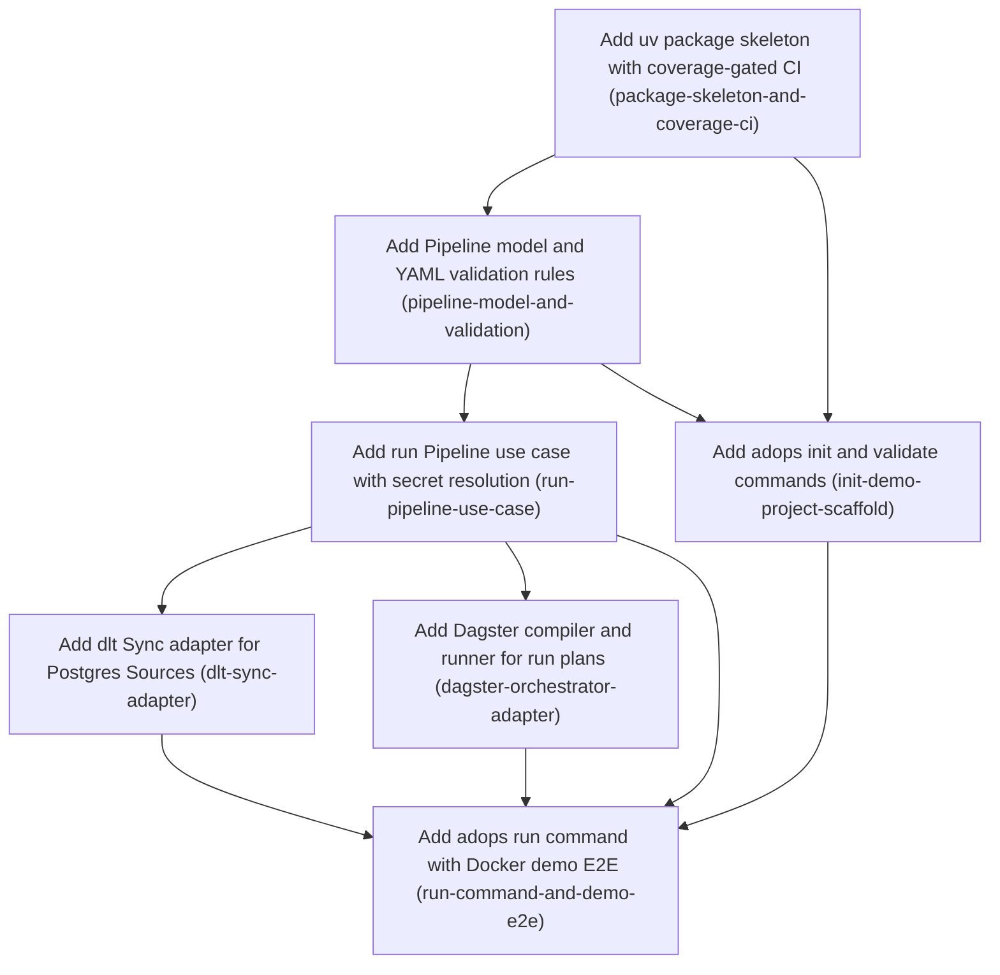

# Horizon 1 — Demo shop loads end-to-end (revision 1)

## 🎯 What are we trying to achieve?

Build the first working piece of `adops`, an open-source command-line tool that copies data between databases from simple YAML files. At the end of this plan, `adops init --demo` creates a demo project, `docker compose up` starts a shop database and a warehouse, and `adops run shop_sync` copies the shop's customers and orders into the warehouse. A second run copies only the changed orders. Every copy is guarded by fixed rules (Checks), such as "no duplicate keys" and "no rows lost". A failed Check stops the flow. Every pull request must pass 100% test coverage and the real Docker demo.

## 🧠 Why does this change need to happen?

The repository has only design documents (the spec, `GLOSSARY.md` and ADRs 0001–0013) and no code. The rest of v1 needs a tested base first: a package, the Pipeline rules, built-in Checks, a way to run Pipelines, and one real end-to-end path. dbt Transforms, Reverse Sync, Environments, MCP and skills come later.

## At a glance

- **Phases:** 7 (the user chose all 7, above the usual 3–5, so the demo works by the end)
- **Complexity:** High — new repo, three third-party engines (dlt, Dagster, Postgres in Docker), plus built-in Checks on every Sync
- **Main risk:** 100% branch coverage over heavy third-party integrations tempts over-mocking or `pragma: no cover` abuse — coverage met while E2E behaviour is untested.
- **Quality target:** 100% line+branch coverage on `src/adops`; the Docker demo E2E, with all Checks passing, on every PR
- **Testing focus:** the same facts always give the same Check verdict; a failed Check stops later Steps; no secret in any output, error or run storage; Incremental Sync loads only changed rows, with no duplicates; layer purity

## Built-in Checks (ADR-0013)

| Check | When | Fails when |
|---|---|---|
| `source_tables_exist` | before copying | a listed table, its primary key or its cursor column is missing in the Source |
| `primary_key_unique` | after every load | a key value appears more than once in the Warehouse table |
| `primary_key_not_null` | after every load | a key is empty |
| `row_count_matches` | after a Full Refresh | Warehouse rows ≠ Source rows counted at load time |
| `no_row_loss` | after an Incremental Sync | Warehouse has fewer rows than before the load |
| `cursor_not_backwards` | after an Incremental Sync | the newest cursor value is older than before the load |

A failed Check fails its Step and skips every later Step. A Check can be skipped for one table only with `skip_checks` plus a written `reason`, and `adops validate` lists every skip. Breaking Change detection and your own per-table Checks (`not_null`, `accepted_values`, `min_rows`, freshness) come first in horizon 2.

## Order of work
```
Phase 0 — Add uv package skeleton with coverage-gated CI
        ↓  (Phase 1 builds on Phase 0)
Phase 1 — Add Pipeline model and YAML validation rules
        ↓  (Phase 2 builds on Phase 1)
Phase 2 — Add run Pipeline use case with secret resolution
        ↓  (Phase 3 builds on Phase 2)
Phase 3 — Add dlt Sync adapter for Postgres Sources
        ↓  (Phase 4 builds on Phase 2)
Phase 4 — Add Dagster compiler and runner for run plans
        ↓  (Phase 5 builds on Phase 0, Phase 1)
Phase 5 — Add adops init and validate commands
        ↓  (Phase 6 builds on Phase 2, Phase 3, Phase 4, Phase 5)
Phase 6 — Add adops run command with Docker demo E2E
```



### Phase 0 — Add uv package skeleton with coverage-gated CI

Technical ID: `package-skeleton-and-coverage-ci` · Tool Build · cross-cutting · blast radius small

**Goal** — Create the installable `adops` Python package (uv-managed, Python 3.12, Apache-2.0) with one locked dependency set and a GitHub Actions workflow that fails any pull request whose `adops` package code is below 100% line and branch coverage.

**Why** — The repo is empty apart from docs, and every later phase assumes a package to put code in, a lockfile that resolves, and a CI gate that holds the coverage bar from the first line of code. Proving that dlt, Dagster and the Postgres driver resolve together in one lockfile is the main unknown and is cheapest to settle before any feature code exists.

**Changes**
- Write pyproject.toml with the hatchling (or uv_build) backend, `requires-python = ">=3.12"`, license Apache-2.0, and a `[project.scripts] adops = "adops.interface.cli:main"` entry point.
- Declare runtime dependencies with pinned compatible versions: dlt[postgres], dagster, dagster-postgres, psycopg (binary), typer, pydantic v2, pyyaml, python-dotenv. Dev group: pytest, pytest-cov, dlt[duckdb] (tests only), ruff.
- Run `uv python pin 3.12` and `uv lock`; commit uv.lock. If the resolver fails, adjust pins until it resolves and record the chosen versions.
- Create the empty layer packages src/adops/{domain,application,infrastructure,interface}.
- Configure coverage: branch = true, source = ["adops"], fail_under = 100, show_missing = true; exclude only `if TYPE_CHECKING:` — no other `pragma: no cover` allowed.
- Add .github/workflows/ci.yml: on pull_request and push to main, a `unit` job using pinned actions/checkout and astral-sh/setup-uv, running `uv sync --locked`, `uv run ruff check`, and `uv run pytest tests/unit --cov --cov-report=term-missing`.
- Add a trivial unit test (the package exposes `__version__`) alongside the CLI test.
- Add a minimal Typer app in src/adops/interface/cli.py with `main()` and `adops --version`, tested with CliRunner, so the installed command works from day one; later phases add subcommands to it.

**Files / areas**
- `pyproject.toml`
- `uv.lock`
- `.python-version`
- `LICENSE`
- `src/adops/__init__.py`
- `src/adops/domain/__init__.py`
- `src/adops/application/__init__.py`
- `src/adops/infrastructure/__init__.py`
- `src/adops/interface/__init__.py`
- `tests/unit/test_package.py`
- `.github/workflows/ci.yml`
- `src/adops/interface/cli.py`
- `tests/unit/interface/test_cli.py`

**How to verify**
- **Locked install and working adops command** — `uv sync --locked` exits 0 on a clean checkout, and `uv lock --check` exits 0
- **100% line+branch coverage gate truly bites** — pyproject.toml `[tool.coverage]` sets `branch = true`, `source = ["adops"]`, `fail_under = 100`, `show_missing = true`
- **CI unit job is pinned, locked and blocking** — .github/workflows/ci.yml triggers on `pull_request` and on `push` with `branches: [main]`
- **Four layer packages exist with CLI in the interface layer** — `uv run python -c "import adops.domain, adops.application, adops.infrastructure, adops.interface"` exits 0

**Done when** — The `unit` job in .github/workflows/ci.yml passes on a pull request, and fails when coverage of src/adops drops below 100% line+branch (checked by temporarily adding an untested branch). Every check under *How to verify* passes its bar.

**Depends on** — nothing — can start immediately

**Rollback** — Revert the commit; nothing depends on it yet.

<details><summary>Reference — full rubric</summary>

#### Locked install and working adops command (`locked-install-and-entrypoint`, minScore 8)

A fresh clone installs from the committed lockfile on Python 3.12 and exposes a working `adops` console script with Apache-2.0 metadata. 10 = every bullet passes and `uv lock --check` proves the lockfile is current; 8 = installs and runs with only cosmetic metadata gaps; below 7 = install or entry point is broken.

Pass criteria:
- `uv sync --locked` exits 0 on a clean checkout, and `uv lock --check` exits 0
- `uv run adops --version` exits 0 and prints the same string as `uv run python -c "import adops; print(adops.__version__)"`
- pyproject.toml has `requires-python = ">=3.12"`, an Apache-2.0 license field, and `[project.scripts] adops = "adops.interface.cli:main"`; `.python-version` contains 3.12
- LICENSE holds the full Apache License 2.0 text (`grep -c "Apache License" LICENSE` >= 1 and the file is over 10 KB)
- `uv tree` lists dlt, dagster, dagster-postgres and psycopg as runtime dependencies, with duckdb only in the dev group (`uv tree --no-dev | grep -i duckdb` returns nothing)

Failure examples:
- uv.lock is committed but stale, so `uv sync --locked` fails in CI after someone edited pyproject.toml
- Plausible implementation: dlt[duckdb] is put in the runtime dependencies 'for convenience', so every user install pulls DuckDB even though it is only needed by the tests
- `adops --version` prints a hard-coded string that differs from `adops.__version__`

#### 100% line+branch coverage gate truly bites (`coverage-gate-enforced`, minScore 9)

Coverage is measured with branches on, over the adops package, fails below 100%, and cannot be bypassed with pragmas. 10 = the gate is proven to fail on an added untested branch, and the only exclusion is TYPE_CHECKING; 8 = configured correctly but the proof is manual; below 9 is unacceptable because every later phase relies on it.

Pass criteria:
- pyproject.toml `[tool.coverage]` sets `branch = true`, `source = ["adops"]`, `fail_under = 100`, `show_missing = true`
- `exclude_lines` / `exclude_also` holds only an `if TYPE_CHECKING:` pattern; `grep -rn "pragma: no cover" src/` returns nothing
- Adding `if __import__('os').getenv('X'): pass` to src/adops/__init__.py makes `uv run pytest tests/unit --cov --cov-report=term-missing` exit non-zero (then revert)
- `uv run pytest tests/unit --cov` on the delivered tree reports TOTAL 100% with zero missing branches

Failure examples:
- `fail_under = 100` is set but `branch` is left false, so a partial `if` passes the gate
- Plausible implementation: `source` points at `src` or is omitted, so the measured set comes from imported modules only, and a never-imported module under src/adops is silently not counted
- An `omit = ["*/interface/*"]` entry quietly removes the CLI from measurement

#### CI unit job is pinned, locked and blocking (`ci-workflow-pinned-and-blocking`, minScore 8)

The workflow runs on pull requests and pushes to main, uses pinned actions, installs strictly from the lockfile, and fails the run on lint or coverage failure. 10 = actions pinned to commit SHAs with version comments and a pinned uv version; 8 = pinned to exact version tags; below 7 = floating refs or non-blocking steps.

Pass criteria:
- .github/workflows/ci.yml triggers on `pull_request` and on `push` with `branches: [main]`
- actions/checkout and astral-sh/setup-uv are pinned to an exact tag or a 40-char SHA (no `@main`, `@v4`-style major-only refs, or `@latest`)
- The `unit` job runs `uv sync --locked`, `uv run ruff check`, and `uv run pytest tests/unit --cov --cov-report=term-missing` as separate steps
- `grep -n "continue-on-error\|\|\| true" .github/workflows/ci.yml` returns nothing
- `uv run ruff check` exits 0 locally on the delivered tree

Failure examples:
- Uses `uv sync` without `--locked`, so CI silently resolves new versions the lockfile never proved
- Plausible implementation: pytest is run without `--cov`, relying on addopts that are missing, so coverage is never enforced in CI even though it is enforced locally
- Actions referenced as `actions/checkout@v4` (major-only, mutable)

#### Four layer packages exist with CLI in the interface layer (`layer-package-layout`, minScore 8)

The domain, application, infrastructure and interface packages are importable, and the only code so far sits in the right layer. 10 = layers exist, the CLI lives only in interface, and domain/application import no third-party framework; 8 = layout correct with a minor stray import; below 7 = CLI or framework code in an inner layer.

Pass criteria:
- `uv run python -c "import adops.domain, adops.application, adops.infrastructure, adops.interface"` exits 0
- Typer is imported only under src/adops/interface: `grep -rln "typer" src/adops | grep -v interface` returns nothing
- tests/unit/interface/test_cli.py exercises `adops --version` via typer.testing.CliRunner and asserts exit code 0

Failure examples:
- The CLI is placed in src/adops/__init__.py or src/adops/cli.py, outside the interface layer, so later phases wire commands into the wrong package
- Plausible implementation: src/adops/__init__.py imports `adops.interface.cli` to re-export `main`, which makes importing the domain pull in Typer

Healer hint: The most likely failure is a coverage config that looks right but does not bite (branch off, wrong `source`, or a stale uv.lock); fix it by setting `branch = true` and `source = ["adops"]`, re-running `uv lock`, and proving the gate with a temporary untested branch.

</details>

### Phase 1 — Add Pipeline model and YAML validation rules

Technical ID: `pipeline-model-and-validation` · Pipeline Authoring · domain · blast radius medium

**Goal** — Define the pure domain types — Pipeline, Sync Step, Source, Warehouse, Environment, Secret Reference and Check — and functions that parse Pipeline YAML and Project settings into them, rejecting invalid input with clear, secret-free error messages, plus pure rules that turn measured Source and load facts into pass/fail Check results.

**Why** — A Pipeline is a YAML file the user (or their Assistant) edits; everything downstream must be able to trust that it is already valid. Keeping these rules pure (no database, no environment variables, no file I/O beyond receiving text) makes them easy to test to 100% branch coverage and reusable by every later phase. Checks are the deterministic guards every flow gets: the same table facts always produce the same pass/fail verdict, with no AI and no database in the rule itself, so the rules are tested here once and every Pipeline inherits them.

**Changes**
- Model a Pipeline (name, ordered Steps) and a Sync Step (name, Source name, explicit non-empty table allowlist, mode `full_refresh` or `incremental`) with pydantic v2 `extra="forbid"`.
- Rule: every table must declare `primary_key`; an `incremental` table must also declare `cursor`; Step names unique within a Pipeline.
- Model a `postgres` Source and `postgres` Warehouse whose password is a Secret Reference.
- Model a Secret Reference as an env-var name (`password_env: SHOP_DB_PASSWORD`) validated with `^[A-Z][A-Z0-9_]*$`; it never holds a value.
- Model an Environment (name, Warehouse, Sources) read from the Project settings file `adops.yaml`; only `dev` required in this slice.
- Add `load_pipeline(text)` and `load_project_settings(text)` using `yaml.safe_load`, converting errors into one `PipelineValidationError` with `path: problem` lines that never echo raw field values.
- Cross-check: every Sync Step's Source name exists in the chosen Environment.
- Define the built-in Check names `source_tables_exist`, `primary_key_unique`, `primary_key_not_null`, `row_count_matches` (Full Refresh), `no_row_loss` and `cursor_not_backwards` (Incremental Sync); all are on by default for every table.
- Allow a per-table opt-out `skip_checks: [<check name>, ...]` with a required non-empty `reason`; reject unknown Check names, a Check that does not apply to the table's mode, and a skip without a reason.
- Add two pure rules: `evaluate_preflight_checks(table, source_facts) -> list[CheckResult]` (only `source_tables_exist`: missing tables / primary_key / cursor columns) and `evaluate_load_checks(table, load_facts) -> list[CheckResult]` (the other Checks for the table's mode). SourceFacts and LoadFacts are separate value objects (Warehouse row count and max cursor before and after the load, Source row count for Full Refresh, duplicate-key and null-key counts). Each result is pass / fail / skipped(reason), with a plain message naming table and Check, never row values.

**Files / areas**
- `src/adops/domain/pipeline.py`
- `src/adops/domain/environment.py`
- `src/adops/domain/secret_reference.py`
- `src/adops/domain/errors.py`
- `src/adops/domain/loader.py`
- `tests/unit/domain/test_pipeline.py`
- `tests/unit/domain/test_environment.py`
- `tests/unit/domain/test_loader.py`
- `src/adops/domain/checks.py`
- `tests/unit/domain/test_checks.py`

**How to verify**
- **Domain stays pure (no I/O, env or framework imports)** — `grep -rnE "^\s*(from|import) (os|dagster|dlt|psycopg|dotenv|typer|adops\.(application|infrastructure|interface))" src/adops/domain` returns nothing
- **Every validation rule has a rejecting test** — tests/unit/domain contains rejecting tests for: unknown key, empty table list, a `full_refresh` table missing `primary_key`, an `incremental` table missing `primary_key` (separate test), incremental table missing `cursor`, duplicate Step name, Secret Reference name not matching `^[A-Z][A-Z0-9_]*$`, Step referencing a Source missing from the Environment, and mode other than full_refresh/incremental
- **Validation errors never echo raw values** — A test puts a sentinel such as `LEAK-9f3a` as the value of an unknown key, an invalid mode and a bad `password_env`, and asserts the sentinel is absent from `str(err)`, `repr(err)` and `err.args`
- **Secret Reference stores only a variable name** — `password: something` in a Source or Warehouse block is rejected by `load_project_settings` (test exists)
- **Built-in Check rules are pure, deterministic and boundary-tested** — tests/unit/domain has, per built-in Check, at least one passing and one failing case: duplicate-key count 0 vs 1, null-key count 0 vs 1, missing table/column empty vs non-empty, Warehouse-after count equal to vs different from Source count (Full Refresh), after count >= vs < before count (Incremental), after max cursor >= vs < previous max cursor
- **Opting out of a Check needs a known, applicable Check and a written reason** — tests/unit/domain has rejecting tests, each asserting the error path (for example `steps[0].tables[1].skip_checks`), for: `skip_checks` with no `reason`, an empty or whitespace-only `reason`, an unknown Check name, `row_count_matches` on an incremental table, and `no_row_loss` or `cursor_not_backwards` on a full_refresh table

**Done when** — src/adops/domain with `load_pipeline`, `load_project_settings`, `evaluate_preflight_checks` and `evaluate_load_checks`, covered 100% line+branch by tests/unit/domain, including tests for: unknown key, empty table list, table without primary_key, incremental table without cursor, duplicate Step name, bad Secret Reference name, unknown Source name, skip_checks without reason, unknown Check name, and each built-in Check passing and failing on boundary facts (equal counts, cursor equal to previous max, zero rows). Every check under *How to verify* passes its bar.

**Depends on** — Add uv package skeleton with coverage-gated CI

<details><summary>Reference — full rubric</summary>

#### Domain stays pure (no I/O, env or framework imports) (`domain-layer-purity`, minScore 9)

src/adops/domain depends only on the stdlib, pydantic and pyyaml, receives text instead of reading files or environment variables, and `evaluate_preflight_checks` / `evaluate_load_checks` receive already-measured SourceFacts / LoadFacts instead of querying anything. 10 = no forbidden import, no `open()`/Path reads, and a test or ruff rule enforces it; 8 = clean by inspection; below 9 is unacceptable for a domain layer.

Pass criteria:
- `grep -rnE "^\s*(from|import) (os|dagster|dlt|psycopg|dotenv|typer|adops\.(application|infrastructure|interface))" src/adops/domain` returns nothing
- `grep -rnE "open\(|environ|getenv|read_text|Path\(" src/adops/domain` returns nothing
- `grep -rnE "^\s*(from|import) (sqlalchemy|duckdb|sqlite3|random)" src/adops/domain` returns nothing, and `grep -rnE "\.now\(|time\.time\(|random\." src/adops/domain` returns nothing (Check verdicts cannot depend on the clock or randomness)
- `load_pipeline` and `load_project_settings` take `str` arguments, and `evaluate_preflight_checks(table, source_facts)` and `evaluate_load_checks(table, load_facts)` take a domain table definition and a SourceFacts / LoadFacts value object (check the signatures in src/adops/domain)
- A ruff banned-api rule, an import-linter contract, or a unit test that walks the domain modules' imports enforces the ban (10 only)

Failure examples:
- `load_project_settings` accepts a path and calls `Path(path).read_text()`, pulling file I/O into the domain
- Plausible implementation: the Secret Reference model gets a convenience `.is_set()` method using `os.environ`, which leaks an environment concern into the domain
- Plausible implementation: `evaluate_load_checks` takes a connection and runs `SELECT count(*)` itself, so Check rules can no longer be unit-tested on plain facts

#### Every validation rule has a rejecting test (`validation-rules-tested`, minScore 8)

Each declared rule has at least one test that feeds invalid YAML and asserts the specific error path, and the domain is at 100% line+branch coverage. 10 = every rule plus malformed YAML and a non-mapping root are tested and asserted by error path; 8 = every listed rule tested; below 8 = any rule untested.

Pass criteria:
- tests/unit/domain contains rejecting tests for: unknown key, empty table list, a `full_refresh` table missing `primary_key`, an `incremental` table missing `primary_key` (separate test), incremental table missing `cursor`, duplicate Step name, Secret Reference name not matching `^[A-Z][A-Z0-9_]*$`, Step referencing a Source missing from the Environment, and mode other than full_refresh/incremental
- Each test asserts the error's path (for example `steps[0].tables`), not just that an exception was raised
- Malformed YAML and a YAML root that is a list/scalar each raise PipelineValidationError, not yaml.YAMLError or TypeError
- `uv run pytest tests/unit/domain --cov=adops.domain --cov-branch --cov-report=term-missing` reports 100% with no missing branches
- `grep -rn "yaml.load(\|yaml.unsafe_load\|FullLoader" src/adops/domain` returns nothing

Failure examples:
- Tests only check `pytest.raises(PipelineValidationError)`, so a rule that fails for the wrong reason still passes
- Plausible implementation: an empty YAML file returns `None` from safe_load and crashes with `TypeError` instead of a validation error
- Plausible implementation: the old rule 'incremental needs primary_key' is kept, so a Full Refresh table without `primary_key` loads but `primary_key_unique` has nothing to check

#### Validation errors never echo raw values (`secret-free-error-messages`, minScore 9)

PipelineValidationError is one exception with `path: problem` lines that never contain user-supplied field values. 10 = a sentinel test covers both pydantic and YAML-syntax errors and checks str, repr and args; 8 = sentinel tested for pydantic errors; below 9 is unacceptable because a mistyped password would leak.

Pass criteria:
- A test puts a sentinel such as `LEAK-9f3a` as the value of an unknown key, an invalid mode and a bad `password_env`, and asserts the sentinel is absent from `str(err)`, `repr(err)` and `err.args`
- A YAML-syntax error test asserts the message has no snippet of the offending line (yaml's `problem_mark` context is not copied)
- Multiple problems in one document are reported together as several `path: problem` lines in one exception
- The original pydantic/yaml exception is not chained (`err.__cause__ is None` and `err.__context__` is suppressed) so tracebacks cannot print it

Failure examples:
- Plausible implementation: the message is built from `str(pydantic_error)`, which includes `input_value='hunter2'` for each failing field
- `raise PipelineValidationError(...) from exc` keeps the pydantic error as the cause, so a traceback still shows raw values
- Only the first error is reported, forcing users to fix problems one at a time

#### Secret Reference stores only a variable name (`secret-reference-holds-no-value`, minScore 8)

Credentials in Source/Warehouse models can only be given as Secret References (an env-var name), never as literal values. 10 = literal-password keys are rejected with a message naming `password_env`, and the model has no field able to hold a value; 8 = only name fields exist and `extra=forbid` rejects literals; below 8 = a literal password is accepted anywhere.

Pass criteria:
- `password: something` in a Source or Warehouse block is rejected by `load_project_settings` (test exists)
- The SecretReference model's only data field is the env-var name (inspect src/adops/domain/secret_reference.py)
- Every pydantic model in src/adops/domain sets `extra="forbid"`: `grep -c "extra=\"forbid\"\|extra='forbid'" src/adops/domain/*.py` covers each model class

Failure examples:
- Plausible implementation: the model accepts `password_env` or `password` 'for local dev', so the demo works but secrets end up in Git
- A nested Source model forgets `extra="forbid"`, so `pasword_env` (typo) is silently ignored and the run later fails with a confusing missing-secret error

#### Built-in Check rules are pure, deterministic and boundary-tested (`check-rules-deterministic`, minScore 9)

`evaluate_preflight_checks(table, source_facts)` returns exactly the `source_tables_exist` CheckResult, and `evaluate_load_checks(table, load_facts)` returns one CheckResult per remaining applicable built-in Check (`primary_key_unique`, `primary_key_not_null`, plus `row_count_matches` for Full Refresh or `no_row_loss` and `cursor_not_backwards` for Incremental Sync) in a fixed order; the same facts always give the same verdicts; boundaries are explicit; messages name table and Check and never contain row values. 10 = every Check has passing and failing parametrized tests including all boundary cases listed, a repeat-call equality test, and a sentinel test on cursor values; 8 = every Check has a pass and a fail test plus equal-count and equal-cursor boundaries; below 9 is unacceptable because these verdicts gate every load.

Pass criteria:
- tests/unit/domain has, per built-in Check, at least one passing and one failing case: duplicate-key count 0 vs 1, null-key count 0 vs 1, missing table/column empty vs non-empty, Warehouse-after count equal to vs different from Source count (Full Refresh), after count >= vs < before count (Incremental), after max cursor >= vs < previous max cursor
- Boundary tests exist and pass: equal counts -> `row_count_matches` and `no_row_loss` pass; after max cursor equal to previous max -> `cursor_not_backwards` passes; empty table (0 rows, max cursor None) -> all applicable Checks pass; previous max cursor None (first run) -> `cursor_not_backwards` passes
- A test calls `evaluate_preflight_checks` and `evaluate_load_checks` each twice with equal facts (and once with a deep copy) and asserts the returned lists are equal, including order; CheckResult and SourceFacts/LoadFacts are frozen (`frozen=True` dataclass or pydantic `frozen`)
- A Full Refresh table never yields `no_row_loss`/`cursor_not_backwards`, and an Incremental table never yields `row_count_matches` (asserted by Check name set per mode)
- A test sets the facts' max cursor values to a sentinel string (for example `LEAK-2031-01-01`) and asserts it is absent from every CheckResult message; each message contains the table name and the Check name
- `uv run pytest tests/unit/domain --cov=adops.domain --cov-branch` reports 100% for the Check module

Failure examples:
- Plausible implementation: `cursor_not_backwards` uses `after_max > previous_max`, so a run that loads nothing (cursor equal to previous max) fails the Check
- Plausible implementation: the comparison `after_max < previous_max` is written without handling None, so the first Incremental run raises TypeError instead of passing
- The failure message is `f"{table}: cursor went backwards ({after_max} < {previous_max})"`, which prints real row values into logs and Dagster metadata
- Results come from iterating a `set` of Check names, so the order differs between runs and the CLI output is not reproducible

#### Opting out of a Check needs a known, applicable Check and a written reason (`skip-checks-require-reason`, minScore 8)

Per-table `skip_checks` is accepted only with a non-empty `reason`, only for known built-in Check names that apply to the table's mode; a skipped Check is reported as `skipped` with that reason and is never evaluated. 10 = all rejection cases tested by error path, whitespace-only reason rejected, and skipped results carry the reason verbatim; 8 = missing reason, unknown name and wrong-mode name rejected and skipped status tested; below 8 = a skip without a reason is accepted.

Pass criteria:
- tests/unit/domain has rejecting tests, each asserting the error path (for example `steps[0].tables[1].skip_checks`), for: `skip_checks` with no `reason`, an empty or whitespace-only `reason`, an unknown Check name, `row_count_matches` on an incremental table, and `no_row_loss` or `cursor_not_backwards` on a full_refresh table
- The unknown-Check-name error lists the allowed Check names and does not echo the user's value (sentinel test, consistent with secret-free-error-messages)
- A test with `skip_checks: [primary_key_unique]` and failing duplicate-key facts asserts the result for that Check is `skipped` with the given reason, and the other Checks are still evaluated
- With no `skip_checks`, every applicable Check is evaluated (default on): a test asserts no result has status `skipped`

Failure examples:
- Plausible implementation: `reason: str = ""` is the pydantic default, so `skip_checks` without a reason passes validation
- Skipped Checks are filtered out of the result list instead of reported as `skipped`, so the CLI and `adops validate` cannot show what was turned off

Healer hint: The most likely failures are a `cursor_not_backwards` rule that fails on an equal or None previous cursor and a Check or validation message that prints row or field values; fix them with parametrized boundary tests plus a sentinel test, and map pydantic errors to `path: msg` lines raised `from None`.

</details>

### Phase 2 — Add run Pipeline use case with secret resolution

Technical ID: `run-pipeline-use-case` · Pipeline Execution · application · blast radius medium

**Goal** — Add the application-level `run_pipeline` use case that validates the Pipeline, resolves every Secret Reference, and runs each Sync Step as preflight → sync → Checks through an orchestrator port (default: an in-order runner); a failed Check fails its Step and skips every later Step.

**Why** — This is the single place that decides the order of work for `adops run`: validate, resolve secrets, then execute. Defining the Sync port (dlt now, PyAirbyte later) and the orchestrator port (an in-order runner now, Dagster in a later phase) here lets the adapters be built independently and lets this logic reach 100% coverage with in-memory fakes. Putting the Checks inside the Step itself means no orchestrator can run a later Step on data that failed a Check.

**Changes**
- Define the Sync port Protocol: `preflight(step, source) -> SourceFacts per table` (missing tables/columns, Source row counts) and `sync(step, source, warehouse) -> SyncResult` (rows loaded plus LoadFacts per table). ResolvedConnection holds the real password and masks it in `__repr__`/`__str__`.
- Define the orchestrator port Protocol `execute(plan, sync) -> RunResult` and an `InOrderOrchestrator` default that runs Steps in Pipeline order, stops at the first failure and marks later Steps skipped.
- Implement `resolve_secret_references(env, refs)`: return values or raise `MissingSecretError` naming every missing variable — names only, never values.
- Implement `run_pipeline(pipeline_text, settings_text, environment_name, env, sync, orchestrator=InOrderOrchestrator())`: validate via the domain loader, pick the Environment (error if unknown), resolve Secret References, build the RunPlan, call `orchestrator.execute`, return RunResult.
- Build each Step as one callable: preflight → `evaluate_preflight_checks` (stop before copying anything if it fails) → sync → `evaluate_load_checks` per table; the application never builds a CheckResult itself → raise `CheckFailedError` (Step status `check_failed`) if any Check failed; skipped Checks are reported with their reason. The orchestrator port executes these callables.
- Unit-test every branch with fakes, including a test that no secret value appears in any error message or `repr()` of a resolved connection.

**Files / areas**
- `src/adops/application/ports.py`
- `src/adops/application/run_pipeline.py`
- `src/adops/application/secrets.py`
- `tests/unit/application/fakes.py`
- `tests/unit/application/test_run_pipeline.py`
- `tests/unit/application/test_secrets.py`

**How to verify**
- **Application layer depends only inward** — `grep -rnE "^\s*(from|import) (os|dagster|dlt|psycopg|dotenv|typer|adops\.(infrastructure|interface))" src/adops/application` returns nothing
- **Missing secrets reported all at once, by name only** — A test with two missing variables asserts both names appear in one MissingSecretError
- **Resolved secrets masked in every repr** — A test resolves a sentinel password and asserts it is absent from `repr()` and `str()` of ResolvedConnection and of the RunPlan that contains it
- **Steps run in order; a failure skips later Steps** — A recording fake Sync shows calls in Pipeline Step order for a 3-Step Pipeline
- **Sync port is engine-neutral** — `grep -nE "dlt|write_disposition|dataset|airbyte" src/adops/application/ports.py` returns nothing
- **Each Step runs preflight, sync, then Checks; a failed Check stops the run** — A recording fake whose `preflight` reports a missing table for Step 1 shows zero `sync` calls for any Step; RunResult shows Step 1 `check_failed` with a failed `source_tables_exist` result naming the table, and Steps 2-3 `skipped`

**Done when** — src/adops/application/run_pipeline.py (with the Sync and orchestrator ports) covered 100% line+branch by tests/unit/application using fakes, including: missing Secret Reference, secret masking, a failing preflight that makes zero sync calls, a failing post-load Check that marks the Step `check_failed` and skips later Steps, and a skipped Check reported with its reason. Every check under *How to verify* passes its bar.

**Depends on** — Add Pipeline model and YAML validation rules

<details><summary>Reference — full rubric</summary>

#### Application layer depends only inward (`application-dependency-direction`, minScore 9)

src/adops/application imports only adops.domain, the stdlib and typing helpers, and gets environment values as a Mapping argument. 10 = enforced by an automated import check; 8 = clean by grep; below 9 = any outer-layer or framework import.

Pass criteria:
- `grep -rnE "^\s*(from|import) (os|dagster|dlt|psycopg|dotenv|typer|adops\.(infrastructure|interface))" src/adops/application` returns nothing
- `run_pipeline` takes `env: Mapping[str, str]`, and `grep -rn "environ\|getenv" src/adops/application` returns nothing
- An import-linter contract, a ruff banned-api rule or a unit test enforces the ban (10 only)

Failure examples:
- Plausible implementation: `run_pipeline(..., env=None)` falls back to `os.environ` when env is omitted, which pulls process state into the use case
- `ports.py` type-hints the Sync port with a dlt type such as `dlt.common.pipeline.LoadInfo`

#### Missing secrets reported all at once, by name only (`missing-secret-reporting`, minScore 8)

resolve_secret_references returns every value or raises one MissingSecretError naming all missing variables and no values. 10 = all missing names reported in sorted order, and the empty-string policy is explicit and tested; 8 = all names reported; below 8 = stops at the first missing name.

Pass criteria:
- A test with two missing variables asserts both names appear in one MissingSecretError
- A test with one set and one missing variable asserts the set variable's value is absent from `str(err)` and `repr(err)`
- Behaviour for a variable set to an empty string is decided (missing or valid) and has a dedicated test
- No secret is resolved and no Step runs when any reference is missing (the fake Sync records zero calls)

Failure examples:
- Plausible implementation: secrets are resolved lazily per Step, so Step 1 runs and loads data before Step 2's missing secret is reported
- The error lists `KeyError('SHOP_DB_PASSWORD')` from a raw dict lookup instead of a domain error

#### Resolved secrets masked in every repr (`resolved-connection-masking`, minScore 9)

No object that holds or derives from a resolved secret shows the value in `repr`, `str`, or an exception message. 10 = a sentinel test covers ResolvedConnection, RunPlan, RunResult, SyncResult and every error raised; 8 = ResolvedConnection and errors covered; below 9 is unacceptable.

Pass criteria:
- A test resolves a sentinel password and asserts it is absent from `repr()` and `str()` of ResolvedConnection and of the RunPlan that contains it
- The same sentinel is absent from `repr(run_result)` and from the message of an error raised by a failing fake Sync
- If ResolvedConnection is a dataclass, the password field uses `field(repr=False)` or `__repr__` is overridden; if pydantic, it uses `SecretStr` or an equivalent

Failure examples:
- Plausible implementation: ResolvedConnection overrides `__repr__`, but RunPlan is a plain dataclass whose auto-generated repr prints the nested connection's `__dict__` via a tuple of fields
- An f-string in an error message such as `f"failed for {connection}"` uses `__format__` on a pydantic model that prints the raw field

#### Steps run in order; a failure skips later Steps (`step-order-and-failure-semantics`, minScore 8)

The default runner executes Sync Steps in Pipeline order, stops at the first failure, marks the later Steps skipped, and returns a RunResult instead of raising. 10 = order, failed/skipped statuses, sanitized error and unknown-Environment error each tested with a recording fake; 8 = order and skip tested; below 8 = later Steps still run after a failure.

Pass criteria:
- A recording fake Sync shows calls in Pipeline Step order for a 3-Step Pipeline
- When Step 1 raises, the fake records no call for Steps 2-3, and RunResult reports Step 1 failed and Steps 2-3 skipped
- An unknown Environment name raises a domain error naming the Environment and listing the available ones
- `uv run pytest tests/unit/application --cov=adops.application --cov-branch` reports 100% with no missing branches

Failure examples:
- Plausible implementation: the runner catches the exception and `continue`s, so a failed customers Sync is followed by an orders Sync against an inconsistent Warehouse
- RunResult reports later Steps as 'failed' instead of 'skipped', so the CLI cannot tell the root cause from its consequences

#### Sync port is engine-neutral (`sync-port-engine-neutral`, minScore 7)

The Sync port Protocol (`preflight` and `sync`) uses only domain and application types, including the domain SourceFacts/LoadFacts, so a PyAirbyte adapter can implement it unchanged. 10 = no engine terms in names or types, and the test fake is checked against the Protocol by a type checker or runtime_checkable test; 8 = neutral signature; below 7 = dlt concepts in the port.

Pass criteria:
- `grep -nE "dlt|write_disposition|dataset|airbyte" src/adops/application/ports.py` returns nothing
- SyncResult reports rows loaded per table as a plain mapping of table name to int, and `preflight`/`sync` return the domain SourceFacts/LoadFacts type (no adapter-specific facts class)
- tests/unit/application/fakes.py implements the Protocol, and a test asserts `isinstance(fake, Sync)` with `@runtime_checkable`, or the type checker passes on it

Failure examples:
- Plausible implementation: the port method takes `write_disposition: str` because the dlt adapter needs it, so Full Refresh/Incremental leaks as dlt vocabulary instead of being read from the Step's mode

#### Each Step runs preflight, sync, then Checks; a failed Check stops the run (`checks-gate-each-step`, minScore 9)

Every Step callable runs preflight -> sync -> domain `evaluate_preflight_checks` before sync and `evaluate_load_checks` after it, per table; a failed preflight records a failed `source_tables_exist` Check and makes zero sync calls; any failed post-load Check raises CheckFailedError, marks the Step `check_failed`, and skips every later Step; skipped Checks appear in RunResult with their reason; verdicts come only from the domain rules. 10 = all bullets tested with recording fakes, including determinism and a sentinel test on CheckFailedError; 8 = preflight-stop, check_failed-skips-later and skipped-with-reason tested; below 9 is unacceptable because these are the run's only data guards.

Pass criteria:
- A recording fake whose `preflight` reports a missing table for Step 1 shows zero `sync` calls for any Step; RunResult shows Step 1 `check_failed` with a failed `source_tables_exist` result naming the table, and Steps 2-3 `skipped`
- A fake whose post-load facts include duplicate-key count 1 makes Step 1 `check_failed` (not generic `failed`); the fake records no `preflight` or `sync` call for Steps 2-3
- A table with `skip_checks` and a reason produces a RunResult Check entry with status `skipped` and that reason
- Running `run_pipeline` twice with identical fakes gives equal RunResult Check lists (same names, statuses, order and messages)
- `grep -nE "(duplicate\w*|null_key\w*|row_count\w*|max_cursor\w*)\s*(==|!=|<=|>=|<|>)" src/adops/application/*.py` shows no threshold comparisons: the application calls the domain Check rules and never re-implements a rule
- A sentinel password in env and a sentinel cursor value in fake facts are absent from `str(CheckFailedError)`, `repr(run_result)` and every Check message

Failure examples:
- Plausible implementation: preflight runs and its result is stored, but the Step still calls `sync` and evaluates `source_tables_exist` afterwards, so the other allowlisted tables are already loaded when the run fails
- CheckFailedError is caught by the generic `except Exception` and the Step is reported `failed`, losing which Check and table failed
- Checks are evaluated only for the last table of the Step, so a duplicate key in the first table passes silently

Healer hint: The most likely failure is a Step that calls `sync` even after preflight reports a missing table, or that reports a failed Check as a generic `failed`; fix it by returning early from the Step callable on a failed `source_tables_exist`, raising CheckFailedError for post-load failures, and asserting zero sync calls with a recording fake.

</details>

### Phase 3 — Add dlt Sync adapter for Postgres Sources

Technical ID: `dlt-sync-adapter` · Pipeline Execution · infrastructure · blast radius medium

**Goal** — Implement the Sync port with dlt so a Sync Step copies its allowlisted tables from a Postgres Source into a raw schema of the Warehouse, as Full Refresh (replace) or Incremental Sync (cursor + merge on primary key). It also measures the table facts the Checks need — before copying (tables, columns, Source row counts) and in the Warehouse before and after each load.

**Why** — dlt is the chosen engine for Verified Sources such as the demo shop Postgres because it is pure Python and needs no Docker socket. Wrapping it behind the Sync port keeps dlt details (pipeline names, state, write dispositions) out of the rest of the tool so PyAirbyte can sit behind the same port later.

**Changes**
- Build the dlt source with `sql_table` per allowlisted table, passing credentials programmatically from the ResolvedConnection (never via secrets.toml).
- Full Refresh: `write_disposition="replace"`. Incremental Sync: `dlt.sources.incremental(cursor)`, `write_disposition="merge"`, `primary_key`.
- Load into dataset `raw_<source name>`; name the dlt pipeline `adops_<pipeline>_<step>` so Incremental Sync state is stable across runs; keep dlt's working dir under the Project's `.adops/`.
- Return SyncResult with rows loaded per table from dlt load info.
- Translate dlt/database exceptions into `SyncFailedError` naming Step and table but stripping connection strings and passwords.
- Implement `preflight`: read the Source catalog for each allowlisted table, its `primary_key` and `cursor` columns, and the Source row count for Full Refresh tables (SourceFacts). In `sync`, measure Warehouse row count and max cursor before the load and, after it, row count, max cursor, duplicate-key count and null-key count (LoadFacts). Use read-only SQL on the same connections and never log values.
- Test with real dlt and no Docker: SQLite Source → DuckDB destination, asserting Full Refresh replaces rows and a second Incremental Sync loads only advanced rows; map Warehouse kind to a dlt destination via a small function so tests can select DuckDB.
- Postgres→Postgres behaviour (the real demo path) is proven by the Docker end-to-end test in phase run-command-and-demo-e2e; this phase's tests stay Docker-free.
- Test fact measurement against DuckDB, including a row deliberately duplicated in the destination (duplicate-key count 1) and a missing Source table reported by `preflight`.

**Files / areas**
- `src/adops/infrastructure/dlt_sync.py`
- `tests/unit/infrastructure/test_dlt_sync.py`

**How to verify**
- **Incremental Sync loads only advanced rows, no duplicates** — The SQLite to DuckDB test inserts 1 new row and updates 1 row's cursor and a value, then runs again; afterwards `SELECT count(*)` equals original + 1 and `SELECT id FROM raw_<source>.<table> GROUP BY id HAVING count(*) > 1` returns zero rows
- **Full Refresh replaces the destination table** — The test runs Full Refresh, deletes 1 Source row and updates another, runs again, and asserts the destination row set equals the Source row set
- **Credentials passed in memory; errors stripped of secrets** — After a test run, `find <project>/.adops -name 'secrets.toml' -o -name 'config.toml'` returns nothing and `grep -r <sentinel> <project>/.adops` returns nothing
- **dlt confined to one adapter; tests Docker-free and fully covered** — `grep -rlnE "^\s*(import|from) dlt" src/adops` returns only src/adops/infrastructure/dlt_sync.py
- **Adapter measures exact table facts and never decides pass/fail** — tests/unit/infrastructure/test_dlt_sync.py inserts one duplicated `id` in the DuckDB destination and asserts duplicate-key count 1, inserts one null key and asserts null-key count 1, and asserts 0 for both on clean data

**Done when** — src/adops/infrastructure/dlt_sync.py covered 100% line+branch by tests/unit/infrastructure/test_dlt_sync.py, with passing Full Refresh and Incremental Sync tests against SQLite→DuckDB and fact-measurement tests (duplicate key, null key, missing table, before/after counts and max cursor). Every check under *How to verify* passes its bar.

**Depends on** — Add run Pipeline use case with secret resolution

<details><summary>Reference — full rubric</summary>

#### Incremental Sync loads only advanced rows, no duplicates (`incremental-loads-only-advanced-rows`, minScore 9)

A second Incremental Sync run loads only rows whose cursor advanced, merges updates on the primary key, and reports only those rows as loaded. 10 = row count, the distinct-key check, the updated value and the reported delta are all asserted, and state survives a fresh adapter instance; 8 = count and no-duplicates asserted; below 9 is unacceptable.

Pass criteria:
- The SQLite to DuckDB test inserts 1 new row and updates 1 row's cursor and a value, then runs again; afterwards `SELECT count(*)` equals original + 1 and `SELECT id FROM raw_<source>.<table> GROUP BY id HAVING count(*) > 1` returns zero rows
- The updated row's new value is asserted in the destination
- The second run's SyncResult reports exactly 2 rows for that table (not the full table count)
- The second run uses a new adapter instance pointing at the same Project `.adops/` directory, proving dlt state persists under the stable name `adops_<pipeline>_<step>`

Failure examples:
- Plausible implementation: the test asserts only the final row count; it passes even though the cursor was never applied and all rows were re-read and merged, so the reported rows equal the full table
- dlt's pipelines_dir defaults to ~/.dlt or a per-run temp dir, so Incremental state is lost and every run is a full reload
- The merge has no primary_key, so the updated row appears twice

#### Full Refresh replaces the destination table (`full-refresh-replaces`, minScore 8)

A Full Refresh run makes the destination table equal the Source table, including deletions, inside the `raw_<source name>` dataset. 10 = deletes and updates both reflected, and the dataset name is asserted; 8 = replacement after a deletion asserted; below 8 = rows appended.

Pass criteria:
- The test runs Full Refresh, deletes 1 Source row and updates another, runs again, and asserts the destination row set equals the Source row set
- Tables land in schema/dataset `raw_<source name>` (asserted by querying DuckDB `information_schema.tables`)
- Only allowlisted tables are loaded: a non-allowlisted Source table is absent from the destination

Failure examples:
- Plausible implementation: `write_disposition="replace"` is set on the source but overridden by a resource-level default of `append`, so a second run doubles the rows
- The `sql_database` source is used without a table filter, so every Source table is copied, not just the allowlist

#### Credentials passed in memory; errors stripped of secrets (`credentials-and-sanitized-errors`, minScore 9)

Credentials go to dlt and to the fact-measuring queries programmatically and are never written to disk, and every failure in `preflight`, `sync` or fact measurement becomes a SyncFailedError naming the Step and table with no password or connection string. 10 = a sentinel failure test checks message, repr, the exception chain and the dlt working directory for both preflight and sync; 8 = message and repr checked; below 9 is unacceptable.

Pass criteria:
- After a test run, `find <project>/.adops -name 'secrets.toml' -o -name 'config.toml'` returns nothing and `grep -r <sentinel> <project>/.adops` returns nothing
- A test forces a connection failure with a sentinel password in both `preflight` and `sync` and asserts the sentinel and the `postgresql://` DSN are absent from `str(err)`, `repr(err)`, and from `err.__cause__`/`err.__context__` (raised `from None` or chain sanitized)
- SyncFailedError's message names the Step and the table being loaded

Failure examples:
- Plausible implementation: `raise SyncFailedError(step, table) from exc`, where `exc` is a dlt PipelineStepFailed whose text contains the full DSN with the password, printed in any traceback
- Credentials passed as a DSN string that dlt writes into the pipeline state/trace under `.adops/`

#### dlt confined to one adapter; tests Docker-free and fully covered (`dlt-confined-and-docker-free`, minScore 8)

dlt is imported only by the adapter module, which implements the Sync port and is 100% covered by tests that need no Docker. 10 = all bullets pass, including the Warehouse-kind-to-destination mapping for both postgres and duckdb; 8 = confined and covered; below 8 = dlt imported elsewhere or coverage under 100%.

Pass criteria:
- `grep -rlnE "^\s*(import|from) dlt" src/adops` returns only src/adops/infrastructure/dlt_sync.py
- `uv run pytest tests/unit/infrastructure/test_dlt_sync.py --cov=adops.infrastructure.dlt_sync --cov-branch` reports 100%
- `grep -nE "docker|testcontainers" tests/unit/infrastructure/test_dlt_sync.py` returns nothing, and the test passes with Docker stopped
- The destination-mapping function is tested for both `postgres` and `duckdb` and raises a clear error for an unknown kind

Failure examples:
- Plausible implementation: the Postgres destination branch is never executed in unit tests, so coverage is reached with a `pragma: no cover` on it
- The application layer imports a dlt exception class to catch it, so dlt leaks out of infrastructure

#### Adapter measures exact table facts and never decides pass/fail (`table-facts-measured-accurately`, minScore 8)

`preflight` reports missing tables/columns and Source row counts without loading anything, and `sync` returns Warehouse row count and max cursor before and after the load plus duplicate-key and null-key counts, measured with read-only SQL; the adapter returns facts only and leaves verdicts to the domain. 10 = every fact asserted against known DuckDB data including the boundary states, identifiers quoted, and no fact value logged; 8 = duplicate, null, missing-table and before/after counts asserted; below 8 = facts derived from dlt load info instead of measured.

Pass criteria:
- tests/unit/infrastructure/test_dlt_sync.py inserts one duplicated `id` in the DuckDB destination and asserts duplicate-key count 1, inserts one null key and asserts null-key count 1, and asserts 0 for both on clean data
- `preflight` on an allowlist with a table absent from the SQLite Source, and on a table missing its `cursor` column, reports them in SourceFacts/LoadFacts, and a test asserts no `raw_<source>` table was created by that call
- First-run boundary: before the first load the Warehouse table does not exist and facts report before count 0 and previous max cursor None (no exception); an empty Source table yields count 0 and max cursor None after the load
- Before/after counts and max cursor are asserted on a second Incremental run (before = after of run 1), and a Full Refresh table's Source row count equals `SELECT count(*)` on the SQLite table
- `grep -nE "CheckResult|evaluate_preflight_checks|evaluate_load_checks|CheckStatus" src/adops/infrastructure/dlt_sync.py` returns nothing (no verdict logic in the adapter), and measurement SQL quotes identifiers (no f-string table names without quoting)
- A caplog test with a sentinel cursor value asserts no log record contains it

Failure examples:
- Plausible implementation: Warehouse 'after' row count is taken from dlt load info rows loaded, so a merge that silently drops rows still reports a healthy count
- The 'before' measurement is skipped when the table does not exist yet by catching every exception, which also hides a real connection error
- Duplicate-key count is computed with `count(*) - count(DISTINCT id)` but null keys are counted as distinct, so a null key is never reported

Healer hint: The most likely failure is facts read from dlt load info, or a missing destination table on the first run raising instead of reporting count 0 and cursor None; fix it by measuring every fact with explicit read-only SQL and adding DuckDB tests for duplicate, null, missing-table and first-run states.

</details>

### Phase 4 — Add Dagster compiler and runner for run plans

Technical ID: `dagster-orchestrator-adapter` · Pipeline Execution · infrastructure · blast radius medium

**Goal** — Implement the orchestrator port with Dagster: compile a RunPlan into a Dagster job with one op per Step and execute it, recording the run in the Dagster instance configured for the Project (Postgres run storage in the demo).

**Why** — Dagster is the internal engine that runs and records Pipeline runs; users never write Dagster code. Keeping compilation and execution in one adapter behind the orchestrator port means the rest of the tool does not import Dagster, and later Step kinds only add op builders here.

**Changes**
- Add `compile_job(plan, sync)`: one `@op` per Sync Step calling that Step's preflight → sync → Checks callable from the use case, chained in Pipeline order; job name = Pipeline name.
- Add `DagsterOrchestrator.execute(plan, sync)`: `DagsterInstance.get()` when `DAGSTER_HOME` is set, else `DagsterInstance.ephemeral()`; run with `execute_in_process(instance=..., raise_on_error=False)`.
- Map Dagster step results to RunResult; a failed op marks later Steps skipped and surfaces the sanitized error, not the Dagster stack trace.
- Pass resolved secrets to ops by closure, not run config, so they never reach Dagster run storage.
- Unit-test with a fake Sync and an ephemeral instance: success path, failing first Step skipping the second, and stored run config containing no secret value.
- Record each Check result (name, table, pass/fail/skipped, message) as Dagster op metadata so the run history shows every guard.

**Files / areas**
- `src/adops/infrastructure/dagster_orchestrator.py`
- `tests/unit/infrastructure/test_dagster_orchestrator.py`

**How to verify**
- **No secret value reaches Dagster run storage** — A test runs with a sentinel password and asserts it is absent from `instance.get_run_by_id(run_id).run_config`, the run tags, and the str of every record in `instance.all_logs(run_id)`
- **A failed op skips later Steps with a sanitized error** — With a recording fake Sync whose first call raises, the fake records exactly 1 call, and RunResult shows Step 1 failed and Step 2 skipped
- **Compiled job matches the Pipeline** — A test asserts `job.graph.node_names` equals the Step names for a 3-Step plan
- **Correct Dagster instance chosen and the run recorded** — A test sets DAGSTER_HOME (via monkeypatch) to a tmp dir with a sqlite-backed dagster.yaml and asserts the run appears in `DagsterInstance.get().get_runs()` with SUCCESS status after `execute`
- **Dagster confined to the adapter; orchestrator port stays neutral** — `grep -rlnE "^\s*(import|from) dagster" src/adops` returns only src/adops/infrastructure/dagster_orchestrator.py
- **Every Check result is recorded in Dagster, including on failure** — A test with a fake Sync whose facts pass reads `instance.all_logs(run_id)` and finds metadata entries for every applicable Check of every table with status `pass`

**Done when** — src/adops/infrastructure/dagster_orchestrator.py covered 100% line+branch by tests/unit/infrastructure/test_dagster_orchestrator.py, including the failing-Step-skips-downstream and no-secret-in-run-storage tests. Every check under *How to verify* passes its bar.

**Depends on** — Add run Pipeline use case with secret resolution

<details><summary>Reference — full rubric</summary>

#### No secret value reaches Dagster run storage (`no-secret-in-run-storage`, minScore 9)

Resolved secrets reach ops only by closure, and nothing Dagster persists (run config, tags, event log, op outputs, failure events) contains a secret. 10 = a sentinel scan covers the run record, tags and every event for both a successful and a failing run; 8 = run config and event log scanned on success; below 9 is unacceptable.

Pass criteria:
- A test runs with a sentinel password and asserts it is absent from `instance.get_run_by_id(run_id).run_config`, the run tags, and the str of every record in `instance.all_logs(run_id)`
- The same scan passes for a run whose first op raises an error (the failure event's error info has no sentinel)
- Ops do not return ResolvedConnection or any object holding the secret as an Output (inspect `compile_job` in src/adops/infrastructure/dagster_orchestrator.py)

Failure examples:
- Plausible implementation: run config is clean, but the op re-raises the Sync error and Dagster stores its full stack trace with local variables or the DSN in the STEP_FAILURE event
- An op returns the plan's ResolvedConnection as an output, so its pickled value lands in the IO manager's storage

#### A failed op skips later Steps with a sanitized error (`failure-skips-downstream`, minScore 8)

When one op fails, later ops do not execute, RunResult marks them skipped, and the surfaced error is the sanitized adops message, not a Dagster stack trace. 10 = call recording, statuses, and absence of Dagster internals in the message all asserted; 8 = skip and status asserted; below 8 = later ops run or a raw trace surfaces.

Pass criteria:
- With a recording fake Sync whose first call raises, the fake records exactly 1 call, and RunResult shows Step 1 failed and Step 2 skipped
- `execute_in_process(..., raise_on_error=False)` is used, and `execute` returns a RunResult instead of raising
- The RunResult error text contains the SyncFailedError message and no `dagster._core` or `Traceback` substring

Failure examples:
- Plausible implementation: ops are added without dependencies between them, so Dagster runs them in parallel or in any order, and Step 2 still runs after Step 1 fails
- The error surfaced is `DagsterExecutionStepExecutionError` text with a nested traceback

#### Compiled job matches the Pipeline (`compiled-job-shape`, minScore 8)

compile_job builds one op per Sync Step with names derived from the Step names, chained in Pipeline order, in a job named after the Pipeline. 10 = node names, dependency edges, and the handling of names that are invalid in Dagster are asserted; 8 = node count and order asserted; below 8 = shape untested.

Pass criteria:
- A test asserts `job.graph.node_names` equals the Step names for a 3-Step plan
- A test asserts each op N+1 depends on op N (inspect `job.graph.dependency_structure`)
- `job.name` equals the Pipeline name; a Pipeline or Step name with a hyphen produces a valid Dagster name, or a clear error (tested)

Failure examples:
- Plausible implementation: every op is built from one shared `@op` definition with the same name, so Dagster raises a duplicate-name error once a Pipeline has two Steps

#### Correct Dagster instance chosen and the run recorded (`instance-selection-and-recording`, minScore 8)

With DAGSTER_HOME set the adapter uses that instance and records the run in it; without it, it uses an ephemeral instance. 10 = both branches tested and the run record status asserted in a DAGSTER_HOME tmp instance; 8 = both branches tested; below 8 = only the ephemeral path exercised.

Pass criteria:
- A test sets DAGSTER_HOME (via monkeypatch) to a tmp dir with a sqlite-backed dagster.yaml and asserts the run appears in `DagsterInstance.get().get_runs()` with SUCCESS status after `execute`
- A test without DAGSTER_HOME asserts an ephemeral instance is used and nothing is written to the working directory
- The adapter does not mutate `os.environ` (DAGSTER_HOME is read, not set, here)

Failure examples:
- Plausible implementation: `DagsterInstance.get()` is called unconditionally and the test suite passes only because a developer has DAGSTER_HOME set locally; CI then fails or writes into the home directory

#### Dagster confined to the adapter; orchestrator port stays neutral (`dagster-confined-to-adapter`, minScore 9)

Dagster is imported only by the orchestrator adapter; the orchestrator port and run_pipeline use no Dagster types; and the default in-order runner still works. 10 = all bullets pass with 100% branch coverage of both changed files; 8 = confined with coverage met; below 9 = a Dagster import leaks inward.

Pass criteria:
- `grep -rlnE "^\s*(import|from) dagster" src/adops` returns only src/adops/infrastructure/dagster_orchestrator.py
- `grep -n dagster src/adops/application/*.py` returns nothing
- The existing tests/unit/application tests still pass without passing an orchestrator
- `uv run pytest tests/unit --cov --cov-branch` stays at 100%, including dagster_orchestrator.py and run_pipeline.py

Failure examples:
- Plausible implementation: the application layer imports `DagsterRunStatus` to map statuses, which ties the use case to Dagster

#### Every Check result is recorded in Dagster, including on failure (`check-results-as-op-metadata`, minScore 8)

Each op records every Check result (name, table, pass/fail/skipped, message, reason for skips) as Dagster op metadata, for both a passing and a `check_failed` Step; a failed Check fails the op, later ops do not run, and RunResult matches what the in-order runner returns for the same facts. 10 = metadata asserted from the stored event log for pass, fail and skipped cases, parity with InOrderOrchestrator tested, and no row value or secret in metadata; 8 = metadata asserted on success and on a failed Check; below 8 = Check results lost when the op fails.

Pass criteria:
- A test with a fake Sync whose facts pass reads `instance.all_logs(run_id)` and finds metadata entries for every applicable Check of every table with status `pass`
- A test whose facts fail `primary_key_unique` in Step 1 finds that Check's `fail` entry in the stored events (for example via `Failure(metadata=...)` or a logged event before raising), Step 1 is `check_failed` in RunResult, and the fake records no call for Step 2
- A skipped Check appears in metadata with status `skipped` and its reason
- A parity test runs the same plan and fakes through `InOrderOrchestrator` and `DagsterOrchestrator` and asserts equal RunResult Check lists
- A sentinel cursor value in the fake facts and a sentinel password are absent from every stored event's metadata

Failure examples:
- Plausible implementation: Check results are attached only through `Output(metadata=...)`, so a Step that fails a Check has no output and its Check results never reach the run history
- The op maps any exception to plain `failed`, so a CheckFailedError and a connection error look the same in RunResult
- The metadata value is the raw SourceFacts/LoadFacts dict, which stores the max cursor value in Dagster storage

Healer hint: The most likely failure is Check results attached only to a successful op's Output, so a failed Check leaves no metadata, or a secret reaching the failure event; fix it by emitting Check metadata before raising (or via `Failure(metadata=...)`), raising only sanitized adops errors `from None`, and scanning the event log for sentinels.

</details>

### Phase 5 — Add adops init and validate commands

Technical ID: `init-demo-project-scaffold` · Project Scaffolding · interface · blast radius medium

**Goal** — Add the `adops` command-line app with an `init` command that writes a new Project into a target folder; with `--demo` it writes the demo shop Project: docker-compose.yml (shop Source Postgres seeded with customers/orders, Warehouse Postgres, Dagster metadata Postgres), adops.yaml, a Pipeline syncing orders and customers, dagster.yaml and .env.example. It also adds `adops validate [PIPELINE]`, which checks Pipeline YAML and settings without touching any database and lists every skipped Check with its reason.

**Why** — A user with no Docker or Git knowledge needs one command that produces a working Project holding only their files — no tool code is copied in. The demo Project is also what the end-to-end test runs, so its files must be valid by construction; a unit test loads the shipped Pipeline and settings through the domain validator.

**Changes**
- Add to the existing Typer app in src/adops/interface/cli.py the subcommand `adops init [PATH] [--demo]` copying the template folder via `importlib.resources`, renaming `gitignore` to `.gitignore`, refusing to overwrite a non-empty folder (exit 1). Without `--demo` write only adops.yaml and an empty pipelines/.
- docker-compose.yml: `shop`, `warehouse`, `dagster_meta` on pinned `postgres:17-alpine`, each with a `pg_isready` healthcheck, host ports and passwords from .env.
- seed/01_shop.sql: deterministic synthetic `customers` (id PK, email, updated_at) and `orders` (id PK, customer_id, amount, updated_at), 20 customers and 100 orders.
- pipelines/shop_sync.yaml: Sync Step `sync_shop` from Source `shop`, `customers` full_refresh, `orders` incremental on `updated_at`, primary key `id`.
- adops.yaml: `dev` Environment with Source and Warehouse, passwords as Secret References; dagster.yaml: dagster_postgres storage from DAGSTER_PG_* env vars; .env.example lists every variable with demo-only values.
- Unit tests with CliRunner in tmp_path: demo files written, refusal on non-empty folder, plain init, and the shipped pipeline + adops.yaml pass the domain loaders.
- Add `adops validate [PIPELINE] [--project PATH]`: run the domain loaders on one or all Pipelines, print `ok` or the sanitized errors (exit 1), and list every `skip_checks` entry as `table: check skipped — reason`.

**Files / areas**
- `src/adops/interface/cli.py`
- `src/adops/interface/init_command.py`
- `src/adops/templates/demo/docker-compose.yml`
- `src/adops/templates/demo/seed/01_shop.sql`
- `src/adops/templates/demo/adops.yaml`
- `src/adops/templates/demo/pipelines/shop_sync.yaml`
- `src/adops/templates/demo/dagster.yaml`
- `src/adops/templates/demo/.env.example`
- `src/adops/templates/demo/gitignore`
- `tests/unit/interface/test_init_command.py`
- `src/adops/interface/validate_command.py`
- `tests/unit/interface/test_validate_command.py`

**How to verify**
- **Demo files validate and agree on every variable** — tests/unit/interface/test_init_command.py loads the generated pipelines/shop_sync.yaml and adops.yaml through `load_pipeline` and `load_project_settings` with no error
- **Demo stack comes up healthy with a deterministic seed** — `adops init --demo $D && cp $D/.env.example $D/.env && docker compose -f $D/docker-compose.yml up --wait` exits 0 with services shop, warehouse and dagster_meta healthy
- **Init never overwrites and writes only user files** — A test pre-fills the target with one file, runs `adops init --demo`, and asserts exit code 1, a clear message, and an unchanged directory listing and file contents
- **Templates, including dotfiles, ship in the built package** — `uv build && unzip -l dist/*.whl | grep -E "templates/demo/(\.env\.example|gitignore|seed/01_shop.sql|dagster.yaml)"` lists all four
- **adops validate needs no database and lists every skipped Check** — `adops init --demo $D && adops validate --project $D` exits 0, prints `ok`, and prints no `skipped` line, with no .env file and no Docker running

**Done when** — `adops init --demo <dir>` produces a demo Project whose `docker compose up --wait` brings all three Postgres services to healthy, `adops validate` on it prints ok with no skipped Checks, and init/validate code is covered 100% by tests/unit/interface. Every check under *How to verify* passes its bar.

**Depends on** — Add uv package skeleton with coverage-gated CI, Add Pipeline model and YAML validation rules

**Rollback** — Remove the init command and templates folder; only the run/E2E phase reads them.

<details><summary>Reference — full rubric</summary>

#### Demo files validate and agree on every variable (`scaffold-internally-consistent`, minScore 9)

The generated demo passes the domain loaders, and every environment variable named by docker-compose.yml, adops.yaml and dagster.yaml exists in .env.example, with no literal password in any committed file. 10 = a unit test cross-checks variable names across all three files and the loaders; 8 = loaders pass and a manual check finds no gaps; below 9 is unacceptable because the E2E depends on it.

Pass criteria:
- tests/unit/interface/test_init_command.py loads the generated pipelines/shop_sync.yaml and adops.yaml through `load_pipeline` and `load_project_settings` with no error
- A test collects every `${VAR}` in docker-compose.yml, every `*_env:` value in adops.yaml and every `env:` reference in dagster.yaml, and asserts each name is a key in .env.example
- `grep -nE "password:\s*[^ $]" <generated>/adops.yaml <generated>/pipelines/*.yaml` returns nothing
- `docker compose -f <generated>/docker-compose.yml --env-file <generated>/.env.example config -q` exits 0

Failure examples:
- Plausible implementation: adops.yaml uses `password_env: SHOP_PASSWORD` while compose and .env.example use `SHOP_DB_PASSWORD`; the loaders pass but the run later fails with a missing secret
- dagster.yaml reads `DAGSTER_PG_DB` but .env.example only defines `DAGSTER_PG_DATABASE`

#### Demo stack comes up healthy with a deterministic seed (`demo-stack-healthy-and-deterministic`, minScore 8)

The demo compose file starts all three Postgres services healthy on a pinned image, and the shop seed produces the same 20 customers and 100 orders every time. 10 = `up --wait` passes, and two fresh starts give identical table checksums; 8 = healthy with correct counts; below 8 = unpinned image or a nondeterministic seed.

Pass criteria:
- `adops init --demo $D && cp $D/.env.example $D/.env && docker compose -f $D/docker-compose.yml up --wait` exits 0 with services shop, warehouse and dagster_meta healthy
- Every service image is exactly `postgres:17-alpine` (or a digest); `grep -n ":latest" $D/docker-compose.yml` returns nothing; each service has a `pg_isready` healthcheck
- In the shop DB, `SELECT count(*) FROM customers` = 20 and `SELECT count(*) FROM orders` = 100, with primary keys on `id`
- `grep -niE "random\(|now\(|current_timestamp" seed/01_shop.sql` returns nothing (fixed `updated_at` literals)

Failure examples:
- Plausible implementation: the seed uses `generate_series` with `now() - random() * interval '30 days'` for updated_at, so Incremental Sync cursor assertions in the E2E are flaky
- Host ports are hard-coded (5432), so the stack fails to start on a machine already running Postgres instead of reading ports from .env

#### Init never overwrites and writes only user files (`safe-target-folder-handling`, minScore 8)

`adops init` refuses a non-empty target without touching it, creates a missing target, renames gitignore, and writes no tool code into the Project. 10 = all bullets tested, including no partial writes on refusal; 8 = refusal and plain init tested; below 8 = any overwrite possible.

Pass criteria:
- A test pre-fills the target with one file, runs `adops init --demo`, and asserts exit code 1, a clear message, and an unchanged directory listing and file contents
- The generated Project has `.gitignore` (not `gitignore`), and it lists `.env` and `.adops/`
- Plain `adops init $D` writes only `adops.yaml` and an empty `pipelines/` (asserted by listing)
- `find $D -name '*.py'` returns nothing for both plain and demo init

Failure examples:
- Plausible implementation: the emptiness check runs after the template copy has started, so a refusal leaves half a Project behind
- The generated .gitignore omits `.env`, so the user's real passwords get committed on first `git add .`

#### Templates, including dotfiles, ship in the built package (`templates-ship-in-wheel`, minScore 8)

The demo templates load through importlib.resources and are present in the built wheel, including dot-named files. 10 = a test or CI step checks the wheel contents; 8 = verified manually with `uv build`; below 8 = init works only from a source checkout.

Pass criteria:
- `uv build && unzip -l dist/*.whl | grep -E "templates/demo/(\.env\.example|gitignore|seed/01_shop.sql|dagster.yaml)"` lists all four
- init_command.py reads templates with `importlib.resources.files("adops.templates")` (or equivalent), not `Path(__file__)` relative paths
- Init and validate code is covered 100% line+branch: `uv run pytest tests/unit/interface --cov=adops.interface --cov-branch` reports no missing lines in init_command.py or the validate command module

Failure examples:
- Plausible implementation: hatchling's default excludes drop `.env.example` from the wheel, so `adops init --demo` works in the repo but produces a Project without .env.example after `uv tool install`

#### adops validate needs no database and lists every skipped Check (`validate-offline-and-lists-skips`, minScore 8)

`adops validate [PIPELINE] [--project PATH]` runs only the domain loaders, needs no database, Docker, network or secret values, prints `ok` or sanitized `path: problem` lines with exit 1, and lists every `skip_checks` entry as `table: check skipped - reason` in a stable order. 10 = all bullets tested with CliRunner including a no-network guard and byte-identical repeat output; 8 = ok, error and skip-listing paths tested; below 8 = validate opens a connection or omits skipped Checks.

Pass criteria:
- `adops init --demo $D && adops validate --project $D` exits 0, prints `ok`, and prints no `skipped` line, with no .env file and no Docker running
- A CliRunner test monkeypatches `socket.socket.connect` (or uses pytest-socket) to raise, and `adops validate` still passes on the demo Project
- A test Pipeline with `skip_checks: [primary_key_unique]` and a reason prints exactly `<table>: primary_key_unique skipped - <reason>` (separator as documented), and two Pipelines' skips appear in sorted Pipeline/table/Check order; running twice gives identical output
- A Pipeline with `skip_checks` but no `reason`, or an unknown Check name, makes `adops validate` exit 1 with a one-line-per-problem message and `"Traceback" not in result.output`, and a sentinel field value is absent from the output
- Without PIPELINE, every file in pipelines/ is validated (a test with one valid and one invalid file exits 1 and names the invalid one)

Failure examples:
- Plausible implementation: validate reuses `run_pipeline` up to secret resolution, so it fails with MissingSecretError on a fresh clone without .env
- Skipped Checks are printed only for the first Pipeline, or iterated from `os.listdir` so the order differs between machines
- Validate stops at the first invalid Pipeline and exits 0 if that file was the last one read

Healer hint: The most likely failure is a variable-name mismatch between adops.yaml, docker-compose.yml, dagster.yaml and .env.example, or `adops validate` reaching for secrets or a database; fix it with the cross-file variable-name test, a no-network CliRunner test for validate, and a wheel check with `unzip -l`.

</details>

### Phase 6 — Add adops run command with Docker demo E2E

Technical ID: `run-command-and-demo-e2e` · Pipeline Execution · interface · blast radius medium

**Goal** — Add `adops run <pipeline> [--env dev]` wiring the dlt Sync adapter and Dagster orchestrator into the run Pipeline use case, and prove it end to end with a Docker test and CI job that scaffold the demo, start it, and assert Full Refresh and Incremental Sync results in the Warehouse.

**Why** — This is the entry point that makes the slice usable: one command runs the demo Pipeline. Unit tests with fakes cannot prove that dlt, Dagster and Postgres really work together, so the same phase adds the end-to-end test that runs the real demo in Docker on every pull request. It also adds the `e2e` job to the Tool Build CI workflow, because that job exists only to run this test.

**Changes**
- Add `adops run PIPELINE [--env dev] [--project PATH]`: read adops.yaml and pipelines/<PIPELINE>.yaml, env = `{**dotenv_values(project/.env), **os.environ}`, set DAGSTER_HOME to the Project when dagster.yaml exists, call `run_pipeline` with DagsterOrchestrator and the dlt Sync adapter.
- Print one line per Step (name, status, rows per table) and one line per Check (table, name, pass/fail/skipped), exit 0 on success; on PipelineValidationError, MissingSecretError, SyncFailedError or CheckFailedError print the sanitized message (no traceback) and exit 1.
- Unit-test with CliRunner and fake adapters: success output, each error → exit 1, .env vs process-environment precedence.
- tests/e2e/test_demo_sync.py (marker `e2e`): init demo into tmp, copy .env.example to .env, `docker compose up --wait`, `adops run shop_sync`, assert 20 customers and 100 orders in `raw_shop`; insert 1 order and update 1 order's updated_at, run again, assert 101 orders, the update applied, no duplicates; `docker compose down -v`.
- Extend the E2E with a negative case: drop the `customers` table in the shop DB, run again, assert exit 1, a failed `source_tables_exist` Check named in the output, and Warehouse row counts unchanged.
- Add an `e2e` job to ci.yml running `uv run pytest tests/e2e -m e2e`, required alongside `unit`.

**Files / areas**
- `src/adops/interface/run_command.py`
- `src/adops/interface/cli.py`
- `tests/unit/interface/test_run_command.py`
- `tests/e2e/test_demo_sync.py`
- `.github/workflows/ci.yml`

**How to verify**
- **E2E proves Full Refresh and delta-only Incremental Sync** — After run 1, tests/e2e/test_demo_sync.py asserts `raw_shop.customers` = 20 and `raw_shop.orders` = 100 in the Warehouse
- **adops run fails cleanly with no secret in output or run storage** — CliRunner tests cover PipelineValidationError, MissingSecretError, SyncFailedError, CheckFailedError, an unknown Environment and a missing pipelines/<name>.yaml; each asserts exit_code 1 and `"Traceback" not in result.output`, and the CheckFailedError case names the failed Check and table
- **Composition root wires real adapters with correct env precedence** — A CliRunner test with `X=from_dotenv` in .env and `X=from_process` in the environment asserts the use case received `from_process`
- **E2E CI job really runs, cleans up and cannot pass by skipping** — .github/workflows/ci.yml has an `e2e` job on pull_request running `uv run pytest tests/e2e -m e2e` with the same pinned actions as `unit`
- **E2E shows every built-in Check passing and a missing table stopping the load** — Run 1 and run 2 output of tests/e2e/test_demo_sync.py contain pass lines for customers: `source_tables_exist`, `primary_key_unique`, `primary_key_not_null`, `row_count_matches`, and for orders: `source_tables_exist`, `primary_key_unique`, `primary_key_not_null`, `no_row_loss`, `cursor_not_backwards`; no `row_count_matches` line for orders

**Done when** — The `e2e` job in .github/workflows/ci.yml passes on a pull request, running tests/e2e/test_demo_sync.py against the real Docker demo (Full Refresh, Incremental Sync and all built-in Checks passing, plus the missing-table Check failing with nothing loaded), while the `unit` job still reports 100% line+branch coverage. Every check under *How to verify* passes its bar.

**Depends on** — Add run Pipeline use case with secret resolution, Add dlt Sync adapter for Postgres Sources, Add Dagster compiler and runner for run plans, Add adops init and validate commands

**Rollback** — Remove the e2e job and the run command; earlier phases stay valid on their own.

<details><summary>Reference — full rubric</summary>

#### E2E proves Full Refresh and delta-only Incremental Sync (`e2e-incremental-no-duplicates`, minScore 9)

The Docker E2E proves that the second `adops run` loads only the advanced orders rows, applies the update, creates no duplicates, and keeps customers at the Source state. 10 = counts, the no-duplicate query, the updated value and the reported 2-row delta in CLI output are all asserted; 8 = counts, no duplicates and the update asserted; below 9 is unacceptable.

Pass criteria:
- After run 1, tests/e2e/test_demo_sync.py asserts `raw_shop.customers` = 20 and `raw_shop.orders` = 100 in the Warehouse
- After inserting 1 order and bumping 1 order's updated_at and amount in the shop DB, run 2 gives `raw_shop.orders` = 101 and the updated amount is present
- `SELECT id FROM raw_shop.orders GROUP BY id HAVING count(*) > 1` returns zero rows after run 2
- Run 2's CLI output reports 2 rows for orders (not 101), and customers still equals the Source count

Failure examples:
- Plausible implementation: the test asserts only `count(*) == 101`; it passes even if all 101 rows are re-read and merged each run, so Incremental Sync is not actually proven
- The update bumps updated_at to a value equal to the stored cursor maximum, and the test passes only because of an inclusive comparison that also re-loads the boundary row

#### adops run fails cleanly with no secret in output or run storage (`cli-errors-sanitized`, minScore 9)

Every expected failure of `adops run` exits 1 with a one-line sanitized message and no traceback, and no secret appears in CLI output or in the Dagster metadata database. 10 = each error path unit-tested, and the E2E scans dagster_meta for the demo password; 8 = each error path unit-tested; below 9 is unacceptable.

Pass criteria:
- CliRunner tests cover PipelineValidationError, MissingSecretError, SyncFailedError, CheckFailedError, an unknown Environment and a missing pipelines/<name>.yaml; each asserts exit_code 1 and `"Traceback" not in result.output`, and the CheckFailedError case names the failed Check and table
- A unit test with a sentinel password in the fake env and a failing fake Sync asserts the sentinel is absent from `result.output`
- The E2E queries the dagster_meta Postgres (for example `SELECT count(*) FROM event_logs WHERE event LIKE '%' || <demo password> || '%'` and the same on `runs.run_body`) and asserts 0
- On success, output has one line per Step with name, status and rows per table, one line per Check with table, Check name and pass/fail/skipped, and exit code 0

Failure examples:
- Plausible implementation: known errors are caught, but an unexpected exception (for example a psycopg OperationalError raised outside the adapter) falls through to Typer's pretty traceback, which prints local variables including the resolved env dict
- A missing pipeline file raises FileNotFoundError with a traceback instead of a one-line message

#### Composition root wires real adapters with correct env precedence (`composition-and-env-precedence`, minScore 8)

run_command.py is the only module that builds the dlt and Dagster adapters, merges .env under the process environment, and scopes DAGSTER_HOME to the Project, all with 100% branch coverage and no pragma. 10 = precedence, DAGSTER_HOME both ways, restoring the environment, and the run being recorded in dagster_meta all asserted; 8 = precedence and DAGSTER_HOME tested; below 8 = untested wiring branches.

Pass criteria:
- A CliRunner test with `X=from_dotenv` in .env and `X=from_process` in the environment asserts the use case received `from_process`
- Tests cover both a Project with dagster.yaml (DAGSTER_HOME set to the Project path during the run) and one without it (DAGSTER_HOME not set); `os.environ` is unchanged after the command returns
- `grep -rlnE "DltSync|DagsterOrchestrator" src/adops | grep -v infrastructure` returns only src/adops/interface/run_command.py
- The E2E asserts the dagster_meta `runs` table has at least one row with status SUCCESS after run 1
- `uv run pytest tests/unit --cov --cov-branch` reports 100% with run_command.py included and `grep -n "pragma: no cover" src/adops/interface/run_command.py` returns nothing

Failure examples:
- Plausible implementation: `os.environ["DAGSTER_HOME"] = project` is set and never restored, so later CliRunner tests in the same process silently use the first test's tmp instance
- The real-adapter construction lines are hit only by the E2E, so unit coverage drops below 100% and someone adds `pragma: no cover` to pass

#### E2E CI job really runs, cleans up and cannot pass by skipping (`e2e-ci-job-required-and-hermetic`, minScore 8)

The `e2e` CI job runs the Docker test on every pull request, cannot go green by skipping, always tears the stack down, and stays out of the unit job. 10 = all bullets pass and the job is shown green on a real PR run; 8 = configured correctly; below 8 = the test can be skipped or leaves containers running.

Pass criteria:
- .github/workflows/ci.yml has an `e2e` job on pull_request running `uv run pytest tests/e2e -m e2e` with the same pinned actions as `unit`
- The `e2e` marker is registered in pyproject.toml, and the unit job's command (`pytest tests/unit`) collects no e2e test
- In CI, a missing Docker daemon fails the test instead of skipping it (`grep -n "skip" tests/e2e/test_demo_sync.py` shows no unconditional skip on Docker absence, or the skip is disabled when `CI` is set)
- `docker compose down -v` runs in a fixture finalizer or `finally` block, and a unique compose project name per run (`-p`) is used
- `gh run list --workflow ci.yml --branch <pr-branch>` shows the e2e job concluded `success`

Failure examples:
- Plausible implementation: the test does `pytest.skip` when `docker info` fails, which is friendly locally, but CI's runner image setup leaves Docker unreachable and the job reports green with 1 skipped test
- Teardown sits at the end of the test body, so a failed assertion leaves volumes behind and the next run's Full Refresh count starts from stale data

#### E2E shows every built-in Check passing and a missing table stopping the load (`e2e-checks-guard-real-run`, minScore 9)

Against the real Docker demo, both runs print a passing line for every applicable built-in Check of customers and orders, and the negative case (customers table dropped in the shop DB) exits 1 with a failed `source_tables_exist` Check for customers while Warehouse row counts for every table stay unchanged. 10 = Check lines asserted per table and mode, negative case asserts exit code, Check line, unchanged counts for both tables and no row values or secrets in output; 8 = negative case asserts exit 1, the failed Check and unchanged counts; below 9 is unacceptable because this is the only real-database proof of the guards.

Pass criteria:
- Run 1 and run 2 output of tests/e2e/test_demo_sync.py contain pass lines for customers: `source_tables_exist`, `primary_key_unique`, `primary_key_not_null`, `row_count_matches`, and for orders: `source_tables_exist`, `primary_key_unique`, `primary_key_not_null`, `no_row_loss`, `cursor_not_backwards`; no `row_count_matches` line for orders
- Run 2 (no Source change other than the 1 insert and 1 update) passes `cursor_not_backwards`, proving the equal-or-advanced boundary on real data
- Negative case: after `DROP TABLE customers` in the shop DB, `adops run shop_sync` exits 1, output names `customers` and a failed `source_tables_exist`, and `"Traceback" not in output`
- Negative case: the test inserts one new order in the shop DB before dropping customers, and `raw_shop.customers` and `raw_shop.orders` row counts after the failed run equal the counts before it (the new order is not loaded, proving nothing in the Step was copied)
- Neither run's output contains the demo password or any seeded customer email (grep the captured output for one seed email)

Failure examples:
- Plausible implementation: the negative test asserts only exit code 1, which also passes when dlt raises a SyncFailedError mid-load after orders was already copied
- The negative case runs before the Incremental assertions on the same stack, so dropped customers make the later Full Refresh assertions fail or get rewritten to expect 0
- Check lines are printed from a fixed list rather than the RunResult, so the E2E passes even if the adapter never measured the facts

Healer hint: The most likely failure is an E2E that proves neither Incremental Sync nor the guards (asserting only totals and exit codes) or that goes green by skipping without Docker; fix it by asserting the no-duplicate query, the 2-row delta, per-table Check lines and unchanged Warehouse counts after the missing-table run, and by failing rather than skipping when `CI` is set.

</details>

## Out of Scope

- Analytics Agent, Wren AI, Pydantic AI and the /ask skill — deferred to v1.1 by ADR-0010.
- Multi-tenancy, tenant isolation, approval services, the enterprise security checklist and tenant-scoped API — ADR-0001 makes v1 single-team self-hosted.
- Reverse Sync to SaaS destinations — ADR-0003 limits v1 to databases.
- Warehouses other than Postgres and DuckDB — ADR-0004.
- Docker-based Airbyte destination connectors (spec Pattern A) — ADR-0004.
- End-to-end test coverage for Community Sources — only Verified Sources are in the CI E2E suite.
- CDC Sync as a Verified path in the first slices — needs logical replication on the Source; the demo may show it later.
- Vault or cloud secret-store plug-ins — ADR-0007 names them later work.
- The Assistant acting directly on stage or prod — ADR-0009.
- A web UI or hosted SaaS — ADR-0011 / ADR-0001.
- CI/CD templates other than GitHub Actions — ADR-0009.
- Multi-VM / Kubernetes / HA deployment and the spec's chaos/performance programme — v1 ships a single-VM playbook; Helm later.
- Python-first Pipeline authoring beyond the escape hatch — ADR-0005.
- Pydantic Logfire or vendor telemetry backends as defaults — OTel + optional Grafana only.
- Transform Step via dbt (models + tests, dbt project in the scaffold) — later slice.
- Reverse Sync to Postgres with Preview in dev/Branch Environments, writes only in stage/prod — later slice.
- PyAirbyte adapter for Docker-free Community Sources behind the same Sync port — later slice; YAGNI gate 3 now.
- CSV/Parquet file Verified Source — demo only needs Postgres.
- DuckDB Warehouse as a user-facing Warehouse kind (tests use DuckDB only as a dlt test destination) — later slice.
- stage and prod Environments, Promotion and generated GitHub Actions workflows in the Project — YAGNI gate 1 now.
- Branch Environments as per-branch Warehouse schemas with defer and drop-on-merge — later slice.
- Dedicated errors for unreachable Source/Warehouse and empty Source table beyond generic sanitized SyncFailedError — later hardening slice.
- MCP server limited to dev/Branch Environments and the six SKILL.md skills — later slice.
- OpenTelemetry tracing and optional Grafana compose profile — YAGNI gate 1 now.
- Playbooks for Environments/Promotion and single-VM production — later slice.
- Full non-demo `adops init` layout (dbt project, skills, workflows) — later slice.
- A separate Secret Reference resolver port/adapter (Vault, cloud stores) — YAGNI gate 4.
- CDC Sync on the demo Source — needs logical replication.
- Breaking Change detection (schema snapshot vs last successful run, halting the Step and everything after it) — first in horizon 2 (user decision 2026-11-17).
- User-declared per-table Checks in YAML (not_null, accepted_values, min_rows, freshness) — first in horizon 2 (user decision 2026-11-17).

## Required Materials

| Material | Why | How to get it |
|---|---|---|
| Pinned compatible dependency set (dlt[postgres,duckdb], dagster, dagster-postgres, psycopg) plus target Python version | First slice needs one resolvable uv lockfile that leaves room for dbt and PyAirbyte later; system python3 is 3.9.6, too old. | Prove the set with `uv lock` against a uv-managed Python 3.12; record pins in pyproject.toml. |
| dlt sql_database source + Postgres/DuckDB destination reference | Sync adapter needs table allowlist, replace vs incremental+merge, dataset naming, state location, read-only SQL access for measuring table facts (counts, max cursor, duplicate/null keys), programmatic credentials. | dlthub.com/docs pages for the locked dlt version. |
| Dagster programmatic job construction + Postgres run-storage reference | `adops run` compiles Pipeline YAML into Dagster jobs and runs them with run storage in the metadata Postgres. | Dagster docs for the locked version: asset/op factories, dagster.yaml with dagster_postgres storage, execute_in_process/materialize. |
| Demo shop Source schema and seed data (customers, orders) | Demo and E2E need deterministic rows with primary key and updated_at cursor to assert Full Refresh and Incremental Sync. | Write a small synthetic seed SQL in the demo template's docker-entrypoint-initdb.d; no third-party sample DBs. |
| Pinned Postgres Docker image | Demo compose runs three Postgres services needing fixed tags and healthchecks. | Pick official postgres:17-alpine (or 16) from Docker Hub. Local Docker 29.8.2 + Compose v5.5.0 verified running. |
| GitHub Actions pinned versions (actions/checkout, astral-sh/setup-uv) | Tool-repo CI installs uv/Python, runs coverage gate and Docker E2E job. | Read release pages; pin major tag or SHA. Remote origin github.com/Basiliskin/agentic-data-ops exists and gh is authenticated. |

## Success Criteria

- `adops init --demo` + `docker compose up --wait` + `adops run shop_sync` loads 20 customers (Full Refresh) and 100→101 orders (Incremental Sync, update applied, no duplicates) into the Postgres Warehouse; CI enforces 100% line+branch coverage on src/adops and runs this Docker demo E2E on every PR with every built-in Check passing and a missing Source table stopping the run before anything is copied; no secret value appears in any output, error or Dagster run storage.
- Add uv package skeleton with coverage-gated CI: The `unit` job in .github/workflows/ci.yml passes on a pull request, and fails when coverage of src/adops drops below 100% line+branch (checked by temporarily adding an untested branch).
- Add Pipeline model and YAML validation rules: src/adops/domain with `load_pipeline`, `load_project_settings`, `evaluate_preflight_checks` and `evaluate_load_checks`, covered 100% line+branch by tests/unit/domain, including tests for: unknown key, empty table list, table without primary_key, incremental table without cursor, duplicate Step name, bad Secret Reference name, unknown Source name, skip_checks without reason, unknown Check name, and each built-in Check passing and failing on boundary facts (equal counts, cursor equal to previous max, zero rows).
- Add run Pipeline use case with secret resolution: src/adops/application/run_pipeline.py (with the Sync and orchestrator ports) covered 100% line+branch by tests/unit/application using fakes, including: missing Secret Reference, secret masking, a failing preflight that makes zero sync calls, a failing post-load Check that marks the Step `check_failed` and skips later Steps, and a skipped Check reported with its reason.
- Add dlt Sync adapter for Postgres Sources: src/adops/infrastructure/dlt_sync.py covered 100% line+branch by tests/unit/infrastructure/test_dlt_sync.py, with passing Full Refresh and Incremental Sync tests against SQLite→DuckDB and fact-measurement tests (duplicate key, null key, missing table, before/after counts and max cursor).
- Add Dagster compiler and runner for run plans: src/adops/infrastructure/dagster_orchestrator.py covered 100% line+branch by tests/unit/infrastructure/test_dagster_orchestrator.py, including the failing-Step-skips-downstream and no-secret-in-run-storage tests.
- Add adops init and validate commands: `adops init --demo <dir>` produces a demo Project whose `docker compose up --wait` brings all three Postgres services to healthy, `adops validate` on it prints ok with no skipped Checks, and init/validate code is covered 100% by tests/unit/interface.
- Add adops run command with Docker demo E2E: The `e2e` job in .github/workflows/ci.yml passes on a pull request, running tests/e2e/test_demo_sync.py against the real Docker demo (Full Refresh, Incremental Sync and all built-in Checks passing, plus the missing-table Check failing with nothing loaded), while the `unit` job still reports 100% line+branch coverage.

## Alignment Preview

The size limit would have kept only phases 0–3, so no demo would be visible. The user chose to keep all 7. Preview fixes applied: `adops --version` works from phase 0; Postgres→Postgres copying is proven by the phase-6 Docker E2E; the Sync glossary entry now names dlt and PyAirbyte.

## Quality Gate

**Revision 0 (PLAN):** full path, one iteration. 1 blocker confirmed and healed: success criterion 1 had copied the whole v1 goal. 2 majors healed: the orchestrator port moved into the use-case phase. Minor wording fixed. Fixes were applied directly, with no healer call.

**Revision 1 (REPLAN, revise-phases):** the user asked that every flow be guarded by fixed rules. Built-in Checks went into phases 1–6 and `adops validate` into phase 5. Rubrics were re-invented for the 6 changed phases, with no dimension dropped and no minScore lowered. One critic pass found no blockers and 1 major: there was no domain rule for the before-copy Check. Fixed by splitting it into `evaluate_preflight_checks` (SourceFacts) and `evaluate_load_checks` (LoadFacts); phase 3 now measures Source facts in `preflight` and load facts in `sync`. Minor fixes: removed the duplicate `run_pipeline` signature, replaced a brittle grep, and updated a stale material note. Accepted debt: phases 1 and 5 are at the size ceiling (phase 1 may split `checks.py` into its own commit). `adops validate` sits in the Project Scaffolding phase although it is a Pipeline Authoring capability.

## Cost

PLAN: 7 Agent calls against a budget of about 8–10. REPLAN: 2 calls (rubrics, critic) against a cap of 3. Discovery was skipped because nothing has been built and the user's answers were the ground truth.

## Full analysis

**Domain shape:** business — The objective carries DataOps rules a data-engineering expert recognizes (Reverse Sync writes only in stage/prod, a Breaking Change halts downstream Steps, the Assistant acts only in dev/Branch Environments, Promotion via Git), with real seams between Pipeline authoring/compilation, Environments and the Assistant interface.

| Term | Meaning |
|---|---|
| Project | The user's own Git repository created by `adops init`, holding Pipelines, dbt models and Environment settings, separate from the tool package. |
| Pipeline | A version-controlled YAML definition of a chain of Steps that `adops` validates and compiles to Dagster. |
| Source | An external system data is copied from; Verified Sources are covered by CI E2E, Community Sources are not. |
| Sync | A Step copying selected tables from a Source into the Warehouse — via dlt for Verified Sources, PyAirbyte for Community Sources — as Full Refresh or Incremental Sync, halting on a Breaking Change. |
| Warehouse | The analytical database (Postgres in docker-compose, or a DuckDB file) where synced and transformed data lives. |
| Reverse Sync | A Step copying Warehouse data back into an operational database; writes only in stage/prod, Preview elsewhere. |
| Environment | A fully separate place a Pipeline runs (dev, stage, prod, or a Branch Environment schema), between which changes move only by Promotion. |
| Secret Reference | The env-var name of a secret used in configuration in place of its value; tools may report the name and whether it is set, never the value. |
| Pipeline Authoring | Writing and validating Pipeline YAML and Project settings (the rules a Pipeline must satisfy before it can run). |
| Pipeline Execution | Resolving Secret References and running a valid Pipeline's Steps against a Warehouse, recording the run. |
| Project Scaffolding | Creating a user's Project (plain or demo) from templates shipped in the tool package. |
| Tool Build | Packaging, locking, linting and CI gates of the adops tool itself (not the user's Project). |
| Check | A deterministic rule run before or after a Step on measured table facts; a failed Check fails its Step and skips every later Step. Built-in Checks are always on unless skipped with a written reason. |

**Assumptions**
- confirmed: first slice = 'Demo shop loads end-to-end' — `adops init --demo` + `docker compose up` creates the shop Postgres (Source) and the Postgres Warehouse, `adops run` Syncs orders/customers into the Warehouse, with 100% line+branch coverage and CI (unit + Docker E2E) from day one; Transform, Reverse Sync, MCP, skills, Branch Environments, DuckDB, OTel and playbooks come later.
- confirmed: Python with uv packaging, Apache-2.0, CLI name `adops`, Dagster run storage in a dedicated Postgres metadata container.
- confirmed: production-grade bar — 100% line+branch coverage on `adops` package code enforced in CI plus end-to-end demo runs in Docker in CI.
- GLOSSARY.md and ADR-0001–0011 override the production spec wherever they differ; the spec is background for invariants (AI proposes/deterministic code executes, no secrets to a model, quality gates readiness, explicit stream allowlists, sanitized errors).
- Coverage is measured on the tool's own package code; scaffolded templates are validated by tests/E2E but not counted as Python coverage.
- For Community Sources, PyAirbyte uses an explicit SQL cache pointed at the Warehouse — never the implicit default cache and never Docker-based connectors (ADR-0004/0012).
- The v1 Verified Source set is Postgres (demo shop) plus CSV/Parquet files per the grilling session; every other PyAirbyte source is a Community Source.
- Dagster is an internal implementation detail; users and the Assistant touch only Pipeline YAML and the `adops` CLI/MCP; Dagster run storage + PyAirbyte cache state replace the spec's custom run-state tables.
- dev, stage and prod are separate deployments of the same tool (ADR-0001); in CI, stage can be simulated by a Postgres container.
- External systems (PyAirbyte, dbt, Dagster, databases) sit behind project-owned ports so unit tests reach 100% branch coverage with fakes; real behaviour is proven by the Docker E2E suite.
- confirmed: Verified Sources (Postgres, files) Sync through dlt; PyAirbyte only for Docker-free Community Sources, both behind one Sync port (ADR-0012) — because PyAirbyte 0.71.3 runs source-postgres only via Docker.
- confirmed: every Sync table gets built-in Checks by default (tables/columns exist, primary key unique and not null, row count matches on Full Refresh, no row loss and cursor not backwards on Incremental Sync); opt-out per table only with a written reason, shown by `adops validate` (ADR-0013).

**Risks**
- dlt and PyAirbyte must both write to the Warehouse behind one Sync port with consistent raw-table naming and Incremental Sync state; divergence would make Community Sources behave differently from Verified ones.
- Dependency conflicts between pinned PyAirbyte, dagster, dbt-core/dbt-postgres/dbt-duckdb and DuckDB could block a single uv lockfile.
- 100% branch coverage over heavy third-party integrations tempts over-mocking or `pragma: no cover` abuse — coverage met while E2E behaviour is untested.
- Docker E2E runs in GitHub Actions may be slow or flaky, making the mandatory CI gate a bottleneck.
- Branch Environment deferral needs stage dbt state and stage Warehouse access from CI — credential exposure in PR workflows (forked PRs must not get stage secrets); cross-schema defer must behave the same on Postgres and DuckDB.
- DuckDB allows one writing process, so concurrent runs/Branch Environments on DuckDB can fail.
- Secret values can leak via exceptions, connector/dbt logs, OTel attributes or MCP output; redaction must be central and tested.
- The dev/Branch-only Assistant rule must be enforced in MCP server code; resolving the Environment from model-supplied arguments without validation would bypass it.
- Reverse Sync idempotency/delete semantics on Postgres targets are hard; a wrong Preview diff would mislead users before a real write.
- Breaking Change detection depends on schema-diff data PyAirbyte may not expose uniformly; false negatives let downstream Steps run on broken data.
- Users without Git/Docker knowledge mean skills must handle missing Docker, busy ports and GitHub auth gracefully — hard to test automatically.
- Scope is broad for one v1; without strict slicing the 100%-coverage bar may stall delivery.
- Row-count Checks on a Source that changes during a Full Refresh can fail on legitimate data; the opt-out with a reason covers it, but users may hit it before knowing why.
