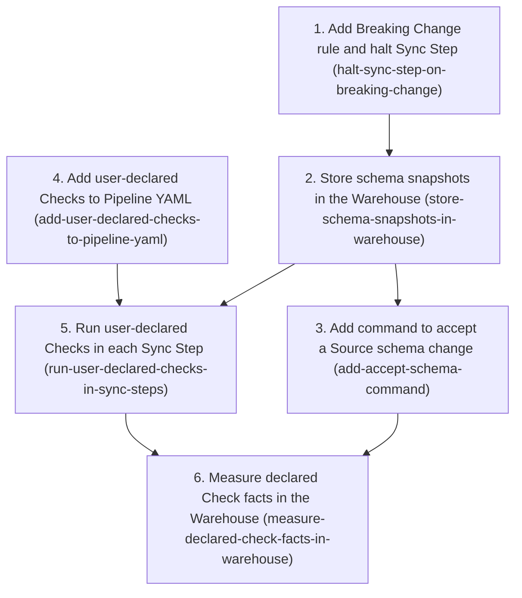

# Horizon 2 — Finish the Check system: Breaking Changes and user-declared Checks

## 🎯 What are we trying to achieve?

Every Sync gets two more safety nets. First, if a Source table's columns change in a way that would break things downstream (a column dropped, renamed or changed type), adops stops that Step before copying anything and skips every Step after it. The user accepts an intended change with one command, `adops accept-schema`. Second, users can write their own per-table rules in the Pipeline YAML (`not_null`, `accepted_values`, `min_rows`, `freshness`), and a failed rule stops the run the same way. Both are proven against real Postgres containers in the Docker end-to-end test, with 100% line and branch coverage.

## 🧠 Why does this change need to happen?

After horizon 1, adops copies the demo shop's tables into the Warehouse and runs built-in Checks (unique keys, no lost rows). But if someone renames `orders.total` in the shop database, the next run copies the changed shape silently and breaks whatever reads it. There is also no way for a user to say "email must never be empty" or "this table must be refreshed daily". ADR-0013 promised both as the next step of the Check system.

## At a glance

- **Phases:** 6
- **Complexity:** Medium. The phases are small slices across layers. The gate raised no blockers; it healed 2 majors and 2 minors, including one phase split you approved.
- **Main risk:** false Breaking Changes from Postgres type aliases (`varchar` vs `character varying`) or dlt's own `_dlt_*` columns. These are handled by a normalizing pure rule and its tests.
- **Quality target:** 100% line and branch coverage (CI gate). Docker E2E proves break → halt → accept → pass, and a failing `not_null(email)`. No secret or row value appears in any output.
- **Testing focus:** snapshot save timing (only after every Check passes), redaction of secrets and URLs, boundary verdicts (freshness exactly at the limit, naive vs aware timestamps), real DuckDB/sqlite adapter tests instead of mocks, and E2E ordering (`DROP TABLE` stays last).

# Implementation plan

## Order of work

```
Phase 1 — Add Breaking Change rule and halt Sync Step
        ↓  (Phase 2 needs the rule and the store port)
Phase 2 — Store schema snapshots in the Warehouse
        ↓  (Phase 3 needs the real store so accept-schema has something to write)
Phase 3 — Add command to accept a Source schema change
        ↓  (Phase 4 independent domain work, ordered after Breaking Changes per the agreed priority)
Phase 4 — Add user-declared Checks to Pipeline YAML
        ↓  (Phase 5 applies the declared-Check rules inside the Step, before the snapshot save)
Phase 5 — Run user-declared Checks in each Sync Step
        ↓  (Phase 6 measures the facts the Step now judges; its E2E edits follow the accept-schema scenario)
Phase 6 — Measure declared Check facts in the Warehouse
```



### Phase 1 — Add Breaking Change rule and halt Sync Step

Technical ID: `halt-sync-step-on-breaking-change` · Breaking Change detection · cross-cutting · medium

**Goal** — Give the domain a pure rule that compares a Source table's current shape (column names and normalized types) with its last recorded schema snapshot and lists every Breaking Change: a dropped column, a renamed column (seen as a drop plus an add) or a retyped column. An added column is not a Breaking Change. Then make a Sync Step use that rule: make a Sync Step compare each table's preflight shape with its stored schema snapshot through a new SchemaSnapshotStore port. On any Breaking Change, the whole Step fails before any table loads and every later Step is skipped. The current shapes are saved as the new snapshot only after all of the Step's Checks pass. A first run with no snapshot records a baseline.

**Why** — adops needs one pure rule that decides what a Breaking Change is (dropped, renamed or retyped column; an added column is fine), and a Sync Step that applies it before any data is copied. This is one small slice across the domain and application layers: the rule has no other consumer, so it ships with the Step change that uses it. Saving the snapshot only after every Check passes means a failed run can never quietly accept a changed shape.

**Changes**

- Create src/adops/domain/schema_snapshot.py with a frozen TableShape (an immutable mapping of column name to normalized type) and a frozen BreakingChange value (column, kind dropped|retyped, previous type, current type, and a plain message that holds no row values).
- Add normalize_column_type(raw: str) -> str: lowercase it, collapse whitespace, and map Postgres aliases to one canonical spelling (character varying -> varchar, int4 -> integer, int8 -> bigint, timestamp with time zone -> timestamptz, bool -> boolean, and so on). Keep type parameters such as numeric(10, 2), so a precision change still counts as a retype.
- Add find_breaking_changes(previous: TableShape, current: TableShape) -> tuple[BreakingChange, ...]: report columns in previous that are missing from current as dropped, and columns whose normalized type differs as retyped. Ignore added columns and any column whose name starts with _dlt_. Return them in a stable, sorted order.
- Extend SourceFacts in domain/checks.py with column_types: Mapping[str, str] (default empty) next to the existing columns field, so preflight can report the shape it measured.
- In application/ports.py, add a SchemaSnapshotStore Protocol with load(warehouse: ResolvedConnection, pipeline: str, source: str, table: str) -> TableShape | None and save(warehouse, pipeline, source, table, shape: TableShape) -> None. The Warehouse credentials are passed on every call, the same way Sync receives them, so the adapter never holds a secret.
- In run_pipeline.py, add BreakingChangeError(StepError) whose message reads 'Step <step>: Breaking Change in <table>: <column> dropped|retyped (<old> -> <new>)' for every broken table and never contains a secret or a row value.
- Give PlannedStep a pipeline name and a snapshot_store field, bound at plan time (by closure, never through Dagster run config). After the existing preflight Checks pass, load each table's snapshot and run find_breaking_changes against a TableShape built from SourceFacts.column_types. Raise BreakingChangeError before sync() is called. If there is no snapshot, treat the table as a baseline.
- After all load Checks pass, save every table's current shape through the store. Wrap load and save in the existing _guard so store failures become a redacted StepError (a SyncFailedError naming the snapshot store), never a raw exception.
- Move URL_PATTERN from infrastructure/dlt_sync.py into application/run_pipeline.py (dlt_sync already imports from there) and make PlannedStep._redact mask scheme:// URLs as well as passwords, so a snapshot-store error carrying a DSN is fully redacted; dlt_sync._redact reuses the moved pattern.
- Add snapshot_store: SchemaSnapshotStore | None = None to run_pipeline and thread it into _build_plan. None means detection is off; this keeps `adops run` working until the very next phase wires in the real store and makes the parameter required (the switch lives for exactly one phase).
- Add an in-memory FakeSnapshotStore to tests/unit/application/fakes.py, plus tests for these cases: first run saves a baseline; same shape passes; added column passes; dropped or retyped column fails the Step with sync() never called and later Steps reported as SKIPPED; a failed load Check does not save; store errors are redacted.
- In GLOSSARY.md, change the Breaking Change entry to say that it halts the whole Sync Step and every later Step.
- Write domain unit tests for every branch: no change, an added column only, a drop, a rename (drop plus add), a retype, aliases that normalize to the same type, a precision change, and _dlt_* columns being ignored.

**Files / areas**

- `src/adops/domain/schema_snapshot.py`
- `src/adops/domain/checks.py`
- `tests/unit/domain/test_schema_snapshot.py`
- `tests/unit/domain/test_checks.py`
- `src/adops/application/ports.py`
- `src/adops/application/run_pipeline.py`
- `tests/unit/application/fakes.py`
- `tests/unit/application/test_run_pipeline.py`
- `GLOSSARY.md`
- `src/adops/infrastructure/dlt_sync.py`

**How to verify**

- **Pure rule classifies drops, retypes and aliases correctly** — `uv run pytest tests/unit/domain/test_schema_snapshot.py -q` passes and includes cases for: 'character varying' vs 'varchar', 'int4' vs 'integer', 'int8' vs 'bigint', 'timestamp with time zone' vs 'timestamptz', 'bool' vs 'boolean' (all give no Breaking Change)
- **Breaking Change stops the Step before sync() and skips later Steps** — In tests/unit/application/test_run_pipeline.py a test with a dropped column asserts the fake Sync recorded zero sync() calls and the following Step's StepReport status is StepStatus.SKIPPED
- **Snapshot saved only after every Check passes; first run records baseline** — A test with an empty FakeSnapshotStore runs the Step and asserts the store then holds a TableShape for every table of the Step
- **Store failures and Breaking Change messages hold no secret or row value** — A test makes FakeSnapshotStore.load raise an exception whose text contains a password and a postgresql:// URL, and asserts the resulting StepError text contains neither, but does mention the snapshot store
- **Rule in domain, port in application, store holds no verdict or secret** — `grep -rn 'find_breaking_changes' src/adops` shows the definition in domain/schema_snapshot.py and its only caller in application/run_pipeline.py; no column-by-column comparison is written inline in run_pipeline.py

**Done when** — A Sync Step that halts on a Breaking Change before sync() runs and saves snapshots only after every Check passes, decided by find_breaking_changes in src/adops/domain/schema_snapshot.py and proven by tests/unit/application/test_run_pipeline.py against FakeSnapshotStore, and every check under *How to verify* passes its bar.

**Depends on** — nothing — can start immediately

**Guards**

- g3: every new branch (baseline, pass, break, save failure, None store) is covered in this phase
- g6: application code imports only domain types and typing; no os, pathlib, dlt or dagster
- g10: application code imports only domain types and typing; no os, pathlib, dlt or dagster
- g7: the store gets Warehouse credentials as call arguments bound by closure, not through run config; no pragma added
- g1: no new dependency
- g8: the Breaking Change verdict comes only from the pure domain rule; the store only loads and saves

<details><summary>Reference — full rubric</summary>

| Dimension | Rule | Pass criteria | Failure examples | minScore |
|---|---|---|---|---|
| breaking-change-rule-correctness | find_breaking_changes and normalize_column_type in src/adops/domain/schema_snapshot.py report every dropped or retyped column, ignore added and _dlt_* columns, treat Postgres alias spellings as the same type, and keep type parameters so a precision change counts as a retype. 10 means no reviewer could ask for more; 8 is the expected score for a competent, complete implementation; minScore is the bar for ACCEPTABLE. | `uv run pytest tests/unit/domain/test_schema_snapshot.py -q` passes and includes cases for: 'character varying' vs 'varchar', 'int4' vs 'integer', 'int8' vs 'bigint', 'timestamp with time zone' vs 'timestamptz', 'bool' vs 'boolean' (all give no Breaking Change)<br>A test shows numeric(10, 2) -> numeric(12, 2) is reported as retyped, and 'NUMERIC(10,2)' vs 'numeric(10, 2)' is NOT (case and whitespace only)<br>A test shows an added column gives an empty result, and a renamed column gives exactly one 'dropped' entry for the old name<br>A test shows a _dlt_load_id / _dlt_id column present in previous but missing in current gives no Breaking Change<br>A test with several broken columns in shuffled input order asserts one exact, sorted tuple | Raw type strings are compared, so a snapshot holding 'character varying' and a preflight reporting 'varchar' flags a false retype on every run<br>normalize_column_type strips parentheses, so numeric(10,2) -> numeric(12,2) passes silently<br>Whitespace is collapsed but the space after the comma is not normalized, so 'numeric(10,2)' and 'numeric(10, 2)' count as a retype<br>Result order follows dict iteration, so the error message changes between runs | 8 |
| halt-before-any-load | PlannedStep checks every table of the Step against its stored snapshot after preflight and raises BreakingChangeError (a StepError) before sync.sync is ever called; InOrderOrchestrator then reports every later Step as SKIPPED. 10 means no reviewer could ask for more; 8 is the expected score for a competent, complete implementation; minScore is the bar for ACCEPTABLE. | In tests/unit/application/test_run_pipeline.py a test with a dropped column asserts the fake Sync recorded zero sync() calls and the following Step's StepReport status is StepStatus.SKIPPED<br>A test with two broken tables in one Step asserts the error message names both tables (all tables are checked before raising, not just the first)<br>`grep -n 'class BreakingChangeError' src/adops/application/run_pipeline.py` shows it subclasses StepError<br>A test with a matching snapshot and a test with only an added column both report the Step as passed and sync() called | Detection runs inside the per-table load loop, so table 1 is synced before table 2's Breaking Change is found<br>BreakingChangeError subclasses Exception instead of StepError, so InOrderOrchestrator crashes instead of marking later Steps SKIPPED<br>Only the first broken table is reported, so the user fixes it and hits a second halt on the next run | 8 |
| snapshot-save-timing | The current shapes are saved through SchemaSnapshotStore only after the Step's load Checks all pass, for every table in the Step, and a table with no snapshot is treated as a baseline rather than a break. 10 means no reviewer could ask for more; 8 is the expected score for a competent, complete implementation; minScore is the bar for ACCEPTABLE. | A test with an empty FakeSnapshotStore runs the Step and asserts the store then holds a TableShape for every table of the Step<br>A test where a built-in load Check fails (e.g. row-count mismatch) asserts FakeSnapshotStore.save was never called<br>A test where the second table's load Check fails asserts no table's snapshot was saved (no partial save)<br>A test with a Breaking Change asserts the stored snapshot is unchanged afterwards | Shapes are saved right after preflight detection passes, before load Checks, so a run whose load Check fails still moves the baseline<br>save is called inside the per-table loop, so table A's new shape is stored even though table B's Check fails later in the same Step<br>A missing snapshot is compared as an empty TableShape, which reports nothing but also never saves a baseline | 8 |
| redacted-store-and-break-errors | Exceptions from the snapshot store's load or save become a redacted SyncFailedError naming the snapshot store via the existing _guard, and BreakingChangeError messages contain only Step, table, column and type names (ADR-0007). 10 means no reviewer could ask for more; 8 is the expected score for a competent, complete implementation; minScore is the bar for ACCEPTABLE. | A test makes FakeSnapshotStore.load raise an exception whose text contains a password and a postgresql:// URL, and asserts the resulting StepError text contains neither, but does mention the snapshot store<br>The same is tested for FakeSnapshotStore.save<br>A test asserts the BreakingChangeError text matches 'Step <step>: Breaking Change in <table>: <column> dropped' / 'retyped (<old> -> <new>)' and contains no ResolvedConnection field value | store.load is called directly rather than through _guard, so a raw driver error with the DSN reaches the CLI<br>The error message is built with an f-string over the ResolvedConnection object, leaking its repr<br>save is guarded but load is not | 8 |
| layer-placement | The Breaking Change verdict lives only in the pure domain module, the SchemaSnapshotStore Protocol lives in application/ports.py and takes the Warehouse ResolvedConnection on every call, and the store is bound into PlannedStep by closure, not Dagster run config. 10 means no reviewer could ask for more; 8 is the expected score for a competent, complete implementation; minScore is the bar for ACCEPTABLE. | `grep -rn 'find_breaking_changes' src/adops` shows the definition in domain/schema_snapshot.py and its only caller in application/run_pipeline.py; no column-by-column comparison is written inline in run_pipeline.py<br>`grep -n 'def load\\|def save' src/adops/application/ports.py` shows both take a warehouse ResolvedConnection argument<br>FakeSnapshotStore in tests/unit/application/fakes.py only stores and returns TableShape values, with no comparison logic<br>`grep -rn 'snapshot' src/adops/infrastructure/dagster_orchestrator.py` shows no snapshot store passed through run config | run_pipeline compares SourceFacts.column_types to the snapshot dict itself, duplicating the domain rule with a different alias table<br>The port's save signature omits the warehouse, so the future adapter would have to hold credentials<br>The store is threaded through Dagster op config, putting credentials in run config | 7 |

Healer hint: If the save-timing tests fail, move the snapshot save out of the per-table loop to a single pass after all load Checks for the whole Step have passed, and wrap both load and save in _guard.

</details>

### Phase 2 — Store schema snapshots in the Warehouse

Technical ID: `store-schema-snapshots-in-warehouse` · Breaking Change detection · cross-cutting · medium

**Goal** — Add the SchemaSnapshotStore adapter. It keeps schema snapshots in the adops-owned table adops._adops_schema_snapshots in each Environment's own Warehouse, and DltSync's preflight reports each Source table's normalized column types, so real runs have real shapes to compare. Wire the store into `adops run` so Breaking Change detection is always on.

**Why** — The application now asks a snapshot store for the last shape, but no real store exists yet. Each Warehouse keeps its own snapshot table, so every Environment remembers its own baseline. The store sits in its own schema so it never collides with the raw_<source> tables that dlt owns. Wiring it into `adops run` in the same phase removes the temporary 'detection off' switch right away; this is one small slice (adapter plus composition-root wiring).

**Changes**

- Create src/adops/infrastructure/schema_snapshot_store.py with WarehouseSnapshotStore(project: Path, warehouse_kind: str). It reaches the Warehouse through dlt's sql_client on the destination built by dlt_sync.warehouse_destination, so one code path serves Postgres and DuckDB. The dataset/schema is 'adops' and the dlt pipelines_dir is under <project>/.adops.
- On first use, create the table _adops_schema_snapshots (pipeline, source, table_name, shape_json, recorded_at) if it does not exist. load returns None when there is no row. save deletes the row with that key and inserts the new one in a single transaction. Use parameterized SQL only.
- Serialize TableShape as sorted JSON and rebuild it on load. Never write a credential into the table.
- In dlt_sync._source_facts, fill SourceFacts.column_types from the SQLAlchemy inspector. Compile each column type with the engine's dialect, so that timestamptz keeps its time zone, then pass it through normalize_column_type. Keep _dlt_* columns out of the result.
- Test the store against a real DuckDB file in tmp_path: create on first use, load with no row gives None, save then load round-trips, saving again replaces the row, and keys are kept apart. Test column_types against the existing sqlite shop fixture.
- Make snapshot_store a required parameter of run_pipeline and remove the temporary None branch and its test.
- In run_command.py, add a build_snapshot_store(project) factory that returns WarehouseSnapshotStore(project, 'postgres') and that tests can monkeypatch, and pass it to run_pipeline.
- Add a test_run_command test proving adops run passes the store built by build_snapshot_store.
- Update every run_pipeline caller in tests/unit/application/test_run_pipeline.py and tests/unit/infrastructure/test_dagster_orchestrator.py to pass a FakeSnapshotStore now that the parameter is required.

**Files / areas**

- `src/adops/infrastructure/schema_snapshot_store.py`
- `src/adops/infrastructure/dlt_sync.py`
- `tests/unit/infrastructure/test_schema_snapshot_store.py`
- `tests/unit/infrastructure/test_dlt_sync.py`
- `src/adops/application/run_pipeline.py`
- `src/adops/interface/run_command.py`
- `tests/unit/interface/test_run_command.py`
- `tests/unit/application/test_run_pipeline.py`
- `tests/unit/infrastructure/test_dagster_orchestrator.py`

**How to verify**

- **Snapshot table round-trips and replaces on a real DuckDB Warehouse** — `uv run pytest tests/unit/infrastructure/test_schema_snapshot_store.py -q` passes using a DuckDB file under tmp_path, with no mock of sql_client
- **Preflight reports normalized, timezone-faithful column types** — A test in tests/unit/infrastructure/test_dlt_sync.py runs preflight on the sqlite shop fixture and asserts the exact column_types mapping for one table, with every value already equal to normalize_column_type(value)
- **Parameterized SQL, no credential stored or leaked** — `grep -nE 'execute_sql\(f|execute\(f|\.format\(' src/adops/infrastructure/schema_snapshot_store.py` returns nothing
- **adops run always wires the real store** — `grep -n 'snapshot_store' src/adops/application/run_pipeline.py` shows no '| None' and no '= None' default
- **Framework code stays in infrastructure** — `grep -rnE 'import (dlt|sqlalchemy)|from (dlt|sqlalchemy)' src/adops/application src/adops/domain src/adops/interface` returns nothing new

**Done when** — src/adops/infrastructure/schema_snapshot_store.py, used by `adops run`, whose save/load round-trip of preflight-measured shapes through adops._adops_schema_snapshots on a real DuckDB Warehouse is proven by tests/unit/infrastructure/test_schema_snapshot_store.py, and every check under *How to verify* passes its bar.

**Depends on** — Add Breaking Change rule and halt Sync Step

**Guards**

- g10: dlt and sqlalchemy imports stay in infrastructure/
- g3: the adapter is covered at 100% branch coverage by real DuckDB/sqlite tests, not mocks
- g1: duckdb is already a dev dependency used by unit tests, so no new dependency and no re-lock
- g7: credentials arrive per call and the adapter keeps none; no pragma added
- g6: application/run_pipeline.py change only removes the None branch; no framework import added

**Rollback** — To undo, run DROP TABLE adops._adops_schema_snapshots (and DROP SCHEMA adops if it is empty) in each Warehouse. The table holds only column names and types, so removing it just means the next run records a fresh baseline.

<details><summary>Reference — full rubric</summary>

| Dimension | Rule | Pass criteria | Failure examples | minScore |
|---|---|---|---|---|
| store-roundtrip-on-real-warehouse | WarehouseSnapshotStore creates adops._adops_schema_snapshots on first use, returns None for an unknown key, round-trips a TableShape exactly, keeps one row per (pipeline, source, table_name) key, and keeps keys apart, proven against a real DuckDB file. 10 means no reviewer could ask for more; 8 is the expected score for a competent, complete implementation; minScore is the bar for ACCEPTABLE. | `uv run pytest tests/unit/infrastructure/test_schema_snapshot_store.py -q` passes using a DuckDB file under tmp_path, with no mock of sql_client<br>A test saves twice for the same key and asserts, by querying the DuckDB file directly, that `SELECT count(*) FROM adops._adops_schema_snapshots WHERE ...` returns 1 and load returns the second shape<br>A test builds two separate store instances on the same file (simulating two runs) and asserts the second does not fail on table creation<br>Tests save under keys differing only in pipeline, only in source, and only in table, and assert each load returns its own shape<br>The table is created in the 'adops' schema, not in a raw_<source> dataset (checked by querying information_schema.tables in the test) | save inserts without deleting the old row, so load reads an arbitrary row with LIMIT 1 and an accepted change reappears as a Breaking Change<br>CREATE TABLE without IF NOT EXISTS works in the single-instance test but fails on the second real run<br>The dlt dataset defaults to the pipeline's dataset, so the snapshot table lands inside raw_shop where dlt may drop it | 8 |
| measured-shape-fidelity | dlt_sync._source_facts fills SourceFacts.column_types with each column's type compiled by the engine's dialect and passed through normalize_column_type, excluding _dlt_* columns, so that a real snapshot compares equal to the next run's measurement. 10 means no reviewer could ask for more; 8 is the expected score for a competent, complete implementation; minScore is the bar for ACCEPTABLE. | A test in tests/unit/infrastructure/test_dlt_sync.py runs preflight on the sqlite shop fixture and asserts the exact column_types mapping for one table, with every value already equal to normalize_column_type(value)<br>A test asserts column_types keys equal SourceFacts.columns minus any _dlt_ prefixed names<br>`grep -n 'compile' src/adops/infrastructure/dlt_sync.py` shows types compiled with the engine dialect, not str(column['type'])<br>Running preflight twice on an unchanged Source gives equal TableShapes (no Breaking Change on a second run) | str(col['type']) is used, giving 'TIMESTAMP' for a timestamptz column, so a timezone change is never detected<br>Types are not normalized in the adapter, so the very first Postgres run stores 'character varying' while a later code path compares against 'varchar'<br>column_types includes a column that columns does not, so a retyped/dropped decision uses the wrong set | 7 |
| sql-and-secret-safety | Every statement the store runs passes key and shape values as parameters, shape_json holds only column names and types, and the store keeps no ResolvedConnection between calls (ADR-0007). 10 means no reviewer could ask for more; 8 is the expected score for a competent, complete implementation; minScore is the bar for ACCEPTABLE. | `grep -nE 'execute_sql\(f\|execute\(f\|\.format\(' src/adops/infrastructure/schema_snapshot_store.py` returns nothing<br>A test saves under a table name containing a single quote and loads it back<br>A test reads every column of the stored row directly from DuckDB and asserts no password or connection URL string appears<br>WarehouseSnapshotStore.__init__ takes only project and warehouse_kind, and no attribute holds credentials after a call (asserted by inspecting vars(store) in a test) | The key is interpolated with an f-string, so a table named o'rders breaks the SQL<br>The store caches the dlt destination (with credentials) on self after first use for speed<br>shape_json is the repr of the SourceFacts object, which pulls in more than names and types | 8 |
| detection-always-on | run_pipeline requires snapshot_store (the temporary None branch is gone) and `adops run` passes the store built by build_snapshot_store(project). 10 means no reviewer could ask for more; 8 is the expected score for a competent, complete implementation; minScore is the bar for ACCEPTABLE. | `grep -n 'snapshot_store' src/adops/application/run_pipeline.py` shows no '\| None' and no '= None' default<br>A test in tests/unit/interface/test_run_command.py monkeypatches build_snapshot_store to return a sentinel and asserts run_pipeline received that exact object<br>build_snapshot_store is a function in src/adops/interface/run_command.py that returns WarehouseSnapshotStore(project, 'postgres'), and nothing builds a store at import time | The None default is kept 'for safety', so a caller that forgets the store silently runs with detection off<br>The store is built at module import, so the monkeypatch test passes but real runs ignore the project path | 7 |
| adapter-layer-placement | dlt and SQLAlchemy usage for snapshot storage and type measurement sits only in src/adops/infrastructure; the application change only removes the None branch and the interface layer only composes. 10 means no reviewer could ask for more; 8 is the expected score for a competent, complete implementation; minScore is the bar for ACCEPTABLE. | `grep -rnE 'import (dlt\|sqlalchemy)\|from (dlt\|sqlalchemy)' src/adops/application src/adops/domain src/adops/interface` returns nothing new<br>schema_snapshot_store.py imports TableShape from domain and returns it; it does not import from interface<br>The store reuses dlt_sync.warehouse_destination rather than building its own connection string | run_command.py builds a dlt destination itself to pass into the store<br>The store builds its own Postgres URL from ResolvedConnection fields, duplicating (and possibly mis-escaping) the existing destination code | 7 |

Healer hint: If the replace test or a second-run test fails, make save do DELETE-then-INSERT inside one sql_client transaction and use CREATE SCHEMA/TABLE IF NOT EXISTS so repeated store instances are idempotent.

</details>

### Phase 3 — Add command to accept a Source schema change

Technical ID: `add-accept-schema-command` · Breaking Change detection · cross-cutting · medium

**Goal** — Add `adops accept-schema <pipeline> <table> --env <environment>`, which records the table's current Source shape as the new snapshot. Prove in the Docker E2E that an injected Breaking Change halts the run and that accept-schema recovers it.

**Why** — Detection without a way to accept an intended change would block a Pipeline forever, so the halt and the accept command ship together. The end-to-end scenario needs both to show the full story: break, halt, accept, pass. This is one small slice across layers: a use case, a CLI command and the wiring.

**Changes**

- Create application/accept_schema.py with accept_schema(pipeline_text, settings_text, environment_name, table, env, sync, snapshot_store). It loads and validates the Pipeline, picks the Environment, finds the single Sync Step that lists the table (a PipelineValidationError if there is none, or more than one), resolves only that Source's and the Warehouse's Secret References, runs sync.preflight on that table, refuses when the table is missing in the Source, and saves its shape.
- Create interface/accept_schema_command.py following run_command's pattern: read adops.yaml and the Pipeline file, merge .env with os.environ, use an explicit --env option (default dev) and print the Environment it wrote to, show only sanitized errors (unexpected errors by type name only). Register it in cli.py.
- Add unit tests for: the use case (success, unknown table, table in two Steps, table missing in Source, unknown Environment) with fakes; the CLI (success message, validation error, missing secret, unexpected error showing only the type).
- In tests/e2e/test_demo_sync.py, let adops_run take any adops arguments. After the passing runs, ALTER the demo Source (for example drop orders.customer_id). Assert that adops run fails with a Breaking Change message, that Warehouse row counts are unchanged, and that the output holds no secret. Then run accept-schema shop_sync orders and assert that the next run passes. Keep the destructive DROP TABLE scenario last.

**Files / areas**

- `src/adops/application/accept_schema.py`
- `src/adops/interface/accept_schema_command.py`
- `src/adops/interface/cli.py`
- `tests/unit/application/test_accept_schema.py`
- `tests/unit/interface/test_accept_schema_command.py`
- `tests/e2e/test_demo_sync.py`

**How to verify**

- **accept_schema targets exactly one table and resolves only its secrets** — `uv run pytest tests/unit/application/test_accept_schema.py -q` passes with cases: success, unknown table, table in two Steps, table missing in Source, unknown Environment
- **CLI takes an explicit Environment and prints only sanitized errors** — `uv run adops accept-schema --help` lists PIPELINE, TABLE and --env
- **Docker E2E proves break, halt, accept, pass without corrupting later scenarios** — `uv run pytest tests/e2e -m e2e` passes on a Docker host within the 20-minute CI limit
- **Halt and accept output hold no secret or row value** — In tests/e2e/test_demo_sync.py, assert_no_secret_or_row_value is called on the halted run's output
- **Use case framework-free, file and env reading in interface** — `grep -nE '^(import|from) ' src/adops/application/accept_schema.py` shows only stdlib typing/collections, adops.domain and adops.application modules

**Done when** — The Docker E2E scenario in tests/e2e/test_demo_sync.py where an injected Breaking Change halts adops run and `adops accept-schema shop_sync orders` lets the next run pass, and every check under *How to verify* passes its bar.

**Depends on** — Store schema snapshots in the Warehouse

**Guards**

- g3: the use case, command and factory are covered by unit tests in this phase
- g5: the new E2E steps run inside the existing demo fixture before the final DROP TABLE, within the 20-minute job
- g6: the use case lives in application/ with no os/pathlib; file and .env reading stay in interface/
- g10: the use case lives in application/ with no os/pathlib; file and .env reading stay in interface/
- g7: secrets reach the store and Sync only as resolved arguments; no pragma added

**Rollback** — The command only rewrites one row in adops._adops_schema_snapshots for the chosen Environment. To undo an accidental accept, restore the previous Source shape and run accept-schema again, or delete that row so the next run records a new baseline.

<details><summary>Reference — full rubric</summary>

| Dimension | Rule | Pass criteria | Failure examples | minScore |
|---|---|---|---|---|
| accept-use-case-scoping | application/accept_schema.py finds the single Sync Step listing the table, resolves only that Source's and the Warehouse's Secret References, runs preflight, refuses a table missing from the Source, and saves the measured shape. 10 means no reviewer could ask for more; 8 is the expected score for a competent, complete implementation; minScore is the bar for ACCEPTABLE. | `uv run pytest tests/unit/application/test_accept_schema.py -q` passes with cases: success, unknown table, table in two Steps, table missing in Source, unknown Environment<br>A test leaves a secret for a different Source unset and asserts accept_schema still succeeds<br>A test with table_exists=False in the fake preflight asserts nothing is saved and a PipelineValidationError (or StepError) is raised<br>A test asserts the saved TableShape equals the one built from the fake preflight's column_types, keyed by the Step's pipeline and source | All Steps' secrets are resolved up front, so an unrelated missing secret blocks accepting an orders change<br>A missing Source table is saved as an empty TableShape, so the next run sees every previously-known column as fine and the real problem is hidden<br>The pipeline key used for save differs from the one run_pipeline loads with, so accept succeeds but the next run still halts | 8 |
| cli-env-and-sanitized-output | `adops accept-schema <pipeline> <table> --env <environment>` is registered, defaults --env to dev, prints the Environment it wrote to, exits non-zero on error, and shows unexpected errors by type name only (ADR-0007, ADR-0009). 10 means no reviewer could ask for more; 8 is the expected score for a competent, complete implementation; minScore is the bar for ACCEPTABLE. | `uv run adops accept-schema --help` lists PIPELINE, TABLE and --env<br>tests/unit/interface/test_accept_schema_command.py asserts the success output names the Environment (e.g. 'dev')<br>A test makes the use case raise RuntimeError('postgresql://u:hunter2@h/db') and asserts the output contains 'RuntimeError' but neither 'hunter2' nor 'postgresql://', with a non-zero exit code<br>Tests cover a validation error and a missing secret, each with a non-zero exit code and a message naming the problem but no secret value | Unexpected errors print str(exc), leaking the DSN from a driver error<br>--env is optional with no echo, so a user accepts in prod while thinking they targeted dev<br>The command catches errors but exits 0 | 8 |
| e2e-break-halt-accept-recover | tests/e2e/test_demo_sync.py alters the demo Source, proves adops run halts with a Breaking Change and leaves Warehouse row counts unchanged, runs `adops accept-schema shop_sync orders`, and proves the next run passes, all before the destructive DROP TABLE scenario. 10 means no reviewer could ask for more; 8 is the expected score for a competent, complete implementation; minScore is the bar for ACCEPTABLE. | `uv run pytest tests/e2e -m e2e` passes on a Docker host within the 20-minute CI limit<br>The halted run is asserted on its message text (e.g. contains 'Breaking Change in orders' and the dropped column name), not only a non-zero exit code<br>counts(env) taken before and after the halted run are asserted equal<br>After accept-schema, the next adops run exits 0 and assert_all_checks_pass holds<br>The DROP TABLE customers step remains the last Source mutation in the test | The test asserts only returncode != 0, which would also pass if the run crashed for an unrelated reason<br>The ALTER is done after the DROP TABLE scenario, or the altered column breaks an existing later assertion that selects orders.customer_id<br>Warehouse counts are not compared, so a halt that happens after loading goes unnoticed | 8 |
| no-secret-in-e2e-output | Both the halted run's output and the accept-schema output are checked against the demo's secrets and row values (ADR-0007). 10 means no reviewer could ask for more; 8 is the expected score for a competent, complete implementation; minScore is the bar for ACCEPTABLE. | In tests/e2e/test_demo_sync.py, assert_no_secret_or_row_value is called on the halted run's output<br>assert_no_secret_or_row_value is also called on the accept-schema output and on the recovered run's output | Only the halted run's output is checked, while accept-schema echoes the resolved Warehouse URL on success | 8 |
| use-case-layer-placement | accept_schema.py in application/ takes text and resolved inputs and reaches Sync and the store only through ports; reading adops.yaml, the Pipeline file, .env and os.environ happens only in interface/accept_schema_command.py. 10 means no reviewer could ask for more; 8 is the expected score for a competent, complete implementation; minScore is the bar for ACCEPTABLE. | `grep -nE '^(import\|from) ' src/adops/application/accept_schema.py` shows only stdlib typing/collections, adops.domain and adops.application modules<br>The accept_schema command builds its Sync and store via the same factories run_command uses (or factories that tests can monkeypatch), not by importing infrastructure inside application<br>tests/unit/application/test_accept_schema.py uses the fakes from tests/unit/application/fakes.py, not real dlt | accept_schema.py imports WarehouseSnapshotStore directly, coupling application to infrastructure<br>The use case reads the Pipeline file from a Path itself | 7 |

Healer hint: If the recovered run still halts after accept-schema, the use case is saving under a different (pipeline, source, table) key than PlannedStep loads; build both keys from the same Step fields.

</details>

### Phase 4 — Add user-declared Checks to Pipeline YAML

Technical ID: `add-user-declared-checks-to-pipeline-yaml` · Checks · domain · medium

**Goal** — Let Pipeline YAML declare per-table Checks (not_null, accepted_values, min_rows, freshness). The loader validates them, and pure domain rules decide each verdict from measured facts, taking 'now' as an argument so freshness is deterministic.

**Why** — Users need to state their own data rules beside the built-in ones. The verdict logic must be pure so that adapters only measure and the same facts always give the same answer. The YAML shape and its validation are the contract that `adops validate`, the adapters and users all depend on.

**Changes**

- In domain/pipeline.py, add a per-table `checks:` list of tagged pydantic models with a `type` discriminator: not_null{column}, accepted_values{column, values (non-empty, unique)}, min_rows{count >= 1} and freshness{column, max_age_hours >= 1}. extra=forbid. Reject a duplicate declared Check on the same table with a `steps[i].tables[j].checks[k]` path.
- Give each declared Check a display name that is unique per table (for example not_null(email), accepted_values(status), min_rows, freshness(updated_at)), so Dagster metadata keys of the form table.check stay distinct.
- Widen CheckResult.check from CheckName to str (CheckName is a StrEnum, so built-in Checks still match). Let SkipChecks.checks also name a declared Check by its display name, and make the SyncTable validator reject names that are neither applicable built-ins nor declared on that table.
- Extend LoadFacts with null_counts, unexpected_value_counts (both Mapping[str, int]) and newest_values (Mapping[str, datetime | None]), all defaulting to empty.
- Add evaluate_declared_checks(table, load_facts, now: datetime) -> list[CheckResult], reusing _evaluate's skip/pass/fail handling. min_rows uses warehouse_rows_after. freshness fails when there is no newest value or now - newest > max_age_hours, and treats a naive timestamp as UTC. Rules are pure and take now as an input.
- Cover every validation and verdict branch in the domain tests, including loader error paths for malformed Checks (unknown type, empty values, count 0, missing column).

**Files / areas**

- `src/adops/domain/checks.py`
- `src/adops/domain/pipeline.py`
- `tests/unit/domain/test_checks.py`
- `tests/unit/domain/test_pipeline.py`
- `tests/unit/domain/test_loader.py`

**How to verify**

- **Declared Checks parse strictly with precise error paths** — `uv run pytest tests/unit/domain/test_pipeline.py tests/unit/domain/test_loader.py -q` passes with rejection cases for: unknown type, extra key, empty values, repeated value in values, count 0, max_age_hours 0, missing column
- **Each declared Check gives the right verdict at its boundaries** — tests/unit/domain/test_checks.py covers: not_null passes at 0 nulls and fails at 1; accepted_values passes at 0 unexpected and fails at 1; min_rows passes at rows == count and fails at count - 1
- **Unique display names and skip_checks over declared Checks** — A test asserts the display names of one table's four Check kinds are all distinct and match the documented format
- **Failure messages report counts and ages, never row values** — A test builds LoadFacts with an unexpected-value count and asserts the accepted_values failure message contains the count but not any sample value
- **Rules are pure and take now as an argument** — `grep -rnE 'datetime\.now|utcnow|date\.today|time\.time' src/adops/domain` returns nothing

**Done when** — evaluate_declared_checks in src/adops/domain/checks.py, with SyncTable accepting validated `checks:` entries, covered at 100% branch coverage by the domain tests, and every check under *How to verify* passes its bar.

**Depends on** — nothing — can start immediately

**Guards**

- g8: verdicts for all four declared Checks come only from pure domain rules over LoadFacts and an explicit now
- g10: domain code imports only stdlib datetime, pydantic and its own modules; it never calls datetime.now
- g3: every new validator and rule branch is covered in this phase
- g1: no new dependency
- g7: no `pragma: no cover` is added; secrets are passed only as resolved arguments bound by closure
- g6: domain/application code imports no framework, os, pathlib or time

<details><summary>Reference — full rubric</summary>

| Dimension | Rule | Pass criteria | Failure examples | minScore |
|---|---|---|---|---|
| yaml-contract-validation | SyncTable accepts a `checks:` list discriminated by `type` (not_null, accepted_values, min_rows, freshness), forbids extra keys, rejects bad values, and rejects a duplicate Check on the same table with a `steps[i].tables[j].checks[k]` path. 10 means no reviewer could ask for more; 8 is the expected score for a competent, complete implementation; minScore is the bar for ACCEPTABLE. | `uv run pytest tests/unit/domain/test_pipeline.py tests/unit/domain/test_loader.py -q` passes with rejection cases for: unknown type, extra key, empty values, repeated value in values, count 0, max_age_hours 0, missing column<br>A test asserts a duplicate not_null(email) on one table fails with a message containing 'steps[0].tables[0].checks[1]'<br>A test asserts not_null(email) and not_null(status) on the same table are both accepted<br>A test asserts the same Check on two different tables is accepted | Duplicate detection keys on type only, so not_null(email) plus not_null(status) is wrongly rejected<br>The error path stops at tables[j], leaving the user to guess which Check is wrong<br>values is a list with no uniqueness check, so accepted_values: [a, a] is accepted | 8 |
| verdict-rule-correctness | evaluate_declared_checks(table, load_facts, now) returns one CheckResult per declared Check with correct pass/fail at each boundary, using warehouse_rows_after for min_rows and treating a naive newest timestamp as UTC for freshness. 10 means no reviewer could ask for more; 8 is the expected score for a competent, complete implementation; minScore is the bar for ACCEPTABLE. | tests/unit/domain/test_checks.py covers: not_null passes at 0 nulls and fails at 1; accepted_values passes at 0 unexpected and fails at 1; min_rows passes at rows == count and fails at count - 1<br>freshness tests: newest exactly max_age_hours old passes, one second older fails, newest None fails, naive newest with an aware now gives a verdict (no TypeError), newest in a non-UTC offset is compared correctly<br>A test proves min_rows reads warehouse_rows_after, not rows loaded this run, by giving the two different values | A naive newest value is compared to an aware now and raises TypeError at run time<br>min_rows uses the rows loaded this run, so an incremental run with 0 new rows fails min_rows on a full table<br>Freshness uses >= instead of >, so a table exactly at the limit fails | 8 |
| skip-and-display-names | Each declared Check has a display name unique per table (e.g. not_null(email), min_rows), skip_checks may name it with a written reason and then yields SKIPPED, and names that are neither applicable built-ins nor declared on that table are rejected; built-in CheckName values still match. 10 means no reviewer could ask for more; 8 is the expected score for a competent, complete implementation; minScore is the bar for ACCEPTABLE. | A test asserts the display names of one table's four Check kinds are all distinct and match the documented format<br>A test skips 'not_null(email)' with a reason and asserts its CheckResult status is SKIPPED with that reason<br>A test asserts skip_checks: ['not_null(emial)'] (typo) is rejected with a path<br>Existing built-in Check tests in tests/unit/domain/test_checks.py pass unchanged | Widening CheckResult.check to str also widens skip_checks to any string, so typos are silently accepted<br>The display name for accepted_values omits the column, so two accepted_values Checks on one table collide as Dagster metadata keys | 7 |
| messages-hold-no-row-values | Declared Check failure messages name the table, Check and counts or age in hours, but never include the offending row values, the accepted value list items that were violated, or the newest timestamp itself (ADR-0007). 10 means no reviewer could ask for more; 8 is the expected score for a competent, complete implementation; minScore is the bar for ACCEPTABLE. | A test builds LoadFacts with an unexpected-value count and asserts the accepted_values failure message contains the count but not any sample value<br>A test asserts the freshness failure message contains an age or limit in hours but not the ISO string of the newest value | The freshness message prints 'newest updated_at 2026-11-17T09:00:00' which is a row value<br>The accepted_values message lists the unexpected values found, which the adapter would then have to measure and expose | 7 |
| domain-purity-and-determinism | All new code in domain/pipeline.py and domain/checks.py is pure: no clock read, no I/O, now arrives as an argument, and new LoadFacts fields default to empty so existing callers are unaffected. 10 means no reviewer could ask for more; 8 is the expected score for a competent, complete implementation; minScore is the bar for ACCEPTABLE. | `grep -rnE 'datetime\.now\|utcnow\|date\.today\|time\.time' src/adops/domain` returns nothing<br>evaluate_declared_checks has no default value for now (checked by reading its signature)<br>Existing constructions of LoadFacts in tests/unit/application compile and pass unchanged | now: datetime = datetime.now(UTC) as a default argument, evaluated once at import and silently stale in long-running processes<br>A new required LoadFacts field breaks every existing call site | 7 |

Healer hint: If freshness tests raise TypeError, normalize a naive newest value with replace(tzinfo=UTC) before subtracting, and make sure every validator error path includes the checks[k] index.

</details>

### Phase 5 — Run user-declared Checks in each Sync Step

Technical ID: `run-user-declared-checks-in-sync-steps` · Checks · cross-cutting · medium

**Goal** — Make each Sync Step evaluate the table's user-declared Checks after the built-in load Checks, with 'now' from an injected Clock, and fail the Step (skipping every later Step) before the schema snapshot is saved when one fails.

**Why** — The YAML and pure rules from the previous phase decide verdicts, but no run applies them yet. This slice adds the clock (so freshness is deterministic and testable) and the Step logic; it is one small slice across layers (a port, its one system implementation and the wiring). A declared Check whose fact was not measured fails with 'not measured', the same way the built-in row-count Check does, so nothing silently passes before the next phase adds the measurements.

**Changes**

- Add a Clock Protocol (now() -> datetime, timezone-aware) to application/ports.py and a required clock parameter to run_pipeline, bound into each PlannedStep by closure.
- In PlannedStep, after the built-in load Checks, call evaluate_declared_checks(table, load_facts, clock.now()) for every table. Raise CheckFailedError on any failure before the schema snapshot is saved, so a failed declared Check never moves the baseline.
- Add infrastructure/clock.py with SystemClock returning datetime.now(UTC), plus a build_clock factory in run_command.py that is passed to run_pipeline. Update fakes with a FixedClock.
- Update every run_pipeline caller in tests/unit/application/test_run_pipeline.py and tests/unit/infrastructure/test_dagster_orchestrator.py to pass a FixedClock.
- Extend tests/unit/domain/test_domain_purity.py to fail if domain/ calls datetime.now or datetime.utcnow.
- Make a declared Check whose fact is missing from LoadFacts fail with '<check> was not measured' (in the domain rule from the previous phase if not already so) and cover it with a test.

**Files / areas**

- `src/adops/application/ports.py`
- `src/adops/application/run_pipeline.py`
- `src/adops/infrastructure/clock.py`
- `src/adops/interface/run_command.py`
- `tests/unit/application/fakes.py`
- `tests/unit/application/test_run_pipeline.py`
- `tests/unit/infrastructure/test_clock.py`
- `tests/unit/infrastructure/test_dagster_orchestrator.py`
- `tests/unit/interface/test_run_command.py`
- `tests/unit/domain/test_domain_purity.py`

**How to verify**

- **Declared Checks run after built-ins and before the snapshot save** — A test in tests/unit/application/test_run_pipeline.py with a failing not_null fact asserts CheckFailedError, the next Step SKIPPED, and FakeSnapshotStore.save never called
- **Time comes from an injected aware Clock; purity test enforces it** — A test asserts SystemClock().now().tzinfo is not None and its utcoffset() is zero
- **Clock and Step logic sit in the right layers** — `grep -rn 'import dlt\|import sqlalchemy\|import dagster' src/adops/application` returns nothing

**Done when** — PlannedStep evaluates user-declared Checks with an injected Clock and fails the Step before the snapshot save, proven by tests/unit/application/test_run_pipeline.py with FakeSnapshotStore and FixedClock, and every check under *How to verify* passes its bar.

**Depends on** — Add user-declared Checks to Pipeline YAML, Store schema snapshots in the Warehouse

**Guards**

- g3: Clock, SystemClock and every new PlannedStep branch are covered by unit tests in this phase
- g6: application code gains only a Clock Protocol and stdlib datetime types
- g7: clock and store are bound into PlannedStep by closure, never run config; no pragma added
- g8: verdicts come only from evaluate_declared_checks; the Step only applies them
- g10: datetime.now lives only in infrastructure/clock.py; the purity test now enforces this

<details><summary>Reference — full rubric</summary>

| Dimension | Rule | Pass criteria | Failure examples | minScore |
|---|---|---|---|---|
| declared-checks-before-baseline | PlannedStep evaluates declared Checks for every table after the built-in load Checks, raises CheckFailedError on any failure, skips every later Step, and never saves the schema snapshot when a declared Check fails. 10 means no reviewer could ask for more; 8 is the expected score for a competent, complete implementation; minScore is the bar for ACCEPTABLE. | A test in tests/unit/application/test_run_pipeline.py with a failing not_null fact asserts CheckFailedError, the next Step SKIPPED, and FakeSnapshotStore.save never called<br>A test with a FixedClock asserts freshness passes at one time and fails at a later one with identical facts<br>A test asserts declared Check results appear in the Step report alongside built-in ones with their display names | Declared Checks are evaluated after the snapshot save, so a failed run still accepts the new shape<br>clock.now() is called once at plan time instead of after the load, so long runs judge freshness against a stale time | 8 |
| clock-injection-and-purity-test | A Clock Protocol lives in application/ports.py, SystemClock in infrastructure/clock.py returns an aware UTC datetime, run_command passes build_clock(), and the domain purity test fails if domain code reads the clock. 10 means no reviewer could ask for more; 8 is the expected score for a competent, complete implementation; minScore is the bar for ACCEPTABLE. | A test asserts SystemClock().now().tzinfo is not None and its utcoffset() is zero<br>A test in tests/unit/interface/test_run_command.py monkeypatches build_clock and asserts run_pipeline received it<br>tests/unit/domain/test_domain_purity.py includes a check that fails on a source string containing datetime.now( or utcnow (proven by a permanent test case that feeds it a source string containing datetime.now( and asserts it is flagged)<br>`grep -rn 'datetime.now\\|utcnow' src/adops` shows only src/adops/infrastructure/clock.py | SystemClock returns datetime.utcnow(), which is naive, and comparisons with aware newest values raise TypeError in production only<br>The purity test greps 'datetime.now(' but misses 'from datetime import datetime as dt; dt.now()' | 7 |
| wiring-layer-placement | The Clock Protocol is in application/ports.py, SystemClock is the only clock read and lives in infrastructure/clock.py, run_command only composes, and PlannedStep calls the domain rule rather than deciding verdicts itself. 10 means no reviewer could ask for more; 8 is the expected score for a competent, complete implementation; minScore is the bar for ACCEPTABLE. | `grep -rn 'import dlt\\|import sqlalchemy\\|import dagster' src/adops/application` returns nothing<br>`grep -n 'evaluate_declared_checks' src/adops/application/run_pipeline.py` shows PlannedStep calling it, with no count or age comparison written inline<br>A test asserts a declared not_null Check with no measured null count fails with 'was not measured' rather than passing | PlannedStep compares null_counts[column] > 0 itself, duplicating the domain rule<br>A declared Check with no measured fact defaults to 0 nulls and passes silently until the measuring phase lands | 7 |

Healer hint: If the save-timing test fails, evaluate declared Checks in the same post-load pass as the built-in Checks and only then call the snapshot save.

</details>

### Phase 6 — Measure declared Check facts in the Warehouse

Technical ID: `measure-declared-check-facts-in-warehouse` · Checks · infrastructure · medium

**Goal** — Measure in the Warehouse, after each load, exactly the facts each declared Check needs (null counts, values outside the accepted list, newest value of the freshness column), declare Checks in the demo Pipeline, and prove in the Docker E2E that a NULL email fails not_null(email) with a sanitized message.

**Why** — The Step now applies declared Checks but has no real numbers to judge. This phase makes the dlt adapter measure them with safe, parameterized SQL and shows the whole story end to end on the demo. It runs after the accept-schema E2E scenario because both edit the same sequential E2E test file.

**Changes**

- In dlt_sync._measure_warehouse, measure only what the table declares: null counts per not_null column, the count of rows outside the accepted values per accepted_values column, and MAX(column) per freshness column. Quote identifiers through the dlt sql_client and pass values as parameters.
- Declare not_null(email) on customers and min_rows on orders in the demo shop_sync.yaml (an existing file, so the demo file set does not change). Add a test_validate_command test showing a malformed declared Check is rejected with its YAML path.
- In the E2E, drop the NOT NULL constraint on customers.email and set one email to NULL; this is not a Breaking Change because names and types are unchanged. Assert the run fails with the not_null(email) Check failed and the output holds no row value or secret. Restore the row and keep DROP TABLE last.

**Files / areas**

- `src/adops/infrastructure/dlt_sync.py`
- `src/adops/templates/demo/pipelines/shop_sync.yaml`
- `tests/unit/infrastructure/test_dlt_sync.py`
- `tests/unit/interface/test_validate_command.py`
- `tests/e2e/test_demo_sync.py`

**How to verify**

- **Adapter measures exactly the declared facts, correctly** — tests/unit/infrastructure/test_dlt_sync.py measures against a real DuckDB Warehouse with seeded rows and asserts exact null_counts, unexpected_value_counts and newest_values
- **Demo declares Checks and adops validate reports malformed ones** — `uv run adops init <tmpdir>` followed by `uv run adops validate` in that directory exits 0
- **Docker E2E proves a NULL email fails not_null(email), sanitized, then recovers** — `uv run pytest tests/e2e -m e2e` passes on a Docker host

**Done when** — A Docker E2E run in tests/e2e/test_demo_sync.py where a NULL email fails the user-declared not_null(email) Check and adops run exits non-zero with a sanitized message, and every check under *How to verify* passes its bar.

**Depends on** — Run user-declared Checks in each Sync Step, Add command to accept a Source schema change

**Guards**

- g3: the adapter measurements are covered by unit tests against real DuckDB/sqlite
- g7: no pragma added; values are passed as SQL parameters
- g8: the adapter only measures counts and maxima; the domain rule decides
- g9: only the existing pipelines/shop_sync.yaml template changes, no new template file and no .py file, so DEMO_FILES stays as is
- g4: no new template file, so the CI wheel grep list stays as is
- g5: the new E2E step runs before the final DROP TABLE

<details><summary>Reference — full rubric</summary>

| Dimension | Rule | Pass criteria | Failure examples | minScore |
|---|---|---|---|---|
| warehouse-measurement-correctness | dlt_sync._measure_warehouse measures, only for Checks the table declares, the null count per not_null column, the count of rows outside accepted values per accepted_values column, and MAX(column) per freshness column, with quoted identifiers and parameterized values. 10 means no reviewer could ask for more; 8 is the expected score for a competent, complete implementation; minScore is the bar for ACCEPTABLE. | tests/unit/infrastructure/test_dlt_sync.py measures against a real DuckDB Warehouse with seeded rows and asserts exact null_counts, unexpected_value_counts and newest_values<br>A test seeds a NULL in an accepted_values column and asserts the documented behavior (NULL counted or not) explicitly<br>A test asserts a table with no declared Checks issues no extra queries / leaves the new LoadFacts fields empty<br>`grep -nE 'execute_sql\(f\|\.format\(' src/adops/infrastructure/dlt_sync.py` shows no accepted value interpolated into SQL<br>newest_values for a timestamptz column is a timezone-aware datetime in the test | `col NOT IN (...)` is used, so rows with NULL silently drop out of the unexpected count<br>Accepted values are joined into the SQL string, breaking on a value containing a quote<br>MAX() comes back as a string from one backend and is passed straight into LoadFacts | 8 |
| demo-yaml-and-validate | The existing demo shop_sync.yaml declares not_null(email) on customers and min_rows on orders, the demo file set is unchanged, and `adops validate` rejects a malformed declared Check with its YAML path. 10 means no reviewer could ask for more; 8 is the expected score for a competent, complete implementation; minScore is the bar for ACCEPTABLE. | `uv run adops init <tmpdir>` followed by `uv run adops validate` in that directory exits 0<br>tests/unit/interface/test_validate_command.py asserts a Pipeline with checks: [{type: min_rows, count: 0}] fails with output containing 'checks[0]'<br>`uv run pytest tests/unit/interface/test_init_command.py -q` passes with DEMO_FILES unchanged | min_rows count on orders is set above the demo seed size, so the very first demo run fails<br>A new template file is added for the Checks, breaking the DEMO_FILES test and the wheel grep list | 7 |
| e2e-declared-check-failure | tests/e2e/test_demo_sync.py drops the NOT NULL constraint on customers.email, sets one email to NULL, asserts adops run fails naming not_null(email) with no row value or secret in the output, restores the data, and proves a following run passes before the final DROP TABLE. 10 means no reviewer could ask for more; 8 is the expected score for a competent, complete implementation; minScore is the bar for ACCEPTABLE. | `uv run pytest tests/e2e -m e2e` passes on a Docker host<br>The failing run's output is asserted to contain 'not_null(email)' and to not contain 'Breaking Change'<br>assert_no_secret_or_row_value is called on the failing run's output, and the nulled customer's id and updated_at values do not appear<br>After restoring the row, a further adops run exits 0 (proving the Warehouse NULL was overwritten, not left behind by an incremental load)<br>DROP TABLE customers remains the last Source mutation | The row is restored in the Source, but customers loads incrementally, so the NULL already copied into the Warehouse keeps failing the next run and later scenarios break<br>Dropping the NOT NULL constraint changes the compiled type string, so the run halts on a Breaking Change instead of the declared Check and the test asserts only a non-zero exit | 8 |

Healer hint: If the E2E fails after restoring the email, the Warehouse still holds the NULL from an incremental load; restore via an UPDATE that bumps the incremental cursor (or rely on merge write disposition) so the next run overwrites the row.

</details>

## Discovery Findings

| Area | Finding | File | Implication |
|---|---|---|---|
| needs: dbt-core/dbt-postgres/dbt-duckdb in the lock | missing. pyproject.toml has no dbt dependency, uv.lock has no dbt entries, and .venv has no dbt packages. Installed: dlt 1.32.0, dagster 1.13.30, dagster-postgres 0.29.30, duckdb 1.5.6, psycopg 3.3.9, psycopg2-binary 2.9.13 (comes in through dagster-postgres), sqlalchemy 2.1.9. (Orchestrator verified in a scratch copy: dbt-core 1.12.7 + dbt-postgres 1.11.0 + dbt-duckdb resolve with this lock.) | pyproject.toml | The first phase that touches dbt must add dbt-core, dbt-postgres and dbt-duckdb to [project].dependencies and regenerate uv.lock in the same change, or `uv sync --locked` fails (g1). |
| guard g1: duckdb is only a dev dependency | present but dev-only. `dlt[duckdb]` is in [dependency-groups].dev, and runtime deps have only `dlt[postgres]`. Unit tests already use the duckdb destination (tests/unit/infrastructure/test_dlt_sync.py). | pyproject.toml | A user-facing DuckDB Warehouse needs `dlt[duckdb]` (and dbt-duckdb) moved into runtime dependencies with a re-locked uv.lock. |
| needs: DuckDB representable in adops.yaml | missing. Environment.warehouse is a PostgresConnection with `type: Literal['postgres']` and required host/port/user/password_env. tests/unit/domain/test_environment.py::test_only_postgres_connections_are_accepted asserts that `type: mysql` gives "Input should be 'postgres'". | src/adops/domain/environment.py | Add a DuckDbConnection model (type: duckdb, path, no password) as a discriminated union for warehouse. Update that test. Sources stay Postgres-only. |
| conflict: ResolvedConnection and the plan builder assume Postgres | present. ResolvedConnection needs host, port, database, user and password. _build_plan resolves every connection's password_env through resolve_secret_references. run_command.build_sync returns DltSync(project, pipeline) with the default source_kind and warehouse_kind of 'postgres'. DltSync already has WAREHOUSE_DESTINATIONS {'postgres', 'duckdb'}, and _duckdb_destination uses connection.database as the file path. | src/adops/application/run_pipeline.py | Most of the DuckDB adapter work is done. Missing: the domain model, a Warehouse connection without a secret, and wiring the Warehouse kind from settings into build_sync, the Transform adapter and the snapshot store. Redaction code that loops over passwords must handle a missing password. |
| needs: Pipeline model accepts a Transform Step | missing. Pipeline.steps is `list[SyncStep]` (extra=forbid). Code that assumes every Step is a Sync: ensure_sources_defined (step.source), _build_plan (environment.sources[step.source]), validate_command._skipped_checks (step.tables), and PlannedStep. | src/adops/domain/pipeline.py | Add a TransformStep and a tagged union. Update loader.ensure_sources_defined, validate_command and _build_plan to handle Transform Steps. Error paths must keep the `steps[i].field` format. |
| conflict: application ports are Sync-only | present. StepTask.__call__(self, sync: Sync), Orchestrator.execute(plan, sync), run_step(task, sync) and dagster compile_job(plan, sync) all take a single Sync. No Transform or snapshot-store port exists. | src/adops/application/ports.py | Adding Transform, SchemaSnapshotStore and Clock ports means changing these signatures (bundle of engines, or bind adapters into each planned Step by closure). Update fakes, InOrderOrchestrator, DagsterOrchestrator and their tests in the same phase. Secrets reach Dagster ops only by closure (g7). |
| needs: Source column types measured | missing. SourceFacts holds only `table_exists` and `columns: frozenset[str]`. dlt_sync._source_facts already calls `sa.inspect(engine).get_columns(table)` but keeps only the names. | src/adops/infrastructure/dlt_sync.py | Extend SourceFacts with a column-to-normalized-type mapping from the inspector in preflight. Normalize Postgres aliases so they do not cause false Breaking Changes. The Source shape never includes _dlt_* columns. |
| needs: Source row count before loading (empty-table error) | missing. Preflight measures no rows. _source_row_count runs only inside sync() and only for full_refresh tables. test_empty_source_table_reports_zero_rows_and_no_cursor shows an empty Source table passes today. | src/adops/infrastructure/dlt_sync.py | Measure the Source row count in preflight for every mode and raise a dedicated EmptySourceTableError (StepError subtype) before sync. Update the existing empty-table test and fakes. |
| needs: dedicated unreachable Source/Warehouse errors | missing. Every adapter failure becomes a generic SyncFailedError("Step X, table Y: <ExcType>: <redacted message>") through dlt_sync._guarded and PlannedStep._guard. Redaction replaces passwords and `scheme://...` URLs with ***, but host/port driver text can appear. Errors are raised outside `except` so they carry no __cause__. | src/adops/infrastructure/dlt_sync.py | Add SourceUnreachableError and WarehouseUnreachableError (StepError subclasses). The adapter classifies connection failures; a fixed message names Pipeline, Step and table. Keep the 'raise outside except' pattern and assert_no_secret helper. Current messages do not name the Pipeline. |
| conflict: InOrderOrchestrator vs DagsterOrchestrator error handling | present. InOrderOrchestrator/run_step catch only StepError. DagsterOrchestrator._report also catches any other Exception and reports 'Step X: unexpected <Type>'. run_command catches any Exception and prints only its type. | src/adops/infrastructure/dagster_orchestrator.py | Map every new failure (Breaking Change, dbtRunner crash, missing run_results.json, snapshot table error) to a StepError subtype with a sanitized message. |
| needs: dlt Warehouse naming for dbt sources.yml | present. DltSync uses dataset_name=f"raw_{step.source}" (schema raw_shop), pipeline_name f"adops_{pipeline}_{step}", pipelines_dir <project>/.adops/dlt. dlt adds _dlt_load_id/_dlt_id columns and _dlt_loads/_dlt_version/_dlt_pipeline_state tables. The e2e test queries raw_shop.customers and raw_shop.orders. | src/adops/infrastructure/dlt_sync.py | Demo sources.yml uses schema raw_shop, tables customers and orders. `_adops_schema_snapshots` needs its own schema (e.g. `adops`), not raw_<source> which dlt owns. |
| needs: Warehouse SQL client for snapshot store and user-declared Check facts | partial. Only Warehouse access is dlt's `pipeline.sql_client()` inside _measure_warehouse; works on Postgres and DuckDB. No standalone Warehouse client exists outside a dlt pipeline. | src/adops/infrastructure/dlt_sync.py | Add a SchemaSnapshotStore adapter working on both Warehouses. Extend _measure_warehouse to report per-column null counts, values outside accepted_values and the max freshness column. Test against DuckDB in unit tests. |
| needs: user-declared Checks in the Check model | missing. CheckName is a closed StrEnum of 6 built-in checks. CHECKS_BY_MODE has fixed per-mode lists. SkipChecks.checks is list[CheckName]. CheckResult has check, table, status, message. _evaluate handles skip/pass/fail uniformly. | src/adops/domain/checks.py | Model user-declared Checks as a per-table `checks:` list of tagged pydantic models (not_null{column}, accepted_values{column, values}, min_rows{count}, freshness{column, max_age}) with pure rules over a new facts type. Decide whether CheckResult.check stays CheckName or becomes str. Dagster metadata keys are f"{table}.{check}" so per-column Checks need distinct names. |
| needs: injected clock for freshness | missing. No clock port. The domain purity test bans `time` but allows `datetime`. | tests/unit/domain/test_domain_purity.py | Pass `now` into the freshness rule as an argument from a Clock port. Consider banning datetime.now/utcnow in domain/. |
| needs: accept-schema CLI command | missing. cli.py registers only init, run and validate, each in interface/<name>_command.py. run_command pattern: read adops.yaml, merge .env with os.environ, build_* factories tests monkeypatch, sanitized errors only. | src/adops/interface/cli.py | Add interface/accept_schema_command.py with `--env` (default dev), backed by an application use case using Sync preflight and SnapshotStore ports. Register in cli.py. |
| needs: demo dbt project in templates | missing. Templates: .env.example, gitignore, adops.yaml, dagster.yaml, docker-compose.yml, pipelines/shop_sync.yaml, seed/01_shop.sql. Demo gitignore lists only .env and .adops/. init copies the tree byte for byte. | src/adops/templates/demo | Add a dbt project (dbt_project.yml, models/, sources.yml, schema tests); profile generated at run time or using env_var. Add dbt target/ and logs/ to the template gitignore. |
| guard g4: wheel template list | present. The CI 'Project templates ship in the wheel' step greps a hard-coded list of 7 demo files plus plain/adops.yaml. | .github/workflows/ci.yml | Every new demo dbt file must be added to this grep list in the same phase. |
| guard g9 (added): exact demo file set test | present. tests/unit/interface/test_init_command.py asserts `files == DEMO_FILES` (exact set of 7 paths) and `rglob('*.py') == []`; also checks every *_env and compose variable matches .env.example. | tests/unit/interface/test_init_command.py | Adding dbt template files means updating DEMO_FILES. The dbt project must contain no .py files. New dbt env vars must appear in .env.example. |
| guard g10 (added): import-boundary tests | present. test_domain_purity allows only stdlib, pydantic and yaml (bans os, sys, io, pathlib, random, time, subprocess, socket, sqlite3). test_application_purity bans os, sys, io, pathlib, subprocess, socket, sqlite3. test_only_the_dagster_adapter_imports_dagster. | tests/unit/application/test_application_purity.py | dbtRunner adapter, run_results.json parsing and the snapshot store must live in infrastructure/. Add an 'only infrastructure/dbt_transform.py imports dbt' test. |
| guard g3: 100% branch coverage for new adapters | present. fail_under=100, branch=true. Existing adapter tests run real dlt against sqlite and duckdb instead of mocking (test_dlt_sync.py fixture `shop`). | pyproject.toml | Cover the dbtRunner adapter with a fake runner or real dbt-duckdb runs plus fixture run_results.json files (success, failed test, crash, missing file). Cover the snapshot store against real DuckDB. No pragmas (g7). |
| guard g5: e2e structure | present. tests/e2e/test_demo_sync.py has one module-scoped `demo` fixture (compose up --wait / down -v) and one sequential test that changes the Source, with DROP TABLE customers at the end. adops_run hard-codes pipeline 'shop_sync'. assert_no_secret_or_row_value checks stdout/stderr plus Dagster event_logs and runs tables. Job timeout 20 minutes. | tests/e2e/test_demo_sync.py | New scenarios (Breaking Change via ALTER, accept-schema, failing user Check, failing dbt test, DuckDB run) must keep the destructive DROP last or get their own fixtures. Parameterize adops_run. Extend secret-leak checks to dbt target/ and logs/. DuckDB run needs a demo Environment, no new container. |
| guard g8: dbt test verdicts | present. Verdicts come only from domain rules (_LOAD_RULES and _missing_in_source). CheckFailedError collects failed CheckResults and run_step turns them into StepStatus.CHECK_FAILED. | src/adops/domain/checks.py | The dbt adapter reports only measured facts (test id + `failures` count from run_results.json, and whether the run crashed). A domain rule decides; dbt's own status is not used. A dbt crash is a StepError, not a Check fail. |
| needs: secret-safe environment for dbt env_var() | partial. run_command merges .env with os.environ but writes into os.environ only when dagster.yaml exists. dbt env_var() reads os.environ. | src/adops/interface/run_command.py | The Transform adapter receives resolved Warehouse credentials by closure and generates profiles in a temp dir outside the Project (or scoped env vars). Never write a password under the Project (ADR-0007). |
| conflict: Breaking Change scope and snapshot timing | present. GLOSSARY says a Breaking Change 'halts that table's Sync and everything downstream'; task says it halts the Step. DltSync runs one dlt load per table inside one sync() call; the port gives no hook between tables. | GLOSSARY.md | Detect Breaking Changes in preflight, before any table loads, so the whole Step halts. Write snapshots after all of a Step's Checks pass, via the SnapshotStore port, so a failed Step never moves the baseline. Fix GLOSSARY wording to Step granularity. |
| needs: Transform Step as a Dagster op | present. compile_job builds one op per StepTask named task.name, chains ops linearly with In(Nothing), records Check metadata keyed f"{check.table}.{check.check}", raises Failure with only the sanitized report.error. | src/adops/infrastructure/dagster_orchestrator.py | A Transform task fits as another StepTask with no orchestrator shape change. For dbt-test Checks, set CheckResult.table to the model name so metadata keys stay unique. |

## Repo guards this plan works under

| Id | What it enforces | When | Where defined | Phases |
|---|---|---|---|---|
| g1 | `uv sync --locked` must succeed: any new dependency (dbt-core, dbt-postgres) must be added to pyproject.toml AND uv.lock in the same change | pull_request, push to main | .github/workflows/ci.yml (unit job) | 1, 2, 4 |
| g2 | `uv run ruff check` (rules E,F,W,I,B,UP, line length 100) must pass | pull_request, push to main | .github/workflows/ci.yml (unit job) | all (repo-wide) |
| g3 | `pytest tests/unit --cov` with branch=true and fail_under=100: every line and branch of the adops package must be covered by unit tests; only `if TYPE_CHECKING:` is excluded | pull_request, push to main | .github/workflows/ci.yml (unit job) + pyproject.toml [tool.coverage] | 1, 2, 3, 4, 5, 6 |
| g4 | the built wheel must contain a hard-coded list of demo template files; new demo template files that must ship (e.g. the dbt project) should be added to that grep list | pull_request, push to main | .github/workflows/ci.yml (unit job, 'Project templates ship in the wheel') | 6 |
| g5 | `pytest tests/e2e -m e2e` runs the demo Project against real Postgres containers within a 20-minute timeout | pull_request, push to main | .github/workflows/ci.yml (e2e job) | 3, 6 |
| g6 | domain and application layers import no framework (dlt, dagster, dbt, typer, os.environ); engines sit behind ports | always | docs/roadmaps/agentic-dataops/decisions.md | 1, 2, 3, 4, 5 |
| g7 | no `pragma: no cover` except TYPE_CHECKING; secrets reach Dagster ops only by closure, never run config | always | docs/roadmaps/agentic-dataops/decisions.md | 1, 2, 3, 4, 5, 6 |
| g8 | Check verdicts come only from pure domain rules over measured facts; adapters only measure; a failed Check stops later Steps; a skip needs a written reason | always | docs/roadmaps/agentic-dataops/decisions.md + ADR-0013 | 1, 4, 5, 6 |
| g9 | the demo scaffold file set must equal DEMO_FILES exactly, contain no .py files, and every *_env / compose variable must appear in .env.example | unit test run (CI unit job) | tests/unit/interface/test_init_command.py | 6 |
| g10 | domain/ may import only stdlib (minus os, sys, io, pathlib, random, time, subprocess, socket, sqlite3), pydantic, yaml; application/ bans os, sys, io, pathlib, subprocess, socket, sqlite3; only infrastructure/dagster_orchestrator.py imports dagster | unit test run (CI unit job) | tests/unit/domain/test_domain_purity.py, tests/unit/application/test_application_purity.py, dagster-import test | 1, 2, 3, 4, 5 |

## Out of Scope

- Reverse Sync and Preview: the vision puts them after Transform, and they need their own engine and diff decisions (open blocker).
- stage/prod/Branch Environments, Promotion and dbt --defer/--state: Branch schema naming and stage dbt state are unresolved blockers, and the brief defers them.
- Explicit Step-dependency graph (`needs:` / dbt-ref DAG): the user confirmed linear YAML order for this horizon.
- dagster-dbt integration: the user chose dbtRunner behind a Transform port.
- Automatic acceptance or auto-evolution of Breaking Changes (e.g. dlt schema contracts deciding instead of adops): the user chose an adops-owned snapshot plus an explicit accept-schema command.
- Generating dbt sources.yml from Pipeline YAML: the demo ships a hand-written one, and generation is a later convenience.
- Breaking Change detection on Transform outputs (dbt model shapes): the GLOSSARY defines a Breaking Change on Source tables only.
- Custom SQL or user-scripted Checks beyond not_null, accepted_values, min_rows and freshness: the task names exactly these four.
- dbt source freshness / dbt snapshot / dbt seed features beyond models plus tests: only models and dbt tests are needed to report Checks.
- PyAirbyte Community Sources: they need their own lock and adapter work, and the brief defers them.
- MCP server and the six skills: these are the Assistant interface and belong to a later horizon.
- Scheduled runs (Dagster daemon or cron): an open blocker that this Check/Transform slice does not need.
- OTel/Grafana observability and playbooks: deferred by the brief.
- CDC Sync: not part of v1's Verified Source Sync modes for this slice.
- Analytics Agent: deferred to v1.1 by ADR-0010.
- dbt Transform Step with dbt tests reported as Checks: user chose to finish the Check system first; it leads horizon 3.
- Dedicated errors for unreachable Source/Warehouse and empty Source table: user-added, held for horizon 3 after dbt.
- DuckDB Warehouse: user-added, held for horizon 3 (or 4) after dbt and the errors.
- dbt Transform Step with dbt tests reported as Checks (priority 3): TransformStep model + dbt-test verdict rule (domain), Transform port and planned Transform Step (application), dbtRunner adapter with dbt-core/dbt-postgres in pyproject.toml and uv.lock (infrastructure), demo dbt project template + DEMO_FILES + CI wheel grep list + Docker E2E (interface). Needs at least 4 phases; only 1 slot was left under the 7-phase cap. Head of horizon 3.
- Add errors for unreachable systems and empty tables (add-dedicated-unreachable-and-empty-errors, fully specified in this horizon's Stage 3 output): held for the next Planning Horizon to keep this one small and reviewable — the user chose to finish the Check system first; the Planning Brief and project memory carry the context forward.
- DuckDB Warehouse running the same demo Pipelines (priority 5): DuckDbConnection union in Environment, ResolvedConnection without a secret, dlt[duckdb] moved to runtime deps with re-lock, Warehouse-kind wiring, DuckDB E2E run. Phase cap; also depends on the deferred dbt work (dbt-duckdb). Horizon 3 after dbt.
- A separate trailing E2E phase: rejected as bookkeeping; each E2E proof sits in the phase that delivers the capability.
- A standalone Clock or Transform port phase: a port with no consumer fails YAGNI gate 3.
- An E2E scenario for unreachable Source/Warehouse (stopping a container mid-run): fails YAGNI gate 2; unit tests against a closed port prove it without lengthening the E2E job.
- Fully specified deferred phase "Add errors for unreachable systems and empty tables" — stored verbatim in this roadmap JSON `deferred` for reuse in horizon 3.

## Success Criteria

- Breaking Change detection: a renamed/dropped/retyped Source column halts the Sync Step before any load and skips every later Step; added columns pass; the first run records a baseline in adops._adops_schema_snapshots of each Warehouse; `adops accept-schema <pipeline> <table> --env <env>` accepts an intended change. User-declared per-table Checks (not_null, accepted_values, min_rows, freshness) are validated by the loader and `adops validate`, decided by pure domain rules with an injected clock, and fail their Step. Both proven in the Docker E2E with 100% line+branch coverage and no secret or row value in any output.
- Add Breaking Change rule and halt Sync Step: A Sync Step that halts on a Breaking Change before sync() runs and saves snapshots only after every Check passes, decided by find_breaking_changes in src/adops/domain/schema_snapshot.py and proven by tests/unit/application/test_run_pipeline.py against FakeSnapshotStore
- Store schema snapshots in the Warehouse: src/adops/infrastructure/schema_snapshot_store.py, used by `adops run`, whose save/load round-trip of preflight-measured shapes through adops._adops_schema_snapshots on a real DuckDB Warehouse is proven by tests/unit/infrastructure/test_schema_snapshot_store.py
- Add command to accept a Source schema change: The Docker E2E scenario in tests/e2e/test_demo_sync.py where an injected Breaking Change halts adops run and `adops accept-schema shop_sync orders` lets the next run pass
- Add user-declared Checks to Pipeline YAML: evaluate_declared_checks in src/adops/domain/checks.py, with SyncTable accepting validated `checks:` entries, covered at 100% branch coverage by the domain tests
- Run user-declared Checks in each Sync Step: PlannedStep evaluates user-declared Checks with an injected Clock and fails the Step before the snapshot save, proven by tests/unit/application/test_run_pipeline.py with FakeSnapshotStore and FixedClock
- Measure declared Check facts in the Warehouse: A Docker E2E run in tests/e2e/test_demo_sync.py where a NULL email fails the user-declared not_null(email) Check and adops run exits non-zero with a sanitized message

## Alignment Preview

- Scoping questions answered before planning: snapshots stored in a Warehouse table; dbt run through `dbtRunner`; error messages and DuckDB requested; `accept-schema` as a CLI command.
- At the preview, the mechanical size cut (target 3–5 phases) kept only the 4 Breaking Change phases. The concerns check flagged a layer-cut phase, a throwaway "detection off" switch, and that your sentence asked for the whole Check system.
- **Redirect (1 round):** you chose to finish all Checks in 5 phases. The rule phase was merged into the halt phase, and the store phase now wires the store into `adops run`, so the temporary switch lives for one phase only. The redirect was applied as an orchestrator edit rather than a fresh decomposition run, because the cut axis was unchanged.
- dbt Transform, dedicated errors and DuckDB are deferred to horizon 3 in that order. See `next-horizon-brief.md`.

## Quality Gate

- Path: full. One critic pass. Blockers: 0 raised. Majors: 2 (`phase-blast-radius`, `grounded-in-discovery`). Failing minors: 2 (`valid-dependencies`, `testable-rubrics`).
- Healed, with the scope change confirmed by you: the last phase was split into "Run user-declared Checks in each Sync Step" and "Measure declared Check facts in the Warehouse". URL redaction (moving `URL_PATTERN` into `run_pipeline.py`) was added to phase 1. The missing test files were added to phases 2 and 5. The E2E-ordering dependency is now explicit. Two rubric bullets were fixed: the demo has no `name` column, and the purity-test case must be permanent.
- The heal was applied by the orchestrator directly from the critic's quoted fixes, with no healer agent call. No verification call was needed.
- Accepted debt: none failing. Advisory: `accepted_values` and `freshness` are proven by unit tests only; the E2E exercises `not_null` and `min_rows`.
- Verdict: **passed after heal**.

## Cost

Agent calls: 7 of the 8–10 budgeted (Stage 1, Discovery, Stage 3, preview concerns, Stage 3.5, Stage 4, critic). There were 0 patch calls, 0 verify calls, and the healer call was replaced by a direct patch. No stage overran.

## Full analysis


**Objective:** Finish the Check system and extend the demo from 'Sync loads' to 'Sync + Transform with safe failure'. That means: Breaking Change detection against a per-Environment schema snapshot, user-declared per-table Checks in Pipeline YAML (not_null, accepted_values, min_rows, freshness), a dbt Transform Step run through dbtRunner with dbt tests reported as Checks, dedicated sanitized errors for an unreachable Source, an unreachable Warehouse and an empty Source table, and the same demo Pipelines running unchanged on a DuckDB Warehouse. All of it is proven in the Docker E2E job under the 100% coverage gate.

**Success definition:** Done when ALL hold. (1) After every successful Sync table, the snapshot table `_adops_schema_snapshots` in each Warehouse records that table's column names and types. A later run that finds a renamed, dropped or retyped column in a Source table raises a sanitized Breaking Change error. That Sync Step fails, and every Step after it in YAML order is not run. Added columns are not a Breaking Change, and the first run with no snapshot records a baseline instead of failing. (2) `adops accept-schema <pipeline> <table>` records the current Source shape as the new snapshot for the chosen Environment, and the next run passes. (3) Pipeline YAML accepts per-table user-declared Checks: not_null, accepted_values, min_rows and freshness. The loader validates them, `adops validate` rejects malformed ones with a clear error, and pure domain rules decide each verdict from facts the adapters measured. freshness takes its 'now' from an injected clock, so the same facts always give the same verdict. A failed Check fails its Step and stops later Steps, and skip_checks with a reason still applies (ADR-0013). (4) A Transform Step in Pipeline YAML runs the demo's dbt project (models plus dbt tests over the dlt raw_<source> schema) through dbtRunner behind a new Transform port, with no dagster-dbt. adops reads run_results.json. Each dbt test becomes a Check whose verdict a domain rule decides from the measured failure count. A failed dbt test fails the Transform Step. (5) An unreachable Source, an unreachable Warehouse and an empty Source table each produce a dedicated, sanitized error that names the Pipeline, Step and table and never shows a secret value. Tests assert this. (6) The demo scaffold from `adops init --demo` contains the dbt project, and its dbt profile settings use Secret References, not values. The same demo Pipelines run unchanged against a DuckDB Warehouse (dlt duckdb destination plus dbt-duckdb) as well as Postgres. (7) uv.lock resolves with dbt-core, dbt-postgres and dbt-duckdb next to dlt and dagster. (8) CI passes with 100% line and branch coverage on the adops package, and the only `pragma: no cover` is for TYPE_CHECKING. The Docker E2E job proves these scenarios: Sync, then Transform, then dbt tests pass; an injected Breaking Change halts the Sync Step and the Transform Step after it; a failing user-declared Check and a failing dbt test each stop later Steps; accept-schema recovers the run; the DuckDB Warehouse run passes.

**Domain shape:** business — The objective is about DataOps rules a data-engineering expert recognizes: a Breaking Change halts a Step and every later Step, Checks give deterministic pass/fail verdicts, dbt tests become Checks, and the snapshot is per Environment. These rules sit inside the existing domain/application/infrastructure seams, so DDD's language and ports earn their cost.

| Term | Meaning |
|---|---|
| Breaking Change | A renamed, dropped or retyped column in a Source table, compared with its last successful snapshot, that halts that Sync Step and every later Step until it is accepted. |
| Check | A deterministic pass/fail rule over measured facts, decided by a pure domain rule: built-in, user-declared (not_null, accepted_values, min_rows, freshness), or a dbt test. A failed Check fails its Step and stops every later Step. |
| Step | One unit of work in a Pipeline, here a Sync or a Transform, run in linear YAML order. |
| Sync | Copying selected Source tables into the Warehouse through dlt. Breaking Change detection and user-declared Checks guard it. |
| Transform | A Step that runs the Project's dbt models and dbt tests through dbtRunner behind the Transform port, over the Warehouse's raw Sync tables. |
| Warehouse | The Postgres or DuckDB database that holds synced and transformed data and the adops-owned schema snapshot table. |
| Environment | A separate place a Pipeline runs, with its own Warehouse location and secrets. Each Environment keeps its own schema snapshots. |
| Source | The external system (the demo shop Postgres) whose table shapes are snapshotted and compared to detect a Breaking Change. |
| Clock | An injected source of 'now' so freshness Checks give the same verdict for the same facts. |

**Assumptions**

- confirmed: Breaking Change snapshots live in a small adops-owned table in each Warehouse (e.g. `_adops_schema_snapshots`), so each Environment has its own memory. A snapshot is the column names and types of each Source table, recorded only after a successful run.
- confirmed: dbt runs through dbt-core's Python dbtRunner behind a new Transform port, not dagster-dbt. adops reads run_results.json and turns each dbt test into a Check. The adapter only measures test failure counts, and a pure domain rule decides pass or fail.
- confirmed: Scope adds dedicated sanitized errors for an unreachable Source, an unreachable Warehouse and an empty Source table, plus the DuckDB Warehouse (the same demo Pipelines, unchanged, on dlt's duckdb destination and dbt-duckdb). The user accepted that this may go past the 3-5 phase target and that the phase cap may push some of it to horizon 3.
- confirmed: An intended Breaking Change is accepted with the CLI command `adops accept-schema <pipeline> <table>`, which records the current Source shape as the new snapshot for that Environment.
- confirmed: dbt-core 1.12.7 + dbt-postgres 1.11.0 (and dbt-duckdb) resolve in the same uv lock as dlt 1.32.0 + dagster 1.13.30. The horizon-1 blocker on this is answered.
- confirmed: 'Halting the Step and everything after it' means Steps keep their linear YAML order. There is no explicit `needs:` graph this horizon, so 'downstream' means 'every later Step in the Pipeline'.
- Breaking Change detection compares the Source table's live shape (measured before copying, alongside the existing SourceFacts pre-load Checks) with the stored snapshot. A pure domain rule classifies the difference: renamed or dropped column, or changed type, is a Breaking Change; an added column is not. A rename is detected as a drop plus an add, and is reported as a Breaking Change.
- A Breaking Change only ever comes from a Source table during a Sync Step, as the GLOSSARY defines it. Shape changes in dbt models are not checked for Breaking Changes.
- An 'empty Source table' error is raised before loading, from the measured Source row count. It is a dedicated error, not a failed min_rows Check. If a user also declares min_rows, that Check still decides on its own.
- freshness is measured as the newest value of a column the user names, compared with a max age. The domain rule takes 'now' as an input (clock port), so it stays deterministic and testable.
- User-declared Checks on a Sync table run after the load, against the Warehouse copy. They extend the horizon-1 LoadFacts and evaluate_*_checks rules rather than adding a second Check mechanism.
- The demo dbt project ships a hand-written sources.yml that points at dlt's normalized raw_<source> schema and tables. adops does not generate sources.yml this horizon.
- The dbt profile is generated from adops.yaml, or read through dbt env_var() from Secret References, so no password is written to disk in the Project or the tool repo (ADR-0007).
- The orchestrator keeps its horizon-1 shape: in-process Dagster, Steps run in order, secrets passed only by closure, and the Transform Step added as another op behind the existing orchestrator port.
- The DuckDB Warehouse is a file-based Warehouse selected per Environment in adops.yaml. Its E2E can run in the same CI job without a new Docker service.
- confirmed: horizon 2 finishes the Check system only (Breaking Changes + accept-schema, then user-declared Checks) in 5 phases; dbt Transform leads horizon 3, then dedicated errors, then DuckDB (user choice at the Alignment Preview).

**Risks**

- Horizon size. Breaking Changes, user-declared Checks, the Transform Step, dbt-tests-as-Checks, three dedicated errors, accept-schema and DuckDB is more than the 3-5 phase target. The phase cap may push DuckDB or the dedicated errors to horizon 3, and the plan must say which ones move instead of quietly dropping them.
- 100% branch coverage of the dbtRunner adapter. dbtRunner, run_results.json parsing and the dbt profile writing need fakes and fixture run_results files. A real dbt run only happens in E2E, so adapter branches (dbt crash compared with a test failure, a missing run_results.json) must be covered by unit tests without gaming them with pragmas.
- Secret leaks through dbt. dbt logs, run_results.json messages, compiled SQL and exception text can echo connection strings or profile values. Every dbt output that adops surfaces must be sanitized, and tests must assert this (ADR-0007, the vision's secret-safety invariant).
- Pure-verdict invariant (decisions.md). dbt decides its own test status. Turning dbt tests into Checks must reduce dbt's output to measured facts (failure count per test) and re-decide the verdict in a domain rule, or the binding 'adapters only measure' decision is broken.
- DuckDB single-writer lock (ADR-0004). dlt's load and dbt-duckdb writing to the same DuckDB file in one in-process run can deadlock or fail with 'database is locked' if connections are not closed between Steps.
- DuckDB parity. dlt's duckdb destination may map types and normalize identifiers differently from Postgres, which can break sources.yml and model SQL. The same snapshot types can also differ by Warehouse. 'Same Pipelines run unchanged' may need Warehouse-specific type normalization in the snapshot rule.
- Breaking Change false positives. Postgres type aliases (varchar compared with character varying, int4 compared with integer), column order and dlt's added _dlt_* columns can all trigger spurious Breaking Changes unless the snapshot records Source-side shape in a normalized form.
- Snapshot write atomicity. Recording the snapshot only after a successful run means a run that crashes after loading but before writing the snapshot leaves the snapshot out of date. Writing it per table, compared with once per run, must be decided so that a partial run cannot silently accept a Breaking Change.
- Horizon-1 discovery: InOrderOrchestrator catches only StepError. New Check rules, dbtRunner exceptions or snapshot-table errors that raise anything else escape run_pipeline, so every new failure must be mapped to a StepError subtype.
- dlt dataset/raw-schema naming. dbt models depend on dlt's normalized table names and _dlt_* columns (open blocker). A dlt naming change or a different normalizer on DuckDB breaks the Transform Step.
- Docker E2E time and stability (open blocker). Adding dbt runs, Breaking Change injection (ALTER on the demo Source), and DuckDB runs makes the E2E job much longer, with no wall-clock baseline yet from a real PR.
- accept-schema needs a reachable Source and Warehouse for the chosen Environment, and the Assistant must not be able to target stage/prod with it later (ADR-0009). The CLI must take an explicit Environment, and its tests must not write to the wrong Warehouse.
