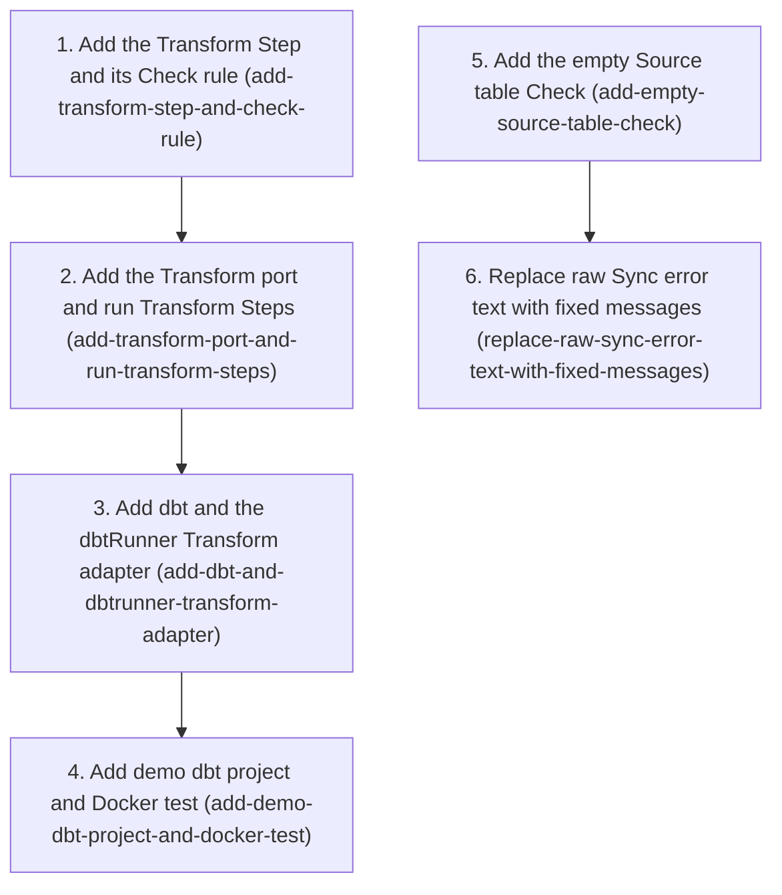

# Horizon 3 — dbt Transform Step and dedicated errors

## Executive summary

### 🎯 What are we trying to achieve?

The demo Pipeline gains a second Step: after copying the shop's `customers` and `orders` into the Warehouse (the Sync), a **Transform Step** runs the Project's dbt models and dbt tests. Every dbt test result shows up as a **Check**, and a failing one stops the run. This is proven against real Postgres in the Docker end-to-end test. Separately, four failure cases get their own clear, safe error messages: an unreachable Source, an unreachable Warehouse, an empty Source table, and a failed load.

### 🧠 Why does this change need to happen?

Today a Pipeline can only copy data; it cannot transform it, which is half of what the demo promises. Failures are also hard to read and not safe. Every connection or load problem becomes one generic error that carries the database driver's own text, which can include the host and port and even Source row values (`Failing row contains (...)`). dlt also prints its own tracebacks to the terminal. An empty Source table loads silently.

### At a glance

- **Phases:** 6: 4 for the dbt Transform, 2 for the dedicated errors. The error phases depend only on existing Sync code.
- **Complexity:** High. dbt is a new engine running in-process, the Step model becomes a union, and the Docker test grows.
- **Main risk:** dbtRunner's real behaviour (crash versus failing test, global state inside a Dagster op) is still unobserved. Phase 3 pins it with real-dbt tests on DuckDB before the Docker test relies on it.
- **Testing focus:** exact Check verdicts per dbt status; later Steps skipped after a failure; no secret, host:port, driver text or row value in any output; nothing dbt-related written into the Project; dlt silent on the terminal (checked with capfd).

## Implementation plan

### Order of work
```
Phase 1 — Add the Transform Step and its Check rule
        ↓  (Phase 2 uses the Transform Step and Check rule)
Phase 2 — Add the Transform port and run Transform Steps
        ↓  (Phase 3 implements the Transform port)
Phase 3 — Add dbt and the dbtRunner Transform adapter
        ↓  (Phase 4 wires the real adapter into adops run and the demo)
Phase 4 — Add demo dbt project and Docker test
        ↓  (Phase 5 independent of dbt; listed after it)
Phase 5 — Add the empty Source table Check
        ↓  (Phase 6 edits the same Sync files as the empty-table Check)
Phase 6 — Replace raw Sync error text with fixed messages
```



### Phase 1 — Add the Transform Step and its Check rule

Technical ID: `add-transform-step-and-check-rule` · Transform · domain · medium blast radius

**Goal** — Let Pipeline YAML declare a Transform Step next to Sync Steps. Add the pure domain rule that turns each measured dbt test result into a Check verdict.

**Done when** the deliverable below exists: src/adops/domain/transform.py exists with TransformStep, DbtTestFacts and evaluate_dbt_tests, Pipeline YAML containing a `type: transform` Step loads, and tests/unit/domain/test_transform.py passes with the unit suite at 100% line and branch coverage.

**Why** — Today a Pipeline can only hold Sync Steps, and only domain code may decide whether a Check passed or failed. One new domain module holds the Transform Step's YAML shape and the rule that judges dbt test results, so later layers only plug engines into it.

**Changes**
- Create src/adops/domain/transform.py with a pydantic `TransformStep`. Fields: `type: Literal["transform"]`; `name`, using the same naming rules as SyncStep; `project: str`, the dbt project folder relative to the Project root, kept as a plain str because the domain may not import pathlib.
- In the same module, add a frozen `DbtTestFacts` with these fields: unique_id, test name, table, status (one of dbt's documented test statuses pass, fail, warn, error or skipped), and failures (int | None, since dbt may report no count).
- Add a pure `evaluate_dbt_tests(facts) -> tuple[CheckResult, ...]`. pass gives PASS. warn gives PASS with a message saying the test warned (there is no WARN status). fail gives FAIL with a message naming the test, the table and the failure count, and no row values. error or skipped gives FAIL with a fixed message. Every (table, check) pair stays unique, because Dagster metadata keys are `table.check`.
- In pipeline.py, change `Pipeline.steps` to a tagged `Step` union of SyncStep | TransformStep. Follow the existing DeclaredCheck `Discriminator` pattern, with a discriminator function that returns `sync` when `type` is missing, so the existing shop_sync.yaml loads unchanged. Keep the duplicate-Step-name rule working across both kinds.
- In loader.py, extend `_without_union_tags` so the Step tag that pydantic inserts after `steps[i]` is removed from error paths, keeping errors like `steps[0].tables[1].mode`. Narrow `ensure_sources_defined` to SyncStep with isinstance.
- Add tests for: both Step kinds load; an unknown `type` gives a clear error that does not echo the input; error paths keep the `steps[i].field` form; and every status maps to the right verdict, including failures=None.

**Files / areas**
- `src/adops/domain/transform.py`
- `src/adops/domain/pipeline.py`
- `src/adops/domain/loader.py`
- `tests/unit/domain/test_transform.py`
- `tests/unit/domain/test_loader.py`

**How to verify**
- **Every dbt test status maps to the right Check verdict** — In tests/unit/domain/test_transform.py there is one test per status. pass gives PASS. warn gives PASS and the message contains the word 'warn'. fail gives FAIL and the message names the test, the table and the failure count. error and skipped each give FAIL with a fixed message.
- **The tagged Step union loads both kinds and the old YAML unchanged** — Loading src/adops/templates/demo/pipelines/shop_sync.yaml as it stood before this phase (with no `type` key) gives a Pipeline whose steps are all SyncStep instances.
- **Loader error paths stay in steps[i].field form** — A test with an invalid `mode` in steps[0].tables[1] asserts that the error text contains exactly `steps[0].tables[1].mode`.
- **The Transform domain model holds only domain facts** — DbtTestFacts has only the fields unique_id, name, table, status and failures. It has no message, compiled_sql, rows, adapter_response or exception field (check with `grep -n` on the class).

**Done when** — src/adops/domain/transform.py exists with TransformStep, DbtTestFacts and evaluate_dbt_tests, Pipeline YAML containing a `type: transform` Step loads, and tests/unit/domain/test_transform.py passes with the unit suite at 100% line and branch coverage. And every check under *How to verify* meets its bar.

**Depends on** — nothing — can start immediately

**Guards**
- g10: transform.py imports only pydantic, the standard library (no pathlib or os) and adops.domain. The existing domain purity test covers the new module automatically.
- g8: verdicts come from the pure function evaluate_dbt_tests over measured facts. Nothing outside domain/ decides pass or fail.
- g3: every status branch and the discriminator's default-to-sync path are unit-tested. No pragma: no cover is added.
- g6: domain code imports no framework (no dbt, dlt, dagster, os.environ).
- g7: no pragma: no cover is added.

<details><summary>Reference — full rubric</summary>

| Dimension | Rule | Pass criteria | Failure examples | minScore |
|---|---|---|---|---|
| Every dbt test status maps to the right Check verdict | evaluate_dbt_tests must turn every documented dbt status (pass, warn, fail, error, skipped) into exactly one CheckResult with the agreed verdict and a message that names the test and table but never holds a row value. 10 = every status and failures=None is pinned by a test that asserts the exact verdict and message; 8 = all statuses correct, with messages asserted by substring; below 7 = any status maps to the wrong verdict. | In tests/unit/domain/test_transform.py there is one test per status. pass gives PASS. warn gives PASS and the message contains the word 'warn'. fail gives FAIL and the message names the test, the table and the failure count. error and skipped each give FAIL with a fixed message.<br>A fail fact with failures=None gives FAIL, and its message does not contain 'None' or '0 failures'.<br>Two DbtTestFacts with different unique_ids for the same table give two CheckResults whose (table, check) pairs differ. A test asserts the pairs are unique.<br>evaluate_dbt_tests(()) returns an empty tuple and does not raise. | warn is mapped to FAIL because it was handled with the same branch as fail.<br>failures=None is formatted straight into the message, so it reads 'failed with None failures'.<br>The check name is just the test name (for example 'unique'), so unique on customers.id and unique on orders.id collide on one Dagster metadata key.<br>skipped is mapped to PASS because 'nothing failed'. | 8 |
| The tagged Step union loads both kinds and the old YAML unchanged | Pipeline.steps must accept SyncStep and TransformStep through a discriminated union. A Step with no `type` must still load as a Sync Step, and an unknown type must be rejected without echoing input. 10 = default-to-sync, explicit sync, transform, unknown type and duplicate names across kinds are all tested; 8 = all work, but one edge is only covered indirectly; below 7 = the existing demo YAML no longer loads. | Loading src/adops/templates/demo/pipelines/shop_sync.yaml as it stood before this phase (with no `type` key) gives a Pipeline whose steps are all SyncStep instances.<br>A YAML Step with `type: transform`, a name and `project: dbt` loads as a TransformStep whose project is the str 'dbt'.<br>A YAML Step with `type: bogus` raises a loader error. Its text does not contain the other field values of that Step (for example a distinctive project string used in the test).<br>A Sync Step and a Transform Step that share a name are rejected by the duplicate-Step-name rule. | The discriminator returns 'sync' only when the key is absent, so `type: sync` written explicitly fails to load.<br>An unknown type error includes pydantic's input_value dump, which echoes the whole Step mapping.<br>The duplicate-name validator iterates only over SyncSteps, so a transform named like a sync passes. | 8 |
| Loader error paths stay in steps[i].field form | Errors for invalid Steps of either kind must report paths like `steps[0].tables[1].mode` with no union tag segment inserted by pydantic. 10 = asserted for an invalid Sync field, an invalid Transform field and a missing required field; 8 = asserted for both Step kinds; below 7 = a tag such as 'sync' or 'transform' appears in any reported path. | A test with an invalid `mode` in steps[0].tables[1] asserts that the error text contains exactly `steps[0].tables[1].mode`.<br>A test with a Transform Step missing `project` asserts a path of the form `steps[i].project` with no `transform` segment.<br>A Sync table or field literally named 'transform' or 'sync' is not removed from the path (the stripping only removes the segment right after steps[i]). | _without_union_tags strips the DeclaredCheck tag but not the new Step tag, so errors read `steps[0].sync.tables[1].mode`.<br>Tag stripping removes every segment equal to 'sync', which corrupts paths that contain a user field of that name. | 7 |
| The Transform domain model holds only domain facts | transform.py must model the Transform Step and dbt test facts as plain domain values, with no filesystem, dbt-runtime or presentation concerns leaking in. 10 = nothing technical in any field, and Sync-only helpers are narrowed by type; 8 = clean, with at most a naming nit; below 7 = any field or helper that only makes sense to an adapter. | DbtTestFacts has only the fields unique_id, name, table, status and failures. It has no message, compiled_sql, rows, adapter_response or exception field (check with `grep -n` on the class).<br>TransformStep.project is a str and no validator in domain/ checks that the folder exists on disk.<br>ensure_sources_defined, and any other Sync-only helper in domain/, narrows with isinstance(step, SyncStep) and does not fail with AttributeError on a TransformStep (shown by a loader test over a mixed Pipeline).<br>DbtTestFacts is frozen: assigning to a field in a test raises. | DbtTestFacts gets a `message: str` field 'for debugging', which invites dbt text (and row values) into the domain.<br>TransformStep.project is validated with a regex that rejects '..', which quietly encodes filesystem policy into the domain.<br>ensure_sources_defined reads step.source on every Step, so a Pipeline with a Transform Step crashes. | 8 |

Healer hint: If the old shop_sync.yaml or the error-path tests break, the discriminator is probably not defaulting to 'sync' when `type` is missing or the new tag segment is not being stripped in _without_union_tags; copy the DeclaredCheck Discriminator pattern exactly and add the Step tag names to the strip set.

</details>

### Phase 2 — Add the Transform port and run Transform Steps

Technical ID: `add-transform-port-and-run-transform-steps` · Transform · application · medium blast radius

**Goal** — Give the application layer a Transform port and a planned Transform Step that calls it and turns the measured dbt test facts into Checks. The Step fails, and every later Step is skipped, on a failed Check, a dbt crash or a broken model.

**Done when** the deliverable below exists: tests/unit/application/test_run_pipeline.py passes with new cases proving, through FakeTransform, that a Sync Step followed by a Transform Step reports dbt test Checks, and that a failing dbt test, a crash or a broken model fails the Transform Step and skips every later Step.

**Why** — Running a Pipeline today only knows how to Sync. A Transform port keeps dbt out of the application layer. Binding the Transform engine into its planned Step when the run plan is built means neither orchestrator (in-order or Dagster) has to change.

**Changes**
- In ports.py, add a `Transform` Protocol: `run(step: TransformStep, warehouse: ResolvedConnection) -> TransformResult`. `TransformResult` holds `tests: tuple[DbtTestFacts, ...]`, `crashed: bool` and `failed_models: tuple[str, ...]`, with model names only and no dbt message text. The engine only measures; it never decides.
- In run_pipeline.py, add `TransformFailedError(StepError)` with the fixed message `Pipeline <p>, Step <s>: dbt run failed`, plus the failed model names when known.
- Add a frozen `PlannedTransformStep` that holds the TransformStep, the resolved Warehouse connection, the Pipeline name and the bound Transform engine. Its `__call__(sync)` ignores `sync` and calls the Transform through the existing redacting guard. It raises TransformFailedError outside `except` (so no original error is chained) when the run crashed or a model failed. It raises CheckFailedError when evaluate_dbt_tests returns a FAIL, and otherwise returns StepOutcome(checks, {}).
- Add a `transform: Transform | None = None` parameter to `run_pipeline` and `_build_plan`. Build a PlannedStep for each SyncStep and a PlannedTransformStep for each TransformStep, and resolve Source secrets only for Sync Steps. A Transform Step with no Transform engine raises a clear PipelineValidationError.
- Narrow `accept_schema._only_step_with` to SyncStep. Leave StepTask, Orchestrator.execute and InOrderOrchestrator signatures unchanged.
- Add a `FakeTransform` to tests/unit/application/fakes.py. Add tests for: passing dbt tests reported as Checks; a failing dbt test gives check_failed and skips a later Step; a crash or broken model gives failed with the fixed message and no __cause__; the Warehouse password never appears in any text (reuse assert_no_secret_in).

**Files / areas**
- `src/adops/application/ports.py`
- `src/adops/application/run_pipeline.py`
- `src/adops/application/accept_schema.py`
- `tests/unit/application/fakes.py`
- `tests/unit/application/test_run_pipeline.py`

**How to verify**
- **Crash and broken model outrank test results** — A FakeTransform returning crashed=True and tests=() makes the Transform Step report status failed, not passed.
- **A failed Transform Step skips every later Step** — test_run_pipeline.py has a three-Step Pipeline (sync, transform, sync) where a failing dbt test gives: step 1 passed, step 2 check_failed, step 3 skipped. The fake Sync records that step 3 was never called.
- **The Transform engine is bound at plan time and only Warehouse secrets reach it** — run_pipeline(..., transform=None) on a Pipeline with a Transform Step raises PipelineValidationError, and the fake Sync records zero calls.
- **The application layer measures nothing and decides nothing** — `grep -n "status" src/adops/application/run_pipeline.py` finds no comparison against dbt status strings such as 'fail' or 'error'. The verdict comes from calling evaluate_dbt_tests.

**Done when** — tests/unit/application/test_run_pipeline.py passes with new cases proving, through FakeTransform, that a Sync Step followed by a Transform Step reports dbt test Checks, and that a failing dbt test, a crash or a broken model fails the Transform Step and skips every later Step. And every check under *How to verify* meets its bar.

**Depends on** — Add the Transform Step and its Check rule

**Guards**
- g6/g10: the application layer imports only adops.domain and the standard library, with no dbt, os or pathlib.
- g8: pass or fail comes from evaluate_dbt_tests. PlannedTransformStep only acts on that verdict, or raises on the measured crash and broken-model facts.
- g7: the Transform engine and Warehouse credentials reach the Step only through the planned Step's own fields (a closure), never through Dagster run config. The existing Dagster tests pass unchanged.
- g3: the missing-engine, crash, broken-model, failed-test and all-pass branches are each unit-tested.

<details><summary>Reference — full rubric</summary>

| Dimension | Rule | Pass criteria | Failure examples | minScore |
|---|---|---|---|---|
| Crash and broken model outrank test results | PlannedTransformStep must give `failed` (TransformFailedError) whenever the measured result says crashed or lists failed models, whatever the test facts say. It gives `check_failed` only when evaluate_dbt_tests returns a FAIL, and it passes otherwise. 10 = each precedence combination is tested, including a crash with zero tests; 8 = crash, broken-model, failed-test and all-pass are tested separately; below 7 = a crash with an empty test list reports passed. | A FakeTransform returning crashed=True and tests=() makes the Transform Step report status failed, not passed.<br>A FakeTransform returning failed_models=('customer_orders',) together with passing tests reports failed, and the message contains 'customer_orders'.<br>A FakeTransform returning one fail test reports check_failed, and the Check line for that test shows fail.<br>All-pass tests give status passed, and every dbt test appears as a Check in the StepOutcome. | The Step first runs evaluate_dbt_tests and returns PASS when there is no FAIL, so a dbt crash that produced no test results looks like success.<br>failed_models is checked only when tests are empty, so a broken model with its dependent tests skipped reports check_failed instead of failed. | 8 |
| A failed Transform Step skips every later Step | In a Pipeline of Sync, Transform and a later Step, any Transform failure must mark every later Step as skipped while earlier Steps keep their result. 10 = shown for both check_failed and failed, with a Step after the Transform; 8 = shown for one failure kind plus a test that the earlier Sync is unaffected; below 7 = a later Step still runs. | test_run_pipeline.py has a three-Step Pipeline (sync, transform, sync) where a failing dbt test gives: step 1 passed, step 2 check_failed, step 3 skipped. The fake Sync records that step 3 was never called.<br>The same Pipeline with crashed=True gives step 3 skipped.<br>A Transform Step placed first, before any Sync, runs without needing a Sync result (the `sync` argument is ignored). | The Transform Step raises a plain exception that is not a StepError, so the orchestrator aborts the whole run instead of reporting skipped for later Steps.<br>The tests only use a two-Step Pipeline with the Transform last, so skipping is never actually observed. | 8 |
| The Transform engine is bound at plan time and only Warehouse secrets reach it | _build_plan must bind the Transform engine and the resolved Warehouse into each PlannedTransformStep, resolve no Source secrets for Transform Steps, and reject a Transform Step that has no engine before any Step runs. 10 = all of that is tested and the orchestrator signatures are untouched; 8 = it works, but the missing-engine check happens at Step run time rather than plan time; below 7 = an engine or credential travels through orchestrator or run config. | run_pipeline(..., transform=None) on a Pipeline with a Transform Step raises PipelineValidationError, and the fake Sync records zero calls.<br>A fake secret resolver records that no Source secret was requested for the Transform Step.<br>`git diff` shows no change to the signatures of StepTask, Orchestrator.execute or InOrderOrchestrator, and the existing Dagster orchestrator tests pass unmodified.<br>A test using assert_no_secret_in over every Step and Check message of a failed Transform run finds no Warehouse password. | The missing-engine check is inside PlannedTransformStep.__call__, so the preceding Sync has already loaded data before the error.<br>A Source secret is resolved for every Step in the loop, so a Transform-only Pipeline fails when the Source secret env var is unset. | 7 |
| The application layer measures nothing and decides nothing | ports.py and run_pipeline.py must depend only on domain types. Pass or fail for dbt tests must come only from evaluate_dbt_tests, and the TransformResult contract must carry no dbt text. 10 = the contract has no free-text field at all and TransformFailedError is raised outside except; 8 = clean, with one cosmetic gap; below 7 = the application compares test statuses itself. | `grep -n "status" src/adops/application/run_pipeline.py` finds no comparison against dbt status strings such as 'fail' or 'error'. The verdict comes from calling evaluate_dbt_tests.<br>TransformResult has exactly tests, crashed and failed_models, with no message, error or stderr field.<br>A test asserts TransformFailedError's __cause__ and __context__ are both None when the FakeTransform raises inside run.<br>TransformFailedError's message matches `Pipeline <p>, Step <s>: dbt run failed`, plus model names only, and holds no text from the fake's exception. | PlannedTransformStep does `if any(t.status == 'fail' ...)` itself before calling evaluate_dbt_tests, which duplicates the verdict outside the domain.<br>TransformFailedError is raised inside the `except` block of the guard, so __context__ chains the engine's exception and its text. | 8 |

Healer hint: The most likely miss is a crash with no test results falling through to PASS; check crashed and failed_models before calling evaluate_dbt_tests, and raise TransformFailedError after the except block so nothing is chained.

</details>

### Phase 3 — Add dbt and the dbtRunner Transform adapter

Technical ID: `add-dbt-and-dbtrunner-transform-adapter` · Transform · infrastructure · medium blast radius

**Goal** — Add dbt as a dependency and implement the Transform port with dbt-core's in-process dbtRunner. The adapter writes a temporary profile that reads the Warehouse password through env_var(), runs one `dbt build`, and returns only measured facts. Real-dbt unit tests pin down how dbtRunner reports pass, fail, warn, broken model and crash.

**Done when** the deliverable below exists: tests/unit/infrastructure/test_dbt_transform.py passes without Docker using real dbt on DuckDB, including the run-twice test and the in-process Dagster run, and covers src/adops/infrastructure/dbt_transform.py at 100% line and branch coverage.

**Why** — dbt is not installed yet, and nobody has seen what dbtRunner returns in each case. This adapter is the only place dbt may be imported, so it is also where that behaviour is pinned by real tests. The unit gate cannot use Docker, so the tests run real dbt against a temporary DuckDB file, including through the Dagster orchestrator and twice in one process. dbt problems with global state, logging or environment variables then show up in seconds, not in the 20-minute Docker job. dbt-duckdb here is only a test stand-in for unit tests; the DuckDB Warehouse itself (horizon 4) stays deferred.

**Changes**
- Add `dbt-core==1.12.7` and `dbt-postgres==1.11.0` to `[project].dependencies` in pyproject.toml.
- Add dbt-duckdb to the `dev` dependency group only. It is a test stand-in that lets unit tests run real dbt without Postgres, and it never becomes a runtime dependency.
- Run `uv lock` and commit uv.lock. Confirm that dbt-duckdb resolves alongside dbt-core 1.12.7 and the existing duckdb pin from `dlt[duckdb]`, and that dlt 1.32, dagster 1.13.30 and protobuf still resolve. If dbt-duckdb cannot resolve, stop and report it. The fallback is then fake dbtRunner results for unit coverage, with real dbt behaviour proven only in the Docker test. Never loosen the dlt or dagster pins to make it fit.
- Create src/adops/infrastructure/dbt_transform.py with `DbtTransform(project_root: Path)` implementing `run(step, warehouse)`. It resolves `step.project` against project_root and creates a `tempfile.TemporaryDirectory` outside the Project for profiles.yml, target/ and logs/. It then calls `dbtRunner().invoke(["build", "--project-dir", ..., "--profiles-dir", tmp, "--target-path", tmp/target, "--log-path", tmp/logs, "--quiet"])`.
- Add a pure `render_postgres_profile(profile_name, warehouse)` that returns profile YAML. host, port, dbname and user come from the connection; the password appears only as `{{ env_var('ADOPS_DBT_WAREHOUSE_PASSWORD') }}`. Set that variable only for the duration of the invoke call and restore os.environ in a `finally` block, the same way run_command._scoped_environ does.
- Map the dbtRunner result to TransformResult, copying no dbt message text, compiled SQL or exception text. A missing result, or `success` False with an exception, gives crashed=True. A model with status error goes into failed_models. Test results become DbtTestFacts.
- Keep the run-and-measure path independent of the database by accepting an injectable profile renderer.
- Tests: drive the adapter for real against a temporary DuckDB file, covering all-pass, a failing test (assert the real failures count), a severity-warn test, a broken model (dependent tests skipped), a missing project folder (crash), and `failures` None where dbt gives it. These assertions pin the observed dbtRunner semantics.
- Test: call the same adapter twice in one process (fail run, then pass run) and assert both results are correct and os.environ is restored each time.
- Test: run a Pipeline with one Transform Step through `run_pipeline(..., transform=DbtTransform(...), orchestrator=DagsterOrchestrator())` as an in-process Dagster job against DuckDB. Assert the Step and Check reports, and that no password reaches Dagster storage.
- Test render_postgres_profile on its own, asserting that a sentinel password never appears in its text. Also assert the Project folder holds no target/, logs/ or profiles.yml after a run, and that a scan of src/ finds `dbt` imported only in infrastructure/dbt_transform.py.

**Files / areas**
- `pyproject.toml`
- `uv.lock`
- `src/adops/infrastructure/dbt_transform.py`
- `tests/unit/infrastructure/test_dbt_transform.py`

**How to verify**
- **Real dbt runs pin the result mapping** — The failing-test scenario seeds a known number of bad rows and asserts DbtTestFacts.failures equals that exact number (not just > 0).
- **No password or dbt artefact touches disk or the Project** — render_postgres_profile with a sentinel password returns text that does not contain the sentinel and does contain `env_var('ADOPS_DBT_WAREHOUSE_PASSWORD')`.
- **dbtRunner is safe to call repeatedly and inside Dagster** — One test calls the adapter twice (first a failing test, then a passing one) and asserts the first result has a fail fact and the second has none, so no state leaks between runs.
- **dbt and its dependencies stay inside the adapter boundary** — A unit test scans src/ and asserts that `dbt` (as both `import dbt` and `from dbt`) appears only in src/adops/infrastructure/dbt_transform.py.

**Done when** — tests/unit/infrastructure/test_dbt_transform.py passes without Docker using real dbt on DuckDB, including the run-twice test and the in-process Dagster run, and covers src/adops/infrastructure/dbt_transform.py at 100% line and branch coverage. And every check under *How to verify* meets its bar.

**Depends on** — Add the Transform port and run Transform Steps

**Guards**
- g1: pyproject.toml and uv.lock change together, including the dev-only dbt-duckdb, and `uv sync --locked` passes locally before commit.
- g3: coverage comes from real dbtRunner calls against a temporary DuckDB file (dbt-duckdb is a dev-only test stand-in) plus a pure test of the Postgres profile renderer, so no Postgres or Docker is needed.
- g6/g10: dbt, tempfile and os.environ are imported only in this infrastructure module, and the import-scan test enforces it. Only dagster_orchestrator.py imports dagster; the test imports it, the adapter does not.
- g7: credentials reach dbt only through an env var scoped to the invoke call and read by env_var() in the profile, never through Dagster run config. No pragma: no cover is added.
- g4: no template file changes here, so the wheel-template grep list is unaffected.

<details><summary>Reference — full rubric</summary>

| Dimension | Rule | Pass criteria | Failure examples | minScore |
|---|---|---|---|---|
| Real dbt runs pin the result mapping | tests/unit/infrastructure/test_dbt_transform.py must drive the real dbtRunner against a temporary DuckDB file and assert concrete measured values for pass, fail, warn, broken model and crash. 10 = every scenario asserts exact statuses and counts, including the observed failures value for pass and warn; 8 = all scenarios run real dbt and assert verdict-relevant fields; below 7 = dbtRunner is mocked for any scenario other than the documented fallback. | The failing-test scenario seeds a known number of bad rows and asserts DbtTestFacts.failures equals that exact number (not just > 0).<br>The broken-model scenario asserts the model name is in failed_models and that the dependent tests come back with status skipped.<br>The missing-project-folder scenario asserts crashed=True and an empty tests tuple.<br>The severity-warn scenario asserts status 'warn'.<br>`grep -n "mock\\|patch" tests/unit/infrastructure/test_dbt_transform.py` shows no patching of dbtRunner.invoke, unless the phase reports the dbt-duckdb fallback. | The tests assert only `result.crashed is False` and `len(result.tests) > 0`, so a wrong mapping of failures or status would still pass.<br>The broken model is simulated with a SQL syntax error that dbt reports as a crash, so the failed_models branch is covered only by a hand-built fake result.<br>A model with status error is mapped to crashed=True, so failed_models is always empty. | 8 |
| No password or dbt artefact touches disk or the Project | The generated profile must reference the password only through env_var(). The env var must exist only during invoke and be restored even on error, and target/, logs/ and profiles.yml must live in a temp dir outside the Project. 10 = all of that is proven, including restore after an exception inside invoke; 8 = proven on the success and fail-test paths; below 7 = the password text appears in any rendered profile or file. | render_postgres_profile with a sentinel password returns text that does not contain the sentinel and does contain `env_var('ADOPS_DBT_WAREHOUSE_PASSWORD')`.<br>After each adapter run, `ADOPS_DBT_WAREHOUSE_PASSWORD` is not in os.environ, and any value it had before is restored. A test covers the path where invoke raises.<br>After a run, the Project folder contains no target/, logs/, profiles.yml or dbt_packages/ (the test asserts each with Path.exists()).<br>No file written during the run (scan of the temp dir before cleanup, or of the Project) contains the sentinel password. | The env var is popped only after a successful invoke, so an exception leaves the password in os.environ for the rest of the process.<br>--log-path is passed but dbt still writes logs/dbt.log into the cwd or project dir because a flag was missed.<br>The profile embeds the password directly and the temp dir is deleted afterwards, on the reasoning that 'it never persists'. | 8 |
| dbtRunner is safe to call repeatedly and inside Dagster | The same DbtTransform must give correct, independent results when called twice in one process and when run as an in-process Dagster job, with no password in Dagster storage. 10 = fail-then-pass twice in one process plus a Dagster run, with storage scanned for the sentinel; 8 = both run and assert results; below 7 = either test is missing or flaky. | One test calls the adapter twice (first a failing test, then a passing one) and asserts the first result has a fail fact and the second has none, so no state leaks between runs.<br>A test runs run_pipeline(..., transform=DbtTransform(...), orchestrator=DagsterOrchestrator()) and asserts the Transform Step status and the dbt Check lines.<br>That Dagster test scans the Dagster instance's event log or run storage for the sentinel password and finds none.<br>Running `uv run pytest tests/unit/infrastructure/test_dbt_transform.py -p no:randomly` and then `-p randomly` (or two consecutive runs) passes both times. | The second invoke reuses dbt's cached manifest from the first, so the fixed data still reports the old failure.<br>The Dagster test passes the DbtTransform through op config, which serialises the Warehouse connection into run storage. | 7 |
| dbt and its dependencies stay inside the adapter boundary | dbt may be imported only in infrastructure/dbt_transform.py. dbt-core and dbt-postgres are runtime dependencies, dbt-duckdb is dev-only, and no dbt message text crosses into TransformResult. 10 = an import-scan test enforces all of this and the result mapping copies only ids, statuses, counts and model names; 8 = enforced, but the scan covers only `import dbt` and not `from dbt`; below 7 = dbt-duckdb is a runtime dependency or dbt text reaches the result. | A unit test scans src/ and asserts that `dbt` (as both `import dbt` and `from dbt`) appears only in src/adops/infrastructure/dbt_transform.py.<br>In pyproject.toml, dbt-core==1.12.7 and dbt-postgres==1.11.0 are under [project].dependencies, and dbt-duckdb appears only under [dependency-groups].dev.<br>`uv tree --no-dev \| grep dbt-duckdb` prints nothing.<br>No field in the TransformResult the adapter builds holds a value taken from result.message, node.compiled_code or str(exception). Shown by a grep of dbt_transform.py and by a test where a failing model's error text, which contains a sentinel, is absent from the result. | dbt-duckdb is added to [project].dependencies 'to make tests easy', so every user installs it.<br>failed_models is filled with `f"{node.name}: {r.message}"`, which carries dbt's database error text, possibly with row values. | 8 |

Healer hint: If dbt-duckdb will not resolve or real-dbt tests are flaky across two invokes, check the lock first and report the fallback rather than loosening dlt or dagster pins, and give each invoke its own temp target path so no manifest state is reused.

</details>

### Phase 4 — Add demo dbt project and Docker test

Technical ID: `add-demo-dbt-project-and-docker-test` · Demo Project · interface · medium blast radius

**Goal** — Ship a demo dbt project with `adops init --demo` and connect the dbtRunner adapter to `adops run`. `adops validate` checks that the dbt project folder exists. The Docker test proves that passing dbt tests report Checks on Postgres, and that a failing dbt test fails the Transform Step and stops the run.

**Done when** the deliverable below exists: tests/e2e/test_demo_sync.py passes in the CI Docker job. In it the Transform Step reports passing dbt Checks, and an orphan order fails the relationships Check with a failure count of 1 on Postgres, fails the Transform Step and exits non-zero.

**Why** — This is where a user actually sees the Transform: the demo Pipeline gains a Transform Step over the synced raw_shop tables. Only the Docker test proves that dbt runs against the real Postgres Warehouse, so it asserts a real failure count from Postgres. The `adops validate` dbt-folder check rides along here because it is a few lines in the same interface layer and only matters once the demo ships a dbt project; four of the files are small static dbt template files.

**Changes**
- Add src/adops/templates/demo/dbt/ with these files: dbt_project.yml; models/sources.yml, hand-written for schema raw_shop with tables customers and orders; models/customer_orders.sql, orders joined to customers on customer_id; models/schema.yml, with unique and not_null on customers.id and a `relationships` test from orders.customer_id to customers.id. Put no not_null test on customer_id. Ship no profiles.yml and no .py file, and add dbt `target/` and `logs/` to the demo gitignore as a safety net.
- Append a Transform Step `transform_shop` (`type: transform`, `project: dbt`) after `sync_shop` in shop_sync.yaml.
- In run_command.py, add a `build_transform(project) -> Transform` factory that returns DbtTransform(project), and pass it to run_pipeline. dbt Checks print in the existing `  check <table> <check>: <status>` format.
- In validate_command.py, skip Transform Steps in `_skipped_checks`. For each Transform Step, report a clear error when `<project>/<step.project>/dbt_project.yml` is missing. Never invoke dbt.
- Add every new demo file to DEMO_FILES in test_init_command.py and narrow its `steps[0].tables` assertion to the Sync Step. Add each new path to the wheel-template grep for-loop in .github/workflows/ci.yml. Add unit tests for build_transform, the validate path check and the Transform skip.
- Docker test, first and second runs: also assert `step transform_shop: passed` and passing dbt Check lines.
- Docker test, new failing scenario before the Breaking Change step (before `ALTER TABLE orders DROP COLUMN customer_id`): insert into the Source an order (id 150) whose customer_id 999 matches no customer. Only dbt checks this, because the Sync declares no Check on customer_id and the Source has no foreign key. Run and assert: exit 1; `step sync_shop: passed`; `step transform_shop: check_failed`; the relationships Check line reports fail with a failure count of 1 measured on Postgres; no secret or row value in the output. Then point order 150 at customer 1 with a newer updated_at, so the incremental Sync updates the Warehouse row, re-run, and assert the Transform passes. Raise the later order-count assertions by one for order 150.
- Docker test, after the Breaking Change: the Breaking Change run and the not_null(email) run assert `step transform_shop: skipped`. Decision: after accept-schema, the Warehouse keeps customer_id as a nullable column, and new orders carry NULL there. dbt's relationships test ignores NULLs, so the post-accept run asserts `step transform_shop: passed`. The final DROP TABLE customers run asserts `step transform_shop: skipped`.

**Files / areas**
- `src/adops/templates/demo/dbt/dbt_project.yml`
- `src/adops/templates/demo/dbt/models/sources.yml`
- `src/adops/templates/demo/dbt/models/customer_orders.sql`
- `src/adops/templates/demo/dbt/models/schema.yml`
- `src/adops/templates/demo/gitignore`
- `src/adops/templates/demo/pipelines/shop_sync.yaml`
- `src/adops/interface/run_command.py`
- `src/adops/interface/validate_command.py`
- `tests/unit/interface/test_init_command.py`
- `tests/unit/interface/test_run_command.py`
- `tests/unit/interface/test_validate_command.py`
- `tests/e2e/test_demo_sync.py`
- `.github/workflows/ci.yml`

**How to verify**
- **The demo scaffolds a safe, runnable dbt project** — Running `adops init --demo` into a temp dir creates dbt/dbt_project.yml, dbt/models/sources.yml, dbt/models/customer_orders.sql and dbt/models/schema.yml, and no dbt/profiles.yml.
- **The Docker test proves the dbt Checks on real Postgres** — The first two runs assert `step transform_shop: passed` and at least one `check` line for a dbt test with status pass.
- **adops validate checks the dbt folder without running dbt** — A unit test removes dbt/dbt_project.yml from a scaffolded demo and asserts that `adops validate` exits non-zero with an error naming transform_shop and the missing dbt_project.yml.
- **The interface wires the adapter in-process and adds no dbt logic** — `grep -rn "dbt" src/adops/interface/ | grep import` shows only an import of DbtTransform from adops.infrastructure, with no `import dbt`.

**Done when** — tests/e2e/test_demo_sync.py passes in the CI Docker job. In it the Transform Step reports passing dbt Checks, and an orphan order fails the relationships Check with a failure count of 1 on Postgres, fails the Transform Step and exits non-zero. And every check under *How to verify* meets its bar.

**Depends on** — Add dbt and the dbtRunner Transform adapter

**Guards**
- g4: every new demo dbt file path is added to the wheel-template grep for-loop in .github/workflows/ci.yml in this same phase.
- g9: DEMO_FILES gets exactly the new files. No .py file or profiles.yml is shipped, and no new *_env name is added (dbt reuses WAREHOUSE_PASSWORD).
- g5: the dbt scenarios go inside the existing sequential Docker test and reuse the module-scoped compose fixture, adding two runs, to stay within the 20-minute budget.
- g3: build_transform, the validate path check and the Transform skip branch are unit-tested.
- g7: run_command passes the Transform engine into the plan in-process, never through Dagster run config.

<details><summary>Reference — full rubric</summary>

| Dimension | Rule | Pass criteria | Failure examples | minScore |
|---|---|---|---|---|
| The demo scaffolds a safe, runnable dbt project | `adops init --demo` must produce the dbt project with hand-written sources over raw_shop, the agreed tests, no profile and no Python, and the demo Pipeline must gain the Transform Step after sync_shop. 10 = the scaffolded tree matches DEMO_FILES exactly, the wheel contains every file, and the tests are exactly as specified; 8 = all present, with one cosmetic deviation; below 7 = a profiles.yml or .py file ships, or a not_null test on orders.customer_id exists. | Running `adops init --demo` into a temp dir creates dbt/dbt_project.yml, dbt/models/sources.yml, dbt/models/customer_orders.sql and dbt/models/schema.yml, and no dbt/profiles.yml.<br>dbt/models/schema.yml has unique and not_null on customers.id and a relationships test from orders.customer_id to customers.id. A grep shows no not_null under customer_id.<br>The scaffolded pipelines/shop_sync.yaml has a second Step named transform_shop with `type: transform` and `project: dbt`.<br>The scaffolded .gitignore lists dbt target/ and logs/.<br>`uv build --wheel && unzip -l dist/*.whl \| grep templates/demo/dbt` lists every new dbt file. | sources.yml uses schema 'shop' instead of 'raw_shop', so dbt compiles but every model fails against the real Warehouse.<br>A not_null test on customer_id is added 'for completeness', so after accept-schema the post-accept run fails where it is supposed to pass.<br>The files ship in the wheel but one is missing from DEMO_FILES, so the exact-set test was 'fixed' by loosening it. | 8 |
| The Docker test proves the dbt Checks on real Postgres | tests/e2e/test_demo_sync.py must assert passing dbt Checks, an orphan-order relationships failure with a failure count of 1 measured on Postgres that stops the run, recovery after the fix, and transform_shop being skipped after each upstream failure. 10 = every specified run asserts its exact transform_shop status and the orphan scenario asserts count, exit code and absence of secrets and rows; 8 = all scenarios asserted, with the count checked by substring; below 7 = the failing scenario does not assert a measured count. | The first two runs assert `step transform_shop: passed` and at least one `check` line for a dbt test with status pass.<br>After inserting order 150 with customer_id 999 (before the DROP COLUMN step), the run exits 1 and its output contains `step sync_shop: passed`, `step transform_shop: check_failed`, and a relationships check line reporting fail with a failure count of 1.<br>That failing run's output contains neither the Warehouse password nor the value 999 shown as a row value.<br>After order 150 is re-pointed at customer 1 with a newer updated_at, the re-run asserts `step transform_shop: passed`.<br>The Breaking Change run, the not_null(email) run and the DROP TABLE customers run each assert `step transform_shop: skipped`. The post-accept-schema run asserts `step transform_shop: passed`. | The orphan order is inserted without bumping updated_at on the fix, so the incremental Sync never updates the Warehouse row and the 'recovery' run is asserted only as exit 1 and then removed.<br>The failing scenario asserts only `check_failed`, so a dbt crash reported as a failed Check would also pass.<br>Order-count assertions later in the test were not raised by one, and the test was 'fixed' by deleting them. | 8 |
| adops validate checks the dbt folder without running dbt | validate_command must report a clear error when `<project>/<step.project>/dbt_project.yml` is missing, must never import or invoke dbt, and must leave Transform Steps out of the skipped-Checks listing. 10 = all three are unit-tested, including a test that fails if dbt is invoked; 8 = path and skip are tested; below 7 = validate runs dbt parse or crashes on a Transform Step. | A unit test removes dbt/dbt_project.yml from a scaffolded demo and asserts that `adops validate` exits non-zero with an error naming transform_shop and the missing dbt_project.yml.<br>A unit test patches DbtTransform or dbtRunner to raise if called and asserts `adops validate` on the full demo still succeeds.<br>The skipped-Checks listing for the demo contains only Sync table entries and does not error on the Transform Step.<br>The validate error text holds the relative project path only, not an absolute path that includes the user's home directory. | The check looks only for the dbt/ folder, so an empty folder passes validate and fails at run time.<br>_skipped_checks iterates step.tables on every Step and raises AttributeError on transform_shop. | 7 |
| The interface wires the adapter in-process and adds no dbt logic | run_command must build the Transform through a build_transform factory and pass it to run_pipeline in-process. The interface layer must hold no dbt imports or verdict logic, and dbt Checks must print in the existing check-line format. 10 = factory unit-tested, no dbt import in interface/, and output format identical for Sync and dbt Checks; 8 = wired correctly with a small format inconsistency; below 7 = the engine travels through config or the interface interprets dbt results. | `grep -rn "dbt" src/adops/interface/ \| grep import` shows only an import of DbtTransform from adops.infrastructure, with no `import dbt`.<br>A unit test asserts build_transform(project) returns a DbtTransform rooted at that project.<br>dbt Check lines in run output match the regex `^  check \S+ \S+: (pass\|fail)` like Sync Checks do.<br>No run-config dict or Dagster config schema in src/ contains a transform or warehouse key (grep). | run_command special-cases dbt Checks and prints them with a different prefix, which breaks scripts that parse check lines.<br>build_transform is constructed inside the Dagster op from a project path in run config instead of being bound when the plan is built. | 7 |

Healer hint: If the orphan-order scenario fails to recover or the counts drift, check that the fix bumps updated_at so the incremental Sync rewrites the Warehouse row and that every later order-count assertion was raised by one, rather than loosening the assertions.

</details>

### Phase 5 — Add the empty Source table Check

Technical ID: `add-empty-source-table-check` · Checks · cross-cutting · medium blast radius

**Goal** — Halt a Sync Step when a Source table has zero rows, raising a dedicated EmptySourceTableError. A table can opt out by listing the new `source_not_empty` Check under skip_checks with a written reason.

**Done when** the deliverable below exists: tests/unit/application/test_run_pipeline.py proves that a Sync Step over an empty Source table fails with EmptySourceTableError (status check_failed) unless that table lists source_not_empty under skip_checks with a reason, with the unit suite at 100% coverage.

**Why** — An empty Source table usually means a broken upstream system, and loading it silently hides that. Making it a built-in Check means the existing skip_checks opt-out with a reason, and the `adops validate` listing of skipped Checks, work unchanged. This is one small slice across layers, built only on existing Sync code: a domain rule, the Step's error, and the dlt adapter counting rows.

**Changes**
- In checks.py, add `row_count: int | None = None` to SourceFacts, and add `CheckName.SOURCE_NOT_EMPTY` to PREFLIGHT_CHECKS and to both CHECKS_BY_MODE tuples. The preflight rule gives FAIL with the fixed message `table <t> is empty in the Source` when row_count == 0, and honours skip_checks like the existing Checks.
- In run_pipeline.py, add `EmptySourceTableError(CheckFailedError)` with the fixed message `Pipeline <p>, Step <s>, table <t>: Source table is empty`. PlannedStep raises it, outside `except`, when the failed preflight Check is source_not_empty; the Step status stays check_failed.
- In dlt_sync.py, measure the Source row count inside `_source_facts` for every Sync mode (full_refresh and incremental), reusing `_source_row_count`.
- Update the existing `empty_orders` tests in test_dlt_sync.py to expect the new result, or seed that table where emptiness is not what is being tested. Add tests for: an empty table halts; a skip with a reason passes; a non-empty table passes; the message holds no row value (assert_no_secret).
- Add the `source_not_empty` line to the CUSTOMER_CHECKS and ORDER_CHECKS expected Check lines in the Docker test.

**Files / areas**
- `src/adops/domain/checks.py`
- `src/adops/application/run_pipeline.py`
- `src/adops/infrastructure/dlt_sync.py`
- `tests/unit/domain/test_checks.py`
- `tests/unit/application/test_run_pipeline.py`
- `tests/unit/infrastructure/test_dlt_sync.py`
- `tests/e2e/test_demo_sync.py`

**How to verify**
- **Count in infrastructure, decide in domain, map in application** — `grep -n "== 0\|row_count" src/adops/infrastructure/dlt_sync.py` shows row_count being assigned, with no zero-comparison or raise.
- **source_not_empty can be skipped only with a written reason** — A run_pipeline test over an empty table with `skip_checks: {checks: [source_not_empty], reason: "<reason>"}` gives Step status passed and a source_not_empty Check reported as skipped.
- **Emptiness is measured for incremental Syncs too** — test_dlt_sync.py has an incremental-mode test over an empty Source table that ends with EmptySourceTableError / status check_failed.
- **EmptySourceTableError is a sanitized check failure** — A test asserts str(error) == 'Pipeline <p>, Step <s>, table <t>: Source table is empty' with the test's real names.

**Done when** — tests/unit/application/test_run_pipeline.py proves that a Sync Step over an empty Source table fails with EmptySourceTableError (status check_failed) unless that table lists source_not_empty under skip_checks with a reason, with the unit suite at 100% coverage. And every check under *How to verify* meets its bar.

**Depends on** — nothing — can start immediately

**Guards**
- g8: the empty-table verdict is a pure preflight rule over the measured row_count. The dlt adapter only counts rows, and a skip needs a non-empty reason through the existing SkipChecks model.
- g3: the empty, skipped, non-empty and row_count-None branches are unit-tested against the existing sqlite and duckdb fixtures.
- g5: the Docker test only gains expected Check lines, with no new scenario.
- g6/g10: the domain and application changes import nothing new.
- g7: no pragma: no cover; EmptySourceTableError is raised outside except so nothing is chained.

<details><summary>Reference — full rubric</summary>

| Dimension | Rule | Pass criteria | Failure examples | minScore |
|---|---|---|---|---|
| Count in infrastructure, decide in domain, map in application | Inside this slice, dlt_sync only measures row_count, the source_not_empty verdict comes only from the pure preflight rule in checks.py, and run_pipeline only maps that FAIL to EmptySourceTableError. 10 = each layer does only its own job and a test proves the adapter raises nothing for an empty table; 8 = clean, with one test missing at the boundary; below 7 = the adapter or PlannedStep decides emptiness itself. | `grep -n "== 0\\|row_count" src/adops/infrastructure/dlt_sync.py` shows row_count being assigned, with no zero-comparison or raise.<br>Calling DltSync preflight directly on the sqlite or duckdb empty fixture returns SourceFacts with row_count == 0 and does not raise.<br>PlannedStep picks EmptySourceTableError by the failed CheckResult's check name being source_not_empty, not by reading row_count.<br>checks.py and run_pipeline.py gain no new imports (`git diff` on their import blocks). | dlt_sync raises EmptySourceTableError directly when the count is 0, which makes skip_checks unable to opt out.<br>PlannedStep checks `facts.row_count == 0` itself, so the verdict lives in application/ and ignores a skip. | 8 |
| source_not_empty can be skipped only with a written reason | Listing source_not_empty under a table's skip_checks with a non-empty reason must let an empty table pass its Step, report the Check as skipped, and appear in `adops validate`'s skip listing. A skip without a reason must still be rejected. 10 = all of that is proven end-to-end through run_pipeline and validate; 8 = run and validation are proven but validate listing only by an existing generic test; below 7 = an empty reason is accepted. | A run_pipeline test over an empty table with `skip_checks: {checks: [source_not_empty], reason: "<reason>"}` gives Step status passed and a source_not_empty Check reported as skipped.<br>The same YAML with an empty reason fails to load with the existing SkipChecks validation error.<br>`adops validate` on a Pipeline with that skip prints a line naming the table, source_not_empty and the reason.<br>source_not_empty is in PREFLIGHT_CHECKS and in both the full_refresh and incremental CHECKS_BY_MODE tuples (a test asserts membership). | source_not_empty is added to PREFLIGHT_CHECKS but not to CHECKS_BY_MODE, so SkipChecks validation rejects it as not applicable to the mode.<br>A skipped empty table is reported as pass instead of skipped, so the opt-out is invisible in the output. | 8 |
| Emptiness is measured for incremental Syncs too | _source_facts must measure row_count for both full_refresh and incremental Sync, and row_count None (not measured) must not give FAIL. 10 = both modes are tested on real sqlite/duckdb fixtures and existing empty_orders tests were updated to their new intent; 8 = both modes tested; below 7 = an incremental Sync over an empty table still loads silently. | test_dlt_sync.py has an incremental-mode test over an empty Source table that ends with EmptySourceTableError / status check_failed.<br>A domain test feeds SourceFacts(row_count=None) and gets no FAIL for source_not_empty.<br>The pre-existing empty_orders tests still exist. Each either expects the new halt or seeds rows, and none was deleted (`git diff --stat` shows modifications to those tests, not removals).<br>A non-empty table in either mode reports source_not_empty: pass. | The count is added only inside the existing full_refresh branch, so incremental Syncs never get a row_count and the rule silently passes.<br>row_count=None is treated as 0, so a Source the adapter could not count halts the run as 'empty'. | 7 |
| EmptySourceTableError is a sanitized check failure | EmptySourceTableError must subclass CheckFailedError, keep Step status check_failed, carry exactly the fixed message naming the Pipeline, Step and table, and be raised with no __cause__ or __context__. 10 = exact message equality, both dunder attrs asserted None, and assert_no_secret passes; 8 = message asserted by substring; below 7 = the status becomes failed or the message carries row or driver text. | A test asserts str(error) == 'Pipeline <p>, Step <s>, table <t>: Source table is empty' with the test's real names.<br>The same test asserts error.__cause__ is None and error.__context__ is None.<br>isinstance(error, CheckFailedError) is True and the reported Step status is check_failed.<br>assert_no_secret passes over the error text and over every Check message of that run. | The error is raised inside an except handler of the preflight call, so __context__ holds the original exception.<br>EmptySourceTableError subclasses StepError directly, so the run reports failed instead of check_failed and the CLI exit semantics differ. | 8 |

Healer hint: Expect existing empty_orders and incremental tests to start failing once row_count is measured in every mode; update each to its intent (seed rows or expect the halt) instead of deleting it, and make sure source_not_empty is in both CHECKS_BY_MODE tuples so skips validate.

</details>

### Phase 6 — Replace raw Sync error text with fixed messages

Technical ID: `replace-raw-sync-error-text-with-fixed-messages` · Sync · cross-cutting · medium blast radius

**Goal** — Give an unreachable Source and an unreachable Warehouse their own errors, give a failed dlt load a fixed sanitized message, and stop dlt's own ERROR logs, tracebacks and row values from reaching the terminal.

**Done when** the deliverable below exists: tests/unit/infrastructure/test_dlt_sync.py proves, against a closed localhost port and a forced load failure, that an unreachable Source, an unreachable Warehouse and a failed load each raise their own StepError subtype with a fixed message. No message holds driver text, host:port, URL, secret or row value, and nothing from dlt reaches the captured stdout or stderr.

**Why** — Today a Sync failure message carries the database driver's own text, which can include host:port and 'Failing row contains (...)' row values, and dlt also prints its own tracebacks. That breaks the rule that no secret or row value reaches the user's terminal. This is one small slice across layers, built only on existing Sync code: two marker exceptions, their mapping in the Step, and error classification in the two adapters that talk to Postgres. It is ordered after the empty Source table Check only because both edit dlt_sync.py, run_pipeline.py and test_dlt_sync.py; it uses nothing that phase produces.

**Changes**
- In ports.py, add plain marker exceptions `SourceUnreachable(table)` and `WarehouseUnreachable` that carry no driver text.
- In run_pipeline.py, add `SourceUnreachableError` and `WarehouseUnreachableError` (StepError subtypes) with fixed messages: `Pipeline <p>, Step <s>, table <t>: Source is unreachable` and `Pipeline <p>, Step <s>: Warehouse is unreachable`. Map the markers in PlannedStep._guard, still raising outside `except` so __cause__ and __context__ stay None.
- In dlt_sync.py, classify connection failures (psycopg OperationalError on connect, and dlt's destination connection errors) into the markers, importing driver exception types only here. Replace the load-path SyncFailedError text with `Pipeline <p>, Step <s>, table <t>: load failed`, never including str(error).
- In schema_snapshot_store.py, classify connection failures on load and save into WarehouseUnreachable, because loading the snapshot is a Sync Step's first contact with the Warehouse.
- Silence dlt's terminal output inside dlt_sync.py: attach a NullHandler to the `dlt` logger and set its level above ERROR. dlt's logger has propagate=False, so caplog cannot see it. Prove it with a capfd test that forces a NOT NULL load failure and asserts stdout and stderr contain no 'Failing row contains', no 'Traceback' and no ERROR line.
- Rewrite the existing test_dlt_sync assertions that pin the old 'Step orders, table orders: OperationalError' text. Extend assert_no_secret to also reject '127.0.0.1:1' and 'port 1'. Test Source and Warehouse against the existing closed-port helper unreachable_postgres().

**Files / areas**
- `src/adops/application/ports.py`
- `src/adops/application/run_pipeline.py`
- `src/adops/infrastructure/dlt_sync.py`
- `src/adops/infrastructure/schema_snapshot_store.py`
- `tests/unit/infrastructure/test_dlt_sync.py`
- `tests/unit/infrastructure/test_schema_snapshot_store.py`
- `tests/unit/application/test_run_pipeline.py`

**How to verify**
- **Source, Warehouse and load failures are told apart correctly** — With the Source pointed at unreachable_postgres(), the Step raises SourceUnreachableError and the message is 'Pipeline <p>, Step <s>, table <t>: Source is unreachable'.
- **No driver text, host:port or row value in any error** — assert_no_secret in test_dlt_sync.py now rejects '127.0.0.1:1' and 'port 1', and is applied to the Source-unreachable, Warehouse-unreachable and load-failed messages.
- **dlt prints nothing to the terminal on a failed load** — A test using capfd forces a NOT NULL load failure and asserts captured stdout and stderr contain no 'Failing row contains', no 'Traceback' and no line containing 'ERROR'.
- **Markers are plain application types and drivers stay in infrastructure** — SourceUnreachable's constructor takes only the table name and WarehouseUnreachable takes no driver argument. Neither stores an original exception (read the class bodies in ports.py).

**Done when** — tests/unit/infrastructure/test_dlt_sync.py proves, against a closed localhost port and a forced load failure, that an unreachable Source, an unreachable Warehouse and a failed load each raise their own StepError subtype with a fixed message. No message holds driver text, host:port, URL, secret or row value, and nothing from dlt reaches the captured stdout or stderr. And every check under *How to verify* meets its bar.

**Depends on** — Add the empty Source table Check

**Guards**
- g6/g10: the marker exceptions in application/ are plain Python classes. psycopg and dlt exception types are imported only in infrastructure/.
- g3: each classification branch (Source connect failure, Warehouse connect failure, snapshot store connect failure, any other load failure) is unit-tested against sqlite, duckdb and a closed port, without Docker.
- g7: no pragma: no cover is added. Errors are raised outside `except`, so no exception that might hold a secret is chained.
- g2: the logging setup stays in dlt_sync.py and passes ruff.

<details><summary>Reference — full rubric</summary>

| Dimension | Rule | Pass criteria | Failure examples | minScore |
|---|---|---|---|---|
| Source, Warehouse and load failures are told apart correctly | A closed Source port must give SourceUnreachableError naming the table, a closed Warehouse port (including during snapshot load or save) must give WarehouseUnreachableError, and any other load failure must give SyncFailedError ending in 'load failed'. 10 = all four paths are tested against unreachable_postgres() and a forced NOT NULL load failure, and a data error is never classified as unreachable; 8 = all four paths are tested; below 7 = a load or constraint error is reported as unreachable, or the other way round. | With the Source pointed at unreachable_postgres(), the Step raises SourceUnreachableError and the message is 'Pipeline <p>, Step <s>, table <t>: Source is unreachable'.<br>With the Warehouse pointed at unreachable_postgres(), the Step raises WarehouseUnreachableError, including when the first contact is the SchemaSnapshotStore load. A separate test covers save.<br>A forced NOT NULL violation during load raises SyncFailedError with message 'Pipeline <p>, Step <s>, table <t>: load failed', not an Unreachable error.<br>Each test asserts the exact exception class, not only the StepError base. | Every psycopg OperationalError is classified as unreachable, so a NOT NULL violation that dlt wraps in an OperationalError is reported as 'Warehouse is unreachable'.<br>The snapshot store's connect failure is caught by the Source guard and reported as SourceUnreachableError.<br>dlt's destination connection error is wrapped in PipelineStepFailed and is not unwrapped, so a closed Warehouse falls through to 'load failed'. | 8 |
| No driver text, host:port or row value in any error | Every Sync error message must be fixed text with no driver class name, host:port, URL, secret or row value, and each must be raised outside `except` so __cause__ and __context__ are None. 10 = assert_no_secret, extended for '127.0.0.1:1' and 'port 1', plus checks against 'OperationalError' and 'Failing row contains', run over every new error and both dunder attrs are asserted; 8 = extended helper used on all paths; below 7 = any path still embeds str(error). | assert_no_secret in test_dlt_sync.py now rejects '127.0.0.1:1' and 'port 1', and is applied to the Source-unreachable, Warehouse-unreachable and load-failed messages.<br>None of those messages contains 'OperationalError', 'psycopg', 'Failing row contains' or 'Traceback'.<br>For each of the three errors, a test asserts __cause__ is None and __context__ is None.<br>`grep -n "str(e\\|{e}\\|{error}" src/adops/infrastructure/dlt_sync.py src/adops/infrastructure/schema_snapshot_store.py` finds no exception text formatted into a raised message.<br>The old assertions pinning 'Step orders, table orders: OperationalError' are gone, replaced by the fixed-message assertions. | The marker is raised with `raise SourceUnreachable(table) from None`, which clears __cause__ but is still inside `except`, so __context__ keeps the driver exception.<br>The load-failed message is fixed, but the marker class stores the original exception as an attribute 'for debugging'. | 8 |
| dlt prints nothing to the terminal on a failed load | A failed dlt load must write no dlt ERROR line, traceback or 'Failing row contains' text to the process's stdout or stderr, proven with capfd rather than caplog, and the silencing must be scoped to the `dlt` logger. 10 = the capfd test passes both alone and in the full suite, and the root logger is untouched; 8 = the capfd test passes in the full suite; below 7 = silence is proven only with caplog, or the root logger is reconfigured. | A test using capfd forces a NOT NULL load failure and asserts captured stdout and stderr contain no 'Failing row contains', no 'Traceback' and no line containing 'ERROR'.<br>`uv run pytest tests/unit/infrastructure/test_dlt_sync.py -k <that test>` passes when run alone, so it does not rely on another test having imported dlt_sync first.<br>`grep -n "getLogger" src/adops/infrastructure/dlt_sync.py` shows configuration only on the 'dlt' logger, and nothing calls logging.basicConfig or changes the root logger.<br>dlt's logger level is set above ERROR and a NullHandler is attached, both in dlt_sync.py. | Silence is asserted with caplog, which never sees dlt's records because dlt sets propagate=False, so the test passes while the terminal still shows tracebacks.<br>The logger is configured inside DltSync.run after dlt has already set up its own handler, so the first failure in a process still prints.<br>logging.disable(logging.CRITICAL) is called globally, which also silences adops' own and Dagster's logs. | 7 |
| Markers are plain application types and drivers stay in infrastructure | SourceUnreachable and WarehouseUnreachable must be plain exception classes in application/ports.py that carry only the table name, PlannedStep._guard must map them, and psycopg or dlt exception types may be imported only in infrastructure/. 10 = markers hold no driver data and the mapping is unit-tested with fakes at the application level; 8 = clean layering, with the mapping tested only through the dlt adapter; below 7 = application/ references a driver type. | SourceUnreachable's constructor takes only the table name and WarehouseUnreachable takes no driver argument. Neither stores an original exception (read the class bodies in ports.py).<br>`grep -rn "psycopg\\|from dlt\\|import dlt" src/adops/application/` prints nothing.<br>test_run_pipeline.py has fake-Sync tests that raise each marker and assert PlannedStep turns them into SourceUnreachableError and WarehouseUnreachableError with the fixed messages.<br>Any exception that is not a marker still goes through the existing redacted SyncFailedError path (one fake-Sync test covers it). | WarehouseUnreachable(cause=err) keeps the psycopg error so later code can 'log it', which brings the driver text back into application/.<br>The mapping is tested only through the real dlt adapter, so a mismatch in _guard ordering (a marker caught by the generic branch first) goes unnoticed in application tests. | 7 |

Healer hint: The likeliest failure is over-broad classification, where every OperationalError becomes 'unreachable' (including NOT NULL load errors), or dlt's wrapped destination error is never unwrapped; classify only connect-time failures and test a forced NOT NULL load beside the closed-port cases.

</details>

## Discovery Findings

| Area | Finding | File | Implication |
|---|---|---|---|
| needs: tagged Step union in pipeline.py | missing. Pipeline.steps is `list[SyncStep]`; SyncStep has no `type`/kind field. No Step union or TransformStep exists. Only DeclaredCheck uses Annotated[...Tag()] + Discriminator(_declared_check_type, custom_error_type=...). | src/adops/domain/pipeline.py | Add a discriminator to SyncStep (or a callable that defaults to sync when no tag is present so shop_sync.yaml keeps working), a TransformStep model and a Step union following the DeclaredCheck Discriminator pattern. |
| needs: loader strips union tags from error paths | present but checks-only. loader._without_union_tags drops a part only when location[i-2]=='checks' and part in DECLARED_CHECK_TYPES. _describe uses include_input=False; RuleViolation sub-locations are appended. | src/adops/domain/loader.py | Extend _without_union_tags so Step tags inserted after `steps[i]` are also removed, or errors read `steps[0].sync.tables...`. Add loader tests for both Step kinds. |
| conflict: code assumes every Step is a SyncStep | present. ensure_sources_defined reads step.source; validate_command._skipped_checks reads step.tables; run_pipeline._build_plan reads step.source; accept_schema._only_step_with reads step.tables; test_init_command asserts pipeline.steps[0].tables. | src/adops/domain/loader.py | Every one of these must narrow to SyncStep (isinstance) when the union lands. Otherwise a Transform Step raises AttributeError. Budget these files in the Step-union phase. |
| needs: SkipChecks / CheckName for the empty-table skip | present. SkipChecks{checks: list[str] min 1, reason: str non-blank}. SyncTable._unknown_skipped_checks accepts names in CHECKS_BY_MODE[mode] or the declared names. CheckName has 6 members; PREFLIGHT_CHECKS=(SOURCE_TABLES_EXIST,). | src/adops/domain/checks.py | Add e.g. CheckName.SOURCE_NOT_EMPTY to both CHECKS_BY_MODE tuples (and to PREFLIGHT_CHECKS) so skip_checks and the validate skip listing work unchanged. Update E2E CUSTOMER_CHECKS/ORDER_CHECKS, which assert per-check lines. |
| needs: SourceFacts.row_count | missing. SourceFacts = (table_exists, columns, column_types). LoadFacts.source_rows exists, but _source_row_count runs only in _load_table and only for FULL_REFRESH. Rules: evaluate_preflight_checks, evaluate_load_checks, evaluate_declared_checks over _evaluate(). | src/adops/domain/checks.py | Add row_count: int \| None to SourceFacts. Measure it in DltSync._source_facts for every mode. The empty verdict becomes a preflight rule in the _evaluate path, not an adapter raise, so the skip works. |
| conflict: dedicated EmptySourceTableError vs skippable Check | present. The h2 deferred phase has PlannedStep raise EmptySourceTableError directly. A raise cannot be skipped through skip_checks; failed preflight Checks today raise CheckFailedError via _raise_if_failed. | docs/roadmaps/agentic-dataops/horizons/horizon-02-breaking-changes-and-declared-checks-roadmap.json | Decide: the empty-table verdict is a CheckResult. PlannedStep then raises an EmptySourceTableError(CheckFailedError) subtype only when that Check fails unskipped, so it still carries checks and the report status stays check_failed. |
| needs: CheckResult / CheckFailedError shape for dbt tests | present. CheckResult(check: str, table: str, status: CheckStatus PASS/FAIL/SKIPPED, message). There is no WARN status. CheckFailedError(step, checks, rows_loaded) lives in application/run_pipeline.py, not domain. Dagster metadata key is f"{table}.{check}". | src/adops/application/run_pipeline.py | Map a dbt test to CheckResult(check=test name, table=model/source). A warn needs PASS with a message, or a new CheckStatus.WARN plus updated printing. Keep the table.check metadata keys unique per test. |
| needs: Transform port and plan contracts | missing. StepTask.__call__(self, sync: Sync) -> StepOutcome. Orchestrator.execute(plan, sync), run_step(task, sync), InOrderOrchestrator and compile_job(plan, sync, *, reports) are all Sync-typed. RunPlan.steps is tuple[StepTask, ...]. | src/adops/application/ports.py | Either add a Transform port and widen every signature, or bind the engine into each PlannedStep and make StepTask zero-arg. The second keeps the Orchestrator ignorant of engine kinds; it touches both orchestrators and every test fake. |
| needs: StepError family and redaction | present. StepError > CheckFailedError, SyncFailedError, BreakingChangeError in run_pipeline.py. PlannedStep._guard/_redact masks passwords and URL_PATTERN only; host:port and driver text pass through. The message is 'Step X: ...' and never names the Pipeline. Errors are raised outside except. | src/adops/application/run_pipeline.py | Add SourceUnreachableError, WarehouseUnreachableError, EmptySourceTable* and TransformFailedError with fixed 'Pipeline p, Step s, table t' messages. PlannedStep already holds `pipeline`. Keep the raise-outside-except pattern. |
| needs: dlt load failure sanitizing | present but leaky. dlt_sync._guarded wraps preflight, _load_table and _drop_not_null as SyncFailedError(f"Step {s}, table {t}: {Type}: {redacted str(error)}"). str(error) can carry 'Failing row contains (...)'. src/ has no logging config, so dlt's own ERROR logs/tracebacks reach the terminal. | src/adops/infrastructure/dlt_sync.py | Replace the load-path text with a fixed message, and silence the 'dlt' logger (propagate=False) through dlt config or a logging handler in infrastructure. Prove it with a capfd/subprocess test; caplog cannot. |
| conflict: existing tests pin the old error text | present. test_dlt_sync asserts str(err).startswith('Step orders, table orders: OperationalError') for unreachable_postgres() (127.0.0.1:1), and 'Step money, table refunds: ' for a missing table. Its Shop fixture has an empty_orders table used by tests at lines ~178 and ~298. | tests/unit/infrastructure/test_dlt_sync.py | The plan must rewrite these assertions to the new fixed messages and either seed empty_orders or expect the empty-table result there. A closed-port helper, unreachable_postgres(), is already available. |
| needs: assert_no_secret helpers | present in three places, none shared. assert_no_secret(error) in tests/unit/infrastructure/test_dlt_sync.py:396 checks __cause__/__context__ None, sentinel and 'postgresql://'. assert_no_secret_in(*texts) is in test_run_pipeline.py:69. E2E has assert_no_secret_or_row_value(output, env). | tests/unit/infrastructure/test_dlt_sync.py | Reuse these. To prove 'no host:port', add a '127.0.0.1:1'/'port 1' assertion, since today's helper does not check it. A dbt adapter test needs the same helper; consider moving it to a shared module. |
| needs: Dagster reporting of failed and skipped Steps | present. compile_job(plan, sync, *, reports=None) gives one op per task, chained through an AFTER Nothing input. A failed op raises Failure(description=report.error). DagsterOrchestrator.execute marks Steps missing from reports as SKIPPED. _report maps a non-StepError to 'Step X: unexpected <Type>'. | src/adops/infrastructure/dagster_orchestrator.py | 'Later Steps not run' works generically (status skipped is printed as 'step x: skipped'). A Transform task only needs to fit the StepTask contract. The dbt adapter must raise StepError subtypes, or Dagster hides the cause. |
| needs: CLI output format | present. run_command._print_result prints 'step {name}: {status}[ — rows]', '  check {table} {check}: {status}', and step.error to stderr. run() catches Exception and prints only its type. build_sync/build_snapshot_store/build_clock/build_orchestrator are the factory seams. | src/adops/interface/run_command.py | Add a build_transform(project) factory seam. dbt Checks print in the same check line format, so E2E asserts can follow the '  check <table> <check>: pass' pattern. |
| needs: validate checks the dbt project path | missing. validate_project does YAML load, _check_sources and _skipped_checks only, and never touches the filesystem beyond the YAML files. | src/adops/interface/validate_command.py | Add a path-exists check for TransformStep's project dir in the interface layer (domain has no pathlib). Skip non-Sync Steps in _skipped_checks. Do not call dbt. |
| needs: dbt-core / dbt-postgres dependency | missing. pyproject.toml deps: dlt[postgres]>=1.32, dagster>=1.13.30,<1.14, dagster-postgres, psycopg, typer, pydantic, pyyaml, python-dotenv. uv.lock has no dbt entries (dlt 1.32.0, dagster 1.13.30, protobuf 7.36.2). No dbt in .venv site-packages. | pyproject.toml | The first dbt phase must add dbt-core==1.12.x and dbt-postgres==1.11.x and re-lock (g1). Check that protobuf 7.36.2 survives, since dbt-core pins protobuf. |
| needs: dbtRunner result semantics | unknown. dbt-core is not installed in .venv, so dbt/cli/main.py dbtRunner/dbtRunnerResult could not be read. |  | Make an early spike/adapter phase pin the mapping after install: result.success, result.exception (crash), and per-node RunResult status/failures from result.result. Lock the mapping with unit tests over fake results so the domain rule stays pure. |
| needs: demo dbt project + DEMO_FILES + wheel grep | missing. The demo has adops.yaml, dagster.yaml, docker-compose.yml (shop, warehouse, dagster_meta), .env.example, gitignore, seed/01_shop.sql and pipelines/shop_sync.yaml (one Step sync_shop: customers full_refresh with not_null(email), orders incremental with min_rows). DEMO_FILES has 7 entries. | src/adops/templates/demo/pipelines/shop_sync.yaml | Add the dbt files under templates/demo (e.g. dbt/dbt_project.yml, models/*.sql, models/sources.yml with schema raw_shop) to DEMO_FILES and the ci.yml unzip grep list, and add a transform Step to shop_sync.yaml. Add any new *_env names to .env.example. |
| guard g4: wheel template grep | present. .github/workflows/ci.yml unit job hard-codes: .env.example gitignore adops.yaml dagster.yaml docker-compose.yml pipelines/shop_sync.yaml seed/01_shop.sql, plus plain/adops.yaml. | .github/workflows/ci.yml | Append every new demo dbt file path to that for-loop in the same phase that adds the template files. |
| guard g9: DEMO_FILES exact set, no .py | present. test_demo_writes_the_demo_project_files asserts files == DEMO_FILES. Other tests cross-check *_env and compose ${VAR} names against .env.example. _copy_tree copies demo/ recursively; RENAMED maps gitignore->.gitignore. | tests/unit/interface/test_init_command.py | Ship no profiles.yml with secrets and no .py in the demo. Add a gitignore entry for dbt target/ and logs/ if they could land in the Project. Update the steps[0].tables assertion. |
| guard g5: E2E structure | present. A single sequential test, test_demo_incremental_breaking_change_and_missing_table, uses a module-scoped compose fixture and runs adops via subprocess (stdout+stderr). It ends after DROP TABLE customers, so any Step after the Sync is skipped from that point on. | tests/e2e/test_demo_sync.py | Insert the dbt pass/fail scenarios before the final DROP TABLE, or restore state after it. Assert 'step <transform>: skipped' for later Steps. Reuse assert_no_secret_or_row_value and keep the 20-minute budget. |
| guard g10: purity tests | present. Domain purity allows only stdlib minus os/sys/io/pathlib/random/time/subprocess/socket/sqlite3, plus pydantic and yaml. Application purity allows only stdlib minus os/sys/io/pathlib/subprocess/socket/sqlite3, plus adops.domain/adops.application. | tests/unit/application/test_application_purity.py | Keep the dbt project path a str in domain/application (no pathlib). Import dbtRunner, tempfile profile writing and os.environ only in infrastructure/dbt_transform.py. The marker exceptions SourceUnreachable/WarehouseUnreachable must be plain. |
| guard g7: closure-only secrets, no pragma | present. The compile_job docstring says the Sync and resolved connections reach ops only through the closure. ResolvedConnection.password is repr=False and __repr__ masks it. | src/adops/infrastructure/dagster_orchestrator.py | Pass Warehouse creds to dbt via the process env for the dbtRunner call only, with env_var() in a profiles.yml generated in a temp dir. Restore os.environ afterwards, as run_command._scoped_environ does. Never use run config, and add no pragma. |
| guard g8: verdicts in pure domain rules | present. ADR-0013 and decisions.md (2026-11-18): dbt runs via dbtRunner behind a Transform port, not dagster-dbt; dbt test failure counts are measured and verdicts stay in domain rules. | docs/roadmaps/agentic-dataops/decisions.md | The dbt adapter returns facts (test id, model, status, failures, error flag). A domain function such as evaluate_dbt_tests maps them to CheckResult. A crash or model error becomes a TransformFailedError, never a Check. |
| needs: glossary/ADR coverage | present. GLOSSARY defines Transform ('Turning Warehouse data into new tables using dbt models and their tests') and Check (avoid 'test'). ADR-0007 covers env-var secrets only. ADR-0013 covers built-in Checks on Syncs. No ADR covers dbt/Transform or dedicated errors. | GLOSSARY.md | Wording: call the reported results 'Checks', not 'tests', in CLI output. Consider extending ADR-0013 to say dbt tests and the empty-table Check are Checks with skip semantics. |
| needs: Warehouse unreachable classification sites | present. Warehouse access happens in DltSync.sync (dlt pipeline + sql_client in _measure_warehouse), make_columns_nullable and WarehouseSnapshotStore load/save (schema 'adops'). PlannedStep._guard wraps the store calls with component 'schema snapshot store'. | src/adops/infrastructure/schema_snapshot_store.py | Classify connection errors in both infrastructure modules into application marker exceptions, and map them in PlannedStep._guard. The first Warehouse touch is snapshot_store.load before sync, so test that path against a closed port too. |

## Repo guards this plan works under

| Id | What it enforces | When | Where defined | Phases touching it |
|---|---|---|---|---|
| g1 | `uv sync --locked` must succeed: any new dependency (dbt-core, dbt-postgres) must be added to pyproject.toml AND uv.lock in the same change | pull_request, push to main | .github/workflows/ci.yml (unit job) | 1, 3 |
| g2 | `uv run ruff check` (rules E,F,W,I,B,UP, line length 100) must pass | pull_request, push to main | .github/workflows/ci.yml (unit job) | 6 |
| g3 | `pytest tests/unit --cov` with branch=true and fail_under=100: every line and branch of the adops package must be covered by unit tests; only `if TYPE_CHECKING:` is excluded | pull_request, push to main | .github/workflows/ci.yml (unit job) + pyproject.toml [tool.coverage] | 1, 2, 3, 4, 5, 6 |
| g4 | the built wheel must contain a hard-coded list of demo template files; new demo template files that must ship (e.g. the dbt project) should be added to that grep list | pull_request, push to main | .github/workflows/ci.yml (unit job, 'Project templates ship in the wheel') | 3, 4 |
| g5 | `pytest tests/e2e -m e2e` runs the demo Project against real Postgres containers within a 20-minute timeout | pull_request, push to main | .github/workflows/ci.yml (e2e job) | 4, 5 |
| g6 | domain and application layers import no framework (dlt, dagster, dbt, typer, os.environ); engines sit behind ports | always | docs/roadmaps/agentic-dataops/decisions.md | 1, 2, 3, 5, 6 |
| g7 | no `pragma: no cover` except TYPE_CHECKING; secrets reach Dagster ops only by closure, never run config | always | docs/roadmaps/agentic-dataops/decisions.md | 1, 2, 3, 4, 5, 6 |
| g8 | Check verdicts come only from pure domain rules over measured facts; adapters only measure; a failed Check stops later Steps; a skip needs a written reason | always | docs/roadmaps/agentic-dataops/decisions.md + ADR-0013 | 1, 2, 5 |
| g9 | the demo scaffold file set must equal DEMO_FILES exactly, contain no .py files, and every *_env / compose variable must appear in .env.example | unit test run (CI unit job) | tests/unit/interface/test_init_command.py | 4 |
| g10 | domain/ may import only stdlib (minus os, sys, io, pathlib, random, time, subprocess, socket, sqlite3), pydantic, yaml; application/ bans os, sys, io, pathlib, subprocess, socket, sqlite3; only infrastructure/dagster_orchestrator.py imports dagster | unit test run (CI unit job) | tests/unit/domain/test_domain_purity.py, tests/unit/application/test_application_purity.py, dagster-import test | 1, 2, 3, 5, 6 |

## Out of Scope
- DuckDB Warehouse (DuckDbConnection, dbt-duckdb wiring, dlt[duckdb] at runtime, DuckDB E2E): the user moved it to horizon 4.
- Running `dbt parse` (or any dbt compilation) inside `adops validate`: the user confirmed dbt problems surface at run time this horizon.
- Reverse Sync and Preview: they come after Transform in the vision and need their own engine and diff decisions (open blocker).
- stage/prod/Branch Environments, Promotion, and dbt --defer/--state: Branch schema naming and stage dbt state are unresolved blockers.
- An explicit Step-dependency graph (`needs:` or a dbt-ref DAG between Steps): Steps stay in linear YAML order by decision.
- dagster-dbt integration or per-model Dagster assets: dbt runs only through dbtRunner behind the Transform port by decision.
- Generating dbt sources.yml from Pipeline YAML: the demo ships a hand-written sources.yml, and generation is a later convenience.
- Breaking Change detection on Transform outputs (dbt model shapes): the GLOSSARY defines a Breaking Change on Source tables only.
- dbt seeds, snapshots, source freshness, store_failures, exposures and other dbt features beyond models plus tests: only models and tests are needed to report Checks, and store_failures would persist row data.
- An E2E scenario for an unreachable Source/Warehouse (stopping a container mid-run): unit tests against a closed port prove it without lengthening the 20-minute E2E job.
- Automatically relaxing a Warehouse NOT NULL after a Source column drops it (open blocker): this horizon only sanitizes the resulting load-failure message; it does not change load behavior.
- PyAirbyte Community Sources: they need separate lock and adapter work.
- MCP server and the six Assistant skills: the Assistant interface belongs to a later horizon.
- Scheduled runs (Dagster daemon or cron), OTel/Grafana observability and playbooks: open blocker or deferred by the brief; not needed for this slice.
- CDC Sync and the Analytics Agent: not part of this slice; the Analytics Agent is deferred to v1.1 by ADR-0010.
- A separate dependency-only phase (add dbt, re-lock, smoke check): folded into the adapter phase, because on its own it would not be worth a full implement-and-verify pass (YAGNI gate 4, ceremony). The domain phase uses dbt's documented test statuses, and the adapter phase's real-dbt tests pin the observed values.
- Bind the Sync engine into PlannedStep as well, so StepTask and Orchestrator.execute take no engine argument: fails YAGNI gate 2 (not needed now). Binding only the Transform engine leaves both orchestrators and every Dagster test unchanged.
- Let skip_checks target individual dbt tests: fails YAGNI gate 1 (not asked for). dbt's own `severity: warn` setting covers it, and the user confirmed it is out of scope.
- A CheckStatus.WARN value with new CLI and Dagster output: fails YAGNI gate 3 (speculative). A warned dbt test is a passing Check whose message says it warned.
- Running `dbt parse` inside `adops validate`: fails YAGNI gate 1. The user scoped validate to the YAML and the dbt project folder.
- Moving the three assert_no_secret helpers into one shared test module: fails YAGNI gate 4 (ceremony). Each phase reuses or extends the helper next to its own tests.
- A Docker scenario that stops a container to prove an unreachable Source or Warehouse: fails YAGNI gate 2. Closed-port unit tests prove it without lengthening the 20-minute Docker job.
- Generating dbt sources.yml from Pipeline YAML, a DuckDB Warehouse, dagster-dbt assets, and Breaking Change detection on dbt models: out of scope according to the task analysis and the user (YAGNI gate 1).

## Required Materials

| Name | Kind | Why needed | How to get it |
|---|---|---|---|
| dbt-duckdb release compatible with dbt-core 1.12.7 and the locked duckdb | tool | Add dbt and the dbtRunner Transform adapter: real-dbt unit tests without Docker | PyPI via uv lock; if none resolves, fall back to fake dbtRunner results and report it |

## Success Criteria
- Done means ALL of these hold. (1) Pipeline YAML accepts a Transform Step alongside Sync Steps in one tagged Step union. Errors keep `steps[i].field` paths and do not echo input. `adops validate` checks only the YAML and that the referenced dbt project path exists; it does not run `dbt parse`. (2) A pure domain rule decides each dbt test's Check verdict from facts the dbtRunner adapter measures (test id, failures count, crash/error flag). A dbt crash or a failing model is a Transform Step error, not a passed Check. The adapter lives in infrastructure/, and domain/ and application/ import no dbt. (3) dbt-core 1.12.7 and dbt-postgres 1.11.0 are runtime dependencies in pyproject.toml and uv.lock. The dbt profile is generated outside the Project and reads credentials through env_var(), so no password is ever written to disk. (4) `adops init --demo` scaffolds a demo dbt project: models plus dbt tests over raw_shop, with a hand-written sources.yml. The exact-set DEMO_FILES test and the CI wheel-template grep list both include the new files, and no .py file is copied into the Project. (5) The Docker E2E job passes in CI. In it, `adops run` Syncs orders/customers, runs the Transform, and reports passing dbt-test Checks. Then a deliberately failing dbt test (an orphan order failing a relationships test, failure count 1 on Postgres) fails the Transform Step and the run exits non-zero; that every later Step is marked skipped is proven by unit tests, since the Transform Step is the demo's last Step. (6) An unreachable Source, an unreachable Warehouse and an empty Source table each raise their own StepError subtype. Each has a fixed message naming the Pipeline and Step, plus the table whenever one is in scope (a Warehouse failure in the schema snapshot store has none), holds no driver text, host:port, URL, secret or row value, and is raised outside `except` (no __cause__). Unit tests prove all of this against a closed localhost port and the sqlite/duckdb fixtures, using the existing assert_no_secret helper. (7) An empty Source table halts its Step unless that table lists the empty-table Check under skip_checks with a non-empty reason, and `adops validate` lists that skip like any other skip. (8) A failed dlt load prints no dlt ERROR log lines, tracebacks or 'Failing row contains (...)' values to the terminal, and SyncFailedError carries a fixed sanitized message naming the Pipeline, Step and table. A test that captures the process's stdout/stderr (not caplog) proves it. (9) Unit tests, the lint gate and 100% line+branch coverage of the `adops` package pass with no new `pragma: no cover`.
- Add the Transform Step and its Check rule: src/adops/domain/transform.py exists with TransformStep, DbtTestFacts and evaluate_dbt_tests, Pipeline YAML containing a `type: transform` Step loads, and tests/unit/domain/test_transform.py passes with the unit suite at 100% line and branch coverage.
- Add the Transform port and run Transform Steps: tests/unit/application/test_run_pipeline.py passes with new cases proving, through FakeTransform, that a Sync Step followed by a Transform Step reports dbt test Checks, and that a failing dbt test, a crash or a broken model fails the Transform Step and skips every later Step.
- Add dbt and the dbtRunner Transform adapter: tests/unit/infrastructure/test_dbt_transform.py passes without Docker using real dbt on DuckDB, including the run-twice test and the in-process Dagster run, and covers src/adops/infrastructure/dbt_transform.py at 100% line and branch coverage.
- Add demo dbt project and Docker test: tests/e2e/test_demo_sync.py passes in the CI Docker job. In it the Transform Step reports passing dbt Checks, and an orphan order fails the relationships Check with a failure count of 1 on Postgres, fails the Transform Step and exits non-zero.
- Add the empty Source table Check: tests/unit/application/test_run_pipeline.py proves that a Sync Step over an empty Source table fails with EmptySourceTableError (status check_failed) unless that table lists source_not_empty under skip_checks with a reason, with the unit suite at 100% coverage.
- Replace raw Sync error text with fixed messages: tests/unit/infrastructure/test_dlt_sync.py proves, against a closed localhost port and a forced load failure, that an unreachable Source, an unreachable Warehouse and a failed load each raise their own StepError subtype with a fixed message. No message holds driver text, host:port, URL, secret or row value, and nothing from dlt reaches the captured stdout or stderr.

## Alignment Preview
- Round 1: 7 phases with 5 concerns from the preview review.
  1. Phases 1 and 4 duplicated the same real-dbt test runs.
  2. The failing-test scenario planned for the Docker test could not work: the duplicate-id insert hits a primary key, and a NULL email fails the Sync's own Check first.
  3. dbtRunner was never tested inside Dagster.
  4. The error phases waited on dbt for no reason.
  5. dbt-duckdb compatibility was unconfirmed.
- The user endorsed all 5. Stage 3 re-ran once and produced 6 phases. The user accepted the second preview and chose to keep dbt and the errors together, above the 3–5 phase soft target.

## Quality Gate
- **Path:** full, one gate iteration.
- **Blockers:** 0 raised.
- **Major issues:** 2, both fixed directly as exact text edits, without a separate healer call.
  - Phase 4's files list was incomplete. It now lists 13 paths, and the rationale says the validate check rides along.
  - Success criterion (6) required a table name on the Warehouse error, which has no table in the snapshot-store case. The criterion now says "the table whenever one is in scope". Criterion (5) now proves later-Step skipping in unit tests, because the Transform is the demo's last Step. Criterion (9) no longer names a type gate.
- **Minor issues also fixed:** the `skip_checks` YAML shape in a Phase 5 pass check; a note on why Phase 6 is ordered after Phase 5; a note that dbt-duckdb is a test-only stand-in.
- **Accepted debt (minor):**
  - Phase 1's deliverable names three domain types, which are cohesive.
  - Phase 1 also touches the Pipeline shape, not only the Transform context.
  - No phase extends ADR-0013 to say dbt tests and the empty-table Check are Checks; that is left as a follow-up.
- **Verification call:** none needed.
- **Verdict:** passed after fixes.

## Cost
- **Agent calls:** 8. Analyze, Discovery, Decompose, preview concerns, Decompose re-run (redirect round 1, sent by message to the same agent), Rubrics, Critic, plus the patch budget, which was unused (0).
- **Budget:** 8–10 for the full path. Stage 3.5 did not run because no phases were cut.
- **Healer:** replaced by direct edits.

## Full analysis

**Domain shape:** business. The objective is about DataOps rules a data-engineering expert recognizes: a failed dbt-test Check stops every later Step, an empty Source table halts its Step unless skipped with a written reason, and unreachable systems and failed loads report sanitized errors naming the Pipeline, Step and table, all within the Pipeline/Check/Sync/Transform seams set by the vision.

| Term | Meaning |
|---|---|
| Transform Step | A Step in a Pipeline that runs the Project's dbt models and dbt tests against the Warehouse through the Transform port. |
| Check | A fixed rule whose pass or fail comes from a pure domain rule over measured facts. A dbt test result is reported as a Check, and a failed Check fails its Step and stops every later Step. |
| Step | One unit of work in a Pipeline (Sync or Transform here), run in linear YAML order, where 'later Steps' means every Step after it in the list. |
| Sync | Copying selected Source tables into the Warehouse through dlt; a failed load must report only a sanitized message naming the Pipeline, Step and table. |
| Source | The external database data is copied from (the demo shop Postgres); it can be unreachable or contain an empty table, each with its own dedicated error. |
| Warehouse | The Postgres database where synced raw_<source> tables and dbt-transformed tables live; it can be unreachable, which gives its own dedicated error. |
| skip_checks | The per-table opt-out that skips a named Check, now including the empty-Source-table halt, only with a non-empty written reason, listed by `adops validate` (ADR-0013). |
| Transform port | The application-layer interface the planned Transform Step calls; the infrastructure dbtRunner adapter implements it and only measures test outcomes, it never decides verdicts. |

**Assumptions**
- confirmed: A failed dlt load gets a fixed, sanitized message naming the Pipeline, Step and table. dlt ERROR logs, tracebacks and 'Failing row contains (...)' row values no longer reach the terminal or the SyncFailedError text (ADR-0007).
- confirmed: An empty Source table halts the Step with a dedicated error. A user may opt out for one table by listing it under skip_checks with a written reason, the same way as for built-in Checks (ADR-0013).
- confirmed: `adops validate` does not run `dbt parse` this horizon. It checks the YAML and, at most, that the referenced dbt project path exists. dbt problems surface at run time as a Transform Step error.
- confirmed: The DuckDB Warehouse is not in this horizon; it moves to horizon 4.
- The empty-table opt-out works by adding a new built-in Check name (e.g. a source-not-empty Check) to the closed CheckName set, so the existing skip_checks + reason validation and the `adops validate` skip listing apply unchanged. The verdict comes from a pure domain rule over a row_count measured in DltSync.preflight for every Sync mode.
- The fully specified horizon-2 deferred phase 'add-dedicated-unreachable-and-empty-errors' is reused as the baseline design. That means: SourceUnreachable/WarehouseUnreachable marker exceptions in application/; driver exception types imported only in infrastructure/; any other failure keeps the redacted SyncFailedError path.
- Horizon 2 landed as planned (state.md: completed, 6 phases), so SchemaSnapshotStore, the Clock port, the PlannedStep closures, CheckResult and CheckFailedError exist and the Transform work plugs into them. The exact names are re-verified against the repo during decomposition.
- Steps keep running in linear YAML order, so 'stops later Steps' means every Step after the failed Transform Step in the YAML list.
- A failing dbt test (status fail, failures > 0) is a failed Check. A dbt test with status warn is reported but does not fail the Step. A dbt runtime error or crash is a Transform Step error, not a Check verdict.
- The Transform Step runs one `dbt build` (models plus tests), or `run` then `test`, against the Environment's Postgres Warehouse. Resolved Warehouse credentials reach dbt only via env vars read by env_var() in a profile generated in a temp dir, never via run config or files in the Project (ADR-0007, closure-only secrets decision).
- The demo's failing-dbt-test E2E scenario is set up by changing Source data or the dbt test inside the existing sequential E2E test, reusing the single module-scoped compose fixture.
- Unreachable Source and Warehouse errors are proven by unit tests only, not by an E2E scenario that stops a container (horizon-2 YAGNI decision).
- dbt's logs/ and target/ output is sent to a directory outside the Project, or cleaned up, so compiled SQL and run_results do not leave Warehouse host or data details in the user's Git repo.

**Risks**
- dbtRunner result semantics are an open blocker: telling a crash apart from a test failure (success/exception fields; run_results statuses error/fail/warn), and whether `failures` can be null. A wrong mapping could turn a crash into a passed Check.
- dbtRunner may not be safe to call repeatedly in one process, or inside an in-process Dagster op (global flags/adapter state, thread-safety). That could make unit tests flaky or break the Dagster-orchestrated run.
- dbt output (logs, compiled SQL in target/, run_results messages, exception text) may echo profile values, the Warehouse host or row data. Surfacing any of it would break ADR-0007 and the no-secret test invariant.
- dbt must not print to the terminal through its own logging, and dlt's 'dlt' logger has propagate=False. caplog therefore cannot prove silence, and suppressing dlt/dbt terminal output needs process-level capture tests and logger configuration that may be fragile across versions.
- Adding dbt-core/dbt-postgres to runtime deps may force transitive version changes (protobuf, agate, sqlparse, jinja) that clash with dlt or dagster pins. Re-locking was verified on 2026-11-18 but could drift.
- The Docker E2E job has a 20-minute budget and no wall-clock baseline. Adding a dbt build plus a failing-test scenario may push it over the limit or make it flaky.
- dlt destination connection failures may not raise a stable exception type, so classifying 'Warehouse unreachable' could misclassify, or let driver text through to the generic path.
- Widening the Sync-only application ports (StepTask, Orchestrator.execute, run_step, compile_job all take a Sync) to carry a Transform port touches the core plan/orchestrator contracts and both orchestrators (InOrder and Dagster), which handle errors differently.
- Making the empty-table halt skippable means adding a new Check name to the closed CheckName enum and to the per-mode lists. The verdict must stay a pure domain rule (ADR-0013 / Check-verdict decision), not an adapter-raised error, or the opt-out cannot work. This is a tension with the deferred phase's design, where PlannedStep raises the error directly.
- An Incremental Sync on a legitimately empty table, or a newly empty one, will now halt by default. Existing demo or test fixtures with empty tables may start failing and need a skip_checks entry or fixture data.
- Mapping dbt tests onto CheckResult (check name, which table, whether a source test or a model test) may not fit the existing CheckResult.check: str / table shape, and skip_checks targeting dbt tests is undecided.
- There is an open blocker on how dbt models reference dlt's raw_<source> tables (normalized names, _dlt_* columns). A hand-written sources.yml can drift from dlt's naming.
