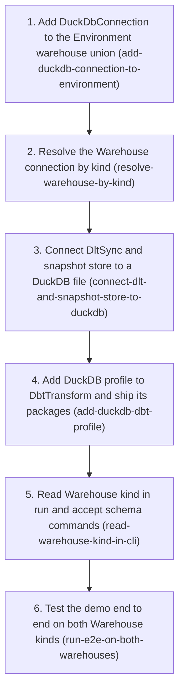

# Horizon 4 — DuckDB Warehouse runs the demo

## 🎯 What are we trying to achieve?
Make DuckDB, a single-file database that needs no server, a second supported Warehouse (the database adops loads data into and transforms it in). The existing demo Pipeline should run unchanged on it: Full Refresh and Incremental Sync, Breaking Change detection and `accept-schema`, the missing-table error, and the dbt Transform with its tests acting as Checks. Done means the full Docker end-to-end test passes on both Postgres and DuckDB, inside the 20-minute CI limit, with coverage still at 100%.

## 🧠 Why does this change need to happen?
The v1 vision promises that the same Pipelines run unchanged on a DuckDB Warehouse. Today `adops.yaml` only accepts a Postgres warehouse. The CLI builds every adapter with a hard-coded `'postgres'`, and the application layer assumes every warehouse has a password. dbt only knows a Postgres profile, and the DuckDB packages are installed for the tool's own tests only. dlt's DuckDB destination and the snapshot store already accept a kind, so most of the work is wiring the kind through and making the file path resolve against the Project folder.

## At a glance
- Phases: 6
- Complexity: Medium — six small or medium phases; the gate found one major issue, which was fixed
- Main risk: DuckDB allows only one writing connection per file, so dlt, the snapshot store and dbt-duckdb must each release the file before the next one opens it
- Target: the full E2E passes on both Warehouse kinds in under ~15 minutes (CI timeout of 20 minutes not raised); 100% line and branch coverage
- Testing focus: real DuckDB files (no mocks), path resolution independent of the working folder, lock release, no secret or path in error output

## Order of work
```
Phase 1 — Add DuckDbConnection to the Environment warehouse union
        ↓  (Phase 2 needs the DuckDB block from the settings model)
Phase 2 — Resolve the Warehouse connection by kind
        ↓  (Phase 3 needs the secret-free resolved DuckDB value)
Phase 3 — Connect DltSync and snapshot store to a DuckDB file
        ↓  (Phase 4 reuses the Project-relative path helper and the lock-safe Sync)
Phase 4 — Add DuckDB profile to DbtTransform and ship its packages
        ↓  (Phase 5 wires the now kind-aware adapters from the settings file)
Phase 5 — Read Warehouse kind in run and accept schema commands
        ↓  (Phase 6 proves the whole chain in Docker on both Warehouses)
Phase 6 — Test the demo end to end on both Warehouse kinds
```



### Phase 1 — Add DuckDbConnection to the Environment warehouse union
Technical ID: `add-duckdb-connection-to-environment` · Project settings (adops.yaml model and loader) · domain · small

**Goal** — Let adops.yaml declare `warehouse: {type: duckdb, path: ...}` and have `adops validate` accept it, while bad DuckDB blocks give clean, value-free error messages.

**Why** — The Warehouse kind must come from the user's settings file, and today Environment.warehouse only accepts PostgresConnection. pydantic puts the chosen union tag into error locations, so the loader's tag-stripping must learn the `warehouse` key or users would see paths like environments.dev.warehouse.duckdb.path.

**Changes**
- In environment.py add `class DuckDbConnection(BaseModel)` with model_config extra='forbid', frozen=True, `type: Literal['duckdb']` and `path: str = Field(min_length=1)` — a plain string, because domain code may not import pathlib; no Secret Reference field.
- Change `Environment.warehouse` to a discriminated union on `type` of PostgresConnection | DuckDbConnection (named e.g. `WarehouseConnection`); keep `sources: dict[str, PostgresConnection]` unchanged. Give an unknown `type` a clear custom message listing 'postgres' and 'duckdb', following the existing pattern in pipeline.py lines ~83-91.
- In loader.py extend `_without_union_tags` so a union tag that directly follows a `warehouse` key is removed from the error location, keeping the existing steps[i]/checks[k] behaviour.
- Update test_environment.py:107's expected text for an unknown warehouse type, and add domain tests: a valid duckdb block parses; `host` on a duckdb block is rejected as an extra field; a missing or empty `path` is rejected.
- Add a loader test asserting the error location reads `environments.dev.warehouse.path` (no `duckdb` segment) and that the input value is not echoed (include_input=False is already set).
- Add `adops validate` tests in test_validate_command.py for: a valid duckdb warehouse, unknown type, stray host on duckdb, missing path.

**Files / areas**
- `src/adops/domain/environment.py`
- `src/adops/domain/loader.py`
- `tests/unit/domain/test_environment.py`
- `tests/unit/domain/test_loader.py`
- `tests/unit/interface/test_validate_command.py`

**How to verify**
- **DuckDB block accepts exactly type and path** — Run `uv run pytest tests/unit/domain/test_environment.py -q`: it passes and includes tests for a valid duckdb block, a duckdb block with `host` (rejected as an extra field), a missing `path`, and `path: ""`.
- **Error locations hide the union tag** — Run `uv run pytest tests/unit/domain/test_loader.py -q`: a test asserts the reported location is exactly `environments.dev.warehouse.path` for a duckdb block with a missing path.
- **Unknown warehouse type lists the supported kinds** — Run `adops validate` on an adops.yaml with `warehouse: {type: snowflake, ...}`: the output is one error on `environments.dev.warehouse` that mentions both 'postgres' and 'duckdb'.

**Done when** — `adops validate` accepts an Environment with `warehouse: {type: duckdb, path: warehouse.duckdb}` and reports clean field paths (e.g. environments.dev.warehouse.path) for invalid DuckDB blocks, proven by the new domain, loader and validate tests., and every check under *How to verify* passes its bar.

**Depends on** — nothing — can start immediately

**Guards**
- g10: DuckDbConnection.path is a str and the module imports only pydantic and typing; test_domain_purity keeps passing.
- g6: no framework import added to domain/.
- g3: every new branch in _without_union_tags and the union error message is covered by the new tests.
- g7: no pragma is added.

<details><summary>Reference — full rubric</summary>

| Dimension | Rule | Pass criteria | Failure examples | minScore |
|---|---|---|---|---|
| DuckDB block accepts exactly type and path | An Environment warehouse block `{type: duckdb, path: <non-empty str>}` parses into a DuckDbConnection, while extra keys, a missing path, or an empty path are rejected; Sources still accept only Postgres. | Run `uv run pytest tests/unit/domain/test_environment.py -q`: it passes and includes tests for a valid duckdb block, a duckdb block with `host` (rejected as an extra field), a missing `path`, and `path: ""`.<br>Open src/adops/domain/environment.py: DuckDbConnection sets extra='forbid' and frozen=True, `path` is a `str` with min_length=1, and it has no `password_env` or other secret field.<br>In the same file, `sources` is still typed `dict[str, PostgresConnection]`, so `sources: {shop: {type: duckdb, path: x}}` is rejected (a test or a quick `adops validate` run shows this). | `path: str` with no min_length, so `path: ""` validates and the empty path only fails later at run time.<br>The union is applied to `sources` as well as `warehouse`, so a DuckDB Source validates even though no Sync can read it.<br>DuckDbConnection lacks extra='forbid', so `{type: duckdb, path: x, host: db}` silently drops `host`. | 8 |
| Error locations hide the union tag | Validation errors inside a warehouse block are reported at paths like `environments.dev.warehouse.path`, never with a `duckdb` or `postgres` union-tag segment, and never echo the bad input value. | Run `uv run pytest tests/unit/domain/test_loader.py -q`: a test asserts the reported location is exactly `environments.dev.warehouse.path` for a duckdb block with a missing path.<br>Run `adops validate` on a project whose adops.yaml has `warehouse: {type: duckdb, path: x, host: secret-host-value}`: the output names `environments.dev.warehouse.host` and does not contain `.duckdb.` or the text `secret-host-value`.<br>Run the same check with a broken Postgres warehouse (e.g. a missing `port`): the path has no `.postgres.` segment, and existing steps[i]/checks[k] loader tests still pass. | _without_union_tags strips any segment equal to 'duckdb', so a Step or field that is really named duckdb is removed from the path as well.<br>The tag is removed only when it follows `warehouse` at the end of the path, so nested errors still read `warehouse.duckdb.path`.<br>The error test only checks that the message contains 'path', so a leftover `duckdb` segment goes unnoticed. | 8 |
| Unknown warehouse type lists the supported kinds | A warehouse `type` other than postgres or duckdb produces one clear error that names both supported kinds, and does not dump pydantic's raw union-tag text. | Run `adops validate` on an adops.yaml with `warehouse: {type: snowflake, ...}`: the output is one error on `environments.dev.warehouse` that mentions both 'postgres' and 'duckdb'.<br>The same output does not contain pydantic's raw phrasing such as `union_tag_invalid` or `Input tag`, and does not contain the value `snowflake`.<br>Run `uv run pytest tests/unit/interface/test_validate_command.py -q`: it passes and covers a valid duckdb warehouse, an unknown type, a stray `host` on duckdb, and a missing path. | The custom message lists only 'postgres' because it was copied from pipeline.py's Step message without updating the kinds.<br>A missing `type` key shows pydantic's raw 'Unable to extract tag using discriminator' text instead of the custom message.<br>test_environment.py:107 is updated to the new text but no validate-command test exercises the CLI output. | 8 |

Healer hint: If the error path still shows `warehouse.duckdb.path`, extend _without_union_tags to remove a postgres/duckdb tag that directly follows a `warehouse` key at any depth, and add a loader test that asserts the exact location string.

</details>

### Phase 2 — Resolve the Warehouse connection by kind
Technical ID: `resolve-warehouse-by-kind` · Pipeline run planning (run_pipeline / accept_schema use cases) · application · medium

**Goal** — Have run_pipeline and accept_schema turn the Environment's warehouse block into the right resolved value — the existing password-masked ResolvedConnection for Postgres, or a new secret-free ResolvedDuckDb(path) for DuckDB — without looking up any secret for DuckDB.

**Why** — The application layer currently assumes every Warehouse has `password_env` and a password, so a DuckDB Environment would crash during secret resolution and redaction. A small dedicated value avoids fake host/port/user fields, and adapters receive it by closure exactly like today's Postgres connection.

**Changes**
- In ports.py add `@dataclass(frozen=True) class ResolvedDuckDb: path: str` (the path exactly as written in adops.yaml; making it absolute is the adapters' job) and a type alias `ResolvedWarehouse = ResolvedConnection | ResolvedDuckDb`. Keep ResolvedConnection unchanged for Postgres Sources and Warehouses.
- Change the warehouse parameter annotations of the ports (Sync.sync, Sync.make_columns_nullable, Transform.run, SchemaSnapshotStore.load/save) from ResolvedConnection to ResolvedWarehouse; Source parameters stay ResolvedConnection.
- In run_pipeline.py add `resolve_warehouse(connection, secrets) -> ResolvedWarehouse` that returns ResolvedDuckDb for DuckDbConnection and calls the existing resolve_connection for PostgresConnection.
- In `_build_plan` collect secret references only from connections that have `password_env` (skip a DuckDB warehouse) and build the warehouse with resolve_warehouse; type PlannedStep.warehouse and PlannedTransformStep.warehouse as ResolvedWarehouse.
- Make `PlannedStep._redact` mask only the passwords that exist (the Source password always, the Warehouse password only when it is a ResolvedConnection).
- In accept_schema.py resolve secrets for the Source plus the warehouse only when it is Postgres, and resolve the warehouse with resolve_warehouse.
- Add application tests with in-memory fakes: a DuckDB Environment runs a Sync and a Transform plan with no WAREHOUSE secret in env (no MissingSecretError) and the fakes receive ResolvedDuckDb(path=...); redaction still masks the Source password on a DuckDB run; accept_schema works with a DuckDB warehouse and no warehouse secret; the Postgres paths keep passing unchanged.

**Files / areas**
- `src/adops/application/ports.py`
- `src/adops/application/run_pipeline.py`
- `src/adops/application/accept_schema.py`
- `tests/unit/application/fakes.py`
- `tests/unit/application/test_run_pipeline.py`
- `tests/unit/application/test_accept_schema.py`

**How to verify**
- **DuckDB runs need no warehouse secret** — Run `uv run pytest tests/unit/application -q`: it passes and includes a test where the env holds only the Source password, the Environment has a DuckDB warehouse, and both a Sync plan and a Transform plan build without MissingSecretError.
- **Adapters receive ResolvedDuckDb with the path as written** — The application tests' recording fakes assert `ResolvedDuckDb(path='warehouse.duckdb')` (the string unchanged, not made absolute) for the Sync, Transform and snapshot-store calls.
- **Redaction masks the passwords that exist** — A unit test makes a fake Sync raise an error whose message contains the Source password on a DuckDB run, and asserts the redacted message shows the mask and not the password.

**Done when** — run_pipeline and accept_schema hand adapters a ResolvedDuckDb(path) for a DuckDB Environment without requiring any warehouse secret, proven by new tests in tests/unit/application., and every check under *How to verify* passes its bar.

**Depends on** — Add DuckDbConnection to the Environment warehouse union

**Guards**
- g10: ports.py and run_pipeline.py import only dataclasses/typing — no pathlib or os — so the path stays a plain string; test_application_purity keeps passing.
- g6: no framework import added to application/.
- g7: the warehouse value stays bound into PlannedStep/PlannedTransformStep by closure; nothing new goes into Dagster run config.
- g3: both branches of resolve_warehouse, the secret filter and _redact are covered by the new fake-based tests.

<details><summary>Reference — full rubric</summary>

| Dimension | Rule | Pass criteria | Failure examples | minScore |
|---|---|---|---|---|
| DuckDB runs need no warehouse secret | Planning a Sync or Transform run, or running accept_schema, against a DuckDB Environment never asks for a warehouse password env var, and only the Source's secrets are resolved. | Run `uv run pytest tests/unit/application -q`: it passes and includes a test where the env holds only the Source password, the Environment has a DuckDB warehouse, and both a Sync plan and a Transform plan build without MissingSecretError.<br>The accept_schema tests include a DuckDB-warehouse case whose secrets contain no warehouse entry, and it succeeds.<br>Run `grep -n 'password_env' src/adops/application/run_pipeline.py src/adops/application/accept_schema.py`: every read of `warehouse.password_env` is guarded by a Postgres type check or a resolve_warehouse dispatch, never read unconditionally. | _build_plan skips the DuckDB warehouse when resolving secrets, but accept_schema still builds `[source.password_env, warehouse.password_env]` and raises AttributeError.<br>The test's secrets fake returns a value for any key, so a stray lookup of a warehouse secret is never noticed. A strict fake that fails on unknown keys is needed.<br>resolve_warehouse checks `hasattr(connection, 'path')` instead of the connection type, so a later Postgres field rename quietly sends Postgres down the DuckDB branch. | 8 |
| Adapters receive ResolvedDuckDb with the path as written | For a DuckDB Environment, every warehouse-facing port call (Sync.sync, make_columns_nullable, Transform.run, SchemaSnapshotStore.load/save) receives ResolvedDuckDb(path=<the exact string from adops.yaml>), while Postgres runs still receive ResolvedConnection. | The application tests' recording fakes assert `ResolvedDuckDb(path='warehouse.duckdb')` (the string unchanged, not made absolute) for the Sync, Transform and snapshot-store calls.<br>Open src/adops/application/ports.py: ResolvedDuckDb is a frozen dataclass with one field, `path: str`. The warehouse parameters of the Sync, Transform and SchemaSnapshotStore ports are annotated ResolvedWarehouse, and Source parameters stay ResolvedConnection.<br>The existing Postgres application tests pass unchanged, apart from type-annotation edits. | resolve_warehouse calls `os.path.abspath` or adds a project prefix to the path, which breaks the purity test or changes the value the adapters expect.<br>Only the Sync fake is checked, and accept_schema's snapshot-store call still receives a ResolvedConnection built from fake host/port fields.<br>ResolvedDuckDb is defined with fake host='' and port=0 fields so that ResolvedConnection code keeps type-checking. | 8 |
| Redaction masks the passwords that exist | Error text from a DuckDB run still has the Source password masked, and redaction does not crash or mask unrelated text because the warehouse has no password. | A unit test makes a fake Sync raise an error whose message contains the Source password on a DuckDB run, and asserts the redacted message shows the mask and not the password.<br>A unit test confirms Postgres redaction still masks both the Source and Warehouse passwords.<br>No test passes an empty string as a password to mask. Inspect `_redact`: it never calls `replace('', ...)` for a missing warehouse password. | _redact uses `getattr(warehouse, 'password', '')` and then runs `text.replace('', '***')`, which puts the mask between every character.<br>The DuckDB redaction test raises an error that never contains the Source password, so it passes whether or not masking works. | 8 |

Healer hint: The most likely miss is accept_schema still reading warehouse.password_env unconditionally; route it through resolve_warehouse and give the tests a strict secrets fake that fails on any unexpected key.

</details>

### Phase 3 — Connect DltSync and snapshot store to a DuckDB file
Technical ID: `connect-dlt-and-snapshot-store-to-duckdb` · Sync engine (dlt) and Warehouse snapshot store · infrastructure · medium

**Goal** — Make the dlt-backed Sync and the WarehouseSnapshotStore load into, measure and record snapshots in a DuckDB file whose path is resolved against the Project folder, and report an unopenable file as WarehouseUnreachable.

**Why** — The dlt duckdb destination already exists in WAREHOUSE_DESTINATIONS but reads the fake `connection.database` field and resolves a relative path against the current working directory, not the Project. `adops run --project X` can run from any folder, so the path must be made absolute here, in infrastructure, because domain and application code may not use pathlib.

**Changes**
- In dlt_sync.py add a small helper `duckdb_file(project_dir: Path, path: str) -> Path` returning the path unchanged when absolute, otherwise `project_dir / path`; it is reused by DbtTransform in the next phase.
- Give `warehouse_destination(kind, connection, project_dir)` the Project folder and make `_duckdb_destination` take a ResolvedDuckDb and pass `str(duckdb_file(project_dir, connection.path))` as dlt credentials; `_postgres_destination` ignores project_dir. An unknown kind still raises UnknownConnectionKindError.
- Store the Project folder in DltSync and WarehouseSnapshotStore (both already receive it) and pass it to warehouse_destination; annotate warehouse parameters as ResolvedWarehouse.
- Make `warehouse_kind` a required argument of DltSync (remove its 'postgres' default) and keep it required on WarehouseSnapshotStore, so a caller that forgets the kind fails loudly instead of silently loading into Postgres; update every existing DltSync construction in tests to pass the kind.
- Change build_sync and build_snapshot_store in src/adops/interface/run_command.py to pass warehouse_kind='postgres' explicitly as an interim step (phase read-warehouse-kind-in-cli replaces it with the kind read from settings), so test_real_adapters_are_built_for_the_project keeps passing.
- Replace the existing tests' fake `ResolvedConnection(host='', port=0, database=str(path), ...)` DuckDB stand-ins with ResolvedDuckDb.
- Add real-DuckDB tests: a relative path lands under the Project folder even when the test's cwd is elsewhere (monkeypatch.chdir); an absolute path is used as given; a path in a missing parent folder raises WarehouseUnreachable from sync; a file held open by another process (subprocess holding duckdb.connect on it) raises WarehouseUnreachable; the snapshot store round-trips save/load on a relative path.
- Add a test that after DltSync.sync and WarehouseSnapshotStore.save return, `duckdb.connect(file)` in the same process succeeds — proving both release the single-writer lock (DuckDB allows only one writing connection per file).

**Files / areas**
- `src/adops/infrastructure/dlt_sync.py`
- `src/adops/infrastructure/schema_snapshot_store.py`
- `tests/unit/infrastructure/test_dlt_sync.py`
- `tests/unit/infrastructure/test_schema_snapshot_store.py`
- `src/adops/interface/run_command.py`
- `tests/unit/interface/test_run_command.py`

**How to verify**
- **Relative DuckDB path lands under the Project folder** — Run `uv run pytest tests/unit/infrastructure/test_dlt_sync.py tests/unit/infrastructure/test_schema_snapshot_store.py -q`: it passes, and there is a test that uses monkeypatch.chdir to a different tmp dir, syncs with path 'wh.duckdb', and asserts `<project>/wh.duckdb` exists while `<cwd>/wh.duckdb` does not.
- **Single-writer lock is released after each call** — A test calls DltSync.sync on a DuckDB file and then `duckdb.connect(file)` (read-write) in the same process, and the connect succeeds.
- **Unopenable file raises WarehouseUnreachable** — A test with path 'missing/dir/wh.duckdb' asserts `pytest.raises(WarehouseUnreachable)` from DltSync.sync, and the missing folder is not created as a side effect.

**Done when** — DltSync and WarehouseSnapshotStore load and snapshot into a DuckDB file resolved against the Project folder, proven by real-DuckDB unit tests in test_dlt_sync.py and test_schema_snapshot_store.py including the missing-folder and locked-file WarehouseUnreachable cases., and every check under *How to verify* passes its bar.

**Depends on** — Resolve the Warehouse connection by kind

**Guards**
- g3: every new branch (absolute vs relative path, unknown kind, unreachable file) is covered by real DuckDB files, not mocks, and the interim explicit kind in run_command.py keeps the existing interface tests green.
- g7: no pragma is added.
- g6: dlt stays inside infrastructure; application ports are unchanged in this phase.
- g10: only infrastructure imports pathlib for the path join.

<details><summary>Reference — full rubric</summary>

| Dimension | Rule | Pass criteria | Failure examples | minScore |
|---|---|---|---|---|
| Relative DuckDB path lands under the Project folder | A relative ResolvedDuckDb.path is joined to the Project folder no matter what the process cwd is, and an absolute path is used exactly as given, for both DltSync and WarehouseSnapshotStore. | Run `uv run pytest tests/unit/infrastructure/test_dlt_sync.py tests/unit/infrastructure/test_schema_snapshot_store.py -q`: it passes, and there is a test that uses monkeypatch.chdir to a different tmp dir, syncs with path 'wh.duckdb', and asserts `<project>/wh.duckdb` exists while `<cwd>/wh.duckdb` does not.<br>A test with an absolute path in another tmp dir asserts the file is created at exactly that path.<br>The snapshot store save/load round trip on a relative path reads back the saved snapshot. Load runs with a different cwd from save, or the test asserts the file location directly. | DltSync joins the path to project_dir, but WarehouseSnapshotStore still passes the raw string, so snapshots go to a second file in cwd and the snapshot load after a sync finds nothing.<br>The test never changes cwd, and pytest's cwd happens to be the project root, so a missing join still passes.<br>`Path(path).resolve()` is used, which resolves against cwd rather than the Project. | 8 |
| Single-writer lock is released after each call | When DltSync.sync and WarehouseSnapshotStore.save/load return, whether they succeed or fail, no DuckDB connection is left open on the file, so a following writer in the same process can open it. | A test calls DltSync.sync on a DuckDB file and then `duckdb.connect(file)` (read-write) in the same process, and the connect succeeds.<br>A test does the same after WarehouseSnapshotStore.save and after load.<br>A test makes sync fail part-way (for example, a Source table that does not exist) and then confirms `duckdb.connect(file)` still succeeds. | The dlt pipeline object is cached on DltSync and keeps its destination client open, so the success-path test passes only because the connect happens after the object is garbage-collected.<br>Only the success path is tested, and an exception inside the snapshot store's `with` block leaves the connection open.<br>The lock test opens the file with read_only=True, which DuckDB allows even while a writer holds the file, so the check proves nothing. | 8 |
| Unopenable file raises WarehouseUnreachable | A DuckDB path in a missing parent folder, or a file locked by another process, surfaces as WarehouseUnreachable from both sync and the snapshot store, not as a raw duckdb or dlt exception. | A test with path 'missing/dir/wh.duckdb' asserts `pytest.raises(WarehouseUnreachable)` from DltSync.sync, and the missing folder is not created as a side effect.<br>A test starts a subprocess that holds `duckdb.connect(file)` open, then asserts WarehouseUnreachable from both sync and snapshot save, and the subprocess is cleaned up in a finally block or fixture.<br>`warehouse_destination('oracle', ...)` still raises UnknownConnectionKindError. DltSync constructed without `warehouse_kind` raises TypeError, so the argument is required. | dlt wraps the duckdb IOException in a PipelineStepFailed, the except clause catches only duckdb.IOException, and the user sees a dlt traceback.<br>dlt quietly creates missing parent folders, so the 'missing folder' test fails, and the implementer weakens it to accept success.<br>The locking subprocess is not terminated on test failure, which leaves a stale lock that breaks later tests. | 8 |

Healer hint: If the lock or path tests fail, check that WarehouseSnapshotStore and DltSync both call the same duckdb_file(project_dir, path) helper and that the dlt pipeline or client is closed in a finally block instead of cached.

</details>

### Phase 4 — Add DuckDB profile to DbtTransform and ship its packages
Technical ID: `add-duckdb-dbt-profile` · Transform engine (dbt) · infrastructure · medium

**Goal** — Make the dbt Transform Step run `dbt build` against the same DuckDB file the Sync loaded, with no password environment variable and one dbt thread — and make dlt's duckdb destination and dbt-duckdb install with adops as runtime dependencies.

**Why** — DbtTransform only knows render_postgres_profile and always exports ADOPS_DBT_WAREHOUSE_PASSWORD, which a DuckDB Warehouse does not have; dbt-duckdb also resolves relative paths against cwd and opens extra connections when threads > 1, which would clash with DuckDB's single-writer lock. The packages move to runtime in the same phase (as horizon 3 folded dbt-core into its adapter phase) because the production DuckDB renderer is what makes dbt-duckdb a real runtime need, and a dependency-only phase would be ceremony.

**Changes**
- Add `render_duckdb_profile` producing a profiles.yml with `type: duckdb`, `path: <absolute file>` (via duckdb_file from dlt_sync.py), `schema: analytics` (TARGET_SCHEMA) and `threads: 1`; promote the test stand-in at test_dbt_transform.py:88-105 to this production renderer.
- Pass the Project folder to the renderers (ProfileRenderer becomes (profile_name, warehouse, project_root) -> str) so the DuckDB renderer can make the path absolute.
- Add a `PROFILE_RENDERERS = {'postgres': render_postgres_profile, 'duckdb': render_duckdb_profile}` registry and a `profile_renderer(kind)` lookup raising UnknownConnectionKindError('Warehouse', kind, ...).
- Make DbtTransform take a required `warehouse_kind: str` (no 'postgres' default) and pick its renderer from the registry; keep the injectable render_profile override for tests, and update existing DbtTransform constructions in tests to pass the kind.
- Change build_transform in src/adops/interface/run_command.py to pass warehouse_kind='postgres' explicitly as an interim step (replaced by the settings-derived kind in phase read-warehouse-kind-in-cli), and update any test that passes render_profile positionally to use the keyword.
- Set ADOPS_DBT_WAREHOUSE_PASSWORD only when the warehouse is a ResolvedConnection; for ResolvedDuckDb run dbt without touching os.environ.
- Add real-dbt tests: a DuckDB build on a relative path resolved against the Project; no password env var is set during a DuckDB run; an unknown kind raises UnknownConnectionKindError.
- Add one in-process lock test on a single DuckDB file: DltSync.sync from a sqlite Source, then WarehouseSnapshotStore.save, then DbtTransform.run over a tiny dbt project selecting from raw_<source> — all succeed in that order.
- In pyproject.toml [project].dependencies replace 'dlt[postgres]>=1.32,<2' with 'dlt[postgres,duckdb]>=1.32,<2' and add 'dbt-duckdb==1.11.1'; remove 'dlt[duckdb]>=1.32,<2' and 'dbt-duckdb>=1.10,<2' from the dev group; change the pyproject description to 'a Postgres or DuckDB warehouse'.
- Run `uv lock` and check the uv.lock diff only moves duckdb, dbt-duckdb and their transitive packages from the dev group to the main dependency set; no version of dlt, dagster, dbt-core, dbt-postgres or protobuf may change — if one moves, stop and report it.

**Files / areas**
- `src/adops/infrastructure/dbt_transform.py`
- `tests/unit/infrastructure/test_dbt_transform.py`
- `pyproject.toml`
- `uv.lock`
- `src/adops/interface/run_command.py`
- `tests/unit/interface/test_run_command.py`

**How to verify**
- **DuckDB profile targets the Sync's file with one thread** — Run `uv run pytest tests/unit/infrastructure/test_dbt_transform.py -q`: it passes and includes a test that parses the rendered YAML and asserts `type == 'duckdb'`, `threads == 1`, `schema == 'analytics'`, and that `path` is absolute and equals `<project>/<relative path>`.
- **No password env var on DuckDB runs** — A test records os.environ during a DuckDB DbtTransform.run, for example with an injected render_profile spy or a dbt macro that reads the env, and asserts ADOPS_DBT_WAREHOUSE_PASSWORD is absent.
- **Sync, snapshot and dbt share one file in sequence** — A test runs sync from a sqlite Source into raw_<source>, then snapshot save, then a tiny dbt model selecting from raw_<source>, all on one file, and asserts the model's row count equals the source row count.
- **DuckDB packages become runtime dependencies without collateral bumps** — Run `grep -n 'duckdb' pyproject.toml`: `dlt[postgres,duckdb]` and `dbt-duckdb==1.11.1` appear under [project].dependencies, and no duckdb entry remains in the dev dependency group.

**Done when** — DbtTransform(project, warehouse_kind='duckdb') — with the kind a required argument — runs `dbt build` against the Sync's DuckDB file without a password env var, with dlt[duckdb] and dbt-duckdb==1.11.1 as runtime dependencies in pyproject.toml and uv.lock, proven by the new real-dbt tests in test_dbt_transform.py (including the sync-then-snapshot-then-dbt lock test) and a passing `uv sync --locked`., and every check under *How to verify* passes its bar.

**Depends on** — Connect DltSync and snapshot store to a DuckDB file

**Guards**
- g1: pyproject.toml and uv.lock change in the same commit and `uv sync --locked` is run before committing.
- g4: the wheel template grep is untouched; `uv build --wheel` is re-run to prove the wheel still builds.
- g3: both password branches, both renderers and the unknown-kind branch run real dbt-duckdb, and the interim explicit kind in build_transform keeps the existing interface tests green.
- g7: no pragma; the DuckDB profile holds no secret, the Postgres profile still uses env_var(), and nothing goes into Dagster run config.
- g6: dbt stays inside infrastructure.

**Rollback** — Revert pyproject.toml and uv.lock; no data or published contract is affected.

<details><summary>Reference — full rubric</summary>

| Dimension | Rule | Pass criteria | Failure examples | minScore |
|---|---|---|---|---|
| DuckDB profile targets the Sync's file with one thread | render_duckdb_profile produces a dbt profile with type duckdb, an absolute path equal to duckdb_file(project_root, path), schema analytics, threads 1, and no secret or env_var reference. | Run `uv run pytest tests/unit/infrastructure/test_dbt_transform.py -q`: it passes and includes a test that parses the rendered YAML and asserts `type == 'duckdb'`, `threads == 1`, `schema == 'analytics'`, and that `path` is absolute and equals `<project>/<relative path>`.<br>A real dbt-duckdb build with a relative path and a different cwd writes its models into `<project>/<path>`. Opening that file read-only shows the model in the `analytics` schema.<br>The Postgres profile still contains `env_var('ADOPS_DBT_WAREHOUSE_PASSWORD')` and no literal password. | The profile writes the relative path as given, so dbt resolves it against dbt's own cwd (the dbt project folder) and builds into an empty new file.<br>threads is left at the dbt default of 4, and dbt-duckdb's extra connections cause intermittent lock errors on bigger projects.<br>The test stand-in renderer is kept in test code and the production code imports nothing new, so production DbtTransform still has only the Postgres renderer. | 8 |
| No password env var on DuckDB runs | DbtTransform.run sets ADOPS_DBT_WAREHOUSE_PASSWORD only for a ResolvedConnection; on a ResolvedDuckDb run, os.environ is unchanged before, during and after the run. | A test records os.environ during a DuckDB DbtTransform.run, for example with an injected render_profile spy or a dbt macro that reads the env, and asserts ADOPS_DBT_WAREHOUSE_PASSWORD is absent.<br>A Postgres-path test confirms the variable is set during the run and restored or removed afterwards, as it was before this phase.<br>DbtTransform constructed without `warehouse_kind` raises TypeError, and `profile_renderer('oracle')` raises UnknownConnectionKindError. | The code sets the env var to an empty string for DuckDB instead of leaving it alone, so the 'no password env var' test passes only because it checks for a truthy value.<br>The env check runs only after `run` returns, so a value that was set and then removed during the run goes unnoticed. | 8 |
| Sync, snapshot and dbt share one file in sequence | In one process, DltSync.sync, then WarehouseSnapshotStore.save, then DbtTransform.run all succeed on the same DuckDB file, and dbt reads the rows dlt loaded. | A test runs sync from a sqlite Source into raw_<source>, then snapshot save, then a tiny dbt model selecting from raw_<source>, all on one file, and asserts the model's row count equals the source row count.<br>The test uses real dlt, real duckdb and real dbt-duckdb, with no mocks of those engines. | The test asserts only that dbt exited 0, but the model selects from an empty schema in a different file, so the shared-file claim is never checked.<br>dbt is run in a subprocess while the test's own duckdb connection is still open, so the sequence passes or fails depending on timing. | 8 |
| DuckDB packages become runtime dependencies without collateral bumps | dlt's duckdb extra and dbt-duckdb==1.11.1 are in [project].dependencies, they are gone from the dev group, and the uv.lock change moves packages only between groups, with no version changes for dlt, dagster, dbt-core, dbt-postgres or protobuf. | Run `grep -n 'duckdb' pyproject.toml`: `dlt[postgres,duckdb]` and `dbt-duckdb==1.11.1` appear under [project].dependencies, and no duckdb entry remains in the dev dependency group.<br>Run `git diff <commit before this phase> -- uv.lock \| grep -E '^[-+](name\|version) = '`: no `version` line changes for dlt, dagster, dbt-core, dbt-postgres or protobuf.<br>In a fresh venv, run `uv build --wheel && uv venv /tmp/w && uv pip install --python /tmp/w dist/*.whl && /tmp/w/bin/python -c 'import duckdb, dbt.adapters.duckdb'`: the import succeeds. | `uv lock --upgrade` is run instead of `uv lock`, and protobuf or dagster moves to a new minor version as a side effect.<br>dbt-duckdb is added at runtime but `dlt[duckdb]` is left only in dev, so the wheel installs dbt-duckdb (which pulls in duckdb) and the problem is masked until the pins drift.<br>The pyproject description still says Postgres only. | 8 |

Healer hint: If the dbt build lands in the wrong file or hits a lock error, make render_duckdb_profile write the absolute duckdb_file(project_root, path) and set threads: 1, and close every dlt or snapshot connection before dbt starts.

</details>

### Phase 5 — Read Warehouse kind in run and accept schema commands
Technical ID: `read-warehouse-kind-in-cli` · CLI commands (run, accept-schema) · interface · medium

**Goal** — Make `adops run` and `adops accept-schema` read the selected Environment's warehouse `type` from adops.yaml and build DltSync, WarehouseSnapshotStore and DbtTransform for that kind, with an unopenable DuckDB file giving the dedicated 'Warehouse unreachable' message in both commands.

**Why** — build_sync, build_snapshot_store and build_transform are called before adops.yaml is parsed and hard-code 'postgres', so a DuckDB Environment would still load into Postgres. accept-schema also lacks a handler for WarehouseUnreachable, so it would print a generic 'unexpected WarehouseUnreachable' instead of the sanitized dedicated message.

**Changes**
- In run_command.py add `warehouse_kind(settings_text, environment) -> str` that calls load_project_settings and pick_environment and returns `environment.warehouse.type` (PipelineValidationError for a bad file or unknown Environment is already caught by `run`).
- Change the builders to take the kind: `build_sync(project, pipeline, kind)` -> DltSync(project, pipeline, warehouse_kind=kind); `build_snapshot_store(project, kind)`; `build_transform(project, kind)` -> DbtTransform(project, warehouse_kind=kind). No 'postgres' literal remains in these builders.
- Call warehouse_kind in run_project and accept_project_schema before building adapters.
- In accept_schema_command.py catch the WarehouseUnreachable marker (from application.ports) and fail with the same sanitized 'Warehouse unreachable' wording WarehouseUnreachableError uses in run, without the file path or driver text.
- Change cli.py:36 help text to 'into your Postgres or DuckDB warehouse' (check test_cli does not assert the old text).
- Update the monkeypatched builder signatures in test_run_command.py (lines ~125-449) and test_accept_schema_command.py (~100-241); add tests that a duckdb settings file makes the builders receive 'duckdb', and that accept-schema on a DuckDB path inside a missing folder prints the dedicated message.
- Add one CLI-level unit test running `adops run` on a DuckDB Environment end to end in process under the real DagsterOrchestrator (sqlite or monkeypatched Source as the existing run tests do), proving the closure-bound DuckDB warehouse reaches the ops.

**Files / areas**
- `src/adops/interface/run_command.py`
- `src/adops/interface/accept_schema_command.py`
- `src/adops/interface/cli.py`
- `tests/unit/interface/test_run_command.py`
- `tests/unit/interface/test_accept_schema_command.py`

**How to verify**
- **Every adapter is built for the Environment's kind** — Run `grep -n "'postgres'\|\"postgres\"" src/adops/interface/run_command.py src/adops/interface/accept_schema_command.py`: there are no matches inside build_sync, build_snapshot_store or build_transform.
- **accept-schema prints the sanitized unreachable message** — Run `adops accept-schema` on a project whose DuckDB path is 'missing/dir/wh.duckdb': the exit code is non-zero, stderr contains 'Warehouse unreachable', and it does not contain 'missing/dir', the home directory path, 'IOException' or 'unexpected'.
- **Real orchestrator run on DuckDB in process** — A CLI-level unit test invokes `adops run` through Typer's CliRunner on a DuckDB Environment with a sqlite or monkeypatched Source, exits 0, and then opens `<project>/<path>` with `duckdb.connect(..., read_only=True)` to assert the expected raw table row count.

**Done when** — `adops run` and `adops accept-schema` build every adapter for the Environment's Warehouse kind (no hard-coded 'postgres' in the builders), proven by updated tests in test_run_command.py and test_accept_schema_command.py., and every check under *How to verify* passes its bar.

**Depends on** — Add DuckDB profile to DbtTransform and ship its packages

**Guards**
- g3: every new branch (kind lookup, new except clause) is covered by interface tests.
- g7: no pragma; the error message is built from fixed text only, never from the exception, so no secret or home-directory path can leak; the kind and warehouse stay closure-bound, not run config.
- g10: interface may import dagster only through dagster_orchestrator as today; no new dagster import.

<details><summary>Reference — full rubric</summary>

| Dimension | Rule | Pass criteria | Failure examples | minScore |
|---|---|---|---|---|
| Every adapter is built for the Environment's kind | `adops run` and `adops accept-schema` read the selected Environment's warehouse type, pass it to build_sync, build_snapshot_store and build_transform, and the builders no longer contain any hard-coded 'postgres'. | Run `grep -n "'postgres'\\|\"postgres\"" src/adops/interface/run_command.py src/adops/interface/accept_schema_command.py`: there are no matches inside build_sync, build_snapshot_store or build_transform.<br>Run `uv run pytest tests/unit/interface/test_run_command.py tests/unit/interface/test_accept_schema_command.py -q`: it passes, with tests asserting that a duckdb settings file makes all three builders receive 'duckdb' and a postgres file makes them receive 'postgres'.<br>A project with two Environments (dev=postgres, ci=duckdb) run with `--env ci` builds its adapters with 'duckdb'. A test covers choosing the kind per Environment. | warehouse_kind reads the first Environment in adops.yaml instead of the selected one, so `--env ci` still builds Postgres adapters.<br>build_transform gets the kind but build_snapshot_store keeps its default, so a DuckDB run loads into DuckDB and then fails the snapshot step against Postgres.<br>The monkeypatched builder fakes accept `*args`, so a test passes even when the kind argument is never passed. | 8 |
| accept-schema prints the sanitized unreachable message | When the DuckDB file cannot be opened, accept-schema exits non-zero with the same fixed 'Warehouse unreachable' wording run uses, and the output contains no file path, home directory or driver text. | Run `adops accept-schema` on a project whose DuckDB path is 'missing/dir/wh.duckdb': the exit code is non-zero, stderr contains 'Warehouse unreachable', and it does not contain 'missing/dir', the home directory path, 'IOException' or 'unexpected'.<br>A unit test in test_accept_schema_command.py asserts the same, and a matching run-command test shows identical wording. | The handler prints `f'Warehouse unreachable: {exc}'`, which leaks the absolute file path and duckdb's driver message.<br>The except clause catches WarehouseUnreachableError (the run-side wrapper) instead of the WarehouseUnreachable marker from application.ports, so accept-schema still prints 'unexpected WarehouseUnreachable'. | 8 |
| Real orchestrator run on DuckDB in process | An in-process `adops run` under the real DagsterOrchestrator on a DuckDB Environment loads data into the Project's DuckDB file, which proves the closure-bound ResolvedDuckDb reaches the ops. | A CLI-level unit test invokes `adops run` through Typer's CliRunner on a DuckDB Environment with a sqlite or monkeypatched Source, exits 0, and then opens `<project>/<path>` with `duckdb.connect(..., read_only=True)` to assert the expected raw table row count.<br>The same test, or a grep of the code, confirms no warehouse path or kind is put into Dagster run config: `grep -n run_config src/adops/infrastructure/dagster_orchestrator.py` shows no warehouse fields. | The test monkeypatches DltSync, so it shows only that the CLI exits 0, not that DuckDB received any rows.<br>The test asserts that a file exists at the path, but the file is an empty DuckDB file created by the snapshot store and the sync loaded nowhere. | 8 |

Healer hint: If DuckDB runs still hit Postgres, check that run_project and accept_project_schema call warehouse_kind for the selected Environment before calling any builder, and tighten the builder fakes to explicit signatures so a missing kind argument fails.

</details>

### Phase 6 — Test the demo end to end on both Warehouse kinds
Technical ID: `run-e2e-on-both-warehouses` · Demo Project and Docker E2E harness · cross-cutting · medium

**Goal** — Ship a commented DuckDB warehouse block in the demo adops.yaml and run the full Docker E2E scenario once on the Postgres Warehouse and once on DuckDB (made by uncommenting that block), inside CI's 20-minute e2e timeout.

**Why** — This is the user-visible proof of the horizon: the same demo Pipeline — Full Refresh and Incremental Sync, Breaking Change halt and accept-schema, missing-table error, dbt Transform with its failing dbt test stopping later Steps — must pass unchanged on DuckDB. The commented block is the E2E's input, so testing it here proves the shipped block actually works; the E2E today runs once and permanently mutates the shop Source, so the Source must be reseeded between the two runs.

**Changes**
- Before editing, run `uv run pytest tests/e2e -m e2e` once and record the current wall-clock as the baseline in discoveries.md.
- In the demo adops.yaml add a commented block under `dev:` showing `# warehouse:` / `#   type: duckdb` / `#   path: .adops/warehouse.duckdb` with a one-line comment saying to swap it in for the Postgres warehouse block; .adops/ is already in the demo gitignore. Add no new file and no *_env key.
- In test_demo_sync.py keep the module-scoped compose fixture (one `docker compose up --wait`) and add a function-scoped fixture parametrized over ['postgres', 'duckdb'] that runs `adops init --demo` into a fresh tmp Project, copies .env, and for duckdb rewrites adops.yaml so dev.warehouse is the uncommented DuckDB block.
- Reseed the shop Source before each run: drop and recreate the shop schema objects through the existing `shop()` helper and replay the demo seed/01_shop.sql, so the Breaking Change mutations of one run do not leak into the next.
- Make the `warehouse()` / `counts()` / `analytics_rows()` helpers dispatch on kind: psycopg for postgres, `duckdb.connect(<project>/.adops/warehouse.duckdb, read_only=True)` for duckdb, opened only after each adops process has exited.
- Keep every existing assertion identical for both kinds (row counts, Breaking Change halt and accept-schema, missing-table error, dbt build and failing dbt test, assert_no_secret_or_row_value); make the Dagster-metadata success assertion count runs for the current parameter only since both runs share the Dagster metadata Postgres.
- Run the e2e suite again and record the new wall-clock in discoveries.md; if it exceeds ~15 minutes, report it instead of raising the CI timeout.

**Files / areas**
- `src/adops/templates/demo/adops.yaml`
- `tests/e2e/test_demo_sync.py`
- `docs/roadmaps/agentic-dataops/discoveries.md`

**How to verify**
- **The commented demo block is what DuckDB runs on** — Run `adops init --demo /tmp/d && grep -n '#.*type: duckdb' -A1 /tmp/d/adops.yaml`: a commented `warehouse:` / `type: duckdb` / `path: .adops/warehouse.duckdb` block appears under `dev:`, with no `*_env` key in it.
- **Identical scenario passes on both Warehouse kinds** — Run `uv run pytest tests/e2e -m e2e -v`: the output shows the scenario test passing for both `[postgres]` and `[duckdb]`.
- **Runs are isolated and repeatable within one stack** — Run `uv run pytest tests/e2e -m e2e -k duckdb` on a fresh stack: it passes on its own.
- **Two-kind E2E fits the CI budget** — Run `time uv run pytest tests/e2e -m e2e`: total wall-clock is under 15 minutes on a developer machine with images already pulled.

**Done when** — tests/e2e/test_demo_sync.py passes for both the postgres and duckdb parameters in one compose stack, with the before/after e2e wall-clock recorded in discoveries.md and under the 20-minute CI timeout., and every check under *How to verify* passes its bar.

**Depends on** — Read Warehouse kind in run and accept schema commands

**Guards**
- g5: one compose stack is reused and the Source is reseeded instead of a second `compose up`; the wall-clock is measured before and after and must stay under the 20-minute timeout, which is not raised.
- g9: no file is added to the demo template, compose and the Postgres default are untouched, and the commented block has no *_env key, so DEMO_FILES, the .env.example cross-check and the dev.warehouse port cross-check still pass.
- g4: no new template file, so the CI wheel grep list is unchanged.
- g7: assert_no_secret_or_row_value runs on both kinds' output.
- g3: the only src/adops/ change is the demo adops.yaml template (a comment block), which adds no Python line or branch, so coverage is unaffected.

<details><summary>Reference — full rubric</summary>

| Dimension | Rule | Pass criteria | Failure examples | minScore |
|---|---|---|---|---|
| The commented demo block is what DuckDB runs on | The demo adops.yaml ships a commented DuckDB warehouse block that, once uncommented in place of the Postgres block, is the exact configuration the duckdb E2E parameter runs. The Postgres default and the template file set are unchanged. | Run `adops init --demo /tmp/d && grep -n '#.*type: duckdb' -A1 /tmp/d/adops.yaml`: a commented `warehouse:` / `type: duckdb` / `path: .adops/warehouse.duckdb` block appears under `dev:`, with no `*_env` key in it.<br>Read tests/e2e/test_demo_sync.py: the duckdb fixture builds its adops.yaml by uncommenting the shipped block (reading it from the scaffolded file), not by writing its own literal DuckDB YAML.<br>Run `uv run pytest tests/unit/interface/test_init_command.py -q`: it passes, and `adops validate` on the scaffold is still clean with the Postgres default active. | The fixture writes `warehouse: {type: duckdb, path: .adops/warehouse.duckdb}` itself, so a typo or wrong indentation in the shipped comment block is never tested.<br>Uncommenting the block as shipped gives invalid YAML because of comment-marker indentation, and the fixture fixes the indentation silently. | 8 |
| Identical scenario passes on both Warehouse kinds | Every E2E assertion (Full Refresh and Incremental counts, Breaking Change halt and accept-schema, missing-table error, dbt build with the failing dbt test stopping later Steps, no secret or row value in output) runs unchanged for both postgres and duckdb. | Run `uv run pytest tests/e2e -m e2e -v`: the output shows the scenario test passing for both `[postgres]` and `[duckdb]`.<br>Read the test: no assertion is behind `if kind == 'postgres'`, and the only kind-dependent code is in the warehouse(), counts() and analytics_rows() helpers.<br>assert_no_secret_or_row_value is called on the CLI output of the duckdb run as well as the postgres run. | The dbt failing-test assertion is skipped for duckdb because the error text is different, which hides a real difference in how Steps stop.<br>The duckdb helper opens the file while an adops process still holds it, gets a lock error, and the implementer adds a retry or sleep instead of opening it only after the process exits.<br>The Dagster success-run count is compared to a total across both parameters, so the duckdb run passes only when it runs second. | 8 |
| Runs are isolated and repeatable within one stack | Both parameters share one `docker compose up`, the shop Source is reseeded before each run so neither run's Breaking Change mutations affect the other, and either parameter passes alone or in either order. | Run `uv run pytest tests/e2e -m e2e -k duckdb` on a fresh stack: it passes on its own.<br>On one stack run `uv run pytest tests/e2e -m e2e -k duckdb` followed by `uv run pytest tests/e2e -m e2e -k postgres`, then the reverse order: all four runs pass.<br>grep the test for `compose`: `up --wait` is called only in the module-scoped fixture. | The reseed replays 01_shop.sql without dropping the column added by the Breaking Change step, so the second run starts with a changed schema and the halt assertion fails.<br>The Dagster metadata assertion counts all successful runs in the shared metadata Postgres, so the test passes only when the parameters run in the default order. | 8 |
| Two-kind E2E fits the CI budget | The full two-parameter E2E finishes well inside the CI e2e job's 20-minute timeout, and the timeout itself is not raised. | Run `time uv run pytest tests/e2e -m e2e`: total wall-clock is under 15 minutes on a developer machine with images already pulled.<br>Run `git diff <commit before this phase> -- .github/workflows/ci.yml`: the e2e job's `timeout-minutes` is unchanged. | Each parameter brings up its own compose stack, which doubles container start-up time and pushes the suite over 15 minutes.<br>The timeout is raised to 30 minutes to make the suite fit. | 8 |

Healer hint: If the second parameter fails on Breaking Change or row counts, the shop reseed is incomplete: drop and recreate the shop schema objects before replaying seed/01_shop.sql, and count Dagster runs for the current parameter only.

</details>

## Discovery Findings

| Area | Finding | File | Implication |
|---|---|---|---|
| needs: DltSync accepts a warehouse kind | present. DltSync(project_dir, pipeline, source_kind='postgres', warehouse_kind='postgres') already exists. WAREHOUSE_DESTINATIONS has 'postgres' and 'duckdb' (_duckdb_destination passes connection.database as the credentials path). warehouse_destination raises UnknownConnectionKindError. | src/adops/infrastructure/dlt_sync.py | Do not add a new registry for dlt. Pass warehouse_kind from build_sync, which today calls DltSync(project, pipeline) and so falls back to the 'postgres' default. |
| conflict: interface builders run before settings are parsed | run_project and accept_project_schema call build_sync(project, pipeline), build_snapshot_store(project) -> WarehouseSnapshotStore(project, 'postgres') and build_transform(project) -> DbtTransform(project), which uses the default render_postgres_profile. adops.yaml is parsed later, inside run_pipeline/accept_schema. | src/adops/interface/run_command.py | The interface must parse settings (load_project_settings) and pick the Environment before it builds adapters, or the builders must take the kind. Builder signatures change. Many tests monkeypatch these signatures (test_run_command.py:125-449, test_accept_schema_command.py:100-241), so those tests need updating. |
| needs: WarehouseSnapshotStore is kind-aware | present. WarehouseSnapshotStore(project, warehouse_kind) dispatches through warehouse_destination. Its unit tests already run against real DuckDB. Its DDL (TIMESTAMP WITH TIME ZONE DEFAULT CURRENT_TIMESTAMP) already works on DuckDB. | src/adops/infrastructure/schema_snapshot_store.py | Only the hard-coded 'postgres' in build_snapshot_store needs to change. No new SQL client is needed. |
| needs: DuckDB dbt profile renderer | missing. dbt_transform.py has only PROFILE_TEMPLATE/render_postgres_profile (threads: 1). DbtTransform takes render_profile as an injectable ProfileRenderer. Tests have a duckdb_profile stand-in with type duckdb, a path and no threads (test_dbt_transform.py:88-105). | src/adops/infrastructure/dbt_transform.py | Add render_duckdb_profile (type: duckdb, absolute path, threads: 1) plus a kind->renderer registry that raises UnknownConnectionKindError. build_transform passes the renderer. Promote the test stand-in to production. |
| conflict: DbtTransform always sets the password env var | DbtTransform.run always wraps the call in _password_in_environ(warehouse.password) and sets ADOPS_DBT_WAREHOUSE_PASSWORD. A DuckDB Warehouse has no password. | src/adops/infrastructure/dbt_transform.py | Set the password env var only when the Warehouse has a password; test both paths with real dbt. |
| needs: ResolvedConnection can describe DuckDB | missing. ResolvedConnection is a Postgres-only dataclass (host, port, database, user, password with repr masked). Tests fake DuckDB as ResolvedConnection(host='', port=0, database=str(path), user='', password=''). resolve_connection takes only PostgresConnection. | src/adops/application/ports.py | Pick one: a kind-tagged resolved Warehouse type, or reuse of fields as tests already do. Port signatures (Sync.sync, make_columns_nullable, Transform.run, SchemaSnapshotStore) all take ResolvedConnection, so a new type has a wide reach. |
| conflict: application code assumes every warehouse has password_env | _build_plan resolves secrets with (c.password_env for c in connections), including environment.warehouse. accept_schema resolves (environment.warehouse.password_env, source_connection.password_env). PlannedStep._redact reads self.warehouse.password. | src/adops/application/run_pipeline.py | Both call sites must skip secret resolution for a DuckDB warehouse; resolve_connection (or a new resolve_warehouse) must dispatch on the kind, and _redact must cope with no Warehouse password. |
| needs: DuckDbConnection in the Environment union | missing. Environment.warehouse is PostgresConnection with type Literal['postgres']. sources is dict[str, PostgresConnection]. test_environment.py:107 expects 'environments.dev.warehouse.type: Input should be 'postgres''. | src/adops/domain/environment.py | Add DuckDbConnection (extra=forbid, frozen, type Literal['duckdb'], path: str) and a discriminated union for warehouse only, with custom error message as pipeline.py:83-91 does. sources stays Postgres. Update the expected error text in test_environment. |
| needs: loader strips union tags for warehouse | missing. _without_union_tags strips a tag only after a list index under 'steps' or 'checks'. A discriminated union under environments.<name>.warehouse would leave the tag in the path, e.g. environments.dev.warehouse.duckdb.path. | src/adops/domain/loader.py | Extend _without_union_tags to strip a tag following the 'warehouse' key so field paths stay clean; add a loader test. include_input=False already keeps input values out of errors. |
| needs: path resolved against the Project folder | missing. dlt makes a relative duckdb path relative to cwd (WithLocalFiles.make_location), not the Project; dbt-duckdb also resolves relative paths against cwd. `adops run --project X` can run from another cwd. | .venv/lib/python3.12/site-packages/dlt/common/storages/configuration.py | Make the path absolute (project / path) before it reaches dlt, the snapshot store or the dbt profile, in interface or infrastructure (g10 bans pathlib in domain/application). |
| guard g10: purity constraints on the new code | domain/ may import only stdlib (minus os/pathlib/...), pydantic and yaml. application/ bans os, pathlib, sys, io, subprocess, socket, sqlite3. | tests/unit/application/test_application_purity.py | DuckDbConnection.path is a str in the domain. Path absolutising and kind registries stay in interface/infrastructure. |
| needs: Warehouse unreachable classification for DuckDB | partially present. warehouse_client catches any exception while opening pipeline.sql_client() and raises WarehouseUnreachable with no driver text. _measure_warehouse runs before pipeline.run, so a missing folder or locked file should surface there. Only Postgres unreachable cases are tested. | src/adops/infrastructure/dlt_sync.py | Add real-DuckDB tests for a missing parent folder and a file locked by another process, expecting WarehouseUnreachable. |
| conflict: accept-schema does not catch WarehouseUnreachable | accept_schema_command catches only PipelineValidationError, ProjectFileError, MissingSecretError and StepError. A WarehouseUnreachable from snapshot_store.load or make_columns_nullable falls into 'unexpected WarehouseUnreachable while accepting <table>'. | src/adops/interface/accept_schema_command.py | If success item (7) must hold for accept-schema too, map WarehouseUnreachable to the dedicated message there. |
| needs: single-writer lock handling | present (partly). dlt's DuckDbConnectionPool refcounts borrowed connections and closes the main connection at 0 (dlt/destinations/impl/duckdb/configuration.py:288-298). Unit tests open duckdb.connect on the same file right after dlt sync and the snapshot store. No test runs dlt-duckdb then dbt-duckdb on one file in one process. | tests/unit/infrastructure/test_dlt_sync.py | Add a real-DuckDB test: Sync, snapshot save, then DbtTransform on one file in one process (and under DagsterOrchestrator). DuckDB rejects a second in-process open of the same file with a different config. |
| needs: Dagster runs Steps in the CLI process | present. DagsterOrchestrator.execute calls job.execute_in_process, so ops run sequentially in the adops process. Adapters are bound by closure (_step_op). The dbt profile already has threads: 1. | src/adops/infrastructure/dagster_orchestrator.py | Lock contention is only within one process: release the dlt handle before dbt. Keep kind and path closure-bound. Use threads: 1 in the DuckDB profile. |
| needs: make_columns_nullable on DuckDB | present. _drop_not_null uses information_schema plus ALTER TABLE .. ALTER COLUMN .. DROP NOT NULL including the staging dataset; a real-DuckDB test already passes (test_dlt_sync.py ~700-715). | src/adops/infrastructure/dlt_sync.py | The Postgres-ALTER-syntax risk is retired in unit tests; E2E accept-schema on DuckDB is still the end-to-end proof. |
| needs: locked duckdb packages | present (dev-only). uv.lock has duckdb 1.5.6, dbt-duckdb 1.11.1, dlt 1.32.0 with duckdb extra, dbt-core 1.12.7, dbt-postgres 1.11.0. pyproject dev group lists 'dlt[duckdb]>=1.32,<2' and 'dbt-duckdb>=1.10,<2'; runtime has 'dlt[postgres]>=1.32,<2'. | pyproject.toml | Move them to [project].dependencies (e.g. 'dlt[postgres,duckdb]>=1.32,<2', 'dbt-duckdb==1.11.1') and remove from dev; re-lock should only move group markers. |
| guard g1: uv sync --locked | CI runs `uv sync --locked`. uv.lock lists dbt-duckdb and dlt[duckdb] under dev. | uv.lock | Change pyproject.toml and uv.lock (uv lock) in the same phase; confirm the diff only moves entries between groups. |
| guard g6/decisions: supersede the dev-only decision | decisions.md:18 reads 'horizon 3 \| dbt-duckdb is a dev-only test stand-in ...'. | docs/roadmaps/agentic-dataops/decisions.md | Add one dated horizon-4 line superseding line 18; touch no other decision. |
| needs: demo dbt SQL portable to DuckDB | present. Models are plain select/join over source('raw_shop', ...) and ref(); tests are unique, not_null, relationships. sources.yml uses schema raw_shop with no database; target schema is 'analytics'. dlt writes dataset raw_shop as a DuckDB schema in the same file. | src/adops/templates/demo/dbt/models/sources.yml | No SQL changes expected, as long as dlt and dbt-duckdb use the same absolute path. |
| needs: demo adops.yaml commented DuckDB block | missing. adops.yaml has only the Postgres warehouse. test_init_command parses it with yaml.safe_load, so comments are ignored. The demo gitignore has .env, .adops/, dbt/target/, dbt/logs/ but no *.duckdb. | src/adops/templates/demo/adops.yaml | Add a commented type: duckdb / path: block, with a path under .adops/ (e.g. .adops/warehouse.duckdb) so it stays out of git. No new template file, so DEMO_FILES and the CI wheel grep stay unchanged. |
| guard g9: demo scaffold tests | DEMO_FILES must match exactly; every *_env and compose variable must be in .env.example; settings ports must match compose ports for dev.warehouse; services == {shop, warehouse, dagster_meta}. | tests/unit/interface/test_init_command.py | Leave compose and the Postgres default untouched; a commented block with no *_env key passes as is. |
| conflict: E2E mutates the Source and runs once | test_demo_sync.py has one test with a module-scoped demo fixture (adops init --demo, compose up --wait, down -v) and 10 adops invocations. It permanently mutates the shop Source (drops orders.customer_id, drops customers, inserts rows). Warehouse assertions go through psycopg. | tests/e2e/test_demo_sync.py | Parametrizing needs a fresh Source per run: reseed shop from seed/01_shop.sql or a separate compose project per kind. The warehouse() helper must dispatch to duckdb.connect on the file after each adops process exits. The DuckDB run's adops.yaml must swap in the warehouse block. |
| guard g5: e2e timeout | The CI e2e job has timeout-minutes: 20. No wall-clock baseline is recorded. | .github/workflows/ci.yml | Record the current e2e runtime before doubling the scenario; prefer reseeding the Source over a second compose up. |
| guard g3/g7: coverage and no pragma | Coverage uses branch=true, fail_under=100; no pragma: no cover in src/. Adapter tests use real sqlite/duckdb/dbt, not mocks. | pyproject.toml | Each new kind branch needs a real test using real DuckDB files. |
| needs: validate covers the DuckDB warehouse | present by construction. validate_command only runs load_project_settings and ensure_sources_defined; it does not connect. | src/adops/interface/validate_command.py | Validation errors for DuckDB come from the domain union and loader path cleanup; add validate tests for unknown type, stray host on duckdb, missing path. |
| conflict: CLI and package text say 'Postgres warehouse' | cli.py:36 says 'sync, transform and check data into your Postgres warehouse'; pyproject description says '... into a Postgres warehouse.' | src/adops/interface/cli.py | Optionally mention DuckDB in both; check whether test_cli asserts this help text. |

## Repo guards this plan works under

| Id | What it enforces | When it fires | Defined in | Phases that touch it |
|---|---|---|---|---|
| g1 | `uv sync --locked` must succeed: any dependency change (e.g. moving dlt[duckdb], dbt-duckdb to runtime) must update pyproject.toml AND uv.lock in the same change | pull_request, push to main | .github/workflows/ci.yml (unit job) | 4 |
| g2 | `uv run ruff check` (rules E,F,W,I,B,UP, line length 100) must pass | pull_request, push to main | .github/workflows/ci.yml (unit job) | all (repo-wide) |
| g3 | `pytest tests/unit --cov` with branch=true and fail_under=100: every line and branch of the adops package must be covered by unit tests; only `if TYPE_CHECKING:` is excluded | pull_request, push to main | .github/workflows/ci.yml (unit job) + pyproject.toml [tool.coverage] | 1, 2, 3, 4, 5, 6 |
| g4 | the built wheel must contain a hard-coded list of demo template files; new demo template files that must ship (e.g. the dbt project) should be added to that grep list | pull_request, push to main | .github/workflows/ci.yml (unit job, 'Project templates ship in the wheel') | 4, 6 |
| g5 | `pytest tests/e2e -m e2e` runs the demo Project against real Postgres containers within a 20-minute timeout | pull_request, push to main | .github/workflows/ci.yml (e2e job) | 6 |
| g6 | domain and application layers import no framework (dlt, dagster, dbt, typer, os.environ); engines sit behind ports | always | docs/roadmaps/agentic-dataops/decisions.md | 1, 2, 3, 4 |
| g7 | no `pragma: no cover` except TYPE_CHECKING; secrets reach Dagster ops only by closure, never run config | always | docs/roadmaps/agentic-dataops/decisions.md | 1, 2, 3, 4, 5, 6 |
| g8 | Check verdicts come only from pure domain rules over measured facts; adapters only measure; a failed Check stops later Steps; a skip needs a written reason | always | docs/roadmaps/agentic-dataops/decisions.md + ADR-0013 | all (repo-wide) |
| g9 | the demo scaffold file set must equal DEMO_FILES exactly, contain no .py files, and every *_env / compose variable must appear in .env.example | unit test run (CI unit job) | tests/unit/interface/test_init_command.py | 6 |
| g10 | domain/ may import only stdlib (minus os, sys, io, pathlib, random, time, subprocess, socket, sqlite3), pydantic, yaml; application/ bans os, sys, io, pathlib, subprocess, socket, sqlite3; only infrastructure/dagster_orchestrator.py imports dagster | unit test run (CI unit job) | tests/unit/domain/test_domain_purity.py, tests/unit/application/test_application_purity.py, dagster-import test | 1, 2, 3, 5 |

## Out of Scope
- Reverse Sync and Preview: these are a separate vision slice (Reverse Sync engine, Preview diff and delete semantics are still open blockers) and they do not depend on the Warehouse kind.
- Branch Environments, stage/prod Environments and GitOps Promotion: DuckDB is a single-file laptop Warehouse (ADR-0004), and per-branch schemas belong to the Postgres stage Warehouse in a later horizon.
- A new `adops init` flag, a new Environment name or a separate DuckDB demo template: the user confirmed that the demo stays Postgres by default and only ships a commented DuckDB block.
- DuckDB as a Source kind: the task adds a Warehouse kind only, and the demo Source stays the Docker shop Postgres.
- Concurrent multi-process access to one DuckDB file (for example, a dagster daemon or a query tool running during a load): ADR-0004 accepts DuckDB's single-writer limit, and scheduling and daemons are still unresolved blockers.
- MotherDuck, remote or S3-backed DuckDB, or encrypted DuckDB files: v1 supports a local DuckDB file only, so a secret-bearing DuckDB variant is not needed.
- Generating dbt sources.yml from dlt schemas: this is an open horizon-1 blocker that both Warehouses share, and the demo keeps its hand-written sources.yml.
- Fixing DbtTransform's source-test table attribution (open horizon-3 blocker): it is not specific to DuckDB, and the demo avoids it with thin models.
- Migrating or copying data between a Postgres and a DuckDB Warehouse: switching kinds means a fresh Warehouse with a fresh snapshot baseline.
- Removing the Warehouse Postgres container from docker-compose for DuckDB users: the compose file is shared, and the demo default stays Postgres.
- MCP server, Assistant skills, PyAirbyte Community Sources, the Grafana/OTel profile and playbooks: these are later vision slices that have nothing to do with the Warehouse kind.
- Separate phase to record the E2E wall-clock baseline — YAGNI gate 4 (ceremony): measuring is a step inside the E2E phase.
- Separate phase for CLI help and pyproject description text mentioning DuckDB — YAGNI gate 4 (ceremony): folded into existing phases as one-line changes.
- Separate dependency-only phase (move dlt[duckdb], dbt-duckdb to runtime, re-lock) — folded into the DbtTransform DuckDB phase by the orchestrator, as horizon 3 folded dbt-core into its adapter phase (gate 4, ceremony).
- New DuckDB SQL client for the snapshot store — YAGNI gate 2: WarehouseSnapshotStore already dispatches through warehouse_destination and its DDL already runs on DuckDB.
- Portable rewrite of the demo dbt models/tests or of the relax-NOT-NULL ALTER path — YAGNI gate 2: the demo SQL is plain select/join and _drop_not_null already passes on real DuckDB; the E2E is the remaining proof.
- A generic kind-dispatch port shared by dlt, snapshot store and dbt — YAGNI gate 3 (speculative): two small per-adapter registries keyed by the same kind string are enough for two kinds.
- A second docker compose project per Warehouse kind in the E2E — YAGNI gates 2/4: reseeding the shop Source in one stack is cheaper and keeps the CI e2e job inside its timeout.

## Success Criteria
- Done when ALL of these hold. (1) adops.yaml accepts an Environment whose warehouse is `type: duckdb` with a file path and no host, port, user or password_env (a DuckDbConnection in the tagged Environment warehouse union). Invalid or unknown warehouse fields give a clear `adops validate` error with a clean field path, and the input value is not echoed. (2) The Warehouse kind is read from the Environment settings everywhere. No 'postgres' literal is left in build_sync, build_snapshot_store or the dbt profile choice: DltSync, WarehouseSnapshotStore and DbtTransform each get the kind and choose the dlt destination, SQL client and dbt profile renderer (render_postgres_profile or a new DuckDB renderer) from it. An unknown kind raises UnknownConnectionKindError. (3) A relative DuckDB path resolves against the Project folder, and DuckDB connections are closed in a fixed order, so dlt, the snapshot store and dbt-duckdb never fight over the single-writer lock in one `adops run`. (4) pyproject.toml lists dlt[duckdb] and dbt-duckdb as runtime dependencies with exact or bounded pins that agree with the installed duckdb, uv.lock is re-locked, and decisions.md gains one line that supersedes 'dbt-duckdb is a dev-only test stand-in'. (5) The demo adops.yaml stays Postgres by default and ships a commented DuckDB warehouse block that can be swapped in. The DEMO_FILES test, the CI wheel-template grep and the .env.example and compose cross-checks still pass. (6) The full Docker E2E scenario in tests/e2e/test_demo_sync.py runs for both Warehouse kinds (for example, parametrized over postgres and duckdb), with the demo shop Postgres as the Source in both. Every assertion that passes on Postgres passes on DuckDB, including row counts, Breaking Change halt and accept-schema, the missing-table error, and the dbt build with a failing dbt test stopping later Steps. The CI e2e job still finishes inside its 20-minute timeout. (7) A DuckDB Warehouse that cannot be opened (missing folder, locked file) gives the dedicated sanitized 'Warehouse unreachable' error. (8) The unit-test gates stay green: 100% line and branch coverage with no new pragma, the domain and application purity tests, and the assert_no_secret tests. No output, log or error message contains a secret value on either Warehouse.
- Add DuckDbConnection to the Environment warehouse union: `adops validate` accepts an Environment with `warehouse: {type: duckdb, path: warehouse.duckdb}` and reports clean field paths (e.g. environments.dev.warehouse.path) for invalid DuckDB blocks, proven by the new domain, loader and validate tests.
- Resolve the Warehouse connection by kind: run_pipeline and accept_schema hand adapters a ResolvedDuckDb(path) for a DuckDB Environment without requiring any warehouse secret, proven by new tests in tests/unit/application.
- Connect DltSync and snapshot store to a DuckDB file: DltSync and WarehouseSnapshotStore load and snapshot into a DuckDB file resolved against the Project folder, proven by real-DuckDB unit tests in test_dlt_sync.py and test_schema_snapshot_store.py including the missing-folder and locked-file WarehouseUnreachable cases.
- Add DuckDB profile to DbtTransform and ship its packages: DbtTransform(project, warehouse_kind='duckdb') — with the kind a required argument — runs `dbt build` against the Sync's DuckDB file without a password env var, with dlt[duckdb] and dbt-duckdb==1.11.1 as runtime dependencies in pyproject.toml and uv.lock, proven by the new real-dbt tests in test_dbt_transform.py (including the sync-then-snapshot-then-dbt lock test) and a passing `uv sync --locked`.
- Read Warehouse kind in run and accept schema commands: `adops run` and `adops accept-schema` build every adapter for the Environment's Warehouse kind (no hard-coded 'postgres' in the builders), proven by updated tests in test_run_command.py and test_accept_schema_command.py.
- Test the demo end to end on both Warehouse kinds: tests/e2e/test_demo_sync.py passes for both the postgres and duckdb parameters in one compose stack, with the before/after e2e wall-clock recorded in discoveries.md and under the 20-minute CI timeout.

## Alignment Preview
- Concern raised: adapters kept a silent `'postgres'` default for the Warehouse kind. The user chose to make the kind a required argument, and that is now in phases 3 and 4.
- The user accepted the first preview, with no redirect rounds. Six phases were kept against the 3–5 soft target (ceiling 7): Stage 3 proposed 7, and the dependency-only phase was folded into the dbt phase. Every shorter cut stops before DuckDB actually runs.

## Quality Gate
- Path: full. One critic pass.
- Blockers: 0 raised, so no verification call was needed.
- Majors: 1 (`respects-repo-guards`). Phases 3 and 4 made the kind required but left `run_command.py`, which calls the constructors without a kind, out of their files, which would turn the unit gate red. Fixed as a contract patch: both phases now pass an interim explicit `'postgres'` in the builders, which phase 5 replaces. The orchestrator applied this patch directly instead of making a healer call.
- Minors fixed: `uv.lock` and `ci.yml` are now diffed against the commit before the phase rather than `HEAD~1`; the order-independence check uses `-k duckdb` and `-k postgres` runs; the `snowflake` echo check is no longer conditional; Docker is no longer labelled an external input.
- Accepted debt: phase 4 bundles the dependency move with the dbt renderer (a justified fold). Phase 5's in-process run checks raw rows only; the Dagster + dbt-duckdb sequence is proven by phase 6's E2E and by phase 4's in-process sync → snapshot → dbt test.
- Verdict: passed after fixes (0 blockers, 1 major fixed).

## Cost
Agent calls: 6 of the 8–10 budgeted (analysis, discovery, decomposition, preview concerns, rubrics, critic). No patch, verification, healer or next-horizon brief call ran. Stage 3.5 was skipped because nothing was cut to the next horizon.

## Full analysis
**Domain shape:** technical — The objective is to plug a second storage engine into existing adapters, the dependency set and the E2E harness. No new DataOps business rule is added, and Check, Breaking Change and Step semantics stay as they are.

| Term | Meaning |
|---|---|
| Warehouse kind | The `type` tag of an Environment's warehouse block (postgres or duckdb). It selects the dlt destination, snapshot SQL client and dbt profile renderer. |
| DuckDbConnection | The secret-free adops.yaml warehouse model for a DuckDB file, resolved relative to the Project folder. It is a member of the Environment warehouse tagged union next to PostgresConnection. |
| Resolved Warehouse | The connection value that run_pipeline hands to adapters by closure after the Environment is read. It is kind-aware, and when it is Postgres its password never appears in repr or output. |
| Kind dispatch | The registries (WAREHOUSE_DESTINATIONS, snapshot client and profile renderer) that map a Warehouse kind to an adapter implementation. An unknown kind raises UnknownConnectionKindError. |
| Single-writer lock | DuckDB's rule that only one connection may write a database file at a time. Adapters must close their DuckDB handles in a fixed order within one run. |
| Runtime dependency | A package in pyproject [project].dependencies that installs with `adops`. In this horizon dlt[duckdb] and dbt-duckdb move here from the dev group. |
| Warehouse-parametrized E2E | The one Docker E2E scenario in tests/e2e/test_demo_sync.py, run once per Warehouse kind against the same demo shop Source, inside the CI e2e job's 20-minute timeout. |

**Assumptions**
- The DuckDB warehouse block is `type: duckdb` plus one path field (for example `path: warehouse.duckdb`). The path is a file path relative to the Project folder unless it is absolute. It has no Secret Reference, so ADR-0007 has nothing to resolve.
- ResolvedConnection (or a new kind-tagged resolved Warehouse value) can describe a DuckDB Warehouse without fake host, port, user or password values. Postgres connections still keep the password out of repr. This change stays inside application/ports.py and run_pipeline._build_plan.
- The Warehouse kind is passed into adapters from interface/run_command.py, after the selected Environment is read. Domain and application code stay free of framework imports, as decided in horizon 1.
- dlt's duckdb destination, which already exists as _duckdb_destination in dlt_sync.py, writes raw_<source> datasets as DuckDB schemas inside one database file. Those schema names match what the demo dbt sources.yml (raw_shop) and the analytics target schema expect.
- dbt-duckdb 1.11.x resolves with dbt-core 1.12.7 and the duckdb already in the lock (horizon 3 resolved it dev-only). Moving it to runtime deps does not change dlt or dagster versions.
- The demo dbt models and tests use SQL that both Postgres and DuckDB accept, or can be made portable without changing what they mean.
- One `adops run` is one process, and the in-process Dagster runs Steps one after another. A DuckDB file is therefore opened by one writer at a time when each adapter closes its connection before the next Step starts.
- Running the E2E scenario twice reuses one docker compose stack (demo shop Postgres plus Warehouse Postgres). The DuckDB run puts its file in a temporary Project copy, so the two runs do not share Warehouse state.
- The Dagster metadata Postgres stays the Dagster storage for both Warehouse kinds. DuckDB replaces only the Warehouse.
- confirmed: demo stays Postgres by default with a commented DuckDB warehouse block; no new Environment name or init flag
- confirmed: the full Docker E2E scenario runs on both Warehouse kinds
- confirmed: dlt[duckdb] and dbt-duckdb become runtime dependencies, superseding the horizon-3 dev-only decision
- confirmed: Warehouse kind is a required argument of DltSync, WarehouseSnapshotStore and DbtTransform (no silent 'postgres' default)
- confirmed: DuckDB block is type: duckdb + path relative to the Project unless absolute; demo comment uses .adops/warehouse.duckdb
- confirmed: secret-free ResolvedDuckDb(path) next to ResolvedConnection; Warehouse ports take ResolvedWarehouse
- confirmed: E2E uses one compose stack with a Source reseed between kinds; over ~15 min is reported, CI timeout is not raised
- confirmed: accept-schema maps WarehouseUnreachable to the dedicated message; CLI help and pyproject description mention DuckDB

**Risks**
- DuckDB's single-writer lock (blocker from horizon 2): dlt's pipeline, WarehouseSnapshotStore's sql_client and dbt-duckdb could open the same file while another handle is still open. This would fail with a lock error, either inside one run or between the in-process Dagster op and the CLI process.
- Version pinning (blocker from horizon 2): dbt-duckdb could pin a duckdb version that conflicts with dlt[duckdb] or with the installed 1.5.6. Re-locking could also shift transitive deps again, as protobuf moved in horizon 3.
- dlt duckdb type mapping and identifier normalization (blocker from horizon 2) could differ from Postgres. For example, timestamp with time zone and numeric precision differ, and so does case handling. That could break the Breaking Change snapshot comparison, the column-type Checks, the declared-Check measurements or the dbt sources/models.
- The horizon-2 relax-NOT-NULL path (make_columns_nullable plus the _staging dataset) uses Postgres ALTER syntax. DuckDB supports ALTER COLUMN DROP NOT NULL differently and has restrictions on columns with dependencies, so accept-schema could fail only on DuckDB.
- Running the full E2E twice could push the CI e2e job past its 20-minute timeout. There is no wall-clock baseline yet, which was a blocker in horizons 1 and 2.
- The 'Warehouse unreachable' classification was built around psycopg2.OperationalError. DuckDB raises duckdb.IOException or duckdb.ConnectionException, which could fall through as a generic error or leak the file path. The path is not a secret, but it could reveal the user's home directory.
- dbt-duckdb's generated profile and the target/ and logs/ folders could write the DuckDB path, or open their own connection with different settings (threads > 1 means more connections), which could cause lock contention.
- Keeping 100% branch coverage with kind-dispatch code could tempt someone to add `pragma: no cover` or to mock DuckDB away. Decisions require real coverage, and the existing tests already run real dlt against duckdb, so the tests must use real DuckDB files.
- Superseding the horizon-3 'dev-only' decision is user-approved. Any other decision touched by accident would conflict, for example 'secrets reach Dagster ops only by closure' if the DuckDB path or kind were put in run config. The kind and the path must stay closure-bound like the Postgres connection.
- Making the existing single sequential E2E test parametrized could duplicate the module-scoped compose fixture or leak state between the two runs, such as the shop Source mutations made by the Breaking Change scenario. The Source must be reset between runs or reseeded.
