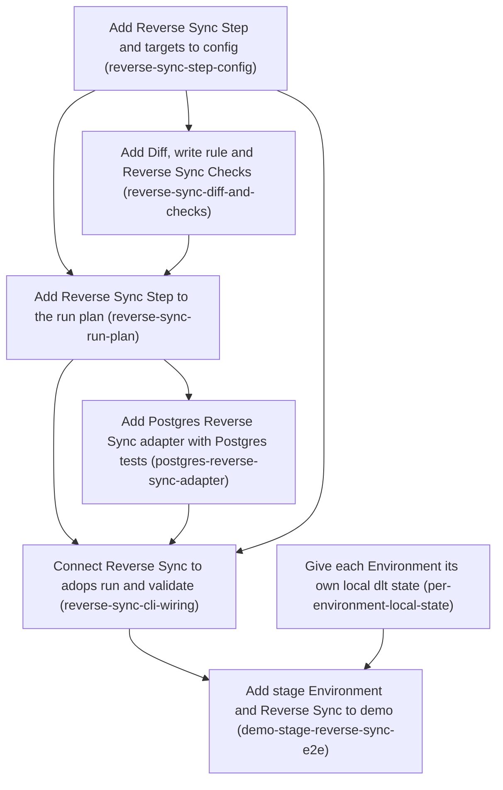

# Horizon 5 — Reverse Sync and Preview

## 🎯 What are we trying to achieve?

Add a new kind of Pipeline Step, **Reverse Sync**, that copies a dbt result from the Warehouse back into an existing table of an operational Postgres database, matched by a key column. It really writes only when the Environment is named exactly `stage` or `prod`; in dev (and any other Environment) it prints a **Preview** — how many rows it would insert, update and delete, plus a short sample of keys — and writes nothing. The demo proves it end to end: dev leaves `shop.customer_stats` untouched, stage fills it with the exact expected rows, on both the Postgres and DuckDB Warehouse.

## 🧠 Why does this change need to happen?

Today adops can copy data into the Warehouse (Sync) and build tables from it with dbt (Transform), but it cannot send results back to the applications that need them. Writing into an operational database is risky, so the vision (ADR-0003) requires a Preview everywhere except stage and prod, and the project rule (ADR-0013) requires deterministic Checks to stop a bad write before it happens. Discovery also found that dev and stage shared one local dlt state folder, which would have made a stage run after a dev run load incomplete data.

## At a glance

- **Phases:** 7 (user chose to keep all 7 so the horizon ends with the Docker E2E)
- **Complexity:** High — new Step kind across all four layers, a transactional writer into an operational database, a new CI Postgres service and a new demo Environment
- **Main risk:** values read from DuckDB vs Postgres (Decimal vs float, naive vs aware timestamps) compared naively would report every row as changed, tripping the max-change guard and breaking "Preview equals write"
- **Testing focus:** stage/prod-only write rule, one-transaction rollback against real Postgres, key-only Preview sample (no PII or secrets in output), Check boundaries, E2E dev-no-write / stage-exact-rows on both Warehouse kinds

## Order of work

```
Phase 1 — Add Reverse Sync Step and targets to config
        ↓  (needs the ReverseSyncStep shape for its Checks)
Phase 2 — Add Diff, write rule and Reverse Sync Checks
        ↓  (wires the pure Diff, write rule and Checks into the run)
Phase 3 — Add Reverse Sync Step to the run plan
        ↓  (implements the port the run plan defines)
Phase 4 — Add Postgres Reverse Sync adapter with Postgres tests
        ↓  (needs the real adapter to build from the CLI)
Phase 5 — Connect Reverse Sync to adops run and validate
        ↓  (independent; lands before the demo so stage loads every row)
Phase 6 — Give each Environment its own local dlt state
        ↓  (needs the CLI wiring and per-Environment state to run dev then stage)
Phase 7 — Add stage Environment and Reverse Sync to demo
```



### Phase 1 — Add Reverse Sync Step and targets to config

Technical ID: `reverse-sync-step-config` · Pipeline configuration · domain · medium blast radius

**Goal** — Let a Pipeline YAML declare a Reverse Sync Step and let an Environment in adops.yaml name the Postgres databases a Reverse Sync may write to, so loading accepts a valid Reverse Sync Step and rejects a malformed one with a clear, sanitized error.

**Why** — Every later phase needs a typed, validated description of a Reverse Sync (which dbt model, which target table, which key, which columns) and of where the target database lives. Pipelines today only know Sync and Transform Steps, and an Environment only has a Warehouse and Sources, so this configuration must exist first. It is pure configuration with no database access.

**Changes**
- Create src/adops/domain/reverse_sync.py with a frozen pydantic model ReverseSyncStep (extra='forbid'): type Literal['reverse_sync'], name (pattern=IDENTIFIER from domain/names.py), model (the dbt model name), target (a connection key), target_table, key (the column rows are matched by), mapping (dict from dbt result column to target column, at least one entry), delete_missing: bool = False, max_change_share: float in (0, 1] with a documented default of 0.5, and skip_checks (the existing SkipChecks shape: a list of Check names plus a non-blank written reason). Apply IDENTIFIER to model, target, target_table, key and every mapping key and value so no YAML value can carry SQL.
- Add the Reverse Sync Check names (target_columns_exist, key_unique, key_not_null, max_change, result_not_empty) to src/adops/domain/checks.py, used here only to validate skip_checks; their verdict rules come in the next phase. Reject skipping a name that does not apply to a Reverse Sync.
- In src/adops/domain/pipeline.py add Tag('reverse_sync') to the Step union and append 'reverse_sync' to STEP_TYPES so the loader's tag stripping keeps error paths like steps[2].key readable.
- In src/adops/domain/environment.py add an optional `targets: dict[str, PostgresConnection] = {}` to Environment (a separate map from `sources`, reusing PostgresConnection and its password_env Secret Reference). Add NO field to Environment or project settings that could enable writes.
- In src/adops/domain/loader.py add ensure_targets_defined(pipeline, environment) next to ensure_sources_defined: it fails with a sanitized error naming the missing target key when a Reverse Sync Step names a target the Environment does not define.
- Unit-test: a valid Reverse Sync Step loads; bad identifiers, empty mapping, unknown fields, out-of-range max_change_share, blank skip reason and an undefined target are each rejected with a readable message that contains no secret value.

**Files / areas**
- `src/adops/domain/reverse_sync.py`
- `src/adops/domain/pipeline.py`
- `src/adops/domain/environment.py`
- `src/adops/domain/loader.py`
- `src/adops/domain/checks.py`
- `tests/unit/domain/test_reverse_sync.py`
- `tests/unit/domain/test_loader.py`
- `tests/unit/domain/test_environment.py`

**How to verify**
- **Every SQL-bound name in a Reverse Sync Step is IDENTIFIER-validated** — In src/adops/domain/reverse_sync.py, model, target, target_table and key are constrained by the IDENTIFIER pattern (grep shows `IDENTIFIER` applied to each, or a shared annotated type that uses it).
- **Configuration exposes no write switch and targets stay pure domain data** — Environment in src/adops/domain/environment.py has `targets: dict[str, PostgresConnection]` defaulting to empty, separate from `sources`.
- **Malformed Reverse Sync config fails with readable, secret-free errors** — 'reverse_sync' is in STEP_TYPES in src/adops/domain/pipeline.py and a test asserts an error message contains `steps[N].<field>` with no `reverse_sync` tag segment in the path.
- **skip_checks only accepts Reverse Sync Check names** — src/adops/domain/checks.py defines the five Reverse Sync Check names as constants or an enum/Literal; it contains no new verdict function in this phase.

**Done when** — src/adops/domain/reverse_sync.py defines ReverseSyncStep, and a Pipeline YAML containing a `type: reverse_sync` Step plus an Environment with a `targets` entry loads through the domain loader, while malformed ones fail with clear, sanitized errors (proven by unit tests). — and every check under *How to verify* passes its bar.

**Depends on** — nothing — can start immediately

**Guards**
- g10: the new module imports only pydantic and stdlib; test_domain_purity.py keeps passing.
- g6: no dlt, dagster, dbt, typer or os.environ import in domain.
- g3: every validator branch (accept and each reject) gets a unit test so coverage stays at 100%.
- g7: no pragma: no cover added.
- g8: only Check NAMES are added to checks.py here; no verdict logic is added.

<details><summary>Reference — full rubric</summary>

| Dimension | Rule | Pass criteria | Failure examples | minScore |
|---|---|---|---|---|
| identifier-safety-on-every-name-field | ReverseSyncStep rejects any model, target, target_table, key, or mapping key/value that does not match IDENTIFIER from src/adops/domain/names.py, so no YAML value can carry SQL into later phases. | In src/adops/domain/reverse_sync.py, model, target, target_table and key are constrained by the IDENTIFIER pattern (grep shows `IDENTIFIER` applied to each, or a shared annotated type that uses it).<br>Mapping keys AND mapping values are both validated against IDENTIFIER (e.g. dict[Identifier, Identifier] or a validator that checks both).<br>tests/unit/domain/test_reverse_sync.py has parametrized rejection cases covering at least: a mapping VALUE like `x; drop table t`, a key with uppercase or a quote, and a target_table with a dot or space; `uv run pytest tests/unit/domain/test_reverse_sync.py` passes.<br>An empty mapping is rejected (min length 1) and an unknown field (e.g. `write: true`) is rejected by extra='forbid'. | IDENTIFIER is applied to target_table and key but mapping is typed dict[str, str], so `mapping: {customer_id: "id\"; drop"}` loads.<br>Mapping keys are validated but mapping values are not, because the developer treated values as 'just target column names'.<br>target_table accepts `public.customer_stats` because the developer relaxed the pattern to allow schema qualification. | 9 |
| no-write-switch-and-domain-only-targets | Neither ReverseSyncStep, Environment nor any project setting gains a field that could turn on writes; targets are a separate optional map that reuses PostgresConnection and its password_env Secret Reference. Target configuration stays in the domain layer as names and Secret References only: nothing in this phase resolves a secret or opens a connection. | Environment in src/adops/domain/environment.py has `targets: dict[str, PostgresConnection]` defaulting to empty, separate from `sources`.<br>`grep -rniE 'allow_write\|writes?_enabled\|dry_run\|preview *:\|write *:' src/adops/domain` returns no new field on ReverseSyncStep or Environment.<br>A test loads a YAML Environment containing `targets.shop` with a literal `password:` instead of `password_env:` and asserts it is rejected (Secret Reference only).<br>An adops.yaml with no `targets` key still loads unchanged (existing test_environment.py cases pass).<br>ensure_targets_defined takes only the Pipeline and Environment and returns/raises without resolving password_env; a test calls it with the referenced env var unset and asserts it still passes for a defined target. | ReverseSyncStep gets a `dry_run: bool = True` field 'for convenience', which a user could set to false in dev.<br>targets reuses the `sources` dict, so a Reverse Sync could name a Sync Source as its write target.<br>targets values are typed as a new class that accepts an inline password string.<br>ensure_targets_defined resolves the target password to "check it early", pulling secret resolution into the domain loader. | 9 |
| sanitized-path-qualified-load-errors | Loading a malformed Reverse Sync Step or an undefined target produces an error that names the YAML path (e.g. steps[2].key) or the missing target key, without pydantic tag noise or secret values. | 'reverse_sync' is in STEP_TYPES in src/adops/domain/pipeline.py and a test asserts an error message contains `steps[N].<field>` with no `reverse_sync` tag segment in the path.<br>ensure_targets_defined exists in src/adops/domain/loader.py and a test asserts its message names the missing target key (e.g. `shop`) and the Step name.<br>Rejection tests for out-of-range max_change_share (0, 1.5, -0.1) and a blank skip reason each assert a human-readable fragment of the message.<br>At least one rejection test sets a password env value and asserts that value does not appear in str(error). | The Step union is updated but STEP_TYPES is not, so errors read `steps.2.reverse_sync.key` instead of `steps[2].key`.<br>ensure_targets_defined raises a KeyError whose message is just `'shop'` with no context.<br>max_change_share accepts 0 because the developer used ge=0 instead of gt=0. | 8 |
| skip-checks-scoped-to-reverse-sync | A Reverse Sync Step's skip_checks accepts only the five Reverse Sync Check names (target_columns_exist, key_unique, key_not_null, max_change, result_not_empty) with a non-blank reason, and rejects Sync-only Check names. | src/adops/domain/checks.py defines the five Reverse Sync Check names as constants or an enum/Literal; it contains no new verdict function in this phase.<br>A test asserts that skipping a Sync-only Check name (e.g. an existing Sync Check such as a breaking-change Check) on a Reverse Sync Step is rejected with a message naming the invalid Check.<br>A test asserts that skipping `max_change` with a non-blank reason loads and that a whitespace-only reason is rejected. | skip_checks reuses the Sync SkipChecks type unchanged, so `skip_checks: [breaking_change]` is accepted on a Reverse Sync Step and silently ignored.<br>Check names are typed as free str, so a typo `max_changes` is accepted. | 7 |

Healer hint: The likeliest miss is leaving mapping values (or keys) typed as plain str or forgetting to add 'reverse_sync' to STEP_TYPES; fix by using a shared IDENTIFIER-constrained type for both sides of the mapping and appending the tag, then add one rejection test per field.

</details>

### Phase 2 — Add Diff, write rule and Reverse Sync Checks

Technical ID: `reverse-sync-diff-and-checks` · Reverse Sync · domain · medium blast radius

**Goal** — Provide one pure function that computes the Diff (inserts, updates and opt-in deletes) between the dbt result rows and the target rows by key, one pure rule that decides from the Environment name alone whether a Reverse Sync writes or produces a Preview, and the pure verdict rules of the five built-in Reverse Sync Checks.

**Why** — The Preview (what would change, without writing) and the real write must never disagree, so both come from the same Diff value computed in one place. Only Environments named exactly `stage` or `prod` may write, and the repo requires Check verdicts to be pure rules over measured facts, so the write rule and the Checks (duplicate keys, empty result, a Diff that would rewrite most of the table) live in pure domain code that nothing in configuration can switch off.

**Changes**
- Create src/adops/domain/reverse_sync_diff.py with a frozen Diff dataclass holding inserts, updates (key, changed column names, new values) and deletes (keys), and a delete_missing flag that says whether deletes will be applied or only reported as rows that are kept.
- Add compute_diff(result_rows, target_rows, key, mapping, delete_missing) -> Diff. Rename dbt result columns to target columns through the mapping before comparing; treat target rows missing from the result as deletes only when delete_missing is true, otherwise record them as 'absent from the dbt result, kept'.
- Add normalize_value used on both sides before comparison: numerically equal Decimal/int/float compare equal, naive and timezone-aware timestamps are compared in UTC, booleans stay booleans, so an unchanged row read from DuckDB or Postgres is never reported as an update.
- Add preview_sample(diff, limit) returning, per kind (insert/update/delete), at most `limit` entries containing only the key value and, for updates, the changed column NAMES, never other column values.
- Add writes_allowed(environment_name: str) -> bool returning True only for exactly 'stage' or 'prod' (case-sensitive), so 'dev', 'Stage', 'PROD' and any future Branch Environment name produce a Preview.
- In src/adops/domain/checks.py add a frozen ReverseSyncFacts dataclass (target table exists, missing target column names, result row count, duplicate key count, NULL key count, target row count, Diff update and delete counts) and evaluate_reverse_sync(step, facts) -> tuple[CheckResult, ...], reusing CheckResult and SkipChecks (a skipped Check is reported with its written reason).
- Check rules: max_change fails when (updates + deletes) / target row count exceeds step.max_change_share (deletes count only with delete_missing; an empty target passes so the first stage write is allowed); result_not_empty fails on zero rows; key_unique / key_not_null fail on any duplicate or NULL key; target_columns_exist fails when the table or any mapped column is missing (text names columns, never row values).
- Unit-test: insert/update/delete detection, delete_missing on and off, Decimal-vs-float and naive-vs-aware rows reported unchanged, bounded key-only sample, writes_allowed for dev, stage, prod, 'Stage' and an arbitrary name, and each Check rule at its boundary (exactly at the share, just over, empty target) plus skipped-with-reason.
- In GLOSSARY.md add the terms Diff, Max-change guard and Reverse Sync target (the operational Postgres table a Reverse Sync writes to), and state under Preview that only the stage and prod Environments write.

**Files / areas**
- `src/adops/domain/reverse_sync_diff.py`
- `src/adops/domain/checks.py`
- `tests/unit/domain/test_reverse_sync_diff.py`
- `tests/unit/domain/test_checks.py`
- `GLOSSARY.md`

**How to verify**
- **writes_allowed is true only for exactly 'stage' and 'prod'** — writes_allowed in src/adops/domain/reverse_sync_diff.py has signature (environment_name: str) -> bool and reads no other input (no settings, step, or env var).
- **Equal values from DuckDB or Postgres never produce updates** — A test with result row total_amount=Decimal('10.50') and target row total_amount=10.5 (float) yields zero updates.
- **Deletes are applied only with delete_missing; mapping renames before comparing** — A test with delete_missing=False and one target-only key asserts the Diff marks it as kept (not to be deleted) and the Diff's delete_missing flag is False.
- **Preview sample carries keys and column names only, bounded per kind** — A test with 12 inserts, 12 updates and 12 deletes and limit=5 asserts exactly 5 entries per kind.
- **Reverse Sync Check verdicts are exact at their boundaries** — Tests in tests/unit/domain/test_checks.py cover max_change exactly at the share (passes), one row over (fails), an empty target with inserts only (passes), and deletes counted only when delete_missing is true.

**Done when** — src/adops/domain/reverse_sync_diff.py (compute_diff, preview_sample, writes_allowed) and evaluate_reverse_sync in src/adops/domain/checks.py, with unit tests proving normalization, opt-in deletes, the key-only sample, the stage/prod-only write rule and every Check boundary. — and every check under *How to verify* passes its bar.

**Depends on** — Add Reverse Sync Step and targets to config

**Guards**
- g10: uses only stdlib (decimal, datetime, dataclasses) and pydantic; no os, time or io imports.
- g6: no framework import in domain.
- g8: verdicts are pure functions over ReverseSyncFacts; no adapter decides pass/fail; skips require the existing non-blank reason.
- g3: every branch of compute_diff, normalize_value and each Check rule has a unit test.
- g7: no pragma: no cover added.

<details><summary>Reference — full rubric</summary>

| Dimension | Rule | Pass criteria | Failure examples | minScore |
|---|---|---|---|---|
| write-rule-exact-stage-prod | writes_allowed(environment_name) returns True only for the exact, case-sensitive strings 'stage' and 'prod', and takes nothing but the name, so no configuration can influence it. | writes_allowed in src/adops/domain/reverse_sync_diff.py has signature (environment_name: str) -> bool and reads no other input (no settings, step, or env var).<br>tests/unit/domain/test_reverse_sync_diff.py asserts False for at least: 'dev', 'Stage', 'PROD', ' stage', 'stage ', 'staging', 'production', '' and a branch-like name such as 'feature_x'; and True for 'stage' and 'prod'.<br>The implementation compares against a fixed set/frozenset; it does not call .lower(), .strip() or startswith. | The rule normalizes with name.lower().strip(), so 'PROD ' writes.<br>The rule uses `name in ('stage', 'prod', 'production')` or `name.startswith('prod')`, so 'prod_copy' writes.<br>writes_allowed takes the Environment object and also honours a flag on it. | 9 |
| diff-normalization-no-phantom-updates | compute_diff normalizes both sides through normalize_value so numerically equal Decimal/int/float, and naive vs UTC-aware timestamps of the same instant, compare equal, while genuinely different values and booleans are still detected correctly. | A test with result row total_amount=Decimal('10.50') and target row total_amount=10.5 (float) yields zero updates.<br>A test with a naive datetime vs the same instant as a tz-aware UTC datetime yields zero updates; a test with a tz-aware non-UTC timestamp representing the same instant also yields zero updates.<br>A test asserts True vs 1 is NOT silently treated as unchanged when the target column is boolean, or documents and tests the chosen rule (booleans stay booleans).<br>A test with a real value change (e.g. order_count 3 -> 4) yields exactly one update listing only `order_count` as changed column. | normalize_value converts everything to float, so Decimal('0.1')+Decimal('0.2') and 0.3 compare unequal or large Decimals lose precision.<br>Naive timestamps are compared directly to aware ones, raising TypeError or reporting every row as updated.<br>The update entry lists all mapped columns instead of only the changed ones. | 8 |
| opt-in-deletes-and-mapping | Target rows absent from the dbt result appear as deletes to apply only when delete_missing is true and are otherwise recorded as 'absent from the dbt result, kept'; comparisons use target column names after applying the mapping. | A test with delete_missing=False and one target-only key asserts the Diff marks it as kept (not to be deleted) and the Diff's delete_missing flag is False.<br>The same fixture with delete_missing=True asserts exactly that key is a delete.<br>A test where the mapping renames a result column (e.g. orders -> order_count) asserts the comparison uses the target name and produces no spurious insert/update.<br>Diff is a frozen dataclass (assigning to a field raises FrozenInstanceError in a test). | Target-only rows are dropped from the Diff entirely when delete_missing is false, so the Preview cannot report them.<br>The mapping is applied to result rows but target rows are read with result-side names, so every row looks like an insert. | 8 |
| preview-sample-key-only-bounded | preview_sample(diff, limit) returns at most `limit` entries per kind, each containing only the key value and, for updates, the changed column NAMES — never any other column value. | A test with 12 inserts, 12 updates and 12 deletes and limit=5 asserts exactly 5 entries per kind.<br>A test builds rows whose non-key values are sentinel strings (e.g. 'SENTINEL_VALUE') and asserts repr(preview_sample(...)) does not contain the sentinel.<br>Update entries expose changed column names (e.g. ('order_count',)) and no old/new values. | Update sample entries include new values 'to be helpful', leaking amounts into CLI output.<br>The limit is applied to the total across kinds instead of per kind, so deletes never appear when there are many inserts.<br>The sample order is set-iteration order, so tests pass locally but the sample is non-deterministic. | 9 |
| check-verdict-boundaries | evaluate_reverse_sync(step, facts) returns one CheckResult per Reverse Sync Check from ReverseSyncFacts alone, with max_change = (updates + counted deletes) / target rows > max_change_share failing, an empty target passing, and skipped Checks reported with their reason. | Tests in tests/unit/domain/test_checks.py cover max_change exactly at the share (passes), one row over (fails), an empty target with inserts only (passes), and deletes counted only when delete_missing is true.<br>Tests cover result_not_empty on 0 rows, key_unique with 1 duplicate, key_not_null with 1 NULL, and target_columns_exist with a missing table and with a missing mapped column; failure text names columns but no row values.<br>A test asserts a skipped Check yields a CheckResult marked skipped carrying the step's written reason.<br>evaluate_reverse_sync performs no I/O and takes no adapter or connection parameter. | max_change uses >= so a Diff exactly at max_change_share fails.<br>Empty target divides by zero or fails max_change, blocking the very first stage write.<br>Deletes are counted in max_change even when delete_missing is false, failing a run that would delete nothing. | 8 |

Healer hint: The most likely failure is phantom updates from Decimal-vs-float or naive-vs-aware timestamps (or an off-by-one at max_change_share); fix by normalizing both sides to Decimal/UTC in normalize_value and using a strict > comparison, with a boundary test for each.

</details>

### Phase 3 — Add Reverse Sync Step to the run plan

Technical ID: `reverse-sync-run-plan` · Reverse Sync · application · medium blast radius

**Goal** — Let run_pipeline plan and run a Reverse Sync Step through a new ReverseSync port: resolve the target connection's secret, measure facts, run the Checks, then either return a Preview or ask the engine to apply exactly the computed Diff, with fixed sanitized errors and later Steps stopped on failure.

**Why** — The use case is where the pure rules meet the outside world: it decides write vs Preview with writes_allowed, runs the Checks before anything is written, and turns engine failures into fixed messages that never leak a password. Putting the engine behind a port keeps psycopg out of the application layer and lets this logic be unit-tested with a fake.

**Changes**
- In src/adops/application/ports.py add a ReverseSync port with two calls: read(step, warehouse, target: ResolvedConnection) — where warehouse is the selected Environment's resolved Warehouse connection (ResolvedConnection or ResolvedDuckDb), so the adapter reads the dbt result from that Environment's own Warehouse (dev's or stage's) — returning the dbt result rows, the target rows by key and the measured ReverseSyncFacts inputs; and apply(step, target, diff) that applies exactly the Diff in one transaction. Add TargetUnreachable and WriteFailed marker exceptions. Add an optional, defaulted `preview` field (Diff counts plus the bounded key-only sample, and whether it was written) to StepOutcome and StepReport.
- In src/adops/application/run_pipeline.py add an optional `reverse_sync: ReverseSync | None` parameter and a frozen PlannedReverseSyncStep bound at plan time with the engine, the selected Environment's resolved Warehouse connection, the resolved target connection and the environment name (secrets reach Dagster ops only through this closure). Change _build_plan's non-Sync branch into an explicit isinstance dispatch for TransformStep and ReverseSyncStep; raise PipelineValidationError when a Reverse Sync Step is present but no engine was given; call ensure_targets_defined.
- PlannedReverseSyncStep: compute the Diff with compute_diff, evaluate_reverse_sync, raise CheckFailedError via the existing _raise_if_failed on any failure, then call apply only when writes_allowed(environment_name); always return the preview summary.
- In src/adops/application/secrets.py include target PostgresConnections in secret_references and resolve them with resolve_connection; in src/adops/application/run_pipeline.py add the target password to PlannedStep._redact (or the planned Reverse Sync Step's equivalent).
- In src/adops/application/run_pipeline.py, next to SourceUnreachableError and WarehouseUnreachableError, add ReverseSyncTargetUnreachableError and ReverseSyncWriteFailedError (fixed text saying the target was left unchanged) as StepError subclasses, raised outside except blocks so no driver text is chained. Nothing is added to src/adops/domain/errors.py, so domain never imports from application.
- Add FakeReverseSync to tests/unit/application/fakes.py and unit-test: dev produces a Preview and never calls apply; stage calls apply with the identical Diff object the Preview reported; a failed Check stops the Step and skips later Steps; unreachable and write-failed paths raise the fixed errors and assert_no_secret_in passes.

**Files / areas**
- `src/adops/application/ports.py`
- `src/adops/application/run_pipeline.py`
- `src/adops/application/secrets.py`
- `tests/unit/application/fakes.py`
- `tests/unit/application/test_run_pipeline.py`
- `tests/unit/application/test_secrets.py`

**How to verify**
- **Non-write Environments never reach the engine's apply** — tests/unit/application/test_run_pipeline.py runs a Pipeline with a Reverse Sync Step against FakeReverseSync under env 'dev' and asserts the fake recorded zero apply calls and the StepReport preview has written=False.
- **The write applies exactly the Diff the Preview reports** — A stage test asserts `fake.applied_diff is <diff behind the reported preview>` (identity) or equality plus that compute_diff ran once (e.g. via counts matching a precomputed Diff).
- **Target secrets stay in the closure and engine failures surface as fixed text** — secret_references in src/adops/application/secrets.py includes targets' password_env, and a test in tests/unit/application/test_secrets.py asserts a missing target password env fails with the env var NAME, not a value.
- **ReverseSync port is a framework-free Protocol with an explicit plan-time dispatch** — `grep -nE 'psycopg|duckdb|dlt|dagster' src/adops/application/*.py` shows no new import introduced by this phase.

**Done when** — run_pipeline runs a Reverse Sync Step against FakeReverseSync, returning a Preview in dev and applying the identical Diff in stage, proven by unit tests in tests/unit/application/test_run_pipeline.py. — and every check under *How to verify* passes its bar.

**Depends on** — Add Reverse Sync Step and targets to config, Add Diff, write rule and Reverse Sync Checks

**Guards**
- g6: the port is a Protocol; application imports no psycopg, dagster or os.environ.
- g10: application imports no os, sys, io, pathlib, subprocess, socket or sqlite3.
- g7: the resolved target connection is bound into PlannedReverseSyncStep (closure), never into run config or Dagster metadata; no pragma: no cover.
- g8: the use case only calls the domain evaluator; it adds no verdict logic.
- g3: every branch (no engine, Preview, write, check failure, both error markers) has a unit test.

<details><summary>Reference — full rubric</summary>

| Dimension | Rule | Pass criteria | Failure examples | minScore |
|---|---|---|---|---|
| preview-never-calls-apply | PlannedReverseSyncStep calls ReverseSync.apply only when writes_allowed(environment_name) is True; for any other name it returns a preview with written=False and apply is never invoked. | tests/unit/application/test_run_pipeline.py runs a Pipeline with a Reverse Sync Step against FakeReverseSync under env 'dev' and asserts the fake recorded zero apply calls and the StepReport preview has written=False.<br>The same test is parametrized over at least 'dev' and 'Stage' (capitalized) and both assert zero apply calls.<br>The write decision in src/adops/application/run_pipeline.py calls the domain writes_allowed; `grep -n "== 'stage'\\|== \"stage\"" src/adops/application` returns nothing. | The use case calls apply with an empty Diff in dev 'to keep the code path uniform', so the adapter still opens a write transaction.<br>The environment name bound into the planned Step is the Warehouse name or a default, so dev and stage behave the same. | 9 |
| identical-diff-preview-and-write | In stage/prod, the Diff passed to apply is the same object used for the Checks and for the returned preview summary, computed once by compute_diff. | A stage test asserts `fake.applied_diff is <diff behind the reported preview>` (identity) or equality plus that compute_diff ran once (e.g. via counts matching a precomputed Diff).<br>Checks run before apply: a stage test where the fake facts trigger max_change asserts apply was not called and CheckFailedError is raised.<br>A failed Check stops later Steps: a Pipeline with a Step after the Reverse Sync shows that Step as not run. | The write path re-reads and recomputes the Diff after the Checks, so the applied Diff can differ from the Preview.<br>apply is called before evaluate_reverse_sync, so a failing max_change still writes.<br>The failed Check is reported but later Steps still execute because the error is caught and logged. | 9 |
| secret-confinement-and-fixed-errors | The target password is resolved via secrets.py, redacted, bound only into PlannedReverseSyncStep, and TargetUnreachable/WriteFailed markers become ReverseSyncTargetUnreachableError/ReverseSyncWriteFailedError with fixed text and no chained driver message. | secret_references in src/adops/application/secrets.py includes targets' password_env, and a test in tests/unit/application/test_secrets.py asserts a missing target password env fails with the env var NAME, not a value.<br>Tests where FakeReverseSync raises TargetUnreachable and WriteFailed assert the fixed error classes, that `error.__cause__ is None and error.__context__ is None` (raised outside except), and assert_no_secret_in passes on str(error) and the run report.<br>The WriteFailed message states the target was left unchanged.<br>No resolved connection or preview data appears in Dagster run config: a test inspecting the run config/metadata asserts the target password and sample keys are absent. | The error is raised with `raise ReverseSyncWriteFailedError(...) from exc`, chaining a psycopg message that contains the DSN.<br>The target password is added to secret_references but not to _redact, so it appears in a formatted error.<br>The resolved target connection is passed through Dagster op config to reach the op. | 9 |
| port-keeps-application-engine-free | The ReverseSync port in application/ports.py is a Protocol typed with domain/application types only, and _build_plan dispatches by isinstance on TransformStep and ReverseSyncStep, raising PipelineValidationError when a Reverse Sync Step has no engine. | `grep -nE 'psycopg\|duckdb\|dlt\|dagster' src/adops/application/*.py` shows no new import introduced by this phase.<br>ReverseSync.read accepts the selected Environment's resolved Warehouse connection (ResolvedConnection or ResolvedDuckDb) and the resolved target, so a test can assert the fake received dev's Warehouse in dev and stage's in stage.<br>A test runs a Pipeline containing a Reverse Sync Step with reverse_sync=None and asserts PipelineValidationError before any Step runs.<br>StepOutcome/StepReport's preview field is optional with a default, and existing Sync/Transform tests pass unchanged. | _build_plan keeps an `else:` branch that treats any non-Sync Step as a Transform, so a Reverse Sync Step is silently run as dbt.<br>read() is given the project's default Warehouse rather than the selected Environment's, so stage reads dev's dbt result.<br>The port signature uses psycopg.Connection types, importing psycopg into application. | 8 |

Healer hint: The likeliest failure is chaining driver errors (raise ... from exc) or forgetting target passwords in _redact; fix by capturing a flag inside except and raising the fixed StepError outside it, and add the target secret to both secret_references and _redact.

</details>

### Phase 4 — Add Postgres Reverse Sync adapter with Postgres tests

Technical ID: `postgres-reverse-sync-adapter` · Reverse Sync · infrastructure · medium blast radius

**Goal** — Implement the ReverseSync port: read the dbt model's rows from the Warehouse (Postgres or DuckDB kind), read and measure the target Postgres table by key, and apply a Diff in one psycopg transaction that fully rolls back on any error, proven by unit tests against a real Postgres in CI.

**Why** — This is the only code that touches an operational database, so its commit and rollback behaviour must be proven against real Postgres, not fakes. The user chose to add a Postgres service to the CI unit job (an addition that strengthens the 100%-coverage gate, not a bypass) so the rollback branches are covered for real.

**Changes**
- Create src/adops/infrastructure/postgres_reverse_sync.py with PostgresReverseSync(project_dir, warehouse_kind), warehouse kind required with no default. Read analytics.<model> from the Warehouse connection passed to read() (the selected Environment's own Warehouse) through the existing dlt sql_client for that Warehouse kind, importing TARGET_SCHEMA from dbt_transform.py; open DuckDB read-write (never read_only=True) because dbt-duckdb keeps a process-wide handle open after dbt build.
- Measure the target with psycopg (v3, already a runtime dependency): table and column existence from information_schema, row count, target rows for the mapped columns; build every statement with psycopg.sql.Identifier, never string formatting.
- apply(): open one transaction, re-read target rows under it with SELECT ... FOR UPDATE, verify they still produce the same Diff (otherwise roll back and raise WriteFailed), run inserts, updates and opt-in deletes, commit; on any psycopg error roll back and raise the WriteFailed marker outside the except block. Map connect failures to TargetUnreachable.
- In tests/unit/infrastructure/conftest.py add a postgres_target fixture that reads a DSN from the ADOPS_TEST_POSTGRES_DSN environment variable and FAILS (pytest.fail, never skip) with a one-line hint naming a single `docker run` command for a local Postgres when it is unset, so coverage can never silently drop; each test gets a fresh table.
- In .github/workflows/ci.yml add a postgres service container to the unit job and export ADOPS_TEST_POSTGRES_DSN for the pytest step.
- Unit-test: real commit of inserts/updates/deletes; a forced mid-apply failure (e.g. a type-incompatible value) leaves the table unchanged; unreachable target gives fixed text; DbtTransform then reader in one process works on DuckDB; error text passes the DRIVER_TEXT / assert_no_secret checks.

**Files / areas**
- `src/adops/infrastructure/postgres_reverse_sync.py`
- `tests/unit/infrastructure/conftest.py`
- `tests/unit/infrastructure/test_postgres_reverse_sync.py`
- `.github/workflows/ci.yml`

**How to verify**
- **apply() commits all or nothing against real Postgres** — tests/unit/infrastructure/test_postgres_reverse_sync.py has a test that applies a Diff whose LAST statement fails (e.g. a type-incompatible value after valid inserts) and then asserts SELECT * on the target equals the pre-apply rows exactly.
- **apply refuses when target rows changed since the Preview** — A test computes a Diff, then modifies one target row via a separate connection, then calls apply and asserts WriteFailed is raised and the table still holds the separately modified state (nothing from the Diff applied).
- **All dynamic SQL uses psycopg.sql.Identifier / bound parameters** — `grep -nE 'f"(SELECT|INSERT|UPDATE|DELETE)|\.format\(|%s.*%' src/adops/infrastructure/postgres_reverse_sync.py` finds no string-built SQL containing names or values.
- **Adapter measures facts for both Warehouse kinds and never decides verdicts** — PostgresReverseSync's constructor requires warehouse_kind with no default (a test or signature inspection confirms TypeError when omitted).
- **Real-Postgres tests cannot silently drop out** — Running `env -u ADOPS_TEST_POSTGRES_DSN uv run pytest tests/unit/infrastructure/test_postgres_reverse_sync.py` reports failures/errors (not skips) whose message includes a one-line `docker run` hint.

**Done when** — src/adops/infrastructure/postgres_reverse_sync.py implements the ReverseSync port, with tests/unit/infrastructure/test_postgres_reverse_sync.py proving real commits and real rollbacks against the CI unit job's Postgres service at 100% branch coverage. — and every check under *How to verify* passes its bar.

**Depends on** — Add Reverse Sync Step to the run plan

**Guards**
- g3: adds a Postgres service to the unit job so rollback branches are covered by real tests; the fixture fails rather than skips when no DSN is set, so 100% coverage cannot silently drop.
- g1: psycopg[binary] is already in pyproject.toml and uv.lock; no dependency change, uv sync --locked still passes.
- g7: no pragma: no cover; secrets arrive as a ResolvedConnection argument only.
- g8: the adapter returns measured facts only; it does not decide pass/fail.
- g2: ruff clean.

**Rollback** — The writer is unused until the CLI phase wires it; to roll back, revert the ci.yml service block, the conftest fixture and the new adapter and test modules together.

<details><summary>Reference — full rubric</summary>

| Dimension | Rule | Pass criteria | Failure examples | minScore |
|---|---|---|---|---|
| single-transaction-full-rollback | PostgresReverseSync.apply runs all inserts, updates and opt-in deletes in one psycopg transaction and leaves the target table byte-for-byte unchanged when any statement fails. | tests/unit/infrastructure/test_postgres_reverse_sync.py has a test that applies a Diff whose LAST statement fails (e.g. a type-incompatible value after valid inserts) and then asserts SELECT * on the target equals the pre-apply rows exactly.<br>A success test asserts committed inserts, updates and (with delete_missing) deletes are visible from a separate new connection.<br>With `ADOPS_TEST_POSTGRES_DSN` set, `uv run pytest tests/unit/infrastructure/test_postgres_reverse_sync.py` passes; the adapter never uses autocommit=True for apply. | Each row is executed with autocommit or its own `with conn.transaction()`, so a mid-batch failure leaves earlier rows written.<br>The rollback test fails on the FIRST statement, so it never proves earlier statements are undone.<br>Deletes run in a second transaction after the insert/update commit. | 9 |
| concurrent-change-refusal | Inside its transaction apply re-reads the target rows with SELECT ... FOR UPDATE, recomputes the Diff, and rolls back with the WriteFailed marker if it differs from the Diff it was given. | A test computes a Diff, then modifies one target row via a separate connection, then calls apply and asserts WriteFailed is raised and the table still holds the separately modified state (nothing from the Diff applied).<br>`grep -n 'FOR UPDATE' src/adops/infrastructure/postgres_reverse_sync.py` matches the re-read query. | The re-read happens before BEGIN or without FOR UPDATE, so a concurrent writer can slip in between check and write.<br>The adapter re-reads but compares only row counts, so a changed value is not detected. | 8 |
| sql-composed-with-identifiers | Every table, column and schema name in adapter SQL is composed with psycopg.sql.Identifier (or the Warehouse client's identifier quoting), and every value is a bound parameter. | `grep -nE 'f"(SELECT\|INSERT\|UPDATE\|DELETE)\|\.format\(\|%s.*%' src/adops/infrastructure/postgres_reverse_sync.py` finds no string-built SQL containing names or values.<br>Values are passed as parameters to cursor.execute/executemany, never interpolated.<br>The Warehouse read of analytics.<model> quotes both the TARGET_SCHEMA (imported from dbt_transform.py) and the model name. | Target SQL uses sql.Identifier but the DuckDB/Postgres Warehouse read uses f"SELECT * FROM analytics.{model}" because 'the model is already IDENTIFIER-validated'.<br>Column lists are joined with ', '.join(cols) inside sql.SQL(...) as raw text. | 9 |
| measure-only-facts-and-warehouse-kinds | read() returns dbt result rows from the given Warehouse (Postgres or DuckDB, kind passed explicitly with no default), target rows, and raw ReverseSyncFacts inputs (table/column existence, counts, duplicate and NULL keys) without computing pass/fail. | PostgresReverseSync's constructor requires warehouse_kind with no default (a test or signature inspection confirms TypeError when omitted).<br>A DuckDB test runs DbtTransform then PostgresReverseSync.read in the same process and succeeds (DuckDB opened read-write, not read_only=True).<br>A test against a target table missing one mapped column asserts the facts list that column name; `grep -nE 'CheckResult\|passed\|failed' src/adops/infrastructure/postgres_reverse_sync.py` shows no verdict construction.<br>A connect failure to a bad port raises the TargetUnreachable marker; a test asserts the DRIVER_TEXT/assert_no_secret helpers from test_dlt_sync.py pass on it. | DuckDB is opened with read_only=True and fails with a lock/config conflict after dbt build in the same process.<br>The adapter returns early with 'table missing' as an exception instead of a measured fact, bypassing the target_columns_exist Check.<br>warehouse_kind defaults to 'postgres', so a DuckDB project silently reads the wrong Warehouse. | 8 |
| ci-postgres-fixture-fails-not-skips | The postgres_target fixture fails (never skips) when ADOPS_TEST_POSTGRES_DSN is unset, and the CI unit job provides a Postgres service and exports that DSN. | Running `env -u ADOPS_TEST_POSTGRES_DSN uv run pytest tests/unit/infrastructure/test_postgres_reverse_sync.py` reports failures/errors (not skips) whose message includes a one-line `docker run` hint.<br>.github/workflows/ci.yml unit job declares a `services: postgres` block and sets ADOPS_TEST_POSTGRES_DSN on the pytest step.<br>Each test gets a freshly created table (two tests that insert the same key both pass in either order: `uv run pytest -p no:randomly` and reversed order). | The fixture uses pytest.skip when the DSN is missing, so local runs pass while coverage silently relies on CI.<br>Tests share one table across the module, so the rollback test passes only because an earlier test left matching rows. | 8 |

Healer hint: The likeliest failure is a rollback test that fails on the first statement or a Warehouse read built with an f-string; fix by forcing the failure on the last statement of a multi-row Diff and composing every name with sql.Identifier.

</details>

### Phase 5 — Connect Reverse Sync to adops run and validate

Technical ID: `reverse-sync-cli-wiring` · Command line · interface · small blast radius

**Goal** — Make `adops run --env <name>` build the Postgres Reverse Sync adapter and print the Preview (counts plus key-only sample) or the write summary, and make `adops validate` check Reverse Sync targets in every Environment and list every skipped Reverse Sync Check, without connecting to anything.

**Why** — Users only meet Reverse Sync through the CLI, so the planned Step needs its adapter wired in and its result printed. validate must stay offline but catch a missing target or an unexplained skip before a run ever touches an operational database.

**Changes**
- In src/adops/interface/run_command.py add a monkeypatchable build_reverse_sync(project, kind) next to build_transform and pass its result to run_pipeline.
- Extend _print_result to print, for a Reverse Sync Step, a 'Preview' line (would insert / would update / would delete, or 'kept, absent from dbt result') or a 'wrote' line with the same counts, plus the bounded sample of key values and changed column names. Keep these out of Dagster metadata.
- In src/adops/interface/validate_command.py call ensure_targets_defined for every Environment (as _check_sources does for sources) and extend _skipped_checks so Reverse Sync skip_checks and their reasons are listed.
- Unit-test with FakeReverseSync: dev prints a Preview line and no 'wrote' line; stage prints the write summary; validate reports a missing target and lists Reverse Sync skips; no secret value appears in any output.

**Files / areas**
- `src/adops/interface/run_command.py`
- `src/adops/interface/validate_command.py`
- `tests/unit/interface/test_run_command.py`
- `tests/unit/interface/test_validate_command.py`

**How to verify**
- **CLI output distinguishes a Preview from a write unambiguously** — tests/unit/interface/test_run_command.py invokes the CLI with --env dev and FakeReverseSync and asserts the exact full Preview line text and that no line starts with or contains 'wrote'.
- **Printed sample shows only keys and changed column names** — A test feeds FakeReverseSync rows with sentinel non-key values and a sentinel target password and asserts neither sentinel appears in CliRunner output.
- **validate catches missing targets and lists Reverse Sync skips without connecting** — A test with targets defined in dev but missing in stage asserts validate exits non-zero and names `stage` and the target key.
- **run builds the Postgres Reverse Sync adapter with the selected Warehouse kind** — A test monkeypatches build_reverse_sync and asserts it was called with the selected Environment's Warehouse kind for both a Postgres and a DuckDB Environment.

**Done when** — `adops run` prints a Reverse Sync Preview in dev and a write summary in stage, and `adops validate` reports undefined targets and lists Reverse Sync skips, proven by tests/unit/interface/test_run_command.py and test_validate_command.py. — and every check under *How to verify* passes its bar.

**Depends on** — Add Reverse Sync Step to the run plan, Add Postgres Reverse Sync adapter with Postgres tests, Add Reverse Sync Step and targets to config

**Guards**
- g3: every new print and validate branch has a unit test.
- g7: preview data stays out of Dagster run config and metadata; no pragma: no cover.
- g2: ruff clean.

<details><summary>Reference — full rubric</summary>

| Dimension | Rule | Pass criteria | Failure examples | minScore |
|---|---|---|---|---|
| preview-vs-wrote-output | `adops run` prints a 'Preview' line (would insert / would update / would delete, or kept-absent counts) for non-write Environments and a 'wrote' line with the same counts for stage/prod, never both for one Step. The interface layer only formats the StepReport; it computes no Diff, count or write decision itself. | tests/unit/interface/test_run_command.py invokes the CLI with --env dev and FakeReverseSync and asserts the exact full Preview line text and that no line starts with or contains 'wrote'.<br>A --env stage test asserts the exact full 'wrote' line and no 'Preview' line for that Step.<br>With delete_missing false and target-only rows, the dev output says the rows are kept (absent from dbt result), not 'would delete'.<br>`grep -nE 'compute_diff\|writes_allowed\|evaluate_reverse_sync' src/adops/interface/` returns nothing; the Preview/wrote choice is read from the report's written flag. | The printer chooses wording from the Step config instead of the report's written flag, so a Check-failed stage run still prints 'wrote'.<br>Deletes are always printed as 'would delete' regardless of delete_missing, misleading the user about what stage will do. | 8 |
| cli-output-leaks-no-values | The CLI prints at most the bounded sample of key values and changed column names, and no secret or non-key row value appears in run or validate output, nor in Dagster metadata. | A test feeds FakeReverseSync rows with sentinel non-key values and a sentinel target password and asserts neither sentinel appears in CliRunner output.<br>A test asserts at most 5 sample entries per kind are printed when the fake reports more.<br>A test (or inspection of the orchestrator metadata in the test) asserts the preview sample is not attached to Dagster run config or metadata. | The printer dumps repr(step_report.preview), which includes the full Diff with values.<br>The sample is added to Dagster asset metadata 'for observability', exposing keys in the Dagster UI. | 9 |
| validate-offline-targets-and-skips | `adops validate` calls ensure_targets_defined for every Environment, reports an undefined target by Environment and target key, and lists each skipped Reverse Sync Check with its reason, opening no connection. | A test with targets defined in dev but missing in stage asserts validate exits non-zero and names `stage` and the target key.<br>A test asserts a Reverse Sync `skip_checks: [max_change]` with reason appears in validate output with the reason text.<br>validate tests pass with build_reverse_sync monkeypatched to raise, proving validate never builds or calls the adapter. | validate checks targets only for the default Environment, so a missing stage target is first discovered by a stage run.<br>_skipped_checks iterates only Sync Steps, so Reverse Sync skips are silently omitted. | 8 |
| adapter-wired-with-kind | run_command.build_reverse_sync(project, kind) constructs PostgresReverseSync with the selected Environment's Warehouse kind and passes it to run_pipeline; it is monkeypatchable like build_transform. | A test monkeypatches build_reverse_sync and asserts it was called with the selected Environment's Warehouse kind for both a Postgres and a DuckDB Environment.<br>A test calling the real build_reverse_sync asserts it returns a PostgresReverseSync instance without opening a connection. | build_reverse_sync hard-codes kind='postgres', so a DuckDB demo reads the wrong Warehouse.<br>The adapter is constructed only when the Pipeline has a Reverse Sync Step but constructed with the dev Environment's kind regardless of --env. | 7 |

Healer hint: The likeliest failure is choosing Preview/wrote wording from the Environment or config instead of the report's written flag, or printing the raw preview object; fix by formatting only counts, keys and column names from StepReport.preview.written and asserting full lines.

</details>

### Phase 6 — Give each Environment its own local dlt state

Technical ID: `per-environment-local-state` · Sync · cross-cutting · small blast radius

**Goal** — Store dlt's local working state (including the Incremental Sync cursor) in a per-Environment folder <project>/.adops/dlt/<env>, so a stage run after a dev run in the same Project loads every row instead of only rows newer than dev's cursor.

**Why** — Discovery found that DltSync and WarehouseSnapshotStore both use <project>/.adops/dlt with pipeline names that do not include the Environment. dlt keeps the Incremental cursor in that folder, so today a stage run after a dev run would skip rows dev already loaded and stage's Warehouse, its dbt result and its Reverse Sync write would be incomplete.

**Changes**
- In src/adops/domain/environment.py constrain ProjectSettings.environments keys with IDENTIFIER from domain/names.py, so an Environment name such as '../x' is rejected at load and the per-Environment state folder always stays inside <project>/.adops/dlt; check the demo and existing test settings still load.
- Make the Environment name a required constructor argument of DltSync and WarehouseSnapshotStore and use <project>/.adops/dlt/<env> as pipelines_dir.
- Pass the selected Environment name from run_command.build_sync / build_snapshot_store and from accept_schema_command.
- Unit-test with real dlt (as the existing adapter tests do): an Incremental load in Environment dev followed by one in Environment stage against a separate Warehouse loads every row in stage; accept-schema still finds the stage snapshot store.

**Files / areas**
- `src/adops/infrastructure/dlt_sync.py`
- `src/adops/infrastructure/schema_snapshot_store.py`
- `src/adops/interface/run_command.py`
- `src/adops/interface/accept_schema_command.py`
- `tests/unit/infrastructure/test_dlt_sync.py`
- `tests/unit/infrastructure/test_schema_snapshot_store.py`
- `tests/unit/interface/test_run_command.py`
- `src/adops/domain/environment.py`
- `tests/unit/domain/test_environment.py`

**How to verify**
- **An Incremental cursor from dev never limits a stage load** — tests/unit/infrastructure/test_dlt_sync.py runs real dlt: Incremental load as 'dev', then as 'stage' to a separate Warehouse, and asserts the stage Warehouse row count equals the full source row count.
- **Environment name is a required constructor argument everywhere** — `grep -n 'def __init__' src/adops/infrastructure/dlt_sync.py src/adops/infrastructure/schema_snapshot_store.py` shows an environment parameter without a default value.
- **The Environment name cannot escape the .adops/dlt folder** — Environment names in adops.yaml are validated by IDENTIFIER (or equivalent) so '../x' is rejected at load; a test in tests/unit/domain/test_environment.py or test_loader.py asserts this.

**Done when** — DltSync and WarehouseSnapshotStore keep their local dlt state under <project>/.adops/dlt/<env>, proven by a unit test where a stage Incremental load after a dev load loads every row. — and every check under *How to verify* passes its bar.

**Depends on** — nothing — can start immediately

**Guards**
- g3: the new constructor argument and both callers are covered by updated unit tests; coverage stays at 100%.
- g7: no pragma: no cover; no secret travels through the new argument.
- g2: ruff clean.
- g10: environment.py gains only an import of domain/names.py; no framework import.

<details><summary>Reference — full rubric</summary>

| Dimension | Rule | Pass criteria | Failure examples | minScore |
|---|---|---|---|---|
| cursor-isolation-between-environments | A stage Incremental Sync after a dev Incremental Sync in the same Project, against a separate Warehouse, loads every source row, because each Environment keeps dlt state under <project>/.adops/dlt/<env>. | tests/unit/infrastructure/test_dlt_sync.py runs real dlt: Incremental load as 'dev', then as 'stage' to a separate Warehouse, and asserts the stage Warehouse row count equals the full source row count.<br>After those runs, both <tmp_project>/.adops/dlt/dev and <tmp_project>/.adops/dlt/stage exist and neither run created files directly under <tmp_project>/.adops/dlt outside an env folder.<br>A second dev run after stage still loads only new rows (dev's cursor intact). | The env is added to the dlt pipeline name but pipelines_dir is unchanged, and the test only checks the folder name, not the stage row count.<br>The test uses the same Warehouse for dev and stage, so it passes even if the cursor is shared. | 9 |
| env-required-no-default | DltSync and WarehouseSnapshotStore require the Environment name with no default, and every caller (run_command.build_sync, build_snapshot_store, accept_schema_command) passes the selected Environment. | `grep -n 'def __init__' src/adops/infrastructure/dlt_sync.py src/adops/infrastructure/schema_snapshot_store.py` shows an environment parameter without a default value.<br>tests/unit/interface/test_run_command.py asserts build_sync and build_snapshot_store receive the --env value (e.g. 'stage').<br>A test for accept_schema_command with --env stage asserts the snapshot store it builds uses the stage folder and finds a stage snapshot written there. | environment defaults to 'dev', so accept-schema forgets to pass it and silently accepts dev's snapshot when the user ran --env stage.<br>build_snapshot_store passes the Warehouse database name instead of the Environment name. | 8 |
| env-name-path-safe | The per-Environment state path is built from an Environment name already constrained to a safe identifier, so it always resolves inside <project>/.adops/dlt. | Environment names in adops.yaml are validated by IDENTIFIER (or equivalent) so '../x' is rejected at load; a test in tests/unit/domain/test_environment.py or test_loader.py asserts this.<br>A test asserts DltSync(project, environment='stage') pipelines_dir resolves to project/.adops/dlt/stage exactly. | Environment keys are free strings, so an Environment named '../../tmp' writes dlt state outside the project.<br>The path is built with string concatenation and the test only checks endswith('stage'). | 7 |

Healer hint: The likeliest failure is a test that proves only the folder layout (or reuses one Warehouse) rather than a full stage row count after a dev load; fix by loading dev and stage into separate Warehouses with real dlt and asserting stage has every source row.

</details>

### Phase 7 — Add stage Environment and Reverse Sync to demo

Technical ID: `demo-stage-reverse-sync-e2e` · Demo project · cross-cutting · medium blast radius

**Goal** — Ship a demo where a new per-customer dbt model customer_stats is Reverse Synced into a new shop.public.customer_stats table, with a `stage` Environment next to dev that has its own Warehouse location, and prove with the Docker end-to-end test that dev prints a Preview and leaves customer_stats unchanged while stage writes the expected rows, on both the Postgres and DuckDB Warehouse kinds.

**Why** — This is the horizon's working end-to-end result. Stage needs its own Warehouse database (or DuckDB file) so its Sync, dbt result and snapshots don't mix with dev's. The new model aggregates per customer and carries no email, so no personal data reaches the operational table or the Preview.

**Changes**
- Add dbt model customer_stats.sql (customer_id, order_count, total_amount, last_order_at; no email) and add CREATE TABLE customer_stats (customer_id primary key, compatible types) to seed/01_shop.sql with no now() or random(); do not add it to the shop Sync table list.
- Append a `type: reverse_sync` Step to pipelines/shop_sync.yaml after the Transform Step: model customer_stats, target shop, key customer_id, mapping of the four columns.
- In adops.yaml add `targets: {shop: ...}` (reusing SHOP_PASSWORD and the shop port) to dev and add a `stage` Environment with the same containers and Warehouse database warehouse_stage (plus a commented DuckDB block using .adops/warehouse_stage.duckdb); add warehouse_init/01_stage.sql creating warehouse_stage and mount it as an initdb script into the warehouse service in docker-compose.yml.
- Add customer_stats.sql and warehouse_init/01_stage.sql to DEMO_FILES and to the ci.yml wheel grep list; extend the port and loader scaffold tests to the stage Environment and to ensure_targets_defined.
- In tests/e2e/test_demo_sync.py, after a fresh reseed and before any Source mutation, run `adops run --env dev` (assert the full Preview line and that customer_stats is still empty) then `adops run --env stage` (assert customer_stats holds the expected aggregated rows) for both kinds; extend the DuckDB helper to the stage block; update existing assertions for the new Step's lines using full-line matches; assert the seed email never appears; record the new wall-clock.

**Files / areas**
- `src/adops/templates/demo/adops.yaml`
- `src/adops/templates/demo/pipelines/shop_sync.yaml`
- `src/adops/templates/demo/dbt/models/customer_stats.sql`
- `src/adops/templates/demo/seed/01_shop.sql`
- `src/adops/templates/demo/docker-compose.yml`
- `src/adops/templates/demo/warehouse_init/01_stage.sql`
- `tests/unit/interface/test_init_command.py`
- `.github/workflows/ci.yml`
- `tests/e2e/test_demo_sync.py`

**How to verify**
- **E2E proves no write in dev and the exact rows in stage on both kinds** — `uv run pytest tests/e2e -m e2e` passes, and the test is parametrized (or duplicated) over both Warehouse kinds.
- **stage has its own Warehouse location in the demo** — src/adops/templates/demo/adops.yaml stage Environment's Warehouse database is `warehouse_stage` and the commented DuckDB block uses `.adops/warehouse_stage.duckdb`; dev's values differ.
- **customer_stats carries no email or personal data anywhere** — `grep -i email src/adops/templates/demo/dbt/models/customer_stats.sql` returns nothing; its select list is exactly the four columns.
- **Demo config loads offline with stage and targets, and new files ship** — tests/unit/interface/test_init_command.py loads the scaffolded adops.yaml and pipeline and asserts ensure_targets_defined passes for both dev and stage, and port assertions cover the stage Environment.

**Done when** — The Docker end-to-end test in tests/e2e/test_demo_sync.py passes on both Warehouse kinds, proving `adops run --env dev` prints a Preview and leaves shop.public.customer_stats unchanged and `adops run --env stage` writes the expected customer_stats rows. — and every check under *How to verify* passes its bar.

**Depends on** — Connect Reverse Sync to adops run and validate, Give each Environment its own local dlt state

**Guards**
- g9: new template files (dbt/models/customer_stats.sql, warehouse_init/01_stage.sql) are added to DEMO_FILES; no .py files; stage reuses SHOP_PASSWORD/WAREHOUSE_PASSWORD so .env.example needs no new variables.
- g4: both new template files are added to the ci.yml wheel grep list in this same phase.
- g5: the extra dev and stage runs per kind stay well under the 20-minute e2e timeout; asserts use full lines to avoid flaky substring matches.
- g3: no package code changes here beyond templates; scaffold tests keep coverage at 100%.

<details><summary>Reference — full rubric</summary>

| Dimension | Rule | Pass criteria | Failure examples | minScore |
|---|---|---|---|---|
| e2e-dev-no-write-stage-exact-rows | tests/e2e/test_demo_sync.py, for both the Postgres and DuckDB Warehouse kinds, runs `adops run --env dev` and asserts shop.public.customer_stats is empty plus the full Preview line, then `adops run --env stage` and asserts the table equals the exact expected aggregated rows. | `uv run pytest tests/e2e -m e2e` passes, and the test is parametrized (or duplicated) over both Warehouse kinds.<br>After the dev run the test queries `SELECT count(*) FROM public.customer_stats` on the shop database and asserts 0, and asserts the full Preview line text (e.g. 'would insert N').<br>After the stage run the test compares the full set of (customer_id, order_count, total_amount, last_order_at) rows against a literal expected list derived from the seed, not just a row count.<br>Both runs happen after a fresh reseed and before any Source mutation in the scenario. | The stage assertion checks only `count(*) > 0`, so wrong aggregates or a truncated Incremental load still pass.<br>Only the Postgres kind runs the stage step; DuckDB is left with dev-only assertions.<br>The dev assertion runs after the stage run, so it cannot detect a dev write. | 9 |
| stage-warehouse-isolated | The demo adops.yaml stage Environment points at its own Warehouse (database warehouse_stage for Postgres, .adops/warehouse_stage.duckdb for DuckDB), created by warehouse_init/01_stage.sql mounted into the warehouse service. | src/adops/templates/demo/adops.yaml stage Environment's Warehouse database is `warehouse_stage` and the commented DuckDB block uses `.adops/warehouse_stage.duckdb`; dev's values differ.<br>docker-compose.yml mounts warehouse_init/ into the warehouse service's /docker-entrypoint-initdb.d and 01_stage.sql contains CREATE DATABASE warehouse_stage.<br>The E2E asserts after the stage run that analytics.customer_stats exists in warehouse_stage (or the stage DuckDB file) and that dev's Warehouse row counts are unchanged by the stage run. | stage reuses the dev Warehouse database, so stage's dbt result silently mixes with dev's snapshots.<br>01_stage.sql is added but not mounted, so the E2E works only because the DuckDB kind never needed it and the Postgres kind fails or falls back. | 8 |
| no-pii-in-model-table-or-output | The customer_stats dbt model and shop table contain only customer_id, order_count, total_amount, last_order_at, and no seed email appears in E2E CLI output. | `grep -i email src/adops/templates/demo/dbt/models/customer_stats.sql` returns nothing; its select list is exactly the four columns.<br>The CREATE TABLE customer_stats in seed/01_shop.sql has customer_id as primary key, the four columns only, and uses no now() or random().<br>The E2E asserts every seed email string is absent from both dev and stage run output (existing assert_no_secret_or_row_value or an added check). | customer_stats selects from customer_orders with `select *` grouped later, carrying email through.<br>The seed table uses `last_order_at timestamptz default now()`, making expected rows nondeterministic. | 9 |
| demo-config-loads-and-ships | The scaffolded demo validates offline with both Environments (targets.shop defined in dev and stage, reusing SHOP_PASSWORD) and both new template files ship in the wheel. | tests/unit/interface/test_init_command.py loads the scaffolded adops.yaml and pipeline and asserts ensure_targets_defined passes for both dev and stage, and port assertions cover the stage Environment.<br>The reverse_sync Step in pipelines/shop_sync.yaml appears after the Transform Step, with model customer_stats, target shop, key customer_id and the four-column mapping.<br>`uv build --wheel && unzip -l dist/*.whl \| grep -E 'customer_stats.sql\|warehouse_init/01_stage.sql'` lists both files, and both names appear in the ci.yml wheel grep list.<br>.env.example has no new variables (`git diff --stat src/adops/templates/demo/.env.example` is empty). | targets.shop is added to dev but forgotten in stage, so `adops run --env stage` fails at plan time.<br>The Reverse Sync Step is placed before the Transform Step, so it reads a stale or missing analytics.customer_stats.<br>stage introduces STAGE_SHOP_PASSWORD, breaking the .env.example scaffold test. | 8 |

Healer hint: The likeliest failure is the stage assertion on the DuckDB kind (missing stage DuckDB block, or a stale shared dlt cursor) or a count-only stage check; fix by extending the DuckDB helper to rewrite the stage block and asserting the literal expected customer_stats rows for both kinds.

</details>

## Discovery Findings

| Area | Finding | File | Implication |
|---|---|---|---|
| needs: Step tagged union extensible | present. Step = Annotated union of SyncStep (Tag 'sync', default when type omitted) \| TransformStep (Tag 'transform') with a callable Discriminator; STEP_TYPES=('sync','transform') drives both the error text and loader._UNION_TAGS['steps'] tag stripping. TransformStep lives in domain/transform.py, not pipeline.py. | src/adops/domain/pipeline.py | Add a ReverseSyncStep model (type Literal['reverse_sync'], name pattern=IDENTIFIER, extra=forbid, frozen) in its own domain module like transform.py, add Tag('reverse_sync') to Step, and append 'reverse_sync' to STEP_TYPES so loader tag stripping keeps paths like steps[2].key. |
| needs: identifier validation for table/column names | present but minimal. names.py has only IDENTIFIER = r'^[a-z][a-z0-9_]*$', used for Pipeline and Step names. SyncTable.name, primary_key, cursor and check columns are only min_length=1 and have no pattern. | src/adops/domain/names.py | Apply IDENTIFIER (pattern=) to model, target_table, key and every mapping key/value of the Reverse Sync Step. The adapter must still quote with psycopg.sql.Identifier and never build SQL with f-strings. |
| needs: StepTask/plan wiring for a new Step kind | present. StepTask.__call__(sync: Sync) only receives Sync. Transform is bound into PlannedTransformStep at _build_plan (decision 2026-11-18 h3: engine bound at plan build, StepTask/Orchestrator unchanged). run_pipeline takes transform: Transform\|None, and _build_plan raises PipelineValidationError when it is None. | src/adops/application/run_pipeline.py | Add a ReverseSync port plus an optional run_pipeline/_build_plan parameter, and a PlannedReverseSyncStep frozen dataclass bound with the engine, resolved target, warehouse and environment name. _build_plan's else-branch currently assumes every non-Sync step is a Transform, so make it an explicit isinstance dispatch. |
| needs: Environment name available to a write-vs-Preview rule | present. run_pipeline receives environment_name: str, passes it to _build_plan and RunPlan.environment. pick_environment returns the Environment model, which has no name, stage or prod field. REQUIRED_ENVIRONMENTS=('dev',). Environment keys are not pattern-validated. | src/adops/domain/environment.py | Put a pure domain function (e.g. writes_allowed(name) -> name in {'stage','prod'}) in domain and call it in _build_plan with environment_name. Add no field to Environment or ProjectSettings that could enable writes. Exact-match 'Stage'/'PROD' should give a Preview, and tests should cover that. |
| needs: target connection in adops.yaml | missing. Environment has only warehouse: WarehouseConnection and sources: dict[str, PostgresConnection] (extra=forbid). Nothing named targets exists anywhere in src or tests. | src/adops/domain/environment.py | Decide between a new optional `targets: dict[str, PostgresConnection] = {}` and reusing sources. Add an ensure_targets_defined counterpart to loader.ensure_sources_defined and call it from run_pipeline and validate_command._check_sources, which loops over every Environment. |
| needs: secret resolution for a target | present. _build_plan collects secret_references(warehouse, source connections), resolves them all at once (MissingSecretError lists names only), then resolve_connection() builds ResolvedConnection with a repr-masked password. secret_references only takes warehouse+sources. | src/adops/application/secrets.py | Add the Reverse Sync target PostgresConnections to the list passed to resolve_secret_references and resolve them with resolve_connection into a ResolvedConnection. No new secret mechanism is needed. |
| needs: Check model reusable for Reverse Sync | present but Sync-shaped. CheckName and CHECKS_BY_MODE are keyed by SyncMode. _evaluate(table: SyncTable, ...) calls table.skip_reason and table.name. SkipChecks (checks list plus a non-blank reason) is generic. A Transform reports Checks by building CheckResult tuples itself (evaluate_dbt_tests) and raises CheckFailedError through _raise_if_failed. | src/adops/domain/checks.py | Add Reverse Sync CheckNames (e.g. target_columns_exist, key_unique, key_not_null, max_change, result_not_empty), a ReverseSyncFacts dataclass and pure rules. Generalise _evaluate or write a sibling evaluator. Reuse CheckResult, SkipChecks, _raise_if_failed and CheckFailedError so run_step yields CHECK_FAILED and later Steps are skipped. |
| guard g8: Check verdicts in domain only | applies. ADR-0013 and the decisions require that adapters only measure, verdicts are pure domain rules, a failed Check stops later Steps, and a skip needs a written reason. validate_command._skipped_checks only lists SyncStep table skips. | src/adops/interface/validate_command.py | The adapter returns measured facts only: target columns, row counts, duplicate and null key counts, and the diff sizes. Max-change and emptiness verdicts must be domain functions. Extend _skipped_checks so reverse_sync skip_checks print, and reject skipping checks that do not apply. |
| needs: Preview output channel | missing. StepOutcome(checks, rows_loaded) and StepReport(name, status, checks, rows_loaded, error) have no field for diff counts or samples. run_command._print_result prints only rows_loaded, checks and error. Dagster compile_job stores the StepReport from run_step into a sink and only puts Check metadata into Dagster. | src/adops/application/ports.py | Add an optional defaulted field (preview/diff summary) to StepOutcome and StepReport, copy it through run_step, and print it in _print_result. Keep it out of Dagster metadata, or limit it to counts, so no row values reach dagster_meta event_logs, which the E2E scans for secrets. |
| needs: Dagster orchestrator unchanged for a new Step | present. compile_job makes one op per StepTask named task.name, chained linearly through a Nothing input, and calls run_step. Engines arrive only by closure. A non-StepError becomes 'Step X: unexpected <Type>'. | src/adops/infrastructure/dagster_orchestrator.py | No compile_job change is needed if the Reverse Sync engine is bound into the planned Step. Every adapter failure must be turned into a StepError subclass. |
| needs: error sanitization pattern | present. Ports define marker exceptions SourceUnreachable(table) and WarehouseUnreachable. run_pipeline maps them to SourceUnreachableError/WarehouseUnreachableError with fixed text. PlannedStep._guard raises outside except (no chaining), and _redact masks passwords and URL_PATTERN. Test helpers: assert_no_secret_in (test_run_pipeline.py:87), assert_no_secret and DRIVER_TEXT incl. 'psycopg' (test_dlt_sync.py:495-501), assert_holds_no_driver_text (test_schema_snapshot_store.py:139). | src/adops/application/run_pipeline.py | Add a TargetUnreachable port marker and a ReverseSyncTargetUnreachableError plus a fixed-text write-failed/rolled-back error. Raise them outside except, include the target password in _redact, and reuse the DRIVER_TEXT-style asserts. |
| needs: psycopg v3 usage in src | present only indirectly. psycopg[binary]>=3.3,<4 is a runtime dep (pyproject.toml:13, uv.lock). src uses it only as the SQLAlchemy driver 'postgresql+psycopg' for Sources (dlt_sync._postgres_engine). Nothing in src imports psycopg directly. dlt's postgres destination uses psycopg2-binary. tests/e2e uses psycopg.connect directly. | src/adops/infrastructure/dlt_sync.py | A new infrastructure/postgres_reverse_sync.py importing psycopg and psycopg.sql is allowed (infra only). No lock change is needed (g1). Do not reach for psycopg2 or dlt for the write. |
| guard g3: 100% branch coverage of a transactional writer | conflict with the infra. Unit CI has no Postgres service (ci.yml unit job: only uv sync, ruff, pytest, wheel check). The infra conftest has only a duckdb_held_by_another_process fixture. Adapter tests use real sqlite/duckdb/dbt, and Postgres is reached only as unreachable (127.0.0.1 port 1) to test connect failures. | tests/unit/infrastructure/conftest.py | Choose one: (a) add a postgres service to the CI unit job plus a local fixture; (b) inject a connection factory so rollback branches run against a fake DB-API connection, with real-Postgres rollback proven in E2E. A real-Postgres rollback test is a stated risk. |
| needs: reading a dbt model's rows from the Warehouse | present (building blocks). dbt writes models into TARGET_SCHEMA='analytics' in dbt_transform.py, materialized as tables. warehouse_client(pipeline) and warehouse_destination(kind, ...) give a dlt sql_client for both kinds. WarehouseSnapshotStore shows the pattern (dlt.pipeline with dataset_name, execute_sql with %s params). | src/adops/infrastructure/schema_snapshot_store.py | Build a Warehouse reader that takes the warehouse kind (required, no default) and reads analytics.<model> through dlt sql_client, importing TARGET_SCHEMA rather than hard-coding it. Normalize values (Decimal, tz-aware datetimes) before diffing. |
| conflict: DuckDB process-wide handle | present. dbt-duckdb keeps a process-wide DuckDB handle open after dbt build until exit. dlt, the snapshot store and read-write connects still work in-process, but read_only connects fail. | docs/roadmaps/agentic-dataops/discoveries.md | The Reverse Sync Warehouse read runs after dbt in the same adops process, so it must open DuckDB read-write (or through dlt's pool), never read_only=True. Add a unit test that runs DbtTransform and then the reader in one process. |
| conflict: dlt local state is not per-Environment | present. DltSync uses pipelines_dir=<project>/.adops/dlt and pipeline_name=f'adops_{pipeline}_{step}' (dlt_sync.py:134,197); the snapshot store uses the same pipelines_dir and pipeline 'adops_schema_snapshots' (schema_snapshot_store.py:23,69). Neither includes the Environment name, so dev and stage runs in one Project share local dlt state, including the Incremental cursor. | src/adops/infrastructure/dlt_sync.py | Before 'adops run --env stage' after a dev run, make the dlt pipelines_dir per-Environment. Otherwise stage's incremental orders load only rows newer than dev's cursor and the stage write is incomplete. |
| conflict: Warehouse schemas are fixed, so stage needs a separate database or file | present. Schema names are constants: dlt dataset 'raw_<source>', dbt TARGET_SCHEMA 'analytics', SNAPSHOT_SCHEMA 'adops'. The demo warehouse container creates only POSTGRES_DB=warehouse and mounts no init scripts. DuckDB needs only a different path. | src/adops/templates/demo/docker-compose.yml | Stage on Postgres needs its own database (e.g. warehouse_stage) on the same container and port, created by an initdb script mounted into the warehouse service: a new template file that touches DEMO_FILES (g9) and the CI wheel grep list (g4). DuckDB stage uses e.g. .adops/warehouse_stage.duckdb. |
| guard g9: demo scaffold tests | applies. DEMO_FILES is an exact set (13 files, no .py). test_every_variable_the_demo_reads_is_in_env_example collects every *_env value plus compose ${VARS}. test_settings_ports_match_the_ports_compose_publishes checks only environments.dev ports. test_demo_pipeline_and_settings_pass_the_domain_loaders runs ensure_sources_defined against dev. | tests/unit/interface/test_init_command.py | Stage should reuse SHOP_PASSWORD/WAREHOUSE_PASSWORD and the same ports. Add any new template file to DEMO_FILES. Extend the port test and loader test to stage, and add an ensure-targets check. |
| guard g4: wheel template list | applies. ci.yml 'Project templates ship in the wheel' greps a hard-coded list of adops/templates/demo/<file> paths in the built wheel. | .github/workflows/ci.yml | Add any new demo file to that grep list in the same phase that adds it. |
| conflict: customer_orders shape vs 'customer_stats' | present. customer_orders.sql has one row per order with columns order_id, customer_id, email, amount, updated_at (100 rows after seed). It is not aggregated per customer and has no schema.yml tests. It holds email (PII), and the E2E asserts SEED_EMAIL 'customer7@example.com' never appears in output. | src/adops/templates/demo/dbt/models/customer_orders.sql | Either customer_stats is keyed by order_id with a column subset, or a new aggregated per-customer model is added. The Preview sample must show only key values and changed-column names, never email. |
| needs: demo seed creates customer_stats | missing. seed/01_shop.sql creates only customers and orders, deterministically. The shop container mounts ./seed as initdb. The E2E reseed_shop runs DROP SCHEMA public CASCADE plus re-runs the seed. test_demo_seed_has_no_time_or_randomness_dependent_values constrains the seed. | src/adops/templates/demo/seed/01_shop.sql | Add CREATE TABLE customer_stats (PK on the key, compatible types) to 01_shop.sql with no now() or random(). The shop Sync table list must not include it. |
| conflict: E2E single sequential test and shop_sync mutations | present. test_demo_incremental_breaking_change_and_missing_table runs ~10 'adops run shop_sync' calls per kind, parametrized postgres/duckdb over one compose stack (92s). It drops orders.customer_id, nulls an email, DROPs customers, and asserts exact step lines like 'step transform_shop: skipped'. use_shipped_duckdb_warehouse edits the first '    warehouse:' block. warehouse() reads environments.dev.warehouse.path. | tests/e2e/test_demo_sync.py | Appending a reverse_sync Step makes every existing run also Preview and print 'step <reverse> skipped' on failures. Update asserts, extend the DuckDB helper for the stage block, and put dev-Preview / stage-write runs before Source mutations or in a separate reseeded test. Assert full lines, not bare numbers. |
| needs: validate covers reverse_sync without connecting | present (pattern). validate_project loads settings and pipelines, runs ensure_sources_defined for every Environment, checks dbt_project.yml exists for Transform Steps, and lists skips. It never connects. | src/adops/interface/validate_command.py | Add target-defined checks across all Environments and reverse_sync skip listing. Keep it offline. |
| needs: run_command wiring seam | present. run_project builds adapters through monkeypatchable module functions build_sync, build_snapshot_store, build_clock, build_orchestrator and build_transform(project, kind). Tests replace them. warehouse_kind() is read from the selected Environment. | src/adops/interface/run_command.py | Add build_reverse_sync(project, kind) and pass it to run_pipeline. Extend _print_result for Preview/write summaries. Unit-test with a FakeReverseSync in tests/unit/application/fakes.py. |
| guard g10/g6: purity | applies. domain/ may import only stdlib (minus os, sys, io, pathlib, random, time, subprocess, socket, sqlite3), pydantic and yaml. application/ bans os, sys, io, pathlib, subprocess, socket, sqlite3. Only dagster_orchestrator.py imports dagster. | tests/unit/domain/test_domain_purity.py | The diff engine, value normalization, the write rule and the Check rules go in domain. The ReverseSync port and planned Step go in application. psycopg and duckdb stay in infrastructure. |
| guard g7: secrets by closure, no pragma | applies. compile_job's docstring states that secrets reach ops only through the closure. No pragma: no cover exists in src. | src/adops/infrastructure/dagster_orchestrator.py | Bind the resolved target ResolvedConnection into PlannedReverseSyncStep, never into run config or Dagster metadata. Cover rollback and error branches with real tests. |
| needs: ADR/GLOSSARY alignment | present. ADR-0003: real writes only in stage/prod, dev and every Branch Environment run a Preview with a sample. GLOSSARY defines Reverse Sync and Preview (avoid 'dry run'); Warehouse avoids 'destination'. ADR-0006 places Branch Environments as schemas in the stage Warehouse. ADR-0009 limits the Assistant to dev/Branch (MCP, out of scope). | docs/adr/0003-reverse-sync-to-databases-in-scope.md | Use 'Preview' in code and output. Add GLOSSARY terms (Diff, Max-change guard, Reverse Sync target). Record decisions in decisions.md and mark the Reverse Sync blocker resolved. |
| guard g5: E2E timeout | applies. CI e2e job timeout-minutes: 20. Baseline 92s for postgres+duckdb. Known flaky assert: the '999' orphan id vs Dagster UUIDs. | .github/workflows/ci.yml | Adding dev and stage runs per kind stays far under 20 min. Record the new wall-clock, and assert on full lines rather than bare numbers. |
| needs: accept-schema with stage | present. accept-schema takes --env and builds the Sync and store with that Environment's kind. Snapshots live in each Environment's own Warehouse (adops schema). | src/adops/interface/accept_schema_command.py | No change needed for Reverse Sync; a stage Warehouse location gets its own snapshots. |

## Repo guards this plan works under

| Id | What it enforces | Where | Phases |
|---|---|---|---|
| g1 | `uv sync --locked` must succeed: any dependency change (e.g. moving dlt[duckdb], dbt-duckdb to runtime) must update pyproject.toml AND uv.lock in the same change | whole repo | Add Postgres Reverse Sync adapter with Postgres tests |
| g2 | `uv run ruff check` (rules E,F,W,I,B,UP, line length 100) must pass | whole repo | Add Postgres Reverse Sync adapter with Postgres tests; Connect Reverse Sync to adops run and validate; Give each Environment its own local dlt state |
| g3 | `pytest tests/unit --cov` with branch=true and fail_under=100: every line and branch of the adops package must be covered by unit tests; only `if TYPE_CHECKING:` is excluded | src/adops/ | Add Reverse Sync Step and targets to config; Add Diff, write rule and Reverse Sync Checks; Add Reverse Sync Step to the run plan; Add Postgres Reverse Sync adapter with Postgres tests; Connect Reverse Sync to adops run and validate; Give each Environment its own local dlt state; Add stage Environment and Reverse Sync to demo |
| g4 | the built wheel must contain a hard-coded list of demo template files; new demo template files that must ship (e.g. the dbt project) should be added to that grep list | src/adops/templates/, pyproject.toml | Add stage Environment and Reverse Sync to demo |
| g5 | `pytest tests/e2e -m e2e` runs the demo Project against real Postgres containers within a 20-minute timeout | tests/e2e/ | Add stage Environment and Reverse Sync to demo |
| g6 | domain and application layers import no framework (dlt, dagster, dbt, typer, os.environ); engines sit behind ports | src/adops/domain/, src/adops/application/ | Add Reverse Sync Step and targets to config; Add Diff, write rule and Reverse Sync Checks; Add Reverse Sync Step to the run plan |
| g7 | no `pragma: no cover` except TYPE_CHECKING; secrets reach Dagster ops only by closure, never run config | src/adops/ | Add Reverse Sync Step and targets to config; Add Diff, write rule and Reverse Sync Checks; Add Reverse Sync Step to the run plan; Add Postgres Reverse Sync adapter with Postgres tests; Connect Reverse Sync to adops run and validate; Give each Environment its own local dlt state |
| g8 | Check verdicts come only from pure domain rules over measured facts; adapters only measure; a failed Check stops later Steps; a skip needs a written reason | src/adops/domain/checks.py | Add Reverse Sync Step and targets to config; Add Diff, write rule and Reverse Sync Checks; Add Reverse Sync Step to the run plan; Add Postgres Reverse Sync adapter with Postgres tests |
| g9 | the demo scaffold file set must equal DEMO_FILES exactly, contain no .py files, and every *_env / compose variable must appear in .env.example | src/adops/templates/demo/ | Add stage Environment and Reverse Sync to demo |
| g10 | domain/ may import only stdlib (minus os, sys, io, pathlib, random, time, subprocess, socket, sqlite3), pydantic, yaml; application/ bans os, sys, io, pathlib, subprocess, socket, sqlite3; only infrastructure/dagster_orchestrator.py imports dagster | src/adops/domain/, src/adops/application/ | Add Reverse Sync Step and targets to config; Add Diff, write rule and Reverse Sync Checks; Add Reverse Sync Step to the run plan; Give each Environment its own local dlt state |

## Out of Scope

- Reverse Sync to SaaS destinations (CRMs, ad platforms, APIs): ADR-0003 limits v1 to database destinations.
- Reverse Sync into non-Postgres operational databases (MySQL, SQL Server, DuckDB as a target): only Postgres is needed for the demo and v1 success criterion (2).
- Creating or migrating target tables in the operational database: confirmed that adops never creates tables there; the user (or demo seed SQL) owns the schema.
- Branch Environments (per-branch schemas, defer to stage, drop on merge): they get Preview behaviour for free through the name rule, but creating them is a later horizon.
- GitHub Actions Promotion (PR to Branch Environment, merge to stage, release to prod) and a prod Environment in the demo: only `stage` is added to the demo. Promotion workflows are a later horizon.
- MCP server tools (including a Preview tool) and the six Assistant skills: these are separate later horizons, and refusing stage/prod in MCP server code belongs there.
- Using dlt or any third-party reverse-ETL engine for the write: confirmed that adops computes and applies the diff itself with psycopg.
- Streaming/batched diffs for very large tables or incremental Reverse Sync by cursor: v1 diffs the full model in memory, which is enough for the demo. Scaling is deferred until a real need appears.
- Soft deletes, upsert-only conflict strategies or per-column update policies beyond the key + mapped columns + delete_missing opt-in: these were not requested, and YAGNI applies.
- Persisting Preview results (files, tables, PR comments) or a Preview-approval gate before writing: the Preview is printed to the run output only. Approval flows belong to Promotion.
- Scheduling Reverse Sync runs: the open scheduling blocker (daemon vs cron/CI) is not resolved here.
- Fixing the existing dbt source-test naming blocker or other open blockers not about Reverse Sync: unrelated to this horizon's objective.
- A generic connection-factory seam so the writer can be tested with fake DB-API connections: fails YAGNI gate 4 (the CI Postgres service gives real commit/rollback tests).

## Success Criteria

- Done when ALL of these hold. (1) A Pipeline YAML can declare a Reverse Sync Step (e.g. `type: reverse_sync`) naming the dbt model, the target connection, the target table, a key column, a column mapping, an optional `delete_missing: true` and an optional max-change share. `adops validate` accepts a valid one and rejects a malformed one with a clear, sanitized error. (2) One pure domain function computes the diff (inserts, updates, deletes) from the dbt result rows and the target rows read by key. The Preview and the write both use that same diff object, and a unit test proves they cannot disagree. (3) One pure domain rule decides write vs Preview from the Environment name alone. Only `stage` and `prod` write; dev and any other name (including future Branch Environments) produce a Preview. No adops.yaml or Pipeline field can turn on writes elsewhere, and unit tests show this for dev, stage, prod and an arbitrary name. (4) In stage/prod, adops applies exactly the computed diff in ONE psycopg transaction. Any error rolls back the whole transaction, leaves the target unchanged and raises a fixed, sanitized error. Deletes run only when the table opts in with `delete_missing: true`. (5) The Preview writes nothing to the target. It prints counts of would-insert, would-update and would-delete (deletes are shown as 'would delete' only with the opt-in, otherwise as rows absent from the dbt result that will be kept), plus a bounded sample. (6) Built-in Checks guard every Reverse Sync. Each verdict comes from a pure domain rule over measured facts, and a failed Check fails the Step and stops every later Step. The Checks are: (a) the target table and mapped columns exist; (b) the key column is unique and never NULL in the dbt result; (c) the max-change guard stops the Step when updates plus deletes would exceed the configured share of target rows; (d) the dbt result is not empty. Each Check runs in both Preview and write mode, before anything is written. Skipping one needs `skip_checks` plus a non-empty reason where allowed, and `adops validate` lists every skip. (7) The demo seed SQL creates `customer_stats` in the demo shop Postgres. The demo dbt project adds a per-customer model `customer_stats` (customer_id, order_count, total_amount, last_order_at; no email) and the demo pipeline adds a Reverse Sync of it into the target table, keyed by customer_id. The demo adops.yaml ships a `stage` Environment next to dev (same containers, its own Warehouse location), and the demo scaffold tests (DEMO_FILES, .env.example, port checks) still pass. (8) The Docker E2E test proves, on both the Postgres and DuckDB Warehouse kinds, that `adops run --env dev` prints a Preview and leaves `customer_stats` unchanged, and that `adops run --env stage` writes the expected rows into `customer_stats`. It stays within the existing 20-minute CI timeout. (9) 100% line and branch coverage holds with no new `pragma: no cover`. The domain and application layers import no psycopg, dagster or os. No secret value appears in any output, log or error, as asserted by tests. ruff and `uv sync --locked` pass. (10) GLOSSARY.md defines Diff, Max-change guard and Reverse Sync target and says only stage and prod write.
- Add Reverse Sync Step and targets to config: src/adops/domain/reverse_sync.py defines ReverseSyncStep, and a Pipeline YAML containing a `type: reverse_sync` Step plus an Environment with a `targets` entry loads through the domain loader, while malformed ones fail with clear, sanitized errors (proven by unit tests).
- Add Diff, write rule and Reverse Sync Checks: src/adops/domain/reverse_sync_diff.py (compute_diff, preview_sample, writes_allowed) and evaluate_reverse_sync in src/adops/domain/checks.py, with unit tests proving normalization, opt-in deletes, the key-only sample, the stage/prod-only write rule and every Check boundary.
- Add Reverse Sync Step to the run plan: run_pipeline runs a Reverse Sync Step against FakeReverseSync, returning a Preview in dev and applying the identical Diff in stage, proven by unit tests in tests/unit/application/test_run_pipeline.py.
- Add Postgres Reverse Sync adapter with Postgres tests: src/adops/infrastructure/postgres_reverse_sync.py implements the ReverseSync port, with tests/unit/infrastructure/test_postgres_reverse_sync.py proving real commits and real rollbacks against the CI unit job's Postgres service at 100% branch coverage.
- Connect Reverse Sync to adops run and validate: `adops run` prints a Reverse Sync Preview in dev and a write summary in stage, and `adops validate` reports undefined targets and lists Reverse Sync skips, proven by tests/unit/interface/test_run_command.py and test_validate_command.py.
- Give each Environment its own local dlt state: DltSync and WarehouseSnapshotStore keep their local dlt state under <project>/.adops/dlt/<env>, proven by a unit test where a stage Incremental load after a dev load loads every row.
- Add stage Environment and Reverse Sync to demo: The Docker end-to-end test in tests/e2e/test_demo_sync.py passes on both Warehouse kinds, proving `adops run --env dev` prints a Preview and leaves shop.public.customer_stats unchanged and `adops run --env stage` writes the expected customer_stats rows.

## Alignment Preview

Concerns raised at the preview: (1) 7 phases is the hard ceiling — the size rule would have stopped at 5; the user chose to keep all 7 so the horizon ends with the Docker E2E. (2) The demo uses a new per-customer model instead of customer_orders — user-confirmed; success definition updated. (3) The adapter did not know which Environment's Warehouse to read — fixed: the planned Step binds the selected Environment's resolved Warehouse connection. (4) A plain local `pytest` now needs a Postgres — the fixture fails (never skips) with a one-line `docker run` hint. No redirect rounds; assumptions confirmed by the user.

Orchestrator fixes after Stage 3 (no extra call): the per-Environment dlt state work was split out of the demo phase (11 files → 9 + 7) and the Diff phase and Check-rules phase were merged (both small pure domain code), keeping 7 phases.

## Quality Gate

Path: full. One critic pass: 0 blockers, 3 majors, 8 passing. No verification call needed (no blockers). The 3 majors were precise contract fixes applied directly by the orchestrator instead of a healer call (none changed scope or phases):
- ddd-boundaries — new Reverse Sync StepErrors moved from `domain/errors.py` to `application/run_pipeline.py` next to the existing StepError family, so domain never imports application.
- testable-rubrics — per-Environment state phase now plans the IDENTIFIER constraint on Environment names (`domain/environment.py` + test) its rubric requires.
- success-coverage — criterion (10) now covers only GLOSSARY.md (added to the Diff phase); decisions/blockers memory is written by this PLAN run itself.
Minor fixes applied: `_redact` pointed at `PlannedStep._redact` in run_pipeline.py; duplicate deferred entries merged. Accepted debt (minor): the adapter phase and the demo phase sit near the size edge (one class doing Warehouse read + target measure + write; 9 files in the demo phase). Verdict: passed after fixes.

## Cost

Agent calls: 6 (Stage 1, Discovery, Stage 3, preview concerns, Stage 4, critic) against a budget of 8–10. Stage 3.5 skipped (nothing cut to the next horizon); patch, verify and healer calls not needed.

## Full analysis

**Domain shape:** business — The objective is about DataOps rules that a data-engineering expert would recognize: write only in stage/prod and Preview everywhere else, opt-in delete semantics, and Checks such as the max-change guard that stop a Step before it touches an operational database. It is not mainly about tooling machinery.

**Objective:** Add a Reverse Sync Step to adops Pipelines that copies a dbt model's rows from the Warehouse into an existing table of an operational Postgres database by key: it writes only when the Environment is named stage or prod, and in every other Environment it produces a Preview of the inserts, updates and deletes it would make. The demo Reverse Syncs a new per-customer dbt model customer_stats into shop.customer_stats, end to end on both Postgres and DuckDB Warehouses.

**Success definition:** Done when ALL of these hold. (1) A Pipeline YAML can declare a Reverse Sync Step (e.g. `type: reverse_sync`) naming the dbt model, the target connection, the target table, a key column, a column mapping, an optional `delete_missing: true` and an optional max-change share. `adops validate` accepts a valid one and rejects a malformed one with a clear, sanitized error. (2) One pure domain function computes the diff (inserts, updates, deletes) from the dbt result rows and the target rows read by key. The Preview and the write both use that same diff object, and a unit test proves they cannot disagree. (3) One pure domain rule decides write vs Preview from the Environment name alone. Only `stage` and `prod` write; dev and any other name (including future Branch Environments) produce a Preview. No adops.yaml or Pipeline field can turn on writes elsewhere, and unit tests show this for dev, stage, prod and an arbitrary name. (4) In stage/prod, adops applies exactly the computed diff in ONE psycopg transaction. Any error rolls back the whole transaction, leaves the target unchanged and raises a fixed, sanitized error. Deletes run only when the table opts in with `delete_missing: true`. (5) The Preview writes nothing to the target. It prints counts of would-insert, would-update and would-delete (deletes are shown as 'would delete' only with the opt-in, otherwise as rows absent from the dbt result that will be kept), plus a bounded sample. (6) Built-in Checks guard every Reverse Sync. Each verdict comes from a pure domain rule over measured facts, and a failed Check fails the Step and stops every later Step. The Checks are: (a) the target table and mapped columns exist; (b) the key column is unique and never NULL in the dbt result; (c) the max-change guard stops the Step when updates plus deletes would exceed the configured share of target rows; (d) the dbt result is not empty. Each Check runs in both Preview and write mode, before anything is written. Skipping one needs `skip_checks` plus a non-empty reason where allowed, and `adops validate` lists every skip. (7) The demo seed SQL creates `customer_stats` in the demo shop Postgres. The demo dbt project adds a per-customer model `customer_stats` (customer_id, order_count, total_amount, last_order_at; no email) and the demo pipeline adds a Reverse Sync of it into the target table, keyed by customer_id. The demo adops.yaml ships a `stage` Environment next to dev (same containers, its own Warehouse location), and the demo scaffold tests (DEMO_FILES, .env.example, port checks) still pass. (8) The Docker E2E test proves, on both the Postgres and DuckDB Warehouse kinds, that `adops run --env dev` prints a Preview and leaves `customer_stats` unchanged, and that `adops run --env stage` writes the expected rows into `customer_stats`. It stays within the existing 20-minute CI timeout. (9) 100% line and branch coverage holds with no new `pragma: no cover`. The domain and application layers import no psycopg, dagster or os. No secret value appears in any output, log or error, as asserted by tests. ruff and `uv sync --locked` pass. (10) GLOSSARY.md defines Diff, Max-change guard and Reverse Sync target and says only stage and prod write.

| Term | Meaning |
|---|---|
| Reverse Sync | A Pipeline Step that copies a dbt result from the Warehouse back into a table of an operational Postgres database, matched by a key column. |
| Preview | A Reverse Sync run that reports the inserts, updates and deletes it would make, plus a bounded sample, without writing anything. It happens in every Environment except stage and prod. |
| Diff | The set of inserts, updates and (opt-in) deletes computed by a pure domain rule from the dbt result rows and the target rows by key. The Preview reports it, and a write applies exactly it. |
| Environment | A fully separate place a Pipeline runs (dev, stage, prod) with its own Warehouse location and secrets. Its name alone decides whether a Reverse Sync writes or produces a Preview. |
| Check | A fixed rule over measured facts that gives the same pass or fail for the same data. A failed Check fails its Step and stops every later Step, and skipping one needs a written reason. |
| Max-change guard | A built-in Reverse Sync Check that stops the Step when the Diff would update or delete more than a configured share of the target rows. |
| Warehouse | The Postgres or DuckDB database where synced data and dbt results live, and where a Reverse Sync reads its rows from. |
| Step | One unit of work inside a Pipeline (Sync, Transform or Reverse Sync), run in linear YAML order. |

**Assumptions**
- confirmed: Deletes: the default is insert + update only. A table opts in with `delete_missing: true` to also delete target rows missing from the dbt result. The Preview reports deletes either way, as 'would delete' only when opted in.
- confirmed: Engine: adops computes the diff itself, reading dbt result rows from the Warehouse and target rows by key and computing inserts/updates/deletes. In stage/prod it applies exactly that diff in ONE transaction with psycopg, which is already a runtime dependency (psycopg[binary]>=3.3,<4). dlt is not used. Preview and write share the same diff.
- confirmed: Demo target: the demo Reverse Syncs a NEW per-customer dbt model customer_stats (customer_id, order_count, total_amount, last_order_at; no email; user-confirmed after Discovery showed customer_orders is per-order and holds email) into a NEW table `customer_stats` in the existing demo shop Postgres, created by the demo seed SQL. No new container. adops never creates tables in an operational database.
- confirmed: Write rule: a pure domain rule decides by Environment name. Only Environments named `stage` or `prod` write; every other name (dev, any future Branch Environment) produces a Preview. Nothing in adops.yaml can enable writes in dev.
- confirmed: Built-in Checks guard every Reverse Sync in ADR-0013 style: (a) the target table and mapped columns exist; (b) the key column is unique and non-NULL in the dbt result; (c) a configurable max-change guard; (d) the dbt result is not empty. Verdicts come from pure domain rules over measured facts. A failed Check stops the Step and later Steps, and skipping one is allowed only with a written reason where applicable.
- confirmed: The demo adops.yaml ships a `stage` Environment in addition to dev, using the same demo containers but its own Warehouse location, so `adops run --env stage` performs a real write. The Docker E2E proves Preview in dev (no write) and a write in stage on both the Postgres and DuckDB Warehouse kinds.
- Assumed: the Reverse Sync Step runs after the Transform Step in linear YAML order (decision 2026-11-18). It reads the dbt model from the Transform's target schema (`analytics`), and an earlier failed Check already stops it.
- Assumed: the stage Environment's 'own Warehouse location' is a separate Postgres database or schema in the same warehouse container (for example created by the compose init or seed) and a separate DuckDB file path for the DuckDB kind. Schema snapshots stay per-Environment in that location.
- Assumed: the diff compares values after normalizing them to a canonical form (for example Decimal vs int/float, timezone-aware timestamps), so an unchanged row read from DuckDB or Postgres is never reported as an update.
- Assumed: the full dbt result and the target key set fit in memory for v1-sized tables. The demo table is tiny.
- Assumed: the stage write in the E2E is triggered by `adops run --env stage` run locally. GitHub Actions Promotion is not needed to reach stage.
- confirmed: local dlt state (.adops/dlt) becomes per-Environment, folded into this horizon.
- confirmed: a Postgres service is added to the CI unit job so the Reverse Sync writer's commit/rollback is unit-tested against real Postgres.
- confirmed: Reverse Sync targets live in a new optional `targets` map on each Environment, not in `sources`.
- confirmed: the max-change guard measures (updates + deletes) / target row count against max_change_share (default 0.5); an empty target table passes.
- confirmed: the Preview sample shows at most 5 entries per kind (insert/update/delete): key values and changed column names only, never other values.
- confirmed: the write re-reads target rows under SELECT ... FOR UPDATE inside its one transaction and refuses to write (rolls back, fixed error) if the Diff no longer matches.
- confirmed: writes_allowed is case-sensitive: only exactly 'stage' and 'prod' write.
- confirmed: the horizon keeps all 7 phases and ends with the Docker E2E (user choice over the 3-5 soft target).

**Risks**
- Value normalization across Warehouse kinds: DuckDB and Postgres return different Python types for numeric, timestamp and boolean columns. A naive equality check reports every row as an update, which would trip the max-change guard and break the 'Preview equals write' promise.
- Partial writes: if the diff is not applied in one transaction, or the connection drops mid-apply, the operational table could be left half-updated. Rollback must be tested against a real Postgres, not only fakes.
- Read/write race: target rows changing between the diff read and the write make the applied diff stale. Without reading inside the write transaction (or with too weak an isolation level), updates could overwrite concurrent changes.
- PII in output: the Preview sample and diff errors could print customer data from the operational database, against the horizon-3 precedent of never printing Source row values. The sample format has to be bounded and tested.
- Secret safety: psycopg connection errors can echo host, user or DSN fragments. Target connect failures need fixed, sanitized messages like the Source/Warehouse unreachable errors.
- Stage Environment wiring: giving stage its own Warehouse location in the same container may need compose/init SQL changes. It must keep the demo scaffold tests (DEMO_FILES exact match, .env.example vars, port checks) passing, and it must not break dbt-duckdb's process-wide DuckDB handle when one E2E process runs both Environments and both kinds.
- Identifier safety: target table and column names come from YAML. They must be validated with the existing names rules and quoted with psycopg.sql, never string-formatted, or a malicious or typo'd name could inject SQL into an operational database.
- E2E runtime and flakiness: adding dev + stage runs on two Warehouse kinds roughly doubles the current 92s scenario. That is still far under the 20-min timeout, but more output means more chances for flaky substring asserts (see the '999' in a Dagster run UUID).
- Mapping the dbt result's column types onto pre-existing target column types (e.g. bigint vs numeric) may fail at write time even though the existence Check passed. A type-compatibility failure must surface as a clear sanitized error.
- Coverage: 100% branch coverage on a transactional writer needs real-Postgres adapter tests (or a carefully shaped seam). Fakes alone would leave the rollback branches unproven.
