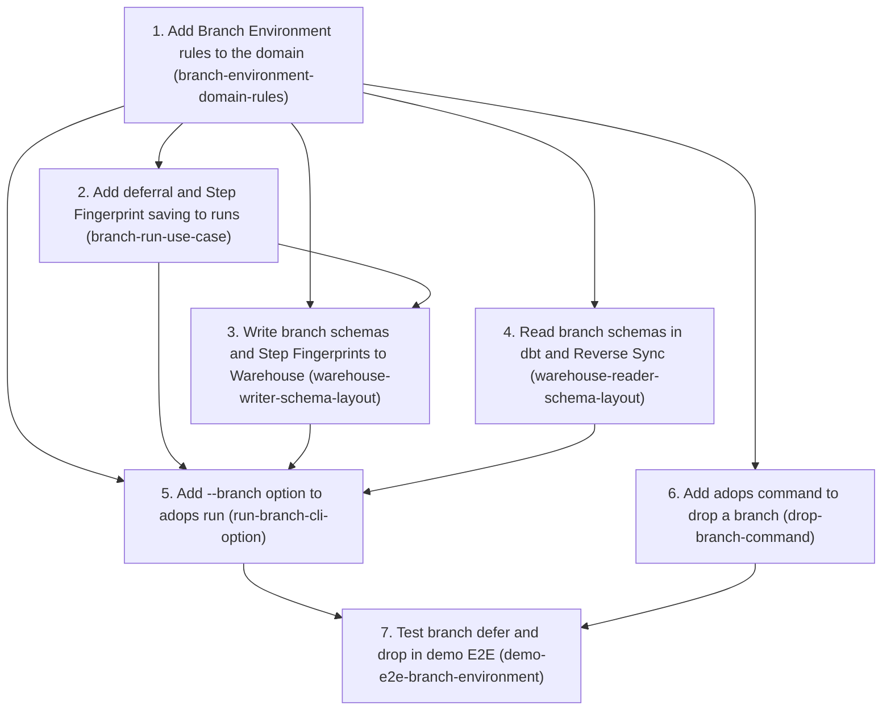

# Horizon 6 — Branch Environments

## Executive Summary

### 🎯 What are we trying to achieve?
A developer can run `adops run <pipeline> --branch <name>` and get a private copy of the Pipeline inside the stage Warehouse. Only the Steps that changed since stage's last good run (and the Steps after them) are rebuilt. Everything earlier is read straight from stage. When the branch is done, `adops drop-branch <name>` removes its schemas. Both commands work on Postgres and DuckDB, and the Docker demo test proves it.

### 🧠 Why does this change need to happen?
Today every adapter writes to fixed schema names (`raw_<source>`, `analytics`, `adops`), so trying a change means running it in dev from scratch or risking stage. Nothing records what stage last built, so a branch cannot tell what changed. The vision's success criterion (5) asks for per-branch schemas in the stage Warehouse that defer to stage, rebuild only changed Steps and get dropped on merge. This horizon builds the CLI half of that. The GitHub Actions that call it automatically come next.

### At a glance
- **Phases:** 7
- **Complexity:** High. Every Warehouse adapter gains a schema seam, there is a new fingerprint baseline in stage, and there is a destructive drop command.
- **Main risk:** dlt silently rewrites `br_x__raw_shop` to `br_x_raw_shop` (and its `*_staging` twin), so branches write to the wrong schemas and the drop misses them. This was verified, and normalization is switched off for non-default schemas.
- **Target:** stage tables, fingerprints and snapshots unchanged by any branch run or drop; no secret in output; demo E2E on both Warehouse kinds within the 20-minute CI job.
- **Testing focus:** default-layout byte-identity, `__` kept on both Warehouses, fingerprint saved only after Checks in stage, exact-prefix drop, secret absence, stage before/after snapshots in E2E.

## Implementation plan

### Order of work

```
Phase 1 — Add Branch Environment rules to the domain
        ↓  (needs the domain's fingerprint and layout rules)
Phase 2 — Add deferral and Step Fingerprint saving to runs
        ↓  (implements the ports the run use case declares)
Phase 3 — Write branch schemas and Step Fingerprints to Warehouse
        ↓  (needs SchemaLayout from the domain rules)
Phase 4 — Read branch schemas in dbt and Reverse Sync
        ↓  (wires the use case and both adapter halves into the CLI)
Phase 5 — Add --branch option to adops run
        ↓  (needs only the domain's branch name and drop prefix; independent of the run path)
Phase 6 — Add adops command to drop a branch
        ↓  (exercises --branch and drop-branch together on the real demo)
Phase 7 — Test branch defer and drop in demo E2E
```



### Phase 1 — Add Branch Environment rules to the domain

Technical ID: `branch-environment-domain-rules` · Environment · domain · medium blast radius

**Goal** — Create one pure domain module that holds every Branch Environment rule: turning a Git branch name into a safe Branch Environment name, naming its Branch Schemas, computing a Step Fingerprint, finding the first Changed Step, and deciding when a fingerprint may be saved. After this phase: src/adops/domain/branch_environment.py exists, has 100% line and branch coverage from tests/unit/domain/test_branch_environment.py, and passes the domain purity test.

**Why** — A Branch Environment is a throwaway copy of the stage Environment for one Git branch. It lives as extra schemas in the stage Warehouse (the database that holds synced and transformed tables). Every later phase (the run use case, the adapters, the drop command) depends on the same naming and change-detection rules. Keeping those rules pure, with no file or database access, makes them deterministic and fully unit-testable. It also keeps them inside the repo's domain-purity rules.

**Changes**

- Add src/adops/domain/branch_environment.py. Add `branch_environment_name(branch: str, longest_source: str) -> str`: lowercase the name, turn every run of characters outside [a-z0-9] into '_', trim leading and trailing '_', then add the 'br_' prefix. Cap the length so the longest generated schema, br_<name>__raw_<longest_source>_staging, fits Postgres' 63-byte identifier limit. (dlt, the loading library, creates a '<schema>_staging' companion for merge and incremental loads.) When the name is cut short, end it with a short hashlib sha256 suffix so two long branch names cannot collide. The result must match names.IDENTIFIER. Raise PipelineValidationError with a plain usage message when nothing is left after sanitizing.
- Add a frozen `SchemaLayout` value with `raw(source)`, `analytics` and `adops` schema names. `SchemaLayout.default()` returns today's names (raw_<source>, analytics, adops), so dev and stage stay byte-identical; `SchemaLayout.for_branch(env_name)` returns br_<name>__raw_<source>, br_<name>__analytics and br_<name>__adops. The domain only names schemas: it carries no loader-library flag (the adapters handle dlt's name normalization themselves).
- Add `read_layout(branch_layout, first_changed_index, steps)`. It answers, for every Step that runs in the branch, which raw_<source> schema to read (stage's when that source's Sync Step was deferred, the branch's when it was rebuilt) and which analytics schema a Reverse Sync Step reads (the branch's when the Transform Step was rebuilt, stage's otherwise).
- Add `step_fingerprint(step_json: str, files: Mapping[str, bytes]) -> str`. It returns a sha256 hash over the canonical Step JSON (json.dumps(sort_keys=True) of model_dump(mode='json')) followed by each file, in sorted POSIX-path order, with CRLF normalized to LF.
- Add `first_changed_step(current: Sequence[tuple[str, str]], stage: Mapping[str, str]) -> int | None`. It returns the index of the first Step whose fingerprint differs from stage's or is missing from it, so new, renamed and reordered Steps count as changed. It returns None when nothing changed.
- Add `saves_stage_fingerprint(environment_name: str) -> bool`, which is True only for exactly 'stage', and `drop_prefix(env_name) -> str`, which returns '<env_name>__'.
- Add `uses_raw_schema_var(files: Mapping[str, bytes], source: str) -> bool`, True when some dbt .yml file in the Transform's project references the variable adops_raw_schema_<source>. It lets a branch run refuse to build analytics from stage's old raw tables when a rebuilt Sync's raw schema is not reachable from the user's dbt sources.
- Add tests/unit/domain/test_branch_environment.py covering every line and branch: sanitizing edge cases, truncation with the hash suffix, two distinct long names producing distinct results, empty input, stable hashes across file order and CRLF, and the missing, renamed and new Step cases.

**Files / areas**

- `src/adops/domain/branch_environment.py`
- `src/adops/domain/names.py`
- `tests/unit/domain/test_branch_environment.py`

**How to verify**

- Branch names always yield valid, collision-safe schema names — Run `uv run pytest tests/unit/domain/test_branch_environment.py -q`: it passes.
- Step Fingerprint is stable across irrelevant differences and sensitive to real ones — In test_branch_environment.py there is a test that passes the same files in two different dict orders and asserts equal fingerprints.
- First Changed Step handles new, missing, renamed and reordered Steps — Tests assert: identical mappings -> None; second Step changed -> 1; a Step name not in stage -> its index; two Steps swapped in order with unchanged content -> index of the first moved Step; empty stage mapping -> 0.
- Domain module names schemas without adapter or loader knowledge — `grep -nEi 'enable_dataset_name_normalization|DROP SCHEMA|CREATE |information_schema|target/|dbt_packages|duckdb|postgres' src/adops/domain/branch_environment.py` prints nothing (comments explaining the 63-byte Postgres limit excepted).

**Done when** — src/adops/domain/branch_environment.py exists, has 100% line and branch coverage from tests/unit/domain/test_branch_environment.py, and passes the domain purity test. Every check under *How to verify* passes its bar.

**Depends on** — nothing — can start immediately

**Guards**

- g3: test_branch_environment.py covers every line and branch of the new module.
- g6: the module imports no framework, only stdlib (hashlib, json, re) and the existing pydantic step models.
- g10: no os, sys, io, pathlib, random or time imports, and no clock reads. tests/unit/domain/test_domain_purity.py stays green.
- g7: no pragma: no cover added.

<details><summary>Reference — rubric and healer hint</summary>

| Dimension | Rule | Pass criteria | Failure examples | Min |
|---|---|---|---|---|
| `branch-name-fits-identifier-limit` | branch_environment_name turns any Git branch name into a br_-prefixed name such that every schema it generates, including the longest br_<name>__raw_<longest_source>_staging, matches names.IDENTIFIER and fits Postgres' 63-byte limit, and two distinct long branch names never map to the same name. 10 = property-style or table-driven tests over slashes, unicode, dots, leading/trailing separators and >63-byte inputs, all asserting the full staging schema length; 8 = competent explicit cases for each; minScore is acceptable, not perfect. | Run `uv run pytest tests/unit/domain/test_branch_environment.py -q`: it passes.<br>In a Python shell, `branch_environment_name('feature/ABC-12.fix', 'shop')` returns a value starting with 'br_' that contains only [a-z0-9_] and matches `adops.domain.names.IDENTIFIER`.<br>For a 200-character branch name and a 30-character source, the returned name n satisfies `len(f'{n}__raw_{source}_staging'.encode()) <= 63`.<br>Two 200-character branch names that differ only in their last character return different names (hash suffix present).<br>`branch_environment_name('///', 'shop')` raises PipelineValidationError with a message that tells the user the branch name is unusable. | Truncation caps br_<name> at 63 bytes but forgets the '__raw_<source>_staging' suffix, so dlt's staging schema is silently truncated by Postgres.<br>Truncation keeps a prefix only, so 'feature/very-long-name-a' and 'feature/very-long-name-b' collide and one branch drops the other's schemas.<br>A trailing '_' left after truncation produces 'br_x___raw_shop', breaking the exact '__' drop prefix. | 8 |
| `fingerprint-determinism` | step_fingerprint returns the same hash regardless of Mapping insertion order and CRLF vs LF line endings, and a different hash when the Step JSON, any file's content, or any file's path changes. 10 = also proves a renamed file with identical bytes changes the hash and that path/content boundaries cannot be shifted to forge equal hashes; 8 = order, CRLF, content and Step-JSON cases tested. | In test_branch_environment.py there is a test that passes the same files in two different dict orders and asserts equal fingerprints.<br>There is a test where one file uses '\r\n' and the other '\n' with otherwise equal text, asserting equal fingerprints.<br>There are tests asserting a changed byte in one file, a renamed file path, and a changed Step JSON field each yield a different fingerprint.<br>`grep -n 'sort_keys' src/adops/domain/branch_environment.py` or the call site shows Step JSON is canonicalized before hashing. | Files are concatenated without a path or length separator, so moving bytes from the end of a.sql to the start of b.sql gives the same hash.<br>Only file contents are hashed, so renaming models/customer_stats.sql to another path does not count as a change.<br>CRLF normalization is applied to the Step JSON but not to the files, so a Windows checkout rebuilds everything. | 8 |
| `first-changed-step-semantics` | first_changed_step returns the index of the earliest Step whose fingerprint differs from or is absent in stage's mapping, and None only when every current Step matches stage. 10 = adds a case where stage holds extra Steps the branch removed and documents the chosen behaviour in a test name; 8 = each listed case tested. | Tests assert: identical mappings -> None; second Step changed -> 1; a Step name not in stage -> its index; two Steps swapped in order with unchanged content -> index of the first moved Step; empty stage mapping -> 0.<br>`read_layout` tests assert that for first_changed_index 0 every raw schema is the branch's, and for an index after the Sync Step the raw schema is stage's raw_<source> while analytics is the branch's.<br>`saves_stage_fingerprint('stage')` is True and `saves_stage_fingerprint('Stage')`, `('br_stage')`, `('prod')` and `('dev')` are False in tests. | Comparison is by set of fingerprints, so swapping two Steps' order returns None and the branch defers to stage tables built in a different order.<br>A Step present in the branch but absent from stage is skipped instead of counted as changed.<br>saves_stage_fingerprint uses `startswith('stage')` or case-insensitive compare, letting 'stage_test' overwrite stage's baseline. | 8 |
| `domain-layer-carries-no-adapter-concepts` | branch_environment.py expresses only Branch Environment rules: it holds no SQL text, no dlt normalization flag or dataset-option, no filesystem walk and no knowledge of dbt's generated folders. 10 = SchemaLayout is a frozen value whose only behaviour is naming; 8 = no adapter concept leaks though helpers may be loosely grouped. The purity test already proves imports; this dimension checks concepts. | `grep -nEi 'enable_dataset_name_normalization\|DROP SCHEMA\|CREATE \|information_schema\|target/\|dbt_packages\|duckdb\|postgres' src/adops/domain/branch_environment.py` prints nothing (comments explaining the 63-byte Postgres limit excepted).<br>`SchemaLayout` is declared frozen (pydantic frozen config or `@dataclass(frozen=True)`) and assigning to an attribute in a test raises.<br>`SchemaLayout.default().raw('shop') == 'raw_shop'`, `.analytics == 'analytics'`, `.adops == 'adops'`, so dev and stage are byte-identical. | SchemaLayout exposes a `dlt_normalize: bool` field because the author knew adapters would need it.<br>uses_raw_schema_var filters out target/ and logs/ paths itself, duplicating the infrastructure exclusion list.<br>SchemaLayout.default() returns 'raw__shop' due to a shared format string, silently moving dev and stage tables. | 7 |

Healer hint: The likely miss is computing the length cap for br_<name> alone instead of the full br_<name>__raw_<longest_source>_staging schema or leaving a trailing '_' after truncation; fix by computing the budget from the longest generated schema and stripping '_' before appending the hash suffix.

</details>

### Phase 2 — Add deferral and Step Fingerprint saving to runs

Technical ID: `branch-run-use-case` · Pipeline · application · medium blast radius

**Goal** — Teach the Pipeline run use case to (a) save each Step's Step Fingerprint after a stage run's Checks pass and (b) in a Branch Environment, skip the unchanged earlier Steps and report them as deferred to stage. After this phase: run_pipeline in src/adops/application/run_pipeline.py defers unchanged Steps as DEFERRED and saves stage-only Step Fingerprints after Checks pass, proven by tests/unit/application/test_run_pipeline.py at 100% coverage.

**Why** — run_pipeline in the application layer builds and runs the list of Steps (Sync, Transform, Reverse Sync). It is the one place that knows when a Step has fully succeeded. Fingerprints must be saved only after Checks pass, so a branch never defers to a broken stage table. This phase adds the ports (interfaces the application calls; infrastructure implements them) without any real adapter, so the logic is proven against fakes first.

**Changes**

- In ports.py, add a `StepFingerprintStore` Protocol with `load(pipeline) -> Mapping[str, str]` and `save(pipeline, step, fingerprint) -> None`. Add a `ProjectFiles` Protocol with `read_tree(relative_dir) -> Mapping[str, bytes]`. Add `StepStatus.DEFERRED`, and let `RunResult.succeeded` accept PASSED or DEFERRED.
- In run_pipeline.py, add a `BranchRun` input: the branch env name, the stage fingerprints and the first Changed Step index. Add one shared `current_fingerprints(steps, project_files)` that computes every Step's fingerprint through ProjectFiles and the domain `step_fingerprint` (Transform Steps hash their dbt project tree); stage runs and branch runs both use it, so the saved and compared hashes always come from the same inputs. Add `plan_branch_run(...)`, which calls current_fingerprints, loads stage's fingerprints, and calls `first_changed_step`. Raise a new `StageNotRunError` with the message 'run the Pipeline in stage first' when stage has no fingerprints for the Pipeline.
- Wrap every StepTask, binding the store and the Step's value from current_fingerprints by closure, so it saves that fingerprint only when the inner task returns normally and `saves_stage_fingerprint(environment)` is True. dev and branch runs never save one.
- Leave deferred Steps out of the RunPlan and add a synthetic DEFERRED StepReport for each. When nothing changed, return a RunResult without calling the Orchestrator (the component that executes the plan, e.g. Dagster).
- Pass the branch env name, never 'stage', as the environment of PlannedReverseSyncStep, so writes_allowed keeps every branch Reverse Sync a Preview. Look up settings through pick_environment(…, 'stage') and raise a dedicated PipelineValidationError when adops.yaml has no stage Environment.
- When a branch rebuilds a Sync Step for a source and a later Transform Step runs, check `uses_raw_schema_var` on that Transform's project files; if it is False, fail before any Step runs with a new BranchSourcesNotParameterizedError naming the source and the variable adops_raw_schema_<source> to use in dbt sources, instead of quietly reading stage's raw tables.
- Add a fake StepFingerprintStore and a fake ProjectFiles to tests/unit/application/fakes.py. Add tests covering: saved after Checks pass in stage, not saved on Check failure, not saved in dev or in a branch, nothing changed → no Orchestrator call and exit success, first changed Step plus all later Steps run, Reverse Sync environment starts with 'br_' and apply is never called, missing stage fingerprints, missing stage Environment, the un-parameterized dbt sources error, and stage-save and branch-compare using the same current_fingerprints value.

**Files / areas**

- `src/adops/application/ports.py`
- `src/adops/application/run_pipeline.py`
- `tests/unit/application/fakes.py`
- `tests/unit/application/test_run_pipeline.py`

**How to verify**

- Stage fingerprints are saved only after a Step and its Checks succeed — Run `uv run pytest tests/unit/application/test_run_pipeline.py -q`: it passes.
- Unchanged earlier Steps are DEFERRED and a no-change run never calls the Orchestrator — A test with first Changed Step index 1 asserts the fake Orchestrator received a plan without Step 0 and with Steps 1..n, and the reports show Step 0 as DEFERRED.
- A branch Reverse Sync is always a Preview — A test runs a branch plan with a Reverse Sync Step and asserts the fake Reverse Sync's environment argument starts with 'br_' and its apply() call count is 0.
- Rebuilt Sync with un-parameterized dbt sources fails before any Step runs — A test with fake ProjectFiles lacking 'adops_raw_schema_shop' and a changed Sync Step asserts BranchSourcesNotParameterizedError is raised, its message contains 'shop' and 'adops_raw_schema_shop', and the fake Orchestrator was never called.
- Branch logic reaches files and the Warehouse only through Protocols — `grep -nE "br_|raw_|__|SELECT|INSERT|\.adops|open\(" src/adops/application/run_pipeline.py` shows no hand-built schema names, SQL or file opens (domain function calls excepted).

**Done when** — run_pipeline in src/adops/application/run_pipeline.py defers unchanged Steps as DEFERRED and saves stage-only Step Fingerprints after Checks pass, proven by tests/unit/application/test_run_pipeline.py at 100% coverage. Every check under *How to verify* passes its bar.

**Depends on** — Add Branch Environment rules to the domain

**Guards**

- g3: new branches in run_pipeline.py and ports.py are covered by test_run_pipeline.py with fakes.
- g6: the new ports are Protocols. No dlt, dagster, dbt or typer import enters application/.
- g10: file and Warehouse access stay behind StepFingerprintStore and ProjectFiles, with no pathlib or os. test_application_purity.py stays green.
- g7: the store and the branch context are bound into StepTasks by closure, never through Dagster run config. StageNotRunError carries no connection text.
- g8: Check verdicts are untouched. A failed Check still stops later Steps, and the Step then saves no fingerprint.

<details><summary>Reference — rubric and healer hint</summary>

| Dimension | Rule | Pass criteria | Failure examples | Min |
|---|---|---|---|---|
| `fingerprint-saved-only-after-checks-in-stage` | A Step Fingerprint is written to the StepFingerprintStore only when the environment is exactly 'stage' and that Step's task, including its Checks, returned normally; a failed Check, a raised error, a dev run or a branch run writes nothing. 10 = a test proves that when Step 2's Check fails, Step 1's fingerprint is saved and Step 2's and Step 3's are not; 8 = each condition tested separately. | Run `uv run pytest tests/unit/application/test_run_pipeline.py -q`: it passes.<br>A test runs a stage Pipeline whose Transform Check fails and asserts the fake store's saved keys contain the Sync Step only.<br>Tests run the same Pipeline with environment 'dev' and with a 'br_feat' environment and assert the fake store's save() was never called.<br>A test asserts the value saved in stage equals the value plan_branch_run compares for the same Step (both from current_fingerprints). | The fingerprint is saved before Checks run (at the end of the materialize call), so a branch later defers to a stage table that failed its Checks.<br>Save happens after the whole RunResult succeeds, so a later Step's failure prevents saving earlier, valid fingerprints and every branch rebuilds from Step 0.<br>Stage save hashes the Transform's dbt project tree but the branch compare hashes only the Step JSON, so every branch run sees a change. | 8 |
| `deferral-and-no-change-short-circuit` | In a branch run, Steps before the first Changed Step are absent from the RunPlan and reported as StepStatus.DEFERRED; the Changed Step and every later Step run; when nothing changed the result succeeds without invoking the Orchestrator. 10 = tests also assert report order matches Step order and RunResult.succeeded with a mix of DEFERRED and PASSED; 8 = each behaviour tested. | A test with first Changed Step index 1 asserts the fake Orchestrator received a plan without Step 0 and with Steps 1..n, and the reports show Step 0 as DEFERRED.<br>A test where every fingerprint matches asserts the fake Orchestrator's run counter is 0 and `RunResult.succeeded` is True.<br>A test with no stage fingerprints asserts StageNotRunError is raised with the message 'run the Pipeline in stage first'.<br>A test with an adops.yaml lacking a stage Environment asserts a PipelineValidationError naming the missing stage Environment. | Deferred Steps are kept in the RunPlan with a skip flag, so the Orchestrator still opens a Warehouse connection for them.<br>Only the Changed Step runs and later dependent Steps are deferred, so the Reverse Sync previews stale analytics.<br>RunResult.succeeded still checks `== PASSED`, so a branch run with deferred Steps exits non-zero. | 8 |
| `branch-reverse-sync-never-writes` | Every PlannedReverseSyncStep built for a branch run carries the br_ environment name, never 'stage', so writes_allowed is False and apply() is never called. 10 = a test asserts this even when the stage Environment's settings enable writing; 8 = a test asserts the br_ environment and no apply call. | A test runs a branch plan with a Reverse Sync Step and asserts the fake Reverse Sync's environment argument starts with 'br_' and its apply() call count is 0.<br>The same assertion holds when the stage settings in the test enable Reverse Sync writes.<br>`grep -n "'stage'" src/adops/application/run_pipeline.py` shows 'stage' used only to pick settings (pick_environment) and in the save decision, not as the Reverse Sync environment. | The branch reuses the stage EnvironmentSettings object, including its name, so PlannedReverseSyncStep gets 'stage' and writes to the shop target.<br>The test only checks the printed word 'Preview' rather than that apply() was not called. | 9 |
| `unparameterized-sources-fail-fast` | When a branch rebuilds a Sync Step for a source and a later Transform's dbt project does not reference adops_raw_schema_<source>, the run raises BranchSourcesNotParameterizedError naming the source and the variable, before the Orchestrator runs anything. 10 = the message tells the user the exact var() expression to put in sources.yml; 8 = error raised with source and variable named. | A test with fake ProjectFiles lacking 'adops_raw_schema_shop' and a changed Sync Step asserts BranchSourcesNotParameterizedError is raised, its message contains 'shop' and 'adops_raw_schema_shop', and the fake Orchestrator was never called.<br>A test where only the Transform changed (Sync deferred) and sources are un-parameterized asserts no such error is raised. | The check runs inside the Transform StepTask, so the Sync has already loaded into br_ schemas before the error.<br>The check fires whenever sources lack the variable, even when the Sync is deferred, blocking the dbt-only-change case. | 7 |
| `application-stays-behind-ports` | run_pipeline.py and ports.py read dbt project files only via ProjectFiles and fingerprints only via StepFingerprintStore, and never build schema strings, SQL, or file paths themselves. 10 = schema choices come solely from the domain read_layout/SchemaLayout; 8 = no adapter concept in application code. | `grep -nE "br_\|raw_\|__\|SELECT\|INSERT\|\.adops\|open\(" src/adops/application/run_pipeline.py` shows no hand-built schema names, SQL or file opens (domain function calls excepted).<br>`StepFingerprintStore` and `ProjectFiles` in src/adops/application/ports.py are `typing.Protocol` classes.<br>The fakes in tests/unit/application/fakes.py implement those Protocols without subclassing any infrastructure class. | run_pipeline formats f'br_{name}__analytics' itself instead of using SchemaLayout.for_branch.<br>The fingerprint store is passed to StepTasks through Dagster run config instead of closure. | 7 |

Healer hint: The most likely failure is saving the fingerprint at the wrong moment (before Checks or only after the whole run) or computing it from different inputs than the branch compare; fix by wrapping each StepTask so it saves the precomputed current_fingerprints value only after the inner task returns and only when the environment is exactly 'stage'.

</details>

### Phase 3 — Write branch schemas and Step Fingerprints to Warehouse

Technical ID: `warehouse-writer-schema-layout` · Warehouse · infrastructure · medium blast radius

**Goal** — Let the adapters that write to the Warehouse (dlt Sync and the schema snapshot store) take their schema names from a SchemaLayout instead of module constants, keeping '__' intact in branch schemas, and implement the StepFingerprintStore and ProjectFiles ports: Step Fingerprints live in a new _adops_step_fingerprints table in the stage Warehouse's adops schema, and the dbt project tree is read from disk minus generated folders. The default layout keeps dev and stage byte-identical. After this phase: DltSync and WarehouseSnapshotStore accept a SchemaLayout keyword (default-layout tests prove dev/stage schema names unchanged; branch-layout tests prove br_<name>__ schemas, including *_staging, are created intact), and src/adops/infrastructure/step_fingerprint_store.py implements StepFingerprintStore and ProjectFiles, all 100% covered on DuckDB and Postgres.

**Why** — Today raw_<source> and adops are hard-coded constants in DltSync and WarehouseSnapshotStore, so a branch cannot write to br_<name>__ schemas. These are the write side of the Warehouse: their risk is dlt's dataset-name normalization collapsing '__' (including the *_staging companion dlt creates for merge and incremental loads). The Step Fingerprint store is another adops-schema writer that copies WarehouseSnapshotStore's dlt client pattern, so it belongs with it. Branch runs compare against stage's last successful run, so stage must persist one fingerprint per Pipeline and Step in the Warehouse both runs share, and file reading for fingerprints must skip dbt's generated target/, logs/, dbt_packages/, .adops/ and .pyc files, or every branch rebuilds everything.

**Changes**

- In dlt_sync.py, give DltSync a `layout: SchemaLayout = SchemaLayout.default()` keyword. Use layout.raw(step.source) as dataset_name. Whenever the schema name differs from the default one, build the dlt.destinations.postgres/duckdb factory with enable_dataset_name_normalization=False (dlt otherwise collapses '__' into '_'); pass nothing new in the default case.
- In schema_snapshot_store.py, give WarehouseSnapshotStore a `layout` keyword and use layout.adops instead of SNAPSHOT_SCHEMA, disabling dlt dataset-name normalization when the schema is not the default.
- Add src/adops/infrastructure/step_fingerprint_store.py with WarehouseFingerprintStore(project, warehouse_kind, environment). Copy WarehouseSnapshotStore._client's pattern: a dlt pipeline named 'adops_step_fingerprints' in local_state_dir(project, environment) with dataset 'adops'. Only save() creates the dataset if it is missing and runs CREATE TABLE IF NOT EXISTS _adops_step_fingerprints(pipeline, step, fingerprint, primary key pipeline+step), then upserts with parameterized SQL. load() first checks information_schema for the schema and table and returns {} when either is absent, without running any DDL, so a branch run never mutates the stage Warehouse's adops schema. Open DuckDB read-write only.
- In the same module, add `read_project_tree(project_root, relative_dir) -> Mapping[str, bytes]`. It walks the directory and returns POSIX relative paths, excluding target/, logs/, dbt_packages/, .adops/ and *.pyc, and satisfies the ProjectFiles port.
- Map driver failures to the existing WarehouseUnreachable so no DSN or driver text leaks.
- Extend test_dlt_sync.py and test_schema_snapshot_store.py with a default-layout case (asserting the unchanged schema names and destination arguments) and a branch-layout case on real DuckDB and the CI Postgres service, asserting br_x__raw_shop and br_x__adops keep their '__'. The branch merge/incremental Sync test must assert that a br_x__raw_shop_staging schema actually exists in information_schema.schemata (not merely that any staging schema present is prefixed).
- Add tests/unit/infrastructure/test_step_fingerprint_store.py: save-then-load and overwrite on DuckDB and the CI Postgres service, load on an empty Warehouse returning {} and leaving no adops schema or table behind, exclusion list, stable path order, unreachable Warehouse error with no secret in the message, and a locked DuckDB file via the duckdb_held_by_another_process fixture.

**Files / areas**

- `src/adops/infrastructure/dlt_sync.py`
- `src/adops/infrastructure/schema_snapshot_store.py`
- `src/adops/infrastructure/step_fingerprint_store.py`
- `tests/unit/infrastructure/test_dlt_sync.py`
- `tests/unit/infrastructure/test_schema_snapshot_store.py`
- `tests/unit/infrastructure/test_step_fingerprint_store.py`

**How to verify**

- Dev and stage schema names and dlt options are unchanged for the writer adapters — Run `uv run pytest tests/unit/infrastructure/test_dlt_sync.py tests/unit/infrastructure/test_schema_snapshot_store.py -q`: they pass.
- Branch layouts create br_<name>__ schemas intact on both Warehouses — Tests on DuckDB and on Postgres (ADOPS_TEST_POSTGRES_DSN) run a branch-layout Sync and assert `SELECT schema_name FROM information_schema.schemata` includes 'br_x__raw_shop'.
- Fingerprints save, overwrite and load per Pipeline and Step — Run `uv run pytest tests/unit/infrastructure/test_step_fingerprint_store.py -q` with ADOPS_TEST_POSTGRES_DSN set: it passes with no skips.
- Project tree reading ignores generated files and is order-stable — A test creates models/a.sql, target/manifest.json, logs/dbt.log, dbt_packages/x/y.sql, .adops/s and a __pycache__/m.pyc, and asserts the returned keys are exactly ['models/a.sql'] plus any other non-excluded files.
- Warehouse failures map to WarehouseUnreachable with no DSN text — A test points the store at an unreachable Postgres DSN containing a distinctive password and asserts WarehouseUnreachable is raised and the password appears in neither `str(exc)` nor `repr(exc)`.

**Done when** — DltSync and WarehouseSnapshotStore accept a SchemaLayout keyword (default-layout tests prove dev/stage schema names unchanged; branch-layout tests prove br_<name>__ schemas, including *_staging, are created intact), and src/adops/infrastructure/step_fingerprint_store.py implements StepFingerprintStore and ProjectFiles, all 100% covered on DuckDB and Postgres. Every check under *How to verify* passes its bar.

**Depends on** — Add Branch Environment rules to the domain, Add deferral and Step Fingerprint saving to runs

**Guards**

- g3: every new keyword in dlt_sync.py and schema_snapshot_store.py has a default and a non-default test on real DuckDB plus the CI Postgres service, and step_fingerprint_store.py is fully covered by its test file, with Postgres-backed cases that fail rather than skip without ADOPS_TEST_POSTGRES_DSN.
- g7: no pragma. Warehouse credentials still reach adapters only through resolved connections, never logged. Fingerprint store errors carry no DSN or driver text, and the tests assert the secret is absent.
- g10: dlt and pathlib usage stays in infrastructure/. Only dagster_orchestrator.py imports dagster.

**Rollback** — Revert the DltSync and WarehouseSnapshotStore layout keywords; because defaults equal the old constants, no existing Warehouse data needs migrating. The new fingerprint table only accumulates fingerprints: to undo, run DROP TABLE "adops"."_adops_step_fingerprints" in the stage Warehouse. Stage tables and snapshots are unaffected.

<details><summary>Reference — rubric and healer hint</summary>

| Dimension | Rule | Pass criteria | Failure examples | Min |
|---|---|---|---|---|
| `default-layout-byte-identical` | With no layout keyword, DltSync and WarehouseSnapshotStore use exactly raw_<source> and adops and construct their dlt destination exactly as before (no enable_dataset_name_normalization or other new kwargs). 10 = tests assert the destination factory call arguments in the default case, not just schema names; 8 = default schema names asserted per adapter. | Run `uv run pytest tests/unit/infrastructure/test_dlt_sync.py tests/unit/infrastructure/test_schema_snapshot_store.py -q`: they pass.<br>Each of those two test files contains a default-layout test asserting the Warehouse ends up with schema raw_shop / adops as before.<br>A test asserts that in the default case the dlt destination is built without enable_dataset_name_normalization. | enable_dataset_name_normalization=False is passed always, which changes dlt's normalization of user-provided source names in dev and stage.<br>WarehouseSnapshotStore's default schema is derived from SchemaLayout.default() through a format string that yields 'adops_' or '_adops', silently moving stage's snapshot baseline. | 8 |
| `branch-schemas-keep-double-underscore` | With SchemaLayout.for_branch('br_x'), DltSync and WarehouseSnapshotStore create br_x__raw_shop and br_x__adops on both DuckDB and the CI Postgres service, with '__' preserved, including dlt's *_staging companion, which a merge/incremental branch Sync must actually create as br_x__raw_shop_staging. 10 = tests also list information_schema.schemata and assert no collapsed br_x_raw_shop or br_x_raw_shop_staging exists; 8 = the expected names asserted on both kinds. | Tests on DuckDB and on Postgres (ADOPS_TEST_POSTGRES_DSN) run a branch-layout Sync and assert `SELECT schema_name FROM information_schema.schemata` includes 'br_x__raw_shop'.<br>The same query returns no 'br_x_raw_shop' (single underscore) schema.<br>A merge/incremental branch Sync test asserts 'br_x__raw_shop_staging' is present in information_schema.schemata (the assertion fails if no staging schema was created at all), and that no 'br_x_raw_shop_staging' exists.<br>A branch-layout WarehouseSnapshotStore test asserts 'br_x__adops' exists on both Warehouse kinds. | Normalization is disabled for the main dataset but the staging dataset is still normalized, leaving a 'br_x_raw_shop_staging' that drop-branch's 'br_x__' prefix never removes.<br>The branch test only runs on DuckDB, and Postgres' identifier handling differs.<br>The staging test only checks that every staging schema found starts with 'br_x__raw_shop', so it passes vacuously when the load used replace mode and no staging schema was created. | 8 |
| `upsert-roundtrip-both-warehouses` | WarehouseFingerprintStore.save creates the adops dataset and table if missing and upserts one row per (pipeline, step) in adops._adops_step_fingerprints with parameterized SQL; load checks information_schema and returns exactly that Pipeline's mapping, or {} when the table or schema does not exist, without running any DDL, on DuckDB and Postgres. 10 = also proves two Pipelines' rows are isolated and load on a fresh Warehouse leaves no adops schema or table behind; 8 = save/overwrite/empty cases on both kinds. | Run `uv run pytest tests/unit/infrastructure/test_step_fingerprint_store.py -q` with ADOPS_TEST_POSTGRES_DSN set: it passes with no skips.<br>A test saves fingerprint 'a' then 'b' for the same Step and asserts load returns {'step': 'b'} and the table has one row for that key.<br>A test loads from a fresh Warehouse and asserts {} with no exception.<br>`grep -nE "f\".*(INSERT\|SELECT).*\{" src/adops/infrastructure/step_fingerprint_store.py` shows no f-string interpolation of pipeline, step or fingerprint values into SQL.<br>A test calls load() on a fresh Warehouse and then asserts information_schema has no _adops_step_fingerprints table (and no adops schema that did not exist before). | save uses INSERT without ON CONFLICT, so a second stage run raises a primary-key error.<br>load runs CREATE TABLE IF NOT EXISTS, so a branch run mutates the stage Warehouse's adops schema.<br>load ignores the pipeline argument and returns every Pipeline's Steps, so same-named Steps collide. | 8 |
| `project-tree-excludes-generated` | read_project_tree returns POSIX relative paths for every file under the directory except target/, logs/, dbt_packages/, .adops/ and *.pyc, so running dbt does not change a Transform's fingerprint. 10 = a test runs or simulates a dbt build that writes target/ and logs/ and asserts the computed fingerprint is unchanged; 8 = exclusion and path format asserted. | A test creates models/a.sql, target/manifest.json, logs/dbt.log, dbt_packages/x/y.sql, .adops/s and a __pycache__/m.pyc, and asserts the returned keys are exactly ['models/a.sql'] plus any other non-excluded files.<br>A test asserts keys use '/' separators and are relative (no leading '/').<br>A test asserts that a nested 'models/target_customers.sql' is NOT excluded (only a directory named target is). | Exclusion uses `'target' in path`, which drops models/target_customers.sql and hides a real change.<br>Only top-level target/ is excluded, but dbt_packages contain their own target/ and logs/ that drift.<br>Paths come from os.walk without sorting and without relpath, so they include the absolute tmp dir and differ per machine. | 8 |
| `errors-carry-no-secrets` | Driver and dlt failures from the store surface as the existing WarehouseUnreachable whose message and chained repr contain no DSN, password or driver error text; a DuckDB file held by another process produces the same plain error. 10 = the test asserts the password substring is absent from str(), repr() and the __cause__-suppressed traceback; 8 = absent from the message. | A test points the store at an unreachable Postgres DSN containing a distinctive password and asserts WarehouseUnreachable is raised and the password appears in neither `str(exc)` nor `repr(exc)`.<br>A test uses the duckdb_held_by_another_process fixture and asserts WarehouseUnreachable (or the repo's existing locked-file error) with no file-path-plus-driver dump.<br>The raise uses `from None` or equivalent so the driver exception is not chained into user-visible tracebacks. | The error is raised `from exc`, and the CLI's traceback printing in debug mode shows psycopg's message with the DSN.<br>The message includes f'{exc}' from dlt, which embeds the connection string. | 9 |

Healer hint: The likely miss is dlt still collapsing '__' for the *_staging companion or on one Warehouse kind; fix by passing enable_dataset_name_normalization=False to the destination factory whenever the schema differs from the default and asserting the exact schema list from information_schema on both DuckDB and Postgres. For the fingerprint store: the likely failure is a substring-based exclusion or a load() that creates the table; fix by excluding by path component (any directory part equal to an excluded name) and by checking table existence in information_schema before selecting.

</details>

### Phase 4 — Read branch schemas in dbt and Reverse Sync

Technical ID: `warehouse-reader-schema-layout` · Warehouse · infrastructure · medium blast radius

**Goal** — Let the adapters that read Branch Schemas chosen per run (dbt Transform and the Reverse Sync reader) take their schema names from keywords instead of module constants, and make the demo dbt sources.yml read its raw schema from a dbt variable. The defaults keep dev and stage byte-identical. After this phase: DbtTransform accepts target_schema and raw_schemas (passed as --vars), PostgresReverseSync accepts analytics_schema and reads DuckDB read-write, and the demo sources.yml reads var('adops_raw_schema_shop', 'raw_shop'), with default tests proving dev/stage behaviour unchanged and branch tests proving br_<name>__analytics is read and written intact.

**Why** — Today analytics is the constant TARGET_SCHEMA used by DbtTransform and PostgresReverseSync, and the demo sources.yml hard-codes raw_shop, so a branch cannot read stage's tables for deferred Steps or write br_<name>__analytics. This is the read side of the Warehouse, with a different risk profile from the dlt writers: dbt profile rendering, the --vars payload, and opening DuckDB read-write while dbt-duckdb holds the file. dbt (the SQL transformation tool) needs the demo's sources.yml to read its raw schema from a dbt variable, so a branch can point it at stage's raw tables.

**Changes**

- In postgres_reverse_sync.py, give PostgresReverseSync an `analytics_schema: str = TARGET_SCHEMA` keyword for _read_result, disabling dlt dataset-name normalization when it is not the default. On DuckDB, open the connection read-write, never read_only, because dbt-duckdb holds the file open.
- In dbt_transform.py, give DbtTransform a `target_schema: str = TARGET_SCHEMA` keyword and a `raw_schemas: Mapping[str, str] = {}` keyword. Render target_schema into both profile renderers. When raw_schemas is non-empty, pass `--vars` with adops_raw_schema_<source> to dbtRunner.
- Change templates/demo/dbt/models/sources.yml so its schema reads "{{ var('adops_raw_schema_shop', 'raw_shop') }}". This adds no new file.
- Extend test_dbt_transform.py and test_postgres_reverse_sync.py with a default case (asserting the unchanged analytics schema, rendered profiles and dbtRunner argv) and a branch case on real DuckDB and the CI Postgres service, asserting br_x__analytics keeps its '__' and dbt reads the raw schema passed through --vars.

**Files / areas**

- `src/adops/infrastructure/dbt_transform.py`
- `src/adops/infrastructure/postgres_reverse_sync.py`
- `src/adops/templates/demo/dbt/models/sources.yml`
- `tests/unit/infrastructure/test_dbt_transform.py`
- `tests/unit/infrastructure/test_postgres_reverse_sync.py`

**How to verify**

- Dev and stage dbt invocation and Reverse Sync reads are unchanged — Run `uv run pytest tests/unit/infrastructure/test_dbt_transform.py tests/unit/infrastructure/test_postgres_reverse_sync.py -q`: they pass.
- dbt reads raw tables from the schema the layout chooses — `grep -n "var('adops_raw_schema_shop', 'raw_shop')" src/adops/templates/demo/dbt/models/sources.yml` prints one line.
- Reverse Sync reads the chosen analytics schema without locking DuckDB — A test sets analytics_schema='br_x__analytics', seeds a table there and asserts the Preview rows come from it, on DuckDB and Postgres.

**Done when** — DbtTransform accepts target_schema and raw_schemas (passed as --vars), PostgresReverseSync accepts analytics_schema and reads DuckDB read-write, and the demo sources.yml reads var('adops_raw_schema_shop', 'raw_shop'), with default tests proving dev/stage behaviour unchanged and branch tests proving br_<name>__analytics is read and written intact. Every check under *How to verify* passes its bar.

**Depends on** — Add Branch Environment rules to the domain

**Guards**

- g3: every new keyword in dbt_transform.py and postgres_reverse_sync.py has a default and a non-default test on real DuckDB plus the CI Postgres service, keeping 100% line and branch coverage.
- g4: sources.yml already ships in the wheel and no template file is added, so the ci.yml wheel grep list is unchanged.
- g9: the demo file set is unchanged and sources.yml is not a .py file, so DEMO_FILES in test_init_command.py stays equal.
- g7: no pragma added. Warehouse credentials still reach adapters only through resolved connections, never logged.
- g10: dlt and dbt stay inside infrastructure/. Only dagster_orchestrator.py imports dagster.

**Rollback** — Revert the DbtTransform and PostgresReverseSync keywords and the sources.yml var line. Because defaults equal the old constants and the var defaults to raw_shop, no existing Warehouse data needs migrating.

<details><summary>Reference — rubric and healer hint</summary>

| Dimension | Rule | Pass criteria | Failure examples | Min |
|---|---|---|---|---|
| `reader-default-layout-byte-identical` | With no new keywords, DbtTransform renders schema analytics into both profiles and invokes dbtRunner exactly as before (no --vars), PostgresReverseSync reads from analytics and builds its dlt destination as before, and the demo sources.yml resolves to raw_shop. 10 = tests assert the full dbtRunner argv and destination factory arguments in the default case, not just schema names; 8 = default schema names asserted per adapter. | Run `uv run pytest tests/unit/infrastructure/test_dbt_transform.py tests/unit/infrastructure/test_postgres_reverse_sync.py -q`: they pass.<br>Each of those two test files contains a default test asserting the analytics schema is used as before.<br>A test asserts that in the default case dbtRunner is invoked without a '--vars' argument and the Reverse Sync reader's dlt destination is built without enable_dataset_name_normalization. | --vars is always passed with adops_raw_schema_shop=raw_shop, which changes the stage dbt invocation and can break user dbt projects that never declared the variable.<br>The Reverse Sync reader always disables dataset-name normalization, changing how stage's analytics dataset is opened. | 8 |
| `dbt-reads-deferred-or-rebuilt-raw` | DbtTransform renders target_schema into both the Postgres and DuckDB profiles and, when raw_schemas is given, passes adops_raw_schema_<source> via --vars so the demo sources.yml resolves to that schema; the demo sources.yml falls back to raw_shop. 10 = a real dbt run test shows a model reading from a non-default raw schema; 8 = rendered profile and argv asserted for both kinds. | `grep -n "var('adops_raw_schema_shop', 'raw_shop')" src/adops/templates/demo/dbt/models/sources.yml` prints one line.<br>A test asserts the rendered profile for both warehouse kinds contains schema br_x__analytics when target_schema='br_x__analytics'.<br>A test asserts dbtRunner argv contains '--vars' with a payload mapping adops_raw_schema_shop to the given schema when raw_schemas={'shop': 'raw_shop'}. | target_schema is rendered into the Postgres profile only, so DuckDB branch Transforms overwrite stage's analytics.<br>The --vars payload is built by string concatenation and breaks YAML/JSON quoting for schema names. | 7 |
| `reverse-sync-reads-chosen-analytics-safely` | PostgresReverseSync reads its result from analytics_schema and, on DuckDB, opens the connection read-write so it can coexist with dbt-duckdb in the same process. 10 = a test reads a br_x__analytics table on DuckDB right after a dbt run in the same process; 8 = keyword honoured and read-write mode asserted. | A test sets analytics_schema='br_x__analytics', seeds a table there and asserts the Preview rows come from it, on DuckDB and Postgres.<br>`grep -n 'read_only' src/adops/infrastructure/postgres_reverse_sync.py` shows no `read_only=True`. | The reader keeps the TARGET_SCHEMA constant in its SQL and only the dlt dataset_name changes, so the Preview shows stage analytics.<br>DuckDB is opened read_only and raises 'different configuration' when dbt-duckdb already holds the file. | 7 |

Healer hint: The likely miss is target_schema rendered into only one profile renderer, --vars passed in the default case, or the Reverse Sync reader opening DuckDB read_only; fix by rendering target_schema in both renderers, passing --vars only when raw_schemas is non-empty (built with a YAML/JSON serializer), and opening DuckDB read-write.

</details>

### Phase 5 — Add --branch option to adops run

Technical ID: `run-branch-cli-option` · Pipeline · interface · medium blast radius

**Goal** — `adops run <pipeline> --branch <name>` builds a Branch Environment from the stage Environment's settings, wires the adapters to the right schemas, prints deferred Steps as 'deferred to stage', and exits 0 when nothing changed. After this phase: `adops run <pipeline> --branch <name>` in src/adops/interface/run_command.py runs a Branch Environment end-to-end against fakes and adapters, covered by tests/unit/interface/test_run_command.py at 100%.

**Why** — The CLI is where user input becomes adapter wiring. The branch name and the stage settings must become a br_ Environment name, a SchemaLayout and dlt state under .adops/dlt/br_<name>. Using --env together with --branch has to be rejected, because a Branch Environment always derives from stage. Stage runs also need the fingerprint store wired in, so they start saving fingerprints.

**Changes**

- Change run()'s --env default to None (meaning 'dev' when absent) and add a `--branch` option. Fail with a usage error when both are given.
- Add build_fingerprint_store(project, kind) and build_project_files(project) as new module-level builders. Add branch layout arguments as defaulted keywords on build_sync, build_snapshot_store, build_transform and build_reverse_sync, so existing exact-signature monkeypatches in tests keep working.
- In run_project, when --branch is given: read stage settings, compute the br_ name with branch_environment_name, call plan_branch_run, build the adapters with SchemaLayout.for_branch plus the read layout (stage raw or analytics for deferred Steps), and pass the br_ name as the environment. Always pass the fingerprint store so stage runs save fingerprints.
- Print DEFERRED Steps as 'step <name>: deferred to stage'. On a run with no changes, print that the branch uses stage. Map StageNotRunError and a missing stage Environment to fail() with their plain messages.
- Extend tests/unit/interface/test_run_command.py with CliRunner cases: --branch with --env is a usage error, a branch run wires br_ layouts and env name, no-change output and exit 0, stage-not-run error, no stage Environment error, and a stage run passes a fingerprint store. Assert no secret value appears in the output.

**Files / areas**

- `src/adops/interface/run_command.py`
- `tests/unit/interface/test_run_command.py`

**How to verify**

- --branch wires every adapter to the right schemas and env name — Run `uv run pytest tests/unit/interface/test_run_command.py -q`: it passes.
- Conflicting options and missing baselines fail with plain usage messages — `adops run shop_sync --env stage --branch feat` (CliRunner) exits with a non-zero usage code and mentions both options.
- Plain stage runs get the fingerprint store wired in — A CliRunner test monkeypatches build_fingerprint_store and asserts it was called with the stage Environment's warehouse kind for `--env stage`.
- No secret value appears in any branch run output — A test sets the stage Warehouse secret env var to a distinctive value (e.g. 'S3cr3t-xyz') and, for each new CliRunner case, asserts that value is not in `result.output`.

**Done when** — `adops run <pipeline> --branch <name>` in src/adops/interface/run_command.py runs a Branch Environment end-to-end against fakes and adapters, covered by tests/unit/interface/test_run_command.py at 100%. Every check under *How to verify* passes its bar.

**Depends on** — Add Branch Environment rules to the domain, Add deferral and Step Fingerprint saving to runs, Write branch schemas and Step Fingerprints to Warehouse, Read branch schemas in dbt and Reverse Sync

**Guards**

- g3: every new CLI branch has a CliRunner test in test_run_command.py.
- g7: unexpected errors still print only their type. The new error messages carry no DSN, and the tests assert the secret is absent. Adapters reach Dagster ops only by closure.

<details><summary>Reference — rubric and healer hint</summary>

| Dimension | Rule | Pass criteria | Failure examples | Min |
|---|---|---|---|---|
| `cli-wires-branch-layouts` | `adops run <pipeline> --branch <name>` builds Sync, snapshot store, Transform and Reverse Sync with SchemaLayout.for_branch for rebuilt Steps, the stage raw/analytics schemas for deferred inputs, dlt state under .adops/dlt/br_<name>, and the br_ name as environment, using stage's Warehouse settings. 10 = a test asserts every builder's received layout/schema arguments for both a Transform-only change and a Sync change; 8 = one branch scenario asserts all four builders. | Run `uv run pytest tests/unit/interface/test_run_command.py -q`: it passes.<br>A CliRunner test with monkeypatched builders runs `run shop_sync --branch feat` and asserts build_transform received target schema 'br_feat__analytics', build_reverse_sync received environment starting 'br_feat', and the Warehouse connection came from the stage Environment.<br>A test with only the Transform changed asserts build_transform received raw_schemas mapping shop to 'raw_shop' (stage's), not 'br_feat__raw_shop'.<br>Existing test monkeypatches of build_sync/build_transform with their previous signatures still pass unchanged. | The branch run uses dev's Warehouse settings because the env default stayed 'dev' instead of resolving stage.<br>dlt state is written under .adops/dlt/stage, so a branch Sync advances stage's incremental cursor.<br>Layout keywords are added as required positional arguments, breaking existing monkeypatched builders. | 8 |
| `cli-input-validation-and-messages` | Passing --env with --branch is a usage error; a missing stage run or stage Environment exits non-zero with its plain message; deferred Steps print 'step <name>: deferred to stage' and a no-change run says the branch uses stage and exits 0. 10 = exit codes and exact output lines asserted for all four cases; 8 = each case asserted with substring checks. | `adops run shop_sync --env stage --branch feat` (CliRunner) exits with a non-zero usage code and mentions both options.<br>A no-change branch run exits 0 and its output contains 'deferred to stage' for each Step plus a line saying the branch uses stage.<br>With an empty fingerprint store the output contains 'run the Pipeline in stage first' and the exit code is non-zero.<br>`adops run shop_sync` with no flags still runs dev (existing tests unchanged). | --env keeps default 'dev', so `--branch` alone is indistinguishable from `--env dev --branch` and the conflict check fires always or never.<br>StageNotRunError falls into the generic except and prints only 'StageNotRunError' with no guidance. | 7 |
| `stage-runs-save-fingerprints` | `adops run <pipeline> --env stage` passes a WarehouseFingerprintStore and project-files reader into run_pipeline, so stage begins recording baselines; dev runs pass a store too but the use case never saves for them. 10 = a test asserts the store's kind and environment arguments match stage's Warehouse; 8 = a test asserts a store is passed for stage. | A CliRunner test monkeypatches build_fingerprint_store and asserts it was called with the stage Environment's warehouse kind for `--env stage`.<br>A test asserts run_pipeline receives a non-None fingerprint store and project files for a stage run. | The store is only built inside the `if branch:` path, so stage never saves fingerprints and every later branch hits StageNotRunError. | 8 |
| `cli-output-no-secrets` | For every new path (branch success, no-change, stage-not-run, missing stage, usage error, unexpected adapter error) the CLI output contains no resolved Warehouse secret. 10 = a single parametrized test sets a distinctive secret env var and asserts it is absent across all paths; 8 = asserted on the error paths. | A test sets the stage Warehouse secret env var to a distinctive value (e.g. 'S3cr3t-xyz') and, for each new CliRunner case, asserts that value is not in `result.output`.<br>A test where a builder raises an exception whose message contains the secret asserts only the exception type is printed. | The branch summary prints the resolved stage connection to show which Warehouse is used.<br>The secret check is done only on the happy path; the unexpected-error path echoes str(exc). | 9 |

Healer hint: The likely failure is the branch run reusing dev settings or stage's dlt state dir because --env still defaults to 'dev'; fix by defaulting --env to None, resolving stage settings explicitly for --branch, and passing local_state_dir(project, br_name) to the Sync builder.

</details>

### Phase 6 — Add adops command to drop a branch

Technical ID: `drop-branch-command` · Environment · cross-cutting · medium blast radius

**Goal** — `adops drop-branch <name>` removes every stage-Warehouse schema whose name starts with exactly br_<name>__ (including dlt's *_staging schemas), using DROP SCHEMA "…" CASCADE, and deletes only the local dlt state folder .adops/dlt/br_<name>. It succeeds when nothing exists. After this phase: `adops drop-branch <name>` drops exactly the br_<name>__ schemas and the branch's local dlt state, idempotently, covered at 100% by its three unit test files.

**Why** — This is one small slice across layers: a use case, one adapter and one CLI command, roughly 200 lines in under 10 files, and no other phase consumes any of it. The drop is destructive, so the prefix match must be an exact Python startswith on the sanitized name with a trailing '__' (never a SQL LIKE, where '_' is a wildcard) and quoted identifiers, so stage schemas such as raw_shop and analytics can never match.

**Changes**

- Add src/adops/application/drop_branch.py: drop_branch(settings_text, branch, env, schemas, state) resolves only the stage Environment's Warehouse secret with resolve_warehouse, computes the br_ name and drop_prefix from the domain, lists schemas, drops those starting with the prefix, then deletes the local state. A small WarehouseSchemas Protocol (list_schemas, drop) is declared next to the use case.
- Add src/adops/infrastructure/warehouse_schemas.py: it lists schemas from information_schema.schemata and drops with DROP SCHEMA IF EXISTS "<name>" CASCADE through warehouse_client, opening DuckDB read-write. Add a function that removes local_state_dir(project, br_name) only when it exists, never .adops/ or the DuckDB file.
- Add src/adops/interface/drop_branch_command.py (def drop_branch) with accept_schema_command's except ladder, so no driver text leaks. Register it in cli.py as 'drop-branch'.
- Add tests: application tests with fakes (only prefixed schemas dropped, raw_shop/analytics/br_other__ untouched, idempotent when none exist), infrastructure tests on DuckDB and the CI Postgres service (including a *_staging schema and a locked DuckDB file), and CliRunner tests asserting no secret appears in the output.

**Files / areas**

- `src/adops/application/drop_branch.py`
- `src/adops/infrastructure/warehouse_schemas.py`
- `src/adops/interface/drop_branch_command.py`
- `src/adops/interface/cli.py`
- `tests/unit/application/test_drop_branch.py`
- `tests/unit/infrastructure/test_warehouse_schemas.py`
- `tests/unit/interface/test_drop_branch_command.py`

**How to verify**

- Only schemas with the exact br_<name>__ prefix are dropped — Run `uv run pytest tests/unit/application/test_drop_branch.py tests/unit/infrastructure/test_warehouse_schemas.py tests/unit/interface/test_drop_branch_command.py -q` with ADOPS_TEST_POSTGRES_DSN set: they pass with no skips.
- Only .adops/dlt/br_<name> is removed locally — A test creates .adops/dlt/br_feat, .adops/dlt/br_feat2, .adops/dlt/stage and the DuckDB warehouse file, runs drop-branch feat, and asserts only .adops/dlt/br_feat is gone.
- Repeated drops succeed and only stage's secret is resolved — A CliRunner test runs `adops drop-branch feat` twice against the same Warehouse and asserts exit code 0 both times.
- Use case is Warehouse-agnostic and CLI errors leak nothing — `grep -nE "SELECT|DROP|information_schema|rmtree|Path\(" src/adops/application/drop_branch.py` prints nothing.

**Done when** — `adops drop-branch <name>` drops exactly the br_<name>__ schemas and the branch's local dlt state, idempotently, covered at 100% by its three unit test files. Every check under *How to verify* passes its bar.

**Depends on** — Add Branch Environment rules to the domain

**Guards**

- g3: the use case, adapter and command each have a test file. Postgres-backed tests run against the CI service.
- g6: drop_branch.py imports no dlt or typer. The schema access sits behind the WarehouseSchemas Protocol.
- g10: application/drop_branch.py uses no os or pathlib. Folder deletion lives in infrastructure.
- g7: no pragma. Errors map to plain messages with no DSN or driver text, and the tests assert it.

**Rollback** — A drop cannot be undone, but it only ever touches br_<name>__ schemas and .adops/dlt/br_<name>. Recover by re-running `adops run <pipeline> --branch <name>`. Stage data is never at risk, because the prefix match is exact and tested against stage schema names.

<details><summary>Reference — rubric and healer hint</summary>

| Dimension | Rule | Pass criteria | Failure examples | Min |
|---|---|---|---|---|
| `exact-prefix-drop-only` | drop_branch drops a schema only if Python `name.startswith(drop_prefix(br_name))` is true, using quoted identifiers, so stage schemas and other branches' schemas, including br_<name>x__ and br_<name>_other__, are never touched. 10 = tests include adversarial neighbours (br_feat2__analytics, br_fea__analytics, a schema containing '%' or '_' wildcard lookalikes) on real Warehouses; 8 = raw_shop, analytics, adops and br_other__ asserted untouched. | Run `uv run pytest tests/unit/application/test_drop_branch.py tests/unit/infrastructure/test_warehouse_schemas.py tests/unit/interface/test_drop_branch_command.py -q` with ADOPS_TEST_POSTGRES_DSN set: they pass with no skips.<br>On DuckDB and Postgres, a test creates raw_shop, analytics, adops, br_feat__raw_shop, br_feat__raw_shop_staging, br_feat__analytics, br_feat2__analytics and br_other__adops, runs drop-branch feat, and asserts exactly the three br_feat__ schemas are gone.<br>`grep -nEi "LIKE" src/adops/infrastructure/warehouse_schemas.py src/adops/application/drop_branch.py` prints nothing.<br>`grep -n 'DROP SCHEMA' src/adops/infrastructure/warehouse_schemas.py` shows the name wrapped in double quotes. | Listing uses `WHERE schema_name LIKE 'br_feat__%'`, where '_' is a wildcard, so 'br_feat2_analytics' or 'br_featx_analytics' also matches.<br>The prefix is computed from the raw branch argument rather than branch_environment_name, so 'Feat/X' drops nothing while its schemas remain.<br>Prefix 'br_feat' without the trailing '__' drops br_feat2__analytics. | 9 |
| `local-state-deletion-scoped` | The command deletes exactly local_state_dir(project, br_name) when it exists and never .adops/, another branch's state, stage's state or the DuckDB Warehouse file. 10 = a test also guards a branch name whose sanitized form could be empty or traverse paths; 8 = sibling dirs and the DuckDB file asserted present after the drop. | A test creates .adops/dlt/br_feat, .adops/dlt/br_feat2, .adops/dlt/stage and the DuckDB warehouse file, runs drop-branch feat, and asserts only .adops/dlt/br_feat is gone.<br>A test with no .adops/dlt/br_feat directory asserts the command succeeds.<br>`grep -n 'rmtree' src/adops/infrastructure/warehouse_schemas.py` shows it applied only to the local_state_dir result. | rmtree(local_state_dir(project, '')) when sanitizing yields '' deletes all of .adops/dlt.<br>The state folder is deleted before schemas are dropped, so a Warehouse failure leaves orphan schemas with no local state to re-run incrementally. | 9 |
| `idempotent-and-stage-only-secret` | Running drop-branch twice, or for a branch that never existed, exits 0 with a plain message; it resolves only the stage Environment's Warehouse secret, so missing prod or dev secrets do not block it. 10 = a test leaves prod/dev secrets unset and asserts success; 8 = idempotency asserted on both Warehouse kinds. | A CliRunner test runs `adops drop-branch feat` twice against the same Warehouse and asserts exit code 0 both times.<br>A test with only the stage secret env var set (dev/prod secrets unset) asserts drop-branch succeeds.<br>`adops drop-branch '///'` exits non-zero with the PipelineValidationError usage message and drops nothing. | The command resolves all Environments' secrets up front and fails when prod's secret is absent on a developer laptop.<br>DROP SCHEMA without IF EXISTS raises when a concurrent drop already removed the staging schema. | 8 |
| `layer-split-and-error-mapping` | application/drop_branch.py decides which schemas to drop through the WarehouseSchemas Protocol and holds no SQL or path code; the CLI maps every failure via the accept_schema_command except ladder so no DSN or driver text is printed. 10 = the secret-absence assertion covers unreachable Warehouse, locked DuckDB and unexpected exceptions; 8 = covers unreachable Warehouse. | `grep -nE "SELECT\|DROP\|information_schema\|rmtree\|Path\(" src/adops/application/drop_branch.py` prints nothing.<br>A CliRunner test with an unreachable Postgres DSN containing a distinctive password asserts a non-zero exit and that the password is not in the output.<br>A test with a DuckDB file held by another process asserts a plain locked-Warehouse message and non-zero exit. | The use case filters with a SQL LIKE string it passes to the adapter, moving the destructive match logic out of tested Python.<br>A new except branch prints `str(exc)` for duckdb.IOException, which includes the file path and lock holder PID. | 8 |

Healer hint: The likely failure is a SQL LIKE or missing trailing '__' that lets a neighbouring branch or *_staging schema slip through; fix by listing all schemas and filtering in Python with name.startswith(drop_prefix(branch_environment_name(branch, ...))), then quoting each name in DROP SCHEMA IF EXISTS "..." CASCADE.

</details>

### Phase 7 — Test branch defer and drop in demo E2E

Technical ID: `demo-e2e-branch-environment` · Environment · cross-cutting · medium blast radius

**Goal** — Prove on both Postgres and DuckDB Warehouses in the Docker demo that a stage run saves fingerprints, a dbt-only change rebuilds only Transform and Reverse Sync without re-syncing, a Sync change re-syncs into br_ schemas, a no-change branch run defers everything, and drop-branch removes the br_ schemas while stage's stay. Record the schema-layout decision alongside. After this phase: tests/e2e/test_demo_sync.py::test_branch_environment passes for both postgres and duckdb in the CI e2e job within its 20-minute limit.

**Why** — Unit tests use fakes or single adapters, so only the end-to-end demo shows the pieces agree on real dlt, dbt and Dagster with real schema names. The user requires each horizon to end with the Docker demo E2E proving the feature on both Warehouse kinds. ADR-0006 still describes a single env_<branch> schema dropped by CI. That wording must be clarified in the same change, so the docs match the code.

**Changes**

- Add test_branch_environment_* to tests/e2e/test_demo_sync.py, parametrized by the existing demo fixture over postgres and duckdb. Run `adops run shop_sync --env stage`, then edit dbt/models/customer_stats.sql and run --branch feat: assert the Sync Step is 'deferred to stage', br_feat__analytics exists, and no br_feat__raw_shop exists.
- Edit pipelines/shop_sync.yaml's Sync Step and run --branch feat again: assert br_feat__raw_shop now holds rows. Revert both edits and run --branch feat2: assert every Step is deferred and the exit code is 0. Assert the Reverse Sync printed a Preview and the shop target is unchanged.
- Run `adops drop-branch feat`: assert no br_feat__ schema remains (including *_staging) and that stage's raw_shop, analytics and adops tables are unchanged versus a snapshot taken before the branch runs. Compare before and after rather than absolute values, because the Postgres stage database persists across tests.
- Change the known flaky ORPHAN_CUSTOMER_ID '999' assertion only if it stays a one-line change (match the Reverse Sync preview lines, not Dagster run UUIDs); otherwise leave it and record it as a known issue. Record the new E2E wall-clock time.
- As steps in this phase: amend ADR-0006 with a clarifying note (per-kind br_<branch>__<schema> layout, manual drop-branch, '__' kept by disabling dlt dataset-name normalization, and the adops_raw_schema_<source> dbt-variable convention user dbt projects need for branch re-syncs). Add Step Fingerprint, Changed Step, Defer, Branch Schema and Drop to GLOSSARY.md, and reword 'deleted when merged or closed'. Log the decision and the accept-schema --branch known gap in decisions.md.

**Files / areas**

- `tests/e2e/test_demo_sync.py`
- `docs/adr/0006-branch-environments-as-warehouse-schemas.md`
- `GLOSSARY.md`
- `docs/roadmaps/agentic-dataops/decisions.md`

**How to verify**

- Demo proves defer, rebuild-only-changed and re-sync-on-Sync-change on Postgres and DuckDB — Run `uv run pytest tests/e2e -m e2e -k branch_environment -v`: both the postgres and duckdb parametrizations pass.
- Stage tables, fingerprints, snapshots and the shop target are unchanged by branch runs and the drop — The test captures, before the first --branch run, the rows of adops._adops_step_fingerprints, the schema-snapshot table and per-table row counts of raw_shop and analytics, and asserts they are equal after `adops drop-branch feat`.
- drop-branch leaves no br_feat__ schema behind, including dlt staging — After drop-branch feat, `SELECT schema_name FROM information_schema.schemata` filtered in Python by startswith('br_feat__') returns an empty list on both postgres and duckdb.
- E2E stays in the 20-minute job and user docs describe the shipped layout — `uv run pytest tests/e2e -m e2e --durations=0` finishes in well under 20 minutes (the e2e CI job passes within its timeout).

**Done when** — tests/e2e/test_demo_sync.py::test_branch_environment passes for both postgres and duckdb in the CI e2e job within its 20-minute limit. Every check under *How to verify* passes its bar.

**Depends on** — Add --branch option to adops run, Add adops command to drop a branch

**Guards**

- g5: the new scenario adds about 5 adops runs per Warehouse kind on top of the ~110s baseline, well inside the 20-minute timeout. The test runs stage itself and never assumes an empty stage.
- g9: the test edits files only in the scaffolded tmp project, not in src/adops/templates/demo, so DEMO_FILES is unchanged.

<details><summary>Reference — rubric and healer hint</summary>

| Dimension | Rule | Pass criteria | Failure examples | Min |
|---|---|---|---|---|
| `e2e-defer-and-rebuild-both-warehouses` | Vision success criterion (5): Branch Environments are per-branch schemas in the stage Warehouse that defer to stage, rebuild only changed Steps + dependents, re-sync only when a Sync Step changed. The E2E proves this on both Warehouse kinds: a dbt-only edit defers the Sync and creates br_feat__analytics without br_feat__raw_shop; a Sync edit creates br_feat__raw_shop with rows; a reverted project defers every Step and exits 0. 10 = also asserts the Changed-Step rebuild output names each rebuilt Step; 8 = the three scenarios asserted on both kinds. | Run `uv run pytest tests/e2e -m e2e -k branch_environment -v`: both the postgres and duckdb parametrizations pass.<br>The test asserts the output of the dbt-only branch run contains the Sync Step with 'deferred to stage', and that information_schema has br_feat__analytics and no br_feat__raw_shop.<br>After the Sync edit, the test asserts `SELECT count(*) FROM br_feat__raw_shop.<table>` is > 0.<br>The reverted-project branch run asserts exit code 0 and every Step reported as deferred. | The test runs only the DuckDB parametrization because the Postgres fixture's stage database already had fingerprints from an earlier test and the author skipped it.<br>The dbt-only scenario asserts br_feat__analytics exists but not that br_feat__raw_shop is absent, so a branch that re-syncs everything still passes.<br>The test assumes an empty stage and asserts absolute row counts that fail on the persistent Postgres stage database. | 8 |
| `e2e-stage-untouched-and-preview-only` | Stage tables, fingerprints and snapshots unchanged by any branch run or drop, and the branch Reverse Sync only previews. The E2E snapshots stage's raw_shop, analytics, adops tables (including _adops_step_fingerprints and schema snapshots) and the shop target before branch runs and asserts equality afterwards. 10 = comparison covers row contents (hash or full select), not just counts; 8 = row counts plus fingerprint rows compared. | The test captures, before the first --branch run, the rows of adops._adops_step_fingerprints, the schema-snapshot table and per-table row counts of raw_shop and analytics, and asserts they are equal after `adops drop-branch feat`.<br>The test asserts the branch run output contains a Reverse Sync Preview line and the shop target table's rows are unchanged.<br>The orphan-customer/preview assertion matches Reverse Sync Preview lines, not Dagster run UUIDs. | The comparison happens after the stage run but before the drop, missing a drop that removed stage's adops_staging schema.<br>Only analytics is compared, so a branch run that overwrote adops._adops_step_fingerprints goes unnoticed and future branches defer to the wrong baseline. | 9 |
| `e2e-drop-removes-all-branch-schemas` | Branch Environments are dropped by the manual `adops drop-branch` command, and secrets never appear in any output. After `adops drop-branch feat` no schema starting with br_feat__ remains on either Warehouse, *_staging companions included, while other branches' br_feat2__ schemas survive. 10 = asserts exact empty prefix list and that a second drop exits 0; 8 = prefix list empty after one drop. | After drop-branch feat, `SELECT schema_name FROM information_schema.schemata` filtered in Python by startswith('br_feat__') returns an empty list on both postgres and duckdb.<br>The test asserts br_feat2__ schemas (if created by the no-change run) are still present after dropping feat, then drops feat2 to clean up.<br>The test asserts no output from drop-branch or any branch run contains the Warehouse password from the demo .env. | The assertion checks only br_feat__analytics and br_feat__raw_shop, missing a leftover br_feat__raw_shop_staging.<br>The test drops feat2 first and never checks feat2's isolation from feat's drop. | 8 |
| `e2e-runtime-and-user-docs` | Demo E2E on Postgres and DuckDB within the 20-minute CI job; ADR-0006 and GLOSSARY.md describe the shipped behaviour (br_<branch>__<schema> per kind, manual drop-branch, the adops_raw_schema_<source> dbt variable) instead of a single env_<branch> schema dropped by CI. 10 = wall-clock measured and docs give a copy-pastable sources.yml var() line; 8 = runtime under limit and docs no longer contradict the code. | `uv run pytest tests/e2e -m e2e --durations=0` finishes in well under 20 minutes (the e2e CI job passes within its timeout).<br>`grep -n 'br_' docs/adr/0006-branch-environments-as-warehouse-schemas.md` shows the br_<branch>__ layout and `grep -n 'drop-branch'` in the same file finds the manual command.<br>`grep -n 'adops_raw_schema_' docs/adr/0006-branch-environments-as-warehouse-schemas.md` finds the dbt variable convention.<br>`grep -nE 'Step Fingerprint\|Changed Step\|Defer\|Branch Schema\|Drop' GLOSSARY.md` finds all five terms as glossary entries, and GLOSSARY.md no longer says branches are deleted automatically when merged or closed. | ADR-0006 gets an appended note but its original text still says CI drops an env_<branch> schema on merge, so a reader sees two contradictory layouts.<br>The branch scenario repeats a full stage run per Warehouse kind per scenario, pushing the job over 20 minutes on Postgres. | 7 |

Healer hint: The likely failure is the Postgres parametrization breaking because the persistent stage database holds rows and fingerprints from earlier tests; fix by running the stage step inside the test and comparing before/after snapshots instead of absolute values.

</details>

## Discovery Findings

| Area | Finding | File | Implication |
|---|---|---|---|
| conflict: dlt collapses '__' in dataset names | present. dlt snake_case naming collapses underscore runs when normalizing dataset names: NamingConvention().normalize_table_identifier('br_feat__raw_shop') returns 'br_feat_raw_shop' (verified in .venv). DestinationClientDwhConfiguration.enable_dataset_name_normalization defaults True (client.py:319,362). Same for the snapshot store dataset. | .venv/lib/python3.12/site-packages/dlt/common/destination/client.py | br_<name>__raw_<source> and br_<name>__adops would be created as br_<name>_raw_shop. Either pass enable_dataset_name_normalization=False to dlt.destinations.postgres/duckdb (factories accept **kwargs; verify) or choose another separator. Drop prefix matching must use the actually created name. |
| conflict: dlt staging dataset and identifier length | present. For merge/incremental loads dlt also creates '<dataset>_staging' (client.py:317); stage already has raw_shop_staging and dlt_sync._drop_not_null_in_dataset touches it. On Postgres dlt shortens >63-byte identifiers with its own hash. | src/adops/infrastructure/dlt_sync.py | Branch-name length cap must fit br_<name>__raw_<longest source>_staging (+8 bytes) within 63. Drop prefix match covers *_staging; tests must assert it is dropped. |
| needs: per-run schema seam in DltSync | present, hard-coded. DltSync._warehouse_pipeline sets dataset_name=f'raw_{step.source}' (dlt_sync.py:201-207). Constructor takes project_dir, pipeline, environment, warehouse_kind (130-143); run_command.build_sync builds it (run_command.py:41-42). | src/adops/infrastructure/dlt_sync.py | Add optional keyword (schema_prefix='' or raw-schema function) to DltSync and thread through build_sync; default keeps dev/stage byte-identical. |
| needs: per-run schema seam in DbtTransform | present, constant. TARGET_SCHEMA='analytics' (dbt_transform.py:25) used by both profile renderers (59,72). _build_args passes no --vars (119-129). Renderer signature (profile_name, warehouse, project_root). | src/adops/infrastructure/dbt_transform.py | Give DbtTransform a target schema and a raw-schema map; render the schema into profiles.yml and pass --vars (e.g. adops_raw_schema_shop) to dbtRunner. Renderer tests must cover both. |
| needs: demo dbt sources.yml parameterized | missing. demo/dbt/models/sources.yml hard-codes 'schema: raw_shop'; models use source('raw_shop', ...). The plain template has no dbt project. | src/adops/templates/demo/dbt/models/sources.yml | Change demo to schema: "{{ var('adops_raw_schema_shop', 'raw_shop') }}" so dev/stage are unchanged; document the convention. A user project ignoring the var reads stage raw always. |
| needs: snapshot store schema seam | present, constant. SNAPSHOT_SCHEMA='adops', SNAPSHOT_TABLE='_adops_schema_snapshots' (schema_snapshot_store.py:18-19). _client opens dlt pipeline 'adops_schema_snapshots' with dataset_name=SNAPSHOT_SCHEMA in local_state_dir(project, environment), creates dataset if missing, CREATE TABLE IF NOT EXISTS (70-88). | src/adops/infrastructure/schema_snapshot_store.py | Add a schema keyword (default 'adops') for br_x__adops. A new fingerprint store copies this _client pattern with its own pipeline_name and table (_adops_step_fingerprints) in stage's 'adops' schema. |
| needs: Reverse Sync reader schema seam | present, constant. PostgresReverseSync._read_result opens dlt.pipeline(dataset_name=TARGET_SCHEMA) imported from dbt_transform (postgres_reverse_sync.py:22,86-96). Constructor takes project_dir, environment, warehouse_kind. | src/adops/infrastructure/postgres_reverse_sync.py | Add analytics_schema keyword (default TARGET_SCHEMA); branch planner picks br_x__analytics when Transform was rebuilt, else 'analytics'. Same '__' normalization concern. |
| needs: Environment selection and derivation | present. run_command.run has --env default 'dev' (run_command.py:73). warehouse_kind() and run_pipeline call pick_environment(settings.environments, name) raising PipelineValidationError 'no Environment with this name' (run_pipeline.py:401-408). Every build_* gets the same environment string. | src/adops/interface/run_command.py | A Branch Environment needs two names: 'stage' for settings lookup and 'br_x' for dlt state dir, RunPlan.environment and writes_allowed. Make --env default None to detect --branch with --env; dedicated error when stage is missing. |
| needs: Preview rule gets the branch name | present. writes_allowed(name) returns name in {'stage','prod'} (reverse_sync_diff.py:8,43-44). _build_plan passes environment_name into PlannedReverseSyncStep (run_pipeline.py:446-449) which calls writes_allowed(self.environment) (273). | src/adops/domain/reverse_sync_diff.py | Only the derived br_ name may flow into _build_plan's environment_name; settings come from stage. Unit test: branch plan's PlannedReverseSyncStep.environment starts with 'br_' and apply is never called. |
| needs: plan building can skip earlier Steps | present (seam). _build_plan builds one StepTask per step in order (run_pipeline.py:411-453). InOrderOrchestrator skips after first non-PASSED (340-350). DagsterOrchestrator compiles one op per plan step, fills missing reports SKIPPED (dagster_orchestrator.py:57-65). | src/adops/application/run_pipeline.py | Leave deferred Steps out of the RunPlan and merge synthetic reports into RunResult; handle an empty plan without calling the orchestrator (zero-op Dagster graph unverified). |
| needs: a reported status for deferred Steps | missing. StepStatus has PASSED/FAILED/CHECK_FAILED/SKIPPED; RunResult.succeeded requires every step PASSED (ports.py:162-222). _print_result prints 'step <name>: <status>' (run_command.py:150-159). | src/adops/application/ports.py | Add StepStatus DEFERRED (printed 'deferred to stage') and let succeeded accept it, so a no-change run exits 0. |
| needs: fingerprint saved only after Checks pass | present (pattern). PlannedStep saves snapshots only after _raise_if_failed (run_pipeline.py:172-173). Transform and Reverse Sync steps return StepOutcome only after checks pass; failures raise. StepTask is a Protocol bound by closure. | src/adops/application/run_pipeline.py | Wrap each StepTask so the fingerprint is saved only when the inner task returns normally and only when env name is exactly 'stage' (pure domain rule). Orchestrators unchanged; store bound by closure (g7). |
| needs: fingerprint inputs reachable without pathlib in domain/application | present (constraint). TransformStep.project is a str relative to the Project root (transform.py:20); DbtTransform resolves project_root / step.project (dbt_transform.py:121). Steps are frozen pydantic models; model_dump(mode='json') + json.dumps(sort_keys) is canonical regardless of YAML order/comments. hashlib allowed in domain. | src/adops/domain/transform.py | Domain: fingerprint(step_json, files: Mapping[str, bytes]) with sha256 over sorted posix paths, CRLF normalized. File reading behind a port (ProjectFiles.read_tree) in infrastructure, excluding target/, logs/, .adops/, dbt_packages/, .pyc. |
| needs: demo dbt project file list | present. dbt/dbt_project.yml, models/{customers,orders,customer_orders,customer_stats}.sql, models/schema.yml, models/sources.yml. No macros/, tests/, seeds/, packages.yml. DbtTransform writes target/ and logs/ to a temp dir. | src/adops/templates/demo/dbt | Hash the whole dbt project tree minus an exclusion list (not an allowlist), so later macros/packages.yml are not missed. |
| needs: local dlt state per env name | present. local_state_dir(project, env) = project/.adops/dlt/<env> (dlt_sync.py:76-78) used by DltSync, WarehouseSnapshotStore, PostgresReverseSync. DuckDB warehouse also under .adops/ (demo stage .adops/warehouse_stage.duckdb). dlt wipes local state when the dataset is missing. | src/adops/infrastructure/dlt_sync.py | Pass the br_ name as env everywhere so the branch gets .adops/dlt/br_x. Drop deletes only local_state_dir(project, br_name), never .adops/ or the DuckDB file; reuse local_state_dir. |
| needs: schema drop/list support in the Warehouse | missing. No code lists or drops schemas. warehouse_client(pipeline) gives a dlt SqlClientBase with execute_sql, has_dataset/create_dataset (dlt_sync.py:263-273). Postgres and DuckDB support information_schema.schemata and DROP SCHEMA "x" CASCADE. | src/adops/infrastructure/dlt_sync.py | Add a WarehouseSchemas adapter with list_schemas() and drop(name), filtered in Python by exact startswith(prefix) (not LIKE), quoted identifiers. Unit-test on DuckDB and the CI Postgres service. |
| needs: DuckDB single file and dbt-duckdb handle | present. dbt-duckdb keeps a process-wide DuckDB handle open after dbt build until exit; read-write connects in-process still work; read_only connects fail. conftest.py has a duckdb_held_by_another_process fixture. | tests/unit/infrastructure/conftest.py | Every reader/writer in a branch run (stage-fingerprint reader, Reverse Sync reader after dbt) opens DuckDB read-write, never read_only. drop-branch runs in its own process; test the locked-file error with the existing fixture. |
| needs: secret resolution for the drop command | present. application/secrets.py has secret_references, resolve_secret_references, resolve_warehouse; MissingSecretError lists names only. accept_schema_command shows the CLI error-mapping pattern. | src/adops/application/secrets.py | Drop use case resolves only stage's warehouse secret and copies accept_schema_command's except ladder so no driver text leaks. |
| needs: CLI registration | present. cli.py registers app.command()(fn) for init, run, validate, accept_schema (cli.py:12-15). Command behaviour tested per command with CliRunner and monkeypatched run_command.build_*. | src/adops/interface/cli.py | Add interface/drop_branch_command.py (def drop_branch) registered as 'adops drop-branch'; add --branch to run(). Tests in test_drop_branch_command.py and test_run_command.py. |
| needs: monkeypatchable adapter builders | present. run_project calls build_sync, build_snapshot_store, build_clock, build_orchestrator, build_transform, build_reverse_sync (run_command.py:41-62,98-118). Tests monkeypatch some with exact signatures (test_run_command.py:138,165,194,400,439,460,476-481). | tests/unit/interface/test_run_command.py | Add schema parameters as defaulted keyword args or new build_* functions (build_fingerprint_store, build_project_files, build_warehouse_schemas); exact-signature patches break if positional arity changes. |
| needs: branch-name sanitizer | missing. names.py has only IDENTIFIER = r'^[a-z][a-z0-9_]*$'. No sanitization/truncation helper in src. | src/adops/domain/names.py | Add a pure domain function that lowercases, collapses non-[a-z0-9] runs to '_', trims, adds br_, caps length (counting _staging), adds a hashlib suffix on truncation; result matches IDENTIFIER; empty result is a usage error. |
| needs: no existing branch/fingerprint/defer code | missing. grep of src/ and tests/ for branch\|fingerprint\|defer finds nothing; only GLOSSARY.md:82 and :91-92 mention Branch Environments. | GLOSSARY.md | All greenfield. GLOSSARY says a Branch Environment is 'deleted when merged or closed'; update wording for the manual drop and add Step Fingerprint, Changed Step, Defer, Branch Schema. |
| conflict: ADR-0006 schema wording | present. ADR-0006 says 'its own schema (e.g. env_add_refunds) in the stage Warehouse, created by CI and dropped on merge/close'. Confirmed design is per-kind br_<name>__{raw_<src>,analytics,adops}, no CI yet. | docs/adr/0006-branch-environments-as-warehouse-schemas.md | Record a clarifying decision (decisions.md + ADR amendment) for the per-kind br_ layout, manual drop, and the separator chosen because of dlt '__' normalization. |
| needs: E2E layout for a branch scenario | present. Module-scoped 'stack' fixture; function-scoped 'demo' fixture parametrized over postgres/duckdb runs adops init and reseed_shop; use_shipped_duckdb_warehouse swaps the warehouse in every env. Helpers adops_run, warehouse(demo, sql, environment). One test today. | tests/e2e/test_demo_sync.py | Add a separate test_branch_environment_* with the same demo fixture; edit customer_stats.sql and pipelines/shop_sync.yaml between runs; query br_ schemas via warehouse(demo, sql, 'stage'). |
| conflict: Postgres stage warehouse persists across E2E tests | present. warehouse_stage DB lives in the module-scoped stack, so the first test's --env stage run leaves stage tables (and now fingerprints). reseed_shop resets only the shop DB. The DuckDB stage file is per-test under tmp_path. | tests/e2e/test_demo_sync.py | Branch test runs stage itself first, never assumes empty stage; assertions compare stage before/after each branch run or drop, not absolute values. |
| guard g5: E2E time and the known flake | applies. e2e timeout-minutes 20; baseline ~110s for postgres+duckdb. Known flaky assert ORPHAN_CUSTOMER_ID '999' not in output (test_demo_sync.py:327) can match Dagster run UUIDs. | .github/workflows/ci.yml | Branch scenario adds ~5 runs per kind, within budget; record new wall-clock. Consider fixing the flaky assertion in this horizon. |
| guard g10: domain/application purity | applies. Domain bans os/sys/io/pathlib/random/time/subprocess/socket/sqlite3, third-party only pydantic/yaml, no clock reads. Application bans os/sys/io/pathlib/subprocess/socket/sqlite3. hashlib, re, json allowed. | tests/unit/domain/test_domain_purity.py | Fingerprint hash, Changed Step detection, sanitizer and stage-only save rule in domain; file I/O and schema list/drop in infrastructure behind new ports (FingerprintStore, ProjectFiles, WarehouseSchemas). |
| guard g3: 100% coverage touches many adapter tests | applies. test_dlt_sync, test_dbt_transform, test_postgres_reverse_sync, test_run_command, test_init_command reference schema names/constants. Adapter tests run real dlt/dbt on duckdb plus the Postgres service. | tests/unit/infrastructure | Every new keyword needs default and non-default tests; plan adapter seams with their test updates in the same phase; real DuckDB and CI Postgres for drop/list. |
| guard g4/g9: template changes | applies. ci.yml wheel grep and DEMO_FILES (test_init_command.py:21-37) list demo files exactly; editing sources.yml adds no file. A test asserts demo environments == {'dev','stage'}. | tests/unit/interface/test_init_command.py | Parameterizing sources.yml needs no list change; any new demo file must be added to DEMO_FILES and the ci.yml grep. Branches not in adops.yaml so the environments assertion stays. |
| guard g7: secrets by closure / no pragma | applies. compile_job passes Sync and resolved connections to ops only by closure (dagster_orchestrator.py:31-51). run CLI prints only the error type for unexpected errors (run_command.py:89-91). No pragma: no cover in src. | src/adops/infrastructure/dagster_orchestrator.py | Bind fingerprint store and branch schema map into StepTasks by closure; drop and 'run stage first' errors carry no DSN or driver text; tests assert no secret appears. |
| needs: accept-schema in a Branch Environment | unknown/not designed. accept_project_schema takes --env and builds Sync and snapshot store for that env (accept_schema_command.py:49-62). A branch Breaking Change would halt with no way to accept, since br_ names are not in adops.yaml. | src/adops/interface/accept_schema_command.py | Decide: add --branch to accept-schema, or declare out of scope as a known gap (branch baselines start fresh so it is rare). |

## Repo guards this plan works under

| Guard | Enforces | Fires on | Defined in | Phases and how they comply |
|---|---|---|---|---|
| g1 | `uv sync --locked` must succeed: any dependency change (e.g. moving dlt[duckdb], dbt-duckdb to runtime) must update pyproject.toml AND uv.lock in the same change | pull_request, push to main | .github/workflows/ci.yml (unit job) | repo-wide; no phase needs a special step |
| g2 | `uv run ruff check` (rules E,F,W,I,B,UP, line length 100) must pass | pull_request, push to main | .github/workflows/ci.yml (unit job) | repo-wide; no phase needs a special step |
| g3 | `pytest tests/unit --cov` with branch=true and fail_under=100: every line and branch of the adops package must be covered by unit tests; only `if TYPE_CHECKING:` is excluded; the unit job runs a Postgres service (ADOPS_TEST_POSTGRES_DSN) and Postgres-backed unit tests fail, never skip, without it | pull_request, push to main | .github/workflows/ci.yml (unit job) + pyproject.toml [tool.coverage] | 1: g3: test_branch_environment.py covers every line and branch of the new module.<br>2: g3: new branches in run_pipeline.py and ports.py are covered by test_run_pipeline.py with fakes.<br>3: g3: every new keyword in dlt_sync.py and schema_snapshot_store.py has a default and a non-default test on real DuckDB plus the CI Postgres service, and step_fingerprint_store.py is fully covered by its test file, with Postgres-backed cases that fail rather than skip without ADOPS_TEST_POSTGRES_DSN.<br>4: g3: every new keyword in dbt_transform.py and postgres_reverse_sync.py has a default and a non-default test on real DuckDB plus the CI Postgres service, keeping 100% line and branch coverage.<br>5: g3: every new CLI branch has a CliRunner test in test_run_command.py.<br>6: g3: the use case, adapter and command each have a test file. Postgres-backed tests run against the CI service. |
| g4 | the built wheel must contain a hard-coded list of demo template files; new demo template files that must ship (e.g. the dbt project) should be added to that grep list | pull_request, push to main | .github/workflows/ci.yml (unit job, 'Project templates ship in the wheel') | 4: g4: sources.yml already ships in the wheel and no template file is added, so the ci.yml wheel grep list is unchanged. |
| g5 | `pytest tests/e2e -m e2e` runs the demo Project against real Postgres containers within a 20-minute timeout | pull_request, push to main | .github/workflows/ci.yml (e2e job) | 7: g5: the new scenario adds about 5 adops runs per Warehouse kind on top of the ~110s baseline, well inside the 20-minute timeout. The test runs stage itself and never assumes an empty stage. |
| g6 | domain and application layers import no framework (dlt, dagster, dbt, typer, os.environ); engines sit behind ports | always | docs/roadmaps/agentic-dataops/decisions.md | 1: g6: the module imports no framework, only stdlib (hashlib, json, re) and the existing pydantic step models.<br>2: g6: the new ports are Protocols. No dlt, dagster, dbt or typer import enters application/.<br>6: g6: drop_branch.py imports no dlt or typer. The schema access sits behind the WarehouseSchemas Protocol. |
| g7 | no `pragma: no cover` except TYPE_CHECKING; secrets reach Dagster ops only by closure, never run config | always | docs/roadmaps/agentic-dataops/decisions.md | 1: g7: no pragma: no cover added.<br>2: g7: the store and the branch context are bound into StepTasks by closure, never through Dagster run config. StageNotRunError carries no connection text.<br>3: g7: no pragma. Warehouse credentials still reach adapters only through resolved connections, never logged. Fingerprint store errors carry no DSN or driver text, and the tests assert the secret is absent.<br>4: g7: no pragma added. Warehouse credentials still reach adapters only through resolved connections, never logged.<br>5: g7: unexpected errors still print only their type. The new error messages carry no DSN, and the tests assert the secret is absent. Adapters reach Dagster ops only by closure.<br>6: g7: no pragma. Errors map to plain messages with no DSN or driver text, and the tests assert it. |
| g8 | Check verdicts come only from pure domain rules over measured facts; adapters only measure; a failed Check stops later Steps; a skip needs a written reason | always | docs/roadmaps/agentic-dataops/decisions.md + ADR-0013 | 2: g8: Check verdicts are untouched. A failed Check still stops later Steps, and the Step then saves no fingerprint. |
| g9 | the demo scaffold file set must equal DEMO_FILES exactly, contain no .py files, and every *_env / compose variable must appear in .env.example | unit test run (CI unit job) | tests/unit/interface/test_init_command.py | 4: g9: the demo file set is unchanged and sources.yml is not a .py file, so DEMO_FILES in test_init_command.py stays equal.<br>7: g9: the test edits files only in the scaffolded tmp project, not in src/adops/templates/demo, so DEMO_FILES is unchanged. |
| g10 | domain/ may import only stdlib (minus os, sys, io, pathlib, random, time, subprocess, socket, sqlite3), pydantic, yaml; application/ bans os, sys, io, pathlib, subprocess, socket, sqlite3; only infrastructure/dagster_orchestrator.py imports dagster | unit test run (CI unit job) | tests/unit/domain/test_domain_purity.py, tests/unit/application/test_application_purity.py, dagster-import test | 1: g10: no os, sys, io, pathlib, random or time imports, and no clock reads. tests/unit/domain/test_domain_purity.py stays green.<br>2: g10: file and Warehouse access stay behind StepFingerprintStore and ProjectFiles, with no pathlib or os. test_application_purity.py stays green.<br>3: g10: dlt and pathlib usage stays in infrastructure/. Only dagster_orchestrator.py imports dagster.<br>4: g10: dlt and dbt stay inside infrastructure/. Only dagster_orchestrator.py imports dagster.<br>6: g10: application/drop_branch.py uses no os or pathlib. Folder deletion lives in infrastructure. |

## Out of Scope

- Generating GitHub Actions workflows (PR opened → Branch Environment run, PR merged/closed → drop): the user deferred CI automation to a later horizon. This horizon proves the CLI commands only.
- dbt model-level --defer/--state (rebuilding only the modified dbt models inside a Transform Step): explicitly out of scope by the user. The Transform Step is the unit of change.
- Git-based change detection (diffing against a base branch or commit): the user chose fingerprint comparison with stage's last run, and no Git is used.
- Declaring Branch Environments in adops.yaml or letting them override Warehouse, Sources or targets: Branch Environments are derived from stage settings only.
- MCP server and Assistant skills operating Branch Environments: those interfaces are not built yet and belong to the Assistant horizons.
- Keeping secrets away from forked-PR workflows: there are no generated workflows in this horizon (open blocker deferred with CI).
- Automatic cleanup of stale or abandoned branch schemas (TTL, listing orphaned br_ schemas): only an explicit drop by branch name is in scope.
- Running several Branch Environments concurrently with locking or isolation guarantees: runs are assumed to be sequential, especially on single-writer DuckDB.
- Deferring Branch Environments to prod or to dev, or chaining branches off other branches: ADR-0006 fixes stage as the base.
- Seeding a branch's Breaking Change baseline from stage's snapshots: a branch re-sync takes a fresh baseline like any new Environment. Cross-Environment snapshot comparison is a separate design question.
- Step graphs or partial downstream rebuilds: Steps stay linear (horizon-2 decision), so every later Step is rebuilt.
- Promotion (Branch → stage → prod via Git) and the Environments/Promotion playbook: these are separate vision criteria for later horizons.
- adops accept-schema --branch: user chose to record it as a known gap; a branch takes a fresh baseline on its first re-sync, so it is rare
- Generate GitHub Actions workflows that run a Branch Environment on PR open and drop it on merge/close — gate 1 (Asked for): the user scoped CI automation to a later horizon.
- adops accept-schema --branch for accepting a Breaking Change inside a Branch Environment — gate 1 (Asked for): the user recorded it as a known gap (workaround: drop and re-run the branch).
- dbt model-level --defer/--state so only modified dbt models rebuild inside a Transform Step — gate 1 (Asked for): explicitly out of scope; the Transform Step is the unit of change.
- Git-diff based Changed Step detection — gate 1 (Asked for): the user chose fingerprint comparison with stage's last successful run.
- Listing or automatically cleaning up abandoned br_ schemas (TTL, orphan report) — gate 2 (Needed now): only an explicit drop by branch name is required, and nothing else depends on it.
- Locking for concurrent Branch Environment runs on the same Warehouse — gate 3 (Not speculative): runs are sequential by assumption, with no concurrent caller on this horizon.
- Seeding a branch's Breaking Change baseline from stage's schema snapshots — gate 2 (Needed now): a branch re-sync takes a fresh baseline like any new Environment, which is enough here.
- Parameterizing raw schemas in the plain template — gate 2 (Needed now): the plain template ships no dbt project, so there is nothing to parameterize. The demo's adops_raw_schema_<source> convention is documented in the ADR note instead.
- A separate ProjectFiles adapter module or factory — gate 4 (Not ceremony): reading the dbt project tree is a small function kept in the fingerprint store module.
- MCP server and Assistant skills operating Branch Environments — gate 1 (Asked for): those interfaces belong to later Assistant horizons.

## Success Criteria

- Done when ALL hold. (1) A successful stage run of a Step, after all its Checks pass, saves that Step's Step Fingerprint in the stage Warehouse's adops schema. The fingerprint is a deterministic hash of the Step's YAML definition plus the files it depends on (for a Transform Step, the dbt project files, excluding generated target/, logs/ and .adops/). Running the same files on another machine or another day gives the same hash. dev runs and Branch Environment runs never write stage fingerprints. (2) `adops run <pipeline> --branch <name>` derives a Branch Environment from the stage Environment's settings: same Warehouse, Sources and targets. It names it br_<sanitized name> and uses schemas br_<name>__raw_<source>, br_<name>__analytics and br_<name>__adops. It computes fingerprints for every Step. The first Step whose fingerprint differs from stage's, or that stage has none for, and every later Step run in branch schemas. Earlier Steps do not run, and the Steps that do run read stage's raw_<source>/analytics tables for them. A Transform Step after an unchanged Sync Step reads stage's raw_<source>. A Reverse Sync Step reads the branch's analytics when the Transform was rebuilt, and stage's otherwise. (3) A branch run re-syncs Sources only when a Sync Step, or a Step before it, changed. (4) A branch run where nothing changed runs no Step, exits 0 and says it uses stage. A branch run with no stage fingerprints for the Pipeline fails with a clear, sanitized error asking you to run stage first. --branch without a stage Environment in adops.yaml fails clearly. (5) Every Reverse Sync in a Branch Environment yields a Preview and never writes, enforced by the existing exact stage/prod name rule. (6) The drop command removes every Warehouse schema with prefix br_<name>__ (CASCADE) and the local dlt state folder <project>/.adops/dlt/<branch env>. It never touches a schema without that exact prefix, uses quoted identifiers, and succeeds idempotently when nothing exists. (7) Stage tables, fingerprints and snapshots are byte-for-byte unchanged by any branch run or drop. (8) The Docker demo E2E, on both Postgres and DuckDB Warehouses: runs stage; changes only the dbt model and shows the branch rebuilds only Transform + Reverse Sync with no re-sync; changes the Sync Step and shows a re-sync into br_ schemas; shows a no-change branch run; drops the branch and asserts the br_ schemas are gone and stage's remain. The whole E2E finishes inside the unchanged 20-minute CI job. (9) The repo gates hold: 100% line+branch coverage with no new pragma; domain/application purity rules; no secret value in any output, log or error (asserted by tests); `uv sync --locked`; wheel template check. (10) ADR-0006's schema wording is clarified by a recorded decision (env_<branch> → per-kind br_<branch>__<schema>), and GLOSSARY gains the new terms.
- Add Branch Environment rules to the domain: src/adops/domain/branch_environment.py exists, has 100% line and branch coverage from tests/unit/domain/test_branch_environment.py, and passes the domain purity test.
- Add deferral and Step Fingerprint saving to runs: run_pipeline in src/adops/application/run_pipeline.py defers unchanged Steps as DEFERRED and saves stage-only Step Fingerprints after Checks pass, proven by tests/unit/application/test_run_pipeline.py at 100% coverage.
- Write branch schemas and Step Fingerprints to Warehouse: DltSync and WarehouseSnapshotStore accept a SchemaLayout keyword (default-layout tests prove dev/stage schema names unchanged; branch-layout tests prove br_<name>__ schemas, including *_staging, are created intact), and src/adops/infrastructure/step_fingerprint_store.py implements StepFingerprintStore and ProjectFiles, all 100% covered on DuckDB and Postgres.
- Read branch schemas in dbt and Reverse Sync: DbtTransform accepts target_schema and raw_schemas (passed as --vars), PostgresReverseSync accepts analytics_schema and reads DuckDB read-write, and the demo sources.yml reads var('adops_raw_schema_shop', 'raw_shop'), with default tests proving dev/stage behaviour unchanged and branch tests proving br_<name>__analytics is read and written intact.
- Add --branch option to adops run: `adops run <pipeline> --branch <name>` in src/adops/interface/run_command.py runs a Branch Environment end-to-end against fakes and adapters, covered by tests/unit/interface/test_run_command.py at 100%.
- Add adops command to drop a branch: `adops drop-branch <name>` drops exactly the br_<name>__ schemas and the branch's local dlt state, idempotently, covered at 100% by its three unit test files.
- Test branch defer and drop in demo E2E: tests/e2e/test_demo_sync.py::test_branch_environment passes for both postgres and duckdb in the CI e2e job within its 20-minute limit.

## Alignment Preview

The user checked the 7-phase plan at the preview and chose "Build it, apply fixes A–D". The four concerns raised by the preview check were applied before the rubrics were written. There were 0 redirect rounds. Earlier questions settled the scope (CLI commands + demo test), change detection (compare with stage's last run, no Git), the schema layout (one schema per kind, prefixed `br_<name>__`) and accept-schema (recorded as a known gap).

## Quality Gate

- Path: full. One gate iteration; no verification call needed.
- Critic: 1 blocker raised, 0 discarded on evidence, 0 downgraded, 1 confirmed. `phase-blast-radius`: the Warehouse adapter phase changed four adapters plus a template at once.
- Healed, with user approval: split into a writer half (dlt Sync, schema snapshot store, plus the former Step Fingerprint store phase folded in) and a reader half (dbt Transform, Reverse Sync reader, demo sources.yml). Still 7 phases. While healing, the fingerprint store's `load()` was required to run no DDL, and the staging-schema test was made non-vacuous.
- Accepted debt (minor, not healed): (1) `deferred` repeats some entries (GitHub Actions, accept-schema --branch, dbt --defer, Git diff, MCP); (2) the ProjectFiles port has no ubiquitous-language name; (3) the domain's `uses_raw_schema_var` knows the dbt .yml convention; (4) the WarehouseSchemas Protocol is planned inside drop_branch.py rather than ports.py; (5) success criterion (7) says byte-for-byte, but the E2E rubric accepts row counts at score 8; (6) the E2E phase also carries the ADR/GLOSSARY edits; (7) phase 5's expectedResult wording is loose ('end-to-end').
- Verdict: passed after heal. The critic was not re-run on the healed roadmap, by design; mechanical checks were re-run and pass.

## Cost

Agent calls: 8 (Stage 1, Discovery, Stage 3, preview concerns, Stage 4 rubrics, Stage 3.5 brief, critic, healer) against a budget of 8–10. No stage overran.

## Full analysis

**Domain shape:** business — The objective encodes DataOps rules a data engineer recognizes: a Branch Environment defers to stage, only changed Steps and their dependents rebuild, re-sync only on Sync change, branches never write via Reverse Sync, and branches are disposable. It sits within the existing Environment/Pipeline bounded contexts, even though it touches Warehouse schema machinery.

| Term | Meaning |
|---|---|
| Branch Environment | A disposable Environment for one Git branch, derived from the stage Environment's settings and living as br_<branch>__-prefixed schemas in the stage Warehouse. |
| stage Environment | The Environment named exactly stage, whose Warehouse hosts the Branch schemas and whose last successful run is the baseline a Branch Environment defers to. |
| Step Fingerprint | A deterministic hash of a Step's YAML definition and the files it depends on, saved per Step after a successful stage run and recomputed by every branch run. |
| Changed Step | A Step whose Step Fingerprint differs from, or is missing in, stage's record; it and every later Step are rebuilt in the Branch Environment. |
| Defer | A Branch Environment reading stage's tables for unchanged earlier Steps instead of running them. |
| Branch Schema | A Warehouse schema named br_<branch>__<kind> (raw_<source>, analytics, adops) that belongs to exactly one Branch Environment. |
| Drop | Removing every Branch Schema with a branch's exact prefix plus its local dlt state, leaving stage untouched. |
| Preview | The non-writing Reverse Sync report every Branch Environment gets, because only Environments named exactly stage or prod write. |

**Assumptions**

- The CLI flag is `--branch <name>` on `adops run`. The drop command is assumed to be `adops drop-branch <name>`, with the exact verb fixed at planning. Using --branch together with --env is a usage error, because a Branch Environment always derives from stage.
- Branch name sanitization: lowercase it, turn every non-[a-z0-9] run into '_', trim leading and trailing '_', and add the br_ prefix. Cap the length so the longest generated schema (br_<name>__raw_<longest source>) fits Postgres' 63-byte identifier limit. When truncation happens, add a short hash suffix so two long branch names cannot collide. An empty result after sanitizing is a usage error.
- Because of the br_ prefix, a Branch Environment's name can never equal stage or prod, so the horizon-5 decision 'only stage/prod write' automatically makes every branch Reverse Sync a Preview.
- Branch Environments are not declared in adops.yaml. They exist only as a CLI argument plus their Warehouse schemas and local dlt state.
- Step Fingerprints live in a new table in the stage Warehouse's adops schema (alongside _adops_schema_snapshots), keyed by pipeline + Step name. They are saved per Step only after all that Step's Checks pass, matching the snapshot decision.
- What goes into a fingerprint: Sync Step = its YAML definition (source, tables, modes, checks, skip reasons). Transform Step = its YAML plus dbt_project.yml, models/, macros/, tests/, seeds/ and sources yml, hashed in sorted path order with normalized line endings. Reverse Sync Step = its YAML definition. The Environment settings are not hashed, because the branch reuses stage's settings by construction.
- A Step that is new, renamed or reordered relative to stage's fingerprints counts as changed. Because Steps are linear (horizon-2 decision), 'dependents' means every later Step.
- How deferral reaches dbt: adops tells the dbt Transform which schemas to read raw_<source> from and write analytics to (for example through dbt vars or a schema override it controls). Demo and plain templates may change so sources.yml schemas are parameterized. The user's dbt project keeps working unchanged for dev/stage/prod.
- A branch's Breaking Change baseline is its own br_<name>__adops snapshot schema. A branch's first re-sync takes a fresh baseline, as a new Environment does today. Its dlt state starts empty, so Incremental Steps do a full load in the branch.
- Branch runs and drops are sequential, one process at a time. On DuckDB the branch schemas live in the stage DuckDB file.
- The demo E2E switches the demo to its stage Environment, which already exists since horizon 5, to run stage, then branch, then drop, for both Warehouse kinds in one compose stack.
- confirmed: scope is CLI commands + demo E2E; GitHub Actions wiring is a later horizon
- confirmed: changed Steps are detected by comparing Step Fingerprints with stage's last successful run, not Git
- confirmed: branch schemas are per kind with a br_<branch>__ prefix
- confirmed: accept-schema does not get --branch this horizon; a branch Breaking Change is a known gap (workaround: drop and re-run the branch), recorded in blockers.md
- verified: dlt keeps "__" in dataset names when the destination is built with enable_dataset_name_normalization=False (checked with a real DuckDB load); every adapter that opens a branch schema must pass it
- confirmed: Alignment Preview accepted with fixes A–D (loud failure when dbt sources ignore adops_raw_schema_<source>, one shared fingerprint computation, no dlt flag in the domain, flake fix only as a one-liner)
- confirmed: all 7 phases kept (above the 3–5 target) because the user scoped drop-branch and the demo E2E into this horizon

**Risks**

- The dbt Source schema is hard-coded in the demo sources.yml (raw_shop) and dbt writes to a constant TARGET_SCHEMA 'analytics'. Making dbt read stage's raw schema while writing br_<name>__analytics needs a schema-override mechanism. That could change user-facing dbt project files and must keep dev/stage/prod behaviour identical.
- Schema names are module constants in several adapters: the dlt dataset raw_<source>, dbt analytics, the snapshot schema adops, and the Reverse Sync reader. Threading a per-run schema prefix through DltSync, WarehouseSnapshotStore, DbtTransform and PostgresReverseSync touches every adapter and their 100%-covered tests.
- An unstable fingerprint makes every branch rebuild everything, silently defeating 'rebuild only changed Steps'. Causes include CRLF line endings, file order, dbt target/ or logs/ artifacts, .pyc files, and YAML key order or comments. A fingerprint that misses a real dependency (for example a macro or packages.yml) makes the branch wrongly defer to stale stage tables.
- Stage fingerprints are saved per Step. If a stage run fails after an earlier Step succeeded, stage tables and fingerprints must still agree. Saving a fingerprint before the Step's Checks pass would let a branch defer to a broken stage table.
- The drop command is destructive. A sanitization or prefix-matching bug (for example a LIKE pattern where '_' is a wildcard, or a missing trailing '__') could drop stage schemas such as raw_shop or analytics. Matching must be exact and the identifiers quoted.
- Two branch names that collide after sanitization or truncation would share or drop each other's schemas unless a hash suffix makes truncated names distinct.
- DuckDB: dbt-duckdb keeps a process-wide handle open and the file is single-writer. Reading stage schemas while writing branch schemas in one file within one process, and dropping schemas from another process while one is open, could hit locks.
- A Reverse Sync in a branch reads stage's targets (operational DBs) to compute the Preview Diff. It must never write, and that rests entirely on the exact-name rule. Any code path that passes the base Environment name 'stage' instead of the branch name would cause real writes.
- Change detection compares against the stage Warehouse, not Git. If stage was last run from a different commit than the branch's base, the branch rebuilds Steps it did not itself change. This is accepted by the user's choice but may surprise.
- E2E time: adding stage + branch + drop scenarios on two Warehouse kinds on top of the current ~110s run should still fit 20 minutes. The known flaky '999'-in-Dagster-UUID assertion could surface more often with more runs.
- Conflict with the vision wording: criterion (5) says 'dropped on merge/close', but the user scoped automatic triggering on PR merge/close to a later horizon. This horizon delivers only the manual drop command, so criterion (5) stays partially open until the GitHub Actions horizon.
- Conflict with ADR-0006's wording 'its own schema (e.g. env_add_refunds)': the confirmed layout is several per-kind schemas with a br_<branch>__ prefix. This must be recorded as a clarifying decision, not left as a silent contradiction.
