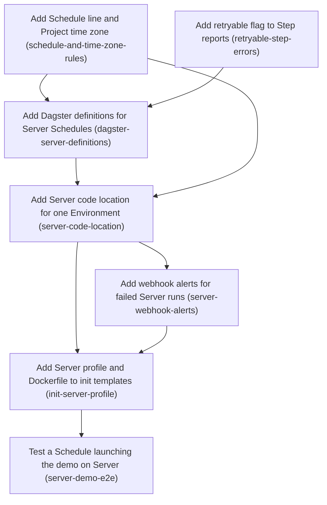

# Horizon 7 — Scheduling: the Server runs Schedules

## 🎯 What are we trying to achieve?

Let a Project's Pipelines run by themselves on a stage or prod **Server** (an always-on machine running Dagster's scheduler and web page). A Pipeline file gets an optional `schedule:` line (plain words like `daily at 02:00`, or cron) read in the Project's time zone; the Server, started with `docker compose --profile server up`, runs each scheduled Pipeline through the same code path as `adops run`, follows fixed run rules, and posts a sanitized alert to a webhook when a run fails. Done when the demo end-to-end test sees a Schedule-launched run succeed on the Server for both Postgres and DuckDB Warehouses, inside the 20-minute CI job.

## 🧠 Why does this change need to happen?

Today Pipelines only run when someone types `adops run`; Dagster is used only inside that one command. ADR-0014 decided that stage and prod get an always-on Server instead of a GitHub Actions cron (a hosted runner can't reach a localhost Warehouse, and secrets would live in GitHub). This horizon builds that Server; pulling new Project versions from Git and accepting Breaking Changes through Git (ADR-0015) follow in horizon 8.

## At a glance

- **Phases:** 7 (at the 7-phase ceiling, by user choice)
- **Complexity:** High — new Dagster daemon/webserver runtime, container image, and a Docker E2E
- **Main risk:** Dagster's daemon runs Pipelines in a separate worker process, so the in-process orchestrator and its secret-by-closure trick can't be reused as-is; secrets must be read inside the worker, never via run config
- **Target:** E2E inside the 20-minute CI job; 100% line+branch coverage held
- **Testing focus:** value-free error messages, exact retry set (only Source/Warehouse unreachable), skip-while-running, no secret in Dagster storage or alerts, compose profile isolation

## Order of work
```
Phase 1 — Add Schedule line and Project time zone
        ↓  (needs nothing)
Phase 2 — Add retryable flag to Step reports
        ↓  (needs Add Schedule line and Project time zone, Add retryable flag to Step reports)
Phase 3 — Add Dagster definitions for Server Schedules
        ↓  (needs Add Dagster definitions for Server Schedules, Add Schedule line and Project time zone)
Phase 4 — Add Server code location for one Environment
        ↓  (needs Add Server code location for one Environment)
Phase 5 — Add webhook alerts for failed Server runs
        ↓  (needs Add Server code location for one Environment, Add webhook alerts for failed Server runs)
Phase 6 — Add Server profile and Dockerfile to init templates
        ↓  (needs Add Server profile and Dockerfile to init templates)
Phase 7 — Test a Schedule launching the demo on Server
```



### Phase 1 — Add Schedule line and Project time zone

Technical ID: `schedule-and-time-zone-rules` · Scheduling · cross-cutting · medium blast radius

**Goal** — A Pipeline file accepts an optional `schedule:` line (plain words or a 5-field cron), `adops.yaml` accepts an optional top-level `timezone:` (default UTC), the domain knows that only the Environments named exactly `stage` or `prod` may run on a Schedule, and `adops validate` rejects a bad Schedule or time zone with a clear message that points at the field and lists each Pipeline's Schedule.

**Why** — Everything the Server does later starts from a valid Schedule read in the Project's time zone, so the rules must exist first, written as pure domain code with no Dagster import. This is one small slice across layers: the domain rules plus the few lines in `adops validate` that show them. It is planned as one phase because the validate listing is too small to be a phase of its own. Layer is cross-cutting because the phase touches both domain and interface code.

**Changes**
- Create src/adops/domain/schedule.py with a frozen `Schedule` value that keeps the user's original text and the 5-field cron it compiles to. Plain words follow a small fixed grammar: `hourly` -> `0 * * * *`, `daily at HH:MM` -> `M H * * *`, `weekly on <monday..sunday> at HH:MM` -> `M H * * <0-6>`. Any other text must be a valid 5-field cron: exactly 5 fields; each field is `*`, a number, a range `a-b`, a list `a,b` or a step `*/n` / `a-b/n`; values must be in range (minute 0-59, hour 0-23, day-of-month 1-31, month 1-12, weekday 0-6). Also reject day-of-month 30 or 31 combined with month 2 only, which matches what Dagster's cron check rejects.
- Write all parse errors in plain words and never echo the bad value, for example `schedule: not a known schedule; use hourly, daily at HH:MM, weekly on <day> at HH:MM or a 5-field cron`.
- In schedule.py add `SCHEDULED_ENVIRONMENTS = frozenset({"stage", "prod"})` and `runs_on_schedule(environment_name: str) -> bool`, which is True only for exactly `stage` or `prod`. The Server will use this rule later to refuse to start for any other Environment. It is deliberately separate from reverse_sync_diff.WRITING_ENVIRONMENTS (a different rule that happens to name the same Environments); a one-line comment says so.
- In src/adops/domain/pipeline.py add `schedule: Schedule | None = None` to the frozen `Pipeline` model, which uses extra="forbid" so unknown keys are errors. Parse it with a field validator that raises the existing `RuleViolation((("schedule",), message))`. The loader already turns this into a value-free `schedule: <problem>` line.
- In src/adops/domain/environment.py add `timezone: str = "UTC"` to `ProjectSettings`. Check it with `zoneinfo.ZoneInfo`, catching ZoneInfoNotFoundError and ValueError, and turn failures into a RuleViolation at path `timezone` whose message does not echo the value.
- In src/adops/interface/validate_command.py add a `schedules` list to `Report` and fill it per Pipeline file. Print one stdout line per Pipeline, e.g. `shop_sync: daily at 02:00 (cron 0 2 * * *, Europe/Berlin)` or `shop_sync: no schedule`. A time zone error is printed with the existing `adops.yaml:` file prefix.
- Add unit tests for every grammar form, the cron edge cases (out-of-range values, wrong field count, Feb 30/31), time zone default/valid/invalid, `runs_on_schedule` for stage, prod, dev, `Stage` and a Branch name, and the validate output. Cover every branch.

**Files / areas**
- `src/adops/domain/schedule.py`
- `src/adops/domain/pipeline.py`
- `src/adops/domain/environment.py`
- `src/adops/interface/validate_command.py`
- `tests/unit/domain/test_schedule.py`
- `tests/unit/domain/test_pipeline.py`
- `tests/unit/domain/test_environment.py`
- `tests/unit/interface/test_validate_command.py`

**How to verify**
- **Plain-words Schedules compile to the right cron** — Run `uv run python -c "from adops.domain.schedule import Schedule; print(Schedule.parse('weekly on sunday at 06:30').cron, Schedule.parse('weekly on monday at 06:30').cron)"` (or the module's actual constructor). It prints `30 6 * * 0` and `30 6 * * 1`, which is cron weekday numbering with Sunday as 0.
- **5-field cron validation matches its stated bounds** — Tests reject `* * * *` (4 fields), `* * * * * *` (6 fields), `60 * * * *`, `* 24 * * *`, `* * 0 * *`, `* * * 13 *`, `* * * * 7`, `0 0 30 2 *` and `0 0 31 2 *`.
- **Errors name the field and never echo the bad value** — Put `schedule: "SENTINEL_9f3 daily"` in a Pipeline file of a temp Project and run `adops validate`. The exit code is 1, stdout/stderr contain the Pipeline file name and `schedule:`, and `grep SENTINEL_9f3` on the output finds nothing.
- **Only stage and prod may run on a Schedule** — Tests assert True for `stage` and `prod`.
- **adops validate lists every Pipeline's Schedule** — Run `adops validate` in a temp Project with one Pipeline using `schedule: daily at 02:00`, another with no schedule, and `timezone: Europe/Berlin`. The output contains `<name>: daily at 02:00 (cron 0 2 * * *, Europe/Berlin)` and `<other>: no schedule`, and the exit code is 0.
- **Rules in domain, presentation in interface** — `grep -n 'print\|cron ' src/adops/domain/schedule.py` shows no output formatting such as `(cron ...` strings or print calls.

**Done when** — `adops validate` on a Project whose Pipeline has `schedule: daily at 02:00` and whose adops.yaml has `timezone: Europe/Berlin` prints that Pipeline's Schedule, and it exits 1 with a field-pointed, value-free message for a bad Schedule or time zone. This is proven by passing unit tests. Every check under *How to verify* passes its bar.

**Depends on** — nothing — can start immediately

**Guards**
- g5: schedule.py imports only stdlib (re, zoneinfo, dataclasses) and pydantic. It does not use dagster, croniter or dateutil, and it never reads the clock (no now/utcnow/today).
- g2: every grammar form, cron branch and time zone path has a unit test, so coverage stays at 100% line+branch.
- g7: no `# pragma: no cover` is added.
- g1: the code passes ruff with line length 100.

<details><summary>Reference — full rubric</summary>

| Dimension | Rule | Pass criteria | Failure examples | minScore |
|---|---|---|---|---|
| plain-words-compile-exactly | Each of the three plain-words forms (hourly, daily at HH:MM, weekly on <day> at HH:MM) compiles to exactly one correct 5-field cron and keeps the user's original text. Text outside that grammar is either a valid cron or an error. Scale: 10 means no reviewer could ask for more, 8 is a competent, complete implementation, and minScore is the acceptable bar. | Run `uv run python -c "from adops.domain.schedule import Schedule; print(Schedule.parse('weekly on sunday at 06:30').cron, Schedule.parse('weekly on monday at 06:30').cron)"` (or the module's actual constructor). It prints `30 6 * * 0` and `30 6 * * 1`, which is cron weekday numbering with Sunday as 0.<br>`hourly` gives `0 * * * *` and `daily at 02:00` gives `0 2 * * *`. Each of these is asserted in tests/unit/domain/test_schedule.py.<br>`daily at 24:00`, `daily at 2:60`, `daily at 2`, `weekly on funday at 06:00` and `every day` are all rejected. The tests name each one.<br>The Schedule value is frozen and exposes both the original text and the cron, so a test that assigns to either attribute gets an error. | Plausible implementation: days are mapped by list index with monday=0, so `weekly on monday` compiles to `* * * * 0` and runs on Sundays.<br>Plausible implementation: `daily at 2:5` is accepted and becomes `5 2 * * *` even though the grammar requires HH:MM.<br>Capitalised `Daily at 02:00` silently falls through to the cron parser and produces a confusing cron error rather than a defined outcome. | 8 |
| cron-field-validation | Cron text is accepted only when it has exactly 5 fields made of *, a number, a range, a list or a step, with every value in range, and the Feb 30/31 combination is rejected. Scale: 10 means no reviewer could ask for more, 8 is a competent, complete implementation, and minScore is the acceptable bar. | Tests reject `* * * *` (4 fields), `* * * * * *` (6 fields), `60 * * * *`, `* 24 * * *`, `* * 0 * *`, `* * * 13 *`, `* * * * 7`, `0 0 30 2 *` and `0 0 31 2 *`.<br>Tests reject the degenerate steps and ranges `*/0` and `5-1`, as well as empty list items such as `1,,2`.<br>Tests accept `*/15 * * * *`, `0 9-17 * * 1-5`, `0 0 1,15 * *` and `0-30/10 * * * *`.<br>`0 0 30 1,3 *` is accepted, which shows that the Feb rule fires only when the month field is 2. | Plausible implementation: a regex checks only the field shapes, so `*/0` or `99 * * * *` passes and Dagster rejects it later when the code location loads.<br>Plausible implementation: the Feb rule also rejects `0 0 30 * *`, which is a valid every-month cron.<br>The 6-field Quartz form with seconds is accepted. | 8 |
| value-free-field-pointed-errors | A bad Schedule or time zone makes `adops validate` exit 1 with a message prefixed by its file and field (`schedule:` or `adops.yaml: timezone:`) that never contains the rejected text. Scale: 10 means no reviewer could ask for more, 8 is a competent, complete implementation, and minScore is the acceptable bar. | Put `schedule: "SENTINEL_9f3 daily"` in a Pipeline file of a temp Project and run `adops validate`. The exit code is 1, stdout/stderr contain the Pipeline file name and `schedule:`, and `grep SENTINEL_9f3` on the output finds nothing.<br>Set `timezone: Mars/SENTINEL_tz` in adops.yaml. The output contains `adops.yaml:` and `timezone` but not `SENTINEL_tz`.<br>The bad-Schedule message lists the allowed forms (hourly, daily at HH:MM, weekly on <day> at HH:MM, 5-field cron).<br>A unit test asserts that the rejected value is absent from the message, not merely that an error was raised. | Plausible implementation: a pydantic ValueError is raised and the loader shows the default `Input should be ... [input_value='SENTINEL_9f3 daily']` text.<br>Plausible implementation: an unknown time zone reports `No time zone found with key Mars/SENTINEL_tz`, because ZoneInfoNotFoundError's text is passed through.<br>The error says `invalid value` without naming the `schedule` field or the file. | 8 |
| scheduled-environment-rule | `runs_on_schedule` is True only for the exact strings `stage` and `prod`, and the domain holds this rule in one place. Scale: 10 means no reviewer could ask for more, 8 is a competent, complete implementation, and minScore is the acceptable bar. | Tests assert True for `stage` and `prod`.<br>Tests assert False for `dev`, `Stage`, `PROD`, ` stage`, `production`, `staging` and a Branch-style name such as `feature-x`.<br>`grep -rn SCHEDULED_ENVIRONMENTS src/adops` shows the set defined once, in src/adops/domain/schedule.py, and no other module re-declares a stage/prod-only-on-Schedule set. | Plausible implementation: the name is lower-cased or stripped first, so `Stage` or ` prod` is accepted.<br>The rule is written as `name != 'dev'`, so Branch Environments pass. | 8 |
| validate-schedule-listing | A successful `adops validate` prints exactly one line per Pipeline file showing its original Schedule text, its cron and the Project time zone, or `no schedule`. Scale: 10 means no reviewer could ask for more, 8 is a competent, complete implementation, and minScore is the acceptable bar. | Run `adops validate` in a temp Project with one Pipeline using `schedule: daily at 02:00`, another with no schedule, and `timezone: Europe/Berlin`. The output contains `<name>: daily at 02:00 (cron 0 2 * * *, Europe/Berlin)` and `<other>: no schedule`, and the exit code is 0.<br>With no `timezone:` key the line shows `UTC`.<br>The number of Schedule lines equals the number of pipelines/*.yaml files, and their order is stable and asserted in tests/unit/interface/test_validate_command.py. | Plausible implementation: only Pipelines that have a Schedule are listed, so the user cannot tell that `no schedule` was intended.<br>The listing prints the cron but drops the time zone, so `0 2 * * *` is ambiguous.<br>The listing is printed even when validation fails, mixed in with the error lines. | 7 |
| domain-vs-interface-placement | Parsing, cron checks, time-zone checks and the stage/prod rule live in domain files, and the formatting of the validate listing lives only in validate_command.py. Scale: 10 means no reviewer could ask for more, 8 is a competent, complete implementation, and minScore is the acceptable bar. | `grep -n 'print\\|cron ' src/adops/domain/schedule.py` shows no output formatting such as `(cron ...` strings or print calls.<br>`grep -n 'ZoneInfo\\|re.compile' src/adops/interface/validate_command.py` returns nothing, so validation is not re-implemented in interface.<br>src/adops/domain/schedule.py imports nothing from adops.interface, adops.infrastructure or adops.application. | Plausible implementation: `Schedule.__str__` builds the whole `name: text (cron ..., tz)` line, so presentation leaks into the domain.<br>validate_command.py re-checks the time zone with ZoneInfo instead of relying on ProjectSettings. | 7 |

Healer hint: The most likely miss is a pydantic or ZoneInfo error message that echoes the rejected value (or an off-by-one weekday mapping), so raise RuleViolation with a fixed plain-words message and map monday..sunday to 1..6,0.

</details>

### Phase 2 — Add retryable flag to Step reports

Technical ID: `retryable-step-errors` · Pipeline Runs · application · small blast radius

**Goal** — Each Step report says whether its failure may be retried. Only the errors 'Source unreachable' and 'Warehouse unreachable' are retryable, so the Server can retry those and nothing else.

**Why** — Today run_step turns every Step error into a plain FAILED report with only a message, so the error's type is lost. The Server's retry rule needs to tell an unreachable Source or Warehouse apart from failed Checks, Breaking Changes and Transform or Reverse Sync failures, which must never be retried.

**Changes**
- In src/adops/application/ports.py add `retryable: bool = False` to the frozen `StepReport` dataclass. Add a `RunResult.retryable` property that is True only when the first Step that did not pass failed with `retryable=True`.
- In src/adops/application/run_pipeline.py change `run_step` so that a caught `SourceUnreachableError` or `WarehouseUnreachableError` returns `StepReport(..., status=FAILED, error=str(error), retryable=True)`. Every other StepError, including `ReverseSyncTargetUnreachableError`, plus CheckFailedError and Breaking Change halts, stays `retryable=False`.
- Add a short comment that the retryable set matches the documented rule ('retry only Source/Warehouse unreachable'). Reverse Sync Target unreachable is deliberately not retried, as the user confirmed.
- Add unit tests: one per retryable error, one each for Reverse Sync Target unreachable, a failed Check, a Breaking Change and a Transform failure (all not retryable), and the `RunResult.retryable` property for passed, retryable-failed and non-retryable-failed runs.

**Files / areas**
- `src/adops/application/ports.py`
- `src/adops/application/run_pipeline.py`
- `tests/unit/application/test_run_pipeline.py`

**How to verify**
- **Exactly two error types are retryable** — A test walks every StepError subclass in run_pipeline/ports (recursively via __subclasses__), raises each from a fake Step and asserts that `retryable` is True only for the two named classes. A new error subclass would then default to non-retryable and still be checked.
- **RunResult.retryable follows the first failing Step** — Tests cover a passed run (False), a run whose first failure is a retryable Source unreachable error (True), and a run whose first failure is a failed Check followed by later Steps reported as skipped/halted (False).
- **Adding the flag changes no current output** — `git diff --stat tests/unit` shows existing test files only gaining lines, with no edited assertions on run output.
- **Retry classification stays in the application layer** — `grep -rn retryable src/adops/infrastructure src/adops/domain` returns nothing.

**Done when** — `run_step` returns a StepReport with `retryable=True` only for Source or Warehouse unreachable errors. This is proven by passing unit tests in tests/unit/application/test_run_pipeline.py. Every check under *How to verify* passes its bar.

**Depends on** — nothing — can start immediately

**Guards**
- g6: only stdlib dataclasses and the existing application/domain modules are touched, with no framework import.
- g2: each new branch in run_step and RunResult.retryable has a test, so coverage stays at 100%.
- g7: no pragma is added.

<details><summary>Reference — full rubric</summary>

| Dimension | Rule | Pass criteria | Failure examples | minScore |
|---|---|---|---|---|
| retryable-set-is-exact | A Step report is retryable only when its Step failed with SourceUnreachableError or WarehouseUnreachableError. Every other StepError subclass, CheckFailedError and Breaking Change halt is not retryable. Scale: 10 means no reviewer could ask for more, 8 is a competent, complete implementation, and minScore is the acceptable bar. | A test walks every StepError subclass in run_pipeline/ports (recursively via __subclasses__), raises each from a fake Step and asserts that `retryable` is True only for the two named classes. A new error subclass would then default to non-retryable and still be checked.<br>There is an explicit test that ReverseSyncTargetUnreachableError gives `retryable=False`.<br>Tests show that a failed Check, a Breaking Change halt and a Transform failure each give `retryable=False`.<br>`run_step` matches with `isinstance(error, (SourceUnreachableError, WarehouseUnreachableError))` or an equivalent closed tuple, not a shared base class or a name match. | Plausible implementation: retryable is decided with `isinstance(error, UnreachableError)`, a shared base that ReverseSyncTargetUnreachableError also inherits, so Reverse Sync Target outages are retried against the user's decision.<br>Plausible implementation: retryable is decided by `'Unreachable' in type(error).__name__`.<br>A subclass of SourceUnreachableError introduced later inherits retryability without any test noticing. | 8 |
| run-result-first-failure | `RunResult.retryable` is True only when the first Step that did not pass failed with retryable=True. A passed run, or a run whose first failure is not retryable, is never retryable. Scale: 10 means no reviewer could ask for more, 8 is a competent, complete implementation, and minScore is the acceptable bar. | Tests cover a passed run (False), a run whose first failure is a retryable Source unreachable error (True), and a run whose first failure is a failed Check followed by later Steps reported as skipped/halted (False).<br>A test builds a RunResult where a non-retryable failure comes before a retryable StepReport and asserts False.<br>The property reads only the StepReports, so it has no side effects and no I/O. | Plausible implementation: `any(r.retryable for r in reports)` returns True when an earlier failed Check is followed by a later retryable report.<br>A passed run with a stray `retryable=True` report returns True. | 8 |
| existing-behaviour-unchanged | `retryable` defaults to False, existing StepReport construction still works, and `adops run` output and exit codes are byte-for-byte unchanged. Scale: 10 means no reviewer could ask for more, 8 is a competent, complete implementation, and minScore is the acceptable bar. | `git diff --stat tests/unit` shows existing test files only gaining lines, with no edited assertions on run output.<br>`grep -rn retryable src/adops/interface` returns nothing, so the CLI prints no new field.<br>StepReport stays a frozen dataclass, and its existing positional and keyword constructions in tests still pass. | Plausible implementation: `retryable` is added as a required field before `error`, which breaks every existing StepReport(...) call.<br>The CLI summary starts printing `(retryable)` next to failed Steps. | 7 |
| classification-lives-in-application | Only application/run_pipeline.py decides retryability. Adapters do not set the flag, and no framework concept appears in it. Scale: 10 means no reviewer could ask for more, 8 is a competent, complete implementation, and minScore is the acceptable bar. | `grep -rn retryable src/adops/infrastructure src/adops/domain` returns nothing.<br>The changes in ports.py and run_pipeline.py import nothing beyond stdlib and adops.domain/adops.application.<br>A comment beside the retryable tuple names the rule (retry only Source/Warehouse unreachable) and says Reverse Sync Target is deliberately excluded. | Plausible implementation: each infrastructure adapter raises its error with a `retryable=True` attribute, scattering the policy across adapters.<br>The flag is named after Dagster (`dagster_retry`) or imports RetryRequested. | 7 |

Healer hint: The likely failure is matching on a shared unreachable base class that also catches ReverseSyncTargetUnreachableError, so switch to an explicit two-class tuple and add the subclass-walk test.

</details>

### Phase 3 — Add Dagster definitions for Server Schedules

Technical ID: `dagster-server-definitions` · Server · infrastructure · medium blast radius

**Goal** — A function in infrastructure turns the Project's Pipelines into Dagster Definitions (Dagster's container for jobs and schedules). It makes one job per Pipeline and one Dagster schedule per Schedule, and enforces the run rules 'skip if still running', 'catch up once' and 'retry only unreachable errors 3 times, 5 minutes apart'.

**Why** — The Server must start each scheduled Pipeline through the same run use case `adops run` uses. Dagster's schedule and retry machinery is the carrier, so it lives in infrastructure, apart from the entry point that wires the Project in. Today's in-process orchestrator cannot be reused as is: it runs a nested `execute_in_process` and collects results in a shared dict, which does not work in a separate Dagster run-worker process.

**Changes**
- Create src/adops/infrastructure/dagster_server.py with `build_server_definitions(pipelines: Sequence[tuple[str, Schedule | None]], time_zone: str, run: Callable[[str], RunResult], on_failure: Callable[[RunResult], None], retry_delay_seconds: int = 300) -> Definitions`.
- For each Pipeline build a job named after the Pipeline. It has one op and uses `in_process_executor`, so the op runs inside the Dagster run worker. The op calls `run(pipeline_name)`, which runs the whole Pipeline, and attaches each Step's status as op metadata.
- In the op, if the RunResult failed with `retryable` True and `context.retry_number < 3`, raise `RetryRequested(max_retries=3, seconds_to_wait=retry_delay_seconds)`. Otherwise, on failure, call `on_failure(result)` exactly once and raise `Failure(description=<first failing Step's sanitized error>, allow_retries=False)`. Never use Dagster run-level retries (`dagster/max_retries`), which would retry everything.
- For each Pipeline with a Schedule add a `ScheduleDefinition` with `cron_schedule=schedule.cron`, `execution_timezone=time_zone`, `default_status=DefaultScheduleStatus.RUNNING` and no partitions, so Dagster launches at most one catch-up run after downtime. Its evaluation function calls `context.instance.get_runs` filtered by the job name and the in-progress statuses (QUEUED, NOT_STARTED, STARTING, STARTED). If a run is in progress it returns `SkipReason("Pipeline <name> is still running")`; otherwise it returns a `RunRequest` with no run_config and no custom tags. A Pipeline with no Schedule gets only its job.
- Pass secrets only by closure: the `run` callable reads them inside the run worker. Nothing in this module puts a secret, DSN or row value into run config, tags or metadata.
- Add unit tests using Dagster's test helpers (`build_schedule_context` with an ephemeral DagsterInstance, and `execute_in_process` on a job with `retry_delay_seconds=0`). The tests cover: skip with the reason when a run is in progress, a RunRequest otherwise, the time zone and cron on the schedule, a job without a schedule for an unscheduled Pipeline, no `partitions_def` on any schedule, and retries for a retryable failure that stop after 3 attempts and then call `on_failure` once. A non-retryable failure (failed Check, Breaking Change) is not retried and calls `on_failure` once. A passing run never calls `on_failure`.
- Add a parity test that runs Dagster's `dagster._utils.schedules.is_valid_cron_string` on every cron the domain's plain words produce, and on a list of crons the domain accepts, and asserts Dagster accepts every one (one-way: the domain may be stricter); it also asserts both reject `*/0`, `1,,2` and Feb 30/31.
- Reuse the sentinel scan from test_dagster_orchestrator.py: run a job whose `run` callable reads a sentinel secret, then assert that no file under DAGSTER_HOME contains it.
- Document in the module docstring the accepted trade-off: a retry re-runs the whole Pipeline (Steps are safe to re-run) and holds the Server's single run slot while it waits, so other Pipelines queue.

**Files / areas**
- `src/adops/infrastructure/dagster_server.py`
- `tests/unit/infrastructure/test_dagster_server.py`

**How to verify**
- **Jobs and schedules match the Pipelines** — A test that passes two Pipelines (one with `daily at 02:00`, one without) and `Europe/Berlin` gets back two jobs named after the Pipelines and exactly one schedule.
- **A due run is skipped while the same Pipeline is in progress** — Tests use `build_schedule_context` on an ephemeral DagsterInstance holding a QUEUED run of the job and a STARTED run of the job. Both cases give a SkipReason whose text contains `<pipeline> is still running`.
- **Only unreachable failures retry, 3 times, then alert once** — A test runs `execute_in_process` with `retry_delay_seconds=0` and a `run` that always returns a retryable failure. It asserts `run` was called 4 times (1 attempt + 3 retries), `on_failure` was called once, and the job failed.
- **No secret reaches Dagster storage or the failure text** — A test runs a job whose `run` callable reads a sentinel secret, including when the result fails, then walks every file under the test's DAGSTER_HOME and asserts that the sentinel is absent.
- **Domain cron rules agree with Dagster's** — A parity test runs `is_valid_cron_string` on every plain-words output plus an explicit list of at least 10 domain-accepted crons covering ranges, lists and steps, and asserts Dagster accepts each.
- **Definitions builder knows no Project files or environment** — `grep -nE 'adops\.interface|os\.environ|open\(|Path\(' src/adops/infrastructure/dagster_server.py` returns nothing.

**Done when** — `build_server_definitions` returns Dagster Definitions whose schedules skip while a run is in progress, keep the Project time zone, have no partitions, and whose ops retry only unreachable errors (3 times) and then report the final failure. This is proven by passing tests in tests/unit/infrastructure/test_dagster_server.py. Every check under *How to verify* passes its bar.

**Depends on** — Add Schedule line and Project time zone, Add retryable flag to Step reports

**Guards**
- g7: RunRequests carry no run_config or custom tags, and secrets are read only inside the `run` callable. The DAGSTER_HOME sentinel scan test proves no secret reaches Dagster storage. No pragma is added.
- g2: every op and schedule branch (skip, request, retry, give up, pass) is tested, so coverage stays at 100%.
- g1: the code passes ruff.

<details><summary>Reference — full rubric</summary>

| Dimension | Rule | Pass criteria | Failure examples | minScore |
|---|---|---|---|---|
| definitions-shape | `build_server_definitions` returns one job per Pipeline and one schedule per scheduled Pipeline. Each schedule uses the Schedule's cron, the Project time zone, default RUNNING status and no partitions. Scale: 10 means no reviewer could ask for more, 8 is a competent, complete implementation, and minScore is the acceptable bar. | A test that passes two Pipelines (one with `daily at 02:00`, one without) and `Europe/Berlin` gets back two jobs named after the Pipelines and exactly one schedule.<br>For that schedule, `cron_schedule == '0 2 * * *'`, `execution_timezone == 'Europe/Berlin'` and `default_status == DefaultScheduleStatus.RUNNING`.<br>Every job and schedule has `partitions_def is None`.<br>Each job uses the in_process_executor and has a single op. | Plausible implementation: execution_timezone is left unset, so schedules fire in UTC while the validate listing claims Europe/Berlin.<br>Plausible implementation: default_status is left at STOPPED, so the Server starts but nothing ever runs until someone clicks in the UI.<br>The unscheduled Pipeline gets no job, so 'Run now' is impossible for it. | 8 |
| overlap-skip | The schedule evaluation returns a SkipReason naming the Pipeline whenever a run of that same job is QUEUED, NOT_STARTED, STARTING or STARTED, and returns a RunRequest with no run_config and no custom tags otherwise. Scale: 10 means no reviewer could ask for more, 8 is a competent, complete implementation, and minScore is the acceptable bar. | Tests use `build_schedule_context` on an ephemeral DagsterInstance holding a QUEUED run of the job and a STARTED run of the job. Both cases give a SkipReason whose text contains `<pipeline> is still running`.<br>Tests show that a SUCCESS or FAILURE run of the job gives a RunRequest.<br>A test shows that an in-progress run of a different Pipeline's job still gives a RunRequest for this one, because the filter is per job.<br>The RunRequest asserted in tests has empty `run_config` and no tags beyond Dagster's own. | Plausible implementation: the filter checks only STARTED, so with max_concurrent_runs=1 a QUEUED run is not seen and a second run is queued behind it.<br>Plausible implementation: get_runs is not filtered by job name, so any running Pipeline blocks every Schedule.<br>A SkipReason with no message, so the UI shows no visible reason. | 8 |
| retry-policy | For a retryable RunResult the op requests up to 3 retries spaced `retry_delay_seconds` apart, then gives up. A non-retryable failure is never retried. In both cases `on_failure` is called exactly once, on the final failure only, and a passing run never calls it. Scale: 10 means no reviewer could ask for more, 8 is a competent, complete implementation, and minScore is the acceptable bar. | A test runs `execute_in_process` with `retry_delay_seconds=0` and a `run` that always returns a retryable failure. It asserts `run` was called 4 times (1 attempt + 3 retries), `on_failure` was called once, and the job failed.<br>A test with a `run` that fails with a retryable error once and then passes asserts that `on_failure` is never called.<br>A non-retryable failure (failed Check) gives exactly 1 call to `run` and 1 call to `on_failure`.<br>`grep -n max_retries src/adops/infrastructure/dagster_server.py` shows only the op-level RetryRequested and no `dagster/max_retries` tag.<br>The default `retry_delay_seconds` is 300. | Plausible implementation: `on_failure` is called before raising RetryRequested, so a webhook fires on every attempt (4 alerts).<br>Plausible implementation: an off-by-one in `retry_number < 3` gives only 3 attempts in total.<br>A run-level retry policy is applied, so failed Checks are also retried. | 8 |
| no-secret-in-dagster-storage | Secrets reach the op only by closure. The sentinel scan finds no secret under DAGSTER_HOME, and the Failure description is the first failing Step's sanitized error. Scale: 10 means no reviewer could ask for more, 8 is a competent, complete implementation, and minScore is the acceptable bar. | A test runs a job whose `run` callable reads a sentinel secret, including when the result fails, then walks every file under the test's DAGSTER_HOME and asserts that the sentinel is absent.<br>The Failure description equals the StepReport `error` string and is not `repr(result)` or the full RunResult.<br>Op metadata holds only Step names and statuses, and a test asserts the metadata keys and values. | Plausible implementation: op metadata is written as `{step.name: step.error}` for every Step, and an error from a driver includes a DSN fragment, which lands in event-log storage.<br>Plausible implementation: the description is `str(result)`, which dumps the dataclass with all fields. | 8 |
| cron-parity-with-dagster | Every cron the domain accepts (and every plain-words output) is one Dagster's is_valid_cron_string accepts, so a validated Project cannot fail to load on the Server because of its Schedule. The domain may be stricter than Dagster (e.g. it rejects weekday 7 and reversed ranges); only the crons both reject (`*/0`, `1,,2`, Feb 30/31) are asserted as shared rejections. Scale: 10 means no reviewer could ask for more, 8 is a competent, complete implementation, and minScore is the acceptable bar. | A parity test runs `is_valid_cron_string` on every plain-words output plus an explicit list of at least 10 domain-accepted crons covering ranges, lists and steps, and asserts Dagster accepts each.<br>The same test asserts both the domain and Dagster reject `*/0 * * * *`, `1,,2 * * * *`, `0 0 30 2 *` and `0 0 31 2 *`.<br>The test does not assert that Dagster rejects crons only the domain rejects (e.g. `* * * * 7`, `5-1 * * * *`). | Plausible implementation: the parity test checks only the three plain-words outputs, so a cron the domain accepts but Dagster rejects (e.g. `0 0 31 2 *`) goes unnoticed. | 7 |
| infrastructure-isolation | dagster_server.py depends only on its callable inputs, the domain Schedule and the application RunResult. It never reads os.environ, Project files or adops.interface. Scale: 10 means no reviewer could ask for more, 8 is a competent, complete implementation, and minScore is the acceptable bar. | `grep -nE 'adops\.interface\|os\.environ\|open\(\|Path\(' src/adops/infrastructure/dagster_server.py` returns nothing.<br>No module in src/adops/domain or src/adops/application imports dagster_server.<br>The module docstring states the accepted trade-off: a retry re-runs the whole Pipeline and holds the single run slot. | Plausible implementation: the builder reads ADOPS_ENVIRONMENT or loads adops.yaml itself, which couples infrastructure to the entry point. | 7 |

Healer hint: The likely failure is `on_failure` firing on each retry attempt or the overlap check missing QUEUED runs, so call `on_failure` only in the give-up branch and filter get_runs by job name with all four in-progress statuses.

</details>

### Phase 4 — Add Server code location for one Environment

Technical ID: `server-code-location` · Server · interface · medium blast radius

**Goal** — A module inside the adops package, `adops.interface.server`, is the Dagster code location (the Python module Dagster's daemon and webserver load). It reads the Project folder it sits in, serves exactly the one Environment named in `ADOPS_ENVIRONMENT`, refuses anything but `stage` or `prod`, and runs each Pipeline through the same run path as `adops run`.

**Why** — The Dagster daemon and webserver need a loadable module. It must live in the adops package because a generated Project may contain no tool code. It must call the same run use case as `adops run`, so run_command.py gets a public run entry that takes an orchestrator. The Server passes the plain in-order orchestrator, so no Dagster job runs nested inside a Dagster op. This phase also records two limits in the docs: this horizon reads the bind-mounted Project folder (pulling from Git comes in horizon 8), and Dagster's open-source page cannot be limited to 'Run now' and 'Pause'.

**Changes**
- In src/adops/interface/run_command.py extract a public `run_in_environment(project: Path, pipeline: str, environment: str, orchestrator: Orchestrator) -> RunResult` from `_run_environment`. It reads the Project files and `.env` merged under os.environ at call time, builds every adapter and calls `run_pipeline`. Make `run_project` (used by `adops run`) call it with `build_orchestrator()`, so `adops run` behaves exactly as before.
- Create src/adops/interface/server.py with `load_definitions(environ: Mapping[str, str]) -> Definitions`. It (1) takes the Project folder from `ADOPS_PROJECT`, defaulting to the working directory; (2) requires `ADOPS_ENVIRONMENT` and raises a clear `ServerConfigError` such as `ADOPS_ENVIRONMENT must be stage or prod; got an Environment that cannot run on a Schedule` unless `runs_on_schedule` is True, and also when that Environment is not in adops.yaml; (3) validates adops.yaml and every pipelines/*.yaml with the existing loaders, failing code-location load with only the sanitized `<file>: <problem>` lines; (4) calls `build_server_definitions` with each Pipeline's Schedule, the Project time zone, a `run` callable `lambda name: run_in_environment(project, name, environment, InOrderOrchestrator())`, and an `on_failure` that prints a sanitized one-line summary.
- Expose `defs` for Dagster's workspace loader without building at import time, for example a module-level `__getattr__("defs")` that calls `load_definitions(os.environ)`. Unit tests can then import the module and call `load_definitions` with a fake environ.
- Catch adops' own errors raised before any Step runs (for example a missing Secret) inside the `run` callable path, and turn them into a RunResult holding a single FAILED StepReport for the Pipeline's first Step whose error is the same sanitized message `adops run` prints, with retryable=False, so `succeeded` is False and failure_alert can build an alert from it. For an unexpected exception keep only its type name.
- Add tests: refusal for dev, a Branch name and a missing variable; load failure that lists only sanitized problems; job and schedule names produced for the demo-shaped Project; `run_in_environment` called with the in-order orchestrator; `adops run` still using the Dagster orchestrator.
- Add a dated 'Clarification' section to docs/adr/0014-schedules-run-on-a-pull-based-server.md, and a matching note under 'Server' in GLOSSARY.md. They say: until horizon 8 the Server runs the Project version in its bind-mounted folder rather than pulling from Git; Dagster's open-source webserver has no per-action permissions, so the page is bound to 127.0.0.1 instead of being limited to 'Run now' and 'Pause'.

**Files / areas**
- `src/adops/interface/run_command.py`
- `src/adops/interface/server.py`
- `tests/unit/interface/test_run_command.py`
- `tests/unit/interface/test_server.py`
- `docs/adr/0014-schedules-run-on-a-pull-based-server.md`
- `GLOSSARY.md`

**How to verify**
- **The Server refuses any Environment but stage or prod** — Tests call `load_definitions({'ADOPS_PROJECT': <demo project>, 'ADOPS_ENVIRONMENT': X})` for X in `dev`, `feature-x`, `Stage` and with the variable unset. Each raises ServerConfigError whose message names ADOPS_ENVIRONMENT and stage/prod and does not contain X.
- **The Server and adops run share one run entry** — `grep -n run_in_environment src/adops/interface/run_command.py src/adops/interface/server.py` shows run_project and server.py both calling it.
- **Importing is free, and load failures are sanitized** — `ADOPS_ENVIRONMENT= uv run python -c 'import adops.interface.server'` from an empty temp directory exits 0.
- **Errors before any Step become sanitized failed results** — A test with the Secret Reference variable unset asserts a failed RunResult whose error equals the `adops run` message for the same case.
- **The ADR and glossary state this horizon's limits** — `grep -n 'Clarification' docs/adr/0014-schedules-run-on-a-pull-based-server.md` finds a dated section mentioning the bind-mounted folder and 127.0.0.1.
- **server.py wires the pieces and holds no schedule logic** — `grep -nE 'ScheduleDefinition|RetryRequested|SkipReason|RunRequest' src/adops/interface/server.py` returns nothing.

**Done when** — `adops.interface.server.load_definitions` returns Server Definitions for a stage or prod Environment, runs Pipelines via the same `run_in_environment` path `adops run` now uses, and refuses any other Environment with a clear error. This is proven by passing tests in tests/unit/interface/test_server.py. Every check under *How to verify* passes its bar.

**Depends on** — Add Dagster definitions for Server Schedules, Add Schedule line and Project time zone

**Guards**
- g9: the code location lives in the adops package (adops.interface.server). No .py file is generated into a Project.
- g7: secrets are resolved inside the `run` callable in the run worker's own environment and never passed through Dagster run config. No pragma is added; the lazy `defs` path is covered by a test.
- g2: every new branch in run_command.py and server.py is tested, so coverage stays at 100%.
- g1: new Python passes ruff (line length 100).

<details><summary>Reference — full rubric</summary>

| Dimension | Rule | Pass criteria | Failure examples | minScore |
|---|---|---|---|---|
| environment-gate | `load_definitions` raises ServerConfigError with a clear, value-free message when ADOPS_ENVIRONMENT is missing, not exactly stage or prod, or not defined in adops.yaml. Scale: 10 means no reviewer could ask for more, 8 is a competent, complete implementation, and minScore is the acceptable bar. | Tests call `load_definitions({'ADOPS_PROJECT': <demo project>, 'ADOPS_ENVIRONMENT': X})` for X in `dev`, `feature-x`, `Stage` and with the variable unset. Each raises ServerConfigError whose message names ADOPS_ENVIRONMENT and stage/prod and does not contain X.<br>A Project whose adops.yaml lacks `prod` raises for `ADOPS_ENVIRONMENT=prod` with a message saying the Environment is not in adops.yaml.<br>The check uses the domain `runs_on_schedule`, and `grep -n '"stage"' src/adops/interface/server.py` returns nothing. | Plausible implementation: the gate checks `runs_on_schedule` but not adops.yaml membership, so `prod` is accepted on a Project with no prod Environment and fails at the first tick.<br>The error message echoes `got 'feature-x'`. | 8 |
| shared-run-path | Both `adops run` and the Server run Pipelines through `run_in_environment`. The Server passes the in-order orchestrator, and `adops run` still passes the Dagster orchestrator. Scale: 10 means no reviewer could ask for more, 8 is a competent, complete implementation, and minScore is the acceptable bar. | `grep -n run_in_environment src/adops/interface/run_command.py src/adops/interface/server.py` shows run_project and server.py both calling it.<br>server.py builds no adapters itself: `grep -nE 'Adapter\|Warehouse\(\|Source\(' src/adops/interface/server.py` returns nothing.<br>Tests assert that the Server's `run` callable passes an InOrderOrchestrator and that `adops run` passes the result of `build_orchestrator()`.<br>Existing tests/unit/interface/test_run_command.py assertions pass unchanged. | Plausible implementation: server.py copies the adapter wiring from `_run_environment`, so later changes to `adops run` silently diverge from the Server.<br>Plausible implementation: the Server reuses build_orchestrator(), so a Dagster job runs nested in a Dagster op and fails in the run worker. | 8 |
| lazy-load-and-sanitized-load-failure | Importing adops.interface.server touches no files or environment. Accessing `defs` builds the Definitions, and an invalid Project fails code-location load with only `<file>: <problem>` lines. Scale: 10 means no reviewer could ask for more, 8 is a competent, complete implementation, and minScore is the acceptable bar. | `ADOPS_ENVIRONMENT= uv run python -c 'import adops.interface.server'` from an empty temp directory exits 0.<br>A test accesses `adops.interface.server.defs` with a patched environ and gets Definitions.<br>A test with a broken pipelines/*.yaml containing a sentinel value asserts that the raised error lists `<file>: <problem>` lines and does not contain the sentinel. | Plausible implementation: `defs = load_definitions(os.environ)` at module top level, so importing the module in unit tests or tooling crashes without ADOPS_ENVIRONMENT.<br>The load error wraps a pydantic ValidationError whose str() includes input values. | 7 |
| pre-step-errors-become-failed-results | Inside the Server's `run` callable, adops errors raised before any Step (for example a missing Secret) become a failed RunResult carrying the same message `adops run` prints. An unexpected exception keeps only its type name. Scale: 10 means no reviewer could ask for more, 8 is a competent, complete implementation, and minScore is the acceptable bar. | A test with the Secret Reference variable unset asserts a failed RunResult whose error equals the `adops run` message for the same case.<br>A test whose fake raises `RuntimeError('postgres://u:SENTINEL@h')` gets a result error equal to `RuntimeError` with no sentinel.<br>The resulting RunResult flows into `on_failure` (asserted with a spy).<br>A test asserts that this RunResult has `succeeded == False`, `retryable == False`, and exactly one StepReport named after the Pipeline's first Step. | Plausible implementation: the generic exception is formatted with `f'{type(e).__name__}: {e}'`, leaking the DSN into the alert and the Dagster event log.<br>A missing Secret propagates as an exception, so the op crashes and `on_failure` is never called. | 8 |
| documented-server-limits | docs/adr/0014 and GLOSSARY.md say that the Server runs the bind-mounted Project version until horizon 8 and that the webserver is bound to 127.0.0.1 because Dagster OSS has no per-action permissions. Scale: 10 means no reviewer could ask for more, 8 is a competent, complete implementation, and minScore is the acceptable bar. | `grep -n 'Clarification' docs/adr/0014-schedules-run-on-a-pull-based-server.md` finds a dated section mentioning the bind-mounted folder and 127.0.0.1.<br>`grep -n -A5 'Server' GLOSSARY.md` shows a matching note.<br>The original ADR decision text is not rewritten: `git diff` on the ADR shows only additions. | Plausible implementation: the ADR's Decision section is edited in place to drop 'pulls from Git', which rewrites history rather than adding a clarification. | 7 |
| composition-root-only | The interface module only reads the environment and Project and passes callables to `build_server_definitions`. Schedule, retry and skip logic stay in infrastructure, and the module lives inside the adops package. Scale: 10 means no reviewer could ask for more, 8 is a competent, complete implementation, and minScore is the acceptable bar. | `grep -nE 'ScheduleDefinition\|RetryRequested\|SkipReason\|RunRequest' src/adops/interface/server.py` returns nothing.<br>No module in src/adops/domain, src/adops/application or src/adops/infrastructure imports adops.interface.server. | Plausible implementation: server.py adds its own `@schedule` wrapper to inject the Environment, duplicating the skip logic. | 7 |

Healer hint: The likely failure is building `defs` at import time or leaking exception text from the run callable, so expose `defs` through a module `__getattr__` and turn unexpected exceptions into their type name only.

</details>

### Phase 5 — Add webhook alerts for failed Server runs

Technical ID: `server-webhook-alerts` · Alerts · cross-cutting · medium blast radius

**Goal** — When a Server run finally fails, after any allowed retries, the Server POSTs one JSON alert to the webhook URL named by an optional Secret Reference in adops.yaml. The alert carries the Pipeline, the Environment, the failing Step and the sanitized error message, and never a secret, row value or host credential.

**Why** — Nobody watches the Server, so a failed scheduled run must reach the team on its own. This is one small slice across layers: an optional Secret Reference field, a pure alert builder and sender port, a stdlib HTTP adapter and the wiring in the Server entry point. No other phase uses its pieces, so it is one phase with layer cross-cutting. A Secret Reference is the name of an environment variable used in configuration in place of its value.

**Changes**
- In src/adops/domain/environment.py add an optional top-level `alert_webhook_env: SecretReference | None = None` to `ProjectSettings`, reusing the existing UPPER_SNAKE validation.
- Create src/adops/application/alerts.py with an `AlertSender` Protocol (`send(alert: FailureAlert) -> None`), a frozen `FailureAlert` (pipeline, environment, step, message), and `failure_alert(result: RunResult) -> FailureAlert`. The builder uses only the Pipeline, Environment and Step names and the first failing StepReport's already-sanitized `error`, never Dagster exception text or stack traces. Add `notify_failure(result, sender)`, which calls the sender and, if sending raises, returns a sanitized `alert could not be sent (<ErrorType>)` line instead of raising. A failing webhook therefore never changes the run result.
- Create src/adops/infrastructure/webhook_alerts.py with a `WebhookAlertSender(url)` that POSTs Slack-compatible JSON `{"text": "Pipeline <p> failed in Environment <e> at Step <s>: <message>", "pipeline": ..., "environment": ..., "step": ..., "message": ...}` with stdlib `urllib.request` and a short timeout. Error text it raises or logs never contains the URL.
- In src/adops/interface/server.py read the Secret Reference's value from the run worker's environment (.env merged under os.environ) at failure time. If it is unset or empty, print `alerts are off` once at load and skip sending; an empty value does not raise MissingSecretError. Otherwise pass `WebhookAlertSender` through `notify_failure` as the `on_failure` callback, and print any returned line.
- Add tests: the alert payload contains the names and sanitized message but none of a sentinel secret, row value or DSN; the webhook adapter is checked against a local `http.server` on 127.0.0.1; a failing or unreachable webhook is logged without the URL and leaves the run result unchanged; with the variable unset the Server loads and says alerts are off; an invalid `alert_webhook_env` name fails validation at path `alert_webhook_env`.

**Files / areas**
- `src/adops/domain/environment.py`
- `src/adops/application/alerts.py`
- `src/adops/infrastructure/webhook_alerts.py`
- `src/adops/interface/server.py`
- `tests/unit/domain/test_environment.py`
- `tests/unit/application/test_alerts.py`
- `tests/unit/infrastructure/test_webhook_alerts.py`
- `tests/unit/interface/test_server.py`

**How to verify**
- **The alert carries names and the sanitized message, nothing else** — tests/unit/application/test_alerts.py builds a RunResult whose StepReports carry sentinels in places a careless builder would copy (a sentinel DSN inside a non-first StepReport's error, a sentinel in rows_loaded keys). It asserts `json.dumps(asdict(failure_alert(result)))` contains none of them and contains the Pipeline, Environment and failing Step names plus only the first failing StepReport's error.
- **Exactly one POST, and a failing webhook never changes the run** — tests/unit/infrastructure/test_webhook_alerts.py starts `http.server` on 127.0.0.1 and asserts one request with Content-Type application/json and the expected body.
- **An unset webhook means 'alerts are off', not an error** — Tests call `load_definitions` with `ALERT_WEBHOOK_URL` unset and then set to the empty string. Each loads without MissingSecretError, and the captured stdout contains `alerts are off` exactly once.
- **alert_webhook_env is an optional, validated Secret Reference** — A test with `alert_webhook_env: https://hooks.example/SENTINEL` (a URL pasted in place of a name) fails with a message prefixed `alert_webhook_env` that does not contain SENTINEL.
- **Alert pieces sit in the right layers** — `grep -nE 'urllib|http|json' src/adops/application/alerts.py` returns nothing (JSON shaping belongs to the adapter).

**Done when** — A failed Server run POSTs exactly one sanitized JSON alert to the webhook named by `alert_webhook_env`, or the Server says alerts are off when the variable is unset. This is proven by passing tests in tests/unit/application/test_alerts.py and tests/unit/infrastructure/test_webhook_alerts.py. Every check under *How to verify* passes its bar.

**Depends on** — Add Server code location for one Environment

**Guards**
- g5: the domain change only adds an optional field of the existing SecretReference type.
- g6: application/alerts.py imports only stdlib dataclasses/typing and adops modules. The urllib HTTP call lives in infrastructure.
- g7: the webhook URL is read inside the run worker at failure time and never put into Dagster run config, tags or logs. No pragma is added.
- g2: payload, send, send-failure, alerts-off and validation branches are all tested, so coverage stays at 100%.
- g1: new Python passes ruff (line length 100).

<details><summary>Reference — full rubric</summary>

| Dimension | Rule | Pass criteria | Failure examples | minScore |
|---|---|---|---|---|
| alert-payload-sanitized | The POSTed JSON holds `text`, `pipeline`, `environment`, `step` and `message` built from names and the first failing StepReport's already-sanitized error. It never holds a secret, row value, DSN or Dagster stack trace. Scale: 10 means no reviewer could ask for more, 8 is a competent, complete implementation, and minScore is the acceptable bar. | tests/unit/application/test_alerts.py builds a RunResult whose StepReports carry sentinels in places a careless builder would copy (a sentinel DSN inside a non-first StepReport's error, a sentinel in rows_loaded keys). It asserts `json.dumps(asdict(failure_alert(result)))` contains none of them and contains the Pipeline, Environment and failing Step names plus only the first failing StepReport's error.<br>The JSON keys are exactly {text, pipeline, environment, step, message}, asserted against a captured request body.<br>`text` reads `Pipeline <p> failed in Environment <e> at Step <s>: <message>`. | Plausible implementation: the message is taken from Dagster's Failure/exception text, which carries a traceback with local variable reprs.<br>Plausible implementation: the full RunResult is serialised into the payload, including every StepReport. | 8 |
| delivery-isolation | Each final failure sends exactly one POST with a short timeout. A webhook error, timeout or non-2xx response is logged as `alert could not be sent (<ErrorType>)` without the URL, and the run result and exit status are unchanged. Scale: 10 means no reviewer could ask for more, 8 is a competent, complete implementation, and minScore is the acceptable bar. | tests/unit/infrastructure/test_webhook_alerts.py starts `http.server` on 127.0.0.1 and asserts one request with Content-Type application/json and the expected body.<br>A test pointing at a closed port or a 500 handler asserts that the logged line contains no part of the URL (sentinel path segment) and that `notify_failure` returns without raising.<br>The urlopen call passes an explicit `timeout=` of 10 seconds or less (grep the call).<br>A Server-level test asserts that the Dagster job's failure outcome is the same with a failing webhook as with alerts off. | Plausible implementation: HTTPError is caught, but the logged `str(error)` includes the full webhook URL with its token path.<br>Plausible implementation: URLError is caught but `socket.timeout` and non-2xx responses are not, so a hung webhook blocks the run slot. | 8 |
| alerts-off-path | With `alert_webhook_env` absent, its variable unset or its variable empty, the Server loads, prints `alerts are off` once and skips sending. The URL is read from the run worker's environment at failure time. Scale: 10 means no reviewer could ask for more, 8 is a competent, complete implementation, and minScore is the acceptable bar. | Tests call `load_definitions` with `ALERT_WEBHOOK_URL` unset and then set to the empty string. Each loads without MissingSecretError, and the captured stdout contains `alerts are off` exactly once.<br>A test sets the variable only after `load_definitions` returns, triggers a failure and asserts a POST was made, which proves the URL is read at failure time.<br>The URL never appears in the Definitions object: no test-visible run_config, tags or metadata contain it. | Plausible implementation: the existing secret resolver is reused, so an empty `ALERT_WEBHOOK_URL=` from .env.example raises MissingSecretError and the generated Project's Server fails to start.<br>Plausible implementation: the URL is captured into the closure at load time, so changing .env needs a reload, and the URL also becomes a Definitions attribute. | 8 |
| alert-setting-validation | `alert_webhook_env` is optional in adops.yaml, reuses the SecretReference UPPER_SNAKE rule, and an invalid name fails validation at path `alert_webhook_env` without echoing it. Scale: 10 means no reviewer could ask for more, 8 is a competent, complete implementation, and minScore is the acceptable bar. | A test with `alert_webhook_env: https://hooks.example/SENTINEL` (a URL pasted in place of a name) fails with a message prefixed `alert_webhook_env` that does not contain SENTINEL.<br>A test with no key loads ProjectSettings with `alert_webhook_env is None`.<br>The field's type is the existing SecretReference: `grep -n alert_webhook_env src/adops/domain/environment.py` shows the SecretReference annotation. | Plausible implementation: the field is typed `str`, so a pasted webhook URL is accepted as a variable name, and the real URL then lives in version control. | 7 |
| alert-layer-split | The FailureAlert, builder, notify_failure and AlertSender port live in application with no HTTP import. The urllib sender lives in infrastructure. Only server.py chooses the sender. Scale: 10 means no reviewer could ask for more, 8 is a competent, complete implementation, and minScore is the acceptable bar. | `grep -nE 'urllib\|http\|json' src/adops/application/alerts.py` returns nothing (JSON shaping belongs to the adapter).<br>`grep -n WebhookAlertSender src/adops` shows it defined in infrastructure/webhook_alerts.py and constructed only in interface/server.py.<br>src/adops/infrastructure/webhook_alerts.py does not import adops.interface. | Plausible implementation: `failure_alert` returns the Slack JSON dict directly, which puts a delivery-format concern in application.<br>notify_failure constructs WebhookAlertSender itself, so application depends on infrastructure. | 7 |

Healer hint: The likely failure is the empty `ALERT_WEBHOOK_URL=` default tripping the strict secret resolver, or a logged HTTPError that echoes the URL, so read the variable directly with empty meaning off and log only the error type name.

</details>

### Phase 6 — Add Server profile and Dockerfile to init templates

Technical ID: `init-server-profile` · Project Setup · interface · medium blast radius

**Goal** — `adops init` and `adops init --demo` both generate a runnable Server setup: a small Dockerfile that installs the pinned adops version, and a docker-compose `server` profile with a Dagster daemon and webserver. Both containers use host networking, bind-mount the Project folder, read `.env`, use the Dagster metadata Postgres, and get a dagster.yaml that allows one run at a time.

**Why** — The Server only exists for users once the Project they generate can start it with `docker compose --profile server up`. The image must install adops rather than copy tool code into the Project. The `dagster-webserver` package is not yet a dependency and must be pinned with Dagster and re-locked in the same change, because CI installs with `uv sync --locked`. Today the plain template is only adops.yaml, so it gains the same Server files.

**Changes**
- Add `dagster-webserver>=1.13.30,<1.14` to pyproject.toml next to dagster and run `uv lock` so uv.lock includes it and dagster-graphql.
- Create a shared folder src/adops/templates/server/ that both init modes copy, so the demo and plain templates do not duplicate files. It holds: `Dockerfile` (python:3.12-slim; `ARG ADOPS_PACKAGE=adops==<version>`, where init writes `adops.__version__` in place of a `{{ADOPS_VERSION}}` marker; `RUN --mount=type=bind,source=.,target=/build pip install "$ADOPS_PACKAGE"`, so a local wheel in the Project folder can be installed without copying any Project files into the image); `workspace.yaml` (loads python module `adops.interface.server`, attribute `defs`, working directory `/project`); and `server/dagster.yaml` (Postgres storage from `DAGSTER_PG_*` plus `run_coordinator: QueuedRunCoordinator` with `max_concurrent_runs: 1`). Both YAML files are generated into a `server/` folder of the Project, NOT its root: run_command sets DAGSTER_HOME=<project> whenever <project>/dagster.yaml exists, so a root dagster.yaml would make every host `adops run` in a plain Project need the metadata Postgres. The demo keeps its existing root dagster.yaml for host runs unchanged.
- In src/adops/templates/demo/docker-compose.yml add `dagster_daemon` (`dagster-daemon run -w /project/server/workspace.yaml`) and `dagster_webserver` (`dagster-webserver -h ${DAGSTER_WEBSERVER_HOST} -p ${DAGSTER_WEBSERVER_PORT} -w /project/server/workspace.yaml`). Both have `profiles: [server]`, `build: .`, `network_mode: host`, `env_file: .env`, `environment: DAGSTER_HOME=/project/server, ADOPS_PROJECT=/project`, a bind mount `./:/project`, and `depends_on` the healthy `dagster_meta` service. Plain `docker compose up` must still start only shop, warehouse and dagster_meta.
- Create src/adops/templates/plain/docker-compose.yml with only the `dagster_meta` Postgres service (postgres:17-alpine with pg_isready) and the same two `server` profile services, plus src/adops/templates/plain/.env.example.
- Add `ADOPS_ENVIRONMENT=stage`, `DAGSTER_WEBSERVER_PORT=3000` and an empty `ALERT_WEBHOOK_URL=` to both .env.example files. Add `alert_webhook_env: ALERT_WEBHOOK_URL` to both adops.yaml templates, with a one-line comment saying an empty value means alerts are off.
- In src/adops/interface/init_command.py copy the shared server/ files into both demo and plain Projects, and replace the version marker in the Dockerfile with `adops.__version__`.
- Update tests/unit/interface/test_init_command.py: add the new files to DEMO_FILES; change the plain-init test that expects exactly {adops.yaml, pipelines}; extend the compose test to expect the two server services with profile `server`, `network_mode: host`, the bind mount and a webserver bound to 127.0.0.1, while services without a profile stay {shop, warehouse, dagster_meta}; assert the Dockerfile pins the current version and that dagster.yaml sets max_concurrent_runs 1.
- Add every new template file (server/Dockerfile, server/workspace.yaml, server/dagster.yaml (published into the Project's server/ folder), plain/docker-compose.yml, plain/.env.example) to the 'Project templates ship in the wheel' grep list in .github/workflows/ci.yml.
- Add `DAGSTER_WEBSERVER_HOST=127.0.0.1` to both .env.example files with a comment: the page has no login, reach it through an SSH tunnel; bind wider only on a trusted network. The init test asserts the default is 127.0.0.1.
- Add a unit test that a plain Project generated by `adops init` has no root dagster.yaml, so host `adops run` keeps using ephemeral Dagster storage and needs no metadata Postgres.

**Files / areas**
- `pyproject.toml`
- `uv.lock`
- `src/adops/templates/server/Dockerfile`
- `src/adops/templates/server/workspace.yaml`
- `src/adops/templates/server/dagster.yaml`
- `src/adops/templates/demo/docker-compose.yml`
- `src/adops/templates/demo/.env.example`
- `src/adops/templates/demo/adops.yaml`
- `src/adops/templates/plain/docker-compose.yml`
- `src/adops/templates/plain/.env.example`
- `src/adops/templates/plain/adops.yaml`
- `src/adops/interface/init_command.py`
- `tests/unit/interface/test_init_command.py`
- `.github/workflows/ci.yml`

**How to verify**
- **The server services start only with --profile server** — After `adops init --demo` in a temp dir, `docker compose config --services` lists exactly shop, warehouse, dagster_meta, and `docker compose --profile server config --services` adds dagster_daemon and dagster_webserver.
- **Daemon and webserver are wired to the Project and code location** — `docker compose --profile server config` in a generated demo Project shows, for both services, `network_mode: host`, a volume source equal to the Project dir with target /project, and environment DAGSTER_HOME=/project/server and ADOPS_PROJECT=/project.
- **The Dockerfile installs the pinned adops and copies no code** — `grep -n ADOPS_PACKAGE <project>/Dockerfile` shows `ARG ADOPS_PACKAGE=adops==` followed by the output of `uv run python -c 'import adops; print(adops.__version__)'`.
- **dagster.yaml allows one run at a time on Postgres** — `python -c "import yaml;d=yaml.safe_load(open('<project>/server/dagster.yaml'));print(d['run_coordinator'])"` shows module dagster.core.run_coordinator (or dagster._core.run_coordinator), class QueuedRunCoordinator and config max_concurrent_runs 1.
- **One shared server template, dependency locked** — `find src/adops/templates -name Dockerfile -o -name workspace.yaml` lists only files under templates/server/, and the only dagster.yaml files are templates/server/dagster.yaml and the unchanged templates/demo/dagster.yaml.

**Done when** — A Project generated by `adops init` or `adops init --demo` contains a Dockerfile pinned to the current adops version and a docker-compose `server` profile whose daemon and webserver load `adops.interface.server`. This is proven by passing tests in tests/unit/interface/test_init_command.py. Every check under *How to verify* passes its bar.

**Depends on** — Add Server code location for one Environment, Add webhook alerts for failed Server runs

**Guards**
- g9: the generated files are a Dockerfile and YAML only. The code location stays in the adops package, so no .py file is generated.
- g4: the server services sit behind the `server` profile, so the existing demo E2E's `docker compose up --wait` starts the same three services as before and stays green.
- g2: the new init_command branches (shared copy, version replacement) are tested, so coverage stays at 100%.
- g7: templates and init_command add no `# pragma: no cover`; generated files hold only Secret Reference names, never values.
- g3: every new template file (server/Dockerfile, server/workspace.yaml, server/dagster.yaml, plain/docker-compose.yml, plain/.env.example) is added to the CI wheel grep list; demo/dagster.yaml stays.
- g8: every ${VAR} the compose files read (DAGSTER_WEBSERVER_PORT, DAGSTER_WEBSERVER_HOST, ADOPS_ENVIRONMENT plus the existing ones), every `env:` in both dagster.yaml files and `alert_webhook_env` are in each .env.example; the test is extended to the plain template and to server/dagster.yaml.
- g1: init_command.py changes pass ruff.

**Rollback** — To undo: remove dagster-webserver from pyproject.toml and re-lock, delete src/adops/templates/server/ and the plain compose/.env.example files, move dagster.yaml back under demo/, and restore the previous compose, init tests and CI grep list. Projects users already generated keep their files, which are inert without the profile.

<details><summary>Reference — full rubric</summary>

| Dimension | Rule | Pass criteria | Failure examples | minScore |
|---|---|---|---|---|
| profile-isolation | In both generated Projects, plain `docker compose up` starts the same services as before, and `--profile server` adds exactly dagster_daemon and dagster_webserver. Scale: 10 means no reviewer could ask for more, 8 is a competent, complete implementation, and minScore is the acceptable bar. | After `adops init --demo` in a temp dir, `docker compose config --services` lists exactly shop, warehouse, dagster_meta, and `docker compose --profile server config --services` adds dagster_daemon and dagster_webserver.<br>After plain `adops init`, the same commands list dagster_meta, then dagster_meta plus the two server services.<br>tests/unit/interface/test_init_command.py asserts that the services without a `profiles` key are {shop, warehouse, dagster_meta} for demo and {dagster_meta} for plain. | Plausible implementation: `profiles: [server]` is placed on dagster_meta too, so plain `docker compose up` no longer starts the metadata Postgres the existing demo E2E relies on.<br>Plausible implementation: the plain template gets the server services but no dagster_meta, so `depends_on` cannot resolve. | 8 |
| server-container-wiring | Both server services use `build: .`, network_mode host, env_file .env, a `./:/project` bind mount, DAGSTER_HOME and ADOPS_PROJECT set to /project, and depends_on a healthy dagster_meta. workspace.yaml loads module adops.interface.server, attribute defs. The webserver binds to DAGSTER_WEBSERVER_HOST, which defaults to 127.0.0.1. Scale: 10 means no reviewer could ask for more, 8 is a competent, complete implementation, and minScore is the acceptable bar. | `docker compose --profile server config` in a generated demo Project shows, for both services, `network_mode: host`, a volume source equal to the Project dir with target /project, and environment DAGSTER_HOME=/project/server and ADOPS_PROJECT=/project.<br>The webserver command contains `-h` with the resolved value 127.0.0.1 and `-w /project/server/workspace.yaml`. The daemon command is `dagster-daemon run -w /project/server/workspace.yaml`.<br>Generated workspace.yaml contains `python_module`, `module_name: adops.interface.server`, `attribute: defs` and `working_directory: /project`.<br>.env.example contains `DAGSTER_WEBSERVER_HOST=127.0.0.1` with a comment about SSH tunnels, plus ADOPS_ENVIRONMENT=stage, DAGSTER_WEBSERVER_PORT and an empty ALERT_WEBHOOK_URL. | Plausible implementation: `ports: ['3000:3000']` is combined with network_mode host, which compose rejects or ignores, and the webserver binds 0.0.0.0 by default.<br>Plausible implementation: workspace.yaml uses `python_file: server.py`, which needs a .py file in the Project and violates ADR-0008.<br>DAGSTER_HOME is left unset, so the daemon uses ephemeral SQLite storage instead of dagster_meta. | 8 |
| dockerfile-installs-pinned-package | The generated Dockerfile defaults `ADOPS_PACKAGE` to `adops==<adops.__version__>`, installs it through a build bind mount, can be overridden with `--build-arg`, and has no COPY or ADD of Project or tool code. Scale: 10 means no reviewer could ask for more, 8 is a competent, complete implementation, and minScore is the acceptable bar. | `grep -n ADOPS_PACKAGE <project>/Dockerfile` shows `ARG ADOPS_PACKAGE=adops==` followed by the output of `uv run python -c 'import adops; print(adops.__version__)'`.<br>`grep -nE '^(COPY\|ADD)' <project>/Dockerfile` returns nothing, and `grep -c '{{ADOPS_VERSION}}'` on the generated Dockerfile is 0 for both demo and plain init.<br>The RUN line uses `--mount=type=bind,source=.,target=/build`, and `pip install "$ADOPS_PACKAGE"` is quoted. | Plausible implementation: the version marker is replaced only in the demo branch of init_command, so plain Projects ship `adops=={{ADOPS_VERSION}}`.<br>Plausible implementation: `COPY . /build` is used to make the local wheel available, which bakes .env secrets into an image layer. | 8 |
| run-coordinator-and-storage | The shared dagster.yaml sets QueuedRunCoordinator with max_concurrent_runs 1 and keeps Postgres storage read from DAGSTER_PG_* env entries, so runs queue rather than run in parallel. Scale: 10 means no reviewer could ask for more, 8 is a competent, complete implementation, and minScore is the acceptable bar. | `python -c "import yaml;d=yaml.safe_load(open('<project>/server/dagster.yaml'));print(d['run_coordinator'])"` shows module dagster.core.run_coordinator (or dagster._core.run_coordinator), class QueuedRunCoordinator and config max_concurrent_runs 1.<br>The storage section uses `env:` entries for every Postgres connection value, so no literal password appears: `grep -n password <project>/server/dagster.yaml` shows only an env reference.<br>Both modes get server/dagster.yaml from templates/server/; a plain Project has no root dagster.yaml, and the demo's root dagster.yaml is unchanged. | Plausible implementation: max_concurrent_runs is set under `run_launcher` rather than `run_coordinator`, so Dagster ignores it and runs execute in parallel.<br>Plausible implementation: tag_concurrency_limits is used per Pipeline, which allows two different Pipelines at once. | 8 |
| single-source-templates-and-lock | Server files exist once under templates/server/, and init_command only copies them and substitutes the version. dagster-webserver is pinned in the same minor range as dagster and is present in uv.lock. Scale: 10 means no reviewer could ask for more, 8 is a competent, complete implementation, and minScore is the acceptable bar. | `find src/adops/templates -name Dockerfile -o -name workspace.yaml` lists only files under templates/server/, and the only dagster.yaml files are templates/server/dagster.yaml and the unchanged templates/demo/dagster.yaml.<br>`uv lock --check` passes, and `grep -n dagster-webserver pyproject.toml` shows the bound `>=1.13.30,<1.14`, which matches dagster's.<br>init_command.py adds only copy and string-replace logic: `grep -nE 'yaml\.(safe_)?dump\|docker' src/adops/interface/init_command.py` shows no compose generation in Python. | Plausible implementation: Dockerfile and workspace.yaml are copied into both demo/ and plain/ folders, and the copies drift.<br>Plausible implementation: dagster-webserver is added unpinned, so `uv sync --locked` in CI resolves a 1.14 webserver against a 1.13 dagster. | 7 |

Healer hint: The likely failure is a compose wiring detail (a profile on dagster_meta, ports used with host networking, or the version marker left unreplaced in plain init), so run `docker compose config --services` with and without `--profile server` on both freshly generated Projects and fix whichever mismatches.

</details>

### Phase 7 — Test a Schedule launching the demo on Server

Technical ID: `server-demo-e2e` · Server · cross-cutting · small blast radius

**Goal** — The Docker demo E2E builds the Server image from the locally built wheel, starts the `server` profile against the demo's stage Environment for both the Postgres and DuckDB Warehouses, and sees a run that the Schedule launched succeed in Dagster's run history, all within the 20-minute CI job.

**Why** — Unit tests prove each run rule against Dagster's test helpers. Only a real daemon, webserver and run worker in containers prove that the code location loads from the bind-mounted Project, reaches the Warehouses over host networking and runs the Pipeline on a Schedule. The test uses an every-minute cron so a tick arrives quickly.

**Changes**
- Create tests/e2e/test_server.py, marked `e2e` and parametrized over the existing postgres/duckdb `demo` fixture. If needed, move the shared stack and `dagster_meta()` helpers out of test_demo_sync.py into a reusable spot so they are not duplicated.
- Once per session, run `uv build --wheel`, copy the wheel into the per-test Project folder, and build the image a single time with `docker compose --profile server build --build-arg ADOPS_PACKAGE=/build/<wheel file>`, reusing it across both Warehouse cases to save time.
- In the per-test Project add `schedule: "* * * * *"` to pipelines/shop_sync.yaml, set `ADOPS_ENVIRONMENT=stage` in `.env`, and start with `docker compose -p <unique> --profile server up -d --wait`. Do not run any host-side `adops run --env stage` while the Server is up, because a DuckDB file has a single writer.
- Poll the Dagster metadata Postgres `runs` table every few seconds, for at most about 3 minutes, until a run of the shop_sync job tagged with the schedule name reaches SUCCESS. Then assert the stage Warehouse tables were loaded. Always run `docker compose --profile server down -v` in teardown.
- Keep the added wall-clock time small enough that the whole e2e job stays under its 20-minute timeout. Measure the job's run time locally or in CI and record it in the PR description.

**Files / areas**
- `tests/e2e/test_server.py`
- `tests/e2e/test_demo_sync.py`

**How to verify**
- **A run launched by the Schedule succeeds** — tests/e2e/test_server.py queries the `runs` table (or run_tags) for the shop_sync job with the `dagster/schedule_name` tag equal to the generated schedule name and requires status SUCCESS.
- **The Server image is built from this commit's wheel** — The session-scoped fixture runs `uv build --wheel`, copies the .whl into the Project folder and runs `docker compose --profile server build --build-arg ADOPS_PACKAGE=/build/<name>.whl`.
- **Postgres and DuckDB both pass without a writer clash** — `uv run pytest tests/e2e/test_server.py -m e2e -v` shows two passing cases, one per Warehouse.
- **Bounded wait, useful failure output, guaranteed teardown** — The poll loop has an explicit deadline of 240 seconds or less, and its assertion message includes the run rows seen (status and tags) and the tail of `docker compose logs dagster_daemon`.
- **The phase changes only tests and shares helpers** — `git diff --stat -- src/` for this phase is empty.

**Done when** — tests/e2e/test_server.py passes for both the Postgres and DuckDB demos: a run launched by the Schedule succeeds in Dagster run history, inside the 20-minute CI e2e job. Every check under *How to verify* passes its bar.

**Depends on** — Add Server profile and Dockerfile to init templates

**Guards**
- g4: the scenario uses an every-minute cron, builds the image once per session and polls with a short bounded timeout, so the e2e job stays within 20 minutes. Existing scenarios are untouched.
- g1: the test code passes ruff.
- g2: the e2e tests are outside the unit coverage run, and no src/adops code changes in this phase.

<details><summary>Reference — full rubric</summary>

| Dimension | Rule | Pass criteria | Failure examples | minScore |
|---|---|---|---|---|
| schedule-launched-success | The E2E passes only when a shop_sync run carrying the Schedule's launch tag reaches SUCCESS in the Dagster metadata Postgres and the stage Warehouse tables then hold the synced rows. Scale: 10 means no reviewer could ask for more, 8 is a competent, complete implementation, and minScore is the acceptable bar. | tests/e2e/test_server.py queries the `runs` table (or run_tags) for the shop_sync job with the `dagster/schedule_name` tag equal to the generated schedule name and requires status SUCCESS.<br>After success the test asserts a non-zero row count in at least one stage Warehouse table loaded by the Sync Step.<br>A run started by hand or through GraphQL 'launch run' would not satisfy the assertion, because the test never launches runs itself: `grep -nE 'launchRun\|adops run' tests/e2e/test_server.py` returns nothing. | Plausible implementation: the test polls for any SUCCESS row in `runs`, so a run left over from an earlier scenario or a manual launch satisfies it.<br>Plausible implementation: it checks only Dagster status, so a run that succeeded against the dev Warehouse passes unnoticed. | 8 |
| image-from-local-wheel | The image is built once per session from `uv build --wheel` output via `--build-arg ADOPS_PACKAGE=/build/<wheel>`, so the containers run the code under test rather than a PyPI release. Scale: 10 means no reviewer could ask for more, 8 is a competent, complete implementation, and minScore is the acceptable bar. | The session-scoped fixture runs `uv build --wheel`, copies the .whl into the Project folder and runs `docker compose --profile server build --build-arg ADOPS_PACKAGE=/build/<name>.whl`.<br>The build happens once per session: `pytest tests/e2e/test_server.py -m e2e -s` output shows a single build step for both parametrized cases.<br>A check such as `docker compose run --rm dagster_daemon pip show adops` or an asserted image label confirms that the installed version equals the local `adops.__version__`. | Plausible implementation: the build runs without the build arg, so pip pulls the published adops and the test exercises old code (or fails offline).<br>Plausible implementation: the image is rebuilt per parameter, doubling build time and pushing the job toward the 20-minute limit. | 8 |
| both-warehouses-safely | The scenario is parametrized over the postgres and duckdb demos, and nothing on the host writes to the DuckDB file while the Server is up. Scale: 10 means no reviewer could ask for more, 8 is a competent, complete implementation, and minScore is the acceptable bar. | `uv run pytest tests/e2e/test_server.py -m e2e -v` shows two passing cases, one per Warehouse.<br>The DuckDB case's row-count assertion opens the file only after `docker compose --profile server down` or read-only after success, and the test shows which.<br>The per-test Project sets `ADOPS_ENVIRONMENT=stage` in .env and uses `schedule: "* * * * *"` on pipelines/shop_sync.yaml. | Plausible implementation: the DuckDB assertion opens the database read-write while the daemon's run worker still holds it, giving a lock error that flakes the test. | 7 |
| bounded-and-clean | Polling stops after about 3 minutes with a failure message that shows the last observed run statuses. Teardown always runs `docker compose -p <unique> --profile server down -v`. The whole e2e job stays within its 20-minute timeout. Scale: 10 means no reviewer could ask for more, 8 is a competent, complete implementation, and minScore is the acceptable bar. | The poll loop has an explicit deadline of 240 seconds or less, and its assertion message includes the run rows seen (status and tags) and the tail of `docker compose logs dagster_daemon`.<br>Teardown is in a fixture finalizer or yield-after, so it runs on failure. After a forced failing run, `docker ps -a --filter label=com.docker.compose.project=<name>` is empty.<br>`uv run pytest tests/e2e -m e2e --durations=0` shows the full e2e suite finishing in under 20 minutes. | Plausible implementation: `while True: sleep(5)` with no deadline, so a code-location load error hangs CI until the 20-minute kill and gives no diagnostic.<br>Plausible implementation: teardown is the last line of the test body, so a failed assertion leaves the daemon and its volumes running into the next scenario. | 7 |
| test-only-change | This phase changes only files under tests/e2e/, and shared stack and dagster_meta helpers are moved rather than copied, so existing demo scenarios are untouched. Scale: 10 means no reviewer could ask for more, 8 is a competent, complete implementation, and minScore is the acceptable bar. | `git diff --stat -- src/` for this phase is empty.<br>`grep -n 'def dagster_meta' -r tests/e2e` finds exactly one definition.<br>`uv run pytest tests/e2e/test_demo_sync.py -m e2e` still passes with its scenarios unchanged. | Plausible implementation: the stack helpers are copy-pasted into test_server.py, so the two copies drift when the demo ports change.<br>A fix needed to make the E2E pass is quietly made in src/adops instead of being sent back to an earlier phase. | 7 |

Healer hint: The likely failure is a code-location load or host-networking error that only shows as a poll timeout, so make the timeout message dump the daemon logs and run rows, then fix the cause (usually ADOPS_ENVIRONMENT, workspace.yaml or a localhost DSN) in the template phase rather than in the test.

</details>

## Discovery Findings

| Area | Finding | File | Implication |
|---|---|---|---|
| needs: Pipeline model accepts schedule | present (needs extending): Pipeline is a frozen pydantic model with extra="forbid" and only name+steps (pipeline.py:200-216); a `schedule:` key today fails with extra_forbidden at path `schedule`. | src/adops/domain/pipeline.py | Add optional `schedule: Schedule / None = None`; validate with a field_validator raising RuleViolation((('schedule',), msg)) so the error is field-pointed and value-free. |
| needs: adops.yaml time zone field | present (needs extending): ProjectSettings has extra="forbid" and only `environments`, with a validator requiring dev (environment.py:86-100); loader._load turns pydantic errors into value-free `path: problem` lines (loader.py:53-94). | src/adops/domain/environment.py | Add top-level `timezone: str = "UTC"` to ProjectSettings checked by a RuleViolation validator; the loader already reports it at path `timezone`. |
| guard g5: domain purity | Purity test allows stdlib outside {os,sys,io,pathlib,random,time,subprocess,socket,sqlite3} plus pydantic/yaml, and bans .now/.utcnow/.today (test_domain_purity.py:8-9,38); zoneinfo/datetime allowed; dagster, croniter, dateutil not. | tests/unit/domain/test_domain_purity.py | Use zoneinfo.ZoneInfo; hand-write the plain-words/cron parser; never import dagster._utils.schedules or croniter in domain; never read the clock there. |
| conflict: cron validator parity | Dagster validates cron with dagster._utils.schedules.is_valid_cron_string (schedules.py:61) on vendored croniter: exactly 5 fields, rejects Feb 30/31; domain cannot import it. | .venv/lib/python3.12/site-packages/dagster/_utils/schedules.py | Add an infrastructure-side parity test: every cron the domain accepts or produces passes is_valid_cron_string; reject Feb 30/31 in domain too. |
| needs: tzdata in Server image | present: tzdata 2026.6 is an unconditional dependency of dagster 1.13.30 (uv.lock), so zoneinfo works on python:slim images. | uv.lock | No apt tzdata needed in the Dockerfile. |
| needs: validate prints Schedules | present (needs extending): validate_project builds Report(problems, skipped); command prints skipped to stdout, problems to stderr prefixed with the relative file, then exit 1 or `ok` (validate_command.py:43-50,73-86); no Schedule listing. | src/adops/interface/validate_command.py | Add a Report field for schedules and print `<pipeline>: <schedule> (<tz>)`; time zone errors prefixed `adops.yaml:`; value-free messages. |
| conflict: no reusable plan builder | run_project/_run_environment (run_command.py:211-250) read files, merge .env under os.environ, set DAGSTER_HOME, build every adapter and call run_pipeline; _build_plan is private (run_pipeline.py:578); nothing returns a wired run without executing it. | src/adops/interface/run_command.py | Extract a public factory (adapters for project+env+pipeline) out of run_command so a Server code location calls the same run_pipeline. |
| needs: Orchestrator seam for Server | present: run_pipeline takes `orchestrator: Orchestrator / None` and calls orchestrator.execute(plan, sync) after building the plan and wrapping stage Steps with FingerprintSavingStep (run_pipeline.py:449-490); Orchestrator is a Protocol in ports.py. | src/adops/application/run_pipeline.py | Inside a Dagster op a Server can call run_pipeline with an in-op orchestrator; fingerprint saving and Reverse Sync writes behave as in `adops run --env stage`. |
| conflict: orchestrator is in-process only | compile_job builds a GraphDefinition (one op per Step, Nothing-chained) with secrets in the closure; DagsterOrchestrator.execute calls job.execute_in_process and collects StepReports from a dict ops write into (dagster_orchestrator.py:31-71). | src/adops/infrastructure/dagster_orchestrator.py | Daemon-launched runs execute in separate run-worker processes, so the shared reports dict doesn't work; the Server job must get results/alerts inside the run worker or from the event log. |
| conflict: job definition at code-location load | compile_job needs a built RunPlan (secrets resolved) and a Sync; a Definitions object built at import would resolve secrets in the code-server/daemon process, and the run worker re-imports the code location. | src/adops/infrastructure/dagster_orchestrator.py | Server jobs resolve secrets lazily inside the op in the run worker's env; use in_process_executor; load-time failure reports only Project validation problems. |
| conflict: op failures marked non-retryable | _step_op raises Failure(description=report.error, allow_retries=False) for every non-passed Step (dagster_orchestrator.py:80-81); _report catches every exception into a StepReport (87-93). | src/adops/infrastructure/dagster_orchestrator.py | Retry needs a Server op path raising RetryRequested(max_retries=3, seconds_to_wait=injectable) only for unreachable errors; keep allow_retries=False otherwise. |
| conflict: error class lost in StepReport | SourceUnreachableError and WarehouseUnreachableError are defined in application/run_pipeline.py:106-114, not domain/errors.py; run_step turns every StepError into StepReport(status=FAILED, error=str) (431-446), losing the class; ReverseSyncTargetUnreachableError is a third unreachable type. | src/adops/application/run_pipeline.py | Add a retryable flag / error kind to StepReport (ports.py) set by run_step; decide whether Target-unreachable is retried (the ADR names only Source/Warehouse). |
| needs: sanitized error messages | present: StepError messages are built from names only; _guard re-raises outside except to avoid chaining; _redact masks passwords and URLs (run_pipeline.py:280-302,398-402); unexpected errors keep only the type name. | src/adops/application/run_pipeline.py | Build alerts only from StepReport.error plus Pipeline/Environment/Step names, never from Dagster exception text or stack traces. |
| needs: Secret Reference resolution for webhook | present: SecretReference validates UPPER_SNAKE env names (secret_reference.py); resolve_secret_references raises MissingSecretError for unset/empty vars (secrets.py:18-26); project_env merges .env under os.environ (run_command.py:318-321). | src/adops/application/secrets.py | Model the webhook as an optional SecretReference; an unset value means alerts are off, not MissingSecretError; mask the URL in all logs. |
| needs: HTTP client for webhook | present (transitive only): requests and urllib3 via dagster/dbt; httpx absent; stdlib urllib.request available; application purity bans socket, not urllib. | uv.lock | Put the webhook POST in infrastructure behind an application port using stdlib urllib.request. |
| needs: dagster-webserver dependency | missing: pyproject has dagster>=1.13.30,<1.14 and dagster-postgres>=0.29.30,<0.30 but no dagster-webserver; neither it nor dagster-graphql is in uv.lock; .venv/bin has dagster and dagster-daemon only. | pyproject.toml | Add dagster-webserver pinned in lockstep (>=1.13.30,<1.14) and re-lock in the same change (CI runs uv sync --locked). |
| needs: Dagster run-rule mechanisms | present in 1.13.30: QueuedRunCoordinator (max_concurrent_runs), SkipReason, RetryRequested(max_retries, seconds_to_wait), run_failure_sensor, execution_timezone and default_status on ScheduleDefinition. | .venv/lib/python3.12/site-packages/dagster/_core/definitions/schedule_definition.py | Use default_status=RUNNING; in the schedule fn check in-progress runs of the job via context.instance.get_runs and return SkipReason. |
| needs: catch-up once after downtime | present by default: a schedule with no partition set launches only the most recent missed tick (_scheduler/scheduler.py:637-639); max_catchup_runs applies only to partitioned schedules. | .venv/lib/python3.12/site-packages/dagster/_scheduler/scheduler.py | No catch-up setting needed for non-partitioned schedules; tests assert the schedule has no partitions. |
| needs: dagster.yaml instance config | present (storage only): demo dagster.yaml configures postgres storage from DAGSTER_PG_* env; run_command sets DAGSTER_HOME=<project> when dagster.yaml exists (run_command.py:217-219), so host runs and Server share one instance config. | src/adops/templates/demo/dagster.yaml | Add run_coordinator QueuedRunCoordinator max_concurrent_runs: 1; execute_in_process bypasses the coordinator so host `adops run` is unaffected. |
| needs: plain template compose/dagster files | missing: plain template is only adops.yaml; init writes adops.yaml plus empty pipelines/ (init_command.py:29-33); no compose, dagster.yaml, .env.example or gitignore; demo copied with _copy_tree. | src/adops/interface/init_command.py | Plain init must write compose (Dagster meta Postgres + server profile), dagster.yaml, .env.example and Dockerfile; update the plain-init test asserting exactly {adops.yaml, pipelines}. |
| conflict: init tests pin compose services | test_demo_compose_pins_postgres_and_checks_readiness asserts services == {shop, warehouse, dagster_meta}, each postgres:17-alpine with pg_isready (test_init_command.py:210-216); DEMO_FILES (21-37) lists exact demo files. | tests/unit/interface/test_init_command.py | Update these tests for server-profile services and add Dockerfile (and workspace.yaml) to DEMO_FILES. |
| guard g8: every compose/dagster var in .env.example | test_every_variable_the_demo_reads_is_in_env_example requires every ${VAR} in compose, every *_env in adops.yaml and every dagster.yaml {env: X} in .env.example (test_init_command.py:177-188). | tests/unit/interface/test_init_command.py | Add ADOPS_ENVIRONMENT, the webhook var, ADOPS_VERSION and webserver port to .env.example. |
| guard g9: init writes no tool code | test_init_writes_no_tool_code asserts no *.py in generated Projects (test_init_command.py:276-280); ADR-0008 forbids copying tool code. | tests/unit/interface/test_init_command.py | The Server code location lives in the adops package (e.g. adops.interface.server referenced by workspace.yaml / python -m), not a generated .py. |
| guard g3: templates in wheel | CI greps the wheel for each listed demo template plus plain/adops.yaml; a new Dockerfile, workspace.yaml or plain compose file is not listed. | .github/workflows/ci.yml | Add every new template file to the grep list. |
| needs: pinned adops version | present: hatch reads the version from src/adops/__init__.py (__version__ = "0.1.0"); test_package asserts it equals the installed version; adops is not on PyPI. | src/adops/__init__.py | Render the Dockerfile with adops.__version__ at init (templates are copied as raw bytes, so this needs substitution) plus a build ARG for a local wheel. |
| needs: E2E stack harness | present: module-scoped `stack` fixture runs adops init --demo, copies .env, `docker compose -p adops-e2e-<uuid> up --wait` then `down -v` (test_demo_sync.py:105-117); `demo` parametrized postgres/duckdb; dagster_meta() queries the runs table. | tests/e2e/test_demo_sync.py | Add a server scenario: build wheel, compose --profile server up with ADOPS_ENVIRONMENT=stage, poll dagster_meta runs for a schedule-tagged SUCCESS; fast test Schedule; inside 20 minutes. |
| conflict: E2E compose ports vs host network | Demo compose publishes Postgres on 127.0.0.1:${PORT} and adops.yaml uses localhost (docker-compose.yml:9,27,40); E2E keeps the shared stack and the per-test Project folder separate. | src/adops/templates/demo/docker-compose.yml | With network_mode: host, server containers reach localhost ports on Linux CI; E2E must bind-mount the per-test Project and bind the webserver to 127.0.0.1. |
| guard g6: application purity | application may import only stdlib (not os/sys/io/pathlib/subprocess/socket/sqlite3), adops.domain and itself (test_application_purity.py:8,21-33). | tests/unit/application/test_application_purity.py | Retry classification, alert payload building and the webhook port go in application/domain; Dagster schedule/sensor code and the HTTP POST go in infrastructure. |
| guard g7: secrets only by closure | Recorded in decisions.md horizon 1; test_no_secret_or_cursor_value_reaches_dagster_storage scans DAGSTER_HOME files for sentinels (test_dagster_orchestrator.py:337-345). | docs/roadmaps/agentic-dataops/decisions.md | Server schedules emit RunRequests with no secret run_config or tags; reuse the sentinel scan on the Server job's storage. |
| needs: stage/prod names | present: STAGE="stage" (branch_environment.py:11) and WRITING_ENVIRONMENTS={stage,prod} with writes_allowed (reverse_sync_diff.py:8,43); no prod constant or scheduled-environments rule. | src/adops/domain/reverse_sync_diff.py | Add a domain rule such as runs_on_schedule(name) for exactly stage or prod, reused by the Server's refusal-to-start check. |
| conflict: ADR-0014 / GLOSSARY Server pulls from Git | ADR-0014 and GLOSSARY say the Server pulls the Project from Git and switches only after validate passes, and the page allows only 'Run now' and 'Pause'; Schedule and Server already defined in GLOSSARY.md:13-19. | docs/adr/0014-schedules-run-on-a-pull-based-server.md | Add an ADR-0014 clarification + GLOSSARY note: this horizon reads the bind-mounted folder (Git pull in horizon 8) and Dagster OSS cannot limit page actions. |
| conflict: ADR-0005 in-process Dagster | ADR-0005 says YAML Pipelines compile to Dagster as an implementation detail; ADR-0014 notes it changes ADR-0005's in-process-per-run model. | docs/adr/0005-yaml-pipelines-compiled-to-dagster.md | No new ADR for the daemon; keep Dagster names out of the user-facing Pipeline format. |

## Repo guards this plan works under

| Id | Enforces | When | Defined in | Phases |
|---|---|---|---|---|
| g1 | ruff check (E,F,W,I,B,UP; line length 100) must pass | on pull request and push to main | .github/workflows/ci.yml | Add Schedule line and Project time zone; Add Dagster definitions for Server Schedules; Add Server code location for one Environment; Add webhook alerts for failed Server runs; Add Server profile and Dockerfile to init templates; Test a Schedule launching the demo on Server |
| g2 | unit tests pass with 100% line+branch coverage of the adops package; only 'if TYPE_CHECKING:' is excluded | on pull request and push to main | .github/workflows/ci.yml + pyproject.toml [tool.coverage] | Add Schedule line and Project time zone; Add retryable flag to Step reports; Add Dagster definitions for Server Schedules; Add Server code location for one Environment; Add webhook alerts for failed Server runs; Add Server profile and Dockerfile to init templates; Test a Schedule launching the demo on Server |
| g3 | listed demo/plain template files must be present in the built wheel; a new template file the tests rely on must be added to the grep list | on pull request and push to main | .github/workflows/ci.yml | Add Server profile and Dockerfile to init templates |
| g4 | the Docker demo E2E suite (tests/e2e -m e2e) passes within a 20-minute job timeout | on pull request and push to main | .github/workflows/ci.yml | Add Server profile and Dockerfile to init templates; Test a Schedule launching the demo on Server |
| g5 | src/adops/domain imports only stdlib (not os/sys/io/pathlib/random/time/subprocess/socket/sqlite3), pydantic, yaml and itself, and never reads the clock (now/utcnow/today) | on unit test run | tests/unit/domain/test_domain_purity.py | Add Schedule line and Project time zone; Add webhook alerts for failed Server runs |
| g6 | src/adops/application imports only stdlib (not os/sys/io/pathlib/subprocess/socket/sqlite3), adops.domain and itself — no frameworks | on unit test run | tests/unit/application/test_application_purity.py | Add retryable flag to Step reports; Add webhook alerts for failed Server runs |
| g7 | no '# pragma: no cover' except TYPE_CHECKING; secrets reach Dagster ops only by closure, never via run config | always | docs/roadmaps/agentic-dataops/decisions.md (horizon 1) | Add Schedule line and Project time zone; Add retryable flag to Step reports; Add Dagster definitions for Server Schedules; Add Server code location for one Environment; Add webhook alerts for failed Server runs; Add Server profile and Dockerfile to init templates |
| g8 | every ${VAR} in the demo compose, every *_env in adops.yaml and every dagster.yaml {env: X} must be defined in .env.example | on unit test run | tests/unit/interface/test_init_command.py (test_every_variable_the_demo_reads_is_in_env_example) | Add Server profile and Dockerfile to init templates |
| g9 | no *.py file may be generated into a Project by adops init (demo or plain), per ADR-0008 | on unit test run | tests/unit/interface/test_init_command.py (test_init_writes_no_tool_code) | Add Server code location for one Environment; Add Server profile and Dockerfile to init templates |

## Out of Scope

- Pull-and-validate-from-Git loop (main for stage, latest release tag for prod; keep last good version; alert on a bad version): deferred to horizon 8 by the user.
- Running changed Pipelines right away when a new version is accepted: depends on the deferred Git loop (horizon 8).
- Git-based acceptance of Breaking Changes for stage/prod (ADR-0015 accepted-change records): deferred to horizon 8 by the user.
- Generated GitHub Actions workflows and their fork-PR secret policy: explicitly out of scope per the user.
- Adding a prod Environment to the init templates: the Server is proven against the demo's stage; prod matters once release-tag pulls (horizon 8) exist.
- Locking between Server runs and host-side `adops run`/`--branch` runs on the same Warehouse: 'one run at a time' is per Server only, per ADR-0014.
- Limiting the Dagster page to only 'Run now' and 'Pause', or adding authentication: Dagster OSS has no per-action permissions; this horizon binds the page to localhost and records the gap.
- Sending email (SMTP) or native Slack/Teams integrations: alerts are one generic webhook POST.
- MCP server, the six skills, and Assistant access to Schedules: the Assistant has no access to a Server (ADR-0009); later vision items.
- Single-VM production and Environments/Promotion playbooks (vision criterion 11): follow once the Git loop and Promotion exist.
- Per-Environment or per-Step Schedules, partial-Pipeline runs, Schedules in dev/Branch Environments, sensors/event triggers: ADR-0014 fixes one Schedule per Pipeline starting the whole Pipeline in stage/prod only.
- Publishing adops to PyPI or a container registry: the Dockerfile pins a version and E2E installs the local wheel.
- Making Docker Desktop on Mac work without host networking enabled: the user accepted host networking as Linux/CI-first.
- Plain-words forms beyond hourly/daily/weekly (e.g. `every N minutes`): a 5-field cron already covers them and the E2E uses cron (fails gate 1).
- An environment variable or setting to change the retry delay at runtime: tests inject the delay as a function argument and no user asked to change it (fails gate 3, a flag nobody flips).
- A separate phase for the public run entry in run_command.py: folded into the Server code location phase, its only consumer (fails gate 4, ceremony).
- Separate phases for the alert port and the webhook adapter: folded into one small alerts slice, because a port and its only adapter used once do not justify two implement-and-verify passes (fails gate 4).
- A `max_catchup_runs` setting: Dagster already launches only the latest missed tick for schedules without partitions, so a test assertion is enough (fails gate 3).
- A dedicated tzdata install step in the Dockerfile: tzdata already ships as an unconditional dependency of dagster 1.13.30 (fails gate 2).

## Success Criteria

- Done when ALL hold: (1) A Pipeline file accepts an optional `schedule:` in plain words from a small fixed grammar (e.g. `hourly`, `daily at 02:00`, `weekly on monday at 06:30`) or a 5-field cron; `adops.yaml` accepts an optional top-level IANA time zone defaulting to UTC; `adops validate` fails with a clear, field-pointed, sanitized error for a bad Schedule or time zone and lists each Pipeline's Schedule; parsing/validation is pure domain code importing no dagster. (2) A Server code location (Dagster Definitions built from the Project folder for exactly one Environment) turns every scheduled Pipeline into a Dagster schedule that starts the whole Pipeline through the same run use case `adops run` uses, keeps the Project time zone, and passes no secret through run config or tags; a Pipeline with no Schedule gets a job but no schedule; a Server pointed at an Environment not named exactly stage or prod refuses to start with a clear error. (3) Run rules enforced by Server code/config and proven by tests: (a) a run due while the same Pipeline is still running is skipped with a visible skip reason; (b) at most one run at a time per Server, others queue; (c) after downtime each schedule launches at most one catch-up run; (d) only SourceUnreachableError and WarehouseUnreachableError are retried, 3 times, 5 minutes apart (delay injectable for tests); failed Checks, Breaking Changes, Transform/Reverse Sync failures and other errors are never retried. (4) A failed Server run POSTs one alert to a webhook URL named by a Secret Reference carrying Pipeline, Environment, failing Step and the sanitized error message, never a secret, row value or host credential (asserted by tests); with the webhook variable unset the Server starts and says alerts are off; a failing webhook is logged sanitized and does not change the run result. (5) `adops init` (and `--demo`) generates a small Dockerfile installing the pinned adops version (no tool code copied, ADR-0008; version overridable by build argument) and a docker-compose `server` profile with a Dagster daemon and webserver on `network_mode: host`, bind-mounting the Project folder, reading `.env`, using the Dagster metadata Postgres and a server/dagster.yaml + workspace.yaml setting the run coordinator (max_concurrent_runs 1); catch-up-once is covered by (3c); plain `docker compose up` starts no Server container. (6) The demo E2E (Postgres and DuckDB Warehouses) builds the Server image from the local wheel, starts the `server` profile against the demo stage Environment, and observes a schedule-launched run of the demo Pipeline succeed in Dagster run history, inside the 20-minute CI timeout. (7) Every existing unit and E2E test still passes, 100% line+branch coverage holds with no new `pragma: no cover`, and domain/application import no framework.
- Add Schedule line and Project time zone: `adops validate` on a Project whose Pipeline has `schedule: daily at 02:00` and whose adops.yaml has `timezone: Europe/Berlin` prints that Pipeline's Schedule, and it exits 1 with a field-pointed, value-free message for a bad Schedule or time zone. This is proven by passing unit tests.
- Add retryable flag to Step reports: `run_step` returns a StepReport with `retryable=True` only for Source or Warehouse unreachable errors. This is proven by passing unit tests in tests/unit/application/test_run_pipeline.py.
- Add Dagster definitions for Server Schedules: `build_server_definitions` returns Dagster Definitions whose schedules skip while a run is in progress, keep the Project time zone, have no partitions, and whose ops retry only unreachable errors (3 times) and then report the final failure. This is proven by passing tests in tests/unit/infrastructure/test_dagster_server.py.
- Add Server code location for one Environment: `adops.interface.server.load_definitions` returns Server Definitions for a stage or prod Environment, runs Pipelines via the same `run_in_environment` path `adops run` now uses, and refuses any other Environment with a clear error. This is proven by passing tests in tests/unit/interface/test_server.py.
- Add webhook alerts for failed Server runs: A failed Server run POSTs exactly one sanitized JSON alert to the webhook named by `alert_webhook_env`, or the Server says alerts are off when the variable is unset. This is proven by passing tests in tests/unit/application/test_alerts.py and tests/unit/infrastructure/test_webhook_alerts.py.
- Add Server profile and Dockerfile to init templates: A Project generated by `adops init` or `adops init --demo` contains a Dockerfile pinned to the current adops version and a docker-compose `server` profile whose daemon and webserver load `adops.interface.server`. This is proven by passing tests in tests/unit/interface/test_init_command.py.
- Test a Schedule launching the demo on Server: tests/e2e/test_server.py passes for both the Postgres and DuckDB demos: a run launched by the Schedule succeeds in Dagster run history, inside the 20-minute CI e2e job.

## Alignment Preview

Concerns raised: (1) Reverse Sync target-unreachable retry was a planner choice → user decided: not retried, per ADR-0014. (2) Whole-Pipeline retry holds the single run slot up to 15 min → user accepted for this horizon. (3) Page on 127.0.0.1 unreachable remotely → user chose a configurable DAGSTER_WEBSERVER_HOST defaulting to 127.0.0.1 with SSH-tunnel guidance. Phase cap: strict cut would keep 3 phases; user chose to keep all 7. No redirect rounds.

## Quality Gate

Path: full. Critic (one iteration): 0 blockers, 3 majors, 8 passes/minors. Majors healed: (a) cron parity rubric made one-way (domain may be stricter than Dagster; Dagster accepts `* * * * 7` and `5-1`); (b) Server dagster.yaml/workspace.yaml moved to the Project's `server/` folder so plain Projects' host `adops run` keeps ephemeral Dagster storage, and pre-Step errors defined as one FAILED StepReport for the first Step; (c) success criterion (5) no longer asks for catch-up limits (covered by 3c). Minors applied cheaply: deferred list deduplicated, concrete filesAffected for phase 6, g1 notes, SCHEDULED_ENVIRONMENTS grep and stage/prod separation note, alert sentinel rubric reworded to real StepReport fields. Heals were applied by the orchestrator as targeted field edits instead of a healer Agent call (no phase added, removed, split or merged; scope unchanged). Verification call: not needed. Accepted debt: ubiquitous language holds 12 terms (4 bounded-context names added by the soft check), over the 8-term guideline. Verdict: passed after fixes.

## Cost

Agent calls: 7 (Stage 1, Discovery, Stage 3, Stage 3.4 concerns, Stage 4, Stage 3.5 brief, critic) against a budget of 8–10. No stage overran.

## Full analysis

**Domain shape:** business — The objective is mostly domain rules a data engineer recognizes — which Environments may run on a Schedule, skipping overlapping runs, one run per Server, catching up once, retrying only unreachable errors and never Breaking Changes or failed Checks, sanitized alerts — with Dagster and docker-compose only as carrying infrastructure.

| Term | Meaning |
|---|---|
| Schedule | The one `schedule:` line in a Pipeline file (plain words or cron), read in the Project's time zone, that starts the whole Pipeline in stage or prod only. |
| Server | The always-on machine (the Dagster daemon and webserver under the docker-compose `server` profile) that runs one Environment's Schedules from the Project folder it sits in. |
| Pipeline | A version-controlled chain of Steps that a Schedule (or 'Run now') starts as a whole. |
| Environment | A fully separate place a Pipeline runs; a Server serves exactly one, and only stage or prod may run on a Schedule. |
| Project | The user's own repository created by `adops init`, now also holding the Dockerfile, the `server` profile and the time zone in adops.yaml. |
| Secret Reference | The name of an environment variable (e.g. the alert webhook URL) used in configuration in place of its value. |
| Breaking Change | A change to a Source table's shape that halts the Sync Step and every later Step; a Server never retries it. |
| Check | A fixed rule that gives the same pass/fail for the same data; a failed Check on the Server is alerted but never retried. |
| Alerts | Telling the team, through a webhook, that a Server run failed. |
| Pipeline Runs | Running a Pipeline's Steps and reporting each Step's outcome, including whether its failure may be retried. |
| Project Setup | What `adops init` generates into a user's Project. |
| Scheduling | The domain rules for Schedules, the Project time zone and which Environments may run on a Schedule. |

**Assumptions**
- confirmed: this horizon covers only the `schedule:` line (plain words or cron), the Project time zone in adops.yaml (default UTC) validated by `adops validate`, compiling Schedules to Dagster schedules, the run rules (skip overlap, one run at a time per Server, catch up once after downtime, retry only Source/Warehouse-unreachable errors 3 times 5 minutes apart), the Server (Dagster daemon + webserver) in the generated docker-compose under a `server` profile reading the Project folder it sits in, and sanitized webhook alerts via a Secret Reference.
- confirmed: the pull-and-validate-from-Git loop (keep last good version, run changed Pipelines right away) and Git-based acceptance of Breaking Changes (ADR-0015) are deferred to horizon 8; GitHub Actions workflows are out of scope.
- confirmed: `adops init` generates a small Dockerfile in the Project that installs the same pinned adops version (no tool code copied, ADR-0008); the E2E test builds it from the locally built wheel via a build argument.
- confirmed: Server containers use docker `network_mode: host`, so the same adops.yaml (localhost hosts) works from the host and on the Server; works on Linux/CI, Docker Desktop on Mac needs host networking turned on.
- A Server serves exactly one Environment, chosen by a setting in compose/.env (e.g. ADOPS_ENVIRONMENT); the demo Server runs stage, since the demo templates define only dev and stage.
- Without the Git pull loop, the Server runs whatever version of the Project sits in its bind-mounted folder; a Pipeline with no Schedule runs on the Server only through the Dagster page's 'Run now'.
- Scheduled runs go through the existing run use case (run_pipeline/RunPlan), so Checks, Breaking Change halts, Preview vs write and stage Step Fingerprint saving behave exactly as in `adops run --env stage`.
- Secrets reach the Server's code location and run workers only from the container environment (.env via env_file) and reach ops only by closure; never Dagster run config.
- The plain-words grammar is small, fixed and documented (hourly; daily at HH:MM; weekly on <weekday> at HH:MM; possibly every N minutes/hours); anything else must be a valid 5-field cron; plain words compile to cron in pure domain code.
- Run rules use Dagster's own mechanisms: QueuedRunCoordinator max_concurrent_runs 1; a schedule function returning SkipReason when a run of the same Pipeline is in progress; a catch-up limit of 1 tick; op-level conditional retry (RetryRequested, max 3, 300s delay) only for the two unreachable error types.
- The webhook alert is a plain JSON POST compatible with Slack incoming webhooks; adops sends no email itself.
- The plain template has no docker-compose.yml today; it gains a minimal one (Dagster metadata Postgres + `server` profile) and the Dockerfile, so both `adops init` and `adops init --demo` produce a runnable Server.
- The tool is not yet on PyPI; the Dockerfile pins the generating adops version and the build argument lets CI/E2E install the local wheel.
- confirmed: horizon 7 keeps all 7 phases (at the ceiling) so it ends with a Server proven by the E2E test.
- confirmed: only SourceUnreachableError and WarehouseUnreachableError are retried, exactly as ADR-0014 says; ReverseSyncTargetUnreachableError is not retried.
- confirmed: a retry re-runs the whole Pipeline and holds the Server's single run slot while waiting (up to 15 minutes); accepted for this horizon.
- confirmed: the Dagster webserver binds to DAGSTER_WEBSERVER_HOST (default 127.0.0.1) from .env, with a comment explaining SSH-tunnel access and the risk of binding wider.
- confirmed: a Server serves exactly one Environment set by ADOPS_ENVIRONMENT; the demo Server runs stage.
- confirmed: plain-words grammar is hourly, daily at HH:MM, weekly on <day> at HH:MM; anything else must be a 5-field cron.
- confirmed: until horizon 8 the Server runs the Project version in its bind-mounted folder; an invalid Project fails at code-location load.
- confirmed: alerts are one Slack-compatible JSON webhook POST; adops sends no email itself.

**Risks**
- Dagster OSS's webserver has no per-action permissions; it cannot be limited to 'Run now' and 'Pause' as ADR-0014 says, and `--read-only` also removes 'Run now'. Mitigation: bind to 127.0.0.1 under host networking and record the gap in an ADR-0014 clarification.
- Under `network_mode: host` the webserver (port 3000) binds on host interfaces; without an explicit 127.0.0.1 bind an unauthenticated Dagster page is exposed to the network.
- Host networking does not work on default Docker Desktop for Mac; CI (Linux) may be the only proof of the Server E2E.
- The 3x5-minute retry and real cron ticks cannot fit in the 20-minute E2E job; retry delay and a fast test Schedule must be injectable; building the Server image adds wall-clock to a job already at ~183s of scenarios.
- Running in a Dagster daemon and run worker (separate processes re-importing the code location) breaks the 'secrets only by closure' assumption if anything resolved in one process is needed in another; secrets must be resolved inside the run worker from its own environment.
- A DuckDB stage Warehouse is a single-writer file; a Server run and a host-side `adops run --env stage`/`--branch` share the bind-mounted file and can hit lock errors; 'one run at a time per Server' does not cover host runs.
- Dagster run-level retries (`dagster/max_retries`) retry everything; the retry must be op-level and conditional or Breaking Changes/failed Checks get retried against the ADR.
- The domain must validate cron without importing dagster; a hand-written validator can disagree with Dagster's cron parser and a bad Schedule would only surface on the Server.
- Dagster failure events and exception text can carry hosts, DSNs or row values; alerts must be built only from adops' own sanitized error messages.
- Without the deferred Git loop, a Server reading the live bind-mounted folder can pick up a half-edited or invalid Project; it must fail visibly at code-location load rather than run a broken version.
- Dagster's own logs/stdout in the daemon, webserver and run worker are new output paths the existing secret-never-printed tests may not cover.
- The time zone must exist in the container image (tzdata on slim Python images), or a zone valid on the host fails on the Server.
- A Project-root dagster.yaml switches host `adops run` to Postgres Dagster storage (run_command sets DAGSTER_HOME when it exists); the Server's dagster.yaml therefore lives in <project>/server/ so plain Projects' host runs are unchanged.
