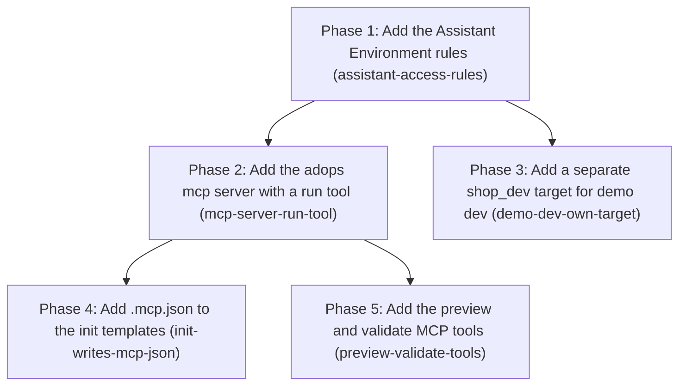

# Horizon 9 — The Assistant's MCP server (run, preview, validate)

## Executive Summary

**🎯 What are we trying to achieve?** A new `adops mcp` command starts an MCP server: a small program the user's own Assistant (for example Claude Code) talks to over standard input/output to call tools. This horizon ships three tools — run, preview and validate — and `adops init` writes a `.mcp.json` so Claude Code finds the server with no setup. The tools act only on the Environment named exactly `dev` or on a Branch Environment, and the server's own code refuses everything else. Tests prove no tool response ever contains a secret value.

**🧠 Why does this change need to happen?** The product promises that a SQL-literate user can operate it through their Assistant, but today the Assistant can only shell out to the CLI, which happily runs against stage or prod. The rule "the Assistant acts only in dev and Branch Environments" must be enforced in code, not in prompt text. Environment names are free-form, so the server uses an allow-list (exactly `dev`, or a branch) and also refuses a dev that secretly points at stage's or prod's database. The demo's dev currently shares a target database with stage, so the demo gets its own `shop_dev` target.

**At a glance**
- Phases: 5 (4 more tool groups deferred to horizon 10 — see next-horizon-brief.md)
- Complexity: Medium
- Main risk: a Branch Environment lives in stage's Warehouse, so only server code keeps the Assistant's Branch runs inside `br_<branch>__` schemas and Preview-only
- Quality target: 100% line+branch coverage; no MCP response contains a secret value; refusals happen before any Warehouse, Source, target or file is touched
- Testing focus: refusal-before-side-effects, secret-leak scanning of every response, fail-fast on a held Warehouse lock, stdout kept off the protocol stream

## Implementation plan

### Order of work
```
Phase 1 — Add the Assistant Environment rules
        ↓  (uses the Environment rules as its guard)
Phase 2 — Add the adops mcp server with a run tool
        ↓  (its test checks the shipped demo passes the shared-connection rule)
Phase 3 — Add a separate shop_dev target for demo dev
        ↓  (registers the `adops mcp` command built in Phase 2)
Phase 4 — Add .mcp.json to the init templates
        ↓  (reuses the guard, serializer and leak harness from Phase 2)
Phase 5 — Add the preview and validate MCP tools
```



### Phase 1 — Add the Assistant Environment rules
Technical ID: `assistant-access-rules` · Assistant access · domain · small

**Goal** — One pure domain module decides, with no I/O, whether an MCP tool call from the Assistant may act on an Environment: only exactly `dev`, or a Branch Environment chosen by a branch name, and never when dev shares a database connection with stage or prod.

**Why** — Every MCP tool must refuse stage, prod and custom Environments in server code, before anything is touched. Keeping the rules pure and framework-free lets the unit suite test every refusal case at 100% branch coverage, and puts all later tools behind one shared definition of 'allowed'. The file-path rule is not built here; it ships with the file tools that use it.

**Changes**
- Create src/adops/domain/assistant_access.py with an `AssistantRefusal` exception that carries only a fixed, sanitized message (an Environment name or a path the caller supplied, never a connection value or secret).
- Add `assistant_target(environment: str | None, branch: str | None) -> AssistantTarget`. An `AssistantTarget` is a small frozen dataclass saying 'dev' or 'branch <name>'. It accepts `environment == "dev"` exactly (case-sensitive, no trimming) or a non-empty branch with no environment. It raises `AssistantRefusal` for every other case: `stage`, `prod`, `qa`, `production`, `Dev`, `dev `, any custom name, both given, or neither given. Treat 'neither given' as dev only if the tool layer passes 'dev' explicitly, so the rule itself stays explicit. The refusal message says the Assistant works only in the Environment named exactly `dev` or in a Branch Environment, so a user whose dev Environment is called `development` understands why.
- Add `refuse_shared_dev_connection(environments, duckdb_identity)`. Using the `ProjectSettings.environments` mapping from domain/environment.py, it raises `AssistantRefusal` when dev's Warehouse, or any of dev's Reverse Sync targets, is the same database connection as stage's or prod's Warehouse or any of their targets. 'Same connection' for Postgres means the same host, port and database after the host is lowercased and localhost/127.0.0.1/::1 are treated as one host. For DuckDB it means equal strings returned by the `duckdb_identity` callable that the caller injects. The caller resolves each path to an absolute path, because domain code may not touch the filesystem.
- Write tests/unit/domain/test_assistant_access.py with one test per refusal and acceptance case of assistant_target (dev, branch, stage, prod, qa, production, Dev, 'dev ', custom, both given, neither given), plus shared-connection cases: the same Warehouse, the same target, a target equal to stage's Warehouse, a localhost-versus-127.0.0.1 alias, an equal DuckDB identity, a prod that is not configured, and fully separate connections that pass.

**Files / areas**
- `src/adops/domain/assistant_access.py`
- `tests/unit/domain/test_assistant_access.py`

**How to verify**
- **Only exact dev or a Branch Environment is accepted** — `uv run pytest tests/unit/domain/test_assistant_access.py -q` passes.
- **Shared dev database detection is correct and complete** — Tests exist and pass for: the same Warehouse; the same target; a dev target equal to stage's Warehouse; 'LOCALHOST' vs '127.0.0.1' vs '::1' on the same port and database; an equal DuckDB identity; prod not configured (no error); fully separate connections (no error).
- **Refusals never carry connection values** — In a test or shell, build ProjectSettings whose dev and stage share host 'leak-host-zz9', database 'leak-db-zz9' and user 'leak-user-zz9'. After catching AssistantRefusal from refuse_shared_dev_connection, str(error) contains none of these three strings.
- **The rule module stays pure domain** — `uv run pytest tests/unit/domain/test_domain_purity.py -q` passes, with assistant_access.py present in src/adops/domain/.

**Done when** — src/adops/domain/assistant_access.py with branch-complete unit tests proving every allowed and refused Environment and shared-connection case. And every check under *How to verify* passes its bar.

**Depends on** — nothing — can start immediately

**Guards**
- g6: the module imports only from adops.domain and the standard library modules the purity test allows (no os, pathlib, mcp or typer). DuckDB path resolution is injected as a callable.
- g3: every branch of the three rules has a test; no pragma.

<details><summary>Reference — full rubric</summary>

| Dimension | Rule | Pass criteria | Failure examples | Min |
|---|---|---|---|---|
| Only exact dev or a Branch Environment is accepted | Derived from the acceptance criterion 'The MCP server's tools act only for dev and Branch Environments': assistant_target(environment, branch) returns an AssistantTarget only for environment == "dev" exactly (with no branch) or for a non-empty branch with no environment, and raises AssistantRefusal for everything else. 10 = every case in the matrix below is a separate named test, and the refusal text explains the exact-`dev` rule. 8 = all cases are refused correctly and tested, with some grouped into one parametrized test. Below 8 = any non-dev name is accepted. | `uv run pytest tests/unit/domain/test_assistant_access.py -q` passes.<br>In a Python shell, `from adops.domain.assistant_access import assistant_target, AssistantRefusal`: assistant_target('dev', None) and assistant_target(None, 'feature-x') both return an AssistantTarget; the second one records the branch name 'feature-x'.<br>Each of assistant_target('stage', None), ('prod', None), ('qa', None), ('production', None), ('Dev', None), ('dev ', None), ('development', None), ('dev', 'x'), (None, None) and (None, '') raises AssistantRefusal.<br>The message of str(AssistantRefusal) for ('development', None) contains the literal `dev` and says that only the Environment named exactly `dev` or a Branch Environment is allowed.<br>AssistantTarget is a frozen dataclass: setting an attribute on an instance raises dataclasses.FrozenInstanceError. | The value is .strip()ed or .lower()ed before comparing, so 'Dev' or 'dev ' is accepted. This is a plausible honest attempt to be 'helpful'.<br>When neither argument is given, the code quietly defaults to dev instead of refusing.<br>An empty-string branch is accepted as a Branch Environment.<br>Both environment and branch are given and the branch silently wins. | 8 |
| Shared dev database detection is correct and complete | refuse_shared_dev_connection raises AssistantRefusal whenever dev's Warehouse or any dev Reverse Sync target is the same connection as stage's or prod's Warehouse or any of their targets. For Postgres, 'same' means host (lowercased, with localhost/127.0.0.1/::1 treated as one host), port and database. For DuckDB, it means equal results from the injected identity callable. 10 = all of these pairings are tested, including cross pairings (dev target vs stage Warehouse) and a missing prod. 8 = the pairings are correct and tested, but one alias or cross pairing is untested. Below 8 = a shared database gets through. | Tests exist and pass for: the same Warehouse; the same target; a dev target equal to stage's Warehouse; 'LOCALHOST' vs '127.0.0.1' vs '::1' on the same port and database; an equal DuckDB identity; prod not configured (no error); fully separate connections (no error).<br>A test with the same host and database but a different port, and one with the same host and port but a different database, both pass with no refusal (no false positive).<br>The DuckDB comparison calls the injected `duckdb_identity` callable. A test passes a fake callable that maps two different relative strings to one identity and expects a refusal.<br>Running `grep -n 'password\\|user' src/adops/domain/assistant_access.py` shows that user and password fields are not part of the equality key. | Only the Warehouses are compared, so the demo's case (dev's target equals stage's target) is missed.<br>Hosts are compared as raw strings, so 'localhost' and '127.0.0.1' count as different. This is a plausible miss.<br>The code only compares dev against stage and forgets prod.<br>The code crashes with KeyError or AttributeError when prod is not configured. | 8 |
| Refusals never carry connection values | AssistantRefusal messages are fixed text that may include only an Environment name or a branch name the caller supplied. They never include a host, port, database, user, path or Secret Reference value. 10 = a test builds settings with distinctive connection values and asserts that none of them appears in the shared-connection refusal. 8 = the messages are fixed strings by inspection, but no test asserts it. Below 8 = any refusal interpolates a connection field. | In a test or shell, build ProjectSettings whose dev and stage share host 'leak-host-zz9', database 'leak-db-zz9' and user 'leak-user-zz9'. After catching AssistantRefusal from refuse_shared_dev_connection, str(error) contains none of these three strings.<br>Running `grep -n 'f"' src/adops/domain/assistant_access.py` shows that no f-string interpolates a connection attribute (host, port, database, path, user, password_env). | The message reads 'dev target shop at localhost:15432/shop is shared with stage'. It is helpful but leaks connection details. This is a plausible careful attempt.<br>The message includes the repr() of the connection objects. | 8 |
| The rule module stays pure domain | assistant_access.py lives in adops.domain and depends only on adops.domain and the standard-library modules the purity test allows. It has no filesystem, environment, MCP or CLI access, and path resolution is injected by the caller. 10 = the purity test passes and the module has no import from application, infrastructure or interface. 8 = the same, but with an unused or redundant import. Below 8 = any banned import, or a direct path resolution inside the module. | `uv run pytest tests/unit/domain/test_domain_purity.py -q` passes, with assistant_access.py present in src/adops/domain/.<br>`grep -nE '^(from\|import) ' src/adops/domain/assistant_access.py` lists only adops.domain.* and stdlib modules other than os, sys, io, pathlib and subprocess.<br>`grep -nE 'adops\.(application\|infrastructure\|interface)\|resolve\(\|abspath\|Path\(' src/adops/domain/assistant_access.py` returns nothing. | The code uses `pathlib.Path(conn.path).resolve()` inside the rule to compare DuckDB files, which breaks purity. This is a plausible convenience shortcut.<br>The module imports `adops.interface.run_command` to reuse an error type. | 9 |

Healer hint: If shared-connection tests fail, normalise each Postgres connection to a (canonical_host, port, database) tuple once, collect dev's set and the union of stage and prod's sets (skipping any missing Environment), and refuse when the two sets intersect.

</details>

### Phase 2 — Add the adops mcp server with a run tool
Technical ID: `mcp-server-run-tool` · Assistant access · interface · medium

**Goal** — A new `adops mcp` command starts an MCP server over stdio that the Assistant can connect to. Its first tool, `run`, runs a Pipeline in dev or a Branch Environment, after the Environment and shared-connection rules have been checked against adops.yaml as it is at call time. A test harness proves that no MCP response contains a secret value.

**Why** — This is the smallest server the Assistant can actually use, and it fixes the safety pattern every later tool copies: refuse first, never pass raw exception text through, keep engine output off the JSON-RPC stream. `run` reuses the run code path the CLI already uses, so refusals sit in front of real behaviour from day one. It also adds a backward-compatible lock_timeout keyword to the existing run code path so the Assistant gets an immediate 'busy' reply instead of a 30-minute wait; the CLI keeps waiting.

**Changes**
- Add `mcp>=1.30,<2` to the runtime dependencies in pyproject.toml and regenerate uv.lock with `uv lock` in the same change.
- Create src/adops/interface/mcp_server.py. It builds a `FastMCP` server for a Project folder and has an `mcp(project: Path = Path("."))` typer command that serves it over stdio. Register the command in cli.py with `app.command()(mcp)`.
- Write every tool as a plain synchronous function. FastMCP then runs tool calls one at a time on its event loop. This matters because run_project swaps os.environ in place, which is not safe if two calls run at once.
- Protect the stdio JSON-RPC stream (the channel MCP messages travel on). At server start, duplicate file descriptor 1 for the protocol and point file descriptor 1 at stderr for the server's lifetime. Anything Dagster, dbt or dlt prints to stdout then goes to stderr. Unit-test this helper: a write to `sys.stdout` and a raw `os.write(1, ...)` inside it must both land on stderr.
- Add one guard helper that every Environment-touching tool calls first. It re-reads adops.yaml, calls `assistant_target`, and for dev calls `refuse_shared_dev_connection` with a DuckDB identity that resolves `project / path` to an absolute path. Only after both pass does it hand back the arguments for `run_project`: environment `dev`, or branch `<name>` (which builds the Branch Environment from stage exactly as `adops run --branch` does).
- Add an optional `lock_timeout` keyword to `run_project` (default: the existing 30-minute DEFAULT_LOCK_TIMEOUT from warehouse_lock.py) and pass it through `_holding_lock` to `build_warehouse_lock`/`warehouse_lock(timeout=...)`. The CLI keeps the default. The MCP `run` tool passes 0, so when the Warehouse lock (stage's, for a Branch run) is already held, the tool returns at once with the existing WarehouseLocked message turned into a plain 'stage is busy, try again later' reply instead of hanging. Test the CLI default is unchanged and the MCP busy reply.
- Add the `run` tool (pipeline, environment, branch). It calls `run_project` from run_command.py, never `run()` or `_run_one`. It returns a plain dict built from RunResult/StepReport/ReverseSyncPreview fields: step name, status, checks, rows loaded, the already-redacted error, and preview counts with sample keys. If any step reports `preview.written is True`, it returns a refusal error instead, which keeps Preview-only true at this layer.
- Catch every exception inside each tool and return a sanitized MCP error. Use `error_lines(error)` for RUN_ERRORS and `AssistantRefusal`, and only `unexpected <TypeName>` for anything else. Never let FastMCP turn `str(exception)` into a response.
- Create tests/unit/interface/mcp_harness.py. It writes a Project whose .env sets a distinctive value for every Secret Reference (every password_env in every Environment plus alert_webhook_env). It opens an in-memory session with `mcp.shared.memory.create_connected_server_and_client_session`, and it provides `assert_no_secret(result)`, which scans the full serialized response (content, structured content, error text). Tests use `@pytest.mark.anyio` with an `anyio_backend` fixture returning 'asyncio'.
- In test_mcp_server.py, reuse the `run_command.build_*` monkeypatch seams and the FakeLocks `locks` fixture. Cover: run in dev; run in a branch; a refusal for each disallowed Environment before any build_* seam is called; a shared-connection refusal; a missing stage Warehouse Secret Reference for a branch run, giving a sanitized error that names it; an invalid YAML error; an unreachable Warehouse; and an unexpected exception reduced to its type name. Pass every response through `assert_no_secret`. Cover the stdio entry point with a CliRunner test that monkeypatches the server's run call, with no pragma.

**Files / areas**
- `pyproject.toml`
- `uv.lock`
- `src/adops/interface/mcp_server.py`
- `src/adops/interface/cli.py`
- `src/adops/interface/run_command.py`
- `tests/unit/interface/mcp_harness.py`
- `tests/unit/interface/test_mcp_server.py`

**How to verify**
- **Stage, prod and custom are refused in code before anything is touched** — `uv run pytest tests/unit/interface/test_mcp_server.py -q` passes.
- **Tests prove no MCP response carries a secret value** — tests/unit/interface/mcp_harness.py writes a .env that sets a unique value for every password_env of every Environment AND for alert_webhook_env.
- **A held Warehouse lock returns at once from MCP, and the CLI keeps waiting** — A test holds the lock through the FakeLocks fixture and calls the MCP `run` tool. The call returns an error whose text says the Environment (stage, for a branch) is busy and to try again later, and no orchestrator seam ran.
- **Engine output cannot corrupt the stdio protocol** — A test enters the stdout-protection helper, runs `print('x')` and `os.write(1, b'y')`, and captures both on stderr (capfd), with neither on stdout.
- **The run tool reports only redacted fields and keeps Preview-only** — A test makes the fake reverse-sync seam return a ReverseSyncPreview with written=True. The tool response is an error and reports no step success.
- **The MCP SDK and run orchestration sit only in the interface layer** — `grep -rnE '^(from|import) mcp' src/adops` lists only src/adops/interface/mcp_server.py.

**Done when** — A working `adops mcp` stdio server exposing a `run` tool that refuses every Environment except exact `dev` and Branch Environments, with in-memory MCP tests that assert no response contains a secret value. And every check under *How to verify* passes its bar.

**Depends on** — Phase 1 — Add the Assistant Environment rules

**Guards**
- g1: pyproject.toml and uv.lock change together via `uv lock`, so `uv sync --locked` passes.
- g2: follows ruff E,F,W,I,B,UP at line length 100.
- g3: the stdio entry point, the stdout redirect and every error-mapping branch are covered by unit tests; no pragma.
- g6: mcp is imported only in src/adops/interface/mcp_server.py; domain and application gain no imports.

<details><summary>Reference — full rubric</summary>

| Dimension | Rule | Pass criteria | Failure examples | Min |
|---|---|---|---|---|
| Stage, prod and custom are refused in code before anything is touched | Verbatim acceptance criterion: 'Stage and prod requests are refused in the server's own code (ADR-0009), not by prompt instructions.' The `run` tool's guard re-reads adops.yaml at call time, calls assistant_target, and for dev calls refuse_shared_dev_connection, all before any build_* seam, lock or run_project call. 10 = every disallowed name and the shared-connection case have a test asserting that zero seams were called and no lock was taken, plus a test that an adops.yaml edited between two calls changes the outcome. 8 = refusals are tested with seam spies, but the call-time re-read is untested. Below 8 = any refusal depends on a tool description or docstring, or happens after a seam runs. | `uv run pytest tests/unit/interface/test_mcp_server.py -q` passes.<br>Tests call `run` with environment 'stage', 'prod' and a custom name (for example 'qa'), and with a dev that shares a database with stage. Each asserts the response is an error AND that the monkeypatched run_command.build_* spies and the FakeLocks fixture recorded no calls.<br>A test changes adops.yaml after the server starts (for example, it makes dev share stage's target) and the next `run` call is refused. This proves the guard does not use settings cached at startup.<br>`grep -n 'stage\\|prod' src/adops/interface/mcp_server.py` shows no refusal that depends only on a tool description string. The decision comes from adops.domain.assistant_access. | adops.yaml is loaded once in the server factory, so a later edit that makes dev share stage's database is not caught. This is a plausible optimisation.<br>The refusal is raised inside run_project after build_orchestrator() has already run.<br>The `environment` parameter is typed as Literal['dev'], so the only 'refusal' is FastMCP's schema validation error, and the server has no refusal code of its own. | 9 |
| Tests prove no MCP response carries a secret value | Verbatim acceptance criterion: 'Tests assert that no MCP response contains a secret value.' mcp_harness.py seeds a distinctive .env value for every Secret Reference in the Project, and assert_no_secret scans the whole serialized CallToolResult (content, structuredContent, isError text). Every `run` test passes its result through it, and unexpected exceptions are reduced to 'unexpected <TypeName>'. 10 = the harness is itself tested with a negative case that plants a secret in a fake result and expects assert_no_secret to fail. 8 = every test uses the harness, but it has no self-test. Below 8 = any test response is not scanned, or an unexpected-exception message passes str(error) through. | tests/unit/interface/mcp_harness.py writes a .env that sets a unique value for every password_env of every Environment AND for alert_webhook_env.<br>Every test in test_mcp_server.py that calls a tool calls assert_no_secret on the result. Check with `grep -c assert_no_secret tests/unit/interface/test_mcp_server.py`, which should be at least the number of call_tool uses.<br>A test makes a build_* seam raise RuntimeError('<seeded secret value>'). The response text is exactly or contains 'unexpected RuntimeError' and passes assert_no_secret.<br>A test with a missing stage Secret Reference for a branch run returns an error that names the Secret Reference (the env var name) and not any value. | assert_no_secret checks only result.content[0].text and misses structuredContent. This is a plausible partial scan.<br>Only the Warehouse password is seeded, so a leak of the alert webhook value or a Reverse Sync target password would go unnoticed.<br>A generic `except Exception as e: return {'error': str(e)}` is used, which leaks connection strings that contain passwords. | 9 |
| A held Warehouse lock returns at once from MCP, and the CLI keeps waiting | run_project takes lock_timeout (default DEFAULT_LOCK_TIMEOUT) and passes it down to warehouse_lock. The MCP `run` tool passes 0 and turns WarehouseLocked into a plain 'stage is busy, try again later' style reply. `adops run` keeps the 30-minute default. 10 = both behaviours are tested, including a Branch run where stage's lock is held, and the busy reply passes assert_no_secret. 8 = both are tested for dev or branch only. Below 8 = the MCP tool can block on a held lock. | A test holds the lock through the FakeLocks fixture and calls the MCP `run` tool. The call returns an error whose text says the Environment (stage, for a branch) is busy and to try again later, and no orchestrator seam ran.<br>A test asserts that the CLI path (`adops run` through CliRunner, or run_project called without lock_timeout) passes timeout == DEFAULT_LOCK_TIMEOUT to the lock builder.<br>`grep -n 'lock_timeout' src/adops/interface/mcp_server.py` shows lock_timeout=0 passed on every run_project call. | lock_timeout is added to run_project but not passed through _holding_lock, so the MCP call still waits 30 minutes. This is a plausible plumbing miss.<br>The default is changed globally to 0, which breaks the CLI's waiting behaviour.<br>The raw WarehouseLocked message, which contains the lock file path or connection details, is returned as is. | 8 |
| Engine output cannot corrupt the stdio protocol | At server start, file descriptor 1 is duplicated for the MCP protocol and fd 1 is pointed at stderr for the server's lifetime, so prints from Dagster, dbt or dlt (from Python or from a subprocess) never reach the JSON-RPC stream. 10 = a unit test proves both a sys.stdout write and a raw os.write(1, ...) land on stderr while the protocol writer still reaches the original stdout. 8 = the redirect is tested for both write paths, but not for the protocol side. Below 8 = only sys.stdout is redirected (for example with contextlib.redirect_stdout). | A test enters the stdout-protection helper, runs `print('x')` and `os.write(1, b'y')`, and captures both on stderr (capfd), with neither on stdout.<br>Running `grep -n 'os.dup\\|dup2' src/adops/interface/mcp_server.py` shows an fd-level redirect, not just contextlib.redirect_stdout.<br>A CliRunner test invokes `adops mcp` with the server's stdio run call monkeypatched, and the command exits 0, which proves it is registered in cli.py. | contextlib.redirect_stdout(sys.stderr) is used. It passes a print test but lets dbt's subprocess output corrupt the stream. This is a plausible miss.<br>fd 1 is redirected but the protocol is not given the saved duplicate, so the server writes its JSON-RPC to stderr and the client hangs. | 8 |
| The run tool reports only redacted fields and keeps Preview-only | The `run` tool returns a plain dict built from RunResult, StepReport and ReverseSyncPreview fields (step name, status, checks, rows loaded, the redacted error, preview counts and sample keys). It turns RUN_ERRORS and AssistantRefusal into error_lines output, and returns a refusal if any step reports preview.written is True. 10 = each mapping branch has a test, including written=True. 8 = written=True is tested and the error mapping is correct, but one RUN_ERRORS class is untested. Below 8 = a dev or branch run that reported a write returns success. | A test makes the fake reverse-sync seam return a ReverseSyncPreview with written=True. The tool response is an error and reports no step success.<br>Tests cover an invalid adops.yaml and an unreachable Warehouse. Each returns the same lines error_lines() gives for that exception.<br>The success response for a dev run is JSON-serialisable (json.dumps works) and has no dataclass or exception objects in it. | The tool returns dataclasses.asdict(result), which carries every field, including any future raw value field. This is a plausible shortcut.<br>written=True is logged but still returned as success. | 8 |
| The MCP SDK and run orchestration sit only in the interface layer | `mcp` is imported only in src/adops/interface/mcp_server.py and in tests. The tool calls run_command.run_project, not the CLI `run()` command or `_run_one`. Domain and application gain no imports. Tools are synchronous functions, so calls run one at a time. 10 = all of these hold, and the dependency is declared in pyproject.toml within mcp>=1.30,<2. 8 = all hold except one tool written as `async def` that only awaits sync code. Below 8 = mcp is imported outside interface, or a tool calls the typer command. | `grep -rnE '^(from\|import) mcp' src/adops` lists only src/adops/interface/mcp_server.py.<br>`grep -nE 'async def' src/adops/interface/mcp_server.py` shows no tool function defined with async def.<br>`grep -nE '\brun\(\|_run_one' src/adops/interface/mcp_server.py` shows no call to the CLI run command or _run_one. run_project is used instead.<br>`git diff --stat` shows no change under src/adops/domain or src/adops/application in this phase. The `uv sync --locked` gate passes. | A shared 'mcp_errors.py' helper is put in adops/application and imports mcp.types. This is a plausible refactor that breaks the layering.<br>The tool invokes the typer `run` command and parses its echoed output. | 9 |

Healer hint: If secret or refusal tests fail, move the guard into one `_guarded_args(project, environment, branch)` helper called as the first line of the tool, and wrap the whole tool body in a single try/except that maps AssistantRefusal and RUN_ERRORS through error_lines and everything else to f'unexpected {type(e).__name__}'.

</details>

### Phase 3 — Add a separate shop_dev target for demo dev
Technical ID: `demo-dev-own-target` · Project setup · interface · small

**Goal** — In the demo Project created by `adops init --demo`, dev's Reverse Sync target `shop` points at its own database `shop_dev`, not the `shop` database stage writes to. The new shared-connection rule then refuses nothing in the demo.

**Why** — Today the demo's dev and stage targets are the same localhost:15432/shop database. Every MCP tool call against the demo's dev would be refused, so the Assistant could not use the demo at all. The user decided to give dev its own target database instead of loosening the rule.

**Changes**
- In templates/demo/adops.yaml, change `environments.dev.targets.shop.database` from `shop` to `shop_dev`. Keep dev's Source on `shop`, and update the header comment to say dev Previews against its own copy of the target table.
- Add templates/demo/seed/02_shop_dev.sql. It runs after 01_shop.sql in the shop container's init folder, creates database `shop_dev`, connects to it, and creates the same `customer_stats` table that 01_shop.sql creates, owned by the shop user.
- Add `seed/02_shop_dev.sql` to the demo file loop in ci.yml's wheel check.
- Update the pinned DEMO_FILES set in tests/unit/interface/test_init_command.py.
- Update any E2E expectation in tests/e2e that assumes dev's Preview reads the `shop` database, so dev Previews against `shop_dev` and stage still writes `shop`.

**Files / areas**
- `src/adops/templates/demo/adops.yaml`
- `src/adops/templates/demo/seed/02_shop_dev.sql`
- `.github/workflows/ci.yml`
- `tests/unit/interface/test_init_command.py`
- `tests/e2e/test_demo_sync.py`

**How to verify**
- **The demo's dev no longer shares a database with stage or prod** — `uv run python -c "from pathlib import Path; from adops.domain.loader import load_project_settings; s=load_project_settings(Path('src/adops/templates/demo/adops.yaml').read_text()); print(s.environments['dev'])"` shows the target shop database as shop_dev and the Source database as shop (adapt the loader import if it is named differently).
- **02_shop_dev.sql creates an identical target table in shop_dev** — `diff <(grep -A20 'CREATE TABLE.*customer_stats' src/adops/templates/demo/seed/01_shop.sql) <(grep -A20 'CREATE TABLE.*customer_stats' src/adops/templates/demo/seed/02_shop_dev.sql)` shows no column, type or key differences.
- **The new seed ships in the wheel and is written by init --demo** — `grep -n '02_shop_dev.sql' .github/workflows/ci.yml tests/unit/interface/test_init_command.py` finds the file in both.
- **E2E expects dev to preview shop_dev and stage to write shop, with no new cases** — `grep -rn 'shop_dev' tests/e2e` shows dev-side expectations pointing at shop_dev.
- **The fix lives in template data, not in rule exceptions** — `git diff --stat` for this phase lists only src/adops/templates/demo/adops.yaml, src/adops/templates/demo/seed/02_shop_dev.sql, .github/workflows/ci.yml, tests/unit/interface/test_init_command.py and files under tests/e2e/.

**Done when** — A demo template whose dev Reverse Sync target is the separate `shop_dev` database, created by a new seed script, with init and E2E tests passing. And every check under *How to verify* passes its bar.

**Depends on** — Phase 1 — Add the Assistant Environment rules

**Guards**
- g4: the new seed/02_shop_dev.sql is added to the hard-coded demo template list in ci.yml.
- g5: no new E2E case is added; only existing expectations change, so the 20-minute budget is unchanged.
- g3: no Python source changes under src/adops; templates and SQL are not measured by coverage.

**Rollback** — Revert the adops.yaml database name and delete 02_shop_dev.sql. Existing demo Projects are unaffected because init only copies templates into empty folders.

<details><summary>Reference — full rubric</summary>

| Dimension | Rule | Pass criteria | Failure examples | Min |
|---|---|---|---|---|
| The demo's dev no longer shares a database with stage or prod | In the template adops.yaml, dev's Reverse Sync target `shop` uses database `shop_dev`, while dev's Source stays on `shop` and stage's (and the commented prod's) target stays on `shop`. As a result, refuse_shared_dev_connection raises nothing on the loaded demo settings. 10 = a unit test loads the shipped template and asserts the rule passes, and the header comment is updated. 8 = the YAML is correct and the rule passes when checked by hand, but no test asserts it. Below 8 = the rule still refuses the demo, or stage's target was moved instead. | `uv run python -c "from pathlib import Path; from adops.domain.loader import load_project_settings; s=load_project_settings(Path('src/adops/templates/demo/adops.yaml').read_text()); print(s.environments['dev'])"` shows the target shop database as shop_dev and the Source database as shop (adapt the loader import if it is named differently).<br>Calling refuse_shared_dev_connection on those settings with an identity callable such as `str` raises no AssistantRefusal.<br>`grep -n 'database:' src/adops/templates/demo/adops.yaml` shows shop_dev exactly once (dev's target) and shop for dev's Source and for stage's Source and target.<br>The header comment of the demo adops.yaml says dev Previews against its own copy of the target table. | dev's Source database is also changed to shop_dev, so dev reads an empty Source. This is a plausible over-application of the change.<br>stage's target is moved to shop_stage instead. This breaks the existing E2E flow and the meaning of 'stage writes shop'.<br>Only the commented prod block is changed. | 8 |
| 02_shop_dev.sql creates an identical target table in shop_dev | seed/02_shop_dev.sql runs after 01_shop.sql, creates database shop_dev, connects to it, and creates customer_stats with the same columns, types and keys as 01_shop.sql, owned by the shop user. 10 = the DDL is identical to 01's and it is proven by bringing the demo stack up (the E2E run or `docker compose up` with psql `\d customer_stats` in shop_dev). 8 = the DDL matches by inspection but the stack was not started. Below 8 = a column or key differs, or the script does not switch database. | `diff <(grep -A20 'CREATE TABLE.*customer_stats' src/adops/templates/demo/seed/01_shop.sql) <(grep -A20 'CREATE TABLE.*customer_stats' src/adops/templates/demo/seed/02_shop_dev.sql)` shows no column, type or key differences.<br>02_shop_dev.sql contains CREATE DATABASE shop_dev, then a `\connect shop_dev` (or `\c`), then the table creation, and sets the owner (or grants) to the shop user.<br>The file name sorts after 01_shop.sql, so the Postgres init folder runs it second. | The table is created without the \connect, so it lands in the default database and shop_dev stays empty. This is a plausible psql-script miss.<br>The primary key is left off, so Reverse Sync diffing by key fails at runtime.<br>The table is owned by postgres, so the shop user gets permission denied when previewing. | 8 |
| The new seed ships in the wheel and is written by init --demo | The new seed is pinned everywhere the demo file set is pinned: DEMO_FILES in test_init_command.py and the demo loop in ci.yml. `adops init --demo` into an empty folder writes seed/02_shop_dev.sql. 10 = both pins are updated, a fresh init shows the file, and the wheel check (guard g4) passes. 8 = the pins are updated and the unit test passes, but the wheel check was not run locally. Below 8 = any pin is missing. | `grep -n '02_shop_dev.sql' .github/workflows/ci.yml tests/unit/interface/test_init_command.py` finds the file in both.<br>`uv run adops init --demo <tmpdir>` creates <tmpdir>/seed/02_shop_dev.sql, byte-identical to the template.<br>Guard outcome: `uv build --wheel && unzip -l dist/*.whl \| grep 02_shop_dev.sql` prints one line. | The file is added to the template folder but DEMO_FILES is not updated. The test may still pass if it checks a subset, so the pin silently loses meaning. This is a plausible oversight.<br>The file is added to the ci.yml plain loop instead of the demo loop. | 8 |
| E2E expects dev to preview shop_dev and stage to write shop, with no new cases | Existing E2E expectations are updated so that dev's Preview reads the shop_dev target and stage still writes the shop database. No new E2E test is added, so the 20-minute budget (g5) is not affected. 10 = the E2E suite passes against Docker, and a dev expectation explicitly checks that shop.customer_stats is untouched by a dev run. 8 = the expectations are updated and the suite passes, without an explicit check that shop is untouched. Below 8 = an E2E still asserts dev's Preview against shop, or a new e2e case is added. | `grep -rn 'shop_dev' tests/e2e` shows dev-side expectations pointing at shop_dev.<br>`git diff tests/e2e \| grep -c '^+def test_'` is 0, so no new E2E tests were added.<br>`uv run pytest tests/e2e -m e2e` passes (needs Docker). | tests/e2e/demo_project.py still queries the shop database for dev's expected Preview counts. Those counts now stay at zero, and an assertion like `>= 0` hides it. This is a plausible quiet false pass.<br>A new E2E test is added for the MCP flow, which uses up budget this phase was not meant to spend. | 8 |
| The fix lives in template data, not in rule exceptions | This Project-setup phase changes only template data, the seed, ci.yml and tests. assistant_access.py and the server guard get no special case for the demo, such as skipping targets or allowing localhost:15432. 10 = `git diff --stat` touches only the listed files. 8 = it also touches an unrelated comment elsewhere. Below 8 = any change to the domain rule or the server guard. | `git diff --stat` for this phase lists only src/adops/templates/demo/adops.yaml, src/adops/templates/demo/seed/02_shop_dev.sql, .github/workflows/ci.yml, tests/unit/interface/test_init_command.py and files under tests/e2e/.<br>`git diff src/adops/domain src/adops/interface` is empty. | A `demo: true` flag or a database-name allowlist is added to refuse_shared_dev_connection so the demo passes. This is a plausible 'quick fix' that weakens the safety rule. | 9 |

Healer hint: If the demo E2E breaks, check that 02_shop_dev.sql switches database with `\connect shop_dev` before CREATE TABLE and gives ownership to the shop user, because a table created in the wrong database or owned by postgres is the usual cause.

</details>

### Phase 4 — Add .mcp.json to the init templates
Technical ID: `init-writes-mcp-json` · Project setup · interface · small

**Goal** — `adops init` and `adops init --demo` write a .mcp.json that registers the `adops mcp` server, so Claude Code opened in the new Project finds the Assistant's tools with no further setup.

**Why** — Without this file the user must work out and write the MCP registration by hand, which is exactly the setup friction the product is meant to remove. Both templates need it, because the Assistant works on plain and demo Projects alike.

**Changes**
- Add .mcp.json to templates/demo and templates/plain with `{"mcpServers": {"adops": {"command": "adops", "args": ["mcp"]}}}`. Claude Code starts it from the Project root, so the default `--project .` points at the Project.
- Check that init_command._copy_tree already copies dotfiles as is (as it does .env.example). Only add a RENAMED entry if the wheel build drops dotfiles.
- Add `.mcp.json` to the demo loop and `plain/.mcp.json` to the plain loop in ci.yml's wheel check.
- Update DEMO_FILES and the plain file set in tests/unit/interface/test_init_command.py. Add one assertion that the written .mcp.json parses as JSON and names `adops` with args `["mcp"]`.

**Files / areas**
- `src/adops/templates/demo/.mcp.json`
- `src/adops/templates/plain/.mcp.json`
- `.github/workflows/ci.yml`
- `tests/unit/interface/test_init_command.py`

**How to verify**
- **.mcp.json has exactly the right registration** — `python -c "import json;print(json.load(open('src/adops/templates/demo/.mcp.json')))"` and the same for templates/plain print the exact object above.
- **Both init modes write .mcp.json into a fresh Project** — `uv run adops init <tmp1>` and `uv run adops init --demo <tmp2>` both create <tmp>/.mcp.json.
- **The registration lives in template files, not in init code** — `git diff src/adops/interface/init_command.py` is empty, or changes only the RENAMED mapping.

**Done when** — Both init templates ship a .mcp.json registering `adops mcp`, pinned by the init tests and the ci.yml wheel list. And every check under *How to verify* passes its bar.

**Depends on** — Phase 2 — Add the adops mcp server with a run tool

**Guards**
- g4: demo .mcp.json and plain/.mcp.json are added to the hard-coded wheel template lists in ci.yml.
- g3: no Python source changes unless a RENAMED entry is needed, which the init tests cover.

<details><summary>Reference — full rubric</summary>

| Dimension | Rule | Pass criteria | Failure examples | Min |
|---|---|---|---|---|
| .mcp.json has exactly the right registration | Both templates' .mcp.json parse as JSON to exactly {"mcpServers": {"adops": {"command": "adops", "args": ["mcp"]}}}, with no absolute paths, env block, secret or project argument, because Claude Code launches the server from the Project root. 10 = the init test parses the written file and asserts the whole object is equal. 8 = the test asserts the command and args but not the full equality. Below 8 = the file has extra keys, an absolute path or an env block. | `python -c "import json;print(json.load(open('src/adops/templates/demo/.mcp.json')))"` and the same for templates/plain print the exact object above.<br>`cmp src/adops/templates/demo/.mcp.json src/adops/templates/plain/.mcp.json` exits 0.<br>tests/unit/interface/test_init_command.py has an assertion that json.loads of the written .mcp.json names server `adops` with args `["mcp"]`.<br>`uv run adops mcp --help` exits 0, which proves the registered command exists. | args is set to ["mcp", "--project", "/abs/path"] with the developer's checkout path baked in. This is a plausible copy-paste from a local test.<br>An `env` block is added with ADOPS_* variables, which invites secret values into a committed file.<br>The file contains a trailing comment, so it is not valid JSON. | 9 |
| Both init modes write .mcp.json into a fresh Project | `adops init` and `adops init --demo` each write .mcp.json at the Project root, under that exact dotfile name, including when installed from the built wheel. The pinned plain and demo file sets include it. 10 = a fresh init in each mode, run from the installed wheel, produces the file. 8 = this is proven through the unit tests and the source tree only. Below 8 = one mode lacks the file, or it lands under a different name. | `uv run adops init <tmp1>` and `uv run adops init --demo <tmp2>` both create <tmp>/.mcp.json.<br>`grep -n '.mcp.json' tests/unit/interface/test_init_command.py` shows it in DEMO_FILES and in the plain file set.<br>`grep -n '.mcp.json' .github/workflows/ci.yml` shows it in the demo loop and as plain/.mcp.json in the plain loop. Guard outcome: the wheel listing has both. | The file is added only to templates/demo, which forgets plain Projects. This is a plausible miss because the demo is the usual test path.<br>The wheel build drops dotfiles. The source-tree unit test passes, but `pip install` users get no .mcp.json. | 8 |
| The registration lives in template files, not in init code | The .mcp.json content lives only as template files. init_command.py is unchanged, unless a RENAMED entry (for example 'mcp.json' to '.mcp.json') is needed because the wheel drops dotfiles. No JSON is built in Python, and init's empty-folder refusal still applies. 10 = init_command.py is untouched, or changed only by that RENAMED entry backed by a wheel check. 8 = a RENAMED entry was added as a precaution without checking. Below 8 = init code writes the JSON itself. | `git diff src/adops/interface/init_command.py` is empty, or changes only the RENAMED mapping.<br>`grep -rn 'mcpServers' src/adops --include=*.py` returns nothing.<br>The existing test that init refuses a non-empty folder still passes, and no .mcp.json is written in that case. | A `_write_mcp_json(target)` helper is added to init_command.py that calls json.dump. It works, but it duplicates template data in code and is skipped by the wheel template checks. This is a plausible design slip. | 8 |

Healer hint: If .mcp.json is missing from the wheel or the init output, follow the existing `gitignore` to `.gitignore` pattern: ship it as `mcp.json` and add a RENAMED entry, then update both ci.yml loops to the shipped name.

</details>

### Phase 5 — Add the preview and validate MCP tools
Technical ID: `preview-validate-tools` · Assistant access · interface · small

**Goal** — The server gains `validate`, which checks a Pipeline or the whole Project without connecting to anything, and `preview`, which runs a Pipeline in dev or a Branch Environment and returns only the Reverse Sync Preview: counts, at most 5 sample keys per kind, and changed column names, never row values.

**Why** — After an edit, the Assistant's normal loop is validate, then look at what a Reverse Sync would change. Both tools reuse existing code (validate_project and run_project), so they are thin additions on top of the guard and serializer built with `run`.

**Changes**
- Add a synchronous `validate(pipeline: str | None)` tool. It calls `validate_project(project, pipeline)` from validate_command.py and returns the Report's problems, skipped Pipelines and Schedules as plain lists. It takes no Environment, because validation never connects.
- Add a synchronous `preview(pipeline, environment, branch)` tool. It goes through the same guard helper as `run`, calls `run_project`, and returns only each Reverse Sync step's Preview fields, plus any failing step's redacted error. It refuses if any Preview reports `written`.
- In preview's serializer copy only PreviewSample's keys (capped at PREVIEW_SAMPLE_SIZE per kind, as defence in depth) and changed column names, and drop every other field.
- Pass `lock_timeout=0` to run_project from `preview` too, so a busy stage returns the same 'stage is busy, try again later' reply as `run`.
- Reuse the run tool's exception mapping. Invalid YAML and validation problems come back as their already-sanitized problem lines.
- Add in-memory MCP tests: validate passing and failing (including invalid YAML); preview in dev and in a branch; preview refused for stage, prod and custom names before any build_* seam runs; preview with an unreachable target. Every response goes through `assert_no_secret`. Also add a test that the server lists exactly the tools built so far.

**Files / areas**
- `src/adops/interface/mcp_server.py`
- `tests/unit/interface/test_mcp_server.py`

**How to verify**
- **validate checks the Project without any Environment or connection** — Listing the tool's input schema through the in-memory session shows only an optional `pipeline` property.
- **preview returns counts, at most 5 sample keys and column names, never row values** — A test makes the fake reverse-sync seam return a Preview with 8 inserted, 8 updated and 8 deleted sample keys. The response has at most 5 keys per kind and the full counts.
- **preview shares run's guard, refusals and fail-fast lock** — Tests call preview with 'stage', 'prod' and a custom name. Each is an error, and the build_* spies and FakeLocks record zero calls.
- **Every response from the new tools is scanned for secrets, and the tool set is exact** — `grep -c 'assert_no_secret' tests/unit/interface/test_mcp_server.py` increases by at least the number of new call_tool uses.
- **The new tools stay thin interface adapters** — `git diff --stat` for this phase lists only src/adops/interface/mcp_server.py and tests/unit/interface/test_mcp_server.py.

**Done when** — The `preview` and `validate` MCP tools, covered by in-memory tests that include refusals and secret-leak assertions. And every check under *How to verify* passes its bar.

**Depends on** — Phase 2 — Add the adops mcp server with a run tool

**Guards**
- g3: every new branch in both tools is covered by unit tests; no pragma.
- g6: no mcp import outside interface.

<details><summary>Reference — full rubric</summary>

| Dimension | Rule | Pass criteria | Failure examples | Min |
|---|---|---|---|---|
| validate checks the Project without any Environment or connection | The `validate(pipeline)` tool has no environment or branch parameter. It delegates to validate_project, returns problems, skipped Pipelines and Schedules as plain lists, and turns invalid YAML into its sanitized problem lines. 10 = tests cover pass, fail and invalid YAML, every build_* seam and lock spy records zero calls, and every response passes assert_no_secret. 8 = these are covered except the zero-seam assertion. Below 8 = validate takes or uses an Environment, or invalid YAML returns a traceback or 'unexpected' message. | Listing the tool's input schema through the in-memory session shows only an optional `pipeline` property.<br>Tests call validate on a valid Project (no problems), on a Project with a validation problem (the problem text is returned), and on a Project with broken adops.yaml (the sanitized YAML problem line is returned, not 'unexpected ...').<br>In those tests the run_command.build_* spies and the FakeLocks fixture record no calls.<br>`grep -n 'validate_project' src/adops/interface/mcp_server.py` shows delegation, with no re-implemented checks. | validate goes through the Environment guard and asks for 'dev', so it fails on Projects whose dev shares a target, even though validation never connects. This is a plausible over-reuse of the guard.<br>An invalid YAML file raises inside load_project_settings, is not in the mapping, and comes back as 'unexpected YAMLError'. | 8 |
| preview returns counts, at most 5 sample keys and column names, never row values | For each Reverse Sync step, `preview` returns only the Preview counts, at most 5 sample keys per change kind, and the names of changed columns, plus any failing step's redacted error. Row values never appear. It refuses if any Preview reports written. 10 = a test feeds a Preview with more than 5 keys per kind and distinctive row values, then asserts the 5-key cap and that the values are absent. 8 = the cap and the field allowlist are tested, but row-value absence is only shown by inspection. Below 8 = sample rows or values are passed through. | A test makes the fake reverse-sync seam return a Preview with 8 inserted, 8 updated and 8 deleted sample keys. The response has at most 5 keys per kind and the full counts.<br>The same test plants a row value such as 'ROWVALUE-zz9' in any sample-row field the port carries, and the serialized response does not contain it.<br>A test with written=True returns a refusal error.<br>The response has no keys for non-Reverse-Sync step data (rows loaded, checks), so preview's output differs from run's. | The tool reuses run's serializer as is and returns the whole run payload, not just the Preview. This is plausible because the plan says to reuse the serializer.<br>The tool trusts that the port already caps samples and does not apply the 5-key limit itself, so a port change would leak more. | 8 |
| preview shares run's guard, refusals and fail-fast lock | Derived from the acceptance criteria 'The MCP server's tools act only for dev and Branch Environments' and 'Stage and prod requests are refused in the server's own code': `preview` calls the same guard helper as `run` before run_project, refuses stage, prod and custom names before any seam runs, and passes lock_timeout=0 so a busy stage returns the same busy reply as run. 10 = all of these are tested, including the busy reply for a branch preview and an unreachable target. 8 = refusals and busy are tested, and the unreachable target is not. Below 8 = preview has its own copy of the Environment check, or blocks on a held lock. | Tests call preview with 'stage', 'prod' and a custom name. Each is an error, and the build_* spies and FakeLocks record zero calls.<br>Tests run preview in dev and in a branch, both succeeding with the Preview payload.<br>A test holding the lock through FakeLocks gets the same busy reply text as the run tool's busy test.<br>A test with an unreachable target returns the error_lines output for that error.<br>`grep -c '_guard\\|assistant_target' src/adops/interface/mcp_server.py` shows a single guard definition used by both tools, not a second inline check. | preview calls run_project directly and copies the `environment == 'dev'` check but forgets refuse_shared_dev_connection. This is a plausible copy-paste drift.<br>lock_timeout=0 is passed in run but missed in preview, so a busy stage hangs the Assistant. | 9 |
| Every response from the new tools is scanned for secrets, and the tool set is exact | Verbatim acceptance criterion: 'Tests assert that no MCP response contains a secret value.' Every new validate and preview test result goes through assert_no_secret, and a test asserts that list_tools returns exactly {run, preview, validate}, so no unguarded tool can sneak in. 10 = both hold, and a validate failure whose problem text would naturally mention a connection is scanned too. 8 = both hold. Below 8 = any new tool response is unscanned, or the tool list is checked as a subset. | `grep -c 'assert_no_secret' tests/unit/interface/test_mcp_server.py` increases by at least the number of new call_tool uses.<br>A test calls session.list_tools() and asserts that the set of names == {'run', 'preview', 'validate'}.<br>Guard outcome: `uv run pytest tests/unit --cov --cov-report=term-missing` reports 100% for src/adops/interface/mcp_server.py with no pragma (the repo keeps 100% line and branch coverage on the adops package). | The tool-list test uses `issubset`, so a leftover debug tool passes. This is a plausible lenient assertion.<br>The validate tests skip assert_no_secret because 'validate never connects'. Its problem lines can still echo .env-derived values. | 9 |
| The new tools stay thin interface adapters | validate and preview are synchronous functions in mcp_server.py that delegate to validate_project and run_project and reuse the existing exception mapping. No logic moves into domain or application, and no new module imports mcp. 10 = only the two listed files change, and each tool body is guard, delegate and map. 8 = a small private helper is added in the same file. Below 8 = Preview filtering or Environment logic is added to application or domain for MCP's sake, or a tool is async. | `git diff --stat` for this phase lists only src/adops/interface/mcp_server.py and tests/unit/interface/test_mcp_server.py.<br>`grep -rnE '^(from\|import) mcp' src/adops` still lists only src/adops/interface/mcp_server.py.<br>`grep -nE 'async def (validate\|preview)' src/adops/interface/mcp_server.py` returns nothing. | A `summarize_preview_for_assistant` function is added to adops/application, which leaks an interface presentation concern inward. This is a plausible 'clean architecture' move in the wrong direction.<br>preview is written as `async def` to call an async helper, which lets two runs overlap while os.environ is swapped. | 8 |

Healer hint: If preview leaks run data or skips a refusal, give it its own small serializer that keeps only the counts, the first 5 sample keys per kind and the changed column names, and make sure its first statement calls the same guard helper `run` uses, with lock_timeout=0.

</details>

## Discovery Findings

| Area | Finding | File | Implication |
|---|---|---|---|
| run entry point reuse | run_project(project, pipeline, environment, branch) at run_command.py:268 returns a RunResult and never raises typer.Exit; it can raise RUN_ERRORS (line 80) or any Exception. typer.echo / fail() / typer.Exit only in _run_one (252), _print_result (459), fail (497). | src/adops/interface/run_command.py | MCP run/preview call run_project directly and reuse _run_one's error mapping: error_lines() for RUN_ERRORS, type name only for anything else. Never call run()/_run_one. |
| run selection & lock | Non-branch: run_in_environment (287) -> pick_environment (run_pipeline.py:579) -> resolve_environment_warehouse -> _holding_lock(env). Branch: _run_branch (318) -> stage_environment (run_pipeline.py:564), stage_branch_name, _holding_lock(STAGE). Lock waits up to 30 min (warehouse_lock.py:19). | src/adops/interface/run_command.py | Environment refusal must run before run_project. A Branch run can block up to 30 minutes on stage's lock, longer than a typical MCP call timeout. |
| run result shape | RunResult(pipeline, environment, steps) with succeeded/retryable; StepReport(name, status, checks, rows_loaded, error already redacted, preview, retryable); ReverseSyncPreview(inserts/updates/deletes/kept/sample/written), ports.py:190-259. | src/adops/application/ports.py | The MCP response serializer is built from these dataclasses; Preview sample holds target key values only, never rows. |
| os.environ mutation | run_project wraps the run in _scoped_environ (run_command.py:448) which clears and restores os.environ; DbtTransform._password_in_environ does the same (dbt_transform.py:155). Not thread-safe. | src/adops/interface/run_command.py | Environment-touching MCP tools must run one at a time, never in parallel threads. |
| MCP SDK verified by orchestrator | present after add: mcp 1.30.0 resolves against the current uv.lock (adds httpx, httpx-sse, sse-starlette, pydantic-settings, python-multipart, pyjwt). mcp.server.fastmcp.FastMCP and mcp.shared.memory.create_connected_server_and_client_session exist. FastMCP calls sync tool functions inline on the event loop (no thread offload), so sync tools run one at a time. | uv.lock | Pin mcp>=1.30,<2 in pyproject and uv.lock (g1). Write tools as sync functions so the os.environ swap is never concurrent; test via the in-memory session. |
| writes only in stage/prod | writes_allowed() checks WRITING_ENVIRONMENTS={stage,prod} (reverse_sync_diff.py:8,44). Branch runs use the br_* name so only Preview. STAGE constant in branch_environment.py:11; no PROD constant; schedule.py:11 has its own {stage,prod} set. | src/adops/domain/reverse_sync_diff.py | The MCP allow-list (dev or branch) is a new pure domain policy; re-assert at the MCP layer that preview.written is False. |
| validate reuse | validate_project(project, pipeline) at validate_command.py:57 returns Report(problems, skipped, schedules), no echo/Exit, never connects, no Environment parameter. | src/adops/interface/validate_command.py | MCP validate calls validate_project directly. |
| accept-schema reuse | accept_project_schema(project, pipeline, table, environment) at accept_schema_command.py:49 returns AcceptedSchema; raises PipelineValidationError, ProjectFileError, MissingSecretError, StepError, WarehouseUnreachable; mapped in the typer wrapper (26-36). Takes no Warehouse lock. | src/adops/interface/accept_schema_command.py | MCP accept-schema calls it with environment fixed to 'dev' and reuses the wrapper's error mapping. |
| drop-branch reuse | drop_project_branch(project, branch) at drop_branch_command.py:47 takes stage's lock, application drop_branch drops only names starting with '<env>__' (drop_branch.py:59, drop_prefix branch_environment.py:45), deletes local dlt state, returns DroppedBranch. | src/adops/interface/drop_branch_command.py | Reusable as is; add MCP tests that stage schemas and br_ab__ survive dropping br_a. |
| secret resolution | project_env (run_command.py:435) merges .env under os.environ (os.environ wins). resolve_secret_references (secrets.py:18) treats empty as missing, MissingSecretError names variables only. secret_references() collects warehouse (Postgres), source and target password_env; alert_webhook_env is another Secret Reference (environment.py:96). | src/adops/application/secrets.py | Leak-test secret set = every password_env in every Environment plus alert_webhook_env, resolved via project_env. project-view needs an is-set helper with the same empty-is-missing rule that never returns the value. |
| redaction | Step errors redacted by _redact (run_pipeline.py:404) masking resolved passwords and URL_PATTERN; engine text dropped (dlt_sync._guarded, dbt CRASHED); unexpected errors keep only the type name (dagster_orchestrator._report). | src/adops/application/run_pipeline.py | The MCP layer never str()s an arbitrary exception; the run-log writer logs only RunResult-derived text. |
| Environment model | ProjectSettings.environments: dict[EnvironmentName, Environment] (environment.py:94). Environment has warehouse (Postgres host/port/database/user/password_env or DuckDB path), sources, targets: dict[str, PostgresConnection]. 'dev' required (environment.py:19,110). | src/adops/domain/environment.py | The shared-connection rule compares PostgresConnection (normalized host, port, database) and DuckDB path as pure domain logic; DuckDB absolute path resolution happens outside domain (dlt_sync.duckdb_file joins project_dir/path). |
| conflict: demo dev shares targets with stage — RESOLVED by user | The demo adops.yaml dev.targets.shop and stage.targets.shop are both localhost:15432/shop (same as the Source). dev Warehouse (warehouse) differs from stage's (warehouse_stage) on the same host:port. | src/adops/templates/demo/adops.yaml | User decision: give the demo dev its own Reverse Sync target database shop_dev (demo adops.yaml, seed/compose init SQL, init tests, E2E expectations) so the strict shared-connection rule stays. |
| connection-check code | No standalone test-connection. Connect points: warehouse_lock._connect (psycopg, WarehouseUnreachable, line 83); postgres_reverse_sync._connected (TargetUnreachable, 129); DltSync.preflight (SourceUnreachable via _guarded); WarehouseSchemaAdmin._in_warehouse. DuckDB is a file. | src/adops/infrastructure/warehouse_lock.py | Add a connection-check port in application/ports.py with a psycopg adapter (connect_timeout, close) mapping failures to the existing fixed messages, never driver text. |
| logging today | adops writes no log files. dlt logger silenced (dlt_sync.py:41); dbt --quiet, logs to temp dir (dbt_transform.py:143-150); Dagster execute_in_process uses its console logger (stderr); server.py:94 print()s to stdout. | src/adops/infrastructure/dagster_orchestrator.py | For stdio MCP, redirect fd-level stdout to stderr while tools run (dbt --quiet still prints errors to stdout); test the stdio stream stays valid JSON-RPC. .adops/logs is a new infrastructure writer. |
| init templates | init (init_command.py:16) refuses a non-empty folder, copies templates/demo or templates/plain via _copy_tree with RENAMED={'gitignore': '.gitignore'}, plus server/ and github/workflows/*. Dotfiles ship as is (.env.example). | src/adops/interface/init_command.py | Ship .mcp.json in demo/ and plain/ (or one shared template written by a helper); update pinned sets in test_init_command.py and the ci.yml wheel list. |
| conflict: .mcp.json preserve assumption | init exits 1 unless the target folder is empty or missing (init_command.py:25), so 'leave an existing .mcp.json unchanged' can never happen. | src/adops/interface/init_command.py | Drop that assumption; no test for it. |
| conflict: plain template has no .gitignore | Only templates/demo/gitignore exists (.env, .adops/, dbt/target/, dbt/logs/); plain Projects get none, so .adops/logs is not ignored there. | src/adops/templates/demo/gitignore | Add plain/gitignore (plus ci.yml wheel entry and init tests) so run logs and .env are ignored in plain Projects. |
| init test pins | test_init_command.py pins DEMO_FILES (compared line 125), SERVER_FILES (29), the plain set in test_plain_init_writes_settings_server_files_and_an_empty_pipelines_folder (383); gitignore contents asserted at 196, 259. | tests/unit/interface/test_init_command.py | Adding .mcp.json / plain .gitignore updates these pinned sets in the same phase. |
| test layout & style | tests/unit/{domain,application,infrastructure,interface}; CLI tests use typer CliRunner; adapters faked by monkeypatching run_command.build_* (test_run_command.py:154-463); interface conftest FakeLocks `locks` fixture; Postgres fixtures postgres_target/postgres_warehouse need ADOPS_TEST_POSTGRES_DSN; application/fakes.py. | tests/unit/interface/conftest.py | MCP tool tests reuse the build_* seams and FakeLocks; the connection-check adapter uses the Postgres DSN fixture. |
| needs: async test support | missing: no pytest-asyncio; anyio 4.16.0 is locked transitively and its pytest plugin auto-registers; pytest uses --strict-markers. | pyproject.toml | Use @pytest.mark.anyio with anyio_backend='asyncio' for in-memory MCP tests; no new dev dependency needed. |
| needs: dev/branch Environment allow-list policy | missing: pick_environment accepts any configured name. A branch name becomes br_* via branch_environment_name (lowercases, sanitizes, raises PipelineValidationError on empty). | src/adops/domain/branch_environment.py | Add a pure domain policy: 'dev' exact match, or a branch parameter. Only 'dev' is ever passed as environment=; branch names go through branch=. |
| needs: path policy | missing: no file-scope policy. Purity tests ban os, sys, io, pathlib, subprocess in domain (test_domain_purity.py:9) and application (test_application_purity.py:8). | tests/unit/domain/test_domain_purity.py | Domain holds a pure string/segment allow-list (pipelines/, dbt/, adops.yaml; refuse .env, .adops, .github, server, '..', absolute, case-insensitive). Symlink/realpath resolution and the post-resolve recheck live in infrastructure/interface. |
| needs: CLI command registration | present: cli.py registers commands via app.command()(fn). | src/adops/interface/cli.py | Add `adops mcp` the same way; cover stdio glue with a test, no pragma. |
| needs: Python & ruff | present: Python 3.12, ruff py312, line-length 100, E,F,W,I,B,UP; PEP 695 generics used. | pyproject.toml | mcp 1.30 supports 3.12; follow py312 style. |
| needs: stage Warehouse secret for Branch runs | present: _run_branch calls resolve_environment_warehouse(stage, env), raising MissingSecretError naming stage's password_env before the lock; MissingSecretError is in RUN_ERRORS. | src/adops/interface/run_command.py | Success criterion 6 already holds in code; MCP surfaces error_lines(error) and adds an MCP-level test. |
| needs: run log on every CLI run | missing: nothing writes .adops/logs. .adops/ holds dlt state (dlt_sync.py:80); step_fingerprint_store excludes '.adops' (GENERATED_DIRS). | src/adops/infrastructure/step_fingerprint_store.py | Add a run-log port + infrastructure writer called from run_project; log files under .adops do not change Step Fingerprints. |
| guard g1: uv sync --locked | Adding mcp changes dependencies. | uv.lock | Change pyproject.toml and uv.lock together via uv lock. |
| guard g3/g6: coverage & purity | 100% line+branch, only TYPE_CHECKING excluded; purity tests enforce import bans and ban clock reads in domain. | tests/unit/application/test_application_purity.py | mcp imports only in interface/infrastructure; policy and log-sanitizing logic pure with branch-complete tests; timestamps via the Clock port. |
| guard g4: wheel template list | ci.yml:43-55 hard-codes demo and plain/server/github template files. | .github/workflows/ci.yml | Add .mcp.json for demo and plain, and plain/gitignore, to the ci.yml loops. |
| guard g5: E2E budget | e2e job timeout 20 minutes. | .github/workflows/ci.yml | MCP coverage stays in unit tests via the in-memory transport; at most a short stdio smoke test; changes to E2E from demo shop_dev and run logs must fit. |
| guard missing from file: purity tests | test_domain_purity.py and test_application_purity.py enforce g6 mechanically. | tests/unit/domain/test_domain_purity.py | Path resolution, file I/O and timestamps cannot live in domain or application. |

## Repo guards this plan works under

| Guard | Enforces | When | Defined in | Phases |
|---|---|---|---|---|
| g1 | uv sync --locked must succeed, so a new runtime dependency (e.g. the MCP SDK) must be added to pyproject.toml and uv.lock together | on pull request / push to main | `.github/workflows/ci.yml` | Phase 2 |
| g2 | ruff check (rules E,F,W,I,B,UP; line length 100) must pass | on pull request / push to main | `.github/workflows/ci.yml` | Phase 2 |
| g3 | unit tests must cover 100% of lines and branches of the adops package; only 'if TYPE_CHECKING:' is excluded | on pull request / push to main | `pyproject.toml [tool.coverage] + .github/workflows/ci.yml` | Phase 1, Phase 2, Phase 3, Phase 4, Phase 5 |
| g4 | the built wheel must contain a hard-coded list of template files; a new shipped template (e.g. .mcp.json) must be added to that list in ci.yml | on pull request / push to main | `.github/workflows/ci.yml` | Phase 3, Phase 4 |
| g5 | the Docker E2E job has a 20-minute timeout, so new E2E cases must fit in the remaining budget | on pull request / push to main | `.github/workflows/ci.yml` | Phase 3 |
| g6 | domain and application layers import no framework (dlt, dagster, typer, mcp, os.environ), and no 'pragma: no cover' is allowed except for TYPE_CHECKING | on review | `docs/roadmaps/agentic-dataops/decisions.md (horizon 1)` | Phase 1, Phase 2, Phase 5 |

## Out of Scope

- The six SKILL.md skills: they build on this MCP server and are a separate vision item (8).
- Opening pull requests or any Git operation from the MCP server: per ADR-0009 and ADR-0011 the skills do Git.
- Any MCP tool action against stage, prod or a custom Environment, including read-only ones: the allow-list deliberately refuses them.
- Hardening Promotion (live E2E of runner workflows, Dagster reload, .adops/ file ownership, prod approval gate): the user chose the MCP server instead.
- Clearing runs left STARTED after a Server crash: a Server concern, deferred with the Promotion blockers.
- ADR-0015 accepted-change records and accept-schema --branch: the record format and applied-once tracking are undecided.
- An HTTP/SSE or remote MCP transport and MCP authentication: v1 runs locally over stdio only.
- Config files for Assistants other than Claude Code: `adops init` writes .mcp.json only.
- Exposing Dagster internals through read-logs: read-logs reads only .adops/logs files.
- New CLI parity commands such as `adops test-connection` or `adops logs`: only `adops mcp` is new; the CLI gains only log-file writing.
- Editing files outside pipelines/, dbt/ and adops.yaml: deliberately locked.
- Async/background run handles or progress streaming for long runs: deferred until real use shows the need.
- The optional Analytics Agent and any LLM key: ADR-0002 keeps the core LLM-free.
- The Verified Source E2E suite and the single-VM production playbook: later vision items.
- test-connection: a connection-check port in application/ports.py, a psycopg adapter (connect_timeout, close, failures mapped to the existing fixed Warehouse/Source/target-unreachable messages), and the MCP tool. Held for the next horizon (gate 2): the first working server does not need it, and port plus adapter plus tool is at least two phases.
- Run logs: a run-log port and an infrastructure writer for .adops/logs/<env>/<run>.log, called from run_project for CLI and MCP runs, using the Clock port for timestamps, plus the plain template's new .gitignore (.env, .adops/) with ci.yml and init-test updates. Held for the next horizon (gate 2): it changes existing CLI run behaviour and E2E, and nothing in this prefix needs it.
- read-logs MCP tool (lists and reads only .adops/logs files, no Dagster internals): held for the next horizon. It depends on the run-log writer above.
- drop-branch MCP tool reusing drop_project_branch, with tests that stage's schemas and br_ab__ survive dropping br_a: held for the next horizon (gate 2). It reuses existing code and fits a later `plan --like` horizon.
- accept-schema MCP tool (environment fixed to dev) reusing accept_project_schema and its error mapping: held for the next horizon (gate 2). Same shape as drop-branch.
- A stdio smoke test in the Docker E2E job: deferred (gate 2). The in-memory session tests and the fd-redirect unit test cover the behaviour without spending the 20-minute E2E budget (guard g5).
- A separate application-layer use case wrapping run_project, validate_project and the others for MCP: rejected (gate 4, ceremony). The tools call the existing functions the CLI already uses.
- A port for resolving DuckDB paths in the shared-connection rule: rejected (gate 4). A plain injected callable is enough.
- Leaving an existing .mcp.json unchanged on init: dropped (gate 1). Discovery shows init refuses any non-empty folder, so the case cannot happen.
- Add tools to list, read and edit files (project-file-tools): held for the next Planning Horizon to keep this one small and reviewable — the Planning Brief and project memory carry the context forward
- Add a Project overview tool for the Assistant (project-view-tool): held for the next Planning Horizon to keep this one small and reviewable — the Planning Brief and project memory carry the context forward

## Success Criteria

- This horizon is done when ALL hold: (1) `adops mcp` starts an MCP server over stdio, and `adops init` / `adops init --demo` write a .mcp.json registering it (pinned by init tests and the ci.yml wheel list). (2) The server lists exactly the tools run, preview and validate. run and preview accept only the Environment named exactly `dev` or a branch name; unit tests show stage, prod, qa, production, Dev, 'dev ' and a custom name each get a sanitized refusal before any Warehouse, Source, target or file is touched. (3) run and preview on dev are refused when dev's Warehouse or any dev Reverse Sync target is the same database connection as stage's or prod's (normalized Postgres host/port/database, resolved DuckDB path), with a test per case; the demo Project's dev uses its own shop_dev target so the demo is not refused. (4) A Branch run through MCP works when stage's Warehouse Secret Reference is set, fails with a sanitized error naming it when not, only ever Previews, and returns 'stage is busy' at once when stage's Warehouse lock is held (the CLI keeps its 30-minute wait). (5) An in-memory MCP secret-leak suite sets a distinctive value for every Secret Reference and asserts no response of run, preview or validate, on success and failure paths (invalid YAML, missing Secret Reference, unreachable Warehouse, unexpected error), contains any secret value. (6) Engine output never reaches the stdio protocol stream. (7) CI stays green: uv sync --locked with mcp in pyproject.toml and uv.lock, ruff, 100% line+branch coverage, no new pragma, no mcp/typer imports in domain/application, Docker E2E within 20 minutes. The remaining vision item-7 tools (edit, read/list files, project view, test-connection, read-logs, drop-branch, accept-schema) and run logs are later horizons.
- Add the Assistant Environment rules: src/adops/domain/assistant_access.py with branch-complete unit tests proving every allowed and refused Environment and shared-connection case.
- Add the adops mcp server with a run tool: A working `adops mcp` stdio server exposing a `run` tool that refuses every Environment except exact `dev` and Branch Environments, with in-memory MCP tests that assert no response contains a secret value.
- Add a separate shop_dev target for demo dev: A demo template whose dev Reverse Sync target is the separate `shop_dev` database, created by a new seed script, with init and E2E tests passing.
- Add .mcp.json to the init templates: Both init templates ship a .mcp.json registering `adops mcp`, pinned by the init tests and the ci.yml wheel list.
- Add the preview and validate MCP tools: The `preview` and `validate` MCP tools, covered by in-memory tests that include refusals and secret-leak assertions.

## Alignment Preview

One preview round. Concerns raised: no .mcp.json in the 3-phase cut; only `run` available; the file-path rule had no user yet; a Branch run could wait 30 minutes on stage's lock; done-criteria needed scoping to this horizon. User chose: 5 phases (+ .mcp.json, preview, validate), MCP runs fail fast on a held lock (CLI keeps 30-minute wait), and the file-path rule moves to the deferred file-tools phase. Earlier grilling settled the dev/branch allow-list, the shared-connection refusal, the four extra tools for v1, the edit scope, run-log files, Branch runs from a laptop, `adops mcp` + `.mcp.json`, and the demo's `shop_dev` target.

## Quality Gate

Full path, one critic pass. Blockers: 0 raised. Majors: 0. 11 minor issues, all passing their bar; cheap ones applied directly without a heal call (dependency inputs echoed, duplicate deferred entry removed, objective narrowed to this horizon, preview serializer copies only sample keys/columns capped at 5, g3 notes on template phases). Accepted debt: Phase 2 is the heaviest slice (server bootstrap + lock_timeout plumbing + leak harness) and may exceed ~250 changed lines. No verification call, no healer call. Verdict: passed.

## Cost

7 Agent calls (Stage 1, Discovery, Stage 3, preview concerns, Stage 3.5 brief, Stage 4 rubrics, critic) against a budget of 8–10; 0 patch calls. No stage overran.

## Full analysis

**Domain shape:** business — The objective is about enforcing DataOps rules a domain expert recognizes: the Assistant may act only in dev and Branch Environments, a Reverse Sync only Previews outside stage/prod, a Secret Reference never reveals its value, and only some Project files are editable; MCP is only the transport.

| Term | Meaning |
|---|---|
| Assistant | The user's own AI coding tool (e.g. Claude Code) that operates the product through the MCP server and its tools. |
| MCP tool | One operation the server exposes to the Assistant (edit, validate, test-connection, run, preview, read-logs, project-view, read-file, list-files, drop-branch, accept-schema). |
| Environment | A fully separate place a Pipeline runs (dev, stage or prod); MCP tools accept only the one named exactly `dev`. |
| Branch Environment | A disposable Environment for one branch, built from stage's settings in br_<branch>__ Branch Schemas in stage's Warehouse; the only non-dev Environment MCP tools accept. |
| Refusal | A sanitized error that server code returns, before touching any Warehouse, Source, target or file, when a request names a disallowed Environment, a shared connection or a disallowed path. |
| Preview | A Reverse Sync run that reports the changes it would make, with a sample, without writing; what every dev and Branch run gets. |
| Secret Reference | The name of a secret used in configuration in place of its value; MCP responses may show the name and whether it is set, never the value. |
| Run log | The cleaned, secret-free file .adops/logs/<env>/<run>.log that every run writes and read-logs lists and reads. |

**Assumptions**
- confirmed: Environment rule is an allow-list. MCP tools accept only the Environment named exactly `dev` (case-sensitive, no trimming) or a Branch Environment selected by a branch name. Every other name is refused in server code.
- confirmed: the server also refuses dev when dev's Warehouse or any of dev's Reverse Sync targets is the same database connection as stage's or prod's.
- confirmed: the extra tools are a read-only Project view (Pipelines, Steps, Environments, each Secret Reference name and whether it is set), read/list Project files, drop a Branch Environment (br_<branch>__ schemas only), and accept-schema for dev only.
- confirmed: edit/read/list may touch only pipelines/, dbt/ and adops.yaml. They refuse .env, .adops/, .github/, server/ and anything outside the Project, including symlink and `..` escapes.
- confirmed: every run (CLI and MCP) writes a cleaned, secret-free log to .adops/logs/<env>/<run>.log. read-logs lists and reads only those files. Dagster internals are not exposed.
- confirmed: a Branch run from a laptop is allowed when stage's Warehouse password Secret Reference is set locally. Otherwise it fails with a sanitized error naming that Secret Reference.
- confirmed: a new `adops mcp` command runs the server over stdio, and `adops init` writes a .mcp.json that registers it for Claude Code.
- confirmed: the user chose the MCP server for horizon 9 over the horizon-8 brief's recommendation to harden Promotion and build ADR-0015 records first. Those blockers stay open.
- The Environment and path rules are pure domain policy (no framework imports), so they can be tested at 100% branch coverage. The MCP SDK appears only in interface/infrastructure, per guard g6.
- The MCP tools call the same code paths the CLI already uses (run_in_environment/_run_branch, validate, accept_schema, drop_branch) rather than shelling out to the adops CLI, so a refusal sits in front of the same code path and existing sanitized errors (RUN_ERRORS) are reused.
- test-connection does not exist yet. It becomes a new use case that opens and closes each Source, the Warehouse and each Reverse Sync target of the requested dev/Branch Environment, behind ports, and returns reachable/unreachable plus the existing fixed sanitized messages.
- The preview tool runs the requested Pipeline in dev or the Branch Environment and returns the existing Reverse Sync Preview (at most 5 keys per kind plus changed column names, never values). In those Environments it never writes, because only stage and prod write (horizon-5 decision).
- A Branch Environment reached through MCP is built exactly as `adops run --branch` builds it: stage's Warehouse, br_<branch>__ schemas, deferring unchanged Steps to stage, taking stage's Warehouse lock.
- A secret value is any value currently resolved for a Secret Reference used by the Project's adops.yaml. The leak test injects distinctive values and scans the full serialized MCP response (content, structured content, error text).
- An edit is a whole-file write (or create) within the allowed paths. After an edit the Assistant calls validate itself; edit does not run validation automatically.
- The Environment and shared-connection rules are checked on every Environment-touching tool call against adops.yaml as it is at call time, so an edit to adops.yaml cannot leave a bypass in place.
- MCP behaviour is tested with the SDK's in-memory client/server transport in the unit suite. At most a short stdio smoke test is added, so the Docker E2E budget is not consumed.
- The .adops/logs/ files are git-ignored, like the rest of .adops/.
- confirmed: the demo Project's dev Environment gets its own Reverse Sync target database shop_dev, so the strict shared-connection rule refuses nothing in the demo.
- The plain template gains a .gitignore (.env, .adops/) so run logs are ignored in plain Projects too.

**Risks**
- A Branch Environment lives in stage's Warehouse and needs stage's Warehouse password locally, so only server code keeps writes inside br_<branch>__ schemas. A bug in schema routing or drop-branch's prefix match could damage stage's own schemas; needs explicit tests that stage schemas are untouched.
- A Branch Environment uses stage's Reverse Sync targets, so a Branch Preview reads stage's operational target databases. The Preview-only guarantee must be re-asserted at the MCP layer.
- Detecting 'the same database connection' is best effort: DNS aliases, IP vs name, Docker host aliases can point at one server undetected. Normalization covers localhost/127.0.0.1/::1 and resolved DuckDB paths only.
- Symlink and path-escape checks are easy to get subtly wrong: symlinked parents, case-insensitive macOS filesystems (`.ENV`, `Pipelines/`), Unicode normalization. Paths must be resolved and compared after resolution.
- Secret leaks can come through channels the CLI never exercised: MCP error payloads built from exception messages, dbt/dlt text in the new log files, read-file contents (a literal password typed into an allowed file would be returned), and the Project view.
- Runs are long, and a Branch run can wait up to 30 minutes for stage's Warehouse lock, which can exceed the Assistant's MCP tool-call timeout and leave a half-finished run with no visible result.
- Dagster, dlt and dbt write to stdout; over a stdio MCP transport any stray stdout write corrupts the JSON-RPC stream. Engine output must be redirected away from stdout while the server runs.
- Adding the MCP Python SDK may pull dependency versions (anyio, pydantic, starlette, httpx) that conflict with the existing dagster/dlt/dbt-core lock; guard g1 then fails.
- Reaching 100% line and branch coverage over an async SDK-driven server and the new logging path takes noticeable test effort; g6 forbids pragmas, so stdio entry-point glue must still be covered.
- Writing a log file for every CLI run changes existing run behaviour; existing tests and the Docker E2E may need updates.
- Users whose dev Environment is named differently (e.g. `development`) get every MCP tool refused; the refusal message must explain it.
- accept-schema for dev only leaves the accept-schema --branch gap and ADR-0015 unknowns open.
