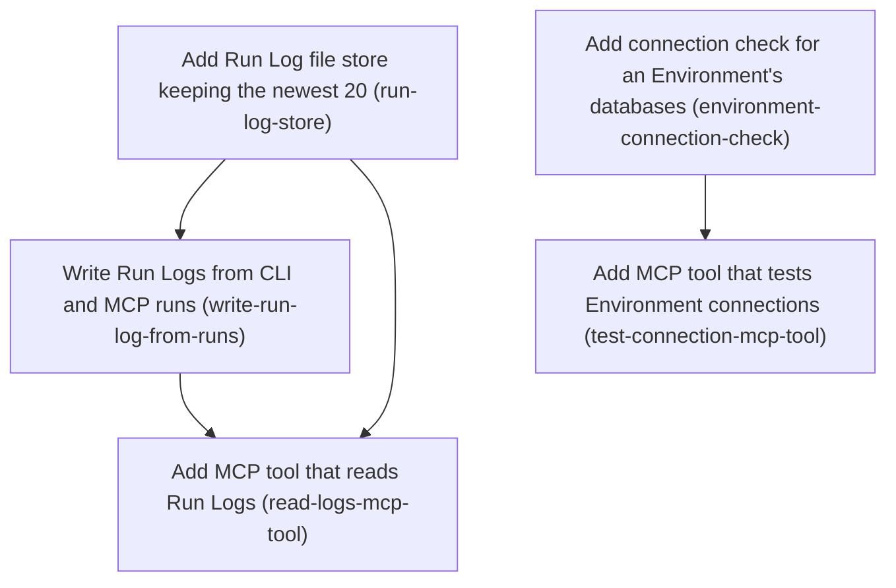

# Horizon 11 — Assistant MCP: Run Logs, read-logs and test-connection

## 🎯 What are we trying to achieve?

Finish the Assistant's v1 MCP tool set. Every `adops run` from the CLI, and every MCP run or preview, leaves one cleaned, secret-free **Run Log** file at `.adops/logs/<env>/<UTC time>-<pipeline>.log`, keeping the newest 20 per Environment. The Assistant gets two new tools: **read-logs**, which reads only those files and only for dev or a Branch Environment, and **test-connection**, which checks dev's or a Branch Environment's Warehouse, Sources and Reverse Sync targets and reports every failure in fixed words that never carry a password or driver text.

## 🧠 Why does this change need to happen?

Today a run's result exists only in the terminal or in one MCP reply, so the Assistant cannot look back at what failed. When a database is down, the only way to find out is to run a Pipeline. Vision item 7 promises read-logs and test-connection, and they are the last two MCP tools still missing.

## At a glance

- **Phases:** 5 (none deferred to a later horizon)
- **Complexity:** Medium — the run entry point changes for both the CLI and MCP, plus new connection probes
- **Main risk:** a Run Log is a new file that persists on disk; any path where unredacted text reaches it would break the no-secret rule
- **Target:** 100% line+branch coverage, no new pragmas, purity tests green, E2E within 20 minutes
- **Testing focus:** secret-free output, path-safety refusals (traversal, symlinks, stage/prod), one log per accepted run, connect-only probes that never write

## Order of work
```
Phase 1 — Add Run Log file store keeping the newest 20
        ↓  (Phase 2 uses the file store and name rule)
Phase 2 — Write Run Logs from CLI and MCP runs
        ↓  (Phase 3 reads the logs the runs now write)
Phase 3 — Add MCP tool that reads Run Logs
        ↓  (Phase 4 independent; can start any time)
Phase 4 — Add connection check for an Environment's databases
        ↓  (Phase 5 wraps the connection check)
Phase 5 — Add MCP tool that tests Environment connections
```


### Phase 1 — Add Run Log file store keeping the newest 20

Technical ID: `run-log-store` · Assistant run observability (Run Logs) · cross-cutting · small

**Goal** — Provide one place that knows what a Run Log file is called and how it is written: a pure domain rule for the file name <UTC timestamp>-<pipeline>.log (e.g. 20261121T143005Z-shop_sync.log), plus a filesystem writer that puts the text in .adops/logs/<env>/ and then keeps only the newest 20 Run Logs in that Environment directory.

**Why** — Two later phases need this: the run hook writes Run Logs, and the read-logs tool must accept only names that follow the same pattern. The name rule and the writer are both small and together are the core of the Run Log feature, so this is one small slice across the domain and infrastructure layers. Nothing like it exists yet; the only per-Environment local state helper today is local_state_dir for .adops/dlt/<env>.

**Changes**
- Create src/adops/domain/run_log.py with RUN_LOG_NAME = re.compile(r'^\d{8}T\d{6}Z-[a-z][a-z0-9_]*\.log$'), run_log_file_name(timestamp: datetime, pipeline: str) -> str (formats the given aware datetime as %Y%m%dT%H%M%SZ in UTC, never calls .now()), and is_run_log_name(name: str) -> bool; pure stdlib only (re, datetime).
- Create src/adops/infrastructure/run_log_store.py with run_log_dir(project, environment) -> project/.adops/logs/<environment> and write_run_log(project, environment, pipeline, timestamp, text) -> Path | None that returns None without touching the disk when environment fails ^[a-z][a-z0-9_]*$ or pipeline fails the Pipeline name pattern, and otherwise creates the directory (mkdir parents) and writes UTF-8 text with exclusive create ('x' mode); on a name collision (two runs of one Pipeline in the same second) add one second and retry, so it never overwrites and the name still matches the pattern.
- After each write, prune: list only files in that directory matching is_run_log_name, sort newest first by name, delete everything after the 20th; ignore FileNotFoundError when a file vanishes during a concurrent prune; never touch non-matching files.
- Make write_run_log catch OSError from writing or pruning (e.g. a root-owned file left by the Server container) and return None instead of raising, so a Run Log problem never changes a run's outcome.
- Add domain tests for file name formatting (a non-UTC aware datetime is converted to UTC) and is_run_log_name accept/reject cases ('../x.log', 'a.log', upper case, missing Z).
- Add infrastructure tests with tmp_path: a write creates the file, a timestamp collision gives the next second, the 21st write deletes the oldest, a non-matching notes.txt survives pruning, a vanishing file during pruning is tolerated, an unwritable directory returns None; cover every branch. Add a test that environment '../x' or 'Dev' returns None and creates nothing.

**Files / areas**
- `src/adops/domain/run_log.py`
- `src/adops/infrastructure/run_log_store.py`
- `tests/unit/domain/test_run_log.py`
- `tests/unit/infrastructure/test_run_log_store.py`

**How to verify**
- **Run Log name rule is pure domain; filesystem stays in infrastructure** — `grep -nE '^(import|from) ' src/adops/domain/run_log.py` lists only `re`, `datetime` and optionally `__future__`.
- **File name is UTC-normalized and the pattern rejects non-Run-Log names** — `uv run python -c "from datetime import datetime,timezone,timedelta; from adops.domain.run_log import run_log_file_name as f; print(f(datetime(2026,11,21,16,30,5,tzinfo=timezone(timedelta(hours=2))),'shop_sync'))"` prints `20261121T143005Z-shop_sync.log`.
- **Same-second collisions never overwrite an existing Run Log** — `grep -nE "open\(.*['\"]x['\"]|mode=['\"]x" src/adops/infrastructure/run_log_store.py` shows an exclusive-create open (or `Path.open('x')`).
- **Pruning keeps the newest 20 Run Logs and touches nothing else** — A test writes 21 Run Logs with increasing timestamps and asserts exactly 20 remain and the oldest name is gone.
- **Any OSError while writing or pruning is swallowed and returns None** — A test makes the Environment directory read-only via tmp_path chmod and asserts write_run_log(...) is None.

**Done when** — src/adops/infrastructure/run_log_store.py write_run_log writes .adops/logs/<env>/<timestamp>-<pipeline>.log and leaves at most 20 Run Logs per directory, proven by unit tests at 100% line+branch coverage. Every check under *How to verify* passes its bar.

**Depends on** — nothing — can start immediately

**Guards**
- g5: domain/run_log.py imports only re and datetime, takes the timestamp as an argument and never calls .now(); all pathlib/os use stays in infrastructure/run_log_store.py.
- g6: the OSError and vanishing-file branches are reached through tmp_path permissions and a monkeypatched unlink, so no pragma is needed.

<details><summary>Reference — full rubric</summary>

| Dimension | Rule | Pass criteria | Failure examples | minScore |
|---|---|---|---|---|
| name-rule-layer-purity | src/adops/domain/run_log.py holds only the name rule (RUN_LOG_NAME, run_log_file_name, is_run_log_name) using stdlib re and datetime, takes the timestamp as an argument, and every pathlib/os call lives in src/adops/infrastructure/run_log_store.py. 10 = domain module has zero non-stdlib imports, no clock call, and infrastructure imports the domain rule instead of re-declaring the pattern; 8 = pure domain module with a minor smell (e.g. an unused import); below 7 = any filesystem, os or clock use in domain. | `grep -nE '^(import\|from) ' src/adops/domain/run_log.py` lists only `re`, `datetime` and optionally `__future__`.<br>`grep -nE 'now\(\|utcnow\|time\.time\|pathlib\|import os' src/adops/domain/run_log.py` prints nothing.<br>`grep -n 'import' src/adops/infrastructure/run_log_store.py` shows it imports is_run_log_name / run_log_file_name from adops.domain.run_log, and `grep -n 're.compile' src/adops/infrastructure/run_log_store.py` prints nothing (pattern not duplicated).<br>`uv run pytest tests/unit/domain/test_domain_purity.py` passes.<br>A test calls write_run_log with environment '../x' and asserts it returns None and tmp_path contains no new file or directory. | run_log_file_name defaults timestamp to datetime.now(timezone.utc) when None is passed, so the domain reads the wall clock.<br>Plausible: the writer in infrastructure re-declares its own regex for pruning that drifts from RUN_LOG_NAME (e.g. allows upper-case pipeline names), so read-logs and pruning disagree on what a Run Log is. | 8 |
| name-format-utc-and-rejection | run_log_file_name converts any aware datetime to UTC before formatting as %Y%m%dT%H%M%SZ-<pipeline>.log, and is_run_log_name accepts only names fully matching ^\d{8}T\d{6}Z-[a-z][a-z0-9_]*\.log$. 10 = UTC conversion, traversal, absolute paths, upper case, missing Z, missing timestamp and trailing newline are all rejected and tested; 8 = UTC conversion plus the listed reject cases tested; below 7 = a non-UTC datetime yields local time or any path-like name is accepted. | `uv run python -c "from datetime import datetime,timezone,timedelta; from adops.domain.run_log import run_log_file_name as f; print(f(datetime(2026,11,21,16,30,5,tzinfo=timezone(timedelta(hours=2))),'shop_sync'))"` prints `20261121T143005Z-shop_sync.log`.<br>`uv run python -c "from adops.domain.run_log import is_run_log_name as g; print([g(n) for n in ['../x.log','/tmp/20261121T143005Z-a.log','a.log','20261121T143005Z-Shop.log','20261121T143005-a.log','20261121T143005Z-a.log\n','20261121T143005Z-a.log']])"` prints six False then one True.<br>tests/unit/domain/test_run_log.py contains a test feeding a non-UTC aware datetime and asserting the UTC hour. | run_log_file_name calls timestamp.strftime directly, so a +02:00 datetime produces 163005Z.<br>Plausible: the pattern is checked with re.match instead of fullmatch and the regex lacks a trailing anchor or uses `$` which accepts a trailing newline, so '20261121T143005Z-a.log\n' passes. | 8 |
| no-overwrite-on-collision | write_run_log creates files with exclusive create and, on FileExistsError, advances the timestamp by one second and retries, so two runs of one Pipeline in the same second leave two distinct, pattern-matching files. 10 = repeated collisions (3+ writes in one second) each produce a distinct name and the original content is byte-for-byte preserved, all tested; 8 = single collision tested with next-second name; below 7 = a second write in the same second replaces the first. | `grep -nE "open\(.*['\"]x['\"]\|mode=['\"]x" src/adops/infrastructure/run_log_store.py` shows an exclusive-create open (or `Path.open('x')`).<br>tests/unit/infrastructure/test_run_log_store.py has a test writing twice with the same timestamp and asserting both files exist with names one second apart and the first file's text unchanged.<br>No call to `write_text` on the target path appears in run_log_store.py (`grep -n write_text` prints nothing or only for non-target paths). | Uses path.write_text(text), so the second run in the same second silently overwrites the first Run Log.<br>Plausible: on collision appends a suffix like '-1' before '.log', producing a name that is_run_log_name rejects, so read-logs can never see it and pruning never deletes it. | 8 |
| prune-keeps-newest-20-only-run-logs | After each write, only files in .adops/logs/<env>/ matching is_run_log_name are considered; they are ordered newest first by name and everything after the 20th is deleted, non-matching files and subdirectories survive, and a file vanishing mid-prune is tolerated. 10 = all of that plus pruning confined to the one Environment directory (sibling Environment dirs untouched) is tested; 8 = 21st write deletes oldest and notes.txt survives, vanishing file tolerated; below 7 = prunes by mtime, deletes non-matching files, or crashes on FileNotFoundError. | A test writes 21 Run Logs with increasing timestamps and asserts exactly 20 remain and the oldest name is gone.<br>A test places notes.txt (and a non-matching .log such as debug.log) in the directory and asserts it still exists after pruning.<br>A test monkeypatches unlink (or deletes a file between list and unlink) to raise FileNotFoundError and asserts write_run_log still returns the written Path.<br>`grep -nE 'st_mtime\|getmtime' src/adops/infrastructure/run_log_store.py` prints nothing (order is by name). | Pruning uses sorted(dir.iterdir())[:-20] and deletes notes.txt and a user's debug.log.<br>Plausible: sorts by st_mtime, so after a git checkout or copy that resets mtimes the wrong (newer) Run Logs are deleted. | 8 |
| write-failure-returns-none | write_run_log returns None instead of raising on any OSError from mkdir, write or prune (e.g. a root-owned directory from the Server container), and returns the written Path on success. 10 = mkdir failure, write failure and prune (unlink PermissionError) failure are each tested separately and the success return value is asserted; 8 = unwritable directory returns None and success returns Path; below 7 = an OSError propagates or a bare `except Exception` hides programming errors. | A test makes the Environment directory read-only via tmp_path chmod and asserts write_run_log(...) is None.<br>A test makes unlink raise PermissionError during pruning and asserts no exception escapes.<br>`grep -nE 'except (Exception\|BaseException)?:?\s*$\|except Exception' src/adops/infrastructure/run_log_store.py` prints nothing (only OSError subclasses are caught). | write is wrapped in try/except OSError but pruning is outside it, so a root-owned old log raises PermissionError and fails the run.<br>Plausible: catches `Exception`, which also hides a TypeError from a wrong argument, so a broken caller in the next phase silently writes no logs. | 7 |

Healer hint: The most likely miss is pruning or collision handling that drifts from the domain pattern (mtime ordering, a '-1' suffix, or a duplicated regex); make run_log_store import is_run_log_name/run_log_file_name, sort matched names descending, and retry with timestamp + timedelta(seconds=1) on FileExistsError.

</details>

### Phase 2 — Write Run Logs from CLI and MCP runs

Technical ID: `write-run-log-from-runs` · Assistant run observability (Run Logs) · interface · medium

**Goal** — Make run_project, the shared entry point used by `adops run` (including each Pipeline of `run --all`) and by the MCP run and preview tools, write exactly one Run Log per accepted Pipeline run, with text identical to what the CLI prints, Secret values masked, and a timestamp from the Clock; and make plain Projects ignore .adops/ in Git so those logs are never committed.

**Why** — Users and the Assistant need a cleaned record of what a run did without engine noise or secrets. run_project is the one function both the CLI and the MCP server go through (the scheduled Server deliberately bypasses it), so hooking it covers exactly CLI and MCP runs. The CLI prints results with typer.echo directly today, so the text is pulled into a pure function the CLI and the Run Log share. The plain Project template has no .gitignore, so once runs write .adops/logs/ a plain Project would commit them; adding it here lands it with the change that creates the files.

**Changes**
- In run_command.py, extract a pure result_lines(result: RunResult) -> list[str] from _print_result, _print_preview and _print_sample_keys (Step status, Checks, rows loaded, Preview counts and sample keys, the already-redacted Step error); make the CLI print those lines keeping today's stdout/stderr split, so CLI output is unchanged.
- Move project_secret_values(project) from mcp_server.py to a new src/adops/interface/project_secrets.py and import it from there in mcp_server.py and run_command.py (run_command must not import mcp_server).
- Add a build_run_log_writer() seam in run_command.py returning infrastructure.run_log_store.write_run_log, next to build_clock().
- Wrap run_project's body: on a returned RunResult take lines = result_lines(result), environment = result.environment, pipeline = result.pipeline; on a raised RUN_ERRORS failure (including WarehouseLocked, logged with the CLI's 'Another run is using ...' text) take lines = error_lines(error) and the Environment name the run used only when it matches the Environment name pattern (^[a-z][a-z0-9_]*$, environment.py:86) or BRANCH_ENVIRONMENT (warehouse_schemas.py:19), writing no log otherwise (for a Branch run the br_ name from stage_branch_name once adops.yaml loads) and the Pipeline argument only when it matches the Pipeline IDENTIFIER pattern; join, pass through redact_secret_values(text, project_secret_values(project)), write with build_clock().now(), then return or re-raise.
- Mask secrets best-effort: if adops.yaml or .env cannot be read for project_secret_values (e.g. the run failed on invalid YAML), mask with an empty value list (the error text is already cleaned) and still write the log; add a test that an invalid-YAML run writes its log.
- Write no Run Log when the Pipeline argument does not match IDENTIFIER (e.g. '../x') and the run raised before a RunResult existed, or when a Branch run's adops.yaml cannot load; never attach a logging handler or capture stdout/stderr.
- Add build_run_log_writer to SEAMS in tests/unit/interface/test_mcp_server.py so assert_nothing_touched shows MCP refusals (stage/prod, unknown Environment, non-plain Pipeline name, shared-database refusal) write no Run Log.
- Add unit tests: a successful run, a failed Step and a Preview each write one log whose text equals the CLI output; missing Secret Reference, invalid YAML, unreachable Warehouse and a held lock each write a log with the clean message; run --all writes one log per Pipeline; a Branch run writes under .adops/logs/br_<name>/; a non-identifier argument writes nothing; a failing writer leaves the exit code unchanged; no Run Log contains any mcp_harness secret value. Update any existing test that asserted an empty .adops/ without weakening it.
- Create src/adops/templates/plain/gitignore containing .env and .adops/ (matching templates/demo/gitignore), add plain/gitignore to the ci.yml wheel template list (ci.yml:51-56), update the plain listing pin in test_init_command.py (~413-424) to include .gitignore, and add a test that a plain Project's .gitignore ignores .env and .adops/.
- In tests/e2e/test_demo_sync.py near the existing no-secret check (~line 331), assert a Run Log exists under .adops/logs/dev/ and contains neither the SHOP_PASSWORD nor the WAREHOUSE_PASSWORD value.

**Files / areas**
- `src/adops/interface/run_command.py`
- `src/adops/interface/project_secrets.py`
- `src/adops/interface/mcp_server.py`
- `src/adops/templates/plain/gitignore`
- `.github/workflows/ci.yml`
- `tests/unit/interface/test_run_command.py`
- `tests/unit/interface/test_mcp_server.py`
- `tests/unit/interface/test_init_command.py`
- `tests/e2e/test_demo_sync.py`

**How to verify**
- **Run Log text is exactly the CLI's printed result lines** — `grep -n 'def result_lines' src/adops/interface/run_command.py` finds one function and `grep -c 'result_lines(' src/adops/interface/run_command.py` is at least 2 (CLI print path and Run Log path).
- **Exactly one Run Log per accepted run; none for refusals or unsafe names** — `grep -n build_run_log_writer tests/unit/interface/test_mcp_server.py` shows it in the SEAMS collection.
- **Every Run Log is masked against all Project secret values** — `grep -n 'redact_secret_values' src/adops/interface/run_command.py` shows the call on the Run Log text path.
- **Run Log problems never change exit code or re-raised error** — A test patches build_run_log_writer to return a writer that returns None and asserts exit code 0 for a successful run.
- **Interface wiring stays in interface; no module cycle with the MCP server** — `grep -n 'mcp_server' src/adops/interface/run_command.py` prints nothing.
- **A new plain Project's .gitignore ignores .env and .adops/** — `cat src/adops/templates/plain/gitignore` shows lines `.env` and `.adops/`.

**Done when** — run_project in src/adops/interface/run_command.py writes one secret-free Run Log per accepted CLI or MCP Pipeline run, with text identical to the CLI output, in a Project whose .gitignore ignores .adops/, proven by unit tests and one E2E assertion. Every check under *How to verify* passes its bar.

**Depends on** — Add Run Log file store keeping the newest 20

**Guards**
- g3: the new plain/gitignore template file is added to the ci.yml wheel-contents list in this same phase.
- g4: adds one cheap file-content assertion to tests/e2e/test_demo_sync.py with no new Docker run, so the 20-minute budget is unaffected.
- g7: mcp_server.py changes only its import of project_secret_values; no MCP SDK import moves out of interface/, and no reply gains a secret value.
- g2: every new branch (write failure, non-identifier name, unloadable Branch name, each RUN_ERRORS kind) has a unit test through the build_run_log_writer and build_clock seams.

<details><summary>Reference — full rubric</summary>

| Dimension | Rule | Pass criteria | Failure examples | minScore |
|---|---|---|---|---|
| log-text-equals-cli-output | A pure result_lines(RunResult) feeds both the CLI printing and the Run Log, so for a successful run, a failed Step and a Preview the Run Log text equals what `adops run` printed (stdout+stderr joined in print order), and CLI output is unchanged from before the phase. 10 = equality asserted for success, failed Step, Preview and early-failure error_lines, and existing CLI output tests pass unedited; 8 = equality asserted for success, failed Step and Preview; below 7 = Run Log built by a separate formatter that can diverge, or CLI output changed. | `grep -n 'def result_lines' src/adops/interface/run_command.py` finds one function and `grep -c 'result_lines(' src/adops/interface/run_command.py` is at least 2 (CLI print path and Run Log path).<br>tests/unit/interface/test_run_command.py has tests that invoke the CLI via CliRunner and assert the Run Log file content equals the printed lines for success, failed Step and Preview.<br>`git diff <phase base commit (ledger baseRef)> -- tests/unit/interface/test_run_command.py` shows no edited expected-output strings for pre-existing CLI output assertions.<br>`grep -nE 'logging\.(getLogger\|Handler\|basicConfig)\|redirect_stdout\|redirect_stderr\|capsys' src/adops/interface/run_command.py` prints nothing. | The Run Log is written from a new f-string template that omits Check results, so it no longer matches what the user saw.<br>Plausible: result_lines returns lines without the stderr error line for a failed Step because the error was printed separately with err=True, so the Run Log is missing the failure reason. | 8 |
| one-log-per-accepted-run-none-for-refusals | Every run that passed Environment and Pipeline-name acceptance writes exactly one Run Log in the Environment directory it used (dev, stage, prod or br_<name>), including early failures (missing Secret Reference, invalid YAML, unreachable Warehouse, held lock), run --all writes one per Pipeline, and MCP refusals plus non-IDENTIFIER Pipeline arguments write none. 10 = each listed case has a test counting files, and test_mcp_server's SEAMS includes build_run_log_writer so every refusal test asserts the writer untouched; 8 = all cases tested but refusal coverage relies on a few explicit tests rather than the SEAMS sweep; below 7 = early failures write nothing, a Branch run logs under dev, or '../x' creates a file. | `grep -n build_run_log_writer tests/unit/interface/test_mcp_server.py` shows it in the SEAMS collection.<br>Tests assert `len(list((tmp/'.adops/logs/dev').iterdir())) == 1` after each early-failure kind, and N files after `run --all` with N Pipelines.<br>A Branch run test asserts the file is under .adops/logs/br_<name>/ and nothing under .adops/logs/dev/.<br>A test running with Pipeline argument '../x' asserts `.adops/logs` does not exist (or contains no file anywhere outside an Environment dir).<br>A test running `adops run p --env '../x'` (and one with invalid adops.yaml and --env '../x') asserts no file is created anywhere outside .adops/logs/<valid env>/ and no .adops/logs entry named after the raw argument exists. | Writer only called after a returned RunResult, so a missing Secret Reference raises before any log is written.<br>Plausible: the Branch run uses the raw `--branch` value as the directory name instead of stage_branch_name's br_ name, so read-logs (which maps through stage_branch_name) can never find those logs. | 8 |
| run-log-secret-free | The joined text passes through redact_secret_values with project_secret_values(project) before writing, falling back to an empty value list only when adops.yaml/.env cannot be read, and no written Run Log contains any resolved secret. 10 = unit tests assert no mcp_harness secret value in any Run Log across success, failure and early-failure cases, the invalid-YAML case still writes, and the E2E test asserts neither SHOP_PASSWORD nor WAREHOUSE_PASSWORD value appears; 8 = masking applied and tested for success and one failure, E2E assertion present; below 7 = masking skipped on any path or invalid YAML crashes the logging. | `grep -n 'redact_secret_values' src/adops/interface/run_command.py` shows the call on the Run Log text path.<br>A test injects a Step error containing a secret value and asserts the Run Log contains the redaction marker and not the value.<br>A test with invalid adops.yaml asserts one Run Log exists and contains the YAML error message.<br>`grep -nE 'SHOP_PASSWORD\|WAREHOUSE_PASSWORD' tests/e2e/test_demo_sync.py` shows an assertion reading a file under .adops/logs/dev/ (guard g4 still runs within budget). | project_secret_values raises on invalid YAML inside the log path, so the invalid-YAML run writes no log and the user's error becomes a traceback.<br>Plausible: masking is applied only to the RunResult path, so the WarehouseLocked/unreachable-Warehouse error_lines path writes unmasked text containing a DSN fragment. | 9 |
| logging-never-changes-outcome | When the writer returns None or the Clock/secret lookup fails, run_project returns the same RunResult or re-raises the same original exception, and the CLI exit code is unchanged. 10 = tests with a failing writer for both a successful and a failing run assert identical exit code and stderr to the no-writer baseline; 8 = one failing-writer test asserts unchanged exit code; below 7 = a logging error replaces the original exception or changes the exit code. | A test patches build_run_log_writer to return a writer that returns None and asserts exit code 0 for a successful run.<br>A test patches the writer for a failing run (e.g. unreachable Warehouse) and asserts the original exception type/message and non-zero exit code are preserved.<br>In run_project, the original exception is re-raised with bare `raise` (check with `grep -n 'raise$' src/adops/interface/run_command.py` near the wrapper). | The wrapper uses try/finally and writes in finally, so an exception during writing masks the original WarehouseLocked error.<br>Plausible: the wrapper re-raises `raise error from None` after logging, changing the traceback chain that an existing test or the CLI's error mapping depends on. | 8 |
| interface-layer-boundaries | project_secret_values lives in src/adops/interface/project_secrets.py and is imported by both mcp_server.py and run_command.py, run_command.py never imports mcp_server, the writer reaches infrastructure only through the build_run_log_writer seam, and no domain or application module imports the store. 10 = all of that with mcp_server.py's only change being the import line; 8 = boundaries respected with small incidental edits in mcp_server.py; below 7 = run_command imports mcp_server or domain/application imports infrastructure.run_log_store. | `grep -n 'mcp_server' src/adops/interface/run_command.py` prints nothing.<br>`grep -n 'def project_secret_values' -r src/adops` prints exactly one hit, in src/adops/interface/project_secrets.py.<br>`grep -rn 'run_log_store' src/adops/domain src/adops/application` prints nothing.<br>`git diff <phase base commit (ledger baseRef)> --stat -- src/adops/interface/mcp_server.py` shows only a few changed lines (the import move). | run_command.py does `from adops.interface.mcp_server import project_secret_values`, pulling the MCP SDK into every CLI run.<br>Plausible: project_secret_values is copied into run_command.py instead of moved, so the two copies drift and a new secret kind is masked in MCP replies but not in Run Logs. | 8 |
| plain-project-ignores-adops | `adops init` for a plain Project creates a .gitignore listing .env and .adops/, matching the demo template, so Run Logs are never committed. 10 = test runs init and asserts via `git check-ignore` (or line content) that both .adops/logs/dev/x.log and .env are ignored, listing pin updated, and wheel guard g3 passes; 8 = file content asserted and listing pin updated; below 7 = plain Projects still lack .gitignore or it omits .adops/. | `cat src/adops/templates/plain/gitignore` shows lines `.env` and `.adops/`.<br>tests/unit/interface/test_init_command.py's plain listing includes `.gitignore` and a test asserts its lines.<br>Guard g3 outcome: `grep -n 'plain/gitignore' .github/workflows/ci.yml` finds the wheel-contents entry. | Template file added as src/adops/templates/plain/.gitignore (dotfile) which the init copier or wheel build skips, so projects get no .gitignore.<br>Plausible: the gitignore lists `.adops/logs/` only, so the existing .adops/dlt/<env> state still gets committed and differs from the demo template. | 7 |

Healer hint: The likeliest failure is an early-failure path (invalid YAML, missing Secret Reference, held lock, Branch name) that raises before the writer runs or logs under the wrong directory; wrap the whole run_project body once, compute the Environment name via stage_branch_name after adops.yaml loads, and fall back to an empty secret list when secrets cannot be read.

</details>

### Phase 3 — Add MCP tool that reads Run Logs

Technical ID: `read-logs-mcp-tool` · Assistant MCP tools · interface · medium

**Goal** — Give the Assistant a read_logs MCP tool that, for dev or one Branch Environment, lists that Environment's Run Logs newest first, or returns one Run Log's cleaned text by file name, and refuses every other file.

**Why** — The Assistant needs to see what past runs did, but must never read stage or prod logs, engine logs, or any file outside the Run Log directory. Reusing the existing dev/Branch allow-list guard and file-reading safeguards keeps the tool small and its refusals the same as the other tools'.

**Changes**
- Add a ReadLogsReply TypedDict (environment, logs: list[str], name: str | None, text: str | None) and a synchronous @server.tool() read_logs(environment: str | None = None, branch: str | None = None, name: str | None = None) in build_server, with a docstring and its body in `with _sanitized_errors():`.
- Apply only the dev/Branch allow-list (assistant_target) — not the shared-database refusal, because reading a local log file never touches a database; map to run_log_dir(project, env): dev stays dev, a branch becomes the same br_ name the run uses via stage_branch_name(stage_environment(settings), branch).
- Without a name: return matching file names (is_run_log_name) sorted newest first, or an empty list when the directory does not exist.
- With a name: refuse with a ToolError unless is_run_log_name(name); refuse a symlinked .adops/logs, Environment directory or file by checking the resolved path is inside resolved project/.adops/logs/<env> and no part is a symlink; read through a capped UTF-8 reader extracted from read_project_file into assistant_files.py (read_capped_text(path) using MAX_READ_BYTES and NOT_READABLE_TEXT), which read_project_file and read_logs both call; pass the text through redact_secret_values with project_secret_values(project).
- Add tests: listing order; reading one log; a dev that shares a database with stage is still readable; refusals for stage, prod, unknown Environment, '../x.log', an absolute path, a non-Run-Log name, a symlinked log file and a symlinked logs directory pointing at stage's logs; missing directory gives an empty list; too-large or non-UTF-8 file; every reply passes mcp_harness.assert_no_secret; project_tree before/after shows nothing written. Existing test_assistant_files.py tests stay unchanged and green.

**Files / areas**
- `src/adops/interface/mcp_server.py`
- `src/adops/interface/assistant_files.py`
- `tests/unit/interface/test_mcp_server.py`

**How to verify**
- **Only pattern-matching files inside the Environment's log directory are readable** — tests/unit/interface/test_mcp_server.py has refusal tests for '../x.log', an absolute path, 'notes.txt', a symlinked Run Log file, and a symlinked .adops/logs (or dev dir) pointing at .adops/logs/stage, each asserting ToolError.
- **dev/Branch allow-list applied and branch maps to the run's br_ directory** — Tests assert ToolError for environment='stage', 'prod' and an unknown name.
- **Listing is newest-first and reads obey size and encoding caps** — A test creates three Run Logs plus notes.txt and asserts logs == the three names in descending order.
- **read_logs writes nothing and no reply carries a secret** — A test writes a Run Log containing an mcp_harness secret value directly to disk, reads it via read_logs, and asserts the value is absent.

**Done when** — A read_logs tool registered in build_server (src/adops/interface/mcp_server.py) that lists and reads only Run Logs of dev or a Branch Environment and refuses every other path, proven by tests in test_mcp_server.py. Every check under *How to verify* passes its bar.

**Depends on** — Add Run Log file store keeping the newest 20, Write Run Logs from CLI and MCP runs

**Guards**
- g7: the tool is synchronous, uses the MCP SDK only inside mcp_server.py, accepts only dev or a Branch Environment through the assistant_target allow-list, and every reply is redacted and checked with assert_no_secret.
- g5: no change to domain or application; allowed_project_path is not widened.

<details><summary>Reference — full rubric</summary>

| Dimension | Rule | Pass criteria | Failure examples | minScore |
|---|---|---|---|---|
| reads-only-run-log-files | read_logs refuses with a ToolError any name that fails is_run_log_name, and any read where .adops/logs, the Environment directory or the file is a symlink or the resolved path is outside resolved project/.adops/logs/<env>. 10 = traversal, absolute path, non-Run-Log name, symlinked file, symlinked Environment dir and symlinked logs dir (pointing at stage's logs) each have a refusal test and none of them reads bytes; 8 = traversal, absolute, non-pattern and symlinked file/dir refused and tested; below 7 = any symlink or traversal case returns content. | tests/unit/interface/test_mcp_server.py has refusal tests for '../x.log', an absolute path, 'notes.txt', a symlinked Run Log file, and a symlinked .adops/logs (or dev dir) pointing at .adops/logs/stage, each asserting ToolError.<br>`grep -n 'is_run_log_name' src/adops/interface/mcp_server.py` shows it used both for listing filtering and for the name check.<br>`grep -nE 'is_symlink\|resolve\(' src/adops/interface/mcp_server.py` shows symlink checks on each path component in the read_logs path. | Name validated with is_run_log_name, but path read without symlink checks, so a dev logs dir symlinked to stage's returns stage Run Logs.<br>Plausible: only the final file is checked with is_symlink(), so a symlinked .adops/logs directory escapes to another Environment while the resolved-path check is skipped because it compares unresolved paths. | 9 |
| environment-mapping-matches-runs | read_logs accepts only dev or a Branch Environment via assistant_target, does NOT apply the shared-database refusal, and maps a branch to run_log_dir(project, stage_branch_name(stage_environment(settings), branch)) — the same directory the previous phase writes to. 10 = stage, prod and unknown Environment refused, a dev sharing stage's database still readable, and a test writes a Branch Run Log via run_project (or write_run_log with the same name rule) and reads it back through read_logs; 8 = refusals and shared-database readability tested, branch mapping tested with a hand-built br_ path; below 7 = stage/prod readable, or shared-db dev refused, or branch maps to a different directory. | Tests assert ToolError for environment='stage', 'prod' and an unknown name.<br>A test with mcp_harness settings where dev shares stage's database lists/reads a dev Run Log successfully.<br>A test with a Branch Environment asserts read_logs lists the files under .adops/logs/<the br_ name a run of that branch writes>/ (computed with stage_branch_name), and a test where dev shares stage's database still lists dev Run Logs. | read_logs reuses guarded_run_arguments, so any Project whose dev shares stage's database can never read its own dev logs.<br>Plausible: branch maps to f'br_{branch}' by hand, skipping stage_branch_name's sanitising/truncation, so long or dashed branch names list an empty directory while the logs exist. | 8 |
| list-and-read-reply-contract | Without name, the reply's logs holds only matching file names sorted newest first (name and text None), with an empty list when the directory is missing; with name, text is the file's content read with read_project_file's 256 KiB cap and UTF-8 requirement. 10 = order, missing-dir empty list, non-matching files excluded from listing, too-large and non-UTF-8 refusals all tested and reply keys match ReadLogsReply exactly; 8 = order, missing dir, read, and one cap refusal tested; below 7 = unsorted or includes non-Run-Log files, missing dir raises, or unbounded read. | A test creates three Run Logs plus notes.txt and asserts logs == the three names in descending order.<br>A test with no .adops/logs/dev asserts logs == [] and no ToolError.<br>Tests assert ToolError for a 256 KiB+1 file and for a file with invalid UTF-8 bytes.<br>`grep -n 'class ReadLogsReply' src/adops/interface/mcp_server.py` shows keys environment, logs, name, text. | Listing uses os.listdir without sorting, so order depends on the filesystem.<br>Plausible: reading uses path.read_text() directly instead of the existing capped reader, so a 50 MB file is loaded into the Assistant's reply. | 8 |
| read-only-and-secret-free | Every read_logs call leaves the project tree unchanged and every reply — listings, reads and ToolError messages — passes mcp_harness.assert_no_secret, with read text masked through redact_secret_values(project_secret_values(project)). 10 = a hand-planted Run Log containing a secret value is read back masked, project_tree before/after asserted on success and refusal paths, and the tool is synchronous; 8 = masked read and assert_no_secret on all reply tests; below 7 = read text not masked or a refusal message echoes a path containing secret text. | A test writes a Run Log containing an mcp_harness secret value directly to disk, reads it via read_logs, and asserts the value is absent.<br>Tests compare mcp_harness project_tree before/after for at least one listing, one read and one refusal.<br>`grep -n 'async def read_logs' src/adops/interface/mcp_server.py` prints nothing (tool is `def`). | Text returned as-is on the assumption Run Logs are already clean, so a log hand-edited or written by an older version leaks a password.<br>Plausible: read_logs calls mkdir(parents=True) on run_log_dir to avoid a missing-dir branch, creating .adops/logs/dev on every listing. | 9 |

Healer hint: Most likely a symlink escape (e.g. a symlinked .adops/logs pointing at stage) or a branch-name mapping that differs from the run's; check is_symlink on .adops/logs, the Environment dir and the file, compare fully resolved paths, and map branches only through stage_branch_name(stage_environment(settings), branch).

</details>

### Phase 4 — Add connection check for an Environment's databases

Technical ID: `environment-connection-check` · Environment connectivity · cross-cutting · medium

**Goal** — Provide shared code that, for one Environment, tries to connect to its Warehouse, every Source used by the Project's Pipelines and every Reverse Sync target, never writes or creates anything, and returns a result per target using new fixed project-wide messages ('Warehouse is unreachable', 'Source <name> is unreachable', 'Target <name> is unreachable') or the existing missing-Secret-Reference message.

**Why** — The test-connection tool needs this logic, and it stays outside the MCP server so a CLI command could be added later. The existing unreachable messages all name a Pipeline and Step, which a project-wide check does not have, so new fixed variants are needed. The use case and its connect-only adapter are small and form one slice across the application and infrastructure layers.

**Changes**
- Create src/adops/application/connection_check.py: a ConnectionProbe Protocol with postgres(connection: ResolvedConnection) -> bool and duckdb(path: str) -> bool; fixed messages WAREHOUSE_UNREACHABLE = 'Warehouse is unreachable', source_unreachable(name), target_unreachable(name) built only from adops.yaml names; a ConnectionResult dataclass (kind, name, ok, message).
- Add check_connections(environment, source_names, env_values, probe) -> list[ConnectionResult]: the Warehouse, then each Source name sorted (an undefined name is a failed result), then each Reverse Sync target in the Environment's targets map; resolve each connection's Secret Reference separately with resolve_secret_references so a MissingSecretError marks only that connection with its existing text; always report every target.
- Create src/adops/infrastructure/connection_probe.py: postgres() does psycopg.connect(..., connect_timeout=10) then close, no query, False on psycopg.OperationalError; duckdb() returns False if the parent directory is missing, True if the file is absent but the directory is writable (without creating it), otherwise duckdb.connect(path, read_only=True) closed immediately, False on duckdb.Error (e.g. a running writer); never touches the <file>.lock file.
- Declare duckdb as a direct dependency in pyproject.toml pinned to the version already locked transitively, and refresh uv.lock so `uv sync --locked` passes.
- Add application tests with a fake probe: all reachable; each unreachable kind; a missing secret on one Source only; an undefined Source name; every target reported after the first failure; no message containing a password, DSN or driver text.
- Add infrastructure tests: Postgres reachable via ADOPS_TEST_POSTGRES_DSN (fixture fails, never skips, without it, as existing tests do) and an unreachable closed local port returning False; DuckDB existing file, absent file not created, missing parent directory, and a file held by the DuckDB-holder fixture (tests/unit/conftest.py) returning False.

**Files / areas**
- `src/adops/application/connection_check.py`
- `src/adops/infrastructure/connection_probe.py`
- `pyproject.toml`
- `uv.lock`
- `tests/unit/application/test_connection_check.py`
- `tests/unit/infrastructure/test_connection_probe.py`

**How to verify**
- **Check logic is driver-free application code behind a probe port** — `grep -nE 'psycopg|duckdb|os\.environ|import os|from adops\.(infrastructure|interface)' src/adops/application/connection_check.py` prints nothing.
- **Warehouse, each Source and each Reverse Sync target always get a result** — A test with a fake probe returning False for the Warehouse asserts results still include every Source and target in order [warehouse, sorted sources..., targets...].
- **Failure messages are fixed strings built only from adops.yaml names** — `grep -nE 'str\(e|\{e\}|repr\(|dsn|host' src/adops/application/connection_check.py` shows no interpolation of exception, DSN or host into messages.
- **The connect-only probe creates and locks nothing** — `grep -nE 'execute|cursor|CREATE|lock' src/adops/infrastructure/connection_probe.py` prints nothing except possibly comments.
- **duckdb is a declared, locked direct dependency at the already-resolved version** — `grep -n duckdb pyproject.toml` shows it under [project].dependencies.

**Done when** — check_connections in src/adops/application/connection_check.py, backed by the connect-only probe in src/adops/infrastructure/connection_probe.py, returns one fixed-message result per Warehouse, Source and Reverse Sync target, proven by unit tests at 100% coverage. Every check under *How to verify* passes its bar.

**Depends on** — nothing — can start immediately

**Guards**
- g5: application/connection_check.py imports only stdlib and adops.domain/application and takes env values as a mapping rather than reading os.environ; psycopg and duckdb are imported only in infrastructure/connection_probe.py.
- g2: the reachable-Postgres branch runs against the CI Postgres service via ADOPS_TEST_POSTGRES_DSN and the unreachable branches use a closed local port, so coverage reaches 100% in CI.
- g6: no pragma; every probe branch is reached by a real file, port or holder fixture.

<details><summary>Reference — full rubric</summary>

| Dimension | Rule | Pass criteria | Failure examples | minScore |
|---|---|---|---|---|
| application-port-purity | src/adops/application/connection_check.py defines the ConnectionProbe Protocol, ConnectionResult and check_connections using only stdlib and adops.domain/application, takes env values as a mapping, and psycopg/duckdb appear only in src/adops/infrastructure/connection_probe.py. 10 = no driver, os or os.environ in application, probe injected, and the infrastructure probe structurally satisfies the Protocol (a typed assignment or test shows it); 8 = pure application module with injected probe; below 7 = application imports psycopg/duckdb/os.environ or calls the infrastructure probe directly. | `grep -nE 'psycopg\|duckdb\|os\.environ\|import os\|from adops\.(infrastructure\|interface)' src/adops/application/connection_check.py` prints nothing.<br>`grep -rln -E '^(import\|from) (psycopg\|duckdb)' src/adops` lists connection_probe.py among existing infrastructure files and nothing under application/ or domain/.<br>`uv run pytest tests/unit/application/test_application_purity.py` passes. | check_connections reads os.environ to resolve Secret References instead of taking env_values.<br>Plausible: application catches psycopg.OperationalError itself to build the message, importing psycopg into application. | 8 |
| every-target-reported-in-order | check_connections returns one ConnectionResult for the Warehouse, then each Source name sorted, then each Reverse Sync target of the Environment, continuing after any failure; an undefined Source name and a missing Secret Reference fail only that entry. 10 = order, continue-after-failure, undefined Source, per-connection secret resolution and an Environment with zero targets are all tested; 8 = order, continue-after-failure, undefined Source and missing secret on one Source tested; below 7 = stops at first failure, or a missing secret on one Source fails the whole check. | A test with a fake probe returning False for the Warehouse asserts results still include every Source and target in order [warehouse, sorted sources..., targets...].<br>A test with one Source's Secret Reference missing from env_values asserts only that Source is not ok and its message equals the existing MissingSecretError text, while other entries are ok.<br>A test passing a Source name absent from adops.yaml asserts a failed result for that name, not an exception. | resolve_secret_references is called once on the whole Environment, so one missing Source password raises and no result is returned.<br>Plausible: Sources iterated from a set without sorting, so result order varies between runs and reply snapshots flake. | 8 |
| fixed-secret-free-messages | Every failed result's message is exactly 'Warehouse is unreachable', 'Source <name> is unreachable', 'Target <name> is unreachable' or the existing missing-Secret-Reference text; no DSN, host, password or driver exception text reaches a message. 10 = probes return bool (exceptions never cross the port) and a test with a secret-bearing DSN and a raising-then-False probe asserts no secret or driver text in any message; 8 = fixed messages asserted for every kind; below 7 = any message includes str(exception), host or DSN. | `grep -nE 'str\(e\|\{e\}\|repr\(\|dsn\|host' src/adops/application/connection_check.py` shows no interpolation of exception, DSN or host into messages.<br>Application tests assert message equality (==) for each unreachable kind.<br>A test asserts no result message contains the test password or 'postgresql://'. | target_unreachable includes the target's host:port for helpfulness, exposing internal hostnames.<br>Plausible: postgres() re-raises OperationalError on authentication failure and the caller formats f'{name}: {err}', leaking the driver's 'password authentication failed for user ...' text. | 9 |
| probe-never-writes | postgres() connects with connect_timeout=10, runs no query and closes; duckdb() opens read_only only for an existing file, returns True for an absent file in a writable directory without creating it, False for a missing parent or a file held by a writer, and never touches <file>.lock. 10 = all DuckDB branches tested against real files including the holder fixture, test asserts the absent file and its .lock still do not exist, and Postgres reachable/unreachable tested against the CI service and a closed port; 8 = DuckDB absent-not-created and held-file cases plus Postgres both branches tested; below 7 = absent file gets created, a .lock file appears, or a query/DDL is executed. | `grep -nE 'execute\|cursor\|CREATE\|lock' src/adops/infrastructure/connection_probe.py` prints nothing except possibly comments.<br>`grep -n 'read_only=True' src/adops/infrastructure/connection_probe.py` and `grep -n 'connect_timeout=10'` each find one hit.<br>tests/unit/infrastructure/test_connection_probe.py asserts `not path.exists()` and `not Path(str(path)+'.lock').exists()` after probing an absent DuckDB file.<br>The Postgres reachable test uses ADOPS_TEST_POSTGRES_DSN with a fixture that fails (not skips) when unset. | duckdb() calls duckdb.connect(path) without read_only, creating an empty Warehouse file on a typo'd path.<br>Plausible: reuses the existing warehouse lock helper to check DuckDB availability, which creates <file>.lock as a side effect. | 9 |
| duckdb-direct-dependency-locked | pyproject.toml lists duckdb as a direct dependency pinned to the version already in uv.lock, and the lock is consistent. 10 = pin equals the previously locked version, uv.lock diff touches only the dependency metadata, and `uv sync --locked` passes; 8 = declared and locked consistently; below 7 = undeclared, or the lock is stale. | `grep -n duckdb pyproject.toml` shows it under [project].dependencies.<br>`uv sync --locked` exits 0.<br>`git diff <phase base commit (ledger baseRef)> -- uv.lock \| grep -E '^[-+]version' ` shows no duckdb version change. | duckdb imported in connection_probe.py but left transitive, so a dlt upgrade dropping it breaks the probe.<br>Plausible: adds `duckdb>=1.0` and runs `uv lock --upgrade`, bumping unrelated packages in the same commit. | 7 |

Healer hint: The likeliest miss is a probe side effect (DuckDB file or .lock created) or driver text leaking via an exception; make probes return bool only, use duckdb.connect(path, read_only=True) solely for existing files, check directory writability with os.access for absent ones, and assert non-existence of both the file and its .lock in tests.

</details>

### Phase 5 — Add MCP tool that tests Environment connections

Technical ID: `test-connection-mcp-tool` · Assistant MCP tools · interface · medium

**Goal** — Give the Assistant a test_connection MCP tool that, for dev or a Branch Environment (which uses stage's Warehouse and Reverse Sync targets), runs the connection check and replies with every target's result in fixed, secret-free words.

**Why** — Before running or debugging a Pipeline, the Assistant needs to know which connection is broken without seeing driver errors or passwords. The check logic exists after the previous phase, so this is the thin MCP glue: guard, resolve the Environment, list the Sources, shape the reply.

**Changes**
- Add a build_connection_probe() seam returning the infrastructure ConnectionProbe, and add it to SEAMS in test_mcp_server.py so refusals are shown to touch nothing.
- Add ConnectionResultReply and TestConnectionReply TypedDicts (environment, results: list[ConnectionResultReply], problems: list[str]) and a synchronous @server.tool() test_connection(environment: str | None = None, branch: str | None = None) with a docstring, body in `with _sanitized_errors():`.
- Pass the arguments through guarded_run_arguments (allow-list + shared-database refusal for dev); pick dev, or stage_environment(settings) for a branch; collect Source names as the sorted set of SyncStep.source over load_pipelines(project) with Pipeline load problems in problems; read env values with project_env; call check_connections; take no Warehouse lock.
- Add tests: dev all reachable; a branch checks stage's Warehouse and targets; each unreachable kind; a missing Secret Reference on one Source; an undefined Source; a Pipeline load problem; refusals for stage, prod, unknown Environment and a shared dev database; project_tree before/after shows nothing written; every reply passes mcp_harness.assert_no_secret.

**Files / areas**
- `src/adops/interface/mcp_server.py`
- `tests/unit/interface/test_mcp_server.py`

**How to verify**
- **MCP tool only wires inputs into check_connections** — `grep -nE '^(import|from) (psycopg|duckdb)' src/adops/interface/mcp_server.py` prints nothing.
- **Same dev/Branch allow-list and shared-database refusal as run; refusals touch nothing** — `grep -n 'guarded_run_arguments' src/adops/interface/mcp_server.py` shows it called inside test_connection.
- **Branch checks stage's Warehouse/targets; Sources come from the Project's Sync Steps** — A test with a recording fake probe calls test_connection(branch='feature') and asserts the Warehouse/target connections passed are stage's from mcp_harness SETTINGS.
- **Replies carry only fixed messages; the call writes nothing and takes no lock** — Every test_connection test in tests/unit/interface/test_mcp_server.py calls assert_no_secret on the reply (`grep -c assert_no_secret` rises accordingly).

**Done when** — A test_connection tool registered in build_server (src/adops/interface/mcp_server.py) that reports every Warehouse, Source and Reverse Sync target result for dev or a Branch Environment with fixed messages and no secrets, proven by tests in test_mcp_server.py. Every check under *How to verify* passes its bar.

**Depends on** — Add connection check for an Environment's databases

**Guards**
- g7: the tool is synchronous, the MCP SDK stays in mcp_server.py, only dev or a Branch Environment is accepted through guarded_run_arguments, and replies carry only fixed messages checked with assert_no_secret.
- g5: the interface calls the application use case; no driver import enters application.

<details><summary>Reference — full rubric</summary>

| Dimension | Rule | Pass criteria | Failure examples | minScore |
|---|---|---|---|---|
| thin-glue-over-use-case | test_connection in mcp_server.py guards arguments, resolves the Environment, collects Source names, reads env values with project_env, calls application check_connections with the probe from build_connection_probe(), and shapes the reply; it formats no messages and imports no driver. 10 = no psycopg/duckdb import or message literal in mcp_server.py for this tool and the reply's result messages come verbatim from ConnectionResult; 8 = thin glue with minor reshaping; below 7 = tool connects to databases itself or rewrites messages. | `grep -nE '^(import\|from) (psycopg\|duckdb)' src/adops/interface/mcp_server.py` prints nothing.<br>`grep -n 'check_connections' src/adops/interface/mcp_server.py` finds the call and `grep -n 'def build_connection_probe' src/adops/interface/mcp_server.py` finds the seam.<br>`grep -nE "is unreachable" src/adops/interface/mcp_server.py` prints nothing (messages only from application).<br>`grep -n 'async def test_connection' src/adops/interface/mcp_server.py` prints nothing. | The tool calls psycopg.connect inline for Sources because SyncStep gives it the connection directly.<br>Plausible: the tool maps ConnectionResult.message to its own wording ('Could not reach Source x'), so CLI and MCP phrasing diverge from the fixed messages. | 8 |
| guard-parity-with-run | Arguments pass through guarded_run_arguments, so stage, prod, unknown Environments and a dev sharing stage's database are refused before any probe call, and build_connection_probe is in SEAMS so every refusal test proves the probe and other seams were untouched. 10 = all four refusals tested via the SEAMS sweep plus project_tree unchanged; 8 = all four refusals tested; below 7 = shared-database dev is accepted or a refusal still calls the probe. | `grep -n 'guarded_run_arguments' src/adops/interface/mcp_server.py` shows it called inside test_connection.<br>`grep -n 'build_connection_probe' tests/unit/interface/test_mcp_server.py` shows it in SEAMS.<br>Tests assert ToolError for environment='stage', 'prod', an unknown name, and the shared dev database harness setting. | Uses assistant_target only (like read_logs), so a dev that shares stage's database is probed.<br>Plausible: build_connection_probe() is called before guarded_run_arguments to build the dependency up front, so refusal tests see the seam touched. | 8 |
| branch-uses-stage-and-sources-from-pipelines | For a branch the tool checks stage_environment(settings)'s Warehouse and Reverse Sync targets; for dev, dev's; the Source list is the sorted set of SyncStep.source across load_pipelines(project), with Pipeline load problems returned in problems rather than raising. 10 = a branch test asserts the probe received stage's resolved connections, a dev test asserts dev's, duplicate Sources across Pipelines are checked once, and a broken Pipeline file yields a problems entry while other results are still returned; 8 = branch-uses-stage and Pipeline-problem cases tested; below 7 = branch probes dev's Warehouse or one bad Pipeline file fails the tool. | A test with a recording fake probe calls test_connection(branch='feature') and asserts the Warehouse/target connections passed are stage's from mcp_harness SETTINGS.<br>A test with two Pipelines using the same Source asserts that Source appears once in results.<br>A test with an invalid Pipeline file asserts problems is non-empty and results still contains the Warehouse entry. | Branch resolves to dev's Environment because the code reuses the dev path when branch is set.<br>Plausible: Sources are taken from adops.yaml's sources map instead of the Pipelines' Sync Steps, so unused Sources are probed and an undefined Source referenced by a Pipeline is never reported. | 8 |
| reply-secret-free-and-side-effect-free | Every test_connection reply (success, each unreachable kind, missing Secret Reference, undefined Source, Pipeline problem) passes mcp_harness.assert_no_secret, the project tree is unchanged after the call, and no Warehouse lock is acquired. 10 = assert_no_secret on every reply test, project_tree before/after on success and failure, and a test proves the lock seam is untouched; 8 = assert_no_secret on all replies and project_tree checked once; below 7 = any reply contains a secret or a .lock/.adops file appears. | Every test_connection test in tests/unit/interface/test_mcp_server.py calls assert_no_secret on the reply (`grep -c assert_no_secret` rises accordingly).<br>A test compares project_tree before/after a call with an unreachable Warehouse.<br>`grep -nE 'warehouse_lock\|acquire\|WarehouseLock' ` within test_connection's body prints nothing.<br>problems entries are Pipeline load messages only; a test asserts no problem string contains a secret value. | problems includes the raw exception from load_pipelines, which echoes a DSN from a malformed Pipeline file.<br>Plausible: the tool reuses the run path's Environment preparation, which takes the Warehouse lock and creates .adops/dlt/dev, so a check during a running Pipeline reports a lock error. | 9 |

Healer hint: The likeliest failure is guard or mapping drift — probing before guarded_run_arguments, using dev for a branch, or collecting Sources from adops.yaml instead of the Pipelines; call guarded_run_arguments first, pick stage_environment(settings) for a branch, build Sources from SyncStep.source over load_pipelines, and only then call build_connection_probe().

</details>

## Discovery Findings

| Area | Finding | File | Implication |
|---|---|---|---|
| run_project entry and early-failure paths | run_project(project, pipeline, environment, branch=None, *, lock_timeout) -> RunResult (run_command.py:271-294). run_in_environment (304-339) reads files (ProjectFileError, 469-473), parses YAML/picks Environment (PipelineValidationError, 318), resolves the Warehouse secret (MissingSecretError, 320) before the lock. _run_branch (342-361) computes stage_branch_name. _holding_lock (409-425) turns WarehouseUnreachable into a RunResult via _warehouse_unreachable (428-435); WarehouseLocked escapes. Other early failures escape as RUN_ERRORS (80-87). | `src/adops/interface/run_command.py` | The single Run Log write wraps run_project's body: render the RunResult or error_lines(error) (90-94), write, re-raise. Writing inside run_in_environment would miss the branch path and pre-lock failures. |
| conflict: Server does not go through run_project | server.py:80 calls run_in_environment directly and builds its own failure RunResult (81-87); CLI (run_command.py:257) and MCP (mcp_server.py:341) both go through run_project. | `src/adops/interface/server.py` | Resolved by the user: scheduled Server runs write no Run Log; hooking run_project covers exactly CLI and MCP. |
| single write point for CLI run, run --all and MCP run/preview | CLI run() loops _run_one per name (246-247), each calling run_project once (257); unexpected exceptions become 'unexpected {type} while running {pipeline}' (260-262). MCP _guarded_run: guarded_run_arguments (refusals, mcp_server.py:340) then run_project (341-347) then _refuse_written (348); plain_pipeline_name runs before (212, 225). | `src/adops/interface/mcp_server.py` | Hooking run_project gives one log per Pipeline run on every path; MCP refusals happen before it, so they write nothing. |
| CLI output rendering | No function returns a RunResult as text lines: _print_result (487-499), _print_preview (502-517), _print_sample_keys (520-522) call typer.echo directly; step errors go to stderr. Preview sample keys are primary-key values. | `src/adops/interface/run_command.py` | Extract a pure result_lines(RunResult) -> list[str] used by both the CLI printing and the Run Log writer so the text is identical. |
| redaction helpers | Step errors are redacted in application by run_pipeline._redact (404-408); engine text is dropped in dlt_sync._guarded (204-218) and PlannedTransformStep._run (325-331). secrets.redact_secret_values(text, values) masks with '***' (secrets.py:43-47). mcp_server.project_secret_values(project) collects every set Secret Reference value (322-334); mcp_server imports run_command (43). | `src/adops/application/secrets.py` | Pass Run Log text through redact_secret_values as a safety net; move project_secret_values to a shared interface helper (run_command must not import mcp_server). |
| Clock port and injection | Clock Protocol now() -> aware datetime (ports.py:183-187); SystemClock returns datetime.now(UTC) (infrastructure/clock.py:4-6); seam build_clock() in run_command.py:114-115, patched in tests (test_run_command.py:480) and listed in mcp tests' SEAMS (test_mcp_server.py:63-71). | `src/adops/application/ports.py` | Take the Run Log timestamp from build_clock().now() formatted %Y%m%dT%H%M%SZ; add a build_run_log_writer seam and list it in SEAMS so assert_nothing_touched covers it. |
| Branch Environment name in RunResult | A Branch run's RunResult.environment is stage_branch_name(stage, branch) (run_pipeline.py:573-576) -> branch_environment_name (branch_environment.py:21-42): 'br_' + sanitized branch, truncated with an 8-char hash when stage's longest Source name would exceed 63 bytes; needs adops.yaml loaded. guarded_run_arguments passes the raw branch with DEV (mcp_server.py:191-192). | `src/adops/domain/branch_environment.py` | Branch Run Logs go to .adops/logs/br_<...>/; read-logs maps a branch to that directory with the same stage_branch_name(stage_environment(settings), branch) call. |
| MCP guard behaviour | assistant_target (assistant_access.py:50-59) accepts only 'dev' or a non-empty branch, not both; plain_pipeline_name refuses '/', '\\', '..', NUL (62-66). guarded_run_arguments (mcp_server.py:186-198) runs refuse_shared_dev_connection for dev (assistant_access.py:101-121: Warehouse and targets vs stage/prod). _sanitized_errors (352-369) maps WarehouseLocked to 'busy', WarehouseUnreachable/SourceUnreachable to fixed texts, AssistantRefusal/StepError/RUN_ERRORS to error_lines, anything else to 'unexpected {type}'. | `src/adops/domain/assistant_access.py` | read-logs and test-connection call guarded_run_arguments and wrap bodies in _sanitized_errors; no new guard code. |
| needs: per-Environment local state path helper | present: local_state_dir(project, env) -> .adops/dlt/<env> (dlt_sync.py:78-80); BRANCH_ENVIRONMENT = br_[a-z0-9_]+ (warehouse_schemas.py:19). Environment names match ^[a-z][a-z0-9_]*$ (environment.py:86). No .adops/logs helper exists. | `src/adops/infrastructure/dlt_sync.py` | Add run_log_dir(project, env) in a new infrastructure run-log module; use only already-accepted Environment names as path parts. |
| conflict: Pipeline name for the log file | The CLI Pipeline argument is the file stem and is not checked by plain_pipeline_name; RunResult.pipeline is the YAML name: field (IDENTIFIER, pipeline.py:204). run_project's pipeline argument can be any CLI text such as '../x'. | `src/adops/domain/pipeline.py` | Build the file name from RunResult.pipeline, or the argument only when it matches IDENTIFIER; otherwise write no log, so a CLI run can never write outside .adops/logs/<env>/. |
| MCP tool registration pattern | Each tool is a synchronous @server.tool() closure in build_server(project) (mcp_server.py:201-314) with a docstring, a `with _sanitized_errors():` body and a TypedDict reply (59-176) built by a *_reply helper. | `src/adops/interface/mcp_server.py` | Add read-logs and test-connection the same way; test-connection returns per-target results rather than raising on the first failure. |
| assistant_files path rule reuse | resolve_project_file (assistant_files.py:28-43) resolves, refuses outside the Project, re-checks with allowed_project_path, which allows only adops.yaml, pipelines/, dbt/ and refuses .adops (assistant_access.py:69-85; pinned at test_assistant_files.py:170, 246). read_project_file caps at 256 KiB, requires UTF-8, redacts (59-71). | `src/adops/interface/assistant_files.py` | Do not widen allowed_project_path; add a separate domain rule allowed_run_log_name (^\d{8}T\d{6}Z-[a-z][a-z0-9_]*\.log$) and reuse the resolve-then-is_relative_to(.adops/logs/<env>) pattern, size cap, UTF-8 and redaction. |
| tests: MCP harness | mcp_harness.py has SETTINGS with dev/stage/prod and distinct password_env (10-40), write_project writes .env values 's3cr3t-<name>-value' (65-76), call_tool (79-81), error_text (84-86), assert_no_secret(result, secrets) (89-93). test_mcp_server.py patches build_* seams (SEAMS 63-71) and checks assert_nothing_touched for refusals; project_tree (1227-1232) snapshots files for no-write assertions. | `tests/unit/interface/mcp_harness.py` | Assert no secret_values() appear in Run Log files and tool replies; add a build_connection_checker seam; use project_tree before/after for test-connection and read-logs. |
| guard g5: application purity test | tests/unit/application/test_application_purity.py allows only stdlib + adops.domain/application and bans os, sys, io, pathlib, subprocess, socket, sqlite3; test_domain_purity.py also bans time/random, allows only pydantic and yaml, and fails on .now()/.utcnow()/.today() in domain. | `tests/unit/application/test_application_purity.py` | Run Log writer and connection-check ports in application take str names and datetime only; paths and drivers stay in infrastructure. |
| guard missing from guards file: MCP import confinement | No test enforces 'MCP SDK only in interface/' beyond the purity tests; infrastructure has no import test. | `tests/unit/domain/test_domain_purity.py` | Keep mcp/ToolError imports in mcp_server.py only; review enforces it. |
| guard g2/g6: coverage and pragmas | 100% line+branch, no pragma except TYPE_CHECKING; error branches reached through injectable seams; tests/unit/conftest.py:13-30 has a real DuckDB-holder subprocess fixture; ADOPS_TEST_POSTGRES_DSN gives a real Postgres in CI. | `tests/unit/conftest.py` | Test every branch: write/prune failure, timestamp collision, symlink escape, each unreachable kind, missing secret, locked DuckDB file. |
| needs: fixed unreachable messages | present: SourceUnreachableError 'Pipeline {p}, Step {s}, table {t}: Source is unreachable' (run_pipeline.py:106-109), WarehouseUnreachableError 'Pipeline {p}, Step {s}: Warehouse is unreachable' (112-114), ReverseSyncTargetUnreachableError 'Pipeline {p}, Step {s}: Target {target} is unreachable' (123-126); MCP texts at mcp_server.py:361-364; missing secret 'these environment variables are not set or are empty: A, B' (secrets.py:8-15); port markers SourceUnreachable(table), WarehouseUnreachable, TargetUnreachable (ports.py:44-73). | `src/adops/application/run_pipeline.py` | All existing messages are bound to a Pipeline/Step; add project-wide fixed variants ('Warehouse is unreachable', 'Source <name> is unreachable', 'Target <name> is unreachable') as application constants built only from adops.yaml names. |
| needs: connect points with timeouts | warehouse_lock._connect uses psycopg.connect(connect_timeout=10) raising WarehouseUnreachable (warehouse_lock.py:21, 83-99); postgres_reverse_sync._connected uses connect_timeout=10 raising TargetUnreachable (29, 128-145). The Source engine has no timeout (dlt_sync.py:61-71); _reach_source does engine.connect().close() (277-284); preflight reads schema and counts rows (164-174, 300-325). | `src/adops/infrastructure/dlt_sync.py` | Connect-and-close with psycopg and connect_timeout=10 for every Postgres check (Warehouse, Source, target) in one shared connect-only helper; do not use preflight. |
| DuckDB Warehouse check | duckdb is not imported in src and not a direct dependency (pyproject.toml:8-23; transitive via dlt[duckdb]/dbt-duckdb). The DuckDB lock opens <file>.lock with mkdir(parents) and 'ab', which creates files (warehouse_lock.py:56-57, 126-134). | `src/adops/infrastructure/warehouse_lock.py` | The DuckDB check must not reuse the lock file or dlt destination; use path checks plus duckdb.connect(path, read_only=True) only when the file exists; a running writer makes read-only open fail, mapped to the fixed Warehouse message. Importing duckdb directly should declare it as a dependency (uv.lock, uv sync --locked). |
| Environment resolution for test-connection | resolve_environment_warehouse resolves only the Warehouse password_env (run_command.py:438-442); resolve_secret_references raises MissingSecretError listing all missing names (secrets.py:18-26); resolve_connection gives ResolvedConnection with masked repr (ports.py:17-31); project_env merges .env under os.environ (run_command.py:463-466). A Branch run uses stage's Environment for Warehouse, Sources and targets (_run_branch 351-353; run_pipeline.py:483, 601-604). | `src/adops/interface/run_command.py` | Resolve each connection separately so one missing secret marks only that connection; for a branch use stage_environment(settings). |
| needs: Source enumeration | present: Environment.sources and .targets are dicts of PostgresConnection (environment.py:78-83); SyncStep.source (pipeline.py:170-177), ReverseSyncStep.target (reverse_sync.py:34); mcp_server.load_pipelines(project) loads every pipelines/*.yaml collecting per-file problems (380-392). | `src/adops/interface/mcp_server.py` | Sources checked = sorted set of SyncStep.source over load_pipelines() defined in the chosen Environment; targets = that Environment's targets map; report undefined names and load problems in the reply. |
| test-connection guard semantics | refuse_shared_dev_connection compares only Warehouse and targets, not Sources (dev and stage share the 'shop' Source in mcp_harness.py:17-27); writes_allowed is true only for stage/prod (reverse_sync_diff.py:43-44). | `src/adops/domain/assistant_access.py` | Applying guarded_run_arguments keeps run semantics; a Branch test-connection opens stage's targets, so it must connect and close only, with no query. |
| needs: plain template gitignore | missing: templates/plain has only .env.example, .mcp.json, adops.yaml, docker-compose.yml; templates/demo/gitignore has .env, .adops/, dbt/target/, dbt/logs/; init_command renames gitignore to .gitignore (init_command.py:11, 60-67); plain listing pinned at test_init_command.py:413-424; ci.yml:51-56 lists plain template files; test_demo_gitignore at test_init_command.py:286-289. | `src/adops/templates/plain` | Add plain/gitignore (.env, .adops/), update the listing pin, add plain/gitignore to the ci.yml template loop (g3), add a plain gitignore test. |
| guard g4: E2E impact | tests/e2e uses substring 'in output' assertions and checks Dagster meta for no secrets (test_demo_sync.py:315-331); only .adops assertion is .adops/dlt/br_feat gone after drop-branch (444). | `tests/e2e/test_demo_sync.py` | New log files don't break E2E; add one cheap assertion that a Run Log exists and holds no SHOP_PASSWORD/WAREHOUSE_PASSWORD value (near line 331). |
| needs: existing Python logging of runs | missing: logging is used only to silence dlt (dlt_sync.py:41-53); mcp_server.stdout_to_stderr redirects engine stdout to stderr (519-536) and it is not captured. | `src/adops/infrastructure/dlt_sync.py` | Build Run Logs only from RunResult and error_lines; never attach a logging handler or capture stdout/stderr. |
| needs: Step Fingerprint exclusion of logs | present: step_fingerprint_store.GENERATED_DIRS = {'target','logs','dbt_packages','.adops'} (step_fingerprint_store.py:18). | `src/adops/infrastructure/step_fingerprint_store.py` | Run Logs do not change Step Fingerprints; no change needed. |
| lock-held behaviour on MCP runs | MCP uses ASSISTANT_LOCK_TIMEOUT=0 (mcp_server.py:56); WarehouseLocked text 'Another run is using the {env} Warehouse; gave up after 0 minutes.' (ports.py:56-65) is replaced in the reply by 'The {env} Warehouse is busy with another run; try again later.' (mcp_server.py:357-360). An unreachable Warehouse is returned as a FAILED first Step (run_command.py:423-435). | `src/adops/application/ports.py` | Accepted: a lock-held Run Log carries the CLI's WarehouseLocked text. |

## Repo guards this plan works under

| Id | What it enforces | When it fires | Defined in | Phases touching it |
|---|---|---|---|---|
| g1 | uv run ruff check (E,F,W,I,B,UP, line-length 100) must pass | on pull request / push to main | `.github/workflows/ci.yml` | all (repo-wide) |
| g2 | uv run pytest tests/unit --cov with fail_under=100 line+branch coverage on adops; Postgres service via ADOPS_TEST_POSTGRES_DSN | on pull request / push to main | `.github/workflows/ci.yml + pyproject.toml [tool.coverage]` | Write Run Logs from CLI and MCP runs, Add connection check for an Environment's databases |
| g3 | every listed template file must be in the built wheel; a new template file must be added to the ci.yml list | on pull request / push to main | `.github/workflows/ci.yml (Project templates ship in the wheel)` | Write Run Logs from CLI and MCP runs |
| g4 | uv run pytest tests/e2e -m e2e, demo Project end to end in Docker within 20 minutes | on pull request / push to main | `.github/workflows/ci.yml (e2e)` | Write Run Logs from CLI and MCP runs |
| g5 | domain and application import no framework (dlt, dagster, typer, mcp, psycopg, os.environ); engines behind ports; clock only via Clock port | on review | `docs/roadmaps/agentic-dataops/decisions.md (horizon 1)` | Add Run Log file store keeping the newest 20, Add MCP tool that reads Run Logs, Add connection check for an Environment's databases, Add MCP tool that tests Environment connections |
| g6 | no `pragma: no cover` except TYPE_CHECKING | on review | `docs/roadmaps/agentic-dataops/decisions.md (horizon 1)` | Add Run Log file store keeping the newest 20, Add connection check for an Environment's databases |
| g7 | MCP SDK imported only in interface/; tools are synchronous; only dev or a Branch Environment accepted; no secret value in any MCP response | on review | `docs/roadmaps/agentic-dataops/decisions.md (horizon 9)` | Write Run Logs from CLI and MCP runs, Add MCP tool that reads Run Logs, Add MCP tool that tests Environment connections |

## Out of Scope

- A CLI `adops test-connection` command — the user confirmed test-connection is MCP-only for now; only the shared check code is built.
- A CLI `adops logs` command or log viewer — the task asks only for the MCP read-logs tool.
- Exposing Dagster event logs, dbt/dlt engine logs or run storage through read-logs — decision 2026-11-21 horizon 9 says Dagster internals are not exposed.
- read-logs or test-connection for stage or prod — the MCP allow-list decision permits only dev and Branch Environments.
- Structured/JSON logs, log shipping to Grafana/OTel or a log level setting — a plain cleaned text Run Log satisfies vision item 7.
- Configurable retention or age-based pruning — the user fixed the newest-20-per-Environment rule.
- Run Logs for non-run commands (validate, drop-branch, accept-schema, init, test-connection) — the task covers Pipeline runs only.
- Testing PyAirbyte Community Source connections — no Community Source adapter exists yet.
- Fixing the open MCP tool-call timeout for long dlt/dbt runs — test-connection gets a connect timeout, but long run timeouts are a separate open blocker.
- Stale STARTED-run cleanup, ADR-0015 accepted-change records, accept-schema --branch and self-hosted runner hardening — open blockers unrelated to logs or connection checks.
- Any new Git operations in the MCP server — decision 2026-11-21 horizon 9 keeps Git out of the server.
- Writing the six SKILL.md Assistant skills or updating them to use read-logs/test-connection — separate vision item.
- HTTP/SSE MCP transport or config for other Assistants — stdio only in v1.
- Run Logs for scheduled Server runs — the user chose CLI and MCP runs only; the Server keeps Dagster's own run history.
- Application-layer Run Log writer port — fails YAGNI gate 4 (ceremony): the only caller is interface run_project, via a build_run_log_writer seam.

## Success Criteria

- Done when ALL hold, proven by unit tests at 100% line+branch coverage (no new pragmas) with domain/application purity tests still green, ruff clean, uv sync --locked passing and the Docker E2E job still within its 20-minute budget: (1) every `adops run` (CLI, including each Pipeline of `run --all`, and dev/stage/prod/Branch runs) and every MCP run/preview call that got past Environment and Pipeline-name acceptance writes exactly one Run Log at .adops/logs/<env>/<UTC timestamp>-<pipeline>.log (e.g. .adops/logs/dev/20261121T143005Z-shop_sync.log), with the timestamp taken from the Clock port, holding only RunResult/StepReport-derived text (Step status, Checks, rows loaded, Preview counts, the already-redacted error) and no dlt/dbt/Dagster engine text; (2) a run that fails before Steps start after acceptance (missing Secret Reference, invalid YAML, unreachable Warehouse, held lock) still writes a Run Log carrying the same clean error message the user saw, while MCP refusals (stage/prod, unknown Environment, non-plain Pipeline name, shared-database refusal) write none; (3) after each write only the newest 20 Run Logs per Environment directory remain; (4) read-logs is an MCP tool behind the existing dev/Branch allow-list guard that can list and read only files matching the Run Log name pattern inside .adops/logs/<allowed env>/, refusing any other path, traversal, symlink escape or stage/prod log directory, and its replies pass mcp_harness.assert_no_secret; (5) test-connection is an MCP tool (no new CLI command) that, for dev or a Branch Environment (whose Warehouse is stage's), attempts a connection to the Warehouse (Postgres connect or DuckDB file open), every Source used by the Project's Pipelines and every Reverse Sync target of that Environment, never writes or creates anything, reports every target's result instead of stopping at the first failure, and phrases each failure with fixed project-wide variants of the existing unreachable messages (Warehouse is unreachable / Source <name> is unreachable / Target <name> is unreachable) or the existing missing-Secret-Reference message, never driver text, passwords or Secret values; (6) the check logic lives in application (a connection-check port) and infrastructure (a connect-only adapter following the existing connect points: psycopg connect_timeout=10, read-only DuckDB open), with the MCP tool as thin interface glue, so a CLI command could be added later; (7) tests assert no Run Log, read-logs reply or test-connection reply contains a resolved Secret value.
- Add Run Log file store keeping the newest 20: src/adops/infrastructure/run_log_store.py write_run_log writes .adops/logs/<env>/<timestamp>-<pipeline>.log and leaves at most 20 Run Logs per directory, proven by unit tests at 100% line+branch coverage.
- Write Run Logs from CLI and MCP runs: run_project in src/adops/interface/run_command.py writes one secret-free Run Log per accepted CLI or MCP Pipeline run, with text identical to the CLI output, in a Project whose .gitignore ignores .adops/, proven by unit tests and one E2E assertion.
- Add MCP tool that reads Run Logs: A read_logs tool registered in build_server (src/adops/interface/mcp_server.py) that lists and reads only Run Logs of dev or a Branch Environment and refuses every other path, proven by tests in test_mcp_server.py.
- Add connection check for an Environment's databases: check_connections in src/adops/application/connection_check.py, backed by the connect-only probe in src/adops/infrastructure/connection_probe.py, returns one fixed-message result per Warehouse, Source and Reverse Sync target, proven by unit tests at 100% coverage.
- Add MCP tool that tests Environment connections: A test_connection tool registered in build_server (src/adops/interface/mcp_server.py) that reports every Warehouse, Source and Reverse Sync target result for dev or a Branch Environment with fixed messages and no secrets, proven by tests in test_mcp_server.py.

## Alignment Preview

The critique raised four concerns. The user accepted the first preview, and two concerns were applied as fixes: secret masking falls back to no values when `adops.yaml` can't be read, and read-logs uses only the dev/Branch allow-list. The domain shape stays business. The plain `.gitignore` is a deliberate change to `adops init` output, approved by the user. Stage 3 returned 6 phases. The plain-template `.gitignore` phase was folded into the Run Log phase as a prerequisite, which keeps the horizon at 5 phases with nothing deferred.

## Quality Gate

- **Path:** full, one gate iteration.
- **Critic result:** 11 dimensions scored, 2 failed (both major) and 0 blockers, so no verification call was needed.
- **Healed by the orchestrator against the critic's own fix proposals:**
  - **grounded-in-discovery** (5/6): the CLI `--env` text is now checked against the Environment name pattern before it becomes a log directory, `write_run_log` refuses invalid names, and read-logs reuses a capped UTF-8 reader extracted into `assistant_files.py`.
  - **Minor fixes:** a vague grep check in a read-logs rubric was replaced with a test, `HEAD~1` diffs were replaced with the phase base commit, the stale "application Run Log port" assumption was corrected, and success clauses (5) and (6) were reworded to match what is built.
- **No healer subagent was used.** The heal was applied directly from the fix proposals, and the guard check was re-run after it.
- **Accepted debt:**
  - **phase-blast-radius** (6/7, major): the Run Log phase also carries the plain `.gitignore` (9 files). The user chose to keep it folded in.
  - **Remaining minors:** the read-logs phase depends on the Run Log phase only for a module move, and chmod-based tests behave differently under root.
- **Verdict:** passed with 1 accepted major.

## Cost

7 Agent calls (Stage 1, Discovery, Stage 3, preview concerns, Stage 4, critic) against a budget of 8–10, plus 0 patch calls, 0 verification calls and 0 healer calls.

## Full analysis

**Domain shape:** business — The work is governed by DataOps domain rules — the Assistant may act only in dev and Branch Environments, Run Logs must never carry Secret values, a Branch Environment's Warehouse is stage's, and failures must use the fixed unreachable messages — within the existing Assistant/Environment bounded contexts.

| Term | Meaning |
|---|---|
| Run Log | The cleaned, secret-free text file one Pipeline run writes to .adops/logs/<env>/<UTC timestamp>-<pipeline>.log, the only thing read-logs may read. |
| read-logs | The MCP tool that lists and reads Run Logs of dev or a Branch Environment and nothing else. |
| test-connection | The MCP tool that connects to an Environment's Warehouse, Sources and Reverse Sync targets without writing and reports each as reachable or with its fixed unreachable message. |
| Environment | A named deployment context (dev, stage, prod, or a Branch Environment) whose name selects the Run Log directory. |
| Branch Environment | A per-branch br_<name> schema set inside stage's Warehouse, so its runs and connection checks use stage's Warehouse and targets. |
| Warehouse | The Postgres or DuckDB database where Sync and Transform land data for an Environment. |
| Reverse Sync target | An operational Postgres database in an Environment's targets map that Reverse Sync writes to in stage/prod and only Previews in dev/Branch Environments. |
| Secret Reference | A named env-var reference (password_env) resolved only from os.environ/.env whose value must never appear in a Run Log or MCP reply. |

**Assumptions**
- confirmed: Run Log file name is <UTC timestamp>-<pipeline>.log under .adops/logs/<env>/ (e.g. .adops/logs/dev/20261121T143005Z-shop_sync.log); one file per Pipeline run, so run --all writes one per Pipeline; keep the newest 20 Run Logs per Environment and delete older ones.
- confirmed: a run that fails before it really starts (missing Secret Reference, invalid YAML) still writes a Run Log with the same clean error message the user saw, once the Environment and Pipeline name were accepted; MCP refusals (stage/prod, bad Pipeline name) write no log.
- confirmed: test-connection is an MCP tool only, with no new CLI command; the check logic lives in shared application/infrastructure code so a CLI could be added later.
- confirmed: the repo is the existing Python project src/adops with domain/application/infrastructure/interface layers; this is horizon 11, built on the horizon-9/10 MCP server in src/adops/interface/mcp_server.py.
- <env> in the Run Log path is the Environment name the run used: dev, stage, prod, or the generated br_<name> Branch Environment name, so a Branch run's logs sit in their own directory and read-logs maps a branch name to that directory with the same rule the run uses.
- Run Log content is plain text built only from the clean RunResult/StepReport fields and the existing sanitized error text, then passed through secret-value masking as a second safety net; no engine output, tracebacks or row values are ever captured.
- The Run Log is written by the infrastructure run_log_store, reached through a build_run_log_writer seam (no application port, see deferred), called from the shared run entry point (run_project) so CLI and MCP get identical behaviour; a failure to write or prune a Run Log does not change the run's outcome or exit code.
- For a Branch Environment, test-connection checks stage's Warehouse and stage's Reverse Sync targets with connect-only, read-nothing calls; consistent with the horizon-9 rule that Branch runs from a laptop use stage's Warehouse Secret Reference.
- For a DuckDB Warehouse, test-connection means the resolved file's parent directory exists and the file can be opened read-only (or is absent but creatable, without creating it); it reports Warehouse is unreachable otherwise.
- Sources checked are the Postgres Sources referenced by the Project's Pipelines' Sync Steps; test-connection uses a plain connect rather than dlt preflight's full schema read, so it is fast.
- test-connection applies the same horizon-9 guards as run: dev/Branch allow-list and the shared-database refusal for dev; it takes no Warehouse lock.
- read-logs offers listing the Run Logs of one allowed Environment (newest first) and reading one Run Log by its file name; replies follow the existing TypedDict reply and ToolError mapping style of mcp_server.py.
- confirmed: only CLI runs (adops run, incl. each Pipeline of run --all) and MCP run/preview write Run Logs; scheduled Server runs (server.py calls run_in_environment directly) write none.
- The single Run Log write wraps run_project's body (render the RunResult, or error_lines(error) for a raised RUN_ERRORS failure, write, then re-raise), so CLI and MCP behaviour is otherwise unchanged.
- The log file's pipeline part is RunResult.pipeline after a run, or the CLI/MCP Pipeline argument only when it matches the IDENTIFIER pattern; otherwise no log is written (treated as not accepted). A Branch run whose adops.yaml cannot load (br_ name unknown) writes no log.
- Run Log text equals the CLI's printed text via one shared pure render function (result_lines), including Preview sample keys, which the CLI and the MCP preview reply already show; a lock-held failure is logged with the CLI's WarehouseLocked text.
- Project-wide test-connection needs new fixed message variants ('Warehouse is unreachable', 'Source <name> is unreachable', 'Target <name> is unreachable') defined in application from adops.yaml names only; missing secrets reuse the MissingSecretError text per connection.
- A plain-template gitignore (.env, .adops/) is added so plain Projects never commit .adops/logs; this updates the init listing pin and the ci.yml template list.
- drop-branch is not changed to delete .adops/logs/br_<name>; old Branch logs age out only by the newest-20 rule.
- confirmed: the Run Log step masks secrets best-effort — when adops.yaml/.env cannot be read it masks with no values and still writes the log.
- confirmed: read-logs applies only the dev/Branch allow-list, not the shared-database refusal, because it touches no database.
- confirmed: the plain template gains a .gitignore (.env, .adops/), a deliberate change to adops init output.
- confirmed: the user accepted the Alignment Preview's remaining assumptions (br_<name> log directory, pipeline name source, lock-held CLI text, Preview sample keys in logs, Sources-used + all targets checked without a lock, log failures never fail a run).

**Risks**
- Changing run_project to write files changes existing CLI and E2E behaviour; tests that assert an empty .adops/ or exact output, and init/template pins, may break and must be updated without weakening them.
- The plain template has no gitignore (only templates/demo/gitignore ignores .adops/), so in a plain Project the new .adops/logs/ files could be committed by the Assistant's Git skills; adding a plain gitignore touches init file pins and the ci.yml wheel template list.
- A Run Log is a new persistent output channel; any path where unredacted text (engine exception text, a URL with a password, a resolved Secret) reaches the log would violate vision item 6, and it persists on disk unlike console output.
- Writing the pre-start-failure log needs the Environment and Pipeline names to be known before the exception escapes; failures inside Environment/Pipeline resolution blur the 'accepted' boundary.
- Run Logs for stage/prod are written by CLI/Server runs but read-logs must never return them; a naming collision or a symlinked .adops/logs could leak stage/prod logs through read-logs.
- Pruning to 20 per Environment races when two runs write into the same directory at once; deletion must tolerate files vanishing and never delete non-Run-Log files.
- Run Logs written as root by the Server container in a bind-mounted .adops/ may not be prunable by a later runner-user run; the write/prune failure must not fail the run.
- Timestamp collisions: two runs of the same Pipeline in the same second in one Environment produce the same file name; the writer must not silently overwrite or crash.
- test-connection against psycopg or DuckDB may hang on an unreachable host without an explicit connect timeout, exceeding Claude Code's MCP tool-call timeout.
- Opening the DuckDB Warehouse file to test it could conflict with DuckDB's single-writer lock held by a running dev run, or create the file as a side effect if opened read-write.
- test-connection on a Branch Environment opens stage's operational Reverse Sync targets from a laptop; any accidental query would breach the dev/Branch-only-Preview rule.
- The existing fixed unreachable messages embed Pipeline/Step/table context that a Project-wide connection check lacks; reusing them may require new fixed message variants, which must stay as sanitized as the originals.
- Adding two tools grows mcp_server.py further; if guard/error-mapping helpers are duplicated instead of reused, coverage and consistency drift.
