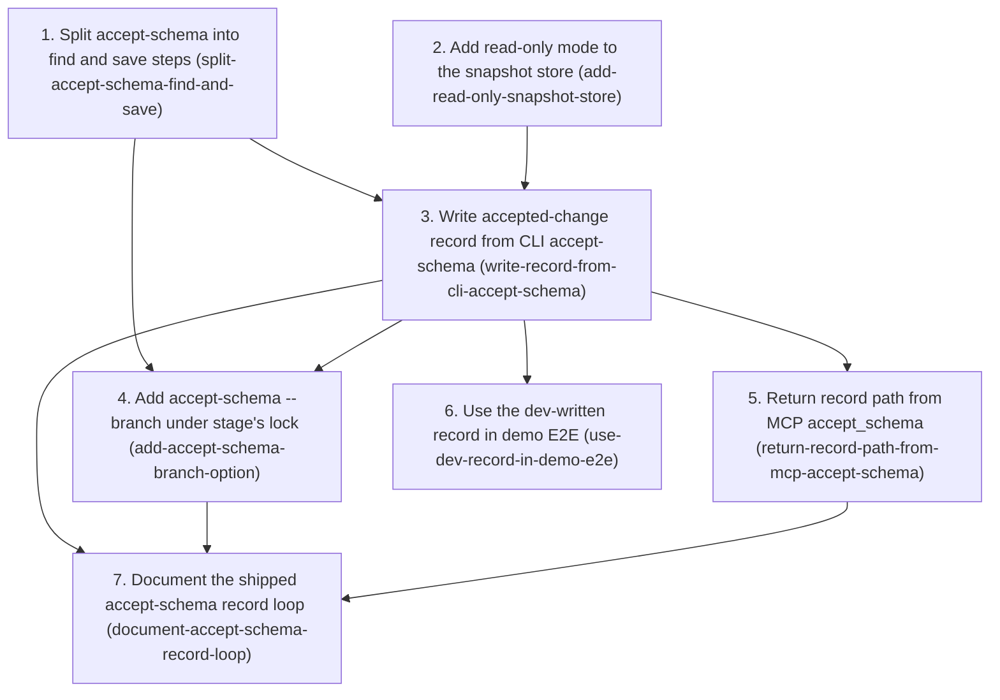

# Horizon 14 — accept-schema writes accepted-change records

## Executive Summary

**🎯 What are we trying to achieve?** When an intended Breaking Change (a dropped or retyped Source column) shows up, one `adops accept-schema` in dev should both accept it in dev and write the `pipelines/accepted/<id>.yaml` record you commit, so stage and prod apply it once on their next run. Stage, prod and every other non-dev Environment become read-only for accept-schema: they only produce the record. Branch Environments get a hand-run `accept-schema --branch <name>`.

**🧠 Why does this change need to happen?** Horizon 13 taught stage, prod and Branch runs to apply committed records, but nothing writes those records yet — the demo E2E hand-writes one. Meanwhile `accept-schema --env stage|prod` still writes straight into those Warehouses (and even reading a saved shape creates schemas and tables there), and a Breaking Change in a Branch cannot be accepted at all.

**At a glance**

- Phases: 7 (user chose all 7 over the 3-phase size cut)
- Complexity: Medium — mostly reshaping existing code; the gate needed one small fix
- Main risk: the read-only stage/prod path accidentally writes (dlt local state, the adops schema, or a new DuckDB file); phase 2 proves it doesn't
- Target: 100% line+branch coverage, demo E2E on Postgres and DuckDB inside the 20-minute job
- Testing focus: no-write proofs with recording fakes, exact record contents, exclusive file creation, lock use for `--branch`

## Implementation plan

### Order of work
```
Phase 1 — Split accept-schema into find and save steps
        ↓  (independent of phase 1; gives stage/prod a way to read without writing)
Phase 2 — Add read-only mode to the snapshot store
        ↓  (needs the find/plan steps (1) and the read-only store (2))
Phase 3 — Write accepted-change record from CLI accept-schema
        ↓  (edits the same command file after phase 3 reshaped it)
Phase 4 — Add accept-schema --branch under stage's lock
        ↓  (the MCP tool calls the CLI function phase 3 changed)
Phase 5 — Return record path from MCP accept_schema
        ↓  (the E2E reads the record path the CLI now prints)
Phase 6 — Use the dev-written record in demo E2E
        ↓  (documents what phases 3–5 shipped)
Phase 7 — Document the shipped accept-schema record loop
```



### Phase 1 — Split accept-schema into find and save steps

Technical ID: `split-accept-schema-find-and-save` · Schema acceptance · application · medium blast radius

**Goal** — The accept-schema use case has a read-only step that finds a Pipeline table's Breaking Changes against the Environment's schema snapshot, a separate step that applies the dropped-column NOT NULL relaxation and saves the new baseline, and a pure rule that decides which accepted-change record (if any) to write.

**Why** — Today one function finds Breaking Changes, alters the Warehouse and saves the snapshot together, so stage and prod cannot use it without writing, and it cannot target a Branch Environment because it looks the Environment up by name in adops.yaml. Splitting it lets dev, --branch and the read-only --env path share the same finding logic. The record decision (no change, already covered, or a new record) is a business rule, so it lives here over existing domain pieces rather than in the CLI.

**Changes**
- Add find_schema_changes(pipeline_text, settings_text, settings_environment_name, table, env, sync, snapshot_store) that loads the Pipeline, picks the settings Environment, runs sync.preflight and snapshot_store.load and find_breaking_changes, and returns a frozen FoundSchemaChanges (pipeline, step, source, table, shape, warehouse, previous-snapshot-present flag, changes); it never calls relax_dropped_columns or save.
- Keep accept_schema as find + relax_dropped_columns + snapshot_store.save, taking the settings Environment name apart from the reported environment name so a Branch (br_<name>) can use stage's Sources and Warehouse secrets.
- Add a changes field to AcceptedSchema so callers can build a record from what was found.
- Add plan_accepted_record(pipeline_name, table, changes, existing_records, now) returning one of: nothing to record (no changes), already covered (ids of existing records for the same Pipeline table when cover() with applied_ids=() leaves no change uncovered), or a new AcceptedChangeRecord listing EVERY change found (not only the uncovered ones) whose id is <now formatted with TIMESTAMP_FORMAT>-<Pipeline.name>-<table>.
- Expose a named apply step apply_schema_acceptance(found, sync, snapshot_store) that runs relax_dropped_columns and snapshot_store.save; accept_schema = find_schema_changes + apply_schema_acceptance, so the interface can run find -> plan -> write record -> apply and a refused record leaves dev's baseline unchanged.
- Refuse a table that is not a plain name (is_plain_name) with a PipelineValidationError before building the id.
- Add unit tests for every branch: no previous snapshot, no change, fully covered by an existing record, partly covered (new record lists every found change — assert the exact list), non-plain table, Branch environment name reported while stage settings are used.

**Files / areas**
- `src/adops/application/accept_schema.py`
- `tests/unit/application/test_accept_schema.py`
- `tests/unit/application/fakes.py`

**How to verify**
- **find_schema_changes never writes** — In tests/unit/application/test_accept_schema.py, a test calls find_schema_changes with a seeded previous snapshot and a dropped column and asserts the fake snapshot store recorded no save and the fake sync recorded no make_columns_nullable call.
- **plan_accepted_record returns the right one of three outcomes** — A unit test with a partly covering existing record asserts the new record's changes equal the full tuple of found changes, compared with ==, not only the uncovered subset.
- **Record id format and non-plain table refusal** — A unit test passes a fixed datetime and asserts the record id equals a literal string such as '<formatted time>-shop_sync-orders'.
- **Settings Environment kept apart from reported Environment** — A unit test calls accept_schema with settings_environment_name='stage' and env='br_feat' and asserts the result's environment is 'br_feat' and the fake sync was preflighted with stage's Source settings.
- **Record decision lives in the application layer without IO** — `grep -nE "^(import|from) " src/adops/application/accept_schema.py` lists only stdlib (datetime, dataclasses, typing, collections.abc), adops.domain.* and adops.application.* modules.

**Done when** — tests/unit/application/test_accept_schema.py passes, covering find_schema_changes, accept_schema and plan_accepted_record with 100% line and branch coverage of src/adops/application/accept_schema.py., and every check under *How to verify* passes its bar.

**Depends on** — nothing — can start immediately

**Guards**
- g2: every new branch (no snapshot, no change, covered, new record, non-plain table) gets a real unit test so coverage stays at 100% line+branch.
- g5: imports only stdlib datetime/dataclasses, adops.domain and adops.application; the time is passed in, never read with .now(); no pragma added.

<details><summary>Reference — full rubric</summary>

| Dimension | Rule | Pass criteria | Failure examples | minScore |
|---|---|---|---|---|
| find-is-side-effect-free | find_schema_changes returns a frozen FoundSchemaChanges and never calls relax_dropped_columns, make_columns_nullable or snapshot_store.save; the write happens only in the separate apply step. 10 = a recording fake proves zero write calls on every branch including the changes-found branch; 8 = proven on the changes-found branch; minScore is the acceptable bar. | In tests/unit/application/test_accept_schema.py, a test calls find_schema_changes with a seeded previous snapshot and a dropped column and asserts the fake snapshot store recorded no save and the fake sync recorded no make_columns_nullable call.<br>`grep -n "save\\|relax_dropped_columns\\|make_columns_nullable" src/adops/application/accept_schema.py` shows those calls only inside the apply/accept_schema function, not inside find_schema_changes.<br>FoundSchemaChanges is a @dataclass(frozen=True) carrying the previous-snapshot-present flag and the changes tuple.<br>apply_schema_acceptance exists in src/adops/application/accept_schema.py and is the only function there that calls relax_dropped_columns or snapshot_store.save. | find_schema_changes reuses the old accept_schema body and calls relax_dropped_columns 'only when changes exist', so the read path still alters the Warehouse.<br>FoundSchemaChanges is a plain mutable dataclass and the changes field is a list. | 8 |
| record-plan-decisions | plan_accepted_record returns nothing-to-record for no changes, already-covered (with the covering record ids) when cover(..., applied_ids=()) leaves no change uncovered for the same Pipeline table, and otherwise a new AcceptedChangeRecord listing EVERY found change. 10 = each outcome plus a record for a different table that must not count as covering is tested with exact equality; 8 = the three outcomes and the partial-cover case are tested with exact equality. | A unit test with a partly covering existing record asserts the new record's changes equal the full tuple of found changes, compared with ==, not only the uncovered subset.<br>A unit test with a fully covering existing record asserts the result is the already-covered outcome and its ids equal the covering record id(s).<br>A unit test with an existing record for a different table of the same Pipeline asserts it is not treated as covering.<br>A unit test with no changes asserts the nothing-to-record outcome. | The partly covered case writes a record with only the uncovered changes, so stage later finds the earlier change applied in one Environment but not another.<br>Covering is checked across all records of the Pipeline regardless of table, so a record for 'customers' suppresses a new record for 'orders'. | 8 |
| record-id-and-table-guard | A new record's id is exactly <now formatted with TIMESTAMP_FORMAT>-<Pipeline.name>-<table>, built from a passed-in time, and a table that fails is_plain_name raises PipelineValidationError before any id is built. 10 = the id is asserted as a literal string and a path-traversal table such as '../x' is refused; 8 = id asserted literally and one non-plain table refused. | A unit test passes a fixed datetime and asserts the record id equals a literal string such as '<formatted time>-shop_sync-orders'.<br>A unit test passes table='../orders' (or another non-plain name) and asserts PipelineValidationError via pytest.raises.<br>`grep -n "\.now(" src/adops/application/accept_schema.py` returns nothing. | The id uses datetime.isoformat() instead of TIMESTAMP_FORMAT, so it contains ':' and differs from existing record ids.<br>The table check runs after the id string is built and only rejects an empty name, letting 'a/b' through. | 8 |
| settings-vs-reported-environment | accept_schema and find_schema_changes take a settings Environment name (whose Sources and Warehouse secrets are used) separately from the reported Environment name, so a Branch reports br_<name> while using stage settings. 10 = a test asserts both the settings looked up and the name in the result; 8 = one test proves a Branch name is reported while stage settings are used. | A unit test calls accept_schema with settings_environment_name='stage' and env='br_feat' and asserts the result's environment is 'br_feat' and the fake sync was preflighted with stage's Source settings.<br>No code path in src/adops/application/accept_schema.py looks up a 'br_'-prefixed name in adops.yaml settings. | The settings Environment is derived by stripping 'br_' from env inside the application, hard-coding the Branch naming rule in two places.<br>A single env parameter is kept and the Branch case is left to fail with an unknown-Environment error. | 7 |
| application-layer-purity | The record decision and find/apply split live in src/adops/application/accept_schema.py using only stdlib datetime/dataclasses, adops.domain and adops.application; no file path, YAML writing or clock read. 10 = no Path, open or yaml import anywhere in the module; 8 = no IO and the time comes in as a parameter. | `grep -nE "^(import\|from) " src/adops/application/accept_schema.py` lists only stdlib (datetime, dataclasses, typing, collections.abc), adops.domain.* and adops.application.* modules.<br>`grep -nE "open\(\|Path\(\|pathlib\|yaml" src/adops/application/accept_schema.py` returns nothing.<br>plan_accepted_record takes existing_records and now as parameters rather than loading them. | plan_accepted_record calls load_project_records(project) itself, pulling interface file loading into the application layer.<br>The application module imports pathlib to compute the record file name pipelines/accepted/<id>.yaml. | 8 |

Healer hint: The likeliest miss is a partly covered table producing a record with only the uncovered changes or with a non-TIMESTAMP_FORMAT id; fix plan_accepted_record to emit found.changes verbatim and build the id with now.strftime(TIMESTAMP_FORMAT), then assert both with == in the unit test.

</details>

### Phase 2 — Add read-only mode to the snapshot store

Technical ID: `add-read-only-snapshot-store` · Schema acceptance · infrastructure · small blast radius

**Goal** — A WarehouseSnapshotStore built read-only loads an Environment's schema snapshot without creating the adops schema, without CREATE TABLE and without creating .adops/dlt/<env> local state; a missing schema or snapshot table reads as no previous snapshot.

**Why** — Every snapshot store call today creates the adops dataset, both adops tables and dlt local state, so even reading a stage or prod snapshot writes to that Warehouse. Stage and prod must be read-only for accept-schema. A constructor option on the existing adapter keeps the shared SchemaSnapshotStore port unchanged, so no fake or isinstance check breaks.

**Changes**
- Add a keyword-only read_only: bool = False to WarehouseSnapshotStore.__init__.
- In read-only mode, point dlt at a throwaway temporary pipelines_dir instead of local_state_dir(project, environment), skip create_dataset and both CREATE TABLE IF NOT EXISTS statements, and return None from load() when the dataset or the snapshot table is missing.
- Make save() refuse in read-only mode with a clear error so a wiring mistake cannot write.
- On DuckDB, a read-only load never creates a missing Warehouse file (check the file exists first; missing file = no previous snapshot) and opens an existing file read-only; on Postgres it issues no DDL.
- Add a read_only keyword to run_command.build_snapshot_store that passes through.
- Add infrastructure tests on DuckDB proving a read-only load on a missing Warehouse file returns None and does not create the file, on an empty Warehouse returns None and leaves no adops schema, no tables and no .adops/dlt/<env> directory, and reads an existing snapshot correctly; plus a Postgres test (ADOPS_TEST_POSTGRES_DSN) that no adops schema is created.

**Files / areas**
- `src/adops/infrastructure/schema_snapshot_store.py`
- `tests/unit/infrastructure/test_schema_snapshot_store.py`
- `src/adops/interface/run_command.py`

**How to verify**
- **Read-only load leaves the Warehouse untouched** — A test in tests/unit/infrastructure/test_schema_snapshot_store.py calls load() read-only on a DuckDB path that does not exist, asserts None, and asserts the path still does not exist.
- **No .adops/dlt/<env> local state in read-only mode** — A test runs a read-only load in a tmp project and asserts (project / '.adops' / 'dlt' / env).exists() is False.
- **Existing snapshot reads correctly and save() refuses** — A test saves a snapshot with a writable store, then loads it with read_only=True and asserts equality with the saved snapshot.
- **Option stays on the adapter; port and default behaviour unchanged** — `git diff -- src/adops/domain src/adops/application` shows no change to the SchemaSnapshotStore protocol.

**Done when** — tests/unit/infrastructure/test_schema_snapshot_store.py passes with read-only tests proving load() creates no Warehouse file, no schema, no table and no .adops/dlt/<env> directory., and every check under *How to verify* passes its bar.

**Depends on** — nothing — can start immediately

**Guards**
- g2: the read-only branches (missing dataset, missing table, save refused) each have a real test; no pragma.
- g5: change is in infrastructure only; domain/application untouched.

**Rollback** — The option defaults to False, so removing it restores today's behaviour with no data effect.

<details><summary>Reference — full rubric</summary>

| Dimension | Rule | Pass criteria | Failure examples | minScore |
|---|---|---|---|---|
| no-warehouse-writes-on-read | A WarehouseSnapshotStore built with read_only=True issues no create_dataset and no CREATE TABLE, and on DuckDB never creates a missing Warehouse file. 10 = both DuckDB cases (missing file, empty file) and the Postgres case are tested and assert schema and file absence afterward; 8 = both DuckDB cases tested and Postgres test present behind ADOPS_TEST_POSTGRES_DSN. | A test in tests/unit/infrastructure/test_schema_snapshot_store.py calls load() read-only on a DuckDB path that does not exist, asserts None, and asserts the path still does not exist.<br>A test on an existing empty DuckDB file asserts load() returns None and information_schema shows no 'adops' schema and no adops tables afterward.<br>A Postgres test gated on ADOPS_TEST_POSTGRES_DSN asserts no adops schema exists after a read-only load.<br>Run `uv run pytest tests/unit/infrastructure/test_schema_snapshot_store.py -q` and see all tests pass. | load() skips CREATE TABLE but dlt's destination client still creates the dataset on first connection, so the adops schema appears in stage.<br>duckdb.connect(path) is called before the existence check, silently creating an empty Warehouse file. | 8 |
| no-local-state-on-read | Read-only mode points dlt at a throwaway temporary pipelines_dir instead of local_state_dir(project, environment), so no .adops/dlt/<env> directory appears. 10 = the test also asserts the temporary directory is cleaned up; 8 = the test asserts .adops/dlt/<env> is absent after load. | A test runs a read-only load in a tmp project and asserts (project / '.adops' / 'dlt' / env).exists() is False.<br>`grep -n "local_state_dir" src/adops/infrastructure/schema_snapshot_store.py` shows it is not used on the read_only branch. | The temporary dir is created under the project's .adops folder, so a .adops/dlt/... tree still appears in the repo.<br>Only the dataset DDL is skipped; local state is still written to .adops/dlt/stage. | 8 |
| reads-existing-snapshot-and-refuses-save | Read-only load returns the same snapshot a writable store saved, and save() on a read-only store raises a clear error before any connection. 10 = the round trip compares the whole snapshot with == and the save test asserts the Warehouse is unchanged; 8 = round trip equality and save refusal with a message match. | A test saves a snapshot with a writable store, then loads it with read_only=True and asserts equality with the saved snapshot.<br>A test calls save() on a read-only store and asserts pytest.raises with a message naming read-only.<br>Missing-table case: a DuckDB file with an adops schema but no snapshot table makes load() return None. | save() in read-only mode silently returns, so a wiring mistake goes unnoticed.<br>The read-only load opens DuckDB with read_only=True but the missing-table case raises CatalogException instead of returning None. | 8 |
| port-unchanged-adapter-only | read_only is a keyword-only constructor option on WarehouseSnapshotStore defaulting to False, the SchemaSnapshotStore port signature is unchanged, and run_command.build_snapshot_store passes it through. 10 = existing writable tests pass unmodified; 8 = port unchanged and factory passes the flag. | `git diff -- src/adops/domain src/adops/application` shows no change to the SchemaSnapshotStore protocol.<br>`grep -n "read_only" src/adops/interface/run_command.py` shows build_snapshot_store accepting a read_only keyword and forwarding it.<br>WarehouseSnapshotStore.__init__ declares read_only after a '*' so it cannot be passed positionally. | A new ReadOnlySnapshotStore port is added to the domain, forcing every fake in tests/unit/application/fakes.py to change.<br>read_only is positional, shifting an existing argument and breaking a caller. | 7 |

Healer hint: The likeliest failure is dlt or duckdb.connect creating the dataset or file before the read-only check; fix by testing Path.exists() first, opening DuckDB with read_only=True, and querying information_schema directly instead of going through dlt's create path.

</details>

### Phase 3 — Write accepted-change record from CLI accept-schema

Technical ID: `write-record-from-cli-accept-schema` · Schema acceptance · interface · medium blast radius

**Goal** — adops accept-schema in dev saves dev's baseline as today and, when it found Breaking Changes, writes exactly one pipelines/accepted/<id>.yaml record and prints its path; with --env naming any other Environment it reads that Environment's snapshot and Source read-only and writes only the record file.

**Why** — The accepted-change record is how a deliberately accepted Breaking Change reaches stage and prod through Git, but nothing writes it yet. Dev keeps saving its own baseline lock-free; every other Environment named with --env must not touch its Warehouse. The record writer must never overwrite a committed record and must stay inside the pipelines folder.

**Changes**
- Make accept_project_schema return an outcome carrying the AcceptedSchema (dev) or FoundSchemaChanges (other Environments) plus record_path: Path | None and the ids of existing covering records.
- Dev path, in this order: find_schema_changes, plan_accepted_record with load_project_records(project) and run_command.build_clock().now(), create the record file exclusively, THEN relax + save dev's baseline (no lock) — so a refused record (name clash, non-plain table) leaves dev unchanged and a re-run can still record.
- Non-dev --env path (stage, prod, ci or any other name): call find_schema_changes with build_snapshot_store(..., read_only=True); never call accept_schema, make_columns_nullable, save or the applied-record write; no lock.
- Write a new record with dump_accepted_record into PIPELINES_DIR/ACCEPTED_RECORDS_DIR, resolving the path through resolve_project_file(write=True) and opening it with mode 'x'; create the accepted folder if missing.
- Add a RecordExists error (a ProjectFileError subclass) raised on a name clash and caught by the command with a clean message, never an overwrite.
- Print: the record path when written; the existing record path(s) when already covered; 'no record written' when there was no previous snapshot or no Breaking Change (plain message, exit 0, for non-dev).
- Change test fixtures to accept the layout/read_only keywords (lambda *_, **__).
- Rewrite test_accept_schema_in_stage_uses_stage_local_state_and_finds_stage_snapshot and the env/kind tests to assert --env stage and --env ci write only the record: no save, no make_columns_nullable, no applied-record write, no .adops/dlt/<env> directory.
- Add tests: dev writes a record that load_project_records loads and validate_project accepts; duplicate prints the existing path and writes nothing; clash refuses cleanly; non-plain table refused.
- Add a test that a record-name clash in dev leaves dev's snapshot unsaved and no column relaxed.

**Files / areas**
- `src/adops/interface/accept_schema_command.py`
- `src/adops/interface/run_command.py`
- `tests/unit/interface/test_accept_schema_command.py`

**How to verify**
- **Dev writes one loadable record and prints its path** — A test in tests/unit/interface/test_accept_schema_command.py runs accept-schema in dev with a seeded snapshot and a dropped column, then asserts exactly one file matches pipelines/accepted/*.yaml.
- **Record is created before dev's baseline changes** — A test pre-creates the record file with the expected id, runs dev accept-schema, and asserts a non-zero exit with a clean message, the fake store recorded no save, and the fake sync recorded no make_columns_nullable.
- **--env <non-dev> writes only the record** — A test runs accept-schema --env stage with a dropped column and asserts a record file exists, the fake store recorded no save and no applied-record write, the fake sync recorded no make_columns_nullable, and no .adops/dlt/stage directory exists.
- **Duplicate prints the existing record; writes stay inside pipelines** — A test runs dev accept-schema twice on the same change and asserts the second run prints the first record's path and the pipelines/accepted file count is still 1.
- **Interface holds IO and clock, not the record rule** — `grep -nE "cover\(|TIMESTAMP_FORMAT|strftime" src/adops/interface/accept_schema_command.py` returns nothing.

**Done when** — tests/unit/interface/test_accept_schema_command.py passes, including a test that --env stage writes only a pipelines/accepted/<id>.yaml record and a test that dev writes a record that passes validate_project., and every check under *How to verify* passes its bar.

**Depends on** — Split accept-schema into find and save steps, Add read-only mode to the snapshot store

**Guards**
- g2: each new branch (dev record, non-dev record, covered, clash, no snapshot, no change, non-plain table) is covered by a unit test; no pragma.
- g5: file writes, Path handling and the clock read stay in the interface; domain/application gain no IO or framework import.

<details><summary>Reference — full rubric</summary>

| Dimension | Rule | Pass criteria | Failure examples | minScore |
|---|---|---|---|---|
| dev-record-written-and-valid | Dev accept-schema with a Breaking Change writes exactly one pipelines/accepted/<id>.yaml that load_project_records loads and validate_project accepts, and prints that path. 10 = the test asserts the printed path, file count == 1, loader result and validate_project; 8 = file loads and validates and the path is printed. | A test in tests/unit/interface/test_accept_schema_command.py runs accept-schema in dev with a seeded snapshot and a dropped column, then asserts exactly one file matches pipelines/accepted/*.yaml.<br>The same test asserts load_project_records(project) returns a record whose changes match the dropped column and validate_project raises nothing.<br>The CLI output contains the project-relative record path. | The record is written with yaml.safe_dump of a dict instead of dump_accepted_record, so load_accepted_record rejects an unknown key.<br>The record is written to <cwd>/pipelines/accepted rather than the project's folder when the CLI runs from a subdirectory. | 8 |
| record-before-baseline | On dev the record file is created with an exclusive open before relax + save, so a refused record (name clash, non-plain table) leaves dev's snapshot unsaved and no column relaxed. 10 = clash and non-plain table both proven to leave dev unchanged; 8 = clash proven to leave no save and no make_columns_nullable call. | A test pre-creates the record file with the expected id, runs dev accept-schema, and asserts a non-zero exit with a clean message, the fake store recorded no save, and the fake sync recorded no make_columns_nullable.<br>A test asserts the pre-existing record file's contents are byte-identical after the refused run.<br>`grep -n "'x'\\|\"x\"" src/adops/interface/accept_schema_command.py` shows the record opened with mode 'x'. | The command saves dev's snapshot first and writes the record last, so a clash leaves dev accepted with no record and a re-run finds nothing to record.<br>The file is opened with 'w' after an exists() check, a race that can overwrite a committed record. | 8 |
| non-dev-env-read-only | For --env stage, prod, ci or any non-dev Environment, the command uses build_snapshot_store(..., read_only=True) and find_schema_changes only: no save, no make_columns_nullable, no applied-record write, no lock, no .adops/dlt/<env>. 10 = asserted for stage and for a custom-named Environment; 8 = asserted for stage and ci. | A test runs accept-schema --env stage with a dropped column and asserts a record file exists, the fake store recorded no save and no applied-record write, the fake sync recorded no make_columns_nullable, and no .adops/dlt/stage directory exists.<br>A test captures the build_snapshot_store call and asserts read_only=True was passed for --env stage.<br>A test with --env ci asserts the same write-only-record behaviour.<br>A non-dev run with no previous snapshot prints 'no record written' and exits 0. | The non-dev check is env == 'stage' or env == 'prod', so --env ci still saves a baseline in ci's Warehouse.<br>build_snapshot_store is called without read_only for non-dev, so the read creates the adops schema in stage. | 8 |
| duplicate-and-path-safety | When existing records already cover every found change the command writes nothing and prints the existing record path(s); new paths resolve through resolve_project_file(write=True) and a name clash raises RecordExists (a ProjectFileError subclass) with a clean message. 10 = duplicate, clash and a missing accepted folder are all tested; 8 = duplicate and clash tested. | A test runs dev accept-schema twice on the same change and asserts the second run prints the first record's path and the pipelines/accepted file count is still 1.<br>A test asserts issubclass(RecordExists, ProjectFileError) and that a clash produces a message without a Python traceback in CLI output.<br>A test with no pipelines/accepted folder asserts the folder is created and the record written. | The second run writes a second record with a newer timestamp, so stage applies the same change twice under two ids.<br>RecordExists escapes as an uncaught FileExistsError traceback. | 8 |
| interface-owns-io-only | The interface reads the clock via run_command.build_clock().now(), loads records and writes the file, but delegates the record decision to plan_accepted_record; it does not re-implement covering or id building. 10 = no cover() call and no TIMESTAMP_FORMAT use in the interface module; 8 = decision delegated with no duplicate id logic. | `grep -nE "cover\(\|TIMESTAMP_FORMAT\|strftime" src/adops/interface/accept_schema_command.py` returns nothing.<br>`grep -n "plan_accepted_record" src/adops/interface/accept_schema_command.py` shows it called on the dev and non-dev paths. | The command builds the file name with datetime.now().strftime itself, so the id can disagree with the record's own id.<br>The command checks coverage by comparing file names in pipelines/accepted instead of using plan_accepted_record. | 7 |

Healer hint: The likeliest failure is ordering: saving dev's baseline before the exclusive record write, or treating only stage/prod as read-only; fix by running find -> plan -> open(path, 'x') -> relax + save, and branching on env != 'dev' with read_only=True.

</details>

### Phase 4 — Add accept-schema --branch under stage's lock

Technical ID: `add-accept-schema-branch-option` · Schema acceptance · interface · small blast radius

**Goal** — adops accept-schema --branch <name> hand-accepts a Branch Environment's baseline exactly like dev's accept-schema (detection, dropped-column NOT NULL relaxation, snapshot save in br_<name>__adops) using stage's settings Environment, while holding stage's Warehouse lock with the CLI's 30-minute wait, and writes no record file.

**Why** — A Branch Environment lives in stage's Warehouse under br_<name>__ schemas, and until now there was no way to accept a Breaking Change there by hand. It writes to stage's Warehouse, so it must take stage's single Warehouse lock like drop-branch does. A Branch is hand-accepted, so no record file is written.

**Changes**
- Add a --branch option; reject it together with --env using the same BadParameter text run uses.
- Derive the Branch name with stage_branch_name(stage, branch) and build adapters with build_sync(..., layout=SchemaLayout.for_branch(name)) and build_snapshot_store(..., layout=SchemaLayout.for_branch(name)).
- Call accept_schema with settings Environment stage and reported environment br_<name>, inside 'with run_command.build_warehouse_lock(warehouse, project, STAGE, DEFAULT_LOCK_TIMEOUT)' as drop_branch_command does.
- Never call plan_accepted_record or the record writer on this path; print the accepted shape and relaxed columns.
- Catch WarehouseLocked and WarehouseUnreachable with clean messages.
- Add tests: Branch layout used, stage settings used, lock taken on stage with the 30-minute default, WarehouseLocked message, --env with --branch refused, no file under pipelines/accepted.

**Files / areas**
- `src/adops/interface/accept_schema_command.py`
- `tests/unit/interface/test_accept_schema_command.py`

**How to verify**
- **--branch holds stage's Warehouse lock with the 30-minute wait** — A test in tests/unit/interface/test_accept_schema_command.py replaces build_warehouse_lock with a recording fake and asserts it was called with environment 'stage' and timeout DEFAULT_LOCK_TIMEOUT (30 minutes).
- **Branch layout and stage settings are used** — A test runs accept-schema --branch feat and asserts both build_sync and build_snapshot_store were called with layout == SchemaLayout.for_branch('br_feat') (or whatever stage_branch_name returns).
- **Branch acceptance writes no record** — A test runs accept-schema --branch feat with a dropped column and asserts no file matches pipelines/accepted/*.yaml.
- **--env with --branch refused; unreachable Warehouse handled** — A test runs accept-schema --branch feat --env stage and asserts exit code 2 and the same error text the run command emits for --env with --branch.

**Done when** — A unit test in tests/unit/interface/test_accept_schema_command.py proves accept-schema --branch feat saves the snapshot under the br_feat layout while holding stage's Warehouse lock with the 30-minute wait and writes no record file., and every check under *How to verify* passes its bar.

**Depends on** — Split accept-schema into find and save steps, Write accepted-change record from CLI accept-schema

**Guards**
- g2: lock taken, lock timeout, --env/--branch exclusion and unreachable Warehouse each have a test; no pragma.
- g5: change is interface-only.

<details><summary>Reference — full rubric</summary>

| Dimension | Rule | Pass criteria | Failure examples | minScore |
|---|---|---|---|---|
| branch-under-stage-lock | accept-schema --branch <name> runs accept_schema inside run_command.build_warehouse_lock(warehouse, project, STAGE, DEFAULT_LOCK_TIMEOUT), the same pattern as drop_branch_command. 10 = the test asserts the lock was held at the moment save was called; 8 = the test asserts the lock was taken on stage with the default timeout. | A test in tests/unit/interface/test_accept_schema_command.py replaces build_warehouse_lock with a recording fake and asserts it was called with environment 'stage' and timeout DEFAULT_LOCK_TIMEOUT (30 minutes).<br>A test asserts the snapshot save happened while the fake lock was entered and not yet exited.<br>A test where the lock raises WarehouseLocked asserts a clean message, a non-zero exit and no save. | The lock is taken on the Branch name 'br_feat', so a concurrent stage run is not excluded.<br>The lock is taken with a zero or MCP-style short timeout instead of the CLI's 30-minute default. | 8 |
| branch-layout-and-settings | The Branch name comes from stage_branch_name(stage, branch); build_sync and build_snapshot_store receive layout=SchemaLayout.for_branch(name); accept_schema gets settings Environment stage and reported environment br_<name>. 10 = the test asserts the snapshot lands in br_<name>__adops and the output names br_<name>; 8 = both factories asserted to receive the Branch layout and stage settings. | A test runs accept-schema --branch feat and asserts both build_sync and build_snapshot_store were called with layout == SchemaLayout.for_branch('br_feat') (or whatever stage_branch_name returns).<br>The same test asserts accept_schema received settings Environment 'stage' and environment 'br_feat'.<br>CLI output names the Branch Environment and lists the relaxed columns. | Only build_snapshot_store gets the Branch layout, so relax_dropped_columns alters stage's own tables instead of br_feat__ tables.<br>The name is built as f'br_{branch}' by hand, ignoring stage_branch_name's normalisation. | 8 |
| branch-writes-no-record | The --branch path never calls plan_accepted_record or the record writer. 10 = asserted both by an empty pipelines/accepted folder and by a spy on plan_accepted_record; 8 = no file under pipelines/accepted after a run with a dropped column. | A test runs accept-schema --branch feat with a dropped column and asserts no file matches pipelines/accepted/*.yaml.<br>A test spies on plan_accepted_record and asserts it is not called during accept-schema --branch. | --branch reuses the dev path wholesale and writes a record, which stage would then apply to its own tables. | 8 |
| option-exclusion-and-errors | --branch together with --env is refused with the same BadParameter text run uses, and WarehouseUnreachable produces a clean message. 10 = the exact text is asserted equal to run's; 8 = both cases tested with message checks. | A test runs accept-schema --branch feat --env stage and asserts exit code 2 and the same error text the run command emits for --env with --branch.<br>A test makes the Warehouse unreachable and asserts a clean one-line message with no traceback. | --env is silently ignored when --branch is given, so a user typing --env prod --branch x gets a stage Branch acceptance.<br>The exclusion message is reworded and diverges from run's. | 7 |

Healer hint: The likeliest failure is passing the Branch layout to only one adapter or taking the lock on br_<name> instead of stage; fix by copying drop_branch_command's build_warehouse_lock(..., STAGE, DEFAULT_LOCK_TIMEOUT) wrapper and passing SchemaLayout.for_branch(name) to both build_sync and build_snapshot_store.

</details>

### Phase 5 — Return record path from MCP accept_schema

Technical ID: `return-record-path-from-mcp-accept-schema` · Assistant MCP · cross-cutting · small blast radius

**Goal** — The dev-only MCP accept_schema tool returns the written accepted-change record's path in an optional record_path reply field, names covering existing records in covered_by, and its Branch refusal text points the user to the CLI accept-schema --branch.

**Why** — This is one small slice across layers: a reply field in the MCP interface and one refusal sentence in the domain's Assistant access rules. The MCP tool already calls the CLI's accept_project_schema, so it writes the record once the CLI phase lands, but the Assistant cannot see where the record went. The old refusal says a Branch has nothing to accept, which is no longer true.

**Changes**
- Add record_path: str | None (project-relative path of the newly written record, None when none was written) and covered_by: list[str] (project-relative paths of existing records that already cover the found changes, empty otherwise) to AcceptedSchemaReply and fill both in accepted_schema_reply from the accept_project_schema outcome.
- Add a test proving a RecordExists clash passes through _sanitized_errors with its message (RecordExists is a ProjectFileError subclass, and ProjectFileError is already in RUN_ERRORS, so no RUN_ERRORS edit is needed).
- Reword ACCEPT_SCHEMA_DEV_ONLY so Branch acceptance points to 'adops accept-schema --branch <name>' run by hand.
- Update test_mcp_server.py: add record_path to the expected structuredContent (None with no previous snapshot), add a seeded dropped-column test that asserts a pipelines/accepted/*.yaml file is created and its path returned, update the Branch refusal text assertion, keep assert_no_secret and the no-lock assertion.

**Files / areas**
- `src/adops/interface/mcp_server.py`
- `src/adops/domain/assistant_access.py`
- `tests/unit/interface/test_mcp_server.py`

**How to verify**
- **record_path reply field is set or None** — In tests/unit/interface/test_mcp_server.py, the no-previous-snapshot test asserts structuredContent['record_path'] is None.
- **RecordExists reaches the Assistant with its message** — A test pre-creates the record file, calls the MCP accept_schema tool, and asserts the reply is an error whose text names the clashing record.
- **Branch refusal points to the CLI** — `grep -n "accept-schema --branch" src/adops/domain/assistant_access.py` finds the command in ACCEPT_SCHEMA_DEV_ONLY.
- **Domain gets only a string; MCP stays lock-free** — `git diff -- src/adops/domain/assistant_access.py` changes only the ACCEPT_SCHEMA_DEV_ONLY string.

**Done when** — tests/unit/interface/test_mcp_server.py passes with a test where MCP accept_schema in dev returns record_path naming a newly created pipelines/accepted/<id>.yaml file and takes no lock., and every check under *How to verify* passes its bar.

**Depends on** — Write accepted-change record from CLI accept-schema

**Guards**
- g2: the record_path None and set branches and the clash error pass-through are tested; no pragma.
- g5: the domain change is a string constant only; no framework import enters domain.

<details><summary>Reference — full rubric</summary>

| Dimension | Rule | Pass criteria | Failure examples | minScore |
|---|---|---|---|---|
| record-path-reply-field | AcceptedSchemaReply has record_path: str \| None, filled with the project-relative path of the written record (None when none was written), and covered_by: list[str] naming existing covering records. 10 = the set-path test also asserts the file exists and loads with load_project_records, and the covered case is tested; 8 = None, set and covered cases all asserted in structuredContent. | In tests/unit/interface/test_mcp_server.py, the no-previous-snapshot test asserts structuredContent['record_path'] is None.<br>A seeded dropped-column test asserts structuredContent['record_path'] starts with 'pipelines/accepted/' and ends with '.yaml', and (project / record_path).exists() is True.<br>The returned path is relative (no leading '/' and no absolute tmp path).<br>A test calls MCP accept_schema twice on the same dropped column and asserts the second reply has record_path None, covered_by equal to [the first reply's record_path], and still exactly one file under pipelines/accepted/. | record_path is the absolute filesystem path, leaking the user's home directory to the Assistant.<br>The already-covered case returns record_path None and an empty covered_by, so the Assistant cannot tell 'covered by record X' from 'nothing to record'. | 8 |
| clash-error-passes-through | RecordExists is in RUN_ERRORS so _sanitized_errors passes its text to the Assistant, with no secret leaked. 10 = a clash test asserts the message text and assert_no_secret; 8 = a clash test asserts isError and the message. | A test pre-creates the record file, calls the MCP accept_schema tool, and asserts the reply is an error whose text names the clashing record.<br>The same test calls assert_no_secret on the reply. | RecordExists is not added to RUN_ERRORS, so the Assistant gets a generic 'internal error' and retries blindly. | 7 |
| branch-refusal-points-to-cli | ACCEPT_SCHEMA_DEV_ONLY tells the Assistant to have the user run 'adops accept-schema --branch <name>' by hand and no longer says a Branch has nothing to accept. 10 = the test asserts the exact new string; 8 = the test asserts the CLI command appears in the refusal. | `grep -n "accept-schema --branch" src/adops/domain/assistant_access.py` finds the command in ACCEPT_SCHEMA_DEV_ONLY.<br>`grep -n "nothing to accept" src/adops/domain/assistant_access.py` returns nothing.<br>A test in tests/unit/interface/test_mcp_server.py asserts the Branch refusal text contains 'adops accept-schema --branch'. | The MCP tool is widened to accept Branches itself, taking stage's lock from the Assistant against the dev-only rule. | 8 |
| each-part-in-its-layer | The domain change is a string constant in assistant_access.py with no new import, the reply field lives in the interface, and the MCP dev path still takes no Warehouse lock. 10 = the no-lock assertion runs on the record-writing test; 8 = existing no-lock assertion kept and domain diff is string-only. | `git diff -- src/adops/domain/assistant_access.py` changes only the ACCEPT_SCHEMA_DEV_ONLY string.<br>The dropped-column MCP test asserts build_warehouse_lock was not called. | record_path formatting (Path.relative_to) is added to the domain module, importing pathlib into domain. | 7 |

Healer hint: The likeliest miss is returning an absolute path or forgetting RecordExists in RUN_ERRORS; fix by returning str(record_path.relative_to(project)) and adding RecordExists to the pass-through tuple with a clash test.

</details>

### Phase 6 — Use the dev-written record in demo E2E

Technical ID: `use-dev-record-in-demo-e2e` · Demo end-to-end check · cross-cutting · small blast radius

**Goal** — The Docker demo Breaking Change scenario, on Postgres and DuckDB, proves the loop end to end: stage halts on a dropped Source column, dev accept-schema writes the accepted-change record, the next stage run applies that record and names it, and a further stage run does not apply it again.

**Why** — The existing scenario already runs a stage halt, an apply run and a no-reapply run, but it hand-writes the record file. Replacing the hand-written file with the one dev accept-schema prints proves the real loop without adding stage runs, so the E2E job stays inside its 20-minute limit.

**Changes**
- Delete STAGE_RECORD and the step that hand-writes pipelines/accepted/2026-03-15-shop_sync-orders.yaml.
- Parse the record path from the dev accept-schema output, assert the file exists under pipelines/accepted/ and that adops validate passes.
- Assert the next stage run prints 'Applied accepted-change record <that id> in stage' and the following stage run prints no 'Applied' line.
- Add no new test and no new stage run.

**Files / areas**
- `tests/e2e/test_demo_sync.py`

**How to verify**
- **The E2E uses only the dev-written record** — `grep -n "STAGE_RECORD\|2026-03-15-shop_sync-orders\|write_text" tests/e2e/test_demo_sync.py` shows no write into pipelines/accepted.
- **Stage applies that record once and not again** — The test asserts the line 'Applied accepted-change record <id> in stage' is in the stage run output, where <id> is the file stem of the parsed record path.
- **No new test or stage run** — `git diff -- tests/e2e/test_demo_sync.py | grep '^+def test_'` returns nothing.

**Done when** — test_demo_incremental_breaking_change_and_missing_table passes on both postgres and duckdb params using only the record written by dev accept-schema., and every check under *How to verify* passes its bar.

**Depends on** — Write accepted-change record from CLI accept-schema

**Guards**
- g4: reuses the existing four stage runs per param and adds no test, so the e2e job stays within the 20-minute timeout; run uv run pytest tests/e2e -m e2e before review.

<details><summary>Reference — full rubric</summary>

| Dimension | Rule | Pass criteria | Failure examples | minScore |
|---|---|---|---|---|
| no-hand-written-record | tests/e2e/test_demo_sync.py no longer defines STAGE_RECORD or writes any pipelines/accepted file by hand; the record comes from dev accept-schema's output. 10 = the test also asserts exactly one file in pipelines/accepted before the apply run; 8 = no hand-written record remains and the path is parsed from output. | `grep -n "STAGE_RECORD\\|2026-03-15-shop_sync-orders\\|write_text" tests/e2e/test_demo_sync.py` shows no write into pipelines/accepted.<br>The test parses the record path from the dev accept-schema stdout and asserts that file exists under pipelines/accepted/.<br>The test runs adops validate after the record is written and asserts exit code 0. | The hand-written file is kept 'as a fallback' and the parsed path is only printed, so the E2E would pass even if dev wrote nothing.<br>The path is found with glob('pipelines/accepted/*.yaml')[0] instead of from output, so a stale file could satisfy it. | 8 |
| applies-once-by-id | The next stage run prints 'Applied accepted-change record <that id> in stage' using the id parsed from dev's output, and the following stage run prints no 'Applied' line, on both postgres and duckdb params. 10 = the id equality is exact and checked on both params in one parametrized test; 8 = both assertions present and both params pass. | The test asserts the line 'Applied accepted-change record <id> in stage' is in the stage run output, where <id> is the file stem of the parsed record path.<br>The test asserts 'Applied accepted-change record' does not appear in the following stage run output.<br>Run `uv run pytest tests/e2e -m e2e -k breaking_change` and see both postgres and duckdb params pass. | The assertion checks only that 'Applied accepted-change record' appears, not the id, so a different record would pass.<br>The halt-then-accept order is changed so dev accept-schema runs before stage halts, no longer proving stage halts first. | 8 |
| budget-unchanged | The phase adds no E2E test and no extra stage run; the scenario keeps its existing stage runs per param so the e2e job stays inside the 20-minute g4 limit. 10 = the stage run count per param is identical to the pre-phase file; 8 = no new test function and no added stage invocation. | `git diff -- tests/e2e/test_demo_sync.py \| grep '^+def test_'` returns nothing.<br>Counting stage invocations in test_demo_incremental_breaking_change_and_missing_table before and after (`git diff`) shows no increase.<br>The g4 command `uv run pytest tests/e2e -m e2e` finishes within the 20-minute timeout. | An extra stage run is added to 'double-check' no reapply, pushing the duckdb+postgres job over the timeout. | 7 |

Healer hint: The likeliest failure is a parse of the record path that breaks on the CLI's exact output line or a relative/absolute mismatch; fix by matching the printed 'pipelines/accepted/<id>.yaml' token with a regex and deriving the id from Path(...).stem.

</details>

### Phase 7 — Document the shipped accept-schema record loop

Technical ID: `document-accept-schema-record-loop` · Project documentation · cross-cutting · small blast radius

**Goal** — ADR-0015, ADR-0014, ADR-0006 and GLOSSARY.md describe accept-schema as shipped (dev saves and writes a record, other Environments write only the record, --branch hand-accepts under stage's lock with no record, MCP dev only), and decisions.md records the supersessions.

**Why** — The ADRs still describe the old behaviour: ADR-0014 says Git-based acceptance comes in horizon 8, ADR-0006 lists --branch as a known gap, and the glossary has no accept-schema entry. Readers and the next horizon's Assistant skills rely on these documents being true.

**Changes**
- Add a dated Clarification to ADR-0015 stating the shipped accept-schema behaviour for dev, other Environments, --branch and the MCP tool, the record id form and the duplicate/exclusive-create rules.
- Add a dated Clarification to ADR-0014 replacing the 'horizon 8' pointer: Git-based acceptance shipped in horizons 13 and 14.
- Add a dated Clarification to ADR-0006 closing the '--branch known gap'.
- Add a GLOSSARY accept-schema entry and widen the Breaking Change and Accepted-change record entries (dev writes the record; --branch hand-accepts).
- Append dated h14 lines to decisions.md superseding h6 lines 39 and 42 and h13 lines 96 and 97 (append only; line 10 is already superseded by line 94).

**Files / areas**
- `docs/adr/0015-breaking-changes-accepted-through-git.md`
- `docs/adr/0014-schedules-run-on-a-pull-based-server.md`
- `docs/adr/0006-branch-environments-as-warehouse-schemas.md`
- `GLOSSARY.md`
- `docs/roadmaps/agentic-dataops/decisions.md`

**How to verify**
- **ADR-0015 Clarification matches the shipped behaviour** — `grep -n "Clarification" docs/adr/0015-breaking-changes-accepted-through-git.md` shows a dated (YYYY-MM-DD) Clarification heading or paragraph.
- **ADR-0014 and ADR-0006 stale statements closed** — `grep -n "horizon 8" docs/adr/0014-schedules-run-on-a-pull-based-server.md` hits only inside text that a dated Clarification below explicitly supersedes.
- **GLOSSARY defines accept-schema and widens related entries** — `grep -n "accept-schema" GLOSSARY.md` finds a defined entry heading or bold term.

**Done when** — docs/adr/0015-breaking-changes-accepted-through-git.md carries a dated Clarification matching the shipped accept-schema behaviour, with the ADR-0014/0006/GLOSSARY text and decisions.md supersession lines updated alongside., and every check under *How to verify* passes its bar.

**Depends on** — Write accepted-change record from CLI accept-schema, Add accept-schema --branch under stage's lock, Return record path from MCP accept_schema

<details><summary>Reference — full rubric</summary>

| Dimension | Rule | Pass criteria | Failure examples | minScore |
|---|---|---|---|---|
| adr-0015-matches-shipped-code | ADR-0015 has a dated Clarification stating: dev saves its baseline and writes a record; any other --env writes only the record read-only; --branch hand-accepts under stage's Warehouse lock with no record; MCP accept_schema is dev-only and returns record_path; the id form <TIMESTAMP_FORMAT>-<Pipeline>-<table>; duplicate prints existing and exclusive create refuses a clash. 10 = every statement is traceable to code and names the CLI flags exactly; 8 = all six points present and none contradicts the code. | `grep -n "Clarification" docs/adr/0015-breaking-changes-accepted-through-git.md` shows a dated (YYYY-MM-DD) Clarification heading or paragraph.<br>The Clarification mentions dev, --env, --branch, the MCP tool, the record id form and the duplicate/clash rule; compare each against src/adops/interface/accept_schema_command.py.<br>Nothing in ADR-0015 still says accept-schema in stage or prod saves a baseline. | The Clarification says stage and prod are read-only but omits other Environments such as ci, contradicting the code's 'any non-dev' rule.<br>The original Decision text is rewritten in place instead of a dated Clarification being added, losing the decision history. | 8 |
| stale-pointers-closed | ADR-0014 gets a dated Clarification replacing the 'horizon 8' Git-acceptance pointer with horizons 13 and 14, and ADR-0006 gets a dated Clarification closing the --branch known gap. 10 = each Clarification names the command and the lock rule; 8 = both Clarifications present and dated. | `grep -n "horizon 8" docs/adr/0014-schedules-run-on-a-pull-based-server.md` hits only inside text that a dated Clarification below explicitly supersedes.<br>`grep -n "accept-schema --branch" docs/adr/0006-branch-environments-as-warehouse-schemas.md` finds the new Clarification. | ADR-0006's known-gap bullet is deleted outright, so a reader cannot see when the gap was closed. | 7 |
| glossary-terms | GLOSSARY.md has an accept-schema entry and the Breaking Change and Accepted-change record entries say dev writes the record and --branch hand-accepts, consistent with the ubiquitous language. 10 = the new entry also names the dev-only MCP tool and the Warehouse lock; 8 = new entry present and both existing entries widened. | `grep -n "accept-schema" GLOSSARY.md` finds a defined entry heading or bold term.<br>The Accepted-change record entry states that dev's accept-schema writes it.<br>The Breaking Change entry mentions --branch hand-acceptance for Branch Environments. | The accept-schema entry says it 'saves a new baseline in every Environment', contradicting the read-only rule for stage and prod. | 7 |

Healer hint: The likeliest miss is documentation that drifts from the code (e.g. naming only stage/prod as read-only or omitting the duplicate/clash rule); fix by writing the ADR-0015 Clarification straight from accept_schema_command.py's branches and checking each sentence against a test name.

</details>

## Discovery Findings

| Area | Finding | File | Implication |
|---|---|---|---|
| Q1 accept_schema application today | present: accept_schema(pipeline_text, settings_text, environment_name, table, env, sync, snapshot_store) loads the Pipeline, runs pick_environment and _only_step_with, then sync.preflight. It loads the previous snapshot, computes find_breaking_changes, runs relax_dropped_columns (a Warehouse ALTER) and snapshot_store.save. It returns AcceptedSchema(pipeline, environment, step, table, shape, nullable_columns). It does not return the changes. | src/adops/application/accept_schema.py | Split it at line 59. A pure find step (load, preflight, previous load, find_breaking_changes) returns pipeline, step, source, table, shape and changes. An apply step (relax plus save) is used only by dev and --branch. Add a changes field so the interface can build the record. |
| Q1 accept_schema CLI today | present: the accept_schema typer command has only --env (default dev) and --project. accept_project_schema reads the project files, gets warehouse_kind, and calls the application with run_command.build_sync(project, pipeline, environment, kind) and build_snapshot_store(project, environment, kind). It takes no lock. It catches PipelineValidationError, ProjectFileError, MissingSecretError, StepError and WarehouseUnreachable, then a generic 'unexpected <Type>'. It does not catch WarehouseLocked. | src/adops/interface/accept_schema_command.py | Add --branch with the same BadParameter exclusion text run uses. Add WarehouseLocked to the caught errors for --branch, as drop_branch_command does. Add a new 'record exists' error type to the caught list too, or it prints 'unexpected ...'. The record write and the printed path belong here. |
| Q2 sync.preflight writes | present: DltSync.__init__ only stores paths. preflight() builds only a SQLAlchemy Source engine (sa.inspect, get_columns, count(*)) and disposes it. It never calls dlt.pipeline or opens the Warehouse, so it writes no .adops/dlt state, dataset or table. Only sync() and make_columns_nullable() build the dlt pipeline. | src/adops/infrastructure/dlt_sync.py | The h13 preflight blocker is resolved: preflight is read-only against the Warehouse. The --env stage\|prod path may keep using DltSync.preflight. It must simply not call make_columns_nullable. |
| conflict: snapshot_store.load is NOT read-only | present: every WarehouseSnapshotStore call goes through _client(). _client() calls dlt.pipeline(pipelines_dir=.adops/dlt/<env>), runs client.create_dataset() when the adops schema is missing, and runs CREATE TABLE IF NOT EXISTS for _adops_schema_snapshots and _adops_applied_records. So load() and applied_record_ids() write DDL and local dlt state. The existing test asserts .adops/dlt/stage exists after --env stage. | src/adops/infrastructure/schema_snapshot_store.py | --env stage\|prod must not reuse load() as is. The plan needs a read-only load path: no create_dataset or CREATE TABLE, and a missing schema or table means 'no previous snapshot'. It must also avoid the dlt local-state dir, plus an infrastructure test. This is the biggest decomposition change. |
| Q3 record domain as shipped | present: frozen dataclass AcceptedChangeRecord(id, pipeline, table, changes: tuple[BreakingChange]). parse_change reads '<col> dropped' (previous_type='') or '<col> retyped (<from> -> <to>)'. load_accepted_record(id, text) uses pydantic extra=forbid, changes min_length=1. dump_accepted_record exists (yaml.safe_dump, sort_keys=False) with no caller in src yet. | src/adops/domain/accepted_change_record.py | Reuse dump_accepted_record for the file body; do not write a new serializer. A record with zero changes is invalid, which matches 'write no record when there is no Breaking Change'. |
| Q3 record YAML format | present: pipelines/accepted/<id>.yaml with exactly three keys: pipeline, table and changes (list of strings). The id is the file stem; .yml is rejected. ACCEPTED_RECORDS_DIR='accepted', PIPELINES_DIR, accepted_record_files() and load_project_records() live in run_command. | src/adops/interface/run_command.py | Write records only into PIPELINES_DIR/ACCEPTED_RECORDS_DIR. Use load_project_records(project) for the duplicate check, which also surfaces malformed existing records as a PipelineValidationError. |
| Q3 BreakingChange.message wording | present: dropped reads f'{column} dropped'. Retyped reads f'{column} retyped ({previous_type} -> {current_type})'. find_breaking_changes skips _dlt_ columns and sorts. Halt text outside dev ends '— add an accepted-change record for <table> to the PR' (_RECORD_HINT). | src/adops/domain/schema_snapshot.py | Dumping found changes gives wording parse_change accepts. For the duplicate check use cover()/_match_key semantics, not raw string compare. |
| Q3 adops validate record checks | present: validate_project calls _check_records: reports *.yml files, parses every pipelines/accepted/*.yaml, cross-checks record.pipeline against loaded Pipelines by Pipeline.name and record.table against Sync Steps. | src/adops/interface/validate_command.py | Write the record's pipeline field as Pipeline.name so validate passes. Tests can call validate_project on the written file. |
| Q4 MCP accept_schema tool | present: accept_schema(pipeline, table, environment=None, branch=None) runs plain_pipeline_name, guarded_run_arguments (dev or branch only, shared-warehouse refusal), refuse_branch_schema_acceptance(branch), then accept_project_schema(project, name, table, DEV). No lock. Errors go through _sanitized_errors (AssistantRefusal, StepError, RUN_ERRORS pass text; else 'unexpected <Type>'). AcceptedSchemaReply has six keys. | src/adops/interface/mcp_server.py | Add optional record_path (str \| None) to AcceptedSchemaReply and accepted_schema_reply. Tests assert full structuredContent, so add the key there. The new record-exists error must be in RUN_ERRORS (or a ProjectFileError subclass) to keep its message. |
| conflict: MCP Branch refusal wording | present: ACCEPT_SCHEMA_DEV_ONLY reads 'the Assistant accepts a Breaking Change only in `dev`; a Branch Environment records its accepted shapes afresh, so there is nothing to accept there'. test_mcp_server.py:1119-1127 asserts this text. | src/adops/domain/assistant_access.py | Once CLI accept-schema --branch exists, 'nothing to accept there' is wrong. Reword it to point Branch acceptance to the CLI, and update the asserting test. |
| Q4 edit-file boundary helpers | present: assistant_files.write_project_file -> resolve_project_file(write=True) -> allowed_project_path (pipelines/ or dbt/ only, no '..', NUL, absolute, .env; re-checks symlink-resolved path). write_project_file OVERWRITES (write_bytes). | src/adops/interface/assistant_files.py | The record writer must not reuse write_project_file (not exclusive). Use open(path,'x') (pattern in run_log_store._write_new, minus its retry) after resolving the path with resolve_project_file(write=True) so a symlinked pipelines/accepted cannot escape. |
| Q5 drop-branch lock model | present: drop_project_branch reads settings, stage_environment, project_env, resolve_environment_warehouse(stage, env), then enters run_command.build_warehouse_lock(warehouse, project, STAGE, lock_timeout) with DEFAULT_LOCK_TIMEOUT=30*60. The application derives the name with stage_branch_name(stage, branch). | src/adops/interface/drop_branch_command.py | Copy this for accept-schema --branch: lock stage's Warehouse with STAGE, then build adapters with environment=<br name> and layout=SchemaLayout.for_branch(name). Test the 30-minute wait like test_the_cli_drop_waits_the_default_lock_timeout. |
| Q5 Branch layout in run_command | present: _run_branch takes the name from stage_branch_name(stage, branch), holds _holding_lock(project, STAGE, ...), builds build_sync(..., layout=layout) and build_snapshot_store(..., layout=layout) with layout=SchemaLayout.for_branch(name): dataset br_<name>__adops, local state .adops/dlt/<br name>. run() rejects --env with --branch using BadParameter. | src/adops/interface/run_command.py | Reuse the same factories with layout=. _holding_lock returns a RunResult on WarehouseUnreachable, which does not fit accept-schema; use the drop_branch style 'with build_warehouse_lock(...)'. |
| conflict: application accept_schema cannot target a Branch | present: accept_schema calls pick_environment(settings.environments, environment_name), which raises for a name not in adops.yaml (e.g. br_feat). run_pipeline handles a Branch via BranchRun and stage_environment(...) for settings. | src/adops/application/accept_schema.py | The split find/apply function must take the settings Environment (stage) apart from the environment name it reports (br_<name>), using stage's Sources and Warehouse secrets. |
| needs: test fixtures accept layout kwarg | present: fixtures in test_accept_schema_command.py patch run_command.build_sync and build_snapshot_store with 'lambda *_: fake', which rejects layout=. Factory-spy tests (lines 234-287) use positional-only signatures. | tests/unit/interface/test_accept_schema_command.py | Change fixtures to 'lambda *_, **__' or add explicit layout params when adding --branch. |
| Q6 unit tests that must change | present: test_accept_schema_in_stage_uses_stage_local_state_and_finds_stage_snapshot (317-345) runs --env stage and asserts relaxation happened and .adops/dlt/stage exists. test_env_option_targets_only_that_environment (154) and test_adapters_are_built_for_the_chosen_environments_kind (dev/ci duckdb) assume non-dev writes. | tests/unit/interface/test_accept_schema_command.py | Rewrite to assert --env stage writes only the record: no save, no make_columns_nullable, no applied-record write, no .adops/dlt/stage creation. Define the 'ci' (non-dev, non-stage) case. |
| Q6 MCP accept_schema tests | present: test_mcp_server.py:1028-1210 — spy wraps accept_project_schema with (project, name, table, 'dev'); accept_schema_tool always calls assert_no_secret; dev success test asserts exact structuredContent and locks.events == []; refusal tests for stage/prod/qa/'Dev'/branch, shared-warehouse, Source/Warehouse/secret errors. | tests/unit/interface/test_mcp_server.py | Add record_path to the expected dict (None with no previous snapshot). Add a seeded dropped-column test asserting a pipelines/accepted/*.yaml file is created and returned. Keep assert_no_secret and no-lock assertions. |
| Q6 E2E Breaking Change scenario now | present: test_demo_incremental_breaking_change_and_missing_table runs on postgres and duckdb. Drops orders.customer_id; dev run halts, stage run halts with record hint, dev accept-schema, dev run passes, then HAND-WRITES pipelines/accepted/2026-03-15-shop_sync-orders.yaml (STAGE_RECORD); next stage run prints 'Applied accepted-change record <id> in stage'; second stage run shows no 'Applied'. 4 stage runs total. | tests/e2e/test_demo_sync.py | The E2E change is small: delete the hand-written file and STAGE_RECORD, parse the record path from dev accept-schema output, assert stage applies that id. No new stage runs, keeps the 20-minute budget. |
| guard g4: E2E 20-minute job | present: ci.yml e2e timeout-minutes 20; each test runs twice (postgres, duckdb); the Breaking Change test already does 4 stage runs per param. | .github/workflows/ci.yml | Reuse existing stage runs rather than adding a new test. Prefer unit tests for --branch. |
| Q7 ADR-0015 Consequences | present: Consequences says accept-schema 'changes from writing the snapshot directly into one Environment's Warehouse to producing a record in the Project ...; running it by hand stays available for dev and Branch Environments.' No 'horizon 14' text in the ADR. | docs/adr/0015-breaking-changes-accepted-through-git.md | Add a dated Clarification matching shipped behaviour: dev saves and writes a record, --env stage\|prod writes only the record, --branch hand-accepts under stage's lock with no record, MCP dev only. |
| Q7 ADR-0014 stale pointer | present: Clarification (2026-11-20) says Git-based acceptance of Breaking Changes (ADR-0015) comes with horizon 8; the 2026-11-21 Clarification supersedes only the Git pull part. | docs/adr/0014-schedules-run-on-a-pull-based-server.md | Add a dated clarification: Git-based acceptance shipped in horizons 13 and 14. |
| conflict: ADR-0006 known gap | present: ADR-0006 line 23 says '**Known gap:** `adops accept-schema` has no `--branch` option.' | docs/adr/0006-branch-environments-as-warehouse-schemas.md | Add an ADR-0006 dated clarification closing the gap in the docs phase. |
| Q7 GLOSSARY | present: GLOSSARY.md has 'Accepted-change record' (line 73) and 'Breaking Change' mentioning accept-schema by hand in dev, a record in stage/prod/Branch; no standalone 'accept-schema' entry; omits --branch and dev writing the record. | GLOSSARY.md | Add an accept-schema entry and widen Breaking Change and record entries. |
| Q7 decisions.md lines to supersede | present: line 10 (h2) already superseded by line 94 (h13); line 39 h6 '--branch is a known gap'; line 42 h6 ADR-0006 '--branch gap'; line 96 h13 'until horizon 14 it still writes directly'; line 97 h13 '--branch scheduled for horizon 14'. | docs/roadmaps/agentic-dataops/decisions.md | Append h14 lines superseding 39, 42, 96 and 97 (line 10 covered by 94). Append only. |
| Q8 clock and timestamp reuse | present: run_command.build_clock() returns SystemClock (datetime.now(UTC)); domain/run_log.py has TIMESTAMP_FORMAT='%Y%m%dT%H%M%SZ' and run_log_file_name(timestamp, pipeline). Tests patch run_command.build_clock. | src/adops/domain/run_log.py | Build the record id in the domain from a passed-in datetime, reusing TIMESTAMP_FORMAT: f'{ts}-{pipeline}-{table}'. Read the time through run_command.build_clock() in the interface. |
| Q8 plain-name validation | present: Pipeline.name and step names match ^[a-z][a-z0-9_]*$ (domain/names.py). SyncTable.name only has min_length=1, so it may contain '/', '..', '-' or uppercase. is_plain_name exists (run_log.PLAIN_NAME). | src/adops/domain/pipeline.py | Check the table name with is_plain_name before building the id and refuse cleanly. The id uses Pipeline.name. |
| Q9 purity tests | present: tests/unit/domain/test_domain_purity.py allows stdlib (minus os, sys, io, pathlib, random, time, subprocess, socket, sqlite3) plus pydantic, yaml, adops.domain and bans .now()/.utcnow()/.today(); tests/unit/application/test_application_purity.py allows stdlib (minus os, sys, io, pathlib, subprocess, socket, sqlite3), adops.domain, adops.application. | tests/unit/application/test_application_purity.py | Keep file write, Path handling and clock read in the interface. Record id and body builders can live in the domain and take a datetime. |
| guard g5: no framework in domain/application, no pragma | present: decisions.md h1 forbids pragma: no cover except TYPE_CHECKING and framework imports in domain/application; purity tests enforce imports. | tests/unit/domain/test_domain_purity.py | Every new branch (duplicate found, collision, no previous snapshot, no changes, --branch lock timeout) needs a real test. |
| guard g2: 100% line+branch coverage | present: fail_under=100 with branch coverage. SchemaSnapshotStore and Sync are @runtime_checkable Protocols; fakes in tests/unit/application/fakes.py and interface InMemorySnapshotStore implement only current methods. | src/adops/application/ports.py | If a read-only method is added to the SchemaSnapshotStore port, every fake and WarehouseSnapshotStore must implement it. Alternatively make read-only an adapter option (constructor flag) so the port is unchanged. |
| guard g3: template wheel list | present: no accept-schema or pipelines/accepted references in src/adops/templates. | src/adops/templates | No template change expected; if one is added, add it to the ci.yml grep list. |
| needs: dev records are never applied by dev runs | present: run_pipeline passes records=() when environment_name == DEV; Branch runs apply records like stage. Notes print 'Applied accepted-change record <id> in <env>'. | src/adops/application/run_pipeline.py | A dev-written record is inert in dev and applied by stage, prod and Branch runs. The duplicate check cannot use applied ids in dev. |
| needs: cover() reusable for duplicate check | present: cover(found, records, applied_ids) returns Coverage(uncovered, used_ids), matching by (column, kind[, normalized types]). | src/adops/domain/accepted_change_record.py | Build the duplicate check on cover() with applied_ids=() over records for the same pipeline and table. |

## Repo guards this plan works under

| Id | What it enforces | When | Where defined | Phases |
|---|---|---|---|---|
| g1 | uv run ruff check (E,F,W,I,B,UP; line-length 100) must pass on every PR | on pull request / push to main | .github/workflows/ci.yml | all (repo-wide) |
| g2 | uv run pytest tests/unit --cov with fail_under=100 line+branch on src/adops; only 'if TYPE_CHECKING:' excluded | on pull request / push to main | .github/workflows/ci.yml + pyproject.toml [tool.coverage] | 1, 2, 3, 4, 5 |
| g3 | builds the wheel and greps for an explicit list of template files; a new template file not added to the list is not checked, a listed file missing fails CI | on pull request / push to main | .github/workflows/ci.yml 'Project templates ship in the wheel' | all (repo-wide) |
| g4 | uv run pytest tests/e2e -m e2e on ubuntu with Docker, 20-minute timeout | on pull request / push to main | .github/workflows/ci.yml e2e job | 6 |
| g5 | no 'pragma: no cover' except TYPE_CHECKING; domain/application import no framework | every phase (planning rule) | docs/roadmaps/agentic-dataops/decisions.md horizon 1 | 1, 2, 3, 4, 5 |

## Out of Scope

- The six Assistant SKILL.md skills, including the Breaking Change skill: user-confirmed as the following horizon.
- Git operations (branch, commit, PR, merge) for a record: the MCP server does no Git by horizon-9 decision; skills do Git later.
- An MCP accept_schema for stage/prod or Branch Environments: MCP stays dev only by horizon-10/13 decisions; --branch is CLI only.
- Adding a Warehouse lock to dev accept-schema: user kept the h10 lock-free decision.
- Removing or archiving applied records: h13 decision keeps records forever; applied ids make them inert.
- Changing the record format, cover() rule, applied-records table or halt wording: shipped in h13 and binding; this horizon only writes records.
- Automatic acceptance of Breaking Changes in any Environment: ADR-0015 says a change is accepted only deliberately, by record or by hand.
- Generated GitHub Actions changes (for example a workflow that runs accept-schema): Promotion workflows already validate records; no new CI automation is asked for.
- Making a hand-run Branch accept-schema write a record or a Branch-specific record: user confirmed that a Branch is hand-accepted with no record file.
- Fixing other open blockers (dbt source test naming, self-hosted runner verification, MCP timeouts): unrelated to the record loop.
- Separate read-only SchemaSnapshotStore port method: fails YAGNI gate 4 (ceremony) and breaks @runtime_checkable isinstance checks on every fake; a constructor option on the one adapter suffices.
- New domain module for record id building: fails gate 3/4; TIMESTAMP_FORMAT, is_plain_name, cover() and dump_accepted_record already exist.
- Warehouse lock for dev accept-schema: fails gate 1 (user kept the h10 lock-free decision).
- Same-second collision suffix/retry for record ids: fails gate 1 (user chose exclusive-create refusal instead).
- MCP accept_schema for stage/prod or --branch: fails gate 1 (user decision: MCP stays dev only).
- Six Assistant SKILL.md skills including the Breaking Change skill: fails gate 2 (user-confirmed next horizon).
- New E2E test for --branch or --env stage record writing: fails gate 2 under guard g4's 20-minute budget; covered by unit tests.
- Template or generated GitHub Actions changes: fails gate 1 (no template references accept-schema; Promotion workflows already validate records).

## Success Criteria

- Done when ALL of these hold. (1) `adops accept-schema <pipeline> <table>` in dev does what it does today: same Breaking Change detection, same dropped-column NOT NULL relaxation, saves dev's snapshot, takes no lock. When it found Breaking Changes, it also creates exactly one pipelines/accepted/<id>.yaml record. The id is built from a seconds-precision UTC timestamp plus the pipeline and table. The record lists the changes in BreakingChange.message wording, loads through the h13 record loader and passes `adops validate`. It prints the record path. (2) The MCP accept_schema tool in dev does the same and returns the record path in its reply. It still refuses every Environment other than dev, takes no lock, and its reply carries no secret (assert_no_secret). (3) Before writing, if an existing pipelines/accepted/ record already lists the same changes for the same Pipeline table, it prints that record's path and creates no new file. A new record is created exclusively (O_EXCL-style): if the file name already exists it refuses with a clean error and never overwrites. (4) `--env stage|prod` reads that Environment's snapshot and Source and writes only the record file. A unit test proves no snapshot save, no relaxation and no applied-record write happen. It does not write dlt state, schemas or tables in that Warehouse. If there is no previous snapshot or no Breaking Change, it writes no file and gives a plain message. (5) `adops accept-schema --branch <name>` (CLI only; mutually exclusive with --env) works like dev's accept-schema against the Branch layout (br_<name>__ schemas, br_<name>__adops snapshot) using the stage_branch_name derivation. It runs under stage's Warehouse lock with the CLI's 30-minute wait, and writes no record file. The MCP tool still refuses Branch schema acceptance. (6) The Docker demo E2E, on both Postgres and DuckDB, runs this scenario and stays inside the 20-minute job: a Source column drop makes the stage run halt; dev accept-schema writes a record; the next stage run applies it and names it in the Step result; a further stage run does not apply it again. (7) ADR-0015 and ADR-0014 text matches the shipped behaviour, including the stale ADR-0014 'horizon 8' pointer. GLOSSARY gains accept-schema / accepted-change record entries if they are missing. decisions.md gets dated supersession lines for h2 'accepted only via accept-schema --env', h6 'accept-schema --branch is a known gap' and h13 'until horizon 14 it still writes directly'. (8) Repo gates pass: ruff, 100% line+branch coverage on src/adops with no new pragma, domain/application purity tests, the template wheel list check, unit and E2E suites.
- Split accept-schema into find and save steps: tests/unit/application/test_accept_schema.py passes, covering find_schema_changes, accept_schema and plan_accepted_record with 100% line and branch coverage of src/adops/application/accept_schema.py.
- Add read-only mode to the snapshot store: tests/unit/infrastructure/test_schema_snapshot_store.py passes with read-only tests proving load() creates no Warehouse file, no schema, no table and no .adops/dlt/<env> directory.
- Write accepted-change record from CLI accept-schema: tests/unit/interface/test_accept_schema_command.py passes, including a test that --env stage writes only a pipelines/accepted/<id>.yaml record and a test that dev writes a record that passes validate_project.
- Add accept-schema --branch under stage's lock: A unit test in tests/unit/interface/test_accept_schema_command.py proves accept-schema --branch feat saves the snapshot under the br_feat layout while holding stage's Warehouse lock with the 30-minute wait and writes no record file.
- Return record path from MCP accept_schema: tests/unit/interface/test_mcp_server.py passes with a test where MCP accept_schema in dev returns record_path naming a newly created pipelines/accepted/<id>.yaml file and takes no lock.
- Use the dev-written record in demo E2E: test_demo_incremental_breaking_change_and_missing_table passes on both postgres and duckdb params using only the record written by dev accept-schema.
- Document the shipped accept-schema record loop: docs/adr/0015-breaking-changes-accepted-through-git.md carries a dated Clarification matching the shipped accept-schema behaviour, with the ADR-0014/0006/GLOSSARY text and decisions.md supersession lines updated alongside.

## Alignment Preview

Concerns raised: (1) dev saved the baseline before a refused record write → fixed: record planned and created before relax + save; (2) unclear contents of a partly covered record → user chose: every change found; (3) read-only DuckDB could create a missing file → fixed: phase 2 proves no file is created; (4) 7 phases above the 3–5 target → user kept all 7. No redirect rounds.

## Quality Gate

Full path, one iteration. Critic: pass, 11 dimensions, 0 blockers raised (0 discarded, 0 downgraded), 1 major — `success-coverage`: the MCP reply could not say an existing record already covers the change → healed by adding `covered_by` to the reply plus a twice-run test. Also healed (minor, cheap): phase 1's garbled change bullet now names `apply_schema_acceptance`; phase 4 gained the input that makes its dependency on phase 3 explicit and a spy instead of a grep; phase 5 no longer edits `RUN_ERRORS` (RecordExists passes as a ProjectFileError). Healing was done by the orchestrator directly, not by a healer subagent call, because the fixes were field-level. Accepted debt (minor): phase 2 touches the interface factory `run_command.build_snapshot_store` (one-line pass-through); phase 7's expected result names ADR-0015 with the other docs alongside. No verification call was needed. Verdict: passed.

## Cost

Agent calls: 6 against a stated budget of 8–10 (Stage 1, Discovery, Stage 3, Stage 3.4 concerns, Stage 4, critic). Stage 3.5 skipped (nothing size-cut), no verify call, no healer call.

## Full analysis

**Domain shape:** business — The objective encodes DataOps rules a data-engineering expert recognizes: a Breaking Change is accepted only deliberately, records are promoted through Git and applied once per Environment, stage/prod are read-only for acceptance, and Branch Environments are hand-accepted.

| Term | Meaning |
|---|---|
| Breaking Change | A dropped or retyped Source column, compared with an Environment's saved schema snapshot, that halts the Sync Step and every later Step. |
| accept-schema | The CLI command (and dev-only MCP tool) that deliberately accepts a table's current Source shape: it saves a new baseline in dev/Branch, or writes only a record for stage/prod. |
| accepted-change record | A committed pipelines/accepted/<id>.yaml file listing the accepted dropped/retyped changes of one Pipeline table, applied at most once by stage, prod and Branch Sync Steps. |
| applied record | A record id stored in an Environment's _adops_applied_records table, together with its snapshot, so the record never applies again in that Environment. |
| schema snapshot | The saved baseline shape of a Sync table in an Environment's adops schema (adops or br_<name>__adops), against which Breaking Changes are found. |
| Environment | A named target (dev, stage, prod) with its own Warehouse, or a Branch Environment in stage's Warehouse under br_<name>__ schemas. |
| Warehouse lock | The single exclusive per-Warehouse lock (Postgres advisory lock or DuckDB flock) that Warehouse-writing runs take; --branch takes stage's, with the CLI's 30-minute wait. |
| dropped-column NOT NULL relaxation | Making the Warehouse columns of a dropped Source column nullable when a change is accepted, so later loads do not fail on a constraint. |

**Assumptions**
- confirmed: accept-schema --branch <name> works exactly like dev's accept-schema (same Breaking Change detection, same dropped-column NOT NULL relaxation, saves the Branch's new baseline in br_<name>__adops) under stage's Warehouse lock; it writes NO record file (a Branch is hand-accepted). CLI only.
- confirmed: if dev accept-schema finds changes that an existing pipelines/accepted/ record already lists for the same Pipeline table, it prints that record's path and writes nothing new.
- confirmed: a new record file is created exclusively (never overwrites; refuse if the name exists); the record id uses a seconds-precision UTC timestamp.
- confirmed: dev accept-schema (CLI and MCP) stays lock-free (h10 decision kept).
- confirmed: the six Assistant skills (including a Breaking Change skill) are NOT in this horizon; they are the following horizon.
- The duplicate check compares against any existing record for the same Pipeline table that lists the same changes, applied or not. Dev never applies records, so dev cannot tell 'applied' apart.
- The record format, loader, cover() rule, _adops_applied_records table and halt-message wording are taken as h13 shipped them in src/adops/domain/accepted_change_record.py and run_pipeline.py. Horizon 14 writes records in exactly that format and does not redesign it.
- The record id has the form <UTC %Y%m%dT%H%M%SZ>-<pipeline>-<table>, matching the Run Log timestamp style. A same-second collision is handled by the exclusive-create refusal, not by a suffix.
- When dev accept-schema finds no previous snapshot or no Breaking Change, it saves the baseline as today and writes no record. Output and the MCP reply say that no record was written.
- For --env stage|prod with no previous snapshot or no Breaking Change, it writes nothing and prints a plain message rather than an error, because there is nothing to accept.
- The h13 application function accept_schema is split so that a read-only change-finding step is shared by dev, --branch and --env stage|prod. Only dev and --branch save and relax.
- --env stage|prod takes no Warehouse lock, because it writes nothing to the Warehouse.
- The record is written by the interface layer (filesystem), not by domain/application code. Domain/application stay framework- and IO-free.
- The MCP AcceptedSchemaReply gains an optional record path field (null when no record was written). Keeping the same tool shape is enough; no new MCP tool is added.
- confirmed: every Environment other than dev named with --env (stage, prod, ci, any name) is read-only for accept-schema and writes only the record file.
- confirmed: a new record lists every change found, even when an existing record covers some of them.
- confirmed: horizon keeps all 7 phases (user chose this over the 3-phase size cut), with the preview fixes folded in.
- Non-dev with no previous snapshot or no Breaking Change writes nothing, prints a plain message, exits 0; non-dev --env takes no lock and runs the same duplicate check.
- Read-only mode is a constructor option on WarehouseSnapshotStore; the SchemaSnapshotStore port is unchanged.

**Risks**
- sync.preflight for stage/prod may write dlt local state under .adops/dlt/<env> or create datasets (open h13 blocker). If it does, --env stage|prod is not truly read-only, and the read-only path must avoid building the writing parts or the test must prove it does not write.
- The 20-minute E2E budget may not fit the extra stage runs (halt, apply, no-reapply) on both Postgres and DuckDB. The e2e Warehouse isolation discovery also shows that stage runs on mutated Source data leak into later tests in the shared module stack.
- The duplicate check depends on exact text matching between the changes found now and BreakingChange.message wording in existing records. A difference in wording (the parenthesised retyped form, or an empty previous_type for dropped columns in parse_change) could produce duplicates or false matches.
- An exclusive-create refusal on a same-second collision gives a user-visible failure in a rare race (two machines, or quick retries). It is acceptable by user choice but could confuse users.
- Dev accept-schema writes a record from dev's view while dev's Source may differ from prod's. A record built in dev may not cover what stage/prod actually see, so stage halts naming the uncovered changes. That is the intended h13 behaviour, but users may find it surprising.
- --branch takes stage's single exclusive Warehouse lock (one lock per Warehouse, not per Pipeline). A long stage run makes the CLI wait up to 30 minutes and then fail.
- Existing unit tests assert that --env stage writes the Warehouse (test_accept_schema_command.py ~317-345). They must be rewritten, not deleted, or coverage and behaviour drift.
- Adding methods to @runtime_checkable ports (for example a read-only lookup) breaks isinstance tests on every real adapter until each adapter implements them.
- Records are discovered by Pipeline name, but nothing enforces a Pipeline's name == its file stem. A record written under pipeline.name could be cross-checked against the wrong file by validate.
- Writing pipelines/accepted/ from the MCP tool must stay inside the edit/write boundary rules (pipelines/ only; adops.yaml/.env/.adops refused). A wrong path join could let a crafted table name escape the folder. Table names must be checked to be plain names before they go into the id.
