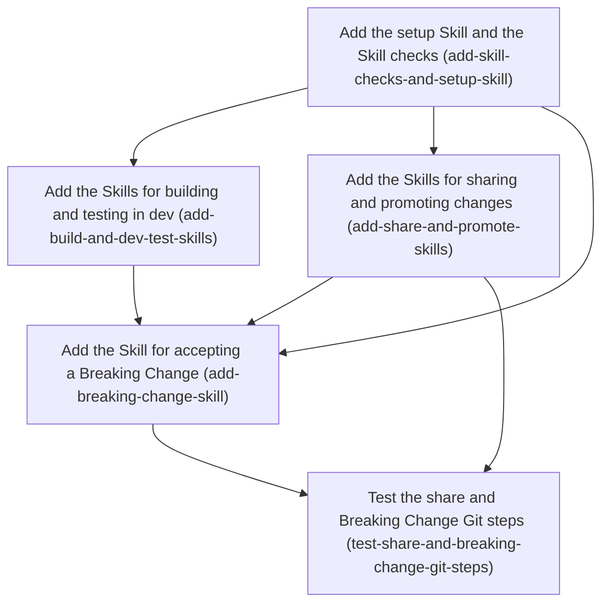

# Horizon 15 — Assistant skills shipped by adops init

## 🎯 What are we trying to achieve?

`adops init` and `adops init --demo` will write six Claude Code skills into every new Project, under `.claude/skills/<name>/SKILL.md`. A skill is a Markdown file that tells the user's Assistant (their own Claude Code) how to do one job step by step, in plain words. The six jobs are: get set up, build a Pipeline, test it in dev, share it as a Pull Request, accept a Breaking Change, and promote after merge. Done means all six ship identically in both templates. Tests prove each skill names only real MCP tools and never acts on stage or prod. One offline test replays the skills' Git steps against a local repository.

## 🧠 Why does this change need to happen?

adops promises that someone who knows SQL but has never used Git or Docker can run it through their Assistant (ADR-0011). The MCP server (horizons 9–14) gives the Assistant tools for dev and Branch Environments, but it deliberately has no Git. Nothing yet tells the Assistant when to check Docker, how to branch and commit safely, or how to carry an accepted-change record to stage through a Pull Request. Without the skills, that whole half of the product is missing (vision items 1 and 8).

## At a glance

- **Phases:** 5, with nothing deferred to a later horizon
- **Complexity:** Low–Medium. It's mostly Markdown and tests with no production code change, but the skill text must be exactly right.
- **Main risk:** the stage/prod and forbidden-Git text checks can catch a skill's own warnings or match nothing at all. Each check gets a self-test with known-bad lines that must be caught and known-good lines that must pass.
- **Testing focus:** structural checks on skill files (front matter, real tool names, never stage/prod), Git command order and safe staging, and an offline Git replay ending in `adops validate`.

## Order of work
```
Phase 1 — Add the setup Skill and the Skill checks
        ↓  (the build and test-in-dev skills reuse the checks from phase 1)
Phase 2 — Add the Skills for building and testing in dev
        ↓  (sharing comes after you've built and tested in dev)
Phase 3 — Add the Skills for sharing and promoting changes
        ↓  (breaking-change is the last skill, and the lists of all six skills close here)
Phase 4 — Add the Skill for accepting a Breaking Change
        ↓  (the replay needs both the share and breaking-change skill texts)
Phase 5 — Test the share and Breaking Change Git steps
```



### Phase 1 — Add the setup Skill and the Skill checks

Technical ID: `add-skill-checks-and-setup-skill` · Assistant Skills · interface · medium

**Goal** — `adops init` and `adops init --demo` write `.claude/skills/adops-setup/SKILL.md` into the new Project. A new test module checks every shipped Skill's structure: front matter, MCP tool names, the never-stage-or-prod rule, and that the demo and plain copies are the same.

**Why** — A Skill is a Markdown file (SKILL.md) that Claude Code reads from `.claude/skills/<name>/`. It tells the user's Assistant how to carry out one workflow in plain words. Every later Skill relies on the same checks, so the test module is built here together with the first Skill and proves it against a real file. adops-setup comes first because every other Skill assumes its Prerequisite check (Docker, ports, .env, git, gh) has passed. The init code already copies dot-folders as they are (`_copy_tree` in src/adops/interface/init_command.py), so no production code changes.

**Changes**
- Write adops-setup/SKILL.md with YAML front matter: `name: adops-setup`, plus a `description` that says when to use it (first-time setup of a new adops Project, or when Docker or the database won't start).
- In the body, write numbered steps in plain words. Each step says what it checks and why. (1) Check Docker is installed (`docker --version`) and running (`docker info`). (2) Read the port variables from `.env`, or from `.env.example` if `.env` is missing, and check that nothing is already using those ports. Never hard-code port numbers. (3) If `.env` is missing, copy `.env.example` to `.env` with the shell, then ask the user to fill in the secret values. Say that the MCP `edit_file` tool cannot edit `.env`. (4) Check that git and gh are installed and that `gh auth status` shows a logged-in user. (5) If the folder is not a git repository, run `git init -b main`. (6) Run `docker compose up --wait`. (7) Call `mcp__adops__test_connection` with environment "dev" and `mcp__adops__validate`, and explain the results.
- State in the Skill that a plain Project's dev Warehouse (localhost:5432) does not come from docker compose, so the user must provide it. Never tell the user to re-run `adops init` (init refuses a folder that is not empty).
- Make the plain copy a byte-identical copy of the demo file. Write the text so it works in both templates: the Skill reads `adops.yaml` and `.env.example` at run time and never assumes demo-only files.
- Create tests/unit/interface/test_assistant_skills.py. It finds Skills by globbing `src/adops/templates/{demo,plain}/.claude/skills/*/SKILL.md` and runs every check once per Skill (pytest parametrization).
- Add a test that the set of shipped Skill folder names equals a module constant EXPECTED_SKILLS. Set it to {"adops-setup"} for now; later phases add names.
- Add a test that demo and plain have the same Skill folders and that each pair of SKILL.md files is byte-identical.
- Add a front-matter test. The file starts with a `---` block; parse it with `yaml.safe_load` and assert that `name` equals the folder name and that `description` is a non-empty string.
- Add a tool-name test. In the Skill text, an MCP tool is written as a backticked `mcp__adops__<tool>`. Collect every such name and assert each one is in the names returned by `build_server(project)` plus `list_tools()`. Build the project with `write_project` from tests/unit/interface/mcp_harness.py. Do not keep a second hard-coded list of all tools. Also fail on a backticked hyphenated form such as `read-logs`, and on any `mcp__<other>__` prefix.
- Add a per-Skill scope test: a dict REQUIRED_TOOLS from Skill name to the tools that Skill must mention. For now it holds adops-setup -> {test_connection, validate}.
- Add a never-stage-or-prod test using one module-level list of regexes over call and command patterns: environment set to "stage" or "prod" (`=` or `:`), `--env stage|prod`, `run --all`, `gh release`, and `gh workflow run`. Prose mentions of stage and prod remain allowed. Also add a self-test that runs the regex list over a few known-bad sample lines and asserts each one is caught, so the rule cannot pass when it matches nothing.
- In tests/unit/interface/test_init_command.py, add `.claude/skills/adops-setup/SKILL.md` to DEMO_FILES. Add `.claude`, `.claude/skills`, `.claude/skills/adops-setup` and the SKILL.md path to the exact listing that the plain-init test expects.
- In .github/workflows/ci.yml, step 'Project templates ship in the wheel': add `.claude/skills/adops-setup/SKILL.md` to the demo loop and `plain/.claude/skills/adops-setup/SKILL.md` to the second loop.
- Add a **Skill** entry to GLOSSARY.md under Actors, next to Assistant: a SKILL.md file that `adops init` writes to `.claude/skills/<name>/` and that tells the Assistant how to carry out one workflow step by step in plain words. _Avoid_: playbook, prompt.
- Write the never-stage-or-prod and forbidden-git-command patterns so they match commands, not prohibitions: Skills phrase warnings without quoting the banned command (e.g. 'stage only the named folders, never everything at once'), and the self-test includes known-good warning and explanation lines (e.g. 'merging sends the change to stage') that must NOT be caught, next to the known-bad lines that must be caught.
- Write the tool-name and never-stage-or-prod checks as plain functions that take Skill text (e.g. unknown_tool_names(text, registered), stage_or_prod_lines(text)), and parametrize them over the shipped files, so a mutated scratch string can be checked directly.

**Files / areas**
- `src/adops/templates/demo/.claude/skills/adops-setup/SKILL.md`
- `src/adops/templates/plain/.claude/skills/adops-setup/SKILL.md`
- `tests/unit/interface/test_assistant_skills.py`
- `tests/unit/interface/test_init_command.py`
- `.github/workflows/ci.yml`
- `GLOSSARY.md`

**How to verify**
- **Skill checks fail on bad Skills, not just pass on good ones** — `uv run pytest tests/unit/interface/test_assistant_skills.py -v` passes and shows test IDs parametrized per Skill path (demo and plain) for front matter, tool names, required tools and never-stage-or-prod.
- **adops-setup checks Prerequisites before changing anything** — Reading src/adops/templates/demo/.claude/skills/adops-setup/SKILL.md, `docker --version`, `docker info`, the port check, the .env check, `gh auth status` all appear before `docker compose up --wait` (verify with `grep -n` line numbers).
- **adops-setup reads ports and secrets from .env and stays template-neutral** — `grep -nE '\b(5432|3000|8080|5433)\b' src/adops/templates/demo/.claude/skills/adops-setup/SKILL.md` finds no port number used as a check target; the only allowed mention is the plain-Project dev Warehouse note (localhost:5432) if worded as an explanation.
- **Phase stays in templates and tests; init listings and wheel list updated** — `git diff --stat HEAD -- src/adops ':(exclude)src/adops/templates'` is empty.

**Done when** — `uv run pytest tests/unit/interface/test_assistant_skills.py tests/unit/interface/test_init_command.py` passes. The checks run against a shipped adops-setup SKILL.md, which is byte-identical in the demo and plain templates. And every check under *How to verify* meets its bar.

**Depends on** — nothing — can start immediately

**Guards**
- g1: the new test module stays within ruff E,F,W,I,B,UP and 100 columns; the regex list is split across lines.
- g2: no src/adops code changes. Skill check logic lives only in tests/, so src coverage stays at 100%.
- g3: the same phase adds both adops-setup template paths (demo and plain) to the ci.yml wheel listing.
- g5: no pragma and no src change.

<details><summary>Reference — full rubric</summary>

| Dimension | Rule | Pass criteria | Failure examples | Min |
|---|---|---|---|---|
| skill-checks-catch-real-violations | tests/unit/interface/test_assistant_skills.py must find Skills by glob, parametrize per Skill, and actually catch each class of violation: front matter mismatch, unknown or hyphenated or foreign-prefixed MCP tool names, and stage/prod-targeting commands, while letting prose warnings through. 10 = every check is proven by a self-test with both caught-bad and allowed-good lines and no reviewer could find a bypass; 8 = competent and complete; minScore is the acceptable bar. | `uv run pytest tests/unit/interface/test_assistant_skills.py -v` passes and shows test IDs parametrized per Skill path (demo and plain) for front matter, tool names, required tools and never-stage-or-prod.<br>The tool-name check gets valid names from `build_server(...)` + `list_tools()` over a `write_project` project; `grep -nE "\"(run\|preview\|validate\|accept_schema\|drop_branch)\"" tests/unit/interface/test_assistant_skills.py` shows no second hard-coded full list of all 11 tools (REQUIRED_TOOLS subsets are fine).<br>A self-test runs the regex list over known-bad lines (`environment="stage"`, `environment: prod`, `--env prod`, `run --all`, `gh release create`, `gh workflow run`) and asserts every one is caught, and over known-good lines (e.g. 'merging sends the change to stage', 'stage only the named folders, never everything at once') and asserts none is caught.<br>Temporarily changing `mcp__adops__validate` to `mcp__adops__read-logs` or `mcp__other__validate` in the setup SKILL.md (in a scratch copy) makes the tool-name test fail.<br>A test asserts the set of shipped Skill folder names equals EXPECTED_SKILLS == {"adops-setup"}, and another asserts demo and plain have the same folders with byte-identical SKILL.md files. | Plausible: the stage/prod regex is `stage\|prod` over the whole text, so it either flags the Skill's own prose explanation or gets loosened until it matches nothing, and there is no self-test proving it catches `--env prod`.<br>Plausible: the tool-name check only looks at names in REQUIRED_TOOLS, so a typo'd `mcp__adops__test_conection` elsewhere in the text passes.<br>The valid tool list is copied by hand into the test, so a future renamed tool is not detected.<br>Front matter is checked with a substring search for 'name:' instead of yaml.safe_load, so `name: adops_setup` passes. | 8 |
| setup-prerequisites-before-action | The adops-setup SKILL.md must check Docker (installed and running), ports, .env, git and gh (including `gh auth status`) before it starts containers or calls MCP tools, and each step must say in plain words what it checks and why. 10 = every check has a stated reason and a stated what-to-do-if-it-fails; 8 = complete and ordered with reasons; minScore is the acceptable bar. | Reading src/adops/templates/demo/.claude/skills/adops-setup/SKILL.md, `docker --version`, `docker info`, the port check, the .env check, `gh auth status` all appear before `docker compose up --wait` (verify with `grep -n` line numbers).<br>Every numbered step has a sentence explaining why it matters (e.g. 'the database runs in Docker, so...'), not just a command.<br>Each failing Prerequisite tells the Assistant to stop and tell the user what to fix, rather than continuing.<br>`git init -b main` is conditional on the folder not already being a git repository. | Plausible: steps are a bare command list (`docker info`, `docker compose up --wait`, ...) with no plain-word reason, so the Assistant cannot explain them to the user.<br>`docker compose up --wait` comes before the port check, so a busy port is discovered only as a cryptic compose error.<br>`gh auth status` is missing; only `gh --version` is checked. | 7 |
| setup-respects-env-and-template-facts | The setup Skill must read port values from .env (falling back to .env.example), never hard-code numbers, copy .env with the shell (stating edit_file cannot edit .env), call MCP tools with environment "dev" explicitly, note that a plain Project's dev Warehouse is user-provided, and never tell the user to re-run `adops init`. 10 = works verbatim in both templates with no demo-only assumption; 8 = all facts present; minScore is the acceptable bar. | `grep -nE '\b(5432\|3000\|8080\|5433)\b' src/adops/templates/demo/.claude/skills/adops-setup/SKILL.md` finds no port number used as a check target; the only allowed mention is the plain-Project dev Warehouse note (localhost:5432) if worded as an explanation.<br>The text says to copy `.env.example` to `.env` with the shell and states that `edit_file` cannot edit `.env`; no instruction uses `mcp__adops__edit_file` on `.env` or `adops.yaml`.<br>`mcp__adops__test_connection` is shown with environment "dev" explicitly.<br>`grep -n 'adops init' .../adops-setup/SKILL.md` shows no instruction to re-run init.<br>No reference to demo-only files (e.g. a specific demo Pipeline name) that are absent from src/adops/templates/plain. | Plausible: the Skill says 'check that port 5432 is free' copied from the demo compose file, which is wrong when .env overrides the port.<br>The Skill says 'ask the Assistant to fill in .env with edit_file', which the MCP server refuses.<br>Troubleshooting advice says 'delete the folder and run adops init again'. | 7 |
| interface-layer-only-and-init-listing | This phase may only add template Markdown, tests, ci.yml wheel entries and a GLOSSARY entry; no src/adops Python changes, and the init tests must pin the new files exactly. 10 = zero production diff and exact listings in both init tests; 8 = expected; minScore is the acceptable bar. | `git diff --stat HEAD -- src/adops ':(exclude)src/adops/templates'` is empty.<br>`git diff HEAD -- src/adops/templates` touches only the two adops-setup SKILL.md files and `cmp` of the demo and plain copies reports no difference.<br>`uv run pytest tests/unit/interface/test_init_command.py` passes and DEMO_FILES plus the plain exact listing include `.claude`, `.claude/skills`, `.claude/skills/adops-setup` and the SKILL.md path.<br>ci.yml wheel step lists both `.claude/skills/adops-setup/SKILL.md` (demo loop) and `plain/.claude/skills/adops-setup/SKILL.md`.<br>GLOSSARY.md has a **Skill** entry under Actors with an _Avoid_ line. | Plausible: a helper to parse front matter is added under src/adops/ 'for reuse', breaking the layer rule and forcing extra coverage.<br>The plain init test is loosened from an exact listing to a subset check so the new folders pass without being listed.<br>Only the demo path is added to ci.yml. | 8 |

Healer hint: Most likely the stage/prod regex list either flags the Skill's own prose or matches nothing; fix by anchoring patterns to call syntax (`environment\s*[=:]\s*"?(stage|prod)`, `--env\s+(stage|prod)`) and adding both bad-must-catch and good-must-pass self-test lines.

</details>

### Phase 2 — Add the Skills for building and testing in dev

Technical ID: `add-build-and-dev-test-skills` · Assistant Skills · interface · small

**Goal** — Init writes the two dev-journey Skills. adops-build edits and validates Pipelines and dbt models through the MCP file tools. adops-test-in-dev runs and previews in dev and explains failures in plain words.

**Why** — After setup, a user builds a Pipeline and then tries it in the dev Environment. Both Skills only call MCP tools on dev, with no Git and no Branch Environment, so they form one coherent group to review. The checks from the first phase already exist, so this phase only adds the Markdown files and extends the listings.

**Changes**
- Write adops-build/SKILL.md (front matter `name: adops-build`, with a description saying when to use it). Steps: get an overview with `mcp__adops__project_view`; find files with `mcp__adops__list_files`; read them with `mcp__adops__read_file`; change them with `mcp__adops__edit_file`; check them with `mcp__adops__validate`, and explain each problem in plain words.
- State in adops-build that edit_file writes only under `pipelines/` and `dbt/`. `adops.yaml`, `.env` and `.github/` are changed by the user or the shell, never through edit_file. dbt models are covered only when a `dbt/` folder exists (a plain Project has none).
- Write adops-test-in-dev/SKILL.md. Steps: check the connection with `mcp__adops__test_connection` environment "dev"; try one Pipeline with `mcp__adops__preview` and `mcp__adops__run`, always passing environment "dev"; when a Step fails, read `steps[].error` and `checks` from the reply and explain them plainly; get details with `mcp__adops__read_logs`.
- Tell the user in adops-test-in-dev that a long run may time out in the Assistant even though it keeps running, and that `read_logs` shows how it ended. If the reply reports a Breaking Change, point the user to the adops-breaking-change Skill.
- Make each plain copy byte-identical to its demo copy.
- In test_assistant_skills.py, add adops-build and adops-test-in-dev to EXPECTED_SKILLS. Add REQUIRED_TOOLS entries: adops-build -> {list_files, read_file, project_view, edit_file, validate}; adops-test-in-dev -> {run, preview, read_logs, test_connection}.
- Add the 2 SKILL.md paths to DEMO_FILES and the 2 folders plus 2 files to the plain expected listing in test_init_command.py.
- Add the 4 template paths (2 demo, 2 plain) to the two loops in ci.yml's 'Project templates ship in the wheel' step.

**Files / areas**
- `src/adops/templates/demo/.claude/skills/adops-build/SKILL.md`
- `src/adops/templates/plain/.claude/skills/adops-build/SKILL.md`
- `src/adops/templates/demo/.claude/skills/adops-test-in-dev/SKILL.md`
- `src/adops/templates/plain/.claude/skills/adops-test-in-dev/SKILL.md`
- `tests/unit/interface/test_assistant_skills.py`
- `tests/unit/interface/test_init_command.py`
- `.github/workflows/ci.yml`

**How to verify**
- **adops-build edits only through allowed paths** — Reading src/adops/templates/demo/.claude/skills/adops-build/SKILL.md: a sentence states edit_file writes only under `pipelines/` and `dbt/`.
- **adops-test-in-dev always names environment "dev"** — `grep -n 'mcp__adops__' src/adops/templates/demo/.claude/skills/adops-test-in-dev/SKILL.md`: each test_connection/preview/run mention is accompanied by environment "dev" in the same step.
- **Failures explained from the actual reply fields** — The text names `steps[].error` (or steps and error) and `checks`, matching the RunReply shape in src/adops/interface/mcp_server.py.
- **Both Skills registered everywhere, nothing in src code** — `cmp` of demo vs plain for adops-build and adops-test-in-dev SKILL.md reports no difference.

**Done when** — The adops-build and adops-test-in-dev SKILL.md pairs ship in both templates, and `uv run pytest tests/unit/interface/test_assistant_skills.py tests/unit/interface/test_init_command.py` passes with both Skills in EXPECTED_SKILLS. And every check under *How to verify* meets its bar.

**Depends on** — Add the setup Skill and the Skill checks

**Guards**
- g1: test edits stay within ruff rules and 100 columns.
- g2: no src/adops code changes.
- g3: the same phase adds all 4 new template paths to the ci.yml wheel listing.
- g5: no src/adops code and no pragma; only template Markdown under src/adops/templates.

<details><summary>Reference — full rubric</summary>

| Dimension | Rule | Pass criteria | Failure examples | Min |
|---|---|---|---|---|
| build-respects-edit-file-scope | adops-build must route Pipeline and dbt changes through `mcp__adops__edit_file`, state that edit_file writes only under pipelines/ and dbt/, send adops.yaml/.env/.github changes to the user or shell, and treat dbt as conditional on a dbt/ folder existing. 10 = the Assistant cannot misread where edits are allowed; 8 = all four facts present; minScore is the acceptable bar. | Reading src/adops/templates/demo/.claude/skills/adops-build/SKILL.md: a sentence states edit_file writes only under `pipelines/` and `dbt/`.<br>No step tells the Assistant to call `mcp__adops__edit_file` on `adops.yaml`, `.env` or `.github/` (`grep -n 'edit_file' ` lines checked by hand).<br>The text says dbt models apply only when a `dbt/` folder exists, and the flow still makes sense for a plain Project (check `ls src/adops/templates/plain` has no dbt/).<br>Order is overview (`project_view`) -> find (`list_files`) -> read (`read_file`) -> change (`edit_file`) -> check (`validate`). | Plausible: the Skill says 'use edit_file to add the new Source's connection to adops.yaml', which the server refuses.<br>The Skill assumes `dbt/models/` exists and tells the Assistant to edit it unconditionally, failing on a plain Project.<br>validate is listed but placed before edit_file only, so changes are never re-checked. | 7 |
| dev-test-always-explicit-dev | Every MCP call in adops-test-in-dev that takes an environment (test_connection, preview, run, read_logs where applicable) must pass environment "dev" explicitly, and the Skill must never introduce a branch or stage/prod target. 10 = every call example shows the argument and the text says why; 8 = all calls explicit; minScore is the acceptable bar. | `grep -n 'mcp__adops__' src/adops/templates/demo/.claude/skills/adops-test-in-dev/SKILL.md`: each test_connection/preview/run mention is accompanied by environment "dev" in the same step.<br>The Skill states the reason (dev is the user's own sandbox; other Environments are reached through Git, not this Skill).<br>`uv run pytest tests/unit/interface/test_assistant_skills.py -k test_in_dev` passes, including never-stage-or-prod and REQUIRED_TOOLS {run, preview, read_logs, test_connection}.<br>No `git` command appears in either Skill of this phase. | Plausible: the first `run` example shows environment "dev" but a later 'try again' step says 'call run on the Pipeline' with no environment, which the server rejects.<br>The Skill suggests 'if dev works, try it on stage' as a next MCP call. | 8 |
| failure-explanation-from-reply-fields | adops-test-in-dev must tell the Assistant to read `steps[].error` and `checks` from the run/preview reply, explain them in plain words, use read_logs for detail and for runs that time out in the Assistant, and point a Breaking Change to the adops-breaking-change Skill. 10 = includes an example of a plain-word explanation; 8 = all fields and paths named; minScore is the acceptable bar. | The text names `steps[].error` (or steps and error) and `checks`, matching the RunReply shape in src/adops/interface/mcp_server.py.<br>A paragraph says a long run may time out in the Assistant while still running and that `mcp__adops__read_logs` shows how it ended.<br>A Breaking Change in the reply sends the user to `adops-breaking-change` by name.<br>Each step says what it does and why in one or two plain sentences, not jargon only. | Plausible: the Skill says 'if the run fails, explain the error' without naming which reply fields hold it, so the Assistant dumps the raw JSON.<br>Timeout is treated as failure and the Skill tells the Assistant to re-run, starting a second concurrent run.<br>Breaking Change is mentioned but the Skill tells the Assistant to call accept_schema itself here. | 7 |
| build-test-listings-complete | The two new Skills must be byte-identical across templates and added to EXPECTED_SKILLS, REQUIRED_TOOLS, both init listings and the wheel list, with no src/adops Python change. 10 = every listing exact; 8 = expected; minScore is the acceptable bar. | `cmp` of demo vs plain for adops-build and adops-test-in-dev SKILL.md reports no difference.<br>EXPECTED_SKILLS contains exactly {adops-setup, adops-build, adops-test-in-dev}; REQUIRED_TOOLS has adops-build -> {list_files, read_file, project_view, edit_file, validate}.<br>`uv run pytest tests/unit/interface/test_assistant_skills.py tests/unit/interface/test_init_command.py` passes.<br>ci.yml wheel step lists all 4 new paths; `git diff --stat HEAD -- src/adops ':(exclude)src/adops/templates'` is empty. | Plausible: the plain copy was edited separately to drop the dbt sentence, so the byte-identity test fails or was weakened.<br>Only the SKILL.md files were added to the plain listing, not the folders, so the exact-listing test fails. | 8 |

Healer hint: The likeliest miss is a later MCP call in adops-test-in-dev written without environment "dev" or an edit_file instruction aimed at adops.yaml; grep every `mcp__adops__` line and add the explicit argument or move the edit to a user/shell step.

</details>

### Phase 3 — Add the Skills for sharing and promoting changes

Technical ID: `add-share-and-promote-skills` · Assistant Skills · interface · medium

**Goal** — Init writes adops-share and adops-promote. adops-share puts a change on a branch, opens a Pull Request and runs its Branch Environment. adops-promote, after the merge, drops the Branch Environment and explains that a merge goes to stage and a release goes to prod.

**Why** — Sharing a change and promoting it are the two ends of one Git journey. Both need a stage Environment, which a plain Project does not have, and both must explain Promotion without ever performing it. Reviewing them together keeps that shared rule consistent. The Skills do the Git work in the Assistant's shell because the MCP server has no Git tools.

**Changes**
- Write adops-share/SKILL.md. First, check that `adops.yaml` has a stage Environment and that `.env` holds its Warehouse password variable. A Branch Environment uses the stage Warehouse. If either is missing, as in a plain Project, stop and explain in plain words that a stage Environment must be added first.
- Continue adops-share: create a branch with `git checkout -b <name>` before any commit; run `git status` and stage only named paths (`pipelines/`, `dbt/`, `adops.yaml`), never `git add -A`, `.env` or `.adops/`; commit; if no remote exists, ask the user, then `gh repo create`; push with `git push -u origin <name>`; open the Pull Request with `gh pr create`.
- Finish adops-share: run the Branch Environment with `mcp__adops__preview` and `mcp__adops__run` with branch="<name>", and explain the replies. Explain that the Pull Request workflow also runs the branch on the Server. Describe what the workflow does in prose without quoting its commands.
- Write adops-promote/SKILL.md. Run it after the Pull Request is merged. Call `mcp__adops__drop_branch` with the branch name to remove the Branch Environment (its br_<branch>__ schemas in the stage Warehouse), and explain that these are the same schemas the Pull Request workflow drops when the Pull Request closes, so dropping by hand only does that cleanup early and is safe to repeat. Explain in prose that merging goes to stage and that publishing a release goes to prod through the generated GitHub Actions, which the user starts from GitHub. The Skill never runs them. Repeat the stage-Environment-missing explanation for plain Projects.
- Make each plain copy byte-identical to its demo copy.
- In test_assistant_skills.py, add adops-share and adops-promote to EXPECTED_SKILLS. Add REQUIRED_TOOLS entries: adops-share -> {run, preview}; adops-promote -> {drop_branch}. Add a test that every Skill text containing `git commit` also contains `git checkout -b` before it, and never contains `git add -A`, `git add .` or `.env` as a `git add` argument.
- Add the 2 SKILL.md paths to DEMO_FILES and the 2 folders plus 2 files to the plain expected listing in test_init_command.py.
- Add the 4 template paths to the two loops in ci.yml's wheel step.

**Files / areas**
- `src/adops/templates/demo/.claude/skills/adops-share/SKILL.md`
- `src/adops/templates/plain/.claude/skills/adops-share/SKILL.md`
- `src/adops/templates/demo/.claude/skills/adops-promote/SKILL.md`
- `src/adops/templates/plain/.claude/skills/adops-promote/SKILL.md`
- `tests/unit/interface/test_assistant_skills.py`
- `tests/unit/interface/test_init_command.py`
- `.github/workflows/ci.yml`

**How to verify**
- **Both Skills stop on a Project without stage** — In src/adops/templates/demo/.claude/skills/adops-share/SKILL.md the stage-Environment check appears before the first `git checkout -b` (`grep -n` line numbers).
- **adops-share does safe Git in the right order** — `grep -nE 'git checkout -b|git status|git add|git commit|git push -u origin|gh pr create' .../adops-share/SKILL.md` shows that order.
- **Branch calls are explicit; Promotion is explained, never run** — Every `mcp__adops__preview`/`mcp__adops__run` mention in adops-share shows branch="<name>"; none shows environment "stage" or "prod".
- **Both Skills registered and identical across templates** — `cmp` demo vs plain for both SKILL.md files reports no difference.

**Done when** — The adops-share and adops-promote SKILL.md pairs ship in both templates, and `uv run pytest tests/unit/interface/test_assistant_skills.py tests/unit/interface/test_init_command.py` passes, including the never-stage-or-prod rule on adops-promote's Promotion explanation. And every check under *How to verify* meets its bar.

**Depends on** — Add the setup Skill and the Skill checks

**Guards**
- g1: test edits stay within ruff rules and 100 columns.
- g2: no src/adops code changes.
- g3: the same phase adds all 4 new template paths to the ci.yml wheel listing.
- g5: no src/adops code and no pragma; only template Markdown under src/adops/templates.

<details><summary>Reference — full rubric</summary>

| Dimension | Rule | Pass criteria | Failure examples | Min |
|---|---|---|---|---|
| plain-project-stops-without-stage | adops-share and adops-promote must check first that adops.yaml defines a stage Environment and .env holds its Warehouse password variable, and if not (a plain Project) stop and explain in plain words why a Branch Environment needs stage. 10 = the check precedes every Git and MCP action and names what to add; 8 = check present and first; minScore is the acceptable bar. | In src/adops/templates/demo/.claude/skills/adops-share/SKILL.md the stage-Environment check appears before the first `git checkout -b` (`grep -n` line numbers).<br>The same explanation appears in adops-promote before `mcp__adops__drop_branch`.<br>The text says to stop (not continue) and explains that a Branch Environment uses the stage Warehouse.<br>The check reads adops.yaml and the password variable name from it rather than assuming a demo-specific variable name (compare with `cat src/adops/templates/plain/adops.yaml`). | Plausible: the stage check is at the end under 'Troubleshooting', so on a plain Project the Assistant already created a branch and pushed before the preview fails.<br>The Skill hard-codes `STAGE_PG_PASSWORD` from the demo .env.example, which a user's own stage setup may name differently.<br>adops-promote omits the plain-Project explanation entirely. | 7 |
| share-git-order-and-safe-staging | adops-share must create the branch before any commit, inspect `git status`, stage only named paths (pipelines/, dbt/, adops.yaml), never stage everything or .env/.adops, ask before `gh repo create` when no remote exists, push with `git push -u origin <name>`, then `gh pr create`, and phrase the warning without quoting the banned command. 10 = every step has a plain reason; 8 = correct order and safe staging; minScore is the acceptable bar. | `grep -nE 'git checkout -b\|git status\|git add\|git commit\|git push -u origin\|gh pr create' .../adops-share/SKILL.md` shows that order.<br>`grep -nE 'git add (-A\|\.)( \|$\|`)\|git add[^\n]*\.env' .../adops-share/SKILL.md` finds nothing.<br>The new git-order test in test_assistant_skills.py (commit requires earlier `git checkout -b`, bans `git add -A`/`git add .`/.env) passes and is parametrized over all Skills.<br>`gh repo create` is gated by asking the user first. | Plausible: the warning reads 'never run `git add -A`', which quotes the banned command and trips the guard test, so the developer weakens the test instead of rewording.<br>Commit is shown before `git checkout -b`, committing on main.<br>The Skill creates a GitHub repo without asking the user. | 8 |
| branch-environment-explicit-and-promotion-explained-not-done | adops-share must call preview/run with branch="<name>" explicitly; adops-promote must call drop_branch with the branch name, explain that it is the same cleanup the Pull Request workflow does on close and safe to repeat, and explain in prose that merge -> stage and release -> prod via GitHub Actions the user starts, without running or quoting those commands. 10 = an Assistant reading it could not accidentally promote; 8 = expected; minScore is the acceptable bar. | Every `mcp__adops__preview`/`mcp__adops__run` mention in adops-share shows branch="<name>"; none shows environment "stage" or "prod".<br>adops-promote names `mcp__adops__drop_branch`, says it removes the br_<branch>__ schemas, and says it is safe to repeat.<br>`uv run pytest tests/unit/interface/test_assistant_skills.py -k promote` passes the never-stage-or-prod check (no `gh release`, `gh workflow run`, `run --all`, `--env prod`).<br>adops-share describes what the Pull Request workflow does in prose without quoting its commands. | Plausible: adops-promote helpfully says 'then publish a release with gh release create v1.0' — explaining by quoting, which both fails the test and invites the Assistant to run it.<br>adops-share copies the workflow line `adops run --all --branch ...` into the explanation.<br>drop_branch is presented as required before merge, contradicting the workflow cleanup. | 8 |
| share-promote-registration | adops-share and adops-promote must be byte-identical across templates and added to EXPECTED_SKILLS, REQUIRED_TOOLS (share -> {run, preview}; promote -> {drop_branch}), both init listings and the ci.yml wheel list, with no src/adops code change. 10 = every listing exact; 8 = expected; minScore is the acceptable bar. | `cmp` demo vs plain for both SKILL.md files reports no difference.<br>`uv run pytest tests/unit/interface/test_assistant_skills.py tests/unit/interface/test_init_command.py` passes.<br>ci.yml wheel loops list the 4 new paths.<br>`git diff --stat HEAD -- src/adops ':(exclude)src/adops/templates'` is empty. | Plausible: REQUIRED_TOOLS for adops-share was added but EXPECTED_SKILLS was not updated, so the folder-set test fails.<br>The plain listing in test_init_command.py misses the adops-promote folder entry. | 8 |

Healer hint: The likeliest failure is a Promotion or staging warning that quotes `gh release`, `git add -A` or the workflow's `run --all` line and trips the guard tests; reword it in prose ('publishing a release on GitHub', 'never stage everything at once') rather than loosening the regex.

</details>

### Phase 4 — Add the Skill for accepting a Breaking Change

Technical ID: `add-breaking-change-skill` · Assistant Skills · interface · small

**Goal** — Init writes adops-breaking-change. It accepts a Breaking Change in dev with accept_schema, commits the accepted-change record at the returned record_path on a branch, and opens the Pull Request that carries the record to stage and prod.

**Why** — A Breaking Change (a dropped or retyped Source column) halts a Pipeline until someone accepts it. Stage and prod accept it only when its accepted-change record file arrives through a reviewed Pull Request. Getting the order wrong (committing on main, or skipping the branch) would let the change reach stage unreviewed, so this Skill gets its own reviewed phase.

**Changes**
- Write adops-breaking-change/SKILL.md. Explain in plain words what a Breaking Change is and what accepting it means (adops stops expecting the dropped or old-typed column). Ask the user to confirm before accepting.
- Steps: create the branch with `git checkout -b <name>` first; call `mcp__adops__accept_schema` with pipeline, table and environment "dev" (dev only); read `record_path` from the reply and stage exactly that file under `pipelines/accepted/`; commit, push and `gh pr create`, explaining that merging this Pull Request lets stage, and later prod, accept the change.
- Handle a reply where `record_path` is null: nothing new needs committing because the files listed in `covered_by` already cover the change. Check those files with `git status` or `git log`, and commit them on the branch if they were never committed.
- For a Branch Environment, tell the user to run `adops accept-schema --branch <name>` themselves. Never suggest `--env stage` or `--env prod`.
- Make the plain copy byte-identical to the demo copy. Write it so that a missing `pipelines/accepted/` folder (plain Project) is fine, because accept_schema creates it.
- In test_assistant_skills.py, add adops-breaking-change to EXPECTED_SKILLS and add the REQUIRED_TOOLS entry adops-breaking-change -> {accept_schema}. Also assert that this Skill names `record_path` and `covered_by`.
- Add the SKILL.md path to DEMO_FILES and the folder plus file to the plain expected listing in test_init_command.py.
- Add the 2 template paths to the two loops in ci.yml's wheel step.

**Files / areas**
- `src/adops/templates/demo/.claude/skills/adops-breaking-change/SKILL.md`
- `src/adops/templates/plain/.claude/skills/adops-breaking-change/SKILL.md`
- `tests/unit/interface/test_assistant_skills.py`
- `tests/unit/interface/test_init_command.py`
- `.github/workflows/ci.yml`

**How to verify**
- **Branch first, accept_schema in dev only** — `grep -nE 'git checkout -b|mcp__adops__accept_schema' src/adops/templates/demo/.claude/skills/adops-breaking-change/SKILL.md` shows the branch line first.
- **Commits exactly record_path; handles null via covered_by** — The text names `record_path` and `covered_by` (asserted by the test added in this phase).
- **Pull Request step explains how stage and prod accept** — `git push -u origin <name>` and `gh pr create` appear after the commit (`grep -n`).

**Done when** — The adops-breaking-change SKILL.md pair ships in both templates, and `uv run pytest tests/unit/interface/test_assistant_skills.py tests/unit/interface/test_init_command.py` passes with all six Skills in EXPECTED_SKILLS. And every check under *How to verify* meets its bar.

**Depends on** — Add the setup Skill and the Skill checks, Add the Skills for building and testing in dev, Add the Skills for sharing and promoting changes

**Guards**
- g1: test edits stay within ruff rules and 100 columns.
- g2: no src/adops code changes.
- g3: the same phase adds both new template paths to the ci.yml wheel listing, completing all 12.
- g5: no src/adops code and no pragma; only template Markdown under src/adops/templates.

<details><summary>Reference — full rubric</summary>

| Dimension | Rule | Pass criteria | Failure examples | Min |
|---|---|---|---|---|
| branch-before-accept-and-dev-only | adops-breaking-change must explain what a Breaking Change and accepting it mean, ask the user to confirm, create the branch with `git checkout -b <name>` before calling `mcp__adops__accept_schema`, pass environment "dev" explicitly, and for a Branch Environment tell the user to run `adops accept-schema --branch <name>` themselves, never `--env stage\|prod`. 10 = the Assistant cannot accept on the wrong Environment or commit on main; 8 = expected; minScore is the acceptable bar. | `grep -nE 'git checkout -b\|mcp__adops__accept_schema' src/adops/templates/demo/.claude/skills/adops-breaking-change/SKILL.md` shows the branch line first.<br>The accept_schema mention includes pipeline, table and environment "dev".<br>A user-confirmation step precedes accept_schema, with a plain-word explanation (adops stops expecting the dropped or old-typed column).<br>`adops accept-schema --branch` appears as a user-run command; `grep -nE -- '--env (stage\|prod)'` finds nothing.<br>`uv run pytest tests/unit/interface/test_assistant_skills.py -k breaking` passes. | Plausible: the Skill calls accept_schema first and creates the branch afterwards, so the record is written while on main and the commit lands on main.<br>The Skill tells the Assistant to call accept_schema with branch="<name>" via MCP, which the server does not support.<br>No confirmation step; the Assistant accepts as soon as it sees a Breaking Change. | 8 |
| record-path-and-covered-by-handled | The Skill must read `record_path` from the reply and stage exactly that file under pipelines/accepted/, and when record_path is null explain that the `covered_by` files already cover the change and check with git status/log whether they still need committing on the branch. 10 = both branches of the reply are handled with a plain explanation; 8 = both handled; minScore is the acceptable bar. | The text names `record_path` and `covered_by` (asserted by the test added in this phase).<br>The `git add` step stages the file at record_path by name, not `pipelines/accepted/` as a folder and not everything.<br>A null-record_path paragraph tells the Assistant to check the covered_by files with `git status` or `git log` and commit them only if never committed.<br>The text says a missing `pipelines/accepted/` folder (plain Project) is fine because accept_schema creates it. | Plausible: the Skill handles record_path but treats null as an error ('accept failed, try again'), causing duplicate attempts.<br>The Skill stages `pipelines/accepted/` as a folder, sweeping in unrelated uncommitted records.<br>The Skill hard-codes a record filename pattern instead of using record_path. | 8 |
| pr-carries-record-explained | After committing, the Skill must push and `gh pr create`, and explain in plain words that merging this Pull Request lets stage, and later prod, accept the change — without performing or quoting any Promotion command. 10 = the user understands why the PR matters; 8 = expected; minScore is the acceptable bar. | `git push -u origin <name>` and `gh pr create` appear after the commit (`grep -n`).<br>A sentence explains merge -> stage accepts, release -> prod accepts, in prose.<br>The never-stage-or-prod test passes for this Skill.<br>`cmp` demo vs plain reports no difference; EXPECTED_SKILLS has all six names; ci.yml lists both new paths. | Plausible: the Skill opens the PR but never says why, so the user merges an unrelated PR first and is surprised stage still halts.<br>The Skill suggests running accept-schema on stage by hand to 'speed it up'. | 7 |

Healer hint: Most likely the null record_path case is missing or the branch is created after accept_schema; move `git checkout -b` above the accept step and add a short record_path-null paragraph that checks the covered_by files with git status.

</details>

### Phase 5 — Test the share and Breaking Change Git steps

Technical ID: `test-share-and-breaking-change-git-steps` · Assistant Skills · interface · small

**Goal** — One test without Docker or an LLM replays the Git steps of adops-share and adops-breaking-change on a demo Project, pushes both branches to a local bare repository, and proves that only the named paths were committed and that the branch carrying the accepted-change record passes `adops validate`.

**Why** — The structural tests check the Skill text but not whether the Git steps it describes actually work. This test runs the same commands the Skills tell the Assistant to run, against a real git repository, so a wrong command order or a missing record fails CI. It lives in tests/unit because unit tests already run git, and it uses a hand-written record instead of a live accept_schema run. That keeps Docker and the 20-minute end-to-end budget out of it.

**Changes**
- Create tests/unit/interface/test_skill_git_steps.py. Reuse the hermetic GIT_ENV and git(*args, cwd) pattern from test_init_command.py (lines 292-300), either by importing it or by moving it into a shared helper in tests/unit/interface/ if importing a test module is awkward.
- Steps: run `adops init --demo` into tmp_path; `git init -b main`; commit everything as the initial commit; `git checkout -b accept-orders`; write a prepared record `pipelines/accepted/20261123T000000Z-shop_sync-orders.yaml` with `{pipeline: shop_sync, table: orders, changes: ['customer_id dropped']}`, using a column that really exists in the demo Source; `git add` only that named path; commit; create a bare repo with `git init --bare`; add it as origin; `git push -u origin accept-orders`.
- Before the record, replay adops-share's own steps: on branch share-change edit a Pipeline file under pipelines/, `git add` only the named paths (pipelines/, dbt/, adops.yaml), commit and push; assert the pushed commit touches only those paths and that .env and .adops/ are absent even though both exist in the working folder.
- Clone the bare repo at branch accept-orders into a new folder. Assert that the record file is present and byte-equal to what was written, and that `.env` and `.adops/` are not in the clone.
- Run validate on the clone (the CLI's validate command, via typer CliRunner or `validate_project`) and assert that it passes with no problems.
- Tie the replay to the Skill text: assert the shipped adops-share and adops-breaking-change SKILL.md files contain the replayed commands (`git checkout -b`, `git add`, `git commit`, `git push -u origin`, `gh pr create`) in the same order the test runs them, so a Skill that reorders or drops a step fails.

**Files / areas**
- `tests/unit/interface/test_skill_git_steps.py`

**How to verify**
- **Replay runs real git against a local bare repo, offline** — `uv run pytest tests/unit/interface/test_skill_git_steps.py -v` passes with network disabled and Docker stopped.
- **Pushed commits contain only named paths** — The test creates `.env` and `.adops/` in the working folder before staging (assert they exist).
- **The pushed record passes adops validate** — The record is `pipelines/accepted/20261123T000000Z-shop_sync-orders.yaml` with pipeline shop_sync, table orders, and a column that exists in the demo Source (check with `grep -rn customer_id src/adops/templates/demo`).
- **Replay order is checked against the shipped Skill text** — The test reads both SKILL.md files from src/adops/templates/demo/.claude/skills/ and checks index order of the five commands.

**Done when** — `uv run pytest tests/unit/interface/test_skill_git_steps.py` passes offline, with no Docker and no network, proving the share and Breaking Change Git steps (in the Skills' own order) push only named paths and a record that passes `adops validate`. And every check under *How to verify* meets its bar.

**Depends on** — Add the Skills for sharing and promoting changes, Add the Skill for accepting a Breaking Change

**Guards**
- g1: the new test file stays within ruff rules and 100 columns.
- g2: no src/adops code changes; the test only adds coverage.
- g4: the replay lives in tests/unit, not tests/e2e, so it adds nothing to the Docker end-to-end job or its 20-minute timeout.

<details><summary>Reference — full rubric</summary>

| Dimension | Rule | Pass criteria | Failure examples | Min |
|---|---|---|---|---|
| replay-is-real-and-offline | tests/unit/interface/test_skill_git_steps.py must run `adops init --demo`, real git commands (init, checkout -b, add named paths, commit, push -u origin) against a `git init --bare` origin in tmp_path, with the hermetic GIT_ENV, and no Docker, network or LLM. 10 = fully hermetic and deterministic; 8 = expected; minScore is the acceptable bar. | `uv run pytest tests/unit/interface/test_skill_git_steps.py -v` passes with network disabled and Docker stopped.<br>The test uses a GIT_ENV/git(*args, cwd) helper (imported or shared under tests/unit/interface/), not the developer's global git config.<br>Both branches (share-change and accept-orders) are pushed with `git push -u origin` to a `git init --bare` repo under tmp_path.<br>No `gh` command is executed (gh pr create is only checked in Skill text).<br>The file is under tests/unit/ (not tests/e2e/) and `git diff --stat HEAD -- src/adops` is empty. | Plausible: the test monkeypatches subprocess and asserts command strings, so it never proves the git steps actually work.<br>The test relies on the developer's ~/.gitconfig user.name and fails in CI.<br>The test calls `gh pr create` and needs network. | 8 |
| only-named-paths-pushed | The test must prove that what arrives in the remote contains only the named paths: the share commit touches only pipelines/, dbt/, adops.yaml, the record commit touches only the record file, and .env and .adops/ are absent from the clone even though both exist in the working folder. 10 = asserted on the pushed commit and on a fresh clone; 8 = expected; minScore is the acceptable bar. | The test creates `.env` and `.adops/` in the working folder before staging (assert they exist).<br>It asserts the share commit's changed files (e.g. `git show --name-only` or `git diff-tree`) are all under pipelines/, dbt/ or adops.yaml.<br>It clones the bare repo at accept-orders into a new folder and asserts the record file is byte-equal to what was written and `.env`/.adops/ are absent.<br>It asserts the accept-orders commit changed exactly the one record path. | Plausible: the test never creates .env in the working folder (init does not write one), so 'absent from clone' passes trivially.<br>Asserts only that the record exists in the clone, not that nothing else was committed.<br>Checks the local branch instead of the cloned remote, so a failed push is not detected. | 8 |
| record-passes-validate | The hand-written record must use a real demo Pipeline, table and column, and validate (CLI via CliRunner or validate_project) on the clone must pass with no problems. 10 = also proves validate would fail on a bad record; 8 = passes on the real record; minScore is the acceptable bar. | The record is `pipelines/accepted/20261123T000000Z-shop_sync-orders.yaml` with pipeline shop_sync, table orders, and a column that exists in the demo Source (check with `grep -rn customer_id src/adops/templates/demo`).<br>validate runs against the clone folder, not the working folder, and the test asserts exit code 0 / no problems.<br>Optional strength: a negative assertion that a record naming a non-existent Pipeline makes validate report a problem. | Plausible: validate runs on the original working folder, so a missing record in the push is not caught.<br>The record uses a column name that is not in the demo Source and validate is not checked for problems, only for not raising. | 7 |
| replay-tied-to-skill-text-order | The test must assert that the shipped adops-share and adops-breaking-change SKILL.md files contain `git checkout -b`, `git add`, `git commit`, `git push -u origin`, `gh pr create` in the same order the test runs them, so reordering or dropping a step in a Skill fails. 10 = order derived from one shared sequence used by both replay and assertion; 8 = expected; minScore is the acceptable bar. | The test reads both SKILL.md files from src/adops/templates/demo/.claude/skills/ and checks index order of the five commands.<br>Swapping `git commit` above `git checkout -b` in a scratch copy of adops-share makes the test fail.<br>The command sequence is defined once in the test and used for both the replay description and the order assertion. | Plausible: the test only checks each command is present (`in text`), so a Skill that commits before branching still passes.<br>Order is checked in adops-share only; adops-breaking-change is not read. | 7 |

Healer hint: The likeliest gap is a vacuous 'secrets absent' check because init writes no .env; create .env and .adops/ in the working folder before staging and assert on a fresh clone of the bare repo, not the local branch.

</details>

## Discovery Findings

| Area | Finding | File | Implication |
|---|---|---|---|
| needs: template copy mechanism | present. init() calls _copy_tree(TEMPLATES/'demo'\|'plain', path), which walks Traversable.iterdir() recursively with no filter, so a `.claude/skills/<name>/SKILL.md` subtree is copied as is. Only `gitignore` is renamed, through RENAMED={'gitignore': '.gitignore'}. | src/adops/interface/init_command.py:10-11,30-39,59-66 | No production code change is needed to ship Skills. Add the 12 SKILL.md files under templates/demo/.claude/skills and templates/plain/.claude/skills (6 each). |
| needs: refusal of non-empty folder | present. init exits 1 with 'is not an empty folder' when the path exists and is non-empty or is a file. | src/adops/interface/init_command.py:25-27 | Skills cannot be added to an existing Project by re-running init. adops-setup should not tell users to re-run init to get Skills. |
| needs: dotfolder templates ship in the wheel | present. hatchling with packages=['src/adops'] and no include/exclude rules; the built wheel already contains templates/demo/.mcp.json and .env.example. | pyproject.toml:36-44 | `.claude/skills/*/SKILL.md` will ship without packaging config. Prove it through guard g3's explicit list. |
| guard g3: wheel template listing | ci.yml:39-56 greps an explicit list: demo files relative to adops/templates/demo/, and a second loop with plain/..., server/..., github/... paths. No .claude path is listed. | .github/workflows/ci.yml:39-56 | Add `.claude/skills/<name>/SKILL.md` for all 6 names to the demo loop and `plain/.claude/skills/<name>/SKILL.md` to the second loop (12 entries). |
| guard g2: 100% coverage | Skills are Markdown only; _copy_tree already covers directories, so no new src code is required. | pyproject.toml:51-58 | Keep Skill validation logic (front-matter parsing, tool-name regex, stage/prod rule) in tests/, not src/adops. |
| conflict: init tests assert exact file listings | test_demo_writes_the_demo_project_files asserts files == DEMO_FILES (exact set); the plain init test asserts an exact listing set including directories. | tests/unit/interface/test_init_command.py:43-62,125-128,451-464 | These tests fail once Skills ship. Add the 6 SKILL.md paths to DEMO_FILES and the .claude dirs + SKILL.md files to the plain expected set in the same phase that adds the files. |
| needs: registered MCP tool names | present. build_server(project) registers exactly run, preview, validate, drop_branch, accept_schema, project_view, list_files, read_file, edit_file, read_logs, test_connection. tests hold this set as TOOLS and a list_tools helper. | src/adops/interface/mcp_server.py:249-392; tests/unit/interface/test_mcp_server.py:70-82,601-609 | The Skill test should get tool names from build_server + list_tools, not a second hard-coded list. |
| needs: MCP tool argument shapes | present. run/preview(pipeline, environment=None, branch=None); validate(pipeline=None); drop_branch(branch); accept_schema(pipeline, table, environment=None, branch=None) dev only; read_logs(environment, branch, name); test_connection(environment, branch); list_files(directory), read_file(path), edit_file(path, content), project_view(). Exactly one of environment='dev' or branch is required. | src/adops/interface/mcp_server.py:252-392; src/adops/domain/assistant_access.py:51-59 | Skills must always pass environment "dev" or branch explicitly; accept_schema uses environment dev only. |
| needs: accept_schema reply with record_path | present. AcceptedSchemaReply has pipeline, table, step, environment, column_count, nullable_columns, record_path (str\|None), covered_by (list[str]); record_path is null when existing records already cover the change. | src/adops/interface/mcp_server.py:146-155,301-314 | adops-breaking-change must handle record_path=null with covered_by (nothing new to commit; check the covering record is committed). |
| needs: other reply shapes | present. RunReply(pipeline, environment, succeeded, steps[name,status,checks,rows_loaded,error,preview]); PreviewRunReply; DroppedBranchReply(environment, dropped_schemas); ValidateReply(valid, problems). | src/adops/interface/mcp_server.py:117-160 | Skills can narrate failures from steps[].error, checks and problems. |
| needs: .mcp.json server name | present. Both templates register server 'adops' (SERVER_NAME='adops'). | src/adops/templates/demo/.mcp.json; src/adops/interface/mcp_server.py:76 | Claude Code shows tools as mcp__adops__<tool>; the tool-name test can accept the bare name and the mcp__adops__ prefix. |
| needs: Branch Environment needs stage settings and secrets locally | present in demo (stage Warehouse via WAREHOUSE_PASSWORD in .env). missing in plain: plain adops.yaml has only dev. | src/adops/templates/demo/adops.yaml; src/adops/templates/plain/adops.yaml; src/adops/interface/mcp_server.py:401-447 | adops-share and adops-promote must check adops.yaml has a stage Environment and .env holds its Warehouse password variable; in a plain Project, explain a stage Environment must be added first. |
| needs: compose ports and .env.example variables | present. Demo publishes SHOP_PORT 15432, WAREHOUSE_PORT 15433, DAGSTER_PG_PORT 15434, DAGSTER_WEBSERVER_PORT 3000 (server profile only). Plain publishes only DAGSTER_PG_PORT and the server-profile webserver; plain dev Warehouse is localhost:5432, not provided by compose. Init hints `docker compose up --wait`. | src/adops/templates/demo/docker-compose.yml; src/adops/templates/plain/docker-compose.yml; src/adops/templates/demo/.env.example | adops-setup reads ports from .env/.env.example instead of hard-coding them, and uses `docker compose up --wait`. |
| needs: accepted-change record format and path | present. id <UTC %Y%m%dT%H%M%SZ>-<pipeline>-<table>; file pipelines/accepted/<id>.yaml = {pipeline, table, changes: ['<col> dropped' \| '<col> retyped (<a> -> <b>)']}, extra keys forbidden. | src/adops/application/accept_schema.py:154-177; src/adops/domain/accepted_change_record.py:30-80 | A prepared record for the Git replay test uses shop_sync with orders or customers, e.g. changes: ['customer_id dropped']. |
| needs: adops validate checks records offline | present. validate_project → _check_records parses every pipelines/accepted/*.yaml and cross-checks pipeline and Sync table without connecting. | src/adops/interface/validate_command.py:58-117 | The Git-replay test can run adops validate on the pushed branch's clone with no Warehouse and no Docker. |
| needs: accept_schema in dev needs live Source | present but Docker-bound; the existing Docker E2E already covers dev accept-schema → record → validate. | tests/e2e/test_demo_sync.py:270-306 | The no-Docker Git replay uses a prepared record; running real accept_schema would cost Docker E2E time. |
| needs: git usable in unit tests on CI | present. Unit tests already shell out to git with a hermetic GIT_ENV and a git(*args, cwd) helper (init -b main, commit, clone, tag). | tests/unit/interface/test_init_command.py:292-300,706-740,836-868 | The Git-replay test can live in tests/unit with no Docker: init demo, git init, checkout -b, add record, commit, bare remote, push, clone, validate. |
| guard g4: Docker e2e job | tests/e2e files carry pytest.mark.e2e and the Docker stack fixture; a test there without the marker runs in neither CI job. | .github/workflows/ci.yml:58-69; tests/e2e/conftest.py:17-30 | Placing the replay test in tests/unit is simpler, adds no compose time and keeps the 20-minute budget. |
| needs: Assistant file-edit scope | present. MCP edit_file writes only under pipelines/ and dbt/; adops.yaml read-only; read_file/list_files refuse .env, .adops, .github. | src/adops/domain/assistant_access.py:21-28,82-85 | adops-build must not edit adops.yaml/.env/workflows through edit_file; adops-setup's .env step uses the Assistant's shell or the user. |
| needs: ADR-0011 constraints on Skills | present. Skills check prerequisites (Docker installed and running, free ports), do Git (branch, commit, PR) themselves, narrate plainly; the only hard requirement is a GitHub account. | docs/adr/0011-no-git-or-docker-knowledge-required.md | Each SKILL.md needs a prerequisites section and plain-word narration; Git runs in the Assistant's shell, not MCP. |
| needs: ADR-0009 constraint | present. The Assistant acts only in dev and Branch Environments; stage/prod reached only by PR merge or release. | docs/adr/0009-assistant-acts-only-in-dev-and-branch-environments.md | The never-stage/prod test is a text rule over the Skills; adops-promote may explain but not perform stage/prod actions. |
| needs: ADR-0015 record flow | present. MCP accept_schema works only in dev and returns record_path; Branch acceptance is the hand-run `adops accept-schema --branch <name>`; records reach stage/prod via PR merge and release. | docs/adr/0015-breaking-changes-accepted-through-git.md | adops-breaking-change follows exactly this flow and must not suggest accept-schema --env stage/prod. |
| conflict: drop_branch in adops-promote overlaps the PR workflow | The generated adops-pull-request.yml already runs `adops drop-branch "$BRANCH"` on the stage runner when the PR closes, and its branch job runs `adops run --all --branch`. | src/adops/templates/github/workflows/adops-pull-request.yml:56,64-82 | adops-promote's drop_branch removes a Branch Environment the user ran from their laptop and says the workflow drops the Server-side one; the no-run---all rule applies only to Skills. |
| needs: GLOSSARY term for Skill | missing. GLOSSARY.md has no Skill entry; Assistant (line 157-158) mentions 'skills' lowercase. | GLOSSARY.md:157-158 | Add a Skill glossary entry. |
| needs: no existing .claude or SKILL.md references | present (clean slate) in src/, tests/, .github/. |  | No naming collisions; the new test module sets the convention. |
| needs: horizon 14 landed | present. HEAD 4d7b6a8 is horizon 14. |  | record_path is available. |
| needs: PyYAML for front-matter tests | present. Tests already import yaml. | tests/unit/interface/test_init_command.py:9 | Parse front matter with yaml.safe_load; assert name == folder, non-empty description, demo and plain SKILL.md byte-identical. |
| guard g1: ruff | Ruff E,F,W,I,B,UP line-length 100 applies to new test files; Markdown is not linted. | .github/workflows/ci.yml:33 | Keep regex lists and test code within 100 columns. |
| guard g5: no pragma, layering | No pragma: no cover except TYPE_CHECKING; domain/application import no framework. | docs/roadmaps/agentic-dataops/decisions.md | Any Skill-name constant in src goes in interface or stays test-only. |

## Repo guards this plan works under

| Guard | What it enforces | When | Defined in | Phases and how they comply |
|---|---|---|---|---|
| g1 | uv run ruff check (E,F,W,I,B,UP; line-length 100) must pass | on pull request | `.github/workflows/ci.yml (unit job, Lint)` | Add the setup Skill and the Skill checks: the new test module stays within ruff E,F,W,I,B,UP and 100 columns; the regex list is split across lines.; Add the Skills for building and testing in dev: test edits stay within ruff rules and 100 columns.; Add the Skills for sharing and promoting changes: test edits stay within ruff rules and 100 columns.; Add the Skill for accepting a Breaking Change: test edits stay within ruff rules and 100 columns.; Test the share and Breaking Change Git steps: the new test file stays within ruff rules and 100 columns. |
| g2 | unit tests with 100% line+branch coverage on src/adops; only 'if TYPE_CHECKING:' is excluded | on pull request | `.github/workflows/ci.yml + pyproject.toml [tool.coverage]` | Add the setup Skill and the Skill checks: no src/adops code changes. Skill check logic lives only in tests/, so src coverage stays at 100%.; Add the Skills for building and testing in dev: no src/adops code changes.; Add the Skills for sharing and promoting changes: no src/adops code changes.; Add the Skill for accepting a Breaking Change: no src/adops code changes.; Test the share and Breaking Change Git steps: no src/adops code changes; the test only adds coverage. |
| g3 | builds the wheel and greps for an explicit list of template files; a listed file missing from the wheel fails CI, and a new template file not added to the list is not checked | on pull request | `.github/workflows/ci.yml 'Project templates ship in the wheel'` | Add the setup Skill and the Skill checks: the same phase adds both adops-setup template paths (demo and plain) to the ci.yml wheel listing.; Add the Skills for building and testing in dev: the same phase adds all 4 new template paths to the ci.yml wheel listing.; Add the Skills for sharing and promoting changes: the same phase adds all 4 new template paths to the ci.yml wheel listing.; Add the Skill for accepting a Breaking Change: the same phase adds both new template paths to the ci.yml wheel listing, completing all 12. |
| g4 | uv run pytest tests/e2e -m e2e on ubuntu with Docker must pass within a 20-minute job timeout | on pull request | `.github/workflows/ci.yml e2e job` | Test the share and Breaking Change Git steps: the replay lives in tests/unit, not tests/e2e, so it adds nothing to the Docker end-to-end job or its 20-minute timeout. |
| g5 | no 'pragma: no cover' except TYPE_CHECKING; domain and application layers import no framework (dlt, dagster, typer, mcp, os.environ) | on review | `docs/roadmaps/agentic-dataops/decisions.md horizon 1` | Add the setup Skill and the Skill checks: no pragma and no src change.; Add the Skills for building and testing in dev: no src/adops code and no pragma; only template Markdown under src/adops/templates.; Add the Skills for sharing and promoting changes: no src/adops code and no pragma; only template Markdown under src/adops/templates.; Add the Skill for accepting a Breaking Change: no src/adops code and no pragma; only template Markdown under src/adops/templates. |

## Out of Scope

- Running or evaluating a real Assistant (Claude Code or any LLM) against the Skills: v1 needs no LLM key (vision item 12), and the user set the quality bar to structural tests plus one Git-replay E2E.
- Skills for other Assistants (AGENTS.md, Cursor rules, Codex): the user confirmed Claude Code only, consistent with the horizon-9 .mcp.json-only decision.
- New or changed MCP tools, including any Git tool inside the MCP server: the horizon-9 decision keeps Git out of the server, so the Skills do Git through the Assistant's shell.
- Running stage or prod, `adops run --all`, publishing releases or triggering Promotion workflows from a Skill: ADR-0014 and the horizon-9 allow-list keep the Assistant in dev and Branch Environments. adops-promote only explains this.
- Proving Promotion on a real self-hosted runner, or changing the generated GitHub Actions workflows: that is MAP candidate #16.
- Adding a dbt project to the plain template: that is MAP candidate #17. Skills only work with whatever dbt/ exists.
- Fixing the MCP tool-call timeout for long runs and the `dbt/profiles.yml` dev-redirect gap: that is MAP candidate #18, whose timeout half needs real use of these Skills first.
- Calling GitHub or gh in tests (real PR creation, gh auth): tests must stay offline and deterministic, so the E2E stops at a push to a local bare repo.
- Automating drop-branch on PR merge or close in CI: horizon 6 made drop-branch manual, and adops-promote calls the MCP drop_branch tool by hand.
- An upgrade command that adds Skills to existing Projects: init refuses non-empty folders, and an upgrade path is new CLI surface that nobody requested.
- Environments/Promotion and single-VM playbooks: those are vision item 11 and MAP #19. The Skills explain steps inline but are not the playbooks.
- An analytics `/ask` Skill: ADR-0010 defers the Analytics Agent and its skill to v1.1.
- A Docker end-to-end test that runs a real dev accept_schema before the Git replay: fails gate 2 (needed now). The existing Docker E2E already covers dev accept-schema -> record -> validate (tests/e2e/test_demo_sync.py:270-306), and a prepared record proves the Git steps without adding to the 20-minute budget.
- Splitting the Skill test module into its own phase with no Skill: fails gate 4 (ceremony). With no Skill file, the checks would only run against an empty set, so the module grows with the first Skill instead.
- A new ADR for shipping Skills: fails gate 1 (asked for). The existing decisions on no Git or Docker knowledge (ADR-0011), dev and Branch only (ADR-0009) and Breaking Changes through Git (ADR-0015) already decide this; only the GLOSSARY Skill entry is missing, and it is a step in the first phase.
- A src/adops constant listing Skill names, or a Skill validator in production code: fails gate 3 (speculative abstraction). Nothing in the product reads Skills at run time, and keeping check logic in tests keeps src coverage unaffected.
- An `adops init` next-step hint that names the shipped Skills: fails gate 1 (not asked for).
- Separate Skill text for the plain and demo templates: fails gate 3. One byte-identical file that checks adops.yaml at run time covers both templates, and the test enforces that the copies are identical.

## Success Criteria

- Done and correct when ALL of these hold. (1) The demo and plain templates ship exactly six files, `.claude/skills/{adops-setup,adops-build,adops-test-in-dev,adops-share,adops-breaking-change,adops-promote}/SKILL.md`. `adops init` and `adops init --demo` write all six into the new Project, and no tool code is copied. The CI step that checks templates ship in the wheel lists all 12 new template paths. (2) Each SKILL.md has valid YAML front matter: `name` equals its folder name, and `description` is non-empty and says when to use the Skill. (3) Each Skill covers its confirmed scope. adops-setup checks that Docker is installed and running, the compose ports are free, `.env` is filled from `.env.example`, and git and gh are installed and logged in, then starts `docker compose up`. adops-build uses list_files, read_file, project_view, edit_file and validate. adops-test-in-dev uses run, preview, read_logs and test_connection, and explains failures plainly. adops-share creates a branch, commits, pushes, opens a Pull Request with `gh pr create`, and runs the Branch Environment with run/preview `branch=`. adops-breaking-change calls accept_schema in dev, then commits the file at the returned `record_path` under `pipelines/accepted/` on a branch and opens the Pull Request that carries the record. adops-promote, after the merge, calls drop_branch and explains that a merge goes to stage and a release goes to prod. (4) Unit tests, at the repo's 100% line+branch coverage, assert for every Skill that the front matter is valid, that every MCP tool name it mentions is a tool `build_server` really registers (run, preview, validate, drop_branch, accept_schema, project_view, list_files, read_file, edit_file, read_logs, test_connection), and that it never targets stage or prod: no MCP call or adops command passes environment/--env stage or prod, and no Skill runs `adops run --all`, a release or a prod workflow. (5) One offline Git-replay test in tests/unit, with no Docker and no LLM, replays the Git steps of adops-share and adops-breaking-change on a demo Project: git init, create a branch, write a prepared record `pipelines/accepted/<id>.yaml`, commit it, and push to a local bare repo. It asserts the pushed branch holds the record and passes `adops validate`. (6) All existing repo gates stay green: lint, 100% coverage, unit job and Docker E2E inside the 20-minute CI budget. No test needs an LLM key.
- Add the setup Skill and the Skill checks: `uv run pytest tests/unit/interface/test_assistant_skills.py tests/unit/interface/test_init_command.py` passes. The checks run against a shipped adops-setup SKILL.md, which is byte-identical in the demo and plain templates.
- Add the Skills for building and testing in dev: The adops-build and adops-test-in-dev SKILL.md pairs ship in both templates, and `uv run pytest tests/unit/interface/test_assistant_skills.py tests/unit/interface/test_init_command.py` passes with both Skills in EXPECTED_SKILLS.
- Add the Skills for sharing and promoting changes: The adops-share and adops-promote SKILL.md pairs ship in both templates, and `uv run pytest tests/unit/interface/test_assistant_skills.py tests/unit/interface/test_init_command.py` passes, including the never-stage-or-prod rule on adops-promote's Promotion explanation.
- Add the Skill for accepting a Breaking Change: The adops-breaking-change SKILL.md pair ships in both templates, and `uv run pytest tests/unit/interface/test_assistant_skills.py tests/unit/interface/test_init_command.py` passes with all six Skills in EXPECTED_SKILLS.
- Test the share and Breaking Change Git steps: `uv run pytest tests/unit/interface/test_skill_git_steps.py` passes offline, with no Docker and no network, proving the share and Breaking Change Git steps (in the Skills' own order) push only named paths and a record that passes `adops validate`.

## Alignment Preview

The user accepted the first preview with these concerns folded in:
- *other* — The plan has the Skills write warnings such as "never `git add -A`" and "never suggest `--env stage` or `--env prod`", and has adops-share describe a Pull Request workflow that runs `run --all`, but the new tests fail any Skill whose text contains those same strings, so the correctly written Skills would fail their own checks. **Fix applied:** Decide on one rule before writing: either the forbidden-pattern tests skip lines that are clearly prohibitions or explanations, or the Skills phrase those warnings without quoting the banned command. Add a self-test that shows a correctly written warning line passes.
- *acceptance-conflict* — The confirmed quality bar asks for one test that replays the Git steps of both adops-share and adops-breaking-change, but the planned test only replays the Breaking Change record commit and checks the share Skill by searching its text for a few command strings, so it would still pass if adops-share put the steps in the wrong order or added the wrong paths. **Fix applied:** Make the replay also do adops-share's own steps (branch first, add only the named paths pipelines/, dbt/ and adops.yaml, commit, push), or say clearly in the plan that share is checked by text only and get the user to agree.
- *other* — The last phase says the replay test catches a wrong command order, but the test runs its own hard-coded commands instead of reading them from the Skill files, so that claim is not true and the text check only confirms each command appears somewhere in the file. **Fix applied:** Either have the test check that the commands appear in the Skill text in the same order the test runs them, or remove the claim so nobody relies on a guarantee the test does not give.
- *other* — adops-promote is told to drop "the Branch Environment the user ran from their laptop" while the Pull Request workflow drops "the Server's copy", but a Branch Environment is one set of schemas in the shared stage Warehouse, so both may be the same schemas and the Skill's explanation could be wrong. **Fix applied:** Before the Skill is written, check whether a laptop branch run and a Server branch run use the same schemas. Then have adops-promote describe what actually happens, for example that dropping it by hand only speeds up a cleanup the workflow does anyway.
- *acceptance-conflict* — The success criteria call for one E2E test, but the plan puts the Git replay in the unit test folder with a prepared record, which is a reasonable choice to save CI time but differs from what was written. **Fix applied:** Have the user confirm that a unit-level replay using a prepared record satisfies criterion 5, or reword criterion 5 to match.

## Quality Gate

- Path: full, with one gate iteration.
- Critic: 11 dimensions scored. 0 blockers were raised and 1 major failed: phase 4's dependencies (`valid-dependencies`, 6/10). The breaking-change phase claimed all six skills but depended only on phase 1.
- Fixed by the orchestrator, not a healer call, because the fix was mechanical. Phase 4 now depends on phases 1–3. Two minor issues were also fixed: success criterion 5 now says the replay is an offline test in tests/unit, not an E2E, and criterion 6 no longer names a 'types' gate that CI doesn't have. Phase 1 now asks for the checks as plain functions that take text, so the mutation checks can run directly.
- Accepted debt: phase 1 is the largest phase (6 files: test module, setup skill, listings, CI list, GLOSSARY).
- Verification call: none needed. Verdict: **passed**.

## Cost

Agent calls: 7 (analysis, Discovery, decomposition, preview critique, rubrics, critic), against an expected 7–9 stated before planning. No stage overran.

## Full analysis

**Domain shape:** business — The Skills encode DataOps workflow rules that a data-engineering expert would recognize: a Breaking Change is accepted only through a reviewed accepted-change record, the Assistant acts only in dev and Branch Environments, and Promotion runs merge→stage and release→prod through Git. The Markdown and test machinery only carries these rules.

| Term | Meaning |
|---|---|
| Skill | A SKILL.md file that `adops init` writes to `.claude/skills/<name>/`, telling the user's Assistant how to carry out one workflow step by step in plain words. |
| Assistant | The user's own Claude Code, which operates the Project through the adops MCP tools and does the Git and Docker work itself. |
| MCP tool | One of the eleven tools the `adops mcp` server registers (run, preview, validate, edit_file, read_file, list_files, project_view, read_logs, test_connection, accept_schema, drop_branch), which accept only dev or a Branch Environment. |
| Prerequisite check | A step in which a Skill confirms Docker is installed and running, ports are free, .env is filled, and git and gh are installed and logged in, before it does anything else. |
| Branch Environment | A per-Git-branch set of br_<branch>__ schemas in the stage Warehouse, run with the run/preview `branch` argument and removed with drop_branch after merge. |
| Breaking Change | A dropped or retyped Source column that halts the affected Step and every later Step until it is accepted. |
| accepted-change record | The `pipelines/accepted/<id>.yaml` file that dev accept_schema writes and the Skill commits in a Pull Request, so stage, prod and Branch Environments accept the Breaking Change through Git. |
| Promotion | Moving a reviewed change from a Branch Environment to stage on merge and to prod on release through the generated GitHub Actions. Skills explain it but never run it. |

**Assumptions**
- Claude Code finds Project Skills at `.claude/skills/<name>/SKILL.md`, with YAML front matter holding at least `name` and `description`. No other Assistant format ships in v1 (user answer 2, matching the horizon-9 decision to ship .mcp.json only).
- The MCP server is named `adops` in `.mcp.json`, so Claude Code shows its tools as `mcp__adops__<tool>`. Skills name tools by their registered Python names (underscores, e.g. accept_schema, read_logs, test_connection, drop_branch). The user's hyphenated names (read-logs, test-connection) map 1:1 to these.
- Skills are static Markdown template files copied by the existing `_copy_tree` in init_command.py. No version marker substitution is needed. Dot-folders already ship in the wheel, as `.mcp.json` and `.env.example` show, but the CI template wheel-listing guard (ci.yml:39-56) must be extended.
- `adops init` does not run `git init` or create a GitHub repository. adops-setup runs `git init` when the folder is not a repo. adops-share creates the GitHub remote with `gh repo create` when none exists, after asking the user. These steps are the Skills' Git work under ADR-0011.
- Both the plain and demo templates get the same six Skills. In a plain Project with no dbt project yet (MAP candidate #17), adops-build covers Pipeline YAML fully and dbt models only where `dbt/` exists.
- The 'never targets stage/prod' test is a text rule over each SKILL.md. Skills may mention stage and prod in explanation (adops-promote must explain merge→stage and release→prod). They must never tell the Assistant to call a tool or command with stage or prod. The MCP server's own allow-list refusal stays the real security boundary.
- Running a real Assistant over the Skills is not tested (user answer 3). Correctness of the Skill prose is checked by the structural unit tests plus the one Git-replay E2E.
- The E2E pushes to a local bare repository and never calls GitHub or gh. The `gh pr create` step is out of the E2E by design.
- Horizon 14 (accept_schema returns record_path and writes the dev record) is landed and committed (commit 4d7b6a8).
- confirmed: the six Skills are adops-setup, adops-build, adops-test-in-dev, adops-share, adops-breaking-change, adops-promote (user, 2026-11-23)
- confirmed: Claude Code only — .claude/skills/<name>/SKILL.md (user)
- confirmed: quality bar = structural unit tests on Skill files + one Git replay test (user)
- confirmed A1: the Git replay is a Docker-free test in tests/unit with a hand-written record; the Docker E2E already covers real dev accept-schema (user, Stage 3.4)
- confirmed A2: Skills name tools as backticked mcp__adops__<tool>; the test reads the tool list from build_server
- confirmed A3: plain and demo SKILL.md files are byte-identical and read adops.yaml/.env.example at run time
- confirmed A4: share/promote stop and explain when adops.yaml has no stage Environment (plain Project)
- confirmed A5: no new ADR; GLOSSARY gets a Skill entry

**Risks**
- The stage/prod text rule may give false positives or false negatives. A naive grep for 'stage'/'prod' fails adops-promote, which must explain them. A rule that is too loose misses a disguised instruction. The test must target call and command patterns (environment=, --env, run --all, gh release), and that pattern list must be reviewed.
- Tool-name drift: Skills must name the tools that `build_server` registers today. If the test reads names from prose with a regex, wording such as 'read-logs' versus 'read_logs' can let a wrong name slip through or fail a correct one. One canonical form (backticked tool names) has to be chosen and enforced.
- Claude Code's real MCP tool-call timeout against long dev and Branch runs is still an open question (h09). The Skills cannot fix it. adops-test-in-dev and adops-share should tell the user a long run may time out and point them to read_logs. Answering the question is MAP #18's job.
- Committing the record: accept_schema creates a timestamped file under `pipelines/accepted/`. If the Skill commits on main or forgets to branch first, the record reaches stage without review, which conflicts with ADR-0015. The Skill must create the branch before committing.
- Secret leakage through Git: adops-share must never `git add` `.env` or `.adops/`. The plain and demo gitignores cover both, but a Skill using `git add -A` in a Project with an edited or missing .gitignore could commit secrets, against vision item 6. Skills should stage named paths (pipelines/, dbt/, adops.yaml) or check git status first.
- Plain-Project gaps: the plain template has no dbt project and no pipelines/accepted folder. Skills written against the demo layout may give wrong instructions in a plain Project.
- The Docker E2E budget is 20 minutes and must not be raised (h4 decision). A Git-replay E2E that runs a dev Sync to produce a real Breaking Change adds time. Using a hand-written record checked by `adops validate`, or reusing the existing demo E2E fixture, keeps the cost low.
- Users who ran `adops init` before this horizon get no Skills, because init refuses a non-empty folder. There is no upgrade path, the same gap as the h12 server files.
- A Branch Environment run needs stage's Warehouse Secret Reference in the local .env (h09 decision). The adops-share Skill must explain this, or users will hit the sanitized error with no context.
