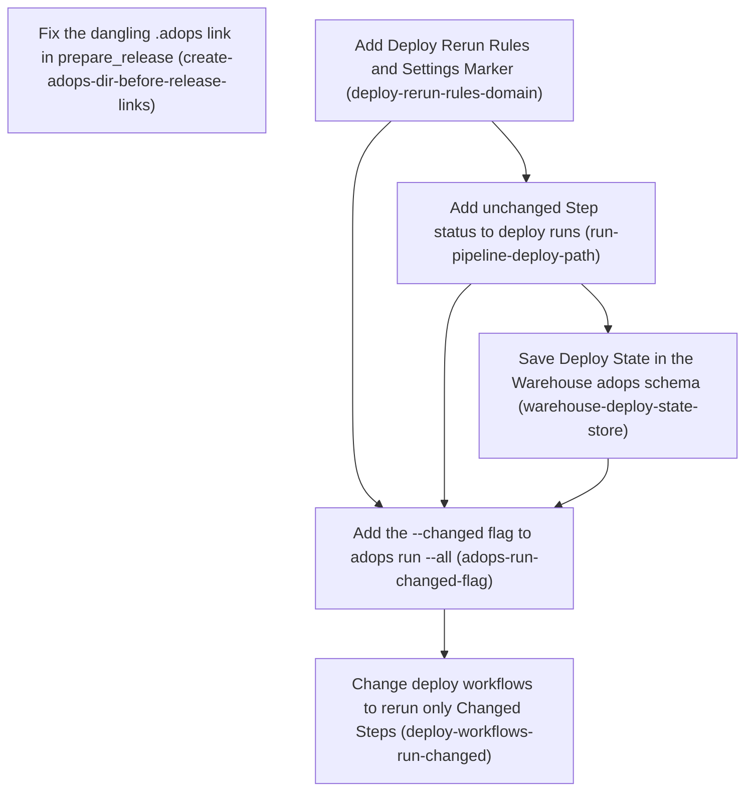

# Horizon 18 — Deploys rerun only Changed Steps

## 🎯 What are we trying to achieve?

Make stage and prod deploys stop rerunning every Pipeline. Each deploy runs `adops run --all --changed`, which reruns a Pipeline in full, from its first changed Step, or not at all ("unchanged, nothing rerun"). The choice follows the rerun rules agreed in horizon 17.

## 🧠 Why does this change need to happen?

Today every merge to stage and every release to prod reruns every Pipeline, including the slow Syncs whose definitions did not change. Stage already saves a fingerprint (a hash) of each Step's definition, but deploys never use it, and prod saves none. Horizon 17 moved deploys onto release folders. This horizon makes them do only the work that a change requires.

## At a glance

- Phases: 6
- Complexity: Medium
- Main risk: a Settings Marker that is too narrow misses a real connection change, and one that is too wide reruns everything
- Target: 100% line and branch coverage, e2e job under 20 minutes
- Testing focus: the order of the rerun rules, state written only after a passing run, the 'unchanged in <env>' wording, parsing the workflow YAML

## Order of work

```
Phase 1 — Fix the dangling .adops link in prepare_release
        ↓  (Add Deploy Rerun Rules and Settings Marker needs: nothing earlier — independent)
Phase 2 — Add Deploy Rerun Rules and Settings Marker
        ↓  (Add unchanged Step status to deploy runs needs: Add Deploy Rerun Rules and Settings Marker)
Phase 3 — Add unchanged Step status to deploy runs
        ↓  (Save Deploy State in the Warehouse adops schema needs: Add unchanged Step status to deploy runs)
Phase 4 — Save Deploy State in the Warehouse adops schema
        ↓  (Add the --changed flag to adops run --all needs: Add Deploy Rerun Rules and Settings Marker, Add unchanged Step status to deploy runs, Save Deploy State in the Warehouse adops schema)
Phase 5 — Add the --changed flag to adops run --all
        ↓  (Change deploy workflows to rerun only Changed Steps needs: Add the --changed flag to adops run --all)
Phase 6 — Change deploy workflows to rerun only Changed Steps
```



### Phase 1 — Fix the dangling .adops link in prepare_release

Technical ID: `create-adops-dir-before-release-links` · Server Releases · infrastructure · small

**Goal** — A Server root that has no .adops folder yet can be switched to a new release folder, and Syncs then run from it without a FileExistsError.

**Why** — prepare_release (horizon 17) links releases/<commit>/.adops to the Server root's .adops even when that folder does not exist. dlt then calls mkdir(parents=True) through the broken link and fails with FileExistsError. The fix is small and already diagnosed, and nothing else in this horizon depends on it.

**Changes**
- In prepare_release, create server_dir/.adops with mkdir(exist_ok=True) before the .adops link is made, so the link always points at a real folder.
- Add a unit test that prepares a release in a Server root without .adops, then creates a nested folder through the release's .adops link (as dlt's local state dir does) and asserts it succeeds.
- Keep the existing .env link behaviour and its tests unchanged.

**Files / areas**
- `src/adops/infrastructure/release_folders.py`
- `tests/unit/infrastructure/test_release_folders.py`

**How to verify**
- The release's .adops link always points at a real folder: Run `uv run pytest tests/unit/infrastructure/test_release_folders.py -q`: it passes and includes a test that starts from a Server root with no .adops folder.
- Preparing releases again is safe and keeps shared state: Run `git diff src/adops/infrastructure/release_folders.py`: the only behaviour change is creating server_dir/.adops; the SHARED link loop and the already-prepared early return are unchanged.
- The fix stays inside the infrastructure adapter: Run `git diff --stat`: the source changes for this phase are limited to src/adops/infrastructure/release_folders.py and tests/unit/infrastructure/test_release_folders.py.

**Done when** — prepare_release creates server_dir/.adops before linking, proven by a unit test in tests/unit/infrastructure/test_release_folders.py for a Server root without .adops., and every check under *How to verify* passes its bar.

**Depends on** — nothing — can start immediately

**Guards**
- g2: the new mkdir line is covered by the new unit test, so line and branch coverage stays at 100%.
- g5: no pragma is added.

<details><summary>Reference — full rubric</summary>

**adops-link-resolves-to-real-dir** (minScore 8) — After prepare_release runs on a Server root that has no .adops folder, server_dir/.adops exists as a real directory and releases/<commit>/.adops resolves to it, so a nested mkdir through the link succeeds. 10 = a test also proves that an existing .adops folder and the files in it are kept as they are; 8 = the missing-folder case is proven by a test that does what dlt does (mkdir(parents=True) of a nested path through the link); minScore 8.

Pass:
- Run `uv run pytest tests/unit/infrastructure/test_release_folders.py -q`: it passes and includes a test that starts from a Server root with no .adops folder.
- That test calls prepare_release, then runs `(release / '.adops' / 'a' / 'b').mkdir(parents=True)` (or a similar nested mkdir through the link) and asserts that it succeeds and that the new folder is under server_dir/.adops.
- In src/adops/infrastructure/release_folders.py, server_dir/.adops is created with exist_ok=True before the links are made, not after os.replace.
- Run `uv run pytest tests/unit --cov --cov-report=term-missing`: release_folders.py shows 100% line and branch coverage and has no new pragma.

Fails when:
- The test only asserts `(release / '.adops').is_symlink()`. That passes while the link still dangles, so the FileExistsError bug is not covered.
- The folder is created inside the release folder (releases/<commit>/.adops as a real folder) instead of under server_dir. State then stops being shared across release switches.
- mkdir runs without exist_ok, so preparing a second release for a Server root that already has .adops raises FileExistsError.

**prepare-release-idempotent** (minScore 7) — The fix must not change prepare_release's existing contract. A commit that is already prepared is returned untouched, a pre-existing .adops folder and its contents survive, and the .env link behaves exactly as before. 10 = a test prepares two commits in a row and asserts that a file written into .adops through the first release can be read through the second; 8 = the existing .env and already-prepared tests pass unmodified; minScore 7.

Pass:
- Run `git diff src/adops/infrastructure/release_folders.py`: the only behaviour change is creating server_dir/.adops; the SHARED link loop and the already-prepared early return are unchanged.
- Run `git diff tests/unit/infrastructure/test_release_folders.py`: existing tests are not weakened or deleted, and only new tests are added.
- A test (new or existing) shows that preparing a release when server_dir/.adops already holds a file leaves that file in place.

Fails when:
- The fix also creates a .env file when it is missing. A missing .env then looks configured and hides a setup error.
- The mkdir is placed after the early return for an already-prepared commit, so an old Server root that was prepared before the fix still has a dangling link.

**infrastructure-layer-confined** (minScore 8) — The filesystem fix lives only in src/adops/infrastructure/release_folders.py. Callers in the interface layer get no workaround, and no domain or application module learns about .adops paths. 10 = the diff touches only release_folders.py and its test; 8 = the same, apart from a docstring line; minScore 8.

Pass:
- Run `git diff --stat`: the source changes for this phase are limited to src/adops/infrastructure/release_folders.py and tests/unit/infrastructure/test_release_folders.py.
- Run `grep -rn "\.adops" src/adops/domain src/adops/application`: no new matches compared with `main`.
- Run `git diff src/adops/interface/release_command.py`: no mkdir workaround was added there.

Fails when:
- The developer adds `Path('.adops').mkdir()` in release_command.py before calling prepare_release. That fixes the CLI path but leaves prepare_release broken for other callers and tests.

Healer hint: If the new test passes while the bug remains, it is probably only checking that the link exists: make it do a nested mkdir(parents=True) through releases/<commit>/.adops and create server_dir/.adops with exist_ok=True before the SHARED link loop.

</details>

### Phase 2 — Add Deploy Rerun Rules and Settings Marker

Technical ID: `deploy-rerun-rules-domain` · Promotion Deploy · domain · medium

**Goal** — One pure function decides, for each Pipeline in a deploy, whether to rerun it in full, from its first Changed Step, or not at all ('unchanged'). A second pure function computes the Settings Marker for one Environment. Prod is allowed to save Step Fingerprints.

**Why** — The rules for which Pipelines a stage or prod deploy reruns are the core business decision of this horizon. They have to be testable without a Warehouse, so they live in the framework-free domain layer next to the existing first_changed_step. A Step Fingerprint is a hash of a Step's definition. A Changed Step is one whose fingerprint differs from the one the Environment saved after its last passing run. The Settings Marker is a hash of the adops.yaml settings that affect one Environment.

**Changes**
- Create src/adops/domain/deploy_rerun.py with a frozen DeployState value (settings_marker: str | None, seen_record_ids: frozenset[str]) and a DeployPlan value whose kind is full, from_step (with the start index and Step name) or unchanged.
- Add settings_marker(settings: ProjectSettings, env: str) -> str. It is the sha256 of canonical JSON (json.dumps(model_dump(mode='json'), sort_keys=True, separators=(',',':')), the same pattern as canonical_step_json) of environments[env] (warehouse, sources, targets) plus timezone and alert_webhook_env. Comments, formatting and other Environments' blocks do not change it. It holds only secret-reference names, never secret values.
- Add plan_deploy(pipeline, current_fingerprints, saved_fingerprints, marker_changed, unseen_record_ids) -> DeployPlan, where unseen_record_ids are this Pipeline's Accepted-Change Record ids (the caller filters records by r.pipeline == pipeline.name) minus DeployState.seen_record_ids. Check the rules in this binding order: Settings Marker changed -> full; any unseen Accepted-Change Record id for this Pipeline -> full; pipeline.schedule is None -> full; no saved fingerprints -> full; otherwise keep only saved rows whose Step name is in the current Pipeline and call first_changed_step; None -> unchanged, an index -> from_step.
- Do not change first_changed_step or how Branch runs use it, and do not prune stored rows: the by-name filter lives only inside plan_deploy.
- Widen saves_stage_fingerprint in branch_environment.py so it is true for both stage and prod, and update the parametrized test at test_branch_environment.py:145-154 (prod -> True, dev and Branch -> False).
- Write unit tests for every rule branch and for the rule order (for example, a changed marker wins over 'no Changed Step'). Include a removed Step whose stale saved row would otherwise force a full rerun. For the marker, test that a comment or formatting edit (parse two YAML texts) and an edit to another Environment's block leave it unchanged, while editing a Source in this Environment's own block (adops.yaml has no Sources shared across Environments) changes it.

**Files / areas**
- `src/adops/domain/deploy_rerun.py`
- `src/adops/domain/branch_environment.py`
- `tests/unit/domain/test_deploy_rerun.py`
- `tests/unit/domain/test_branch_environment.py`

**How to verify**
- plan_deploy checks the Deploy Rerun Rules in the binding order: Run `uv run pytest tests/unit/domain/test_deploy_rerun.py -v`: there is a passing test for each outcome: marker changed -> full; unseen record for this Pipeline -> full; schedule None -> full; empty saved fingerprints -> full; a changed middle Step -> from_step with that Step's index and name; nothing changed -> unchanged.
- Saved rows for removed Steps are ignored, not pruned: tests/unit/domain/test_deploy_rerun.py has a test where saved fingerprints include a Step name missing from the current Pipeline while every current Step matches, and plan_deploy returns unchanged.
- The Settings Marker hashes exactly one Environment's settings: tests/unit/domain/test_deploy_rerun.py parses two adops.yaml texts that differ only by a comment and asserts that settings_marker is equal for both.
- Rerun rules are pure, frozen domain values: Run `grep -n '^from\|^import' src/adops/domain/deploy_rerun.py`: only standard library modules (json, hashlib, dataclasses, enum, typing) and adops.domain modules appear.

**Done when** — src/adops/domain/deploy_rerun.py with plan_deploy and settings_marker, covered by tests/unit/domain/test_deploy_rerun.py, one test per rule branch plus the rule order., and every check under *How to verify* passes its bar.

**Depends on** — nothing — can start immediately

**Guards**
- g6: deploy_rerun.py imports only json, hashlib, dataclasses and existing domain models. tests/unit/domain/test_domain_purity.py keeps passing.
- g2/g5: every rule branch has a unit test, with no pragma.

<details><summary>Reference — full rubric</summary>

**rule-order-binding** (minScore 8) — Success item (1): plan_deploy returns one Deploy Plan per Pipeline (full, from_step <name>, or unchanged). It picks full when the Settings Marker changed, when the Pipeline has an unseen Accepted-Change Record, when the Pipeline has no Schedule, or when it has no saved Step Fingerprints, checked in that order. Otherwise it uses first_changed_step, and no Changed Step means unchanged. 10 = a parametrized test pairs every adjacent pair of rules to prove which one wins; 8 = one test per branch plus at least one rule-order test; minScore 8.

Pass:
- Run `uv run pytest tests/unit/domain/test_deploy_rerun.py -v`: there is a passing test for each outcome: marker changed -> full; unseen record for this Pipeline -> full; schedule None -> full; empty saved fingerprints -> full; a changed middle Step -> from_step with that Step's index and name; nothing changed -> unchanged.
- At least one test sets several conditions at once (for example a changed marker and no Changed Step, or a Pipeline with no Schedule and an unseen record) and asserts the outcome the binding order gives.
- A test shows that an empty unseen_record_ids with every other condition clear does not force a full rerun; the per-Pipeline filtering of records is tested in the interface phase.
- The DeployPlan from_step result carries both the start index and the Step name, as a test asserts.

Fails when:
- The rules are checked in the order schedule -> fingerprints -> marker. Every single-branch test still passes, but there is no combined test, so a wrong order goes unnoticed.
- unseen_record_ids is treated as global, so an Accepted-Change Record for pipeline A reruns pipeline B in full.
- A Pipeline with no Schedule whose Steps are unchanged returns unchanged instead of full, which goes against ADR-0014's 'runs only then'.

**stale-row-by-name-filter** (minScore 8) — Success item (2): saved fingerprint rows for Steps that are no longer in the Pipeline are ignored by a by-name filter inside plan_deploy, and stored rows and first_changed_step stay unchanged, so Branch deferral behaves exactly as before. 10 = tests cover both a removed Step and a renamed Step; 8 = a removed-Step test proves that a stale row does not force a full or wrong from_step; minScore 8.

Pass:
- tests/unit/domain/test_deploy_rerun.py has a test where saved fingerprints include a Step name missing from the current Pipeline while every current Step matches, and plan_deploy returns unchanged.
- Run `git diff src/adops/domain/branch_environment.py`: first_changed_step's body and signature are unchanged.
- Run `uv run pytest tests/unit/domain/test_branch_environment.py -q`: it passes, and the only edited assertion is the saves_stage_fingerprint parametrization (prod -> True, dev and Branch -> False).

Fails when:
- The filter is added inside first_changed_step, so Branch runs also start ignoring stale rows and Branch deferral behaviour changes.
- Without the filter, a removed Step's leftover row makes plan_deploy return from_step 0 on every deploy, so the feature never reports unchanged.

**settings-marker-scope** (minScore 8) — Success item (3): settings_marker(settings, env) is a canonical hash of the parsed settings for that Environment's own block plus timezone and alert_webhook_env. A comment edit, a formatting edit or an edit to another Environment's block leaves it unchanged, while a change to a Source in this Environment's block changes it. The marker holds secret-reference names, never secret values. 10 = tests also show that reordering YAML keys and changing a warehouse or target in the own block change the marker as expected; 8 = the four required cases are each tested by parsing two YAML texts; minScore 8.

Pass:
- tests/unit/domain/test_deploy_rerun.py parses two adops.yaml texts that differ only by a comment and asserts that settings_marker is equal for both.
- Another test parses two texts that differ only by indentation or quoting style and asserts that the marker is equal.
- Another test edits only the prod block and asserts that settings_marker(..., 'stage') is unchanged while settings_marker(..., 'prod') changes.
- Another test edits a Source in the stage block and asserts that the stage marker changes.
- settings_marker uses json.dumps(..., sort_keys=True, separators=(',', ':')) over model_dump(mode='json') and returns a sha256 hex string (check src/adops/domain/deploy_rerun.py).

Fails when:
- The marker hashes the raw adops.yaml text, so a comment edit reruns every Pipeline.
- The marker hashes the whole ProjectSettings, so editing prod's block reruns every stage Pipeline.
- timezone is left out, so a timezone change goes unnoticed and Schedules drift without a rerun.

**domain-pure-values** (minScore 8) — deploy_rerun.py is framework-free domain code. It has frozen value objects and pure functions with no I/O, no os.environ and no reference to ports, stores or StepStatus from the application layer. 10 = DeployPlan's kind is a closed enum or Literal and invalid combinations (from_step without an index) cannot be built; 8 = frozen dataclasses and pure functions with imports limited to the standard library and domain modules; minScore 8.

Pass:
- Run `grep -n '^from\|^import' src/adops/domain/deploy_rerun.py`: only standard library modules (json, hashlib, dataclasses, enum, typing) and adops.domain modules appear.
- DeployState and DeployPlan are declared with @dataclass(frozen=True), and seen_record_ids is a frozenset.
- Run `uv run pytest tests/unit/domain/test_domain_purity.py -q`: it passes.

Fails when:
- deploy_rerun.py imports StepStatus or DeployStateStore from adops.application.ports, which makes the domain depend on the outer layer.
- plan_deploy takes a store and calls load() itself, mixing I/O into the domain rule.

Healer hint: The most likely failure is a rule-order bug that no single-branch test catches, or a marker test that builds ProjectSettings directly instead of parsing two YAML texts: add combined-condition tests and comment and format YAML pairs.

</details>

### Phase 3 — Add unchanged Step status to deploy runs

Technical ID: `run-pipeline-deploy-path` · Promotion Deploy · application · medium

**Goal** — run_pipeline can run a stage or prod Pipeline from a given Step, or not at all. Steps it does not rerun get a new 'unchanged' status that counts as success. After the Pipeline passes, it saves the Pipeline's Accepted-Change Record ids as seen in the Environment's Deploy State.

**Why** — The existing 'deferred' status means 'a Branch run used stage's data' and 'skipped' means 'not run after a failure'. Reusing either for a deploy would mislead users and the Assistant about why a Step did not run. An Accepted-Change Record is a file that accepts a Breaking Change for one Pipeline. Deploy State is the per-Environment record of the last Settings Marker and the record ids already seen. Seen ids must be written only after a passing run, so a failed deploy redoes the same work next time.

**Changes**
- Add StepStatus.UNCHANGED = 'unchanged' in ports.py and include it in SUCCEEDED, so RunResult.succeeded, alerts.py and dagster_server.py treat an unchanged Pipeline as passed and fire no alert.
- Add a DeployStateStore Protocol in ports.py with load() -> DeployState, save_seen_records(pipeline, record_ids) and save_marker(marker), and a FakeDeployStateStore in tests/unit/application/fakes.py.
- Add an optional deploy: DeployRun | None = None parameter to run_pipeline. DeployRun holds the start index (int, or None for unchanged), the record ids for this Pipeline and the DeployStateStore. When the index is None, return every Step as UNCHANGED. Otherwise build the plan with the existing _build_plan(first) slicing and mark the earlier Steps UNCHANGED.
- After a deploy run passes, call save_seen_records with this Pipeline's record ids (records filtered by r.pipeline == pipeline.name). If the save raises, fail the run with only the error type in the message, as FingerprintSavingStep does.
- Leave the Branch path (branch parameter, stage_environment, _deferred) unchanged, and keep every existing Branch test passing unmodified.
- Update the ports.py:176 docstring so it says stage and prod save Step Fingerprints.
- Add a unit test in tests/unit/application/test_run_pipeline.py pinning that a passing prod run (environment 'prod', as the prod Server's scheduled runs call it) now saves Step Fingerprints through the fake fingerprint store; this is intended so prod deploys compare against prod's own state.

**Files / areas**
- `src/adops/application/ports.py`
- `src/adops/application/run_pipeline.py`
- `tests/unit/application/fakes.py`
- `tests/unit/application/test_run_pipeline.py`

**How to verify**
- Skipped deploy Steps get their own UNCHANGED status: src/adops/application/ports.py defines `UNCHANGED = "unchanged"` in StepStatus, and SUCCEEDED includes it.
- Seen record ids are written only after a passing run: A test with a failing Step in a deploy run asserts that FakeDeployStateStore recorded no save_seen_records call.
- The Branch and normal run paths behave as before: Run `git diff tests/unit/application/test_run_pipeline.py`: existing tests are not modified (only additions).
- DeployStateStore is a plain application port: Run `grep -n 'class DeployStateStore' -A6 src/adops/application/ports.py`: it is a Protocol with the three methods, and its return types reference adops.domain.deploy_rerun.DeployState.
- Prod now saves its own Step Fingerprints: The test_branch_environment.py parametrization lists prod -> True, stage -> True, dev -> False and a Branch -> False.

**Done when** — run_pipeline's deploy path (DeployRun parameter, StepStatus.UNCHANGED, seen-record save after a pass), covered by new tests in tests/unit/application/test_run_pipeline.py for unchanged, from-step, full and a failing save., and every check under *How to verify* passes its bar.

**Depends on** — Add Deploy Rerun Rules and Settings Marker

**Guards**
- g6: DeployStateStore is a typing Protocol in application/ports.py with no dlt or SQL import. test_application_purity.py keeps passing.
- g2/g5: the new branches (all unchanged, from-step, save failure) are each covered by a unit test using the fake store, with no pragma.

<details><summary>Reference — full rubric</summary>

**unchanged-status-distinct** (minScore 8) — Success item (4), application side: Steps a deploy does not rerun get StepStatus.UNCHANGED, which is part of SUCCEEDED. They never get DEFERRED or SKIPPED, so RunResult.succeeded is true and no alert fires for an all-unchanged Pipeline. 10 = a test asserts that alerts and the retryable logic ignore UNCHANGED Steps; 8 = tests assert the statuses for the unchanged and from-step plans and that succeeded is true; minScore 8.

Pass:
- src/adops/application/ports.py defines `UNCHANGED = "unchanged"` in StepStatus, and SUCCEEDED includes it.
- In tests/unit/application/test_run_pipeline.py, a deploy run with start index None returns every Step as StepStatus.UNCHANGED with result.succeeded True, and the fake Orchestrator receives no Steps to execute.
- A from-step deploy run (index k) marks Steps 0..k-1 UNCHANGED and runs Steps k.. through the existing _build_plan(first) slicing.
- Run `grep -n 'DEFERRED' src/adops/application/run_pipeline.py`: DEFERRED is still used only on the Branch path.

Fails when:
- The deploy path reuses DEFERRED for skipped Steps, so the CLI later prints 'deferred to stage' for a prod deploy.
- UNCHANGED is added to the enum but not to SUCCEEDED, so an unchanged Pipeline counts as failed and sends a failure alert.

**seen-records-after-pass-only** (minScore 9) — Success item (3) invariant: save_seen_records runs only after the deploy run of a Pipeline passes, with only that Pipeline's Accepted-Change Record ids. A failed Step writes nothing, so the next deploy reruns the same work. A save error fails the run and reports only the error type. 10 = there are tests for a failing Step (no save), a failing save (sanitized message) and records filtered by Pipeline; 8 = failing-Step and failing-save tests exist; minScore 9.

Pass:
- A test with a failing Step in a deploy run asserts that FakeDeployStateStore recorded no save_seen_records call.
- A test where FakeDeployStateStore.save_seen_records raises an exception carrying a secret-like string asserts that the run fails, the message has the exception type name and the secret-like string is not in the result.
- A test with records for two Pipelines asserts that only records whose r.pipeline equals the run Pipeline's name are saved.
- Read run_pipeline.py: the save_seen_records call is reached only after the result is succeeded.

Fails when:
- Seen ids are saved before the Orchestrator executes the plan, so a failed deploy permanently marks a new Accepted-Change Record as seen and it is never applied.
- The save error message includes str(exc), which leaks a connection string.

**branch-path-untouched** (minScore 8) — The deploy parameter is optional and defaults to None. With it absent, run_pipeline behaves exactly as before for Branch, dev, stage and prod runs, and existing Branch tests are not edited. 10 = there is also a test that passing both branch and deploy is refused; 8 = existing tests pass with no edits to their assertions; minScore 8.

Pass:
- Run `git diff tests/unit/application/test_run_pipeline.py`: existing tests are not modified (only additions).
- Run `uv run pytest tests/unit/application -q`: it passes.
- Read run_pipeline's signature: `deploy: DeployRun | None = None`, and _deferred and the stage_environment handling are not edited.

Fails when:
- The Branch logic is moved into a shared 'skip' helper and the Branch status mapping changes slightly, so a Branch test had to have its expected status updated.

**port-protocol-only** (minScore 8) — DeployStateStore is a typing Protocol in application/ports.py using only domain types (DeployState), with load, save_seen_records and save_marker. The application layer never builds a concrete Warehouse store. 10 = the Protocol is @runtime_checkable and the fake is checked against it with isinstance in a test; 8 = the Protocol and the fake exist and the application code uses only the Protocol; minScore 8.

Pass:
- Run `grep -n 'class DeployStateStore' -A6 src/adops/application/ports.py`: it is a Protocol with the three methods, and its return types reference adops.domain.deploy_rerun.DeployState.
- Run `grep -rn 'infrastructure' src/adops/application/run_pipeline.py`: no matches.
- tests/unit/application/fakes.py defines FakeDeployStateStore that records calls and can be set to raise.

Fails when:
- DeployRun holds a WarehouseDeployStateStore type hint imported from infrastructure, which turns the dependency inward the wrong way.

**prod-saves-fingerprints** (minScore 7) — Success item (2): saves_stage_fingerprint returns true for stage and prod and false for dev and Branch, and a test pins that a passing prod run_pipeline call (as the prod Server's scheduled runs make) saves Step Fingerprints. 10 = the prod-save test asserts the saved rows' Environment and Step names; 8 = the prod-save test asserts that the save happened; minScore 7.

Pass:
- The test_branch_environment.py parametrization lists prod -> True, stage -> True, dev -> False and a Branch -> False.
- tests/unit/application/test_run_pipeline.py has a test where run_pipeline with environment 'prod' on a passing Pipeline leaves Step Fingerprint rows in the fake fingerprint store; `uv run pytest tests/unit/application/test_run_pipeline.py -k prod -q` passes.

Fails when:
- The predicate is widened, but the only test is the parametrized truth table, so nothing proves that a real prod run reaches the save.

Healer hint: The likeliest miss is saving seen records before checking result.succeeded, or forgetting to add UNCHANGED to SUCCEEDED: move the save after the success check and add a failing-Step test that asserts no save call.

</details>

### Phase 4 — Save Deploy State in the Warehouse adops schema

Technical ID: `warehouse-deploy-state-store` · Promotion Deploy · infrastructure · small

**Goal** — Each Environment keeps its Deploy State (the last Settings Marker and the seen Accepted-Change Record ids) in a new table in its own Warehouse adops schema, read and written through the DeployStateStore port.

**Why** — Deploy State must survive release-folder switches and Server rebuilds, so it lives in the Warehouse next to the Step Fingerprints and not on the Server filesystem. It gets its own table, because _adops_applied_records only records ids whose Breaking Change a Sync actually found. A record whose change never appears would then look 'new' on every deploy.

**Changes**
- Create WarehouseDeployStateStore in src/adops/infrastructure/deploy_state_store.py that implements DeployStateStore. Follow WarehouseFingerprintStore and WarehouseSnapshotStore: a writable dlt SQL client, create the adops dataset if needed, and CREATE TABLE IF NOT EXISTS adops._adops_deploy_state.
- Store the Settings Marker as one row, and seen record ids as one row per (pipeline, record_id) with an upsert so saving the same id twice is harmless. load() returns DeployState(settings_marker=None, seen_record_ids=empty) when the table or rows are missing.
- Do not read or change _adops_applied_records.
- Add unit tests modelled on tests/unit/infrastructure/test_step_fingerprint_store.py: empty load, marker round trip and overwrite, seen ids accumulated across Pipelines, and a second Environment's store not seeing the first one's rows.
- Update the step_fingerprint_store.py:23 docstring so it says stage and prod save fingerprints.

**Files / areas**
- `src/adops/infrastructure/deploy_state_store.py`
- `src/adops/infrastructure/step_fingerprint_store.py`
- `tests/unit/infrastructure/test_deploy_state_store.py`

**How to verify**
- Deploy State round-trips and defaults safely: Run `uv run pytest tests/unit/infrastructure/test_deploy_state_store.py -v`: it passes against a real local Warehouse (DuckDB as in test_step_fingerprint_store.py) and includes tests for empty load, marker save and load, marker overwrite, and seen ids from two Pipelines.
- Each Environment sees only its own Deploy State: tests/unit/infrastructure/test_deploy_state_store.py has a test that saves a marker and seen ids through one Environment's store and asserts that a second Environment's store loads an empty state.
- SQL and dlt stay in the adapter and errors stay sanitized: Read src/adops/infrastructure/deploy_state_store.py: values such as record ids and marker strings are passed as query parameters, with no f-string or %-formatting of values into SQL.

**Done when** — WarehouseDeployStateStore in src/adops/infrastructure/deploy_state_store.py, proven by tests/unit/infrastructure/test_deploy_state_store.py against a real local Warehouse., and every check under *How to verify* passes its bar.

**Depends on** — Add unchanged Step status to deploy runs

**Guards**
- g6: dlt and SQL stay in infrastructure. The application layer sees only the Protocol.
- g2/g5: every branch (missing table, upsert, marker overwrite) is covered by unit tests, with no pragma.

**Rollback** — The table adops._adops_deploy_state is new and only this feature reads it. To undo, remove the adapter and drop the table. A missing table makes the next deploy rerun every Pipeline in full, which is the safe default.

<details><summary>Reference — full rubric</summary>

**state-roundtrip-and-defaults** (minScore 8) — Success item (3): WarehouseDeployStateStore keeps the Settings Marker and seen Accepted-Change Record ids in adops._adops_deploy_state. load() on a missing table or empty rows returns DeployState(None, frozenset()), which makes the next deploy run in full. 10 = tests also cover a pre-existing empty table and a marker saved twice leaving exactly one marker row; 8 = empty load, marker round trip and overwrite, and seen ids accumulated across Pipelines are each tested; minScore 8.

Pass:
- Run `uv run pytest tests/unit/infrastructure/test_deploy_state_store.py -v`: it passes against a real local Warehouse (DuckDB as in test_step_fingerprint_store.py) and includes tests for empty load, marker save and load, marker overwrite, and seen ids from two Pipelines.
- A test saves the same (pipeline, record_id) twice and asserts that load returns it once, with no exception and no duplicate row (count via a SQL query in the test).
- load() on a fresh Warehouse where the adops schema has no _adops_deploy_state table returns settings_marker None and empty seen_record_ids, without raising.

Fails when:
- save_seen_records uses a plain INSERT, so the second deploy with the same record raises a unique-key error or stores duplicates.
- load() raises when the table is missing on the first upgraded deploy, instead of returning the empty state that triggers a full rerun.

**environment-isolation** (minScore 8) — Deploy State lives in the deployed Environment's own Warehouse adops schema. A second Environment's store never sees the first one's rows, and _adops_applied_records is not read or changed. 10 = the isolation test uses two distinct Warehouse destinations and also asserts that _adops_applied_records is untouched; 8 = a two-Environment isolation test passes; minScore 8.

Pass:
- tests/unit/infrastructure/test_deploy_state_store.py has a test that saves a marker and seen ids through one Environment's store and asserts that a second Environment's store loads an empty state.
- Run `grep -n '_adops_applied_records' src/adops/infrastructure/deploy_state_store.py`: no matches.
- The table name is _adops_deploy_state in the adops dataset (grep the module).

Fails when:
- The store keys rows by Environment name in one shared table on stage's Warehouse, so prod's Deploy State lives in stage and is lost when stage is rebuilt.
- The adapter reuses _adops_applied_records, so a record whose Breaking Change never shows up in a Sync looks new on every deploy.

**adapter-sanitized-and-confined** (minScore 8) — All dlt and SQL code sits in src/adops/infrastructure/deploy_state_store.py and follows the WarehouseFingerprintStore pattern (writable SQL client, create the dataset if missing, CREATE TABLE IF NOT EXISTS). Values are bound as parameters, never formatted into SQL, and nothing in the adapter logs or raises secret values. 10 = a test proves that a record id containing a quote is stored and loaded intact; 8 = parameterized SQL and the IF NOT EXISTS DDL are visible in the module; minScore 8.

Pass:
- Read src/adops/infrastructure/deploy_state_store.py: values such as record ids and marker strings are passed as query parameters, with no f-string or %-formatting of values into SQL.
- The module contains `CREATE TABLE IF NOT EXISTS` for the adops _adops_deploy_state table.
- Run `uv run pytest tests/unit/application/test_application_purity.py tests/unit/domain/test_domain_purity.py -q`: both pass, and the application layer imports no dlt.

Fails when:
- The upsert builds `VALUES ('{pipeline}', '{record_id}')` with an f-string. That works in tests but breaks on a record id with a quote in it and is an injection risk.

Healer hint: The likeliest failure is a non-idempotent seen-id insert or a load() that raises on a missing table: use an upsert (or delete-then-insert) keyed on (pipeline, record_id) and return the empty DeployState when the table does not exist.

</details>

### Phase 5 — Add the --changed flag to adops run --all

Technical ID: `adops-run-changed-flag` · Promotion Deploy · interface · medium

**Goal** — `adops run --all --changed --env stage|prod` reruns each Pipeline in full, from its first Changed Step, or not at all, prints 'step X: unchanged in <env>' and 'Pipeline P unchanged, nothing rerun in <env>', and saves the Settings Marker only after every Pipeline passed.

**Why** — This is the entry point the deploy workflows will call. The flag is refused wherever saved fingerprints for the Environment do not exist or do not apply (dev, Branch runs, a single Pipeline), so hand-typed `adops run --all` keeps running every Step. The Run Log must show the same text as the terminal.

**Changes**
- Add a --changed bool option to run(). Refuse it with typer.BadParameter and a clear, sanitized message when used without --all, with a PIPELINE, with --branch, or with --env missing or dev.
- Pass changed through _run_one and run_project down to run_in_environment as an optional parameter defaulting to False, so the MCP _guarded_run caller (mcp_server.py:491) keeps working unchanged.
- Inside _holding_lock in run_in_environment (the Warehouse lock, as Branch runs do in _run_branch_locked), build a WarehouseDeployStateStore, load Deploy State and saved fingerprints, compare settings_marker(settings, env) to the saved marker, call plan_deploy, and pass the resulting DeployRun to run_pipeline.
- In run(), when --changed and every Pipeline passed, call save_marker with the new Settings Marker, inside a final Warehouse-lock-held step. Do not save it if any Pipeline failed, so the next deploy reruns everything again.
- Add result_output branches: 'step X: unchanged in <env>' for StepStatus.UNCHANGED, and an all-unchanged summary line 'Pipeline P unchanged, nothing rerun in <env>'. Keep the one shared result_lines so the Run Log equals stdout, and never use the 'deferred to stage' wording.
- Add unit tests for each refusal, for full, from-step and unchanged output, for the marker being saved only after all Pipelines pass, and a test that `adops run --all` without --changed still runs every Step. Update the --all help-text test in test_cli.py if the help changes.
- Add one e2e case to tests/e2e/test_demo_sync.py with @pytest.mark.parametrize('demo', ['postgres'], indirect=True). It first adds a Schedule to its copy of pipelines/shop_sync.yaml (the demo Pipeline has none, and a Pipeline with no Schedule always reruns in full), then runs `adops run --all --changed --env stage`, edits dbt/models/customer_stats.sql, runs the same command again, and asserts the output has 'step sync_shop: unchanged in stage' and that the Transform Step passed.

**Files / areas**
- `src/adops/interface/run_command.py`
- `tests/unit/interface/test_run_command.py`
- `tests/unit/interface/test_cli.py`
- `tests/e2e/test_demo_sync.py`

**How to verify**
- --changed is refused everywhere except --all with stage or prod: tests/unit/interface/test_run_command.py has separate tests for `run --changed --env stage` (no --all), `run PIPELINE --all --changed`, `run --all --changed --branch x`, `run --all --changed --env dev` and `run --all --changed` with no --env. Each asserts exit_code != 0 and a specific message.
- Deploy skips print 'unchanged in <env>', never 'deferred to stage': A test of an all-unchanged prod deploy asserts that stdout contains 'Pipeline <name> unchanged, nothing rerun in prod' and does not contain 'deferred'.
- The Settings Marker is saved only after every Pipeline passed: A test with two Pipelines where one fails asserts that the Deploy State store never received save_marker and the exit code is non-zero.
- The CLI wires the rules and does not re-implement them: Run `grep -n 'schedule is None\|first_changed_step' src/adops/interface/run_command.py`: no matches (rule logic stays in the domain).
- One cheap e2e case proves changed-only reruns: Run `grep -n 'changed' tests/e2e/test_demo_sync.py`: one new test, parametrized with demo=['postgres'] and indirect=True.

**Done when** — `adops run --all --changed` in src/adops/interface/run_command.py, proven by new tests in tests/unit/interface/test_run_command.py for refusals, the three plan outcomes and the marker save, plus one postgres-only stage e2e case in tests/e2e/test_demo_sync.py., and every check under *How to verify* passes its bar.

**Depends on** — Add Deploy Rerun Rules and Settings Marker, Add unchanged Step status to deploy runs, Save Deploy State in the Warehouse adops schema

**Guards**
- g9: the new lines come only from result_output through the shared result_lines, so the Run Log equals the CLI text and is masked. Deploy State store errors report only the error type.
- g2/g5: every refusal and output branch has a unit test, with no pragma.
- g4: only one postgres-only e2e case is added. It runs no Server and no Dagster, just two in-process stage runs of the demo, which keeps it well inside the ~2:49 headroom of the 20-minute job.

<details><summary>Reference — full rubric</summary>

**changed-flag-refusals** (minScore 8) — Success item (4): `adops run --all --changed` runs only with --all and --env stage|prod. Without --all, with a PIPELINE, with --branch, or with --env missing or dev, it exits non-zero with a clear, sanitized message. `adops run --all` without --changed still runs every Pipeline and every Step. 10 = each refusal's message names the offending option and the allowed form; 8 = each of the five refusals has its own CliRunner test asserting a non-zero exit and the message; minScore 8.

Pass:
- tests/unit/interface/test_run_command.py has separate tests for `run --changed --env stage` (no --all), `run PIPELINE --all --changed`, `run --all --changed --branch x`, `run --all --changed --env dev` and `run --all --changed` with no --env. Each asserts exit_code != 0 and a specific message.
- A test runs `run --all --env stage` without --changed against a project whose fingerprints all match and asserts that every Step ran (passed, not unchanged).
- Run `uv run pytest tests/unit/interface/test_run_command.py tests/unit/interface/test_cli.py -q`: both pass.

Fails when:
- --env missing is not refused because the default Environment is used silently, so `adops run --all --changed` quietly runs against dev.
- Only one combined 'invalid combination' test exists, so the --branch refusal is never exercised.

**unchanged-wording** (minScore 8) — Success item (4): an UNCHANGED Step prints 'step X: unchanged in <env>', a Pipeline with nothing rerun prints 'Pipeline P unchanged, nothing rerun in <env>', and that text goes through the one shared result_lines, so the Run Log equals stdout. 10 = a test compares the Run Log file with stdout for a from-step and an unchanged run on prod; 8 = output tests for full, from-step and unchanged on stage or prod assert the exact lines and the absence of 'deferred'; minScore 8.

Pass:
- A test of an all-unchanged prod deploy asserts that stdout contains 'Pipeline <name> unchanged, nothing rerun in prod' and does not contain 'deferred'.
- A from-step test asserts 'step <first>: unchanged in stage' for earlier Steps and normal passed lines for the rerun Steps.
- Run `grep -n 'unchanged in' src/adops/interface/run_command.py`: the new wording comes from result_output or result_lines only, not from a separate print or echo call.

Fails when:
- The summary line is printed with typer.echo after result_lines, so the terminal shows it but the Run Log does not.
- The env name is hard-coded as 'stage' in the wording, so prod deploys say 'unchanged in stage'.

**marker-saved-after-all-pass** (minScore 9) — Success item (3) invariant: save_marker is called once, after every Pipeline in the --changed run passed. If any Pipeline fails, the marker is not saved and the next deploy reruns everything again. Planning happens inside the Warehouse lock. 10 = a test also shows that the next --changed run after a failure plans full for every Pipeline; 8 = there is a test for 'one Pipeline fails -> no save_marker' and one for 'all pass -> marker saved'; minScore 9.

Pass:
- A test with two Pipelines where one fails asserts that the Deploy State store never received save_marker and the exit code is non-zero.
- A test where all Pipelines pass asserts that save_marker was called with settings_marker(settings, env).
- Read run_in_environment: plan_deploy is called inside the _holding_lock block, after the fingerprints and Deploy State are loaded.

Fails when:
- The marker is saved per Pipeline right after each one passes. A later Pipeline's failure then still leaves the new marker, so the next deploy skips Pipelines that never ran under the new settings.
- plan_deploy runs before the lock is taken, so an overlapping scheduled run can change fingerprints between planning and running.

**interface-wiring-only** (minScore 8) — run_command.py only wires the deploy together: it loads state, calls the domain plan_deploy and settings_marker, and passes DeployRun to run_pipeline. It does not re-implement any rule branch, and the MCP _guarded_run caller works unchanged through a default changed=False. Store errors report only the error type. 10 = there is also a test that the MCP run path runs every Step; 8 = no rule logic in the interface and the MCP call site unchanged; minScore 8.

Pass:
- Run `grep -n 'schedule is None\|first_changed_step' src/adops/interface/run_command.py`: no matches (rule logic stays in the domain).
- Run `git diff src/adops/interface/mcp_server.py`: no change at the run_in_environment call.
- A test where the Deploy State store's load raises an exception containing a secret-like string asserts that the output names the error type and does not include the string.
- A test with Accepted-Change Records for two Pipelines shows that a record belonging to another Pipeline does not make this Pipeline rerun in full (records are filtered by r.pipeline == pipeline.name before plan_deploy).

Fails when:
- run_command.py checks `pipeline.schedule is None` itself before calling plan_deploy, which duplicates the rule so the two can drift apart.
- The store error is printed with str(exc), which shows a Warehouse DSN.

**e2e-changed-only-proof** (minScore 8) — Success item (6): exactly one postgres-only stage e2e case shows that a second --changed deploy after editing one dbt model reruns from that Transform Step and leaves the unchanged Sync alone, with no Server or Dagster, inside the 20-minute job. 10 = the case also asserts that a third run with no edits prints 'unchanged, nothing rerun'; 8 = it asserts 'step sync_shop: unchanged in stage' and that the Transform passed on the second run; minScore 8.

Pass:
- Run `grep -n 'changed' tests/e2e/test_demo_sync.py`: one new test, parametrized with demo=['postgres'] and indirect=True.
- The test adds a Schedule to its own copy of pipelines/shop_sync.yaml before the first run, so the Pipeline is not forced to run in full.
- After editing dbt/models/customer_stats.sql, the second run's output contains 'step sync_shop: unchanged in stage' and a passed line for the Transform Step.
- Run `uv run pytest tests/e2e -m e2e` in CI: it passes and the e2e job's wall time stays under 20 minutes (gate g4).

Fails when:
- The test forgets to add a Schedule, so the second run is full because the Pipeline has no Schedule, and the assertion on 'unchanged' fails or gets loosened.
- The case is parametrized over both Warehouses, which roughly doubles its cost and pushes the job past the time budget.

Healer hint: The likeliest failure is saving the marker per Pipeline or printing the unchanged summary outside result_lines: collect all results, call save_marker once after every Pipeline succeeded, and add the summary line inside result_output.

</details>

### Phase 6 — Change deploy workflows to rerun only Changed Steps

Technical ID: `deploy-workflows-run-changed` · Promotion Deploy · interface · medium

**Goal** — The generated adops-stage.yml and adops-prod.yml deploy workflows run `adops run --all --changed --env <env> --project /project/current`, and the ADRs and the Promotion playbook explain the new behaviour.

**Why** — Users get the benefit only once the deploy workflows call the new flag. The behaviour change matters for users: a scheduled Pipeline whose Steps did not change no longer refreshes on merge. It must be written down where users read about Promotion (moving a change from stage to prod), and the e2e job has only about 2:49 of its 20-minute budget left.

**Changes**
- In both workflow templates, change the run line to `dagster_daemon adops run --all --changed --env <env> --project /project/current` and update the step names and header comments that say 'runs every Pipeline'.
- In test_deploy_validates_the_checkout_before_switching_the_server_release (test_init_command.py:892-912), change the step_index needle and the exact run-string assertion to the --changed form. Keep the YAML parsing, and keep the PR workflow assertion at line 753 unchanged.
- Add dated (2026-11-27 or the landing date) clarifications to docs/adr/0006-branch-environments-as-warehouse-schemas.md (prod saves fingerprints too), docs/adr/0014-schedules-run-on-a-pull-based-server.md (deploys rerun only Changed Steps; unchanged scheduled Pipelines no longer refresh on merge; no-Schedule Pipelines still run in full) and docs/adr/0016-promotion-runs-on-a-self-hosted-runner-per-server.md (the new command; the Warehouse lock serializes an overlapping scheduled run; a real-runner retrial is a follow-up).
- Update docs/playbooks/promotion.md rows 19-20 to the --changed command, and add a note that the first upgraded prod deploy creates new tables in prod's adops schema. Leave run-stage-and-prod-on-a-mac.md:42 as it is.
- Append this horizon's decisions to docs/roadmaps/agentic-dataops/decisions.md (deploys rerun only Changed Steps; prod saves fingerprints; Deploy State in its own table; Settings Marker definition).

**Files / areas**
- `src/adops/templates/github/workflows/adops-stage.yml`
- `src/adops/templates/github/workflows/adops-prod.yml`
- `tests/unit/interface/test_init_command.py`
- `docs/playbooks/promotion.md`
- `docs/roadmaps/agentic-dataops/decisions.md`
- `docs/adr/0006-branch-environments-as-warehouse-schemas.md`
- `docs/adr/0014-schedules-run-on-a-pull-based-server.md`
- `docs/adr/0016-promotion-runs-on-a-self-hosted-runner-per-server.md`

**How to verify**
- Both deploy workflows run the --changed command: Run `uv run pytest tests/unit/interface/test_init_command.py -q`: it passes.
- The ADRs and the Promotion playbook state the new behaviour: Run `grep -n '2026-1' docs/adr/0006-branch-environments-as-warehouse-schemas.md docs/adr/0014-schedules-run-on-a-pull-based-server.md docs/adr/0016-promotion-runs-on-a-self-hosted-runner-per-server.md`: each has a new dated clarification.
- Templates still ship and Skills stay clean: Run `git diff --stat src/adops/templates`: only adops-stage.yml and adops-prod.yml changed, and no file was added or removed.

**Done when** — Generated adops-stage.yml and adops-prod.yml that run `adops run --all --changed --env <env> --project /project/current`, asserted by parsing the YAML in tests/unit/interface/test_init_command.py., and every check under *How to verify* passes its bar.

**Depends on** — Add the --changed flag to adops run --all

**Guards**
- g7: the workflow change is verified by parsing the generated YAML in test_init_command.py, not by matching text.
- g3: only existing template files change, so they still ship in the wheel.
- g8: no Skill file is changed. The ADR and playbook text is not under .claude/skills, and no Skill quotes `--env stage` or `--env prod`.

<details><summary>Reference — full rubric</summary>

**workflow-yaml-run-line** (minScore 8) — Success item (5): the generated adops-stage.yml and adops-prod.yml run `adops run --all --changed --env <env> --project /project/current`, and tests/unit/interface/test_init_command.py asserts this by parsing the YAML. 10 = the test also asserts that the run step still comes after the release-switch step in both workflows and that the PR workflow is unchanged; 8 = an exact run-string assertion for both workflows from parsed YAML; minScore 8.

Pass:
- Run `uv run pytest tests/unit/interface/test_init_command.py -q`: it passes.
- In test_deploy_validates_the_checkout_before_switching_the_server_release, the expected run string for stage and prod contains `adops run --all --changed --env <env> --project /project/current`, checked on yaml.safe_load output (not a substring search of the raw template).
- Run `grep -rn 'runs every Pipeline' src/adops/templates/github/workflows/`: no matches remain.
- The PR workflow assertion near test_init_command.py:753 is unchanged in `git diff`.

Fails when:
- Only adops-stage.yml is switched, and the prod test still passes because its needle matches a substring of the new stage string.
- The step name still says 'Run every Pipeline' while the command is --changed, which misleads users reading the Actions log.

**user-docs-behaviour-change** (minScore 8) — Success item (7): ADR-0006, ADR-0014 and ADR-0016 and docs/playbooks/promotion.md each get a dated clarification. Together they say that deploys rerun only Changed Steps, that prod saves fingerprints, that scheduled Pipelines whose Steps did not change no longer refresh on merge (no-Schedule Pipelines still run in full), and that a real-runner retrial is a follow-up. The playbook warns that the first upgraded prod deploy creates new tables in prod's adops schema. 10 = the playbook also explains how to force a full rerun by hand (`adops run --all --env <env>`); 8 = every required statement is present and dated; minScore 8.

Pass:
- Run `grep -n '2026-1' docs/adr/0006-branch-environments-as-warehouse-schemas.md docs/adr/0014-schedules-run-on-a-pull-based-server.md docs/adr/0016-promotion-runs-on-a-self-hosted-runner-per-server.md`: each has a new dated clarification.
- Run `grep -n 'no longer refresh' docs/adr/0014-schedules-run-on-a-pull-based-server.md`: it matches, and the same paragraph says that no-Schedule Pipelines still run in full.
- Run `grep -n -- '--changed' docs/playbooks/promotion.md`: the deploy command rows show the --changed form, and a nearby line mentions new tables in prod's adops schema.
- Run `grep -n 'retrial\|follow-up' docs/adr/0016-promotion-runs-on-a-self-hosted-runner-per-server.md`: it records the real-runner retrial as a follow-up.

Fails when:
- The ADR text says 'deploys are now faster' but never says that unchanged scheduled Pipelines stop refreshing on merge, so users see it as a regression.
- The playbook is updated but ADR-0006 still says only stage saves fingerprints.

**templates-ship-no-skill-drift** (minScore 7) — Only existing template files change. The wheel still contains both workflow templates, and no Skill file under the templates quotes `--env stage` or `--env prod`. 10 = a freshly built wheel's workflow files contain the --changed line; 8 = the wheel gate and the Skill text checks pass with no new template files; minScore 7.

Pass:
- Run `git diff --stat src/adops/templates`: only adops-stage.yml and adops-prod.yml changed, and no file was added or removed.
- Run `uv build && unzip -p dist/*.whl 'adops/templates/github/workflows/adops-prod.yml' | grep -- '--changed'`: it matches.
- Run `git diff --stat -- 'src/adops/templates/*/.claude/skills'`: no changes.

Fails when:
- The developer adds a note about the new deploy command to the adops-promote Skill, quoting `--env prod`, which trips the g8 Skill text check.

Healer hint: The likeliest failure is the e2e case reporting a full rerun because the demo Pipeline has no Schedule: add a Schedule to the test's copy of shop_sync.yaml before the first --changed run, and keep the case postgres-only.

</details>

## Discovery Findings

| Area | Finding | File | Implication |
|---|---|---|---|
| needs: horizon 17 landed | present: HEAD is d485946 'Horizon 17 — Deploys switch release folders'. src/adops/infrastructure/release_folders.py and src/adops/interface/release_command.py exist. Both deploy workflows run `adops run --all --env <env> --project /project/current` after server-release and a reload. | src/adops/infrastructure/release_folders.py | Build on h17 as it is. Nothing needs re-planning. The brief's 'h17 not yet landed' unknown is resolved. |
| needs: run_pipeline first-slicing | present: run_pipeline (run_pipeline.py:549-600) sets first=0 outside a Branch and first=branch.first_changed inside one. first=None returns RunResult(_deferred(all steps)) (line 582-583). Otherwise _build_plan(first) (685-738) plans steps[first:] and resolves secrets only for the Sources/Targets those Steps use. The result is deferred + result.steps. | src/adops/application/run_pipeline.py | Add a non-Branch 'from step N / unchanged' input, for example an optional DeployRun like BranchRun. Swap _deferred for a skipped-status builder. The Branch path (branch param, stage_environment) must stay as it is. |
| needs: StepStatus for deploy skips | missing: StepStatus (ports.py:197-203) has passed, failed, check_failed, skipped and deferred. SUCCEEDED = {PASSED, DEFERRED} (205). RunResult.succeeded/retryable (263-268), alerts.py:35 and dagster_server.py:141 rely on SUCCEEDED. | src/adops/application/ports.py | Add a new value (e.g. UNCHANGED='unchanged') and include it in SUCCEEDED. Otherwise an unchanged Pipeline counts as failed and fires alerts. SKIPPED means 'after a failure' and must not be reused. |
| needs: output/Run Log wording | present: result_output (run_command.py:606-625) prints 'step X: deferred to stage' for DEFERRED. _summary_lines (628-638) prints 'Nothing changed since stage's last run; <env> uses stage.' when every Step is DEFERRED. Run Logs use the same result_lines (run_project:340), per the h11 rule that Run Log text equals CLI text. | src/adops/interface/run_command.py | Add branches for the new status ('step X: unchanged in <env>') and an all-unchanged summary ('Pipeline P unchanged, nothing rerun in <env>'). Keep one shared result_lines so the Run Log stays identical to stdout. |
| needs: first_changed_step contract | present: first_changed_step(current, stage) (branch_environment.py:127-138) compares (name, fp) pairs by position with list(stage.items()). It returns the first mismatching index, or None. Extra trailing stage rows are ignored. An empty stage returns 0. Unit tests are in tests/unit/domain/test_branch_environment.py:296-345. | src/adops/domain/branch_environment.py | The Deploy Rerun Rule can call it directly with the Environment's own saved fingerprints. 'no saved fingerprints -> full' must be checked before it is called (it would return 0 anyway). |
| needs: prod saves fingerprints by widening one predicate | present: the only gate is saves_stage_fingerprint(env) == (env == 'stage') (branch_environment.py:49-50), used once at run_pipeline.py:596. run_in_environment already builds the store for any env (_fingerprinting, run_command.py:441/554). The store writes the env's own Warehouse adops schema. test_branch_environment.py:154 pins prod -> False. | src/adops/domain/branch_environment.py | Widen the check to {stage, prod} (renaming it is optional; it has 1 src and 1 test call site). Update the parametrized test and the docstrings in ports.py:176 and step_fingerprint_store.py:23. Note that the prod Server's scheduled runs (server.py:81) will then also save fingerprints. |
| needs: fingerprint store load/save semantics | present: _load orders rows by saved_order. _save upserts each Step with saved_order = max+1 per pipeline and never deletes rows. Rows are saved per Step right after that Step passes (FingerprintSavingStep, run_pipeline.py:212-235). A Step that fails, and every Step after it, saves nothing. | src/adops/infrastructure/step_fingerprint_store.py | 'Failed Step reruns next time' already holds per Step. A removed Step's stale row keeps its old, low saved_order, so it sorts first and makes the positional comparison return 0 (always full) from then on. Pruning or a by-name comparison is needed. |
| conflict: pruning vs pinned e2e behaviour | tests/e2e/test_server.py:527-530 (held-run deploy case) asserts that saved_stage_fingerprints still holds the row for STEP_ONLY_IN_HELD_RELEASE after the next scheduled run on the new release. That pins today's never-prune behaviour. The unit test test_a_stage_run_with_reordered_steps_loads_them_in_the_new_order (test_step_fingerprint_store.py:104) pins the ordering. | tests/e2e/test_server.py | Pruning after a passing run breaks this e2e assertion, and it also changes Branch deferral (stale leading rows currently force first=0). Prefer a by-name comparison that skips names not in the current Pipeline, or plan to update the e2e assertion explicitly. |
| needs: applied record ids answer 'new record' | missing: record ids reach _adops_applied_records only when a Sync Step finds a Breaking Change the record covers (cover().used_ids -> AcceptedChanges.record_ids -> snapshot_store.save, run_pipeline.py:290-355). A record matching no found change is never saved. applied_record_ids() is Environment-wide and has no pipeline filter (schema_snapshot_store.py:80-86). | src/adops/infrastructure/schema_snapshot_store.py | A record whose change never shows up would stay 'new' forever and force a full rerun on every deploy. Add a separate seen-record-ids store in Deploy State, written after the Pipeline passes. Do not widen _adops_applied_records, whose meaning drives cover(). |
| needs: record identity and Pipeline scope | present: AcceptedChangeRecord(id=file stem, pipeline, table, changes) is loaded from pipelines/accepted/*.yaml by load_project_records (run_command.py:280-298). The h13 decision says records never change Step Fingerprints (decisions.md:91). run_pipeline already filters records with r.pipeline == pipeline.name. | src/adops/domain/accepted_change_record.py | The rule input is 'record ids for this Pipeline minus the seen ids'. That has to be a separate rule input, because fingerprints never reflect records. |
| conflict: 'shared Sources' in Settings Marker | ProjectSettings (environment.py:89-96) has only environments, timezone and alert_webhook_env at the top level. Sources, targets and warehouse all live inside each Environment block (Environment, environment.py:78-83). No Source is shared across Environments. | src/adops/domain/environment.py | Define the marker as canonical JSON of environments[<env>] (warehouse+sources+targets) plus timezone and alert_webhook_env. 'A shared Source change' in the success criteria means a Source in that Environment's own block. Rephrase that test. |
| needs: canonical JSON helper | present: canonical_step_json(step) = json.dumps(model_dump(mode='json'), sort_keys=True, separators=(',',':')) (branch_environment.py:109-110), with step_fingerprint's sha256. Settings models are frozen pydantic models and hold only secret-reference names (password_env), never values. Defaults are included, so writing an explicit 'timezone: UTC' does not change the hash. | src/adops/domain/branch_environment.py | Reuse the same canonical-dump pattern for the Settings Marker, as a pure domain function (g6-safe). Storing the hash leaks no secret. A rotated password value will not change the marker, which is correct. |
| needs: Schedule presence | present: Pipeline.schedule: Schedule \| None = None (domain/pipeline.py:206). runs_on_schedule(env) covers {stage, prod} (schedule.py:11,45). | src/adops/domain/pipeline.py | 'No Schedule -> full' is a plain pipeline.schedule is None check in the domain rule. No new parsing is needed. |
| needs: adops run CLI surface | present: run() (run_command.py:219-267) takes PIPELINE, --all, --env, --branch and --project. It refuses --env+--branch and --all+PIPELINE with typer.BadParameter, loops names via _run_one -> run_project (one Run Log per Pipeline) and stops at the first failure (typer.Exit). There is no --changed option. | src/adops/interface/run_command.py | Add a --changed bool. Refuse it with BadParameter when used without --all, with --branch, with env None/dev, or with a PIPELINE. Pass it through _run_one/run_project to run_in_environment. The MCP _guarded_run (mcp_server.py:491) calls run_project too, so keep the new parameter optional with a default. |
| needs: where Deploy State is loaded/saved | present: run_in_environment (run_command.py:411-447) runs run_pipeline inside _holding_lock. The lock is per Warehouse+Environment (warehouse_lock.py:30), not per Pipeline, and is held for one Pipeline. Branch runs compute plan_branch_run inside the lock (_run_branch_locked:484), which sets the precedent. | src/adops/interface/run_command.py | Load the fingerprints and Deploy State and compute the Deploy Plan inside the lock. Save the seen ids after the Pipeline passes, still in the lock. Save the Settings Marker only after every --all Pipeline passed. Keep the store behind a new application port (g6); the dlt/SQL adapter goes in infrastructure. |
| conflict: 'per-Pipeline Warehouse lock' | The lock is per Environment's Warehouse (warehouse_lock(warehouse, project, environment)), not per Pipeline. Scheduled Server runs use run_in_environment and save fingerprints per Step under the same lock. A scheduled run on an old release that finishes after a deploy leaves that older release's fingerprints, which match the data it just wrote. | src/adops/infrastructure/warehouse_lock.py | Overlapping runs are serialized by the Warehouse lock, and whoever writes last leaves fingerprints that agree with the data. The next deploy just reruns from the differing Step. No extra ordering is needed, but document this. |
| needs: deploy workflow run step | present: adops-stage.yml:56-59 'Run every Pipeline in stage' -> `dagster_daemon adops run --all --env stage --project /project/current`. adops-prod.yml:62-65 is the same with prod. The header comments (stage:5, prod:7) say 'runs every Pipeline from current'. | src/adops/templates/github/workflows/adops-stage.yml | Change both run lines to `adops run --all --changed --env <env> --project /project/current`, and update the step names and header comments to match. |
| guard g7: DEPLOY_WORKFLOWS YAML tests | present: test_deploy_validates_the_checkout_before_switching_the_server_release (test_init_command.py:892-912) finds the step by the substring 'dagster_daemon adops run --all --env {environment}' and asserts the exact run string followed by RUN_FROM_CURRENT. The new command does not contain that substring, so step_index fails. | tests/unit/interface/test_init_command.py | Update both the step_index needle and the exact-equality assertion to the --changed form by parsing the YAML in the same test. The PR workflow assertion at line 753 (--all --branch) stays unchanged. |
| needs: prepare_release dangling .adops fix | present (bug confirmed): prepare_release (release_folders.py:59-73) always creates the links releases/<c>/.env and .adops pointing to ../../<name>, even when the Server root has no .adops. local_state_dir is project/.adops/dlt/<env> (dlt_sync.py:78-80), and mkdir(parents=True) through the dangling link raises FileExistsError (discoveries.md:196). | src/adops/infrastructure/release_folders.py | In prepare_release, create server_dir/.adops (mkdir exist_ok) before linking, or skip links whose target is missing. Add a unit test for a Server root without .adops. |
| needs: prod Warehouse adops-schema rights | present: prod already creates and writes adops._adops_schema_snapshots and _adops_applied_records on every run (WarehouseSnapshotStore._writable_client, create_dataset + CREATE TABLE IF NOT EXISTS; built with read_only=False). The demo prod uses the same 'warehouse' superuser and a separate warehouse_prod DB (warehouse_init/02_prod.sql, demo adops.yaml:65-72). | src/adops/infrastructure/schema_snapshot_store.py | The 'prod lacks CREATE' risk is mostly gone: any prod that runs today can already create tables in its adops schema. A playbook note is enough. No new permission check is needed. |
| needs: e2e host for one cheap stage check | present: test_branch_environment_defers_rebuilds_and_drops (test_demo_sync.py:404) already runs stage, then edits dbt/models/customer_stats.sql. It is parametrized over postgres+duckdb (conftest.py:38). A single-warehouse form exists: @pytest.mark.parametrize('demo',['postgres'],indirect=True) (test_demo_sync.py:503). The full job is 17:11 of 20 min (discoveries.md:197). | tests/e2e/test_demo_sync.py | Add a postgres-only case, or extend this test, with: stage run, edit the model, `run --all --changed --env stage`, then assert 'step sync_shop: unchanged in stage' and that the transform passed. No Server/Dagster case is needed. |
| needs: ADR/playbook text to clarify | present: ADR-0014's 2026-11-21 clarification (line 20) says 'Accepting a new version on stage runs every Pipeline (adops run --all --env stage)... prod does the same'. ADR-0006 line 14 says 'Stage saves fingerprints'. ADR-0016's 2026-11-27 clarification names `adops run --all --project /project/current`. promotion.md:19-20 lists `adops run --all --env stage/prod`. | docs/adr/0014-schedules-run-on-a-pull-based-server.md | Add dated clarifications to ADR-0006, ADR-0014 and ADR-0016 and update promotion.md rows 19-20. Hand use in run-stage-and-prod-on-a-mac.md:42 (`adops run --all --env prod`) stays valid and should stay as it is. |
| needs: Skill text mentioning deploy reruns | present: adops-promote/SKILL.md (demo and plain are identical) says only that the workflow 'updates the stage Server'. It does not mention running every Pipeline. adops-share:132 'runs every Pipeline of the branch in its Branch Environment' is about PR runs and is out of scope. | src/adops/templates/demo/.claude/skills/adops-promote/SKILL.md | No Skill change is required. If one is made, it must not quote `--env stage/prod` (guard g8). |
| guard g8: Skills never quote --env stage/prod | The h15 decision (decisions.md:112) says Skills never quote a banned command (git add -A, --env stage/prod, gh release), even inside a warning, and tests check this. Added to repoGuards as g8. | docs/roadmaps/agentic-dataops/decisions.md | Any Skill or template-doc wording about changed-only deploys must describe the behaviour without quoting `adops run --all --changed --env stage\|prod`. |
| guard g9: Run Log equals CLI output, redacted | The h11 decision (decisions.md:78) says Run Log text equals the CLI's printed text through one shared result_lines, masked with Secret values, and a failed log write never changes the outcome. Branch/CLI refusals print sanitized text (error_lines, the 'unexpected <Type>' fallback). Added to repoGuards as g9. | src/adops/interface/run_command.py | Produce the 'unchanged in <env>' and 'unchanged, nothing rerun' lines only through result_output. Deploy State store errors must report only the error type, like FingerprintSavingStep does (run_pipeline.py:231). |
| guard g6: domain rule and state port placement | present: branch_environment.py is pure (json/hashlib/pydantic models). run_pipeline imports only ports and domain. The fingerprint and snapshot stores live in infrastructure and use dlt. | src/adops/domain/branch_environment.py | Put the Deploy Plan rule (inputs: saved fps, current fps, marker changed, unseen record ids, has schedule) in a new pure domain module. Add a DeployStateStore Protocol in application/ports.py and implement it in infrastructure with dlt SQL, like WarehouseFingerprintStore. |
| guard g2/g5: tests pinning current behaviour | present: tests pin today's behaviour in test_branch_environment.py:145-154 (prod saves=False), test_run_command.py:1228 (dev builds a store, saves nothing), test_run_pipeline.py:1568-1725 (Branch runs) and test_cli.py:44 (the --all help text). | tests/unit/domain/test_branch_environment.py | Every new branch needs a unit test without pragmas: the refusals, the unchanged/from-step/full plans, a save failure and the new status in result_output. Update the prod predicate test and keep the Branch tests unchanged. |

## Repo guards this plan works under

| Id | Enforces | When | Where | Phases |
|---|---|---|---|---|
| g1 | ruff check passes (E,F,W,I,B,UP, line length 100) | on pull request / push | .github/workflows/ci.yml | repo-wide |
| g2 | unit tests pass with 100% line+branch coverage of the adops package | on pull request / push | .github/workflows/ci.yml + pyproject.toml [tool.coverage] | Fix the dangling .adops link in prepare_release, Add Deploy Rerun Rules and Settings Marker, Add unchanged Step status to deploy runs, Save Deploy State in the Warehouse adops schema, Add the --changed flag to adops run --all |
| g3 | project templates ship in the built wheel | on pull request / push | .github/workflows/ci.yml | Change deploy workflows to rerun only Changed Steps |
| g4 | demo Project end to end in Docker passes within the 20-minute e2e job | on pull request / push | .github/workflows/ci.yml | Add the --changed flag to adops run --all |
| g5 | no pragma: no cover except TYPE_CHECKING | on review | docs/roadmaps/agentic-dataops/decisions.md (horizon 1) | Fix the dangling .adops link in prepare_release, Add Deploy Rerun Rules and Settings Marker, Add unchanged Step status to deploy runs, Save Deploy State in the Warehouse adops schema, Add the --changed flag to adops run --all |
| g6 | domain and application layers import no framework (dlt, dagster, typer, os.environ); engines sit behind ports | on review | docs/roadmaps/agentic-dataops/decisions.md (horizon 1) | Add Deploy Rerun Rules and Settings Marker, Add unchanged Step status to deploy runs, Save Deploy State in the Warehouse adops schema |
| g7 | generated workflows are verified by parsing the generated YAML in unit tests | on review | docs/roadmaps/agentic-dataops/decisions.md (horizon 8) | Change deploy workflows to rerun only Changed Steps |
| g8 | Skills never quote a banned command (git add -A, --env stage/prod, gh release), even inside a warning | on test run | docs/roadmaps/agentic-dataops/decisions.md (horizon 15) + tests/unit Skill text checks | Change deploy workflows to rerun only Changed Steps |
| g9 | Run Log text equals the CLI's printed text through one shared result_lines, masked with Secret values; store/driver errors report only the error type | on review | docs/roadmaps/agentic-dataops/decisions.md (horizon 11) | Add the --changed flag to adops run --all |

## Out of Scope
- Changing hand-typed `adops run --all` or single-Pipeline `adops run`: the user confirmed they keep running every Step.
- Branch Environment behaviour (PR runs deferring to stage): it is already changed-only by ADR-0006 and must not change.
- Scheduled Server runs: they keep running their Pipeline in full on the Schedule. Only deploy-triggered runs change.
- dev Environment changed-only runs: the flag is valid only for stage and prod, and dev has no saved fingerprints by design.
- A real self-hosted-runner or Mac retrial of the changed-only deploy: the user excluded it, and it is recorded as a follow-up.
- Deploy rollback or switching 'current' back to an earlier release: it is a separate concern and not part of the rerun rules.
- Freshness alerts (MAP #19), including alerting on Pipelines left stale by skipped deploy reruns: a later horizon.
- Git-diff-based change detection: decision h6 fixed fingerprint comparison with no Git, and the Server image has no git.
- Moving existing Servers to new storage or layout: Deploy State goes into the existing Warehouse adops schema, and the release-folder migration was finished in horizon 17.
- Rerunning only the Steps downstream of a changed Step, instead of every Step from the first Changed Step onward: the binding rule reruns from the first Changed Step in Pipeline order.
- Retry behaviour (the 3x300 s RetryRequested path) for in-process deploy runs: it applies to Server runs only and is unchanged.
- Pruning stale Step Fingerprint rows for removed Steps: fails gate 2 (needed now). The by-name filter inside plan_deploy covers deploys, and pruning would break the held-run e2e assertion (test_server.py:527-530) and change Branch deferral.
- Renaming saves_stage_fingerprint, StepFingerprintStore or the fingerprint table to an Environment-neutral name: fails gate 4 (ceremony). Widening the predicate is enough, and a rename touches many call sites for no behaviour change.
- A prod Warehouse CREATE-permission pre-check: fails gate 2 (needed now). Prod already creates tables in its adops schema on every run (schema_snapshot_store.py), so a playbook note is enough.
- Changing the adops-promote Skill text to describe changed-only deploys: fails gate 1 (asked for). The Skill never says deploys run every Pipeline, so nothing in it is wrong.
- Extra ordering so a scheduled run on an old release cannot overwrite newer fingerprints: fails gate 2 (needed now). The Warehouse lock serializes runs, and whichever run writes last leaves fingerprints that match its data. This is documented in ADR-0016 instead.
- A changed-only e2e case on the DuckDB Warehouse or in the Server/Dagster path: fails gate 2 (needed now) and endangers g4's 20-minute budget. One postgres stage case is enough.

## Success Criteria
- Done when ALL hold: (1) A framework-free domain rule returns one Deploy Plan per Pipeline: full, from-step <name>, or unchanged. It picks full when the Environment's Settings Marker changed (that affects every Pipeline), when the Pipeline has a new Accepted-Change Record, when the Pipeline has no Schedule, or when it has no saved Step Fingerprints. Otherwise it reruns from first_changed_step. If no Step changed, the Pipeline is unchanged. Unit tests cover each branch of the rule and the order the rules are checked in. (2) Prod saves its own Step Fingerprints in prod's Warehouse adops schema after Checks pass, just as stage does. Saved rows for Steps that are no longer in a Pipeline are pruned, or ignored by a by-name comparison. Tests show that Branch deferral against stage behaves exactly as before. (3) Each Environment keeps its own Deploy State in its own Warehouse: the Settings Marker, which is a canonical hash of the parsed settings for that Environment's own block plus the shared parts (Sources, timezone, top-level settings), and the Accepted-Change Record ids it has seen. Tests show that a comment edit, a formatting edit or an edit to another Environment's block does not change the marker, while a change to a Source in that Environment's own block does (adops.yaml has no cross-Environment Sources). Deploy State is written only after the deploy passes, so a failed deploy reruns the same work next time. (4) `adops run --all --changed` runs only with --all and --env stage|prod. It exits with a clear, sanitized error when used without --all, with --branch, with dev, or with a single PIPELINE. `adops run --all` without --changed still runs every Pipeline. Skipped Steps get their own status and Run Log/output wording ('unchanged in <env>'), never the Branch wording 'deferred to stage'. A Pipeline with nothing to rerun writes an 'unchanged, nothing rerun' line. (5) The generated adops-stage.yml and adops-prod.yml run `adops run --all --changed --env <env> --project /project/current`. The tests in tests/unit/interface/test_init_command.py assert this by parsing the YAML (g7). (6) The repo gates pass: 100% line and branch coverage with no pragma (g2/g5), no framework imports in domain/application (g6), templates ship in the wheel (g3), and the full e2e job stays under 20 minutes (g4) with at most one added cheap stage e2e check. That check shows a second deploy with only one dbt model changed reruns from that Transform Step and leaves the unchanged Sync alone. (7) ADR-0006, ADR-0014 and ADR-0016 and promotion.md each get a dated clarification. They state that deploys rerun only Changed Steps, that prod saves fingerprints, and that scheduled Pipelines whose Steps did not change no longer refresh on merge. They also record a real-runner retrial as a follow-up. The decisions.md lines for this horizon are recorded.
- Fix the dangling .adops link in prepare_release: prepare_release creates server_dir/.adops before linking, proven by a unit test in tests/unit/infrastructure/test_release_folders.py for a Server root without .adops.
- Add Deploy Rerun Rules and Settings Marker: src/adops/domain/deploy_rerun.py with plan_deploy and settings_marker, covered by tests/unit/domain/test_deploy_rerun.py, one test per rule branch plus the rule order.
- Add unchanged Step status to deploy runs: run_pipeline's deploy path (DeployRun parameter, StepStatus.UNCHANGED, seen-record save after a pass), covered by new tests in tests/unit/application/test_run_pipeline.py for unchanged, from-step, full and a failing save.
- Save Deploy State in the Warehouse adops schema: WarehouseDeployStateStore in src/adops/infrastructure/deploy_state_store.py, proven by tests/unit/infrastructure/test_deploy_state_store.py against a real local Warehouse.
- Add the --changed flag to adops run --all: `adops run --all --changed` in src/adops/interface/run_command.py, proven by new tests in tests/unit/interface/test_run_command.py for refusals, the three plan outcomes and the marker save, plus one postgres-only stage e2e case in tests/e2e/test_demo_sync.py.
- Change deploy workflows to rerun only Changed Steps: Generated adops-stage.yml and adops-prod.yml that run `adops run --all --changed --env <env> --project /project/current`, asserted by parsing the YAML in tests/unit/interface/test_init_command.py.

## Alignment Preview

The user accepted the first preview, so there were no redirects. The concerns call raised 5 points, and all were applied before Stage 4: the e2e case adds a Schedule to its copy of the demo Pipeline (`shop_sync.yaml` has none); the Settings Marker test uses a Source in the Environment's own block (there are no shared Sources); the docs phase owns the `decisions.md` lines; 6 phases are accepted on purpose; prod saving fingerprints from scheduled runs is intended and pinned by a test.

## Quality Gate

This was the full path, with one critic pass. It raised 0 blockers, so nothing was discarded or verified.

It raised 1 major issue, `phase-blast-radius`: the last phase bundled the workflows, the e2e case and the docs. The orchestrator fixed it without a healer call. The e2e case moved into the `--changed` flag phase, which is the behaviour it proves, and the three ADR paths were added to the docs phase.

Some minor issues were also fixed: plan_deploy's record input is now pre-filtered per Pipeline, a duplicate deferred entry was removed, the success-criteria wording was corrected, and save_marker now runs inside the lock. Accepted debt: 0. Verdict: pass.

## Cost

Agent calls: 7. They covered analysis, Discovery, decomposition, preview concerns, rubrics and the critic, plus 0 patch calls. No verify or healer call was needed. Stage 3.5 was skipped because no phase was cut for size. This is within the 8–10 budget.

## Full analysis

**Domain shape:** business — The objective encodes DataOps rules a data-engineering expert would recognise: which Pipelines and Steps a Promotion deploy reruns, based on Changed Steps, Accepted-Change Records, Schedules and per-Environment state. The CLI flag and workflow wiring are infrastructure around those rules.

| Term | Meaning |
|---|---|
| Changed Step | A Step whose current Step Fingerprint differs from the one the deployed Environment last saved after a passing run. |
| Step Fingerprint | A hash of a Step's definition, saved per Environment (now stage and prod) after its Checks pass, used to find Changed Steps. |
| Deploy | The merge->stage or release->prod workflow run that switches the release folder and then runs `adops run --all --changed --env <env>`. |
| Deploy Plan | The per-Pipeline result of the Deploy Rerun Rules: full, from the first Changed Step, or 'unchanged, nothing rerun'. |
| Deploy Rerun Rules | The binding horizon-17 rule order. A Settings Marker change reruns every Pipeline in full. A new Accepted-Change Record, no Schedule, or no saved fingerprints reruns that Pipeline in full. Otherwise the Pipeline reruns from its first Changed Step. |
| Settings Marker | A canonical hash of the parsed adops.yaml settings that affect one Environment (its own block plus shared Sources, timezone and top-level settings), saved in that Environment's Deploy State. |
| Deploy State | The per-Environment record in its Warehouse adops schema of the last Settings Marker and the Accepted-Change Record ids already seen, written only after a passing deploy. |
| Accepted-Change Record | An ADR-0015 record of an accepted Breaking Change. A record not yet seen in an Environment's Deploy State makes its Pipeline rerun in full. |

**Assumptions**
- confirmed: 'any adops.yaml change' means a change to a canonical hash of the parsed settings that affect the deployed Environment only: that Environment's own block plus shared parts (Sources, timezone, top-level settings). Comments, formatting and other Environments' blocks do not count.
- confirmed: the CLI surface is a new flag `adops run --all --changed`, valid only together with --all and --env stage|prod. Hand use of `adops run --all` keeps running every Pipeline. Both generated deploy workflows (adops-stage.yml, adops-prod.yml) switch to it.
- confirmed: this horizon has no real-runner or manual trial. Proof is unit tests plus at most one cheap stage e2e check, because the full e2e job already takes 17:11 of its 20-minute budget. A real-runner retrial is a recorded follow-up.
- Horizon 17 shipped as described. It is commit d485946: release_folders.py, release_command.py (`adops server-release`), the per-run adops/release tag, and deploys that run against /project/current. The held-run e2e case is green.
- The horizon-17 decisions are binding and are not reopened. They supersede horizon 8's 'merge->stage runs every Pipeline'. They fix the Deploy Rerun Rules (new record -> that Pipeline in full; Settings Marker change -> every Pipeline; no Schedule -> full; no saved fingerprints -> full; otherwise from the first Changed Step). They also say prod saves its own Step Fingerprints.
- Deploy State lives in each Environment's own Warehouse adops schema, next to the Step Fingerprints and _adops_applied_records. It does not live in .adops or on the Server filesystem, so it survives release-folder switches and needs no new Server volume.
- An Accepted-Change Record counts as 'new' for a deploy when its id is not yet in that Environment's saved seen-record set. Existing applied-record storage is reused or widened when it can state this. A separate seen-ids table is added only if applied-only-when-a-Sync-runs cannot express it.
- Deploy State and new fingerprints are written only after each Pipeline's run passes. A failed Step therefore leaves no new fingerprint for itself or for later Steps, and the next deploy reruns from that Step.
- The first deploy after upgrade has no saved prod fingerprints or Deploy State, so it runs every Pipeline in full. That is the intended safe default.
- The changed-only planning reuses run_pipeline's existing `first` slicing. Only the skipped-Step status and wording change from the Branch path.
- The dangling .adops link bug in prepare_release (FileExistsError from Path.mkdir(parents=True)) is fixed in this horizon. It is a small, already-diagnosed infrastructure fix that the horizon-17 notes put in horizon 18.
- confirmed: 6 phases accepted (the .adops link fix stays its own phase).
- confirmed: the first deploy after upgrade runs every Pipeline in full.
- confirmed: overlapping scheduled and deploy runs are serialized by the Warehouse lock; no extra ordering.
- confirmed: scheduled prod Server runs saving Step Fingerprints is intended.

**Risks**
- Prod's Warehouse role may lack CREATE on the adops schema. Saving prod Step Fingerprints and Deploy State for the first time could then fail the first upgraded prod deploy. Nobody has checked this. A clear error and a playbook note are needed.
- A scheduled full run on the old release can overlap a deploy's changed-only run of the same Pipeline. If the scheduled run saves its own fingerprints after the deploy saved new ones, the saved state no longer matches the data. The per-Pipeline Warehouse lock and run pinning must order the writes, or a scheduled run must not overwrite fingerprints from a newer release.
- Pruning stale fingerprint rows in stage could change how Branch deferral resolves Steps today and break existing Branch e2e behaviour.
- Defining the canonical settings hash wrongly creates two failure modes. If it is too narrow, a real connection change (for example a shared Source) is missed and stale code runs. If it is too wide, every deploy reruns everything and the feature delivers nothing.
- Documented behaviour change: an unchanged scheduled Pipeline no longer refreshes on merge, and a skipped Incremental Sync stays stale until its next Schedule. Users who relied on merge-triggered refreshes may read this as a regression. Pipelines with no Schedule still run in full, which matches ADR-0014's 'runs only then'.
- The e2e budget has only about 2:49 of headroom. Any changed-only e2e case on both Warehouses could push the job past 20 minutes (g4). The added check should run on one Warehouse only, or extend an existing deploy case.
- Reusing the 'deferred' StepStatus or the Branch wording for deploy skips would mislead users and the Assistant about why a Step did not run.
- Writing Deploy State before the run, or recording seen record ids when a Sync Step was skipped, could stop a new Accepted-Change Record from ever being applied in that Environment.
- Renaming saves_stage_fingerprint or the fingerprint store or port to an Environment-neutral name touches many call sites and tests. It could cost more than the horizon's phase ceiling allows.
